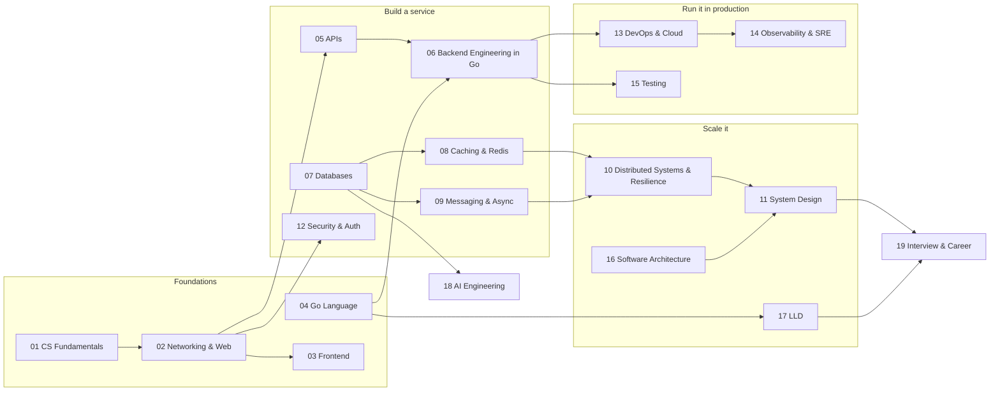

# Home

> [!summary] What this vault is
> Backend engineering, from how a computer runs a program to designing systems at SDE-3 level, with Go as the working language.
> Every topic note goes from basics to advanced:
> - why the topic exists
> - a mental model
> - how it works, with diagrams
> - a worked example with real numbers or tested Go code
> - trade-offs
> - production failure modes
> - a deep dive
> - interview questions
> - a cheat sheet

## Learning map

## Folders

| #   | Folder                            | What you learn                                                                                       | Map                                       |
| --- | --------------------------------- | ---------------------------------------------------------------------------------------------------- | ----------------------------------------- |
| 01  | CS Fundamentals                   | How a computer runs a program, memory and storage, OS basics, data structures, Big-O                 | [[01 CS Fundamentals MOC]]                |
| 02  | Networking & Web                  | IP, DNS, TCP/UDP/QUIC, HTTP 1.1/2/3, TLS, HTTP caching, CDN, proxies                                  | [[02 Networking & Web MOC]]               |
| 03  | Frontend                          | How browsers render, CSS, JavaScript, React                                                          | [[03 Frontend MOC]]                       |
| 04  | Go Language                       | Go from syntax to concurrency, generics, runtime internals and profiling                             | [[04 Go Language MOC]]                    |
| 05  | APIs                              | REST, contracts, errors, pagination, versioning, idempotency, webhooks, GraphQL, gRPC, real-time      | [[05 APIs MOC]]                           |
| 06  | Backend Engineering in Go         | Building a production Go service end to end, plus the InvoiceOps capstone                            | [[06 Backend Engineering in Go MOC]]      |
| 07  | Databases                         | SQL, transactions, indexes, storage engines, isolation, replication, sharding, NoSQL, search         | [[07 Databases MOC]]                      |
| 08  | Caching & Redis                   | Caching patterns, invalidation, eviction, failure modes, Redis internals and operations              | [[08 Caching & Redis MOC]]                |
| 09  | Messaging & Async                 | Queues vs streams, delivery semantics, DLQ, outbox, Kafka, schedulers, workflow engines              | [[09 Messaging & Async MOC]]              |
| 10  | Distributed Systems & Resilience  | Timeouts, retries, circuit breakers, CAP, consistency, consensus, locks, sagas, multi-region         | [[10 Distributed Systems & Resilience MOC]] |
| 11  | System Design                     | Fundamentals, estimation, building blocks, and 17 case studies                                      | [[11 System Design MOC]]                  |
| 12  | Security & Auth                   | Authentication, authorization, passwords, sessions, JWT, OAuth/OIDC, web security, secrets           | [[12 Security & Auth MOC]]                |
| 13  | DevOps & Cloud                    | Docker, CI/CD, deployment strategies, Kubernetes, AWS                                                | [[13 DevOps & Cloud MOC]]                 |
| 14  | Observability & SRE               | Logs, metrics, traces, SLOs, alerting, incidents, debugging playbooks, capacity                      | [[14 Observability & SRE MOC]]            |
| 15  | Testing                           | Strategy, unit to E2E, test doubles, contract, fuzz, load, chaos, CI                                 | [[15 Testing MOC]]                        |
| 16  | Software Architecture             | Coupling and cohesion, monolith vs microservices, layered/hexagonal/clean, DDD, ADRs                 | [[16 Software Architecture MOC]]          |
| 17  | LLD                               | Interview method, principles, SOLID, UML, design patterns in Go, 26 practice problems                | [[17 LLD MOC]]                            |
| 18  | AI Engineering                    | LLMs, prompting, tool calling, embeddings, vector DBs, RAG and evals, agents, MCP, production        | [[18 AI Engineering MOC]]                 |
| 19  | Interview & Career                | Roadmap, SDE-3 readiness checklist, resources, Go traps, LLD round playbook                          | [[19 Interview & Career MOC]]             |

## Three ways through

1. **Full path (beginner to SDE-3):** 01 → 02 → 04 → 05 → 07 → 08 → 09 → 12 → 06 → 10 → 11 → 16 → 17 → 13 → 14 → 15 → 18 → 19.
2. **4-week interview sprint:**
	- **Week 1:** 07 Databases (transactions, isolation, indexing, replication, sharding) and 08 Caching.
	- **Week 2:** 09 Messaging and 10 Distributed Systems & Resilience.
	- **Week 3:** 11 System Design. Start with fundamentals and estimation, then do two case studies a day.
	- **Week 4:** one 17 LLD practice problem a day, plus the SDE-3 readiness checklist in 19.
3. **Go builder:** 04 Go Language → 05 APIs → 06 Backend Engineering in Go (build the InvoiceOps capstone as you go) → 07 → 08 → 13 → 14 → 15.

## How to study one note

1. Read the TL;DR and say it back in your own words.
2. Read "How it works". Then close the note and redraw the diagram from memory.
3. Run the worked example, change one thing, and predict the result before you run it again.
4. Answer the interview questions before you open the answers.
5. Revise with the cheat sheet after one day, one week and one month.

## Conventions and templates

- [[Conventions]] explains how notes are written, named and linked.
- The templates live in `00 Home/Templates`: [[Topic Note Template]] and [[MOC Template]].

## Rebuild status

The vault is being rebuilt folder by folder. [[Rebuild Tracker]] shows the progress, and [[Rebuild Plan]] explains why and how.

- **Done:** 05 APIs, 07 Databases, 08 Caching & Redis, 09 Messaging & Async, 10 Distributed Systems & Resilience, 11 System Design, 17 LLD.
- **Partially done:** 19 Interview & Career.
- **Not yet started:** 00 Home, 01 CS Fundamentals, 02 Networking & Web, 03 Frontend, 04 Go Language, 06 Backend Engineering in Go, 12 Security & Auth, 13 DevOps & Cloud, 14 Observability & SRE, 15 Testing, 16 Software Architecture, 18 AI Engineering.
