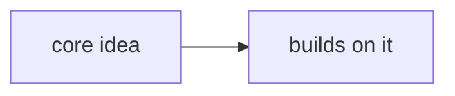

# {{title}}

> [!summary] What this folder covers
> One or two sentences on what you can do after reading this folder.

## Before and after

- **Before this:** 
- **After this:** 

## Learning path

1. [[First Note]] · basic. One line on why to read it.

## Concept map

## Interview focus

- The questions from this folder that come up most often in interviews.

## Sources worth reading

- 
