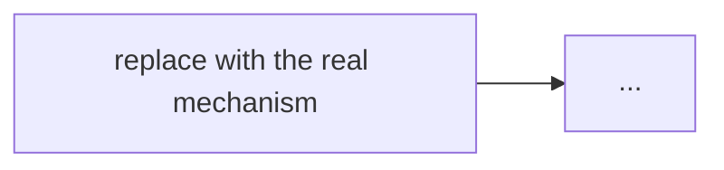

# {{title}}

> [!summary] TL;DR
> One or two sentences a beginner understands. Define every term you use.

%%
Rules for every note built from this template:
1. Every sentence is about THIS topic. If a section has nothing specific to say, delete the section.
2. Never paste the same paragraph into two notes. Link to the note that owns the idea.
3. Diagrams show THIS mechanism (the real boxes, arrows, states), never a generic "client → server → DB" chart.
4. Code compiles and runs (Go 1.24). Logic code ships with a small test.
5. Numbers are real: measured, from docs, or clearly marked as an estimate.
6. Levels: sections 1–4 = basic, 5–7 = intermediate, 8 = advanced. A reader can stop at their level.
%%

## 1. Why it exists
The problem without it, shown with one concrete scenario (use numbers where you can).

## 2. Mental model
The idea in plain words, plus one analogy.

## 3. How it works
Step-by-step mechanism.

## 4. Worked example
Trace one real request, run real numbers, or show Go code that compiles (with a test).

## 5. Variants and comparison
| Option | How it works | Use when | Cost |
| ------ | ------------ | -------- | ---- |
|        |              |          |      |

## 6. Trade-offs and when not to use
- 

## 7. In production
- **Real systems:** who uses it and how.
- **Failure modes → fixes:** 
- **What to monitor:** 

## 8. Deep dive
Internals, edge cases, behaviour at scale.

## 9. Interview questions
> [!question]- Question one?
> Answer in 2–5 lines.

> [!question]- Question two?
> Answer.

## 10. Cheat sheet
- 5–7 bullets you can revise in 60 seconds.

## Links
- **Before this:** 
- **Next:** 
- **Compare with:** 
