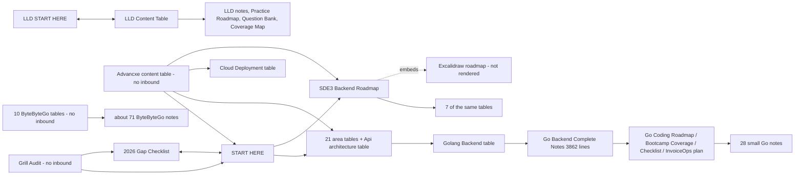
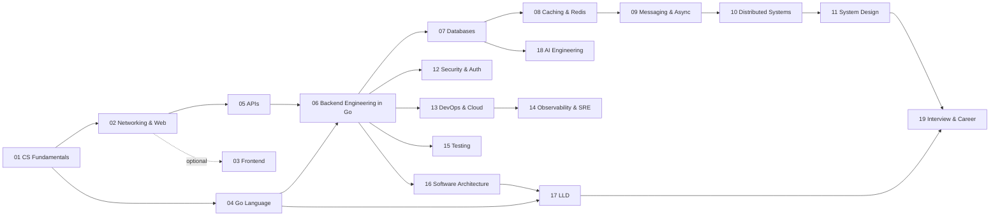

# Audit C - Observability, Testing, Architecture, AI, Navigation

> [!info] What this is
> One block per old note: what it has, what is wrong, what to keep, where it goes, and the **must-cover outline** the rewrite follows. Verdicts: KEEP · POLISH · REWRITE · MERGE · SPLIT · DELETE. Depth 0 (definition only) to 5 (complete). The area plan is at the end. Back to [[Rebuild Plan]].

Scope: 48 audited notes plus `Excalidraw/SDE3 Backend Roadmap.excalidraw.md`, so 49 blocks.
Verdicts: KEEP 0 · POLISH 8 · REWRITE 22 · MERGE 11 · SPLIT 2 · DELETE 6.
Depth: 0 → 6 notes · 1 → 26 · 2 → 11 · 3 → 6 · 4–5 → 0.

Environment facts used below (checked in `.obsidian/`):
- No community plugins are installed on this device (no `plugins/`, no `community-plugins.json`). The Excalidraw plugin is absent, so `.excalidraw.md` files and the `![[SDE3 Backend Roadmap.excalidraw]]` embed show raw text. verify: the owner's other devices (Obsidian Sync is on).
- There is no `snippets/` folder and the AnuPpuccin theme defines no `sd-*` classes. All 172 `<span class="sd-…">` lines (44 notes) render as plain text, and the "Color legend" sections in 9 content tables describe colours that never appear.
- Core plugins enabled: `bases`, `properties`, `templates`, `bookmarks`, `daily-notes`. No Templates folder is configured. 0 of 382 markdown notes have frontmatter or tags.
- No owner-handwritten text or screenshots exist in this scope. `hand` > 0 only on two content tables, and those lines are generated study orders.

---

## observability/

### Logs Metrics Traces
`advance backend/theory/observability/Logs Metrics Traces.md` · 192 lines · real 53 · depth 2 · SPLIT
- Has: one-line role of each signal; checkout-slow example traced through log/metric/trace; backend log fields; OTel Collector callout; 3 diagrams.
- Problems:
  - ~55% template. No mechanism for any signal: no metric types, span model, context propagation, sampling or cardinality math.
  - The "Senior interview bank" is the observability-category bank, copied verbatim into this note, Monitoring and Alerting and Production Debugging Playbook.
  - First diagram (App → 3 boxes → dashboard) is generic.
  - `sd-2026` span renders unstyled.
  - Logging, metrics and tracing are three separate topics forced into one note.
- Keep:
  - "Same incident through three signals": log `payment provider timeout for order 123`, p95 300 ms → 4 s, payment span 3.5 s, plus its diagram.
  - "What to add in backend logs" list.
  - OTel Collector diagram.
  - Q&A #3 (useful log fields) and #4 (when to page).
  - "If you cannot observe it, you cannot operate it."
- New home: split into
  - `14 Observability & SRE/Observability Fundamentals`
  - `14 Observability & SRE/Structured Logging`
  - `14 Observability & SRE/Metrics and Prometheus`
  - `14 Observability & SRE/Distributed Tracing with OpenTelemetry`
- Must cover:
  - *Observability Fundamentals:* monitoring (known failure modes) vs observability (asking new questions of high-cardinality data) · signals: logs, metrics, traces, profiles, events — what each answers and what each costs · cardinality/dimensionality and why `user_id` must never be a metric label · correlation: trace_id/span_id in every log line, exemplars linking histogram buckets to traces · golden signals vs RED (services) vs USE (resources) · telemetry pipeline: SDK → OTel Collector (receivers/processors/exporters) → Prometheus/Tempo/Loki → Grafana · push vs pull, agent vs gateway collector · head vs tail sampling, and always keeping errors and slow traces · telemetry cost control (levels, retention tiers, drop rules) · the "three pillars" critique (wide structured events) · instrumenting a new Go service checklist.
  - *Structured Logging:* structured key/value (JSON) vs printf logs · Go `log/slog` (Go 1.21): Logger/Handler, `JSONHandler`, attrs, groups, `LogValuer` for redaction, `InfoContext` · standard fields (ts, level, service, version, env, trace_id, span_id, request_id, tenant, templated route, status, latency_ms, error code) · level semantics and runtime level switching · request-scoped logger injected by middleware via `context` · never log passwords, tokens, card data or PII; redact or hash · hot-path cost (allocations) and log sampling · pipeline stdout → Fluent Bit/Vector/OTel Collector → Loki/Elasticsearch/CloudWatch, plus retention · `otelslog` bridge for trace correlation · audit logs vs app logs · "log or metric?" decision rule.
  - *Metrics and Prometheus:* counter, gauge, histogram (`_bucket/_sum/_count`) and summary (client-side quantiles, not aggregatable) · series count = metric × label combinations; bounded labels (route template, status class) vs unbounded ones · pull scraping, `/metrics`, service discovery, Pushgateway only for batch jobs · PromQL essentials: `rate()`, `sum by`, `histogram_quantile(0.99, sum by (le)(rate(x_bucket[5m])))` · why averages hide the tail and percentiles cannot be averaged · RED/USE/business metrics (payment success rate) · Go instrumentation (client_golang or OTel metrics) via middleware · recording rules and long-term storage (Thanos/Mimir) · one dashboard per service (RED row, USE row, dependencies row) · native histograms (verify status in your Prometheus version) · detecting a slow leak from a gauge trend.
  - *Distributed Tracing with OpenTelemetry:* trace/span/parent, span kind, attributes, events, status · W3C `traceparent` (`00-<trace-id>-<span-id>-<flags>`) and baggage · propagation over HTTP, gRPC metadata and Kafka headers; span links for async consumers · OTel API vs SDK, instrumentation libraries (otelhttp, otelgrpc, otelsql), OTLP exporter, resource attrs (`service.name`, version) · Collector processors: batch, memory_limiter, tail_sampling, attribute redaction · semantic conventions · reading a waterfall: critical path, gaps = queueing/GC, N+1 as repeated DB spans · Go setup: TracerProvider, threading `ctx`, child spans, `RecordError`, flush on shutdown · pitfalls: goroutines started without ctx, high-cardinality span names, PII in attributes, clock skew · InvoiceOps webhook trace (`verify_signature → db.check_webhook_event → db.update_invoice → queue.publish`, from Go OpenTelemetry Metrics Tracing).
- Diagrams:
  - Fundamentals: flowchart of the telemetry pipeline (Go SDK → Collector → backends → Grafana) with dashed correlation edges (exemplar metric→trace, trace_id log→trace).
  - Logging: sequence diagram of middleware injecting request_id/trace_id into ctx and every layer logging them.
  - Metrics: flowchart service `/metrics` ← Prometheus scrape → TSDB → rules → Alertmanager; Grafana reads the TSDB.
  - Tracing: sequence diagram API → payment svc → Kafka → worker carrying `traceparent`, plus a mermaid `gantt` waterfall with the slow payment span.

### Monitoring and Alerting
`advance backend/theory/observability/Monitoring and Alerting.md` · 156 lines · real 27 · depth 1 · REWRITE
- Has: two-sentence definition; "alert on user-visible symptoms" callout; one payment-incident sentence; threshold diagram.
- Problems:
  - ~71% template, sharing the same 5-question bank as Logs Metrics Traces.
  - The diagram branch "Threshold crossed? no → Dashboard" is meaningless.
  - Only static thresholds are modelled. Missing: SLO burn-rate alerting, Alertmanager routing, runbooks and on-call.
  - The "monitoring" half belongs in the metrics note.
- Keep: symptom-first paging rule (callout text); Q&A #4 "When should an alert page someone?"; "the alert should point to a runbook".
- New home: `14 Observability & SRE/Alerting and On-Call` (dashboards part → `Metrics and Prometheus`)
- Must cover: symptom vs cause alerts; page vs ticket vs dashboard-only · alert anatomy (expr, `for:`, severity, labels, owner, runbook URL) · static thresholds vs multi-window multi-burn-rate SLO alerts (page at 14.4× over 1 h with a 5 m window and 6× over 6 h with a 30 m window; ticket at 1× over 3 d) · alert precision/recall, flapping, hysteresis · Alertmanager grouping, inhibition, silences, routing tree · runbook structure (symptom, dashboards, mitigations, escalation) · on-call rotations, escalation policy, handoff, follow-the-sun, page budget, toil · MTTD/MTTA/MTTR and why mean MTTR misleads · blackbox/synthetic probes and the dead-man's-switch (Watchdog) alert · async alerts: oldest-message age, consumer lag, DLQ growth, missed cron heartbeat · weekly alert review and deleting unused alerts · interview: "cut pages by 80% without missing outages".
- Diagrams: flowchart rules → Alertmanager (group/inhibit/silence/route) → PagerDuty (escalation) vs Slack (ticket); stateDiagram of an alert: inactive → pending → firing → resolved.

### Observability Content Table
`advance backend/theory/observability/Observability Content Table.md` · 49 lines · real 16 · depth 0 · DELETE
- Has: 2 links; a 6-node chain map that reaches into production debugging/; an unrendered colour legend; a "Grill audit additions" link.
- Problems:
  - Navigation only. 4 of its 6 mapped notes live in another folder.
  - The colour legend relies on missing CSS.
  - The Playbook was bolted on under "Grill audit additions" instead of being placed in the order.
- Keep: nothing; the order is superseded by the 14 MOC.
- New home: none. Replaced by `14 Observability & SRE/14 Observability & SRE MOC`.
- Must cover (the replacement MOC): the 15 notes in Area-plan order, links to 06 (instrumentation in Go code) and 13 (rollout and rollback), and an embedded `Progress.base#This area` view.
- Diagrams: MOC concept map: flowchart signals → SLOs → alerts → incident → debugging → postmortem → readiness review.

### Production Debugging Playbook
`advance backend/theory/observability/Production Debugging Playbook.md` · 155 lines · real 39 · depth 3 · POLISH
- Has: correct 8-step method (impact → what changed → scope → metrics → traces → logs → mitigate → RCA), a matching flowchart, and a p99-vs-p50 tail-latency example.
- Problems:
  - ~60% template: the shared 5-Q bank, plus a "Quick revision" that calls it "a observability/debugging topic".
  - Filed under observability/ while its siblings live in production debugging/.
  - No worked incident, no tool commands, no async/queue debugging, no hypothesis discipline.
  - The 8-step list is duplicated in Production Debugging Content Table and Latency Debugging.
- Keep:
  - The method and its flowchart.
  - The "what changed" list (deploy, config, traffic, data, dependency, cron, feature flag).
  - Tail-latency suspects: one bad node, pool exhaustion, GC pauses, slow dependency, hot partition, query shape.
  - Q&A #1 and #5.
- New home: `14 Observability & SRE/Production Debugging Playbook`
- Must cover: severity/impact first · "what changed?" incl. flags, cron and data backfills · scoping by cohort (endpoint, region/AZ, tenant, version, pod, client) and good-vs-bad comparison · RED metric → trace waterfall → logs → profile loop · mitigation menu (rollback, flag off, failover, scale out, shed load, block client) and "mitigate before root cause" · hypothesis-driven elimination with a written timeline · symptom patterns: p99-only rise, 5xx from one pod, cascading timeouts, 429s from a dependency · culprit catalogue: pool exhaustion, DNS, TLS expiry, clock skew, disk full, noisy neighbour, retry storm, cache stampede · async debugging: queue lag, poison message, DLQ, consumer rebalance · tool cheat-sheet (`kubectl describe/logs/top`, `curl -w` timings, `dig`, `/debug/pprof`, `EXPLAIN ANALYZE`, `pg_stat_activity`) · InvoiceOps incident catalogue (from the content table) · interview: "latency doubled at 2 a.m., walk me through it".
- Diagrams:
  - Extend the flowchart into a decision tree: recent deploy? → rollback; single cohort? → isolate; dependency span slow? → timeout/circuit-break.
  - Sequence diagram of one worked incident (alert → IC → rollback → recovery → RCA).

## production debugging/

### Database Performance Debugging
`advance backend/theory/production debugging/Database Performance Debugging.md` · 156 lines · real 8 · depth 1 · REWRITE
- Has: one-line definition and a 5-box diagram.
- Problems:
  - ~91% template.
  - The interview bank is the system-design bank ("What is the first thing you ask? Clarify requirements: users, core features, read/write ratio…"), the wrong category.
  - The diagram is wrong: "EXPLAIN plan → Lock wait? / Pool exhausted?". EXPLAIN shows only the plan; lock waits come from `pg_locks`/`pg_stat_activity` wait events, and pool exhaustion from client pool stats.
  - Overlaps 07 notes (Query Plans and EXPLAIN, Connection Pooling, Database Indexing, N Plus One).
- Keep: only the three suspects (index, lock, pool).
- New home: `14 Observability & SRE/Debugging Database Performance` (link to 07 for index and plan theory)
- Must cover: symptom map (slow endpoint, DB CPU, pool wait, lock wait, replica lag) · finding the query: `pg_stat_statements` (total vs mean time, calls), slow-query log, DB spans · `EXPLAIN (ANALYZE, BUFFERS)`: seq/index/bitmap scans, estimated vs actual rows, stale statistics → `ANALYZE` · index fixes: composite order (equality before range), covering and partial indexes, write cost · locks: `pg_stat_activity` wait_event_type=Lock, long and `idle in transaction` sessions, deadlocks, `lock_timeout`/`statement_timeout` · Go pool exhaustion: `sql.DBStats` (InUse, WaitCount, WaitDuration), MaxOpenConns/MaxIdleConns/ConnMaxLifetime, PgBouncer transaction mode · N+1 from repeated identical spans · MVCC bloat and autovacuum lag · replica lag vs read-your-writes · plan regressions after data growth (generic vs custom plans) · hot rows (counter updates) · safe prod fixes: `CREATE INDEX CONCURRENTLY`, `pg_cancel_backend`, read replicas · interview: "dashboard slows as one tenant hits 1M invoices".
- Diagrams: decision-tree flowchart (is time in the DB span? → pool wait / lock wait / bad plan / too many queries → fix per branch), replacing the EXPLAIN-centric one.

### Incident Response
`advance backend/theory/production debugging/Incident Response.md` · 155 lines · real 7 · depth 1 · REWRITE
- Has: one-line definition and a 4-box flow (Alert → Triage → Mitigate → Recover → Postmortem).
- Problems:
  - ~92% template; the system-design interview bank again.
  - No severity levels, roles, communication or tooling.
  - "Difficult production example" is a generic sentence shared by 7 notes.
- Keep: the 4-box lifecycle and the category "common mistakes" (guessing before scoping, root-causing before mitigating).
- New home: `14 Observability & SRE/Incident Response`
- Must cover: SEV1–SEV4 with concrete criteria (users affected, revenue, data loss) · detection sources (alerts, customers, synthetics) · roles: Incident Commander, tech/ops lead, comms lead, scribe; why the IC does not debug · lifecycle detect → triage → mitigate → resolve → follow-up · mitigation first: rollback, kill-switch flag, failover, scale, shed load, block abuser · "what changed?" under uncertainty; roll back without proof · communication: status page, update cadence, stakeholder template · incident channel hygiene and live timeline · handoffs for long incidents and fatigue · MTTD/MTTA/MTTR, repeat-incident rate · tooling (PagerDuty/Opsgenie/incident.io, ChatOps) · InvoiceOps example: webhook returns 500 after commit → provider retries → duplicate count spikes (from the content table) · interview: "walk me through your worst incident" (STAR + numbers).
- Diagrams: stateDiagram Detected → Triaged → Mitigated → Resolved → Postmortem-complete; sequence of comms (IC ↔ responders ↔ status page).

### Latency Debugging
`advance backend/theory/production debugging/Latency Debugging.md` · 182 lines · real 23 · depth 2 · MERGE→`14 Observability & SRE/Latency, Percentiles and Bottleneck Analysis`
- Has: time-decomposition diagram; step-by-step flowchart (alert → deploy diff → traces → DB/external/queue/CPU); six "questions to ask".
- Problems:
  - ~79% template; system-design interview bank.
  - Its decomposition diagram nearly duplicates performance/Bottleneck Analysis (Request → API → DB / External / Queue).
  - No percentiles theory, queueing, tail amplification or fixes.
  - Not the same topic as bbg `LAtency/what is latency` (latency-numbers screenshots → 01).
- Keep: "Questions to ask" (all endpoints or one? p50 or only p99? traffic up? errors up? DB time up? deploy?); the step-by-step flowchart.
- New home: `14 Observability & SRE/Latency, Percentiles and Bottleneck Analysis` (with performance/Bottleneck Analysis — coordinate with the performance reviewer)
- Must cover: latency vs throughput; service time vs queueing time · p50/p95/p99/p99.9, why averages lie, percentiles can't be averaged (aggregate histograms) · tail amplification under fan-out (1 − 0.99^100 ≈ 63% of requests hit a p99) · Little's Law L = λW for concurrency and pool sizing; latency knee as utilisation → 100% · where time goes: DNS, TCP/TLS handshake, LB, app CPU, GC, DB, cache, external API, queue wait · USE method on CPU, memory, disk, network, pools, locks · trace critical path and unaccounted gaps · common causes: N+1, missing index, lock contention, pool exhaustion, sync calls in loops, large JSON, retries without budget, cold cache · coordinated omission when measuring · fixes and their costs: caching, batching, parallel fan-out with deadlines, hedged requests, timeout budgets, async offload · regression workflow: canary comparison, flame-graph diff · interview: "p99 tripled but p50 flat" and "speed up a 6-service call chain".
- Diagrams: mermaid `gantt` of a request's critical path, sequential vs parallel downstream calls; keep the "where is time spent?" decision flowchart.

### Memory Leak Debugging
`advance backend/theory/production debugging/Memory Leak Debugging.md` · 155 lines · real 7 · depth 1 · REWRITE
- Has: one-line definition and a Traffic → retained objects → OOM → restart diagram.
- Problems:
  - ~92% template; system-design interview bank.
  - Nothing Go-specific, although the vault is Go-first: no GC, goroutine leaks or pprof.
  - The diagram omits that restarts mask leaks (sawtooth RSS).
- Keep: the diagram idea (retention → OOM → restart).
- New home: `14 Observability & SRE/Debugging Memory Leaks and OOMs in Go`
- Must cover: "leak" in a GC'd language = unintended reachability · stack vs heap, escape analysis, concurrent mark-sweep GC, `GOGC`, `GOMEMLIMIT` (Go 1.19) · symptoms: ratcheting RSS, `OOMKilled`/exit 137, rising GC CPU, latency spikes · metrics: `go_memstats_heap_inuse_bytes`, `go_goroutines`, `process_resident_memory_bytes`, container working set · classic Go leaks: blocked goroutines (missing ctx cancel or receiver), unbounded maps/caches, sub-slices pinning large arrays, unclosed `resp.Body`, tickers never stopped (pre-Go 1.23), `defer` in loops · pprof: heap `inuse_space` vs `alloc_space`, `-base` diff of two snapshots, goroutine profile `debug=2`, exposing `net/http/pprof` safely · RSS vs heap: fragmentation, lazy return to the OS, cgo/off-heap · cgroup limits; set `GOMEMLIMIT` ≈ 90% of the container limit · reproduce under load with periodic snapshots; continuous profiling (Pyroscope/Parca) · fixes: bounded LRU/TTL caches, deadlines, worker pools, streaming (`io.Copy`) instead of buffering · interview: "pod is OOMKilled every 6 hours".
- Diagrams: diagnosis flowchart (RSS ↑? → heap ↑? → goroutines ↑? → which profile); sequence of taking two heap profiles and diffing with `-base`.

### Postmortems
`advance backend/theory/production debugging/Postmortems.md` · 155 lines · real 7 · depth 1 · REWRITE
- Has: one-line definition and an Incident → Timeline → Root cause → Actions → Follow-up flow.
- Problems:
  - ~92% template; system-design interview bank.
  - No template, no blameless practice, no action-item tracking.
  - RCA is a separate equally thin note, but it is a section of a postmortem.
- Keep: the flow; the content-table Q&A "What makes a good postmortem? blameless, factual, timeline-based, contributing factors, concrete action items".
- New home: `14 Observability & SRE/Postmortems and Root Cause Analysis` (absorbs Root Cause Analysis)
- Must cover: purpose (learning) and when one is required (SEV thresholds, near-misses) · blameless/Just Culture, focus on systems not people · template: summary, impact (users, revenue, duration), UTC timeline, detection, response, root cause + contributing factors, what went well/badly, where we got lucky, action items · trigger vs root cause vs contributing factors · RCA techniques: 5 Whys and its single-chain limit, fishbone/Ishikawa, fault tree, causal-factor charting · "no single root cause" in complex systems (Cook, *How Complex Systems Fail*) · action items: owner, due date, priority, prevent/detect/mitigate categories, tracked to closure · improving detection and MTTR as first-class actions · review meeting, sharing, postmortem archive and trend analysis · worked mini-postmortem: InvoiceOps duplicate-webhook incident · interview: "tell me about a postmortem you led".
- Diagrams: mermaid `timeline` of the incident; fishbone-style flowchart (code, config, infra, dependency, process, people → incident).

### Production Debugging Content Table
`advance backend/theory/production debugging/Production Debugging Content Table.md` · 92 lines · real 49 · depth 2 · MERGE→`14 Observability & SRE/Production Debugging Playbook`
- Has: 7-link study order; an 8-step process; an incident flowchart; 7 InvoiceOps incident scenarios; easy and hard examples; 3 Q&A; an ops-readiness checklist.
- Problems:
  - Navigation mixed with real content, so the content is invisible to topic search.
  - The 8-step process duplicates the Playbook and Latency Debugging.
  - The study order starts with SLOs but omits the observability signals that live one folder over.
- Keep:
  - The InvoiceOps incident list: login failures spike, duplicate webhooks rise, dashboard latency rises, reminder backlog grows, DB pool exhausted, invoices not marked overdue, one workspace missing invoices.
  - The `/dashboard/summary` example.
  - The webhook-500-after-commit example.
  - 7 common mistakes; 3 Q&A.
  - The reviewer checklist (request id traceable, jobs observable, SLOs defined, rollback possible, incidents documented, action items tracked) → Production Readiness Review.
- New home: content → `14 Observability & SRE/Production Debugging Playbook` (+ `Incident Response`, `Production Readiness Review`); nav → 14 MOC.
- Must cover: see Production Debugging Playbook.
- Diagrams: its incident flowchart duplicates the Playbook's; keep one.

### Root Cause Analysis
`advance backend/theory/production debugging/Root Cause Analysis.md` · 155 lines · real 7 · depth 1 · MERGE→`14 Observability & SRE/Postmortems and Root Cause Analysis`
- Has: one-line definition and a Symptom → Evidence → Cause → Fix → Prevent diagram.
- Problems:
  - ~92% template; system-design interview bank.
  - No technique (5 Whys, fishbone, fault tree).
  - Too thin to stand alone; it is a section of a postmortem.
- Keep: the evidence → cause → prevention diagram.
- New home: `14 Observability & SRE/Postmortems and Root Cause Analysis`
- Must cover: see Postmortems.
- Diagrams: see Postmortems.

### SLO SLA SLI
`advance backend/theory/production debugging/SLO SLA SLI.md` · 154 lines · real 6 · depth 1 · REWRITE
- Has: the correct one-liner (SLI = measurement, SLO = target, SLA = customer promise) and an error-budget diagram.
- Problems:
  - ~93% template; system-design interview bank.
  - No numbers: no budget math, burn rate, measurement point or SLI formula.
  - Filed under "production debugging" although it is the foundation for alerting.
- Keep: the one-liner and the SLI → SLO → error budget / SLA → penalty diagram.
- New home: `14 Observability & SRE/SLIs, SLOs, SLAs and Error Budgets`
- Must cover: SLI = good events / valid events; request-based vs window-based · choosing SLIs per user journey: availability, latency ("99% < 300 ms"), freshness, correctness, durability · measuring at the LB vs the server vs the client/synthetic probe · SLO target and window (rolling 28/30 d vs calendar) · error-budget math: 99.9%/30 d = 43.2 min, 99.95% = 21.6 min, 99.99% = 4.32 min; 1M requests at 99.9% = 1,000 failures · error-budget policy (freeze risky launches when exhausted) · SLA: contractual, looser than the internal SLO, service credits · burn rate and multi-window alerts (link Alerting) · dependency math: serial availabilities multiply (99.9% × 99.9% ≈ 99.8%); redundancy helps · why not 100% · SLOs for async work (job done within N min, queue age) · tooling: Sloth/Pyrra/OpenSLO, recording rules · interview: SLOs for checkout API and the webhook pipeline.
- Diagrams: flowchart SLI → SLO → budget → burn-rate alert → policy; `xychart-beta` line of budget burn-down over a 30-day window.

## testing strategy/

### Chaos Testing
`advance backend/theory/testing strategy/Chaos Testing.md` · 163 lines · real 8 · depth 1 · REWRITE
- Has: one-line definition; a 4-box loop; one real line ("survives dependency failure, latency, pod death, or region degradation"; risk "without rollback, observability, or blast-radius limits").
- Problems:
  - ~92% template. The "SDE-3 depth notes" talk about "a production ecommerce system".
  - No steady-state hypothesis, no tools, no blast-radius mechanics.
  - Named "testing"; the discipline is chaos engineering.
- Keep: the two real lines above; the testing Q&A #3 ("inject timeouts, dependency 5xx, duplicate messages, slow DB, queue backlog…").
- New home: `15 Testing/Chaos Engineering`
- Must cover: Principles of Chaos Engineering: steady-state hypothesis on a business metric, real-world events, production, automation, minimal blast radius · fault catalogue: kill pod/instance, latency, packet loss, dependency 5xx, DNS failure, AZ/region loss, clock skew, disk full, CPU/memory pressure · blast-radius control: staging first, % of traffic, abort conditions tied to SLOs, automatic rollback · prerequisites: observability, SLOs, on-call · what you validate: timeouts, retry + jitter, circuit breakers, fallbacks, autoscaling, failover, and whether alerts fire · tools: Chaos Monkey, Gremlin, LitmusChaos, Chaos Mesh, AWS FIS, Toxiproxy (local/CI) · game days and runbook validation · chaos in CI via Toxiproxy-wrapped integration tests · turning findings into action items · interview: "prove a Redis outage won't take checkout down".
- Diagrams: flowchart experiment loop (hypothesis → inject → compare to steady state → abort? → learn/fix); sequence with Toxiproxy between service and Redis.

### Contract Testing
`advance backend/theory/testing strategy/Contract Testing.md` · 163 lines · real 8 · depth 1 · REWRITE
- Has: a definition, a diagram (Consumer/Provider → Contract → CI), and the failure mode "mock tests drifting away from real service behavior".
- Problems:
  - ~92% template.
  - The definition is misleading: "verifies services agree on request/response schema". Consumer-driven contracts verify the concrete interactions the consumer relies on (requests, expected responses, status codes, semantics); schema compatibility is a weaker check.
  - No Pact, broker, `can-i-deploy` or async contracts.
- Keep: the mock-drift failure mode.
- New home: `15 Testing/Contract Testing`
- Must cover: why (independent deploys; E2E too slow and flaky; mocks drift) · consumer-driven contracts: consumer test against a mock provider → pact file → provider verification with provider states · Pact Broker/PactFlow, `can-i-deploy` gate, webhook-triggered provider builds · contract vs schema testing (OpenAPI diff/oasdiff, `buf breaking` for protobuf) and bi-directional contracts · only assert fields the consumer uses (tolerant reader) · backward-compatibility rules (additive changes, deprecate before removal) · message/event contracts and Schema Registry compatibility modes (BACKWARD/FORWARD/FULL) · CI wiring and environment matrix · limits: no business-logic or performance coverage; needs team adoption · Go tooling: pact-go v2, buf, oasdiff · interview: "stop a provider deploy from breaking 5 consumers".
- Diagrams: sequence diagram of the Pact flow (consumer CI → broker → provider CI verify → `can-i-deploy` → deploy).

### Load Testing
`advance backend/theory/testing strategy/Load Testing.md` · 155 lines · real 7 · depth 1 · REWRITE
- Has: one-line definition and a load-generator diagram.
- Problems:
  - ~92% template.
  - No test types, workload model, tools or SLO thresholds.
  - The vault's real tool content (wrk, h2load, ghz, pprof) sits in golang backend/Go Benchmarking.
- Keep: nothing.
- New home: `15 Testing/Load and Performance Testing`
- Must cover: test types: smoke, load, stress, spike, soak, breakpoint · workload model: open (arrival rate) vs closed (VUs), endpoint mix, think time, realistic data skew (hot keys) · metrics: throughput, p50/p95/p99, errors, saturation, and finding the latency knee · coordinated omission; constant-arrival-rate executors (k6) and wrk2 · tools: k6, Gatling, Locust, vegeta (Go), wrk/wrk2, h2load (HTTP/2), ghz (gRPC) · prod-like environment, warm vs cold caches, real vs stubbed dependencies · pass/fail thresholds tied to SLOs in CI (k6 thresholds) · profiling under load (pprof, `sql.DBStats`, USE) · capacity from results: max RPS per pod at SLO → replicas with N+1 headroom · micro-benchmarks (`testing.B`, `b.Loop` Go 1.24, benchstat) vs system tests · shadow traffic and game days · interview: "prepare for a 10× sale-day spike".
- Diagrams: `xychart-beta` latency vs RPS showing the knee; flowchart load test → observe → profile → fix → re-test.

### Test Data Strategy
`advance backend/theory/testing strategy/Test Data Strategy.md` · 154 lines · real 6 · depth 1 · REWRITE
- Has: one-line definition and a factory → test DB → tests → cleanup diagram.
- Problems: ~93% template; no techniques, privacy rules or Go examples.
- Keep: the diagram skeleton.
- New home: `15 Testing/Test Data Strategy`
- Must cover: fixtures vs factories/builders (Go functional options) · per-test isolation: transaction rollback, truncate, template-database cloning, schema per parallel test · determinism: fixed clocks, seeded randomness, stable IDs · edge-case data: unicode, money precision, time zones/DST, large payloads · synthetic data (gofakeit) and property-based generators · production data: masking/anonymisation, subsetting, GDPR/PCI constraints, never raw PII in lower environments · load-test data volume and Zipf skew · provider states for contract tests · multi-tenant isolation in fixtures · golden datasets for regression (link AI evals) · shared environments: namespacing by run id, TTL cleanup jobs · interview: "tests pass locally but fail in CI".
- Diagrams: flowchart builder → template DB clone → test → rollback; flowchart prod → mask → subset → staging.

### Testing Pyramid
`advance backend/theory/testing strategy/Testing Pyramid.md` · 153 lines · real 5 · depth 1 · REWRITE
- Has: the correct one-liner (many unit, fewer integration and E2E) and a 3-node flowchart.
- Problems:
  - ~94% template.
  - The flowchart arrows (E2E → Integration → Unit) imply flow, not proportion.
  - No alternatives (trophy, honeycomb) and no CI placement.
  - The good material is the shared testing Q&A bank, duplicated across 6 notes.
- Keep: the one-liner and the testing Q&A bank once: what runs on every PR, how to test failure, avoiding flaky tests ("control time, isolate state, avoid sleeps…"), "test what hurts users or money first".
- New home: `15 Testing/Testing Strategy and the Test Pyramid`
- Must cover: why test (confidence to change; cost of a bug by stage) · Cohn's pyramid and its speed/cost/fidelity/flakiness trade-off · alternatives: testing trophy (integration-heavy), microservice honeycomb, ice-cream-cone anti-pattern · test sizes (small/medium/large) vs test types · mapping to architecture: hexagonal core → unit, adapters → integration, service boundaries → contract · risk-based selection: money, data loss, security, critical journeys · CI placement: PR (unit, lint, `-race`, contract), merge (integration), nightly (E2E, load), pre-release (chaos/game day) · health metrics: flake rate, suite duration, escaped defects; coverage ≠ quality (mutation score) · shift-left vs shift-right (canary, synthetics) · InvoiceOps test plan for invoice creation and webhook processing · interview: "design the test strategy for a payments service".
- Diagrams: flowchart pyramid with counts and runtimes per layer (ms / s / min); flowchart CI stages showing which suites gate which step.

### Testing Strategy Content Table
`advance backend/theory/testing strategy/Testing Strategy Content Table.md` · 13 lines · real 7 · depth 0 · DELETE
- Has: 6 links and one sentence.
- Problems: navigation only.
- Keep: nothing.
- New home: none. Replaced by `15 Testing/15 Testing MOC`.
- Must cover (MOC): the 10 notes in Area-plan order; links to 04 (Go `testing` package), 06 (gRPC testing tools), 17 (Testing LLD Code in Go).
- Diagrams: MOC concept map of test types by scope.

### Unit Integration E2E Tests
`advance backend/theory/testing strategy/Unit Integration E2E Tests.md` · 154 lines · real 6 · depth 1 · REWRITE
- Has: the one-liner "catch different classes of bugs" and a linear Unit → Integration → E2E diagram.
- Problems:
  - ~93% template.
  - No Go code although the vault is Go-first.
  - Overlaps golang backend/Go Testing and LLD/Testing LLD Code in Go.
- Keep: nothing.
- New home: `15 Testing/Unit, Integration and E2E Tests`
- Must cover: scope and bug classes per level (logic vs wiring/SQL vs journey) · table-driven tests, `t.Run`, `t.Parallel`, `t.Helper`, `t.Cleanup`, golden files · `net/http/httptest` (ResponseRecorder, NewServer) for handlers · integration with real Postgres/Redis via testcontainers-go; separating suites with build tags or `-short` · E2E on an ephemeral stack (docker compose) for critical journeys only · `go test -race`; `testing/synctest` for time-dependent concurrent code (Go 1.25, verify) · coverage profiles and why 100% is not the goal · mock only at your own ports, never in repository tests · parallel-safe DB tests · suite time budgets (unit < 1 min, integration < 10 min) · flakiness sources: time, randomness, shared state, sleeps → fake clocks, `Eventually` helpers · interview: "how would you test the payment webhook handler?".
- Diagrams: flowchart with three boundary boxes (unit: service + fake repo; integration: repo ↔ Postgres container; E2E: client → API → DB → queue).

## architecture patterns/

### Architecture Decision Records
`advance backend/theory/architecture patterns/Architecture Decision Records.md` · 155 lines · real 7 · depth 1 · REWRITE
- Has: one-line definition and a Problem → Options → Decision → Consequences diagram.
- Problems:
  - ~92% template.
  - The interview bank ("What coupling does this reduce?") is meaningless for ADRs.
  - No template, lifecycle or example.
- Keep: the diagram; the content-table Q&A #3 ("ADRs record why a decision was made, alternatives, trade-off accepted").
- New home: `16 Software Architecture/Architecture Decision Records`
- Must cover: origin (Nygard 2011) and purpose: context and consequences, not just the decision · template: title, status, context, decision, consequences, alternatives (MADR variant) · when to write: hard-to-reverse, cross-team or expensive decisions (one-way vs two-way doors) · storage: `docs/adr/0001-*.md` in the repo, numbering, immutability, supersede instead of edit · RFC (proposal) vs ADR (record); PR-based review · tooling: adr-tools, log4brains · worked example: "Use Postgres `SKIP LOCKED` jobs instead of Kafka for InvoiceOps reminders" · linking ADRs from code and runbooks · pitfalls: written after the fact, too granular, no consequences section, never revisited · interview: "how do you make and communicate architecture decisions?".
- Diagrams: stateDiagram Proposed → Accepted → Deprecated / Superseded-by.

### Architecture Patterns Content Table
`advance backend/theory/architecture patterns/Architecture Patterns Content Table.md` · 109 lines · real 54 · depth 2 · MERGE→`16 Software Architecture/Architecture Fundamentals: Coupling, Cohesion and Dependency Direction`
- Has: study order; "what an SDE-3 must explain" bullets; a decision flowchart; InvoiceOps layered→hexagonal evolution; client-creation and webhook examples; mistakes; 3 Q&A; a self-check list.
- Problems:
  - The decision flow is wrong: "Complex business rules? yes → DDD; no → Need infra isolation? yes → Hexagonal; no → Clean". DDD is orthogonal to and usually combined with hexagonal/clean. Clean and Hexagonal both exist for infrastructure isolation, so "no isolation needed → Clean" is backwards (→ Layered).
  - Navigation mixed with content.
  - Uses Gin in one example; the vault should pick one router.
- Keep:
  - The 7 "explain" bullets (problem, code placement, dependency direction, DB/external isolation, testing, overkill, migration).
  - InvoiceOps ports (payment provider, email sender, file storage).
  - `handler -> service -> repository -> database`.
  - Webhook chain `Webhook handler -> Payment service -> Invoice service -> PaymentProvider verifier -> Repository transaction`.
  - Common mistakes (logic in handlers, DB details in domain models, huge `utils` packages).
  - Q&A #1–#2; the self-check list.
- New home: `16 Software Architecture/Architecture Fundamentals: Coupling, Cohesion and Dependency Direction` (+ examples into Layered and Hexagonal); nav → 16 MOC.
- Must cover: what architecture decides (boundaries, dependency direction, deployment units, data ownership) · coupling kinds: afferent/efferent, temporal, data/schema, deployment · cohesion; package-by-feature vs package-by-layer in Go · dependency inversion with consumer-defined Go interfaces · Go boundaries: `internal/`, import cycles, no `utils` dumping ground · quality attributes (testability, deployability, scalability) · Conway's law · corrected style chooser (team size, domain complexity, integration count → layered / hexagonal-clean / modular monolith / microservices; DDD orthogonal) · evolutionary path (layered → ports when integrations appear) · anti-patterns: big ball of mud, distributed monolith, anemic model, interface pollution · interview: "how would you structure a new Go service?".
- Diagrams: corrected decision flowchart; Go package dependency graph (handlers → app → domain ← adapters).

### Clean Architecture
`advance backend/theory/architecture patterns/Clean Architecture.md` · 163 lines · real 8 · depth 1 · REWRITE
- Has: the correct one-liner; a 4-ring flowchart with correct inward dependency direction; the risk "overengineering small services or leaking ORM models into business logic".
- Problems: ~92% template. No dependency rule detail, use cases, boundary DTOs, Go layout, or relation to hexagonal/onion.
- Keep: the diagram direction and the risk line.
- New home: `16 Software Architecture/Clean Architecture`
- Must cover: Martin's rings: entities, use cases, interface adapters, frameworks & drivers · the dependency rule (source dependencies point inward) · use case/interactor = one application operation (`CreateInvoice`) · crossing boundaries with input/output ports, DTOs, presenters · relation to hexagonal (Cockburn 2005) and onion (Palermo 2008): same idea, more prescriptive rings · Go layout (`domain/`, `usecase/`, `adapter/http`, `adapter/postgres`, `cmd/` composition root) · error mapping across layers (domain error → HTTP status) · transactions via a unit-of-work port · testing use cases with fakes · cost: mapping boilerplate, over-engineering CRUD · Go-idiom tension (small interfaces, no Java-style layering) · interview: "is Clean Architecture worth it in Go?".
- Diagrams: nested-subgraph flowchart of the rings with inward arrows (keep direction); sequence of `CreateInvoice` crossing the boundaries.

### Domain Driven Design
`advance backend/theory/architecture patterns/Domain Driven Design.md` · 155 lines · real 7 · depth 1 · REWRITE
- Has: one-line definition and a domain → two bounded contexts → models diagram.
- Problems:
  - ~92% template.
  - The diagram conflates problem space (subdomains) with solution space (bounded contexts).
  - No strategic or tactical patterns.
  - Too big for one note once written properly.
- Keep: nothing.
- New home: two notes, `16 Software Architecture/Domain-Driven Design: Strategic Design` and `16 Software Architecture/Domain-Driven Design: Tactical Patterns in Go`.
- Must cover:
  - *Strategic:* subdomains (core/supporting/generic) and where to invest · ubiquitous language · bounded context as a model-consistency boundary (one word, two meanings: billing "Invoice" vs accounting "Invoice") · context-map patterns: partnership, shared kernel, customer–supplier, conformist, anticorruption layer, open host service/published language, separate ways · EventStorming · contexts ↔ modules/services (not always 1:1) · team ownership · integration by domain events · InvoiceOps contexts (Billing, Payments, Notifications, Identity) · interview: "how would you split this monolith?".
  - *Tactical:* entities vs value objects (Money, Email) · aggregates and the root; invariants inside; one aggregate per transaction; reference by ID · repositories per aggregate root, not per table · domain vs application services · domain events dispatched after commit (outbox link) · factories · rich vs anemic model in Go (unexported fields, constructors, methods guarding invariants) · aggregate sizing and optimistic locking with a version · eventual consistency between aggregates · when DDD is overkill · interview: "design the Invoice aggregate".
- Diagrams: Strategic: context-map flowchart with labelled relationships (ACL, OHS/PL, customer/supplier). Tactical: class diagram (Invoice root, LineItem, Money value object, InvoiceRepository interface, InvoicePaid event).

### Hexagonal Architecture
`advance backend/theory/architecture patterns/Hexagonal Architecture.md` · 155 lines · real 7 · depth 1 · REWRITE
- Has: the correct one-liner (ports and adapters) and an API adapter → port → core → out-port → DB adapter diagram.
- Problems:
  - ~92% template.
  - The diagram draws "Core → OutPort → DBAdapter" as if it were dependency direction. That is call flow; the driven adapter depends on (implements) the port.
  - No driving vs driven distinction, Go code or composition root.
- Keep: the InvoiceOps ports and webhook example from the content table.
- New home: `16 Software Architecture/Hexagonal Architecture (Ports and Adapters)`
- Must cover: Cockburn's intent (the app is driven equally by UI, tests and scripts) · driving/primary adapters (HTTP, gRPC, CLI, consumers) vs driven/secondary adapters (DB, payment provider, email, queue) · dependency direction: adapters depend on ports; the core imports no infrastructure · Go: port interfaces declared in the core package, adapters in `adapters/postgres` and `adapters/razorpay`, wiring in `main` · testing the core with in-memory adapters; adapter tests against real infra · InvoiceOps PaymentProvider/EmailSender/FileStorage ports · vs layered (no "bottom" DB layer; symmetry) · vs clean/onion (same rule, different vocabulary) · costs: more interfaces and mapping · pitfalls: leaking SQL/ORM types into the core, adapter-shaped ports (`SaveToPostgres`), interface pollution · interview: "swap Razorpay for Stripe: what changes?".
- Diagrams: flowchart hexagon with edges labelled "calls" vs "implements"; class diagram of a `PaymentProvider` port with two adapters.

### Layered Architecture
`advance backend/theory/architecture patterns/Layered Architecture.md` · 154 lines · real 6 · depth 1 · REWRITE
- Has: one-liner (controller, service, repository, database) and a 4-box diagram.
- Problems: ~93% template; no strict vs relaxed layering, model mapping, transactions or the sinkhole anti-pattern.
- Keep: the client-creation example from the content table.
- New home: `16 Software Architecture/Layered Architecture`
- Must cover: presentation / application / domain / persistence layers; logical layers vs physical tiers · strict vs relaxed layering; downward-only dependencies · Go: handler → service → repository with interfaces · DTO vs domain vs DB model mapping · transactions across repositories (unit of work; `*sql.Tx` passing vs tx-in-context) · where validation lives (transport vs domain) · pros (simple, familiar) and cons (DB-centric design, logic leaks into handlers, sinkhole pass-through layers) · testing each layer (httptest handlers, services with fake repos) · when to evolve to hexagonal · interview: "where does business logic go?".
- Diagrams: flowchart of layers with allowed dependencies; sequence of a create-client request through the layers.

### Strangler Fig Pattern
`advance backend/theory/architecture patterns/Strangler Fig Pattern.md` · 155 lines · real 7 · depth 1 · REWRITE
- Has: the correct one-liner and a proxy → old/new diagram.
- Problems:
  - ~92% template.
  - The `Old -. shrink .-> New` edge is semantically wrong (old does not flow into new).
  - No data migration, verification or rollback.
- Keep: the proxy diagram idea; the content-table answer "strangler approach: create a boundary, move one use case, add tests…".
- New home: `16 Software Architecture/Strangler Fig Pattern and Legacy Migration`
- Must cover: origin (Fowler 2004) and why big-bang rewrites fail · steps: find seams → routing facade (gateway/reverse proxy) → migrate slice by slice → retire · routing by path, tenant, % canary or feature flag · data migration: shared-DB phase, CDC (Debezium) sync, dual-write dangers, backfill, ownership switch · verification: shadow traffic / parallel run with response diffing, dark launches · anticorruption layer between models · branch by abstraction (the in-code sibling) · per-slice rollback · pitfalls: never finishing, distributed monolith, shared-DB coupling · progress metrics: % traffic migrated, error/latency parity · interview: "extract payments from the monolith with zero downtime".
- Diagrams: three-phase flowchart (proxy → all old; some routes → new; old retired); sequence of shadow-traffic comparison.

## ai engineering/

### AI Agents
`advance backend/theory/ai engineering/AI Agents.md` · 224 lines · real 63 · depth 2 · POLISH
- Has: agent loop diagram; parts list; agent types; tool design rules; production risks; guardrails; agent vs chatbot.
- Problems:
  - ~57% template.
  - No tool-calling mechanics (schema → tool call → app executes → tool result), no workflow-vs-agent distinction, no memory/context-compaction detail, no MCP.
  - "RAG agent: retrieves documents before answering" is plain RAG; agentic RAG means the model chooses when and what to retrieve.
  - No code.
- Keep: the loop and architecture diagrams; tool design rules (clear name, when-to-use description, strict schema, predictable output, error handling); risks; guardrails (limit permissions, max steps, validate input, approval, log every call).
- New home: `18 AI Engineering/AI Agents and Agentic Workflows`
- Must cover: definition and autonomy spectrum · workflows vs agents (prompt chaining, routing, parallelisation, orchestrator–workers, evaluator–optimiser) · loop mechanics on native tool calling · planning: ReAct vs plan-and-execute · memory: short-term state, long-term store, summarising/compacting context · tool design (keep rules) and MCP as the tool transport · multi-agent: supervisor and handoffs, and when not to use them · stop conditions: max steps, token/cost budget, done criteria · human-in-the-loop for side effects · failure modes: loops, wrong tool, compounding errors, cost blow-up, injection via tool results · evaluating agents: task success rate, trajectory checks, cost per task · durability and checkpoints for long runs (link LangGraph) · least-privilege tools and sandboxed code execution · interview: "design an agent that issues refunds safely".
- Diagrams: keep the loop flowchart; add a sequence with an approval interrupt before a side-effecting tool.

### AI Engineering Content Table
`advance backend/theory/ai engineering/AI Engineering Content Table.md` · 87 lines · real 41 · depth 1 · DELETE
- Has: two link lists; big-picture diagram; 6-line quick revision; topic map; unrendered colour legend.
- Problems:
  - Navigation only.
  - The big-picture diagram is misleading: "LLM → Tools/APIs" and "LLM → Memory" imply the model executes tools and stores memory. The model only emits a tool-call request your code executes, and "memory" is app-managed state re-sent in the prompt.
  - "Course topics from Part 2" puts LangChain before Prompt Engineering, unlike its own study order.
- Keep: nothing (the quick-revision bullets are covered by the new notes).
- New home: none. Replaced by `18 AI Engineering/18 AI Engineering MOC`.
- Must cover (MOC): the 20 notes in Area-plan order, grouped Foundations → Retrieval → Agents → Production; links to 07 (search, pgvector) and 09 (ingestion queues).
- Diagrams: MOC concept map of the request path (app → prompt builder → retrieval → LLM ↔ tool executor → validator → response).

### Introduction to AI Engineering
`advance backend/theory/ai engineering/Introduction to AI Engineering.md` · 189 lines · real 41 · depth 1 · MERGE→`18 AI Engineering/LLM Fundamentals`
- Has: definition; what AI engineers build; main parts; an app-types table; production mindset; a stack line.
- Problems:
  - ~66% template.
  - Stack mismatch: "React frontend -> Node backend -> LLM API" in a Go-first vault.
  - The diagram makes a LangChain/LangGraph orchestrator look mandatory.
  - Too thin to stand alone.
- Keep: the app-types table (chatbot, RAG, agent, workflow automation, AI search, extraction→JSON); "AI engineering = backend engineering + LLM + data + tools + production reliability".
- New home: intro paragraph and app-types table → `18 AI Engineering/18 AI Engineering MOC`; the rest → `18 AI Engineering/LLM Fundamentals`.
- Must cover: see LLM Fundamentals.
- Diagrams: none of its own.

### LLM Fundamentals
`advance backend/theory/ai engineering/LLM Fundamentals.md` · 214 lines · real 47 · depth 2 · REWRITE
- Has: terms (token, context window, temperature, system instruction); limitations; hallucination mitigations; app sequence and production-flow diagrams.
- Problems:
  - ~64% template; no mechanism.
  - "Context window: maximum tokens model can consider at once" omits that the window covers input + output and that long-context recall degrades.
  - "For backend/API work, lower temperature is usually safer" omits that temperature 0 is still not deterministic and some reasoning models fix or ignore sampling params (verify per provider).
  - Missing: statelessness, pricing, reasoning models, multimodal input, model choice.
- Keep: the "Production LLM flow" diagram (validate input → build prompt → LLM → validate output; log cost/latency); hallucination mitigations; the interview answer.
- New home: `18 AI Engineering/LLM Fundamentals` (absorbs Introduction to AI Engineering)
- Must cover: transformer next-token prediction; pretraining → instruction tuning → RLHF · tokenisation (BPE; ~4 chars/token in English, worse for other scripts) and token counting · context window = input + output; "lost in the middle"; cost and latency scale with tokens · sampling: logits → softmax, temperature, top-p, top-k; temperature 0 ≠ deterministic · roles (system/user/assistant); APIs are stateless, so multi-turn means resending history · knowledge cutoff and causes of hallucination; grounding with RAG/tools · reasoning ("thinking") models and effort/budget settings · multimodal inputs (images, PDFs) · pricing: input vs output vs cached-input tokens; batch discounts · latency anatomy: TTFT vs tokens/s; streaming · prompting vs RAG vs fine-tuning decision · model tiers (frontier, small/fast, open-weight) chosen by eval, never hard-coded in notes (put current names in a dated callout) · interview: "why does the answer change between calls?".
- Diagrams: flowchart text → tokens → model → logits → sampling → token, looping; sequence of a stateless multi-turn call resending history.

### LangChain Fundamentals
`advance backend/theory/ai engineering/LangChain Fundamentals.md` · 208 lines · real 43 · depth 1 · MERGE→`18 AI Engineering/LangChain and LangGraph`
- Has: building blocks; a prompt→model→parser diagram; a LangChain-vs-LangGraph table; when (not) to use.
- Problems:
  - ~66% template; no code for a framework note.
  - Outdated framing: "connect models, prompts, tools, retrievers, memory, and chains". Legacy memory classes were deprecated from v0.3 (2024) in favour of LangGraph persistence. LangChain 1.0 (Oct 2025) centres on `create_agent` (built on LangGraph) plus middleware, and legacy chains moved to `langchain-classic` (verify exact names).
  - "Use it when app needs structured output": native SDK structured outputs make this a weak reason.
  - Python/JS-only framework in a Go vault, with no mention of Go options.
- Keep: "When not needed: one simple model call → direct SDK"; the comparison table.
- New home: `18 AI Engineering/LangChain and LangGraph`
- Must cover: see LangGraph.
- Diagrams: see LangGraph.

### LangGraph
`advance backend/theory/ai engineering/LangGraph.md` · 221 lines · real 57 · depth 2 · POLISH
- Has: state/node/edge/conditional edge/checkpoint/thread/HITL concepts; state-machine mental model; persistence uses (memory, resume, approval, time travel); 2 diagrams; mistakes.
- Problems: ~59% template; no code; no reducers, `interrupt()`/`Command`, `Send`, streaming modes or durable execution; nothing on the 1.0 release or LangSmith tracing.
- Keep: the concepts list; the mental model; both diagrams; common mistakes (too much logic in one node, no stop condition, no checkpoint, no tracing).
- New home: `18 AI Engineering/LangChain and LangGraph` (absorbs LangChain Fundamentals)
- Must cover: where LangChain 1.0 sits today: `create_agent`, middleware, standard content blocks, `init_chat_model` (verify) · reusable LangChain parts: chat models, messages, `@tool`, loaders/splitters, retrievers · legacy APIs to recognise in old tutorials: `LLMChain`, `ConversationChain`, `ConversationBufferMemory`, `RetrievalQA`, `initialize_agent`/`AgentExecutor`, plus LCEL `prompt | model | parser` · LangGraph `StateGraph`: state schema + reducers (`add_messages`), nodes, edges, conditional edges, START/END · checkpointers (memory, SQLite, Postgres), `thread_id`, time travel · human-in-the-loop with `interrupt()` and resume via `Command` · durable execution, streaming modes, subgraphs, supervisor/handoff multi-agent · long-term memory store vs checkpoints · tracing and evals with LangSmith · when to skip frameworks; Go options: official SDKs, langchaingo, Genkit Go, Eino (verify maturity) · interview: "chain vs graph vs plain code?".
- Diagrams: stateDiagram of classify → retrieve → agent ⇄ tools → final, with checkpoint markers; sequence of an interrupt and resume on a thread.

### Production AI Best Practices
`advance backend/theory/ai engineering/Production AI Best Practices.md` · 203 lines · real 48 · depth 2 · SPLIT
- Has: a best-practice list; eval types; observability fields; guardrail examples; a 2026 checklist callout; 2 diagrams.
- Problems:
  - ~63% template.
  - Evals, guardrails/security, cost/latency and observability each need their own note.
  - No prompt-injection treatment in the body (only in the shared bank), no caching or model routing, no OWASP LLM Top 10.
- Keep:
  - The best-practice list.
  - Eval list (correctness, hallucination, JSON format, retrieval relevance, safety).
  - Observability fields (prompt, chunks, model, tokens, cost, tool calls, errors).
  - Guardrail examples.
  - "Treat model output as untrusted data".
  - The checklist diagram.
  - AI Q&A bank #1–#5.
- New home:
  - `18 AI Engineering/LLM Evals in Production`
  - `18 AI Engineering/Guardrails and LLM Security`
  - `18 AI Engineering/LLM Cost, Latency and Caching`
  - `18 AI Engineering/LLM Observability`
  - `18 AI Engineering/Production AI Checklist`
- Must cover:
  - *Evals:* why vibes fail · code assertions vs reference-based vs LLM-as-judge vs human vs pairwise · golden, adversarial and production-sampled datasets · offline CI gates vs online A/B, shadow and canary model rollouts · per-use-case metrics (accuracy, groundedness, refusal rate, latency, cost) · error-analysis loop · judge calibration against human labels · versioning prompts, models and datasets together · tooling (LangSmith, Langfuse, promptfoo, Braintrust; verify).
  - *Guardrails:* OWASP Top 10 for LLM Apps 2025 (prompt injection, sensitive info disclosure, supply chain, data/model poisoning, improper output handling, excessive agency, system-prompt leakage, vector/embedding weaknesses, misinformation, unbounded consumption) · direct vs indirect injection via docs, web pages and tool results · least-privilege tools, approvals, output validation, content isolation · input/output filters (PII, moderation, schema) · permission-aware retrieval · provider data retention and regional processing · abuse and cost attacks · red-teaming.
  - *Cost/latency:* cost-per-request formula and per-tenant attribution · TTFT/tokens-per-second; streaming · model routing and cascades · provider prompt caching (stable prefix first) · exact vs semantic response caches and their correctness risk · batch APIs (~50% cheaper; verify) · trimming context, summarising history, limiting `max_tokens` · per-tenant quotas and budget alerts.
  - *Observability:* per-call capture (template id/version, model, params, tokens, cost, TTFT, tool calls, retrieved chunk ids, feedback) · spans for chains and agents, OTel GenAI semantic conventions (`gen_ai.*`, verify status) · LangSmith/Langfuse/Phoenix · redaction and retention · promoting bad traces into eval cases · alerts on cost, latency and guardrail-trigger rate.
  - *Checklist:* versioned prompts/models/tools · fallbacks (second model, cached answer, graceful "can't answer") · timeouts/retries/circuit breakers on LLM calls · eval gate plus canary · human review for risky actions · data governance · budgets · kill switch.
- Diagrams:
  - Guardrails: flowchart of the guarded request path (input guard → ACL-filtered retrieval → LLM → output validator → action approval).
  - Cost: flowchart exact cache → semantic cache → router → small/large model.
  - Observability: `gantt` of an agent trace.
  - Checklist: keep the existing checklist flowchart.

### Prompt Engineering
`advance backend/theory/ai engineering/Prompt Engineering.md` · 208 lines · real 46 · depth 3 · POLISH
- Has: prompt anatomy; technique list; a template; patterns table; a good RAG prompt; bad-prompt signs; "version prompts like code".
- Problems:
  - ~64% template.
  - "Structured output: force JSON/schema-like response" listed as a prompting technique is wrong. Prompting cannot force JSON; use API structured outputs (JSON-Schema-constrained decoding) or tool calling, then validate.
  - "Chain of thought style planning" is outdated for reasoning models, which reason natively (tune effort/budget instead).
  - No prompt injection, few-shot pitfalls, prompt caching or eval-driven iteration.
- Keep: the Role/Task/Context/Rules/Output template; the patterns table; the RAG prompt ("answer only from context… say you do not know… return source names"); bad-prompt signs; the backend tip.
- New home: `18 AI Engineering/Prompt Engineering`
- Must cover: system vs user prompt; anatomy (keep) · clarity over cleverness, positive instructions, delimiters/XML tags around context · zero-shot vs few-shot; example selection bias · CoT for non-reasoning models vs effort settings for reasoning models · structured output via the API, not instructions · templates and variables; versioning in git; prompt registries · RAG prompt rules (keep) · decomposition and prompt chaining · prompt-injection basics and why instructions alone do not stop it · caching implications (stable prefix first, variable input last) · evaluating prompts on a golden set and regression-testing changes · interview: "make LLM output reliable enough to parse in a backend".
- Diagrams: flowchart of prompt assembly (system + template + few-shot + retrieved context + user input → model), with the cacheable prefix marked.

## rag/

### AI Chat with PDFs and Websites
`advance backend/theory/rag/AI Chat with PDFs and Websites.md` · 223 lines · real 58 · depth 3 · POLISH
- Has: PDF and website flows; two API designs; production points; a queue-backed backend design; security list; answer format.
- Problems:
  - ~59% template.
  - Node-isms: "Use Redis/BullMQ queue" (Node-only library), Express-style `:id` paths. The `[[Message Queue with Redis|BullMQ]]` alias is misleading.
  - Two inconsistent route lists in one note.
  - "Scan/validate URL" without naming SSRF.
  - No OCR fallback, crawl politeness, re-ingestion or streaming answers.
- Keep: the "Full backend design" diagram; the resource-style API (`POST /documents/upload`, `GET /documents/{id}/status`, `DELETE /documents/{id}`, `POST /chat`); "upload returns job id / worker processes / chat enabled after indexing"; security list; answer format.
- New home: `18 AI Engineering/Case Study: Chat with PDFs and Websites`
- Must cover: requirements and API (one route list) · upload validation (type, size, magic bytes), S3 presigned URLs · async ingestion in Go (asynq / River / SQS), job status via polling or SSE · PDF parsing with OCR fallback; tables · crawling: robots.txt, sitemaps, JS rendering, dedup, rate limits · SSRF defence for URL ingestion (block private ranges, re-resolve DNS) · tenant isolation on every chunk and query · chat: filtered retrieval, streamed answers (SSE), page-level citations · conversation history storage and condensation · re-ingestion on update and deletion (GDPR) · cost controls (quotas, caching, model tiering) · observability (trace per question) and a small eval set · scaling: embedding throughput, index size, provider rate limits.
- Diagrams: keep the backend flowchart (BullMQ → Go worker); add a sequence of a streamed chat request with retrieval and citations.

### Document Processing
`advance backend/theory/rag/Document Processing.md` · 214 lines · real 51 · depth 3 · POLISH
- Has: pipeline steps; loaders; cleaning steps; chunking-strategies table; metadata-to-store list; 2 diagrams.
- Problems:
  - ~62% template.
  - "Semantic | split by meaning | higher quality" is overstated. Semantic chunking costs extra embedding calls and often does not beat recursive token-based chunking; evaluate on your data.
  - No size/overlap numbers, OCR/table handling, contextual enrichment or incremental re-indexing.
  - Its metadata list repeats in 3 other notes.
- Keep: the cleaning steps; the strategy table (fixed / recursive / semantic / parent-child); the "what to store" list; "chunks without metadata can't be cited or deleted".
- New home: `18 AI Engineering/Document Ingestion and Chunking`
- Must cover: load → parse → clean → chunk → enrich → embed → upsert · parsing by format: digital vs scanned PDF (OCR), multi-column layouts, tables, HTML boilerplate, DOCX, Markdown · parser options (Tika, unstructured, cloud document AI, layout/VLM parsers; verify) · chunking strategies with numbers (typically 200–1,000 tokens, 10–20% overlap; tune by eval) · structure-aware and parent-child (small-to-big) chunks · contextual enrichment: doc/section headers, LLM-generated chunk context · metadata (keep list + version, tenant, permissions) · dedup by hash, language detection, PII redaction before embedding · incremental re-indexing by content hash; deletes · async pipeline: idempotent workers, retries, DLQ, progress status (link 09) · cost: OCR and embedding tokens · interview: "answers miss information that lives in tables".
- Diagrams: ingestion flowchart branching for PDF / OCR / HTML through a queue; small parent-child chunk diagram.

### Embedding Models
`advance backend/theory/rag/Embedding Models.md` · 207 lines · real 33 · depth 2 · REWRITE
- Has: definition; use cases; car/vehicle/banana example; indexing and query flow; decisions list; a common mistake.
- Problems:
  - ~74% template.
  - Factual error: "Using one embedding model to store documents and a different model to search can reduce quality." It breaks retrieval: vectors from different models live in incompatible spaces (often different dimensions). Embed queries and documents with the same model and version (or a designed query/doc pair); a model change means re-embedding the corpus.
  - Its flow diagram duplicates RAG's.
  - Nothing on dimensions, normalisation, asymmetric retrieval, MTEB, quantisation or migration.
- Keep: the use-case list; the car/vehicle example; the decisions list.
- New home: `18 AI Engineering/Embeddings`
- Must cover: what an embedding is; contrastive training (similar pairs pulled together) · dense vs sparse (BM25, SPLADE) · dimensions (≈384–3,072) and storage cost (N × d × 4 bytes); Matryoshka truncation · cosine vs dot vs L2; normalise so cosine = dot · symmetric vs asymmetric retrieval; query/document prefixes or input types · same model and version for index and query; re-embedding migration (dual index, backfill, cut-over) · choosing a model: MTEB retrieval scores, language/domain, max input tokens, cost, API vs self-hosted · multilingual and multimodal embeddings · batching, rate limits, caching by content hash · quantisation (fp16/int8/binary) vs recall · evaluating on your own queries (recall@k) · non-RAG uses (dedup, clustering, classification, recommendations) · interview: "you switched embedding models; what breaks?".
- Diagrams: excalidraw sketch of a 2-D embedding space (query, nearest neighbours, car/vehicle vs banana); flowchart of the re-embedding migration.

### RAG Content Table
`advance backend/theory/rag/RAG Content Table.md` · 86 lines · real 38 · depth 1 · DELETE
- Has: two link lists in different orders; a big-picture RAG diagram; quick revision; unrendered legend; a bolt-on "Missing vector database topics" link.
- Problems: navigation only; its diagram is one of ~13 near-identical "docs → chunks → embed → vector DB → LLM" diagrams across 9 notes.
- Keep: nothing.
- New home: none. Replaced by `18 AI Engineering/18 AI Engineering MOC` (Retrieval section).
- Must cover: n/a; see the 18 MOC.
- Diagrams: n/a.

### RAG
`advance backend/theory/rag/RAG.md` · 244 lines · real 71 · depth 3 · POLISH
- Has: why RAG; indexing and query pipelines; components; quality controls; answer requirements; advanced patterns list; "debug retrieval first"; 3 diagrams.
- Problems:
  - ~55% template.
  - Three overlapping pipeline diagrams in one note.
  - No numbers (top-k, context budget), no conversational query condensation, no long-context-vs-RAG trade-off, no Go sketch.
  - Advanced patterns are a bare list.
- Keep: the indexing/query subgraph diagram; quality-controls list; "RAG answer should include"; "bad retrieval gives bad answers even if the LLM is good"; RAG Q&A bank #1–#5.
- New home: `18 AI Engineering/RAG Pipeline` (advanced list → `Advanced RAG Patterns`)
- Must cover: why RAG (private/fresh data, citations, cheaper than fine-tuning) · indexing vs query pipelines · components (loader, chunker, embedder, store, retriever, prompt builder, LLM, citation layer) · retrieval knobs: top-k, score threshold, metadata filters, MMR diversity · context assembly: ordering, token budget, source labels · citations: chunk ids → source/page links; verify cited spans · permission filtering at retrieval time · conversational RAG: condensing chat history into a standalone query · failure taxonomy: miss, wrong chunk, stale doc, context overflow, ignored context, hallucinated citation · retrieval-first debugging · long-context vs RAG trade-off · latency budget per stage · Go sketch (`Embedder`, `VectorStore`, `Retriever` interfaces) · interview: "design a company knowledge assistant".
- Diagrams: keep one indexing/query flowchart; sequence diagram with permission filter, rerank and citation check.

### Semantic Search
`advance backend/theory/rag/Semantic Search.md` · 207 lines · real 28 · depth 2 · REWRITE
- Has: keyword vs semantic example; hybrid definition; comparison table; rerank pipeline (top 20 → top 5).
- Problems:
  - ~77% template.
  - "Keyword search looks for exact words" is simplified: lexical search matches analysed tokens (lowercased, stemmed, synonyms) ranked by BM25.
  - No BM25, fusion (RRF), cross-encoder or evaluation metrics.
  - Overlaps database/Search Architecture (same keyword/semantic/hybrid table and "What is hybrid search?" Q) and Vector Database Architecture.
- Keep: the `car insurance` ↔ `vehicle protection plan` example; the comparison table; the rerank pipeline.
- New home: `18 AI Engineering/Keyword, Semantic and Hybrid Search` (07 keeps inverted-index/Elasticsearch internals)
- Must cover: inverted index and analysers (tokenise, lowercase, stem) · TF-IDF → BM25 (k1, b) · dense retrieval: strengths (synonyms, paraphrase) and weaknesses (IDs, codes, rare terms, negation) · learned sparse (SPLADE) in brief · hybrid: parallel retrieval fused by Reciprocal Rank Fusion (Σ 1/(k + rank), k ≈ 60) or normalised weighted scores · reranking: bi-encoder vs cross-encoder; retrieve 50–100 → rerank → 5–10 · late interaction (ColBERT) · query understanding: spelling, synonyms, filter extraction · metrics: precision@k, recall@k, MRR, nDCG · per-stage latency budget · implementations: Postgres FTS (`tsvector`, `ts_rank`) + pgvector, OpenSearch/Elasticsearch hybrid, managed engines · interview: "users search by invoice number and by meaning".
- Diagrams: flowchart query → BM25 ∥ vector → RRF → cross-encoder → top-k → LLM/UI.

### Vector Database Architecture
`advance backend/theory/rag/Vector Database Architecture.md` · 198 lines · real 100 · depth 3 · POLISH
- Has: core concepts; record JSON; metadata/tenant rules; HNSW/IVF/flat table; vector vs full-text table; chunking example; evaluation; deletion procedure; Q&A; Pinecone sources.
- Problems:
  - Mislabel: "retrieval precision: did top-k include the right chunk?" describes hit rate / recall@k; precision@k is the fraction of the k results that are relevant.
  - No HNSW/IVF parameters, quantisation, filtered-ANN pitfalls (post-filter returning fewer than k), memory sizing or pgvector specifics.
  - Duplicates Vector Databases.
  - This is the only note in scope with sources; keep that habit.
- Keep: the record JSON; "metadata filtering is a safety layer but enforce authorization in app logic too"; index table; deletion/update 5 steps; good/bad chunk example; "Vector DB is not needed for MVP"; Q&A #5 multi-tenant answer; sources.
- New home: `18 AI Engineering/Vector Databases and ANN Indexes` (absorbs Vector Databases)
- Must cover: exact kNN cost (O(N·d)) vs ANN · HNSW (M, efConstruction, efSearch; memory-heavy), IVF (nlist, nprobe), PQ/scalar/binary quantisation, DiskANN · recall vs latency vs memory; measure recall@k against exact search · metadata filtering: pre-, post- and in-graph filtering, selectivity traps · multi-tenancy: namespace per tenant vs shared index + filter; app-level authorization too · record design and versioning (keep JSON) · CRUD semantics: upsert, delete by `document_id`, re-index procedure (keep 5 steps); eventual visibility · sparse + dense hybrid support · options: pgvector (HNSW/IVFFlat; index dimension limits, `halfvec`; verify), OpenSearch/Elasticsearch kNN, Qdrant, Weaviate, Milvus, Pinecone, Chroma (dev); FAISS is a library · choosing (pgvector first if already on Postgres at modest scale; verify thresholds) · ops: build time, RAM sizing (N × d × 4 B + graph overhead), backups, sharding/replication · interview: "multi-tenant semantic search over 50M chunks".
- Diagrams: excalidraw sketch of HNSW layers with a greedy search path; keep the sequence diagram with the tenant filter.

### Vector Databases
`advance backend/theory/rag/Vector Databases.md` · 221 lines · real 50 · depth 2 · MERGE→`18 AI Engineering/Vector Databases and ANN Indexes`
- Has: definition; product list; similarity metrics; metadata; features; filter example; choosing guide; a leakage mistake.
- Problems:
  - ~63% template.
  - Lists FAISS under "Common vector DBs" and "Local learning: Chroma, FAISS". FAISS is an in-process ANN library, not a database (no server, persistence, CRUD or metadata filtering out of the box).
  - The definition, metric list, metadata list and retrieval sequence duplicate Vector Database Architecture.
- Keep: the feature list (namespaces, upsert, delete by document id, hybrid support); the choosing guide (local / Postgres / managed); "not filtering by user/team can leak another user's documents".
- New home: `18 AI Engineering/Vector Databases and ANN Indexes`
- Must cover: see Vector Database Architecture.
- Diagrams: see Vector Database Architecture.

## sde3 roadmap/

### SDE3 Backend Roadmap
`advance backend/theory/sde3 roadmap/SDE3 Backend Roadmap.md` · 170 lines · real 35 · depth 1 · MERGE→`19 Interview & Career/SDE-3 Readiness Checklist`
- Has: 7 content-table links (all also in START HERE); an interview-flow mermaid; "What SDE-3 notes must answer"; an embedded Excalidraw; a roadmap-specific Q&A.
- Problems:
  - ~67% template, with the absurd generated definition "SDE3 Backend Roadmap is a backend/system-design concept used to make a production system correct, scalable, secure, or operable".
  - A third hub that duplicates START HERE.
  - Its mermaid is an interview framework, not a study order.
  - The Excalidraw embed does not render (plugin missing).
- Keep: "What SDE-3 notes must answer" (7 questions); Q&A #3 (SDE-3 vs SDE-2: operational answers, ownership, rollout); #4 (readiness definition); #5 (final-revision list).
- New home: `19 Interview & Career/SDE-3 Readiness Checklist`; links → `00 Home/Home`.
- Must cover: see 2026 SDE3 Gap Checklist.
- Diagrams: none (the roadmap lives once, in Home).

## advance backend/theory/ root + advance_backedn_content/

### 2026 SDE3 Gap Checklist
`advance backend/theory/2026 SDE3 Gap Checklist.md` · 95 lines · real 30 · depth 1 · MERGE→`19 Interview & Career/SDE-3 Readiness Checklist`
- Has: "Must know deeply" per area; a 9-step visual map; red flags; 8 "newly added" topic links.
- Problems:
  - ~52% template, including the system-design interview bank.
  - A fourth study order that conflicts with START HERE.
  - "Newly added missing topics" is a generator changelog.
  - `Start[[START HERE - …]]` inside mermaid is an auto-linker artefact (renders as a subroutine box, not a link).
  - Red-flag spans unstyled.
- Keep: the "Must know deeply" lists (remap to the 19 areas); the 4 red flags.
- New home: `19 Interview & Career/SDE-3 Readiness Checklist`
- Must cover: what SDE-3 loops test (design depth, trade-offs, operations, ownership, influence) · per-area must-know lists as checkboxes, linked to MOCs · 0–5 self-rating rubric tied to the `confidence` property · red flags (keep) · the 7 "every topic must answer" questions · final-week revision list · mock-interview plan (SD, LLD, coding, behavioural) and STAR stories with metrics · interview-round map (links to 11/17 frameworks and Zepto SDE1 LLD Round Pattern).
- Diagrams: optional flowchart of the revision cycle (study → self-test → rate → schedule revision).

### Grill Audit - SDE3 Backend Gaps
`advance backend/theory/Grill Audit - SDE3 Backend Gaps.md` · 19 lines · real 8 · depth 0 · DELETE
- Has: a generator self-review: weaknesses, "fixes applied", usage.
- Problems:
  - A changelog, not study material; zero inbound links.
  - Its claims are false in effect. "Replaced repeated interview sections with category-specific senior interview banks": the banks are copy-pasted per category and often the wrong category (all 7 production-debugging notes plus START HERE and Gap Checklist carry the system-design bank). "Added reviewer checklist to every topic note": the same 5 boilerplate lines.
  - Title mismatch: H1 "Remaining SDE3 Backend Gaps" vs filename.
- Keep: nothing (its gap list is covered by the new structure).
- New home: none.
- Must cover: n/a.
- Diagrams: n/a.

### START HERE - Advanced Backend SDE3 Path
`advance backend/theory/START HERE - Advanced Backend SDE3 Path.md` · 126 lines · real 56 · depth 1 · MERGE→`00 Home/Home`
- Has: 23 numbered links; a visual path; an 11-item completion checklist; a 5-step revision method; a gap-check link.
- Problems:
  - Order errors:
    - Docker comes before Database.
    - AI/RAG (13–14) comes before Distributed Systems (16) and Data Modeling (17).
    - System Design (8) comes before its prerequisites.
    - Golang (23) comes last although Go is the implementation language.
  - Omits Cloud Deployment, LLD and all ByteByteGo fundamentals.
  - Duplicates Advancxe and SDE3 Backend Roadmap.
  - Carries the system-design interview bank and the "reviewer checklist" on a navigation page.
- Keep: the completion checklist (11 "I can…" statements → readiness checklist); best revision method (read → redraw diagram from memory → explain an example aloud → failure mode → trade-off → Home "How to study").
- New home: `00 Home/Home` (method); `19 Interview & Career/SDE-3 Readiness Checklist` (completion checklist).
- Must cover (Home): purpose and audience · roadmap of the 19 areas with dependencies · area table linking each MOC · alternative paths (full; interview sprint; Go builder) · how to study a note (keep the method) and update properties · embedded progress views · links to Conventions, Readiness Checklist, Learning Resources.
- Diagrams: one mermaid flowchart of area dependencies (the single source of order, replacing 5 conflicting orders).

### Advancxe backend content table
`advance backend/theory/advance_backedn_content/Advancxe backend content table.md` · 116 lines · real 69 · depth 0 · MERGE→`19 Interview & Career/Learning Resources`
- Has: Course Part 1/2 links; a 10-step study order; a big-picture diagram; the course syllabus ("Source coverage checklist", Levels 0–5); "Missing topic groups added"; Go track; SDE-3 upgrade links.
- Problems:
  - A second root hub with zero inbound links. ~95% of its links duplicate START HERE in a different order (AI/RAG at 8–9).
  - Typos in filename ("Advancxe") and folder ("advance_backedn_content").
  - `[[cache]]` resolves to bbg data-structures "cache" (memoisation/LRU) in a sentence about backend caching (wrong context).
  - Appended "Missing topic groups added" sections show accretion.
- Keep: the course syllabus (Level 0 Basic Backend → Level 1 Docker → Level 2 Redis [caching, rate-limiting project, message queue] → Level 3 System Design [scaling, Nginx, microservices, replication, sharding] → Level 4 AI [11 topics] → Level 5 Cloud [AWS deploy, CI/CD, ECR/ECS, best practices]).
- New home: `19 Interview & Career/Learning Resources` (syllabus, with Go Bootcamp Course Coverage Map, CodeWithAryan LLD Playlist Coverage Map, Go YouTube Topic Links).
- Must cover (Learning Resources): each course/playlist with its coverage mapped to the new notes · per-area canonical references (official docs, books) · what each source is good for · links back to MOCs.
- Diagrams: n/a.

## Excalidraw/ and vault root

### SDE3 Backend Roadmap (Excalidraw)
`Excalidraw/SDE3 Backend Roadmap.excalidraw.md` · 122 lines · real 11 (text elements) · depth 0 · DELETE
- Has: 9 labelled boxes (Requirements and Scale → API Design → Data Model → Distributed Systems → Reliability → Observability → Performance → Deployment → Design Practice), a title, and a footer "Use this map with the linked notes in advance backend/theory".
- Problems:
  - A fifth study order; no links.
  - The Excalidraw plugin is not installed, so it renders as a warning plus compressed JSON, including where SDE3 Backend Roadmap embeds it.
  - Some element ids are hand-written (`^req_text`, `^api_text`), suggesting it was generated.
- Keep: nothing (Home's mermaid roadmap replaces it).
- New home: none. If the owner wants drawings, export SVG/PNG to `Assets/`.
- Must cover: n/a.
- Diagrams: n/a.

### README
`README.md` · 1 line · real 0 · depth 0 · REWRITE
- Has: only `# System_Design_notes` (a GitHub repo title; `.gitignore` exists but there is no `.git`).
- Problems: empty; the old name no longer matches the vault scope.
- Keep: nothing.
- New home: `README.md` at the vault root, outside the numbered folders.
- Must cover: what the vault is (Go-first backend/SDE-3 study notes, basic → advanced) · how to open it (Obsidian; core Bases and Properties needed for progress views; mermaid renders natively) · start at `00 Home/Home` · folder map 00–19 · note conventions (link to `00 Home/Conventions`) · sources and attribution (ByteByteGo, courses) · licence/sharing note.
- Diagrams: none.

---

## Area plan: Observability & SRE (14), Testing (15), Software Architecture (16), AI Engineering (18), Home (00), Interview & Career (19)

### New notes, ordered basic → advanced

**00 Home**
- `00 Home/Home` · B · from: START HERE - Advanced Backend SDE3 Path, Advancxe backend content table (nav part), SDE3 Backend Roadmap (+ Excalidraw)
- `00 Home/Conventions` · B · NEW (note template rules, properties, diagram and linking rules)
- `00 Home/Progress.base` · NEW (Bases file; see Navigation redesign)
- `00 Home/Templates/Topic Note`, `00 Home/Templates/MOC` · NEW

**14 Observability & SRE** (one sequence covering observability/, production debugging/ and the performance/ notes)
MOC: `14 Observability & SRE/14 Observability & SRE MOC` · from: Observability Content Table, Production Debugging Content Table, Performance Engineering Content Table (nav parts)
1. `14 Observability & SRE/Observability Fundamentals` · B · from: Logs Metrics Traces
2. `14 Observability & SRE/Structured Logging` · B · from: Logs Metrics Traces, golang backend/Go Logging Observability
3. `14 Observability & SRE/Metrics and Prometheus` · B · from: Logs Metrics Traces, Monitoring and Alerting (monitoring half), NEW
4. `14 Observability & SRE/Distributed Tracing with OpenTelemetry` · I · from: Logs Metrics Traces (OTel callout), golang backend/Go OpenTelemetry Metrics Tracing
5. `14 Observability & SRE/SLIs, SLOs, SLAs and Error Budgets` · I · from: SLO SLA SLI
6. `14 Observability & SRE/Alerting and On-Call` · I · from: Monitoring and Alerting
7. `14 Observability & SRE/Incident Response` · I · from: Incident Response, Production Debugging Content Table
8. `14 Observability & SRE/Production Debugging Playbook` · I · from: Production Debugging Playbook, Production Debugging Content Table, Latency Debugging ("questions to ask")
9. `14 Observability & SRE/Latency, Percentiles and Bottleneck Analysis` · I · from: Latency Debugging, performance/Bottleneck Analysis
10. `14 Observability & SRE/Postmortems and Root Cause Analysis` · I · from: Postmortems, Root Cause Analysis
11. `14 Observability & SRE/Debugging Database Performance` · A · from: Database Performance Debugging
12. `14 Observability & SRE/Profiling Go Services with pprof` · A · from: performance/Profiling, golang backend/Go Benchmarking wrk h2load ghz pprof (pprof half)
13. `14 Observability & SRE/Debugging Memory Leaks and OOMs in Go` · A · from: Memory Leak Debugging
14. `14 Observability & SRE/Performance Engineering and Capacity Planning` · A · from: performance/Performance Engineering Content Table, performance/Capacity Estimation (capacity-planning half; the back-of-envelope half goes to 11)
15. `14 Observability & SRE/Production Readiness Review` · A · NEW (seeded by the Production Debugging Content Table reviewer checklist)

Proposed placement of the other performance/ notes (performance reviewer to confirm):
- Backpressure → 09
- Hot Keys and Hot Partitions → 07/08
- Cache Stampede Avalanche Penetration → 08
- Thread Pools and Blocking IO → 04 (goroutines vs thread pools)
- bbg `LAtency/what is latency` (latency-numbers screenshots) → 01 "latency numbers", not 14

**15 Testing**
MOC: `15 Testing/15 Testing MOC` · from: Testing Strategy Content Table
1. `15 Testing/Testing Strategy and the Test Pyramid` · B · from: Testing Pyramid, Testing Strategy Content Table, the shared testing Q&A bank
2. `15 Testing/Unit, Integration and E2E Tests` · B · from: Unit Integration E2E Tests (links 04 for `testing` package basics)
3. `15 Testing/Test Doubles and Mocking in Go` · B · NEW
4. `15 Testing/Test Data Strategy` · I · from: Test Data Strategy
5. `15 Testing/Contract Testing` · I · from: Contract Testing
6. `15 Testing/Fuzz and Property-Based Testing` · I · NEW
7. `15 Testing/Testing Async and Event-Driven Systems` · I · NEW
8. `15 Testing/Load and Performance Testing` · I · from: Load Testing, golang backend/Go Benchmarking wrk h2load ghz pprof (load-tool half)
9. `15 Testing/Chaos Engineering` · A · from: Chaos Testing
10. `15 Testing/Testing in CI/CD, Flaky Tests and Testing in Production` · A · NEW

Testing LLD Code in Go stays in 17; Go Testing → 04; Go gRPC Testing Tools → 06.

**16 Software Architecture** (assumes system design's "Monolith and Microservices" moves here)
MOC: `16 Software Architecture/16 Software Architecture MOC` · from: Architecture Patterns Content Table (nav part)
1. `16 Software Architecture/Architecture Fundamentals: Coupling, Cohesion and Dependency Direction` · B · from: Architecture Patterns Content Table, NEW
2. `16 Software Architecture/Monolith vs Microservices` · B · from: system design/Monolith and Microservices, bbg React/mcroservise_monolith (other reviewers)
3. `16 Software Architecture/Layered Architecture` · B · from: Layered Architecture
4. `16 Software Architecture/Hexagonal Architecture (Ports and Adapters)` · I · from: Hexagonal Architecture, Architecture Patterns Content Table (InvoiceOps ports)
5. `16 Software Architecture/Clean Architecture` · I · from: Clean Architecture (with an onion comparison)
6. `16 Software Architecture/Architecture Decision Records` · I · from: Architecture Decision Records
7. `16 Software Architecture/Domain-Driven Design: Strategic Design` · I · from: Domain Driven Design
8. `16 Software Architecture/Domain-Driven Design: Tactical Patterns in Go` · A · from: Domain Driven Design
9. `16 Software Architecture/Modular Monolith` · A · NEW
10. `16 Software Architecture/Strangler Fig Pattern and Legacy Migration` · A · from: Strangler Fig Pattern
11. `16 Software Architecture/Documenting Architecture: C4 Diagrams and Fitness Functions` · A · NEW (optional)

Event-driven architecture, CQRS and event sourcing stay in 09/10; Go project layout stays in 06 (cross-link from 4–5).

**18 AI Engineering** (LLM basics → prompting → structured output/tools → embeddings → vector DBs → RAG → agents → production)
MOC: `18 AI Engineering/18 AI Engineering MOC` · from: AI Engineering Content Table, RAG Content Table, Introduction to AI Engineering (intro + app-types table)

Foundations
1. `18 AI Engineering/LLM Fundamentals` · B · from: LLM Fundamentals, Introduction to AI Engineering
2. `18 AI Engineering/Calling LLM APIs from Go` · B · NEW (messages API, streaming SSE, timeouts/retries on 429/5xx, rate limits, token counting, official Go SDKs, provider port)
3. `18 AI Engineering/Prompt Engineering` · B · from: Prompt Engineering
4. `18 AI Engineering/Structured Outputs and Tool Calling` · I · NEW + Prompt Engineering (structured output), AI Agents (tool design rules)

Retrieval

5. `18 AI Engineering/Embeddings` · I · from: Embedding Models
6. `18 AI Engineering/Vector Databases and ANN Indexes` · I · from: Vector Database Architecture, Vector Databases
7. `18 AI Engineering/Keyword, Semantic and Hybrid Search` · I · from: Semantic Search
8. `18 AI Engineering/Document Ingestion and Chunking` · I · from: Document Processing
9. `18 AI Engineering/RAG Pipeline` · I · from: RAG
10. `18 AI Engineering/Advanced RAG Patterns` · A · from: RAG ("Advanced RAG patterns"), NEW (query rewriting/HyDE, routing, self-query filters, parent-child, contextual retrieval, GraphRAG, agentic and corrective RAG, long-context alternative)
11. `18 AI Engineering/RAG Evaluation` · A · NEW + Vector Database Architecture ("Evaluation"), RAG Q&A bank (golden set, recall@k/MRR/nDCG, faithfulness, context precision/recall, LLM-as-judge, CI gates)
12. `18 AI Engineering/Case Study: Chat with PDFs and Websites` · I · from: AI Chat with PDFs and Websites

Agents

13. `18 AI Engineering/AI Agents and Agentic Workflows` · A · from: AI Agents
14. `18 AI Engineering/LangChain and LangGraph` · A · from: LangGraph, LangChain Fundamentals
15. `18 AI Engineering/Model Context Protocol (MCP)` · A · NEW (host/client/server; tools/resources/prompts; stdio and Streamable HTTP; OAuth for remote servers; Go SDK (verify); tool-poisoning risks)

Production

16. `18 AI Engineering/LLM Evals in Production` · A · from: Production AI Best Practices (evals), NEW
17. `18 AI Engineering/Guardrails and LLM Security` · A · from: Production AI Best Practices (guardrails), AI Agents (guardrails), NEW
18. `18 AI Engineering/LLM Cost, Latency and Caching` · A · NEW
19. `18 AI Engineering/LLM Observability` · A · NEW + Production AI Best Practices (observability list)
20. `18 AI Engineering/Production AI Checklist` · A · from: Production AI Best Practices

**19 Interview & Career** (my part)
1. `19 Interview & Career/SDE-3 Readiness Checklist` · I · from: 2026 SDE3 Gap Checklist, SDE3 Backend Roadmap, START HERE (completion checklist)
2. `19 Interview & Career/Learning Resources` · B · from: Advancxe backend content table (syllabus), plus the other reviewers' coverage maps (Go Bootcamp Course Coverage Map, CodeWithAryan LLD Playlist Coverage Map, Go YouTube Topic Links)

### Gaps (topics missing entirely for complete coverage)
- **14:**
  - metric types and PromQL; structured logging with `slog`
  - OTel Collector and sampling (only one callout exists today)
  - alert routing, runbooks and on-call; burn-rate alerting
  - continuous profiling; synthetic/blackbox monitoring
  - production readiness review; capacity planning and game days
  - status-page/incident comms; async-pipeline observability (queue age, DLQ)
  - eBPF-based observability (one paragraph)
- **15:** test doubles; fuzzing (Go native) and property-based testing; mutation testing; testing async/event-driven flows (consumers, outbox, eventual consistency); CI pipeline design and flaky-test management; testing in production (canary analysis, shadow traffic, synthetics); Toxiproxy-style fault injection in CI.
- **16:** architecture fundamentals (coupling/cohesion/dependency direction); modular monolith; onion architecture (fold into Clean); C4 model for drawing architectures; fitness functions/quality attributes; Conway's law/team topologies; anti-patterns (big ball of mud, distributed monolith, anemic domain).
- **18:**
  - Calling LLM APIs from Go (streaming, retries, rate limits); structured outputs and tool calling; MCP
  - BM25/RRF/cross-encoder mechanics; advanced RAG (query rewriting, HyDE, GraphRAG, contextual retrieval); RAG evaluation; LLM evals
  - guardrails mapped to the OWASP LLM Top 10; cost/latency/caching (prompt caching, semantic cache, routing, batch); LLM observability
  - reasoning models; multimodal input; fine-tuning vs RAG vs prompting; long-context vs RAG
  - the Go AI ecosystem (official SDKs, langchaingo, Genkit, Eino)
- **19:** a single readiness checklist tied to progress properties; a learning-resources map.
- **00:** Home, Conventions, templates, progress tracker (none exist).

### Delete list (with reason)
- `advance backend/theory/observability/Observability Content Table.md`: navigation only; superseded by the 14 MOC.
- `advance backend/theory/testing strategy/Testing Strategy Content Table.md`: 6 links and one sentence.
- `advance backend/theory/ai engineering/AI Engineering Content Table.md`: navigation; misleading LLM→Tools diagram; superseded by the 18 MOC.
- `advance backend/theory/rag/RAG Content Table.md`: navigation; the 13th copy of the RAG pipeline diagram.
- `advance backend/theory/Grill Audit - SDE3 Backend Gaps.md`: generator changelog with false claims; zero inbound links.
- `Excalidraw/SDE3 Backend Roadmap.excalidraw.md`: fifth duplicate study order; plugin not installed; replaced by Home's mermaid.
- Delete after migrating content (MERGE sources):
  - START HERE - Advanced Backend SDE3 Path
  - Advancxe backend content table (and the `advance_backedn_content/` folder)
  - SDE3 Backend Roadmap (and the `sde3 roadmap/` folder)
  - 2026 SDE3 Gap Checklist
  - Production Debugging Content Table; Architecture Patterns Content Table
  - Latency Debugging; Root Cause Analysis
  - LangChain Fundamentals; Introduction to AI Engineering
  - Vector Databases
- Found in the global audit, outside my notes (owners to confirm):
  - empty drawings `Excalidraw/Drawing 2026-09-16 21.29.25.excalidraw.md` and `Excalidraw/Drawing 2026-10-09 23.52.42.excalidraw.md`
  - unreferenced images `advance backend/img/Pasted image 20260908154735.png` and `Pasted image 20260909152603.png` (verify they are not wanted)

### Cross-area overlaps found
- **Debugging method repeated in 5 places:** Production Debugging Playbook, Production Debugging Content Table (8 steps), Latency Debugging (step-by-step), Incident Response (flow), and the observability Q&A #1 copied into 3 notes. → one Playbook.
- **Latency, three meanings:**
  - Latency Debugging (production) ≈ performance/Bottleneck Analysis (near-identical "API → DB / External / Queue" diagrams) → merged.
  - performance/Profiling ↔ golang backend/Go Benchmarking (pprof).
  - bbg `LAtency/what is latency` is latency numbers → 01.
- **Database debugging:** Database Performance Debugging ↔ 07 Query Plans and EXPLAIN, Connection Pooling, Database Indexing, data modeling/N Plus One. 14 keeps the debugging workflow; 07 keeps theory.
- **Logging/observability:** Logs Metrics Traces + Monitoring ↔ golang backend/Go Logging Observability ↔ Go OpenTelemetry Metrics Tracing. LLD "Logging System LLD in Go" is a design exercise; keep it separate.
- **Memory:** Memory Leak Debugging ↔ Go Benchmarking (pprof) ↔ Go Generics Reflection Runtime (GC/runtime, 04).
- **Testing:**
  - Load Testing ↔ Go Benchmarking wrk h2load ghz ↔ performance/Capacity Estimation.
  - Unit Integration E2E ↔ golang backend/Go Testing ↔ LLD/Testing LLD Code in Go ↔ Go gRPC Testing Tools.
  - Contract Testing ↔ API contracts (api design) and data modeling/Schema Registry (event contracts).
  - Chaos ↔ reliability (Circuit Breaker, Retry and Backoff, Graceful Degradation), which chaos validates.
- **Architecture:**
  - Hexagonal/Clean ↔ golang backend/Go Project Structure and Modules, Go Transactions and Repository Pattern, LLD SOLID (DIP).
  - Strangler Fig ↔ system design/Monolith and Microservices ↔ bbg React/mcroservise_monolith.
  - DDD aggregates ↔ data modeling/Schema Design, NoSQL Data Modeling.
- **Vector DB, three notes:**
  - Vector Databases ≈ Vector Database Architecture (same definition, metric list, metadata list, retrieval sequence) → merged.
  - The same chunk-metadata list appears in 4 notes (Document Processing, Embedding Models, Vector Databases, Vector Database Architecture).
  - database/Advanced Index Types has a "vector index" row.
- **Search:**
  - Semantic Search ↔ database/Search Architecture (identical keyword/semantic/hybrid table and "What is hybrid search?" Q) ↔ data modeling/Search Indexes ↔ Vector Database Architecture ("Vector DB vs full-text") ↔ RAG ("hybrid search", "reranking").
  - Split: 07 = inverted index and search engines; 18 = retrieval for AI.
- **RAG pipeline diagram:** ~13 near-identical "docs → chunks → embed → vector DB → LLM" diagrams across 9 notes (RAG ×3, RAG CT, AI CT, Embedding, Vector DBs, VDA ×2, Doc Processing ×2, AI Chat ×2, Intro).
- **Async ingestion:** AI Chat queue section ↔ redis/Message Queue with Redis ↔ reliability/Background Jobs, Worker Architecture.
- **Guardrails/abuse:** Production AI + AI Agents guardrails ↔ auth security (abuse/bot protection, OWASP API).
- **Meta/navigation:** START HERE ↔ Advancxe ↔ SDE3 Backend Roadmap ↔ Excalidraw roadmap ↔ 2026 Gap Checklist ↔ Grill Audit, plus golang backend/Go Backend Coding Roadmap and LLD Practice Roadmap. That is 5 conflicting study orders.

### Factual errors found (quote → correction)
- Embedding Models: "Using one embedding model to store documents and a different model to search can reduce quality" → it breaks retrieval entirely (incompatible vector spaces, often different dimensions). Use the same model and version for both, or a designed query/doc pair; changing models means re-embedding.
- Vector Database Architecture: "retrieval precision: did top-k include the right chunk?" → that is hit rate / recall@k; precision@k = relevant results ÷ k.
- Vector Databases: FAISS listed as a "vector DB" → FAISS is an in-process ANN library; persistence, serving, CRUD and filtering are your job.
- Prompt Engineering: "Structured output: force JSON/schema-like response" (as a prompt technique) → prompts cannot force JSON. Use API structured outputs (constrained decoding against a JSON Schema) or tool calling, then validate.
- AI Engineering Content Table diagram: "LLM → Tools/APIs", "LLM → Memory" → the model only requests a tool call; application code executes it and returns the result; memory is app state re-sent each call (APIs are stateless).
- Database Performance Debugging diagram: "EXPLAIN plan → Lock wait? / Pool exhausted?" → EXPLAIN shows only the plan; locks come from `pg_locks`/`pg_stat_activity` wait events, pool exhaustion from `sql.DBStats` (WaitCount/WaitDuration).
- Architecture Patterns Content Table decision flow: "no complex rules → infra isolation? no → Clean Architecture" and "complex rules → DDD" as an alternative to Hexagonal → DDD is orthogonal and commonly combined with hexagonal/clean. Clean and Hexagonal both are infrastructure isolation, so "no isolation needed" → Layered.
- Hexagonal Architecture diagram: "Core → Output port → DB adapter" presented as structure → that is call flow; in dependency terms the DB adapter implements the port (DBAdapter ..|> OutPort).
- Contract Testing: "verifies services agree on request/response schema" → CDC tests verify the concrete interactions (requests, expected responses, status codes, semantics) the consumer uses; schema checks are a weaker, separate technique.
- Document Processing: "Semantic | split by meaning | higher quality" → overstated; semantic chunking costs extra embedding calls and often does not beat recursive token-based chunking (evaluate on your data).
- LLM Fundamentals: "Context window: maximum tokens model can consider at once" → incomplete: it includes generated output, and long-context recall degrades. "lower temperature is usually safer" → fine as a default, but temperature 0 is not deterministic and some reasoning models fix sampling params (verify per provider).
- LangChain Fundamentals: memory/chains as core building blocks → outdated. Legacy memory was deprecated in v0.3 in favour of LangGraph persistence. LangChain 1.0 (Oct 2025) centres on `create_agent` + middleware; legacy chains are in `langchain-classic` (verify exact names).
- Semantic Search: "Keyword search: looks for exact words" → lexical search matches analysed tokens (stemming, lowercasing, synonyms) ranked by BM25.
- SDE3 Backend Roadmap: "SDE3 Backend Roadmap is a backend/system-design concept used to make a production system correct, scalable, secure, or operable" → it is a study plan (template artefact).
- Grill Audit: "Replaced repeated interview sections with category-specific senior interview banks" → banks are copied per category and wrong-category in 9 notes (7 production-debugging topic notes, START HERE, Gap Checklist all carry the system-design bank).
- Introduction to AI Engineering / AI Chat with PDFs: "React frontend -> Node backend", "Use Redis/BullMQ queue", `:id` routes → not false, but the wrong stack for this Go vault. Use asynq/River/SQS and Go 1.22 `{id}` patterns.

### Owner content worth preserving
- No handwritten notes or screenshots exist in this scope. Preserve these generated but correct, specific pieces:
- **InvoiceOps running example** (the owner's capstone; use it consistently across the rebuild):
  - 7 incident scenarios and the webhook-500-after-commit story (Production Debugging CT)
  - layered → hexagonal evolution with payment/email/storage ports and the Razorpay webhook chain (Architecture CT)
  - "Vector DB not needed for MVP" plus future AI uses and the contract-chunk example (VDA)
- **Observability:** Production Debugging Playbook (8 steps, flowchart, tail-latency suspects); Latency "questions to ask"; Logs Metrics Traces "same incident through three signals" plus log fields; the observability Q&A bank (once).
- **Testing:** the testing Q&A bank (what runs on PR, how to test failure, avoiding flaky tests, "test what hurts users or money first").
- **Architecture:** Architecture CT "explain" bullets, common mistakes and self-check list.
- **Vector DBs:** VDA index table, record JSON, 5-step deletion/update procedure, multi-tenant answer, Pinecone source links.
- **RAG/ingestion:** AI Chat backend design, resource API and security list; Doc Processing cleaning steps, strategy table and metadata list; RAG quality controls, answer requirements and RAG Q&A bank.
- **Prompting/agents:** Prompt Engineering template, RAG prompt and bad-prompt signs; AI Agents tool design rules and guardrails; LangGraph concept list and mistakes.
- **Production AI:** Production AI lists (evals, observability fields, guardrails, "treat model output as untrusted").
- **Readiness/meta:**
  - START HERE: completion checklist (11 items) and 5-step revision method
  - Gap Checklist: "Must know deeply" and red flags
  - SDE3 Roadmap: "What SDE-3 notes must answer" and Q&A #3–#5
  - Advancxe: course syllabus (Levels 0–5)

---

## Navigation redesign

### 1. Current navigation inventory (whole vault)
47 navigation notes (~12% of 382 markdown notes) plus 2 borderline (project plan, question bank). Found with `find`/name patterns plus a links-per-content-line ratio scan.

| # | Path | Kind | Out-links | Inbound from nav | Notes |
|---|---|---|---|---|---|
| 1 | `advance backend/theory/START HERE - Advanced Backend SDE3 Path.md` | root hub | 24 | Gap Checklist, Advancxe, Grill Audit | 21 area tables + Api architecture table + SDE3 Roadmap; omits Cloud Deployment, LLD, all ByteByteGo |
| 2 | `advance backend/theory/advance_backedn_content/Advancxe backend content table.md` | root hub #2 | 28 | **none** | ~95% same links, different order; includes Cloud Deployment and 3 Redis topic notes |
| 3 | `advance backend/theory/sde3 roadmap/SDE3 Backend Roadmap.md` | sub-hub | 7 + embed | START HERE, Advancxe | 7 tables already in START HERE; embeds #4 |
| 4 | `Excalidraw/SDE3 Backend Roadmap.excalidraw.md` | drawing | 0 | embedded by #3 | 9-box order; plugin missing |
| 5 | `advance backend/theory/2026 SDE3 Gap Checklist.md` | checklist | 9 | START HERE, Grill Audit | cycle with START HERE |
| 6 | `advance backend/theory/Grill Audit - SDE3 Backend Gaps.md` | changelog | 2 | **none** | |
| 7 | `README.md` | root | 0 | — | title only |
| 8–29 | 22 area tables in `advance backend/theory/*/`: Basic backend, API Design, Auth Security, AWS Services, Cloud Deployment, Data Modeling, Database, Deployment Strategies, Distributed Systems, Docker, Observability, Performance Engineering, Production Debugging, RAG, redis, Reliability, System Design, System Design Practice, Testing Strategy, Architecture Patterns, AI Engineering, Golang Backend | area tables | 2–16 each | START HERE and/or Advancxe (Cloud Deployment: Advancxe only) | 9 have a non-rendering "Color legend"; 11 mix in real content (InvoiceOps sections, decision flows, Q&A) |
| 30 | `Api architecture/theory/Api architecture cntent table.md` | area table | 15 | START HERE, System Design CT | typo "cntent" |
| 31–33 | `advance backend/theory/golang backend/Go Backend Coding Roadmap.md`, `Go Bootcamp Course Coverage Map.md`, `Go Bootcamp Coding Checklist.md` | Go roadmaps/checklists | 39 / 20 / 0 | only from the 3,862-line `Go Backend Complete Notes` | (+ borderline `InvoiceOps Golang Project Plan.md`, a project spec) |
| 34–37 | `LLD with Go/LLD with Go - START HERE.md` ⇄ `LLD with Go/LLD with Go Content Table.md`, `LLD with Go/CodeWithAryan LLD Playlist Coverage Map.md`, `LLD with Go/practice/LLD Practice Roadmap.md` | LLD island | 36 / 42 / 12 / 16 | only each other | (+ borderline `LLD Question Bank with Answers.md`, 809 lines of content); `Elevator System LLD in Go.md` has zero inbound links |
| 38–47 | ByteByteGo: `Css/theory/CSS CONENT.md`, `DNS/theory/DNS CONTENT TABLE.md`, `REST/theory/REST content table.md`, `React/React Theory/React Content.md`, `backend burger/theory/backend burger content.md`, `cache/theory/cache content table.md`, `cloud native/theory/cloud native content table.md`, `data structure/theory/Data structure content table.md`, `js/theory/JS Content.md`, `memory and storage/theory/MEMORY AND STORAGE Content table.md` | folder tables | 2–12 | **none (all 10)** | no ByteByteGo hub; `LAtency/` has no table |

### 2. How they chain today

Reachability, following links through navigation notes only:
- START HERE reaches 215 of 399 files.
- Advancxe reaches 221.
- LLD START HERE reaches 55.
- **106 of 382 markdown notes (28%) are unreachable from any hub:** 71 ByteByteGo, 28 Go (reachable only through the mega-note), 5 LLD, Grill Audit, README. The other 17 unreachable files are drawings.

### 3. Problems to fix
1. Two competing roots (START HERE, Advancxe) plus three partial hubs (SDE3 Roadmap, Gap Checklist, Grill Audit).
2. Five conflicting study orders: START HERE list, START HERE mermaid, Advancxe, Gap Checklist mermaid, Excalidraw.
3. START HERE's order inverts prerequisites: Docker before DB; AI before Distributed Systems and Data Modeling; System Design before its building blocks; Go last.
4. Islands: LLD and ByteByteGo are unreachable from the backend hubs, and the 28 Go notes are hidden behind a concatenated note.
5. Navigation and content are mixed. Area tables hold InvoiceOps examples, decision flows and Q&A that topic search won't surface; several also carry copy-pasted interview banks.
6. No metadata (0 notes with properties/tags), so progress can't be tracked or filtered.
7. Non-rendering conventions: 172 `sd-*` spans, 9 colour legends, Excalidraw without the plugin.
8. Typos in navigation note names: "Advancxe", "advance_backedn_content", "cntent", "CONENT"; inconsistent casing.

### 4. Target design

**Principles**
- Exactly one entry point: `00 Home/Home`.
- Exactly one navigation note per numbered folder: `NN Folder/NN Folder MOC`. It sorts first in the folder because names starting with a digit sort before letters.
- No other navigation notes. Coverage maps become `19 Interview & Career/Learning Resources`; roadmaps become Home; checklists become `19 …/SDE-3 Readiness Checklist`.
- Every note is ≤ 2 clicks from Home (Home → MOC → note).
- Order lives in one place: the `order` property, which MOC lists and Bases views both follow.
- Bookmark Home (core Bookmarks plugin is enabled) and pin it.

**`00 Home/Home`**
1. What this vault is (Go-first backend/SDE-3 notes, basic → advanced), who it is for, and how a note is structured (link `[[Conventions]]`).
2. Roadmap: one mermaid flowchart of area dependencies. This replaces all 5 old orders:

3. Area table: `| # | MOC | what you can do after it | notes | level span |`.
4. Paths:
   - Full path: 01 → 19.
   - Interview sprint (~4 weeks): 04 → 05 → 07 → 08 → 09 → 10 → 11 → 17 → 19.
   - Go builder: 04 → 06 → 05 → 07 → 15 → 13 → 14.
5. How to study a note (kept from START HERE): read → redraw the diagram from memory → explain an example aloud → name a failure mode → name a trade-off → set `status`, `confidence`, `last_reviewed`.
6. Progress: `![[Progress.base#By area]]` and `![[Progress.base#Revise next]]`.
7. Links: `[[SDE-3 Readiness Checklist]]`, `[[Learning Resources]]`.

**Per-folder MOC (template `00 Home/Templates/MOC`)**
```markdown
---
type: moc
order: 0
tags: [moc]
---
# 14 Observability & SRE
> [!abstract] Scope: what this area covers and what you can do after finishing it.
**Before:** [[06 Backend Engineering in Go MOC]] · **After:** [[15 Testing MOC]]

## Learning path
1. [[Observability Fundamentals]] (basic): signals, cardinality, correlation
2. [[Structured Logging]] (basic): slog, fields, redaction
...
## Concept map
(one mermaid diagram of how the area's ideas connect)
## Progress
![[Progress.base#This area]]
## Interview focus
- "p99 tripled but p50 is flat. What do you do?" → [[Production Debugging Playbook]]
## Sources
```

**Progress tracker (core Bases plugin + properties)**
The status lives in each note's frontmatter, so the note itself is the single source of truth (unlike checkbox lists that duplicate the note list). `00 Home/Progress.base`:
```yaml
filters:
  and:
    - type == "topic"
formulas:
  done: 'if(status == "done", 1, 0)'
views:
  - type: table
    name: By area
    groupBy:
      property: file.folder
      direction: ASC
    order: [file.name, level, status, confidence, last_reviewed]
    summaries:
      formula.done: Sum
  - type: table
    name: This area            # embedded in every MOC
    filters:
      and:
        - file.inFolder(this.file.folder)
    order: [file.name, level, status, confidence, last_reviewed]
  - type: table
    name: Learning now
    filters:
      and:
        - status == "learning"
  - type: table
    name: Revise next          # done but weak or stale
    filters:
      and:
        - status == "done"
        - or:
            - confidence < 4
            - last_reviewed < today() - "30d"
  - type: table
    name: Missing metadata     # QA view for the rebuild
    filters:
      or:
        - status.isEmpty()
        - level.isEmpty()
```
verify: Bases key names (`groupBy`, `summaries`, `sort`), `this.file.folder` in embeds, `isEmpty()` and the duration-string syntax changed across Obsidian 1.9.x–1.10. Build the views in the UI (New base → configure → copy its YAML) and sort each view by `order`. When Bases is unavailable (GitHub, old mobile), the MOC's static list still navigates; only the progress view is lost.

**Note template frontmatter (`00 Home/Templates/Topic Note`)**
```yaml
---
type: topic                # topic | moc | case-study | comparison | checklist
order: 40                  # position in the folder's learning path; gaps of 10
level: intermediate        # basic | intermediate | advanced
status: todo               # todo | learning | done | revise
confidence: 0              # 0-5 self-rating at last review
prerequisites:
  - "[[Metrics and Prometheus]]"
related:
  - "[[SLIs, SLOs, SLAs and Error Budgets]]"
  - "[[Alerting and On-Call]]"
tags: [observability, go]  # facets only; the folder already encodes the area
aliases: [OTel tracing]
sources:
  - https://opentelemetry.io/docs/concepts/signals/traces/
last_reviewed: 2026-11-01
---
```
- Set property types once (vault-wide): `order` and `confidence` = Number; `last_reviewed` = Date; `prerequisites`/`related`/`sources`/`aliases` = List; `tags` = Tags; `type`/`level`/`status` = Text.
- Links inside list properties must be quoted `"[[…]]"` to resolve.
- Body skeleton:
  - `> [!summary]` TL;DR (2–3 lines)
  - Why it exists
  - How it works (mechanism + one topic-specific mermaid diagram)
  - Example (Go code or concrete numbers; InvoiceOps where natural)
  - Trade-offs and alternatives (table)
  - Failure modes and pitfalls
  - In production (metrics, defaults, real systems)
  - Interview angle (3–5 topic-specific Q&A incl. one trap)
  - Next
- Rule: omit a section rather than fill it with generic text; no paragraph may appear in more than one note.

**Conventions (`00 Home/Conventions`)**
- Mermaid only for diagrams (renders in Obsidian and on GitHub).
- Replace all `<span class="sd-…">` with callouts (`[!tip]`, `[!warning]`, `[!example]`) and delete the "Color legend" sections.
- Attachments go to `Assets/<area>/` (set Settings → Files and links). Excalidraw drawings are either kept with the plugin installed or exported to SVG.
- Inline links only where meaning needs them (no keyword auto-linking).
- Configure Settings → Templates → folder `00 Home/Templates`.

**Migration steps**
1. Create Home, Conventions, templates, `Progress.base` and the 19 MOCs; set property types and the attachment folder.
2. For each of the 47 navigation notes, move its unique content to the target topic note (see the MERGE blocks above and the other reviewers' files), then delete it.
3. Delete the two empty drawings; rewrite `README.md` to point at `00 Home/Home`.
4. QA:
   - zero links to deleted notes
   - every note reachable from Home in ≤ 2 hops
   - "Missing metadata" view empty
   - no `class="sd-` strings left
