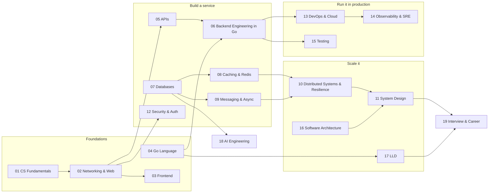

# Rebuild Plan

> [!summary] Verdict
> All 382 notes were reviewed one by one. The per-note results are in the six audit files listed at the end.
> - Only **11 notes can stay as they are**, and all of them are LLD practice solutions.
> - About half the vault is a one-line definition wrapped in roughly 140 lines of the same template.
>
> The plan is to build a new 20-folder structure that goes from basics to advanced. It uses one template and one note per concept, and the rewrite goes one folder at a time. An old note is deleted only after its replacement is written and checked.

## 1. What the review found

### By area

| Old area                                                                | Notes   | Keep   | Polish | Rewrite | Merge   | Split  | Delete | Depth 0–1 | Depth 4–5 |
| ----------------------------------------------------------------------- | ------- | ------ | ------ | ------- | ------- | ------ | ------ | --------- | --------- |
| APIs, security, Docker, Redis, AWS, deployment                          | 67      | 0      | 9      | 39      | 10      | 2      | 7      | 30        | 3         |
| Databases, distributed systems, system design, reliability, performance | 74      | 0      | 18     | 43      | 9       | 0      | 4      | 46        | 0         |
| Observability, testing, architecture, AI/RAG, roadmaps                  | 49      | 0      | 8      | 22      | 11      | 2      | 6      | 32        | 0         |
| Golang backend                                                          | 57      | 0      | 1      | 31      | 16      | 6      | 3      | 35        | 0         |
| bytes GO complete (fundamentals, frontend)                              | 76      | 0      | 2      | 14      | 45      | 4      | 11     | 48        | 0         |
| LLD with Go                                                             | 60      | 11     | 22     | 3       | 23      | 1      | 0      | 3         | 19        |
| **Total**                                                               | **383** | **11** | **60** | **152** | **114** | **15** | **31** | **194**   | **22**    |

383 = 382 notes plus the SDE3 roadmap drawing. Of the 17 Excalidraw drawings, the 15 LLD ones are kept and the 2 empty scratch drawings are deleted.

**Depth scale:**
- **0:** definition only.
- **1:** a few bullets.
- **2:** part of the mechanism, no example.
- **3:** decent but shallow.
- **4:** solid.
- **5:** complete from basic to advanced.

### The 8 problems

1. **Template filler.**
   - 44% of all lines are text repeated in 4 or more notes. The same nine generic sections ("Senior interview bank", "Topic-specific drill", "Reviewer checklist"…) are pasted into about 160 notes.
   - Their questions often belong to another topic. The CAP Theorem note asks about indexes and migrations, and 21 notes carry the "how to run a system design interview" question bank.
2. **Thin content.**
   - 194 of 383 notes (51%) score 0–1. Only 22 reach 4–5, and 19 of those are LLD.
   - Mechanisms are never explained: MVCC, B-tree vs LSM, WAL, Raft, 2PC, fencing tokens, the Go scheduler and GC.
3. **Wrong facts and broken code: about 160 errors.** The most important ones are in [[#2. Errors that matter most]].
4. **Duplication.**
   - `Go Backend Complete Notes` is a 3,862-line copy of 55 other notes.
   - Single ideas are split across many notes: Docker across 13, caching 10+, idempotency and webhooks 7, CDN 4, sharding 4, WebSocket 4, monolith vs microservices 3.
5. **Broken navigation.**
   - 47 hub notes (12% of the vault) give 5 different study orders. START HERE puts Docker before databases and Go last.
   - 106 notes cannot be reached from any hub.
   - The LLD notes link nowhere, and nothing links to them.
6. **Big gaps.** 86 topics have no note at all:
   - OS basics: processes, virtual memory, syscalls, epoll.
   - Networking: TCP, HTTP/2 and HTTP/3, the TLS handshake.
   - Database internals.
   - Distributed algorithms.
   - The Go runtime.
   - Modern AI engineering: structured outputs, tool calling, MCP, evals.
   - 13 classic system-design case studies.
7. **Your own material is mostly screenshots.**
   - The reviewers opened 93 of the 149 images. Every one was a frame from a course (ByteByteGo, Namaste React, Hussein Nasser, Net Ninja, a Hindi Docker/Redis course and others), and none was drawn by you. 4 of them show a presenter's face or the YouTube player.
   - Your handwritten lines are short, and a few are wrong. The rebuild keeps your points and corrects them.
8. **Tool damage.**
   - An auto-linker linked words by spelling, not meaning. CPU cache links to the Redis caching note, and links were injected inside code (`fetch('[[…|https]]://…')`).
   - A formatter broke CSS selectors (`#hero` became `# hero`).
   - 25 JS/React notes have no code fences, so JSX renders as HTML.
   - 172 colour spans (`sd-*`) never render.
   - No note has frontmatter.
   - The Excalidraw plugin is not installed on this Mac, so the 15 LLD drawings show as compressed text.

### What is worth keeping

- **LLD practice.**
  - All 15 full solutions compile and pass `go vet` and `go test -race`, with 86–100% test coverage.
  - The 10-step interview method and the 15 Excalidraw drawings are kept as well.
  - The SQL inside them (partial unique indexes, `SKIP LOCKED`, `EXCLUDE USING gist`) is better than anything in the database notes.
- **The best non-LLD notes (depth 3–4):** CDN, Caching Patterns and Types, File Upload Architecture, Cassandra, Advanced Index Types, Sharding Patterns, Search Architecture, Time Series, Vector Database Architecture.
- **Your InvoiceOps project (Gin + Postgres).** It becomes the running example for caching and the Go capstone.
- **Your topic list.** What you chose to learn is right. The rebuild keeps every topic and adds the missing foundations.

## 2. Errors that matter most

The full lists, with one quote and one fix per error, are in the audit files.

| Note                         | Says                                                                                     | Actually                                                                                                                                                                                       |
| ---------------------------- | ---------------------------------------------------------------------------------------- | ---------------------------------------------------------------------------------------------------------------------------------------------------------------------------------------------- |
| Database Replication         | A replica keeps a backup copy                                                            | Deletes and corruption replicate too. Backups need point-in-time recovery.                                                                                                                     |
| Transactions                 | Isolation prevents overselling                                                           | Not at READ COMMITTED (the Postgres default). Use a conditional `UPDATE … WHERE stock >= n`, `SELECT … FOR UPDATE`, or SERIALIZABLE with retry.                                                |
| Idempotency (diagram)        | Check the key, then insert                                                               | Two retries both pass the check. Claim the key first with `INSERT … ON CONFLICT DO NOTHING`.                                                                                                   |
| Design Payment System        | Write the ledger after charging the provider                                             | A crash in between loses the record. Save the intent and the idempotency key before the call, and send the same key to the provider.                                                           |
| Distributed Locks            | TTL + owner value + safe unlock is enough                                                | A paused client can still write after its lock expired. You need fencing tokens that the storage checks.                                                                                       |
| Rate limiting with Redis     | `INCR`, then `EXPIRE`                                                                    | Not atomic. A crash between the two leaves a key with no TTL, and the user stays blocked forever. Run `INCR` and `EXPIRE key 60 NX` together in `MULTI`/`EXEC`, or use a Lua script.           |
| Quorum Reads and Writes      | With R + W > N the replicas agree                                                        | They only acknowledge. R + W > N alone is not linearizable.                                                                                                                                    |
| Go Concurrency               | Send, then receive on `make(chan Job)` in the same goroutine                             | Deadlocks. An unbuffered send blocks until another goroutine receives.                                                                                                                         |
| Go Deep Basics               | A recover middleware returns 500 without crashing                                        | It never logs the panic, and after a partial write the client gets 200 with a broken body. `net/http` already recovers handler panics; a panic in a goroutine the handler starts still kills the process. |
| Go Transactions, Workers     | Enqueue a job inside the transaction, or right after commit                              | That is a dual write: one side can succeed without the other. Write an outbox row in the same transaction.                                                                                     |
| Docker (your notes)          | Port mapping goes container port → container port; `docker ps` shows all containers      | It goes host port → container port. All containers need `docker ps -a`.                                                                                                                        |
| JavaScript functions         | A `const` function expression works before its line because of hoisting                  | It throws a ReferenceError (temporal dead zone).                                                                                                                                               |
| LLD Vending Machine          | Greedy change-making is optimal for INR                                                  | Only with unlimited coins. With a coin box of {50×1, 20×3}, price 40 and 100 paid, the note's code reports "no change" although 3×20 works.                                                   |
| LLD pattern notes            | Every pattern runs as one `main.go`                                                      | Factory, Facade and Mediator do not compile. Decorator blocks forever on `ListenAndServe`. Mediator's code is a copy of Facade's.                                                             |

## 3. New architecture

### Learning map

### Folders

| Folder                              | Notes | Covers                                                                                                         | Built mostly from                                                        |
| ----------------------------------- | ----- | -------------------------------------------------------------------------------------------------------------- | ------------------------------------------------------------------------ |
| 00 Home                             | –     | Home, conventions, progress view, templates                                                                    | the 47 hub notes, merged                                                 |
| 01 CS Fundamentals                  | 27    | how a computer runs a program, memory and storage, OS basics, data structures, Big-O                           | ByteByteGo memory/storage, data structures, cache, latency; 12 new       |
| 02 Networking & Web                 | 14    | IP, DNS, TCP/UDP/QUIC, HTTP 1.1/2/3, TLS, HTTP caching, CDN, proxies, Nginx                                    | ByteByteGo DNS; api design CDN/proxy; aws TLS; 10 new                     |
| 03 Frontend                         | 12    | browser rendering, CSS, JavaScript, React                                                                      | ByteByteGo CSS, js, React                                                |
| 04 Go Language                      | 23    | basics → concurrency → generics → runtime internals → profiling                                                | golang backend (language half); LLD concurrency/errors/testing           |
| 05 APIs                             | 15    | REST, contracts, errors, pagination, versioning, idempotency, webhooks, GraphQL, gRPC, protobuf, real-time, gateways | Api architecture; api design                                       |
| 06 Backend Engineering in Go        | 29    | building a Go service end to end, plus the InvoiceOps capstone                                                 | golang backend (service half)                                            |
| 07 Databases                        | 23    | SQL, transactions, indexes, storage engines, isolation/MVCC, replication, sharding, NoSQL, search, time-series | database; data modeling                                                  |
| 08 Caching & Redis                  | 12    | caching patterns, invalidation, eviction, failure modes, Redis internals and operations                        | redis; cache notes                                                       |
| 09 Messaging & Async                | 15    | queues vs streams, delivery semantics, DLQ, outbox, Kafka, schedulers, workflow engines                        | reliability; Redis queue                                                 |
| 10 Distributed Systems & Resilience | 20    | timeouts, retries, circuit breakers, CAP, consistency, consensus, locks, sagas, CRDTs, multi-region            | distributed systems; reliability                                         |
| 11 System Design                    | 29    | fundamentals, estimation, building blocks, and 17 case studies                                                 | system design; practice; performance                                     |
| 12 Security & Auth                  | 12    | authn/authz, passwords, sessions, JWT, OAuth/OIDC, CORS/CSRF/XSS, OWASP API, secrets                           | auth security                                                            |
| 13 DevOps & Cloud                   | 29    | cloud basics · `Docker/` (9) · `Delivery and Kubernetes/` (6) · `AWS/` (12)                                     | docker; deployment; cloud deployment; aws; cloud native                  |
| 14 Observability & SRE              | 14    | logs/metrics/traces, SLOs, alerting, incidents, debugging playbooks, capacity                                  | observability; production debugging; performance                         |
| 15 Testing                          | 10    | strategy, unit → E2E, test doubles, contract, fuzz, async, load, chaos, CI                                     | testing strategy                                                         |
| 16 Software Architecture            | 12    | coupling/cohesion, monolith vs microservices, layered/hexagonal/clean, DDD, ADRs, strangler fig                | architecture patterns                                                    |
| 17 LLD                              | 51    | method, principles, SOLID, UML, 16 pattern notes, 26 practice problems                                         | LLD with Go (mostly kept)                                                |
| 18 AI Engineering                   | 20    | LLMs, prompting, structured output and tools, embeddings, vector DBs, RAG and evals, agents, MCP, production  | ai engineering; rag                                                      |
| 19 Interview & Career               | 6     | roadmap, readiness checklist, resources, Go traps, LLD round playbook, company rounds                          | roadmaps, checklists, coverage maps                                      |
| Assets                              | –     | `Images/` and `Drawings/`                                                                                      | used screenshots and drawings                                            |

**373 topic notes**, plus one map note (MOC) per folder and Home. Every note, its level and the old notes it replaces are listed in [[Rebuild Tracker]].

### Conventions

- **One concept, one note.** Other notes link to it instead of repeating it.
- **Names.**
  - Plain Title Case, with no typos.
  - "Go …" appears only in 04 and 06.
  - Use ` - ` instead of `:` in file names.
- **Note structure.** Every topic note follows [[Topic Note Template]]:
  1. TL;DR
  2. why it exists
  3. mental model
  4. how it works, with a diagram
  5. worked example
  6. variants
  7. trade-offs
  8. in production
  9. deep dive
  10. interview Q&A
  11. cheat sheet
  12. links

  A section with nothing topic-specific to say is dropped, never filled.
- **Frontmatter on every note:** `tags`, `level` (basic / intermediate / advanced), `status` (draft / reviewed / done), `prereqs`, `related`, `sources`, `updated`.
- **One map note per folder** (`NN Name MOC`): its notes in learning order with levels, a concept diagram, and what comes before and after.
- **Diagrams.**
  - Mermaid inside notes (flowchart, sequence, state, class, ER).
  - Excalidraw for hand-drawn sketches, exported as SVG beside the drawing so they show everywhere.
- **Code.**
  - Go 1.24. It compiles, and logic code ships with a test.
  - JavaScript appears only in 03 Frontend.
- **Images.**
  - They live in `Assets/Images/<NN folder>/`.
  - No third-party screenshots go in notes meant for sharing.
- **Links.** Added by hand, by meaning. Every auto-link is removed.

### What a rebuilt note looks like

[[Consistent Hashing]] next to the old `Consistent Hashing` note:

| | Old note | Rebuilt sample |
| --- | --- | --- |
| Content | 160 lines; one real sentence, repeated 3 times | The problem, with measured numbers |
| Key numbers | none | Adding a 5th server moves **80%** of keys with `hash % N`, but **19%** with a ring |
| Diagrams | one generic diagram | 3 diagrams and a before/after table |
| Code | none | Go code checked with `go vet` and `go test -race` |
| Interview questions | about slow databases, not hashing | 6 interview Q&As on the topic |
| Other sections | none | Six schemes compared; real systems (Dynamo, Cassandra, Nginx, Envoy); a deep dive on vnode count and hash quality |

## 4. How the rebuild runs

> [!warning] Before anything changes
> Obsidian Sync is on, so every change reaches your other devices. The vault is not under version control yet. Phase 0 fixes that first.

### Phase 0: Safety (once)
1. Turn the vault into a git repository and commit everything as it is today. The existing `.gitignore` already skips workspace and cache files. Every later step is its own commit, so anything can be undone.
2. Install the Excalidraw community plugin on this Mac (Settings → Community plugins → Browse → "Excalidraw").
3. While a batch is running, do not edit the same notes from another device.

### Phase 1: Skeleton (one round)
- Create the folders `00 Home` … `19 Interview & Career`, plus `Assets/`.
- Write the four Home notes:
  - **Home:** the learning map, three paths (full / 4-week interview sprint / Go builder) and the study method.
  - **Conventions**
  - **Topic note template**
  - **Map-note template**
- Point the Templates and Attachments settings at the new folders.
- Add a progress view using Obsidian Bases, grouped by `status`, and confirm it opens on your Obsidian version. The tracker checklist is the fallback.

### Phase 2: Quick fixes (one round, before the long rewrite)
- **Delete pure duplicates and dead files:**
  - `Go Backend Complete Notes`, after moving its 9 unique links into Learning Resources
  - the 2 empty drawings
  - the orphan and duplicate images (listed in audits A, C and E)
- **Fix the wrong LLD code:**
  - Factory, Facade, Mediator and Decorator
  - Vending change-making, Delivery's lock, Notification's retry
  - missing `fmt` imports
- **Remove links** injected inside code blocks, plus the wrong-context auto-links.

### Phase 3: Rewrite, one folder per round (most of the work)
For each folder:
1. Read the audit blocks of its source notes: the must-cover outline, the errors to fix, and your content to keep.
2. Write the notes in learning order from the template.
3. Check every note:
   - Go code passes `go vet` and `go test -race`.
   - Every error the audit found is fixed.
   - Numbers are measured or sourced.
   - Mermaid renders and links resolve.
   - No template filler remains (a lint script rejects the old boilerplate phrases).
4. Write the folder's map note and tick [[Rebuild Tracker]].
5. Delete the replaced old notes and their screenshots, and repoint any links to them.
6. You review the folder in Obsidian. Then the next folder starts.

### Phase 4: Finish
- Write 19 Interview & Career and do the final Home pass.
- Add cross-links between folders, for example LLD Rate Limiter ↔ 11 Rate Limiting ↔ 08 Redis.
- Check for orphan notes and lint every note.
- The old top-level folders (`advance backend`, `Api architecture`, `bytes GO complete thimh`, `LLD with Go`, `Excalidraw`) are empty by now; remove them.

### Phase 5: Share
Pick a way to share:
- export a folder to PDF
- Obsidian Publish
- a free static site with Quartz, which renders wikilinks, callouts and Mermaid

Third-party screenshots never go into the shared version.

## 5. Rewrite order

Your order, mapped onto the new folders:

| Stage | Your words                                       | Folders, in order                                                                                                                                                                                     | Notes |
| ----- | ------------------------------------------------ | ----------------------------------------------------------------------------------------------------------------------------------------------------------------------------------------------------- | ----- |
| 1     | advance backend + API architecture (they merge)  | 07 Databases → 08 Caching & Redis → 09 Messaging & Async → 10 Distributed Systems & Resilience → 11 System Design → 05 APIs → 12 Security & Auth → 04 Go Language → 06 Backend in Go → 13 DevOps & Cloud → 14 Observability & SRE → 15 Testing → 16 Software Architecture → 18 AI Engineering | 263   |
| 2     | bytes GO complete                                | 01 CS Fundamentals → 02 Networking & Web → 03 Frontend                                                                                                                                                | 53    |
| 3     | LLD with Go                                      | 17 LLD: mostly moving, fixing and merging pattern notes, plus 10 new practice problems                                                                                                                | 51    |
| 4     | finish                                           | 19 Interview & Career, Home, final checks                                                                                                                                                             | 6     |

Why this order inside Stage 1:
- Databases come first, because caching, messaging, distributed systems and system design all build on them.
- System design case studies come after their building blocks.
- The Go notes come after the concepts their code demonstrates.

## 6. Decisions needed from you

1. **Frontend (03, 12 notes).** Keep all of it, keep the 5 core notes, or drop it. The 5 core notes are browser rendering, JS core, JS async, React fundamentals and React rendering. *Recommendation: keep the 5 core notes.*
2. **Screenshots (149, course frames as far as checked).** *Recommendation:*
   - No screenshots inside new notes; redraw the ~16 useful ones in Mermaid.
   - Move the rest to `Assets/Legacy Screenshots/` for personal reference, never shared.
   - Delete the 4 that show a presenter's face.
3. **Old notes after replacement.** *Recommendation: delete them (git keeps every version) rather than keep an archive folder.*
4. **Who writes.** Two options:
   - **Me in chat.** I write a few notes per turn and you see each one.
   - **A multi-agent workflow per folder.** Writer agents work in parallel, with a checker per note for facts, compiling and links. It is much faster, but costs roughly 30–60k tokens per note: about 1M tokens for a 20-note folder, around 15M for the whole vault (rough estimate). Say "use a workflow" to switch it on.
5. **Note style.** Open [[Consistent Hashing]]. Is that the right depth and length for every note?

## 7. Detailed audits

- [[Audit A - APIs, Security, Docker, Redis, Cloud]]: 67 notes
- [[Audit B - Databases, Distributed Systems, System Design]]: 74 notes
- [[Audit C - Observability, Testing, Architecture, AI, Navigation]]: 49 notes, plus the navigation redesign
- [[Audit D - Go Backend]]: 57 notes
- [[Audit E - ByteByteGo Fundamentals and Frontend]]: 76 notes, plus the image audit
- [[Audit F - LLD with Go]]: 60 notes, 17 drawings, and compile results
- [[Rebuild Tracker]]: all 373 new notes, with checkboxes
- [[Topic Note Template]] · [[Consistent Hashing]]

Nothing outside `00 Rebuild/` was changed during this review.
