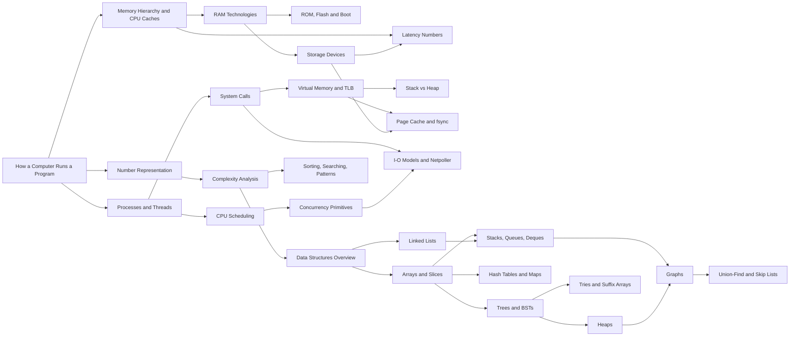

# 01 CS Fundamentals MOC

> [!summary] What this folder covers
> How a computer actually runs your Go service: CPU, memory hierarchy, storage, the operating system (processes, syscalls, virtual memory, scheduling, I/O), and the core data structures with their Big-O costs. After this folder you can reason about why code is fast or slow and answer the classic fundamentals and DSA interview questions.

## Before and after

- **Before this:** nothing; this is a starting point
- **After this:** [[02 Networking & Web MOC]] · [[04 Go Language MOC]] · [[07 Databases MOC]]

## Learning path

Back to [[Home]].

### Hardware and the cost of things

1. [[How a Computer Runs a Program]] · basic. From source code to instructions executing on a CPU core. · Go code: [[How a Computer Runs a Program - Go]]
2. [[Memory Hierarchy and CPU Caches]] · basic. Why cache lines and locality decide real-world speed. · Go code: [[Memory Hierarchy and CPU Caches - Go]]
3. [[RAM Technologies - SRAM, DRAM, DDR, GDDR, HBM]] · basic. What main memory is physically made of and why it trades speed for size. · Go code: [[RAM Technologies - SRAM, DRAM, DDR, GDDR, HBM - Go]]
4. [[ROM, Flash, Firmware and the Boot Process]] · basic. What happens between pressing power and the kernel running. · Go code: [[ROM, Flash, Firmware and the Boot Process - Go]]
5. [[Storage Devices - HDD, SSD, NVMe]] · basic. Seek times, flash pages and why NVMe changed the I/O picture. · Go code: [[Storage Devices - HDD, SSD, NVMe - Go]]
6. [[Latency Numbers Every Engineer Should Know]] · basic. The order-of-magnitude table behind every design estimate. · Go code: [[Latency Numbers Every Engineer Should Know - Go]]
7. [[Number Representation and Text Encoding]] · basic. Two's complement, floats, endianness and UTF-8 versus Go runes. · Go code: [[Number Representation and Text Encoding - Go]]
8. [[Complexity Analysis - Big-O and Amortized Cost]] · basic. The cost model used by every algorithm note that follows. · Go code: [[Complexity Analysis - Big-O and Amortized Cost - Go|Complexity Analysis - Big-O and Amortized Cost - Go]]

### Operating system

9. [[Processes, Threads and Context Switching]] · intermediate. What a process and a thread are, and what a context switch costs. · Go code: [[Processes, Threads and Context Switching - Go]]
10. [[System Calls and User vs Kernel Mode]] · intermediate. How a program asks the kernel for help and why that crossing is expensive. · Go code: [[System Calls and User vs Kernel Mode - Go]]
11. [[Virtual Memory, Paging and the TLB]] · intermediate. How every process gets its own address space and what a page fault is.
12. [[Process Memory Layout - Stack vs Heap]] · intermediate. Where values live, and the bridge to Go's escape analysis. · Go code: [[Process Memory Layout - Stack vs Heap - Go]]
13. [[Page Cache, File Systems and fsync]] · intermediate. Why a successful write is not a durable write. · Go code: [[Page Cache, File Systems and fsync - Go]]
14. [[CPU Scheduling]] · intermediate. How Linux shares cores, and why cgroup quotas throttle Go services. · Go code: [[CPU Scheduling - Go|CPU Scheduling - Go]]
15. [[Concurrency Primitives - Mutex, Semaphore, Atomics]] · intermediate. The building blocks for safely sharing memory between threads. · Go code: [[Concurrency Primitives - Mutex, Semaphore, Atomics - Go]]
16. [[I-O Models - Blocking, epoll, io_uring and the Go Netpoller]] · advanced. How one Go process serves thousands of connections. · Go code: [[I-O Models - Blocking, epoll, io_uring and the Go Netpoller - Go]]

### Data structures and algorithms

17. [[Data Structures Overview and Big-O Cheat Sheet]] · basic. One table to choose the right structure for the job. · Go code: [[Data Structures Overview and Big-O Cheat Sheet - Go]]
18. [[Arrays and Dynamic Arrays (Go Slices)]] · basic. Contiguous memory, slice headers and amortized append. · Go code: [[Arrays and Dynamic Arrays (Go Slices) - Go|Arrays and Dynamic Arrays (Go Slices) - Go]]
19. [[Linked Lists]] · basic. Pointer-chasing structures and the LRU cache pattern. · Go code: [[Linked Lists - Go]]
20. [[Stacks, Queues and Deques]] · basic. LIFO and FIFO, ring buffers, and the engines behind DFS and BFS. · Go code: [[Stacks, Queues and Deques - Go]]
21. [[Hash Tables and Go Maps]] · intermediate. Hashing, collisions, load factor and how Go maps grow. · Go code: [[Hash Tables and Go Maps - Go]]
22. [[Trees, BSTs and Balanced Trees]] · intermediate. Ordered lookups, balancing, and why databases use B+trees. · Go code: [[Trees, BSTs and Balanced Trees - Go]]
23. [[Heaps and Priority Queues]] · intermediate. Top-K problems, timers and schedulers. · Go code: [[Heaps and Priority Queues - Go]]
24. [[Graphs and Graph Algorithms]] · intermediate. BFS, DFS, Dijkstra, topological sort and MSTs. · Go code: [[Graphs and Graph Algorithms - Go]]
25. [[Tries, Suffix Trees and Suffix Arrays]] · advanced. Prefix search, autocomplete and HTTP routers. · Go code: [[Tries, Suffix Trees and Suffix Arrays - Go]]
26. [[Union-Find and Skip Lists]] · advanced. Kruskal's algorithm and the structure behind Redis sorted sets. · Go code: [[Union-Find and Skip Lists - Go]]
27. [[Sorting, Searching and Interview Patterns]] · intermediate. Sorting, binary search and the recurring interview patterns. · Go code: [[Sorting, Searching and Interview Patterns - Go]]

## Concept map

## Interview focus

- What is the difference between a process and a thread, and what does a context switch cost? See [[Processes, Threads and Context Switching]].
- What happens on a system call, and why are syscalls expensive? See [[System Calls and User vs Kernel Mode]].
- How does virtual memory work, and what is a TLB miss or a page fault? See [[Virtual Memory, Paging and the TLB]].
- Stack versus heap: where does a Go value live, and why does it matter? See [[Process Memory Layout - Stack vs Heap]].
- Why does `write()` returning success not mean the data is on disk? See [[Page Cache, File Systems and fsync]].
- How does epoll let one process handle thousands of connections? See [[I-O Models - Blocking, epoll, io_uring and the Go Netpoller]].
- Mutex versus semaphore versus atomic: when do you use each? See [[Concurrency Primitives - Mutex, Semaphore, Atomics]].
- How does a hash map work, and what happens when it grows? See [[Hash Tables and Go Maps]].
- Why is `append` amortized O(1)? See [[Complexity Analysis - Big-O and Amortized Cost]] and [[Arrays and Dynamic Arrays (Go Slices)]].
- Design an LRU cache, or find the top K elements. See [[Linked Lists]] and [[Heaps and Priority Queues]].

## Sources worth reading

- Bryant and O'Hallaron, *Computer Systems: A Programmer's Perspective* (CS:APP).
- Arpaci-Dusseau and Arpaci-Dusseau, *Operating Systems: Three Easy Pieces* (free online at ostep.org).
- Ulrich Drepper, "What Every Programmer Should Know About Memory" (2007).
- Cormen, Leiserson, Rivest and Stein, *Introduction to Algorithms* (CLRS).
- Brendan Gregg, *Systems Performance* (2nd edition).
- The Go source and blog posts on slices, maps and the runtime (go.dev/blog).
