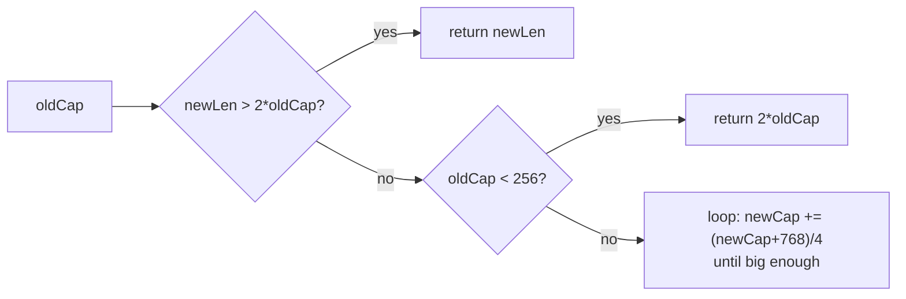
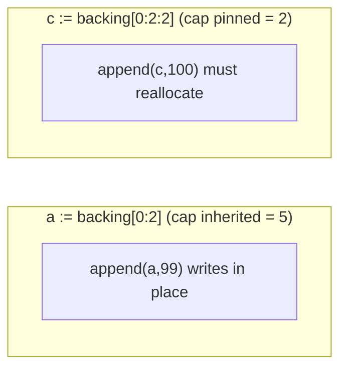

# Arrays and Dynamic Arrays (Go Slices) - Go

> [!summary] TL;DR
> A Go package demonstrating the growth formula, insert/delete, row-major 2-D indexing, and five classic array/slice interview patterns from [[Arrays and Dynamic Arrays (Go Slices)]], all backed by passing tests.

> [!info] How to read this note (pick your level)
> - 🟢 **New to this?** Read "From zero" below, then "Before the code", "What this code shows" and "Running it". You do not need to understand every line yet.
> - 🟡 **Know the basics?** Work through the Code steps 1-4 and the Tests.
> - 🔴 **Interview / SDE-3 prep?** Add Design decisions, Pitfalls and the Exercises. Headings are tagged 🟢🟡🔴 so you always know where you are.

> [!note] Before this note
> - [[Data Structures Overview and Big-O Cheat Sheet]]: `O(1)` means "same cost at any size" and `O(n)` means "cost grows with the input". Read [[Arrays and Dynamic Arrays (Go Slices)]] first too: a slice is a small card (`ptr`, `len`, `cap`) pointing at a row of boxes.

**From zero, in 60 seconds** 🟢

This file is the runnable half of [[Arrays and Dynamic Arrays (Go Slices)]]. The theory note explains slices in words and pictures; this one proves the same ideas with real Go code and passing tests. Read it top to bottom: each "Step" shows a small piece of code, then explains it line by line. If a code block looks scary, read the bolded plain-words line above it and the numbered "How it works" list below it — the code is just those sentences written in Go.

## Before the code 🟢

- **Slices** (`[]int`): Go's growable list, a header (`ptr`, `len`, `cap`) over a backing array.
- **`append` and `copy`**: built-ins that grow a slice and move elements; `copy` handles overlapping ranges safely.
- **Generics** (`func Insert[T any]`): one function that works for any element type `T`.
- **Full slice expression** (`s[low:high:max]`): a sub-slice whose capacity is capped at `max`.
- **Closures** (`canFinish := func(...)`): a function value that can read local variables like `piles` and `h`.
- **What to run:** `go vet ./... && go test -race -v ./...` inside the module. No goroutines or interfaces are needed here.

## What this code shows 🟢

| Code | Concept in [[Arrays and Dynamic Arrays (Go Slices)]] |
| --- | --- |
| `NextCap` | The documented growth formula, [[Arrays and Dynamic Arrays (Go Slices)#append and growth, step by step]] |
| `Insert`, `Delete` | O(n) middle insert/delete by shifting, [[Arrays and Dynamic Arrays (Go Slices)#4. Worked example 🟡]] |
| `RowMajorIndex` | Flat row-major 2-D layout, [[Arrays and Dynamic Arrays (Go Slices)#4. Worked example 🟡]] |
| `TestAliasing` | Two slices sharing a backing array, and the full slice expression that stops it, [[Arrays and Dynamic Arrays (Go Slices)#Aliasing: two tickets, one lot]] |
| `TwoSumSorted`, `MaxWindowSum`, `PrefixSums`/`RangeSum`, `MaxSubArray`, `MinEatingSpeed` | The five classic interview patterns the theory note's cheat sheet points to here |

## Setup 🟢

- Module `arrdyn`, Go 1.24, standard library only, two files of production code (`slice.go`, `patterns.go`) and two test files.
- Run: `go vet ./... && go test -race -v ./...`

## Code 🟡

> 🟢 → 🟡 **You now know** what the package contains and how to run it. **Next we read the code itself**, one small piece at a time: the growth rule, insert and delete, the aliasing proof, then five interview patterns. Each step has a plain-words line first, so you can follow even if Go syntax is new.

### Step 1: the growth formula

**In plain words:** this function answers one question — when a slice runs out of room, how big should the new row of boxes be? Double it when small, grow more gently when big.

**Concept.** [[Arrays and Dynamic Arrays (Go Slices)#append and growth, step by step]] describes `append`'s growth rule in words; `NextCap` is that rule as a function, so it can be tested against the measured table directly instead of trusting the description alone.

The alternative design — always doubling — is simpler but wastes more memory at large capacities, which is why the real runtime decays toward 1.25x above 256 elements.

```go
// NextCap implements the documented two-phase growth decision from the Go
// runtime (runtime/slice.go, nextslicecap, Go 1.18+): below a 256-element
// threshold capacity doubles; above it, growth decays toward 1.25x. The
// actual allocator then rounds the result up to the nearest size class,
// which is why measured capacities are slightly larger than this formula's
// raw output.
func NextCap(oldCap, newLen int) int {
	if newLen > 2*oldCap {
		return newLen
	}
	const threshold = 256
	if oldCap < threshold {
		return 2 * oldCap
	}
	newCap := oldCap
	for newCap < newLen {
		newCap += (newCap + 3*threshold) / 4
	}
	return newCap
}
```

**How it works.**

1. Line 2 handles a huge single append: if the new length is more than double the old capacity (e.g. `append(s, manyElements...)`), there is no point doubling repeatedly — jump straight to `newLen`.
2. Below the 256-element `threshold`, capacity simply doubles.
3. At or above it, the `for` loop repeatedly applies the 1.25x-ish decay formula (`newcap += (newcap + 3*threshold) / 4`) until the capacity is big enough, matching what the runtime does internally.
4. This function returns the *raw* formula output; the real allocator additionally rounds up to a size class (see the theory note's deep dive), which is why `512, 513 -> 832` here but the measured table shows `848`.



### Step 2: insert, delete and 2-D indexing

**In plain words:** to squeeze a value into the middle of a packed row, everything after it has to shuffle one spot over — like people sliding down a full bench to make room.

**Concept.** `Insert` and `Delete` are the code form of the "shift the elements after the gap" picture in [[Arrays and Dynamic Arrays (Go Slices)#4. Worked example 🟡]]: there's no way to make or close a gap in contiguous memory without moving everything on one side of it.

`RowMajorIndex` is the one-line arithmetic behind the flat-array 2-D layout diagram in the same section.

Both are generic (`[T any]`) so the same code works for any element type, which is the idiomatic Go alternative to writing one version per type.

```go
// Insert inserts v at index i, shifting everything after it one place right.
// O(n) because every following element moves.
func Insert[T any](s []T, i int, v T) []T {
	var zero T
	s = append(s, zero)
	copy(s[i+1:], s[i:])
	s[i] = v
	return s
}

// Delete removes the element at index i, shifting everything after it one
// place left. O(n). It clears the now-unused last slot so a pointer or
// interface value there doesn't keep its target alive.
func Delete[T any](s []T, i int) []T {
	copy(s[i:], s[i+1:])
	var zero T
	s[len(s)-1] = zero
	return s[:len(s)-1]
}

// RowMajorIndex maps a (row, col) pair in a width-column grid to the index
// in a flat, row-major []T. Row-major means row 0's elements come first,
// then row 1's, and so on.
func RowMajorIndex(row, col, width int) int {
	return row*width + col
}
```

**How it works.**

1. `Insert` first grows the slice by one slot (`append(s, zero)`, a throwaway placeholder), then `copy(s[i+1:], s[i:])` shifts everything from index `i` onward one place to the right, then writes `v` into the now-empty slot `i`.
2. `copy` is used rather than a manual loop because Go's `copy` correctly handles overlapping source and destination ranges (it copies in the safe direction internally).
3. `Delete` does the mirror operation: shift everything after `i` one place left, then truncate the slice by one and clear the vacated last slot so a reference type there doesn't keep a dead object alive (a subtle garbage-collector interaction — see [[Arrays and Dynamic Arrays (Go Slices)#4. Worked example 🟡]]'s aliasing-leak trap for the same idea applied to sub-slices).
4. `RowMajorIndex` is pure arithmetic: row `r`, column `c`, width `w` maps to flat index `r*w + c` — row 0 occupies indices `0..w-1`, row 1 occupies `w..2w-1`, and so on.

### Step 3: aliasing and the full slice expression

**In plain words:** this test proves that two slices can secretly share the same memory, so writing through one changes the other — and shows the one-line trick that stops it.

**Concept.** This test is the proof, not just the description, of [[Arrays and Dynamic Arrays (Go Slices)#Aliasing: two tickets, one lot]]: two slices sharing a backing array really do see each other's writes, and `s[low:high:max]` really does stop that by pinning capacity so the next `append` is forced onto a new array.

```go
func TestAliasing(t *testing.T) {
	backing := []int{1, 2, 3, 4, 5}
	a := backing[0:2] // len=2, cap=5: shares backing's array
	b := append(a, 99)
	if backing[2] != 99 {
		t.Fatalf("expected append to alias and overwrite backing[2], got %d", backing[2])
	}
	if &b[0] != &backing[0] {
		t.Fatalf("expected b to still share backing's array")
	}

	// The full slice expression s[low:high:max] caps capacity at max, so an
	// append beyond it allocates a fresh array instead of aliasing.
	c := backing[0:2:2] // len=2, cap=2: cap pinned to len
	d := append(c, 100)
	if backing[2] != 99 {
		t.Fatalf("backing[2] should be untouched by the capped append, got %d", backing[2])
	}
	if &d[0] == &backing[0] {
		t.Fatalf("expected d to have a new backing array after growing past the pinned cap")
	}
}
```

**How it works.**

1. `a := backing[0:2]` has `cap == 5` (it inherits capacity from `backing`'s remaining room), so `append(a, 99)` has spare room and writes straight into `backing[2]` — the first assertion checks exactly this aliasing.
2. `&b[0] != &backing[0]` would mean `b` got a new array; the test asserts the opposite — they still share memory.
3. `c := backing[0:2:2]` is the three-index "full slice expression": it pins `cap(c)` to `2`, matching `len(c)`, so `c` has *no* spare room.
4. `append(c, 100)` therefore must allocate a new array; `&d[0] == &backing[0]` would mean it didn't, so the test asserts it's false.



### Step 4: the five interview patterns

**In plain words:** five famous interview tricks, all built on the same fact — a slice lets you jump to any index instantly and scan forward cheaply.

**Concept.** These five functions are what [[Arrays and Dynamic Arrays (Go Slices)]]'s cheat sheet calls "the five classic patterns" — two pointers, sliding window, prefix sums, Kadane's algorithm, and binary search on the answer.

All five rely only on the contiguous-memory properties from the theory note's section 3 (`O(1)` index access, cheap sequential scans); none needs a different data structure.

Alternative designs exist for some of them (e.g. a hash map for two-sum on an *unsorted* array, `O(n)` time and `O(n)` space) but are worse here because the input is already sorted or the problem has a monotonic structure to exploit.

#### Two pointers

**What this code does, in plain words:** in a sorted list, put one finger on the smallest number and one on the biggest; if their sum is too small move the left finger right, if too big move the right finger left, until they hit the target.

**Concept.** `TwoSumSorted` exploits the fact the input is already sorted: instead of checking every pair (`O(n²)`), one pointer starts at each end and the sum's comparison to the target tells you unambiguously which pointer to move.

The alternative — a hash map of seen values — works on *unsorted* input too, but costs `O(n)` extra space; here sortedness is given, so two pointers gets the same `O(n)` time for `O(1)` space.

```go
// TwoSumSorted finds a pair in a sorted slice that sums to target, using two
// pointers that close in from both ends. O(n) time, O(1) extra space — no
// need for the O(n) extra space a hash-map version would use.
func TwoSumSorted(sorted []int, target int) (int, int, bool) {
	lo, hi := 0, len(sorted)-1
	for lo < hi {
		sum := sorted[lo] + sorted[hi]
		switch {
		case sum == target:
			return lo, hi, true
		case sum < target:
			lo++
		default:
			hi--
		}
	}
	return 0, 0, false
}
```

**How it works.**

1. `lo` starts at index 0, `hi` at the last index.
2. If `sum == target`, both indices are returned immediately.
3. If `sum < target`, the only way to increase it is to move `lo` right (every element to the right of `lo` is larger or equal, since the slice is sorted).
4. If `sum > target`, symmetrically move `hi` left.
5. Each step discards one end permanently, so the loop runs at most `len(sorted)` times total — `O(n)`.

#### Sliding window

**What this code does, in plain words:** add up the first `k` numbers once, then slide the frame one step at a time, adding the new number that enters and subtracting the old one that leaves.

**Concept.** `MaxWindowSum` answers "largest sum of any `k` consecutive elements." The naive approach re-sums all `k` elements at every position (`O(n*k)`); the sliding-window trick instead updates one running sum by removing the element that just left the window and adding the one that just entered it, turning the whole scan into `O(n)`.

```go
// MaxWindowSum returns the largest sum of any k consecutive elements, sliding
// a fixed-size window one step at a time instead of resumming it from
// scratch at every position. O(n) time instead of the naive O(n*k).
func MaxWindowSum(nums []int, k int) int {
	sum := 0
	for i := 0; i < k; i++ {
		sum += nums[i]
	}
	best := sum
	for i := k; i < len(nums); i++ {
		sum += nums[i] - nums[i-k] // drop the element leaving the window, add the one entering it
		if sum > best {
			best = sum
		}
	}
	return best
}
```

**How it works.**

1. The first loop sums the initial window (indices `0..k-1`) once.
2. The second loop slides the window forward one index at a time: `nums[i]` enters, `nums[i-k]` leaves, and the running `sum` is adjusted by exactly those two terms rather than recomputed.
3. `best` tracks the maximum window sum seen so far across the whole slide.

#### Prefix sums

**What this code does, in plain words:** build a running total once (1, 3, 6, 10, ...), and then the sum of any stretch is just one total minus another.

**Concept.** `PrefixSums` trades one `O(n)` pre-processing pass for `O(1)` range-sum queries afterward, via `RangeSum`. Without it, each "sum of `nums[l..r]`" query costs `O(r-l)`; with a prefix array, it costs one subtraction, which matters when there are many range queries over the same data.

```go
// PrefixSums returns a length len(nums)+1 array where prefix[i] is the sum of
// nums[0:i]. One O(n) build then answers any "sum of a range" query in O(1)
// via RangeSum, instead of re-summing the range every time.
func PrefixSums(nums []int) []int {
	prefix := make([]int, len(nums)+1)
	for i, v := range nums {
		prefix[i+1] = prefix[i] + v
	}
	return prefix
}

func RangeSum(prefix []int, l, r int) int { return prefix[r+1] - prefix[l] }
```

**How it works.**

1. `prefix` is one element longer than `nums`, with `prefix[0] == 0` by construction (no elements summed yet).
2. `prefix[i+1] = prefix[i] + v` builds a running total: `prefix[i]` is "sum of the first `i` elements of `nums`."
3. `RangeSum(prefix, l, r)` answers "sum of `nums[l..r]`" as `prefix[r+1] - prefix[l]`: the total up to `r` minus the total up to (but not including) `l`.

#### Kadane's algorithm

**What this code does, in plain words:** walk the list keeping a running sum; whenever that sum drops below zero, throw it away and start fresh from the next number, and remember the best sum you ever saw.

**Concept.** `MaxSubArray` finds the maximum sum of any contiguous subarray, including when some elements are negative. The key insight is local: at each position, decide whether extending the running subarray or restarting fresh here gives a better total — a running sum that has gone negative can only drag down whatever follows it, so it's never worth keeping.

```go
// MaxSubArray is Kadane's algorithm: the maximum sum of any contiguous
// subarray, allowing negative numbers. At each index it decides whether
// extending the running subarray or restarting here is better — a running
// sum that's gone negative can only hurt what follows. O(n) time, O(1) space.
func MaxSubArray(nums []int) int {
	best, cur := nums[0], nums[0]
	for _, v := range nums[1:] {
		if cur < 0 {
			cur = v
		} else {
			cur += v
		}
		if cur > best {
			best = cur
		}
	}
	return best
}
```

**How it works.**

1. `cur` tracks the best sum of a subarray *ending exactly at the current position*.
2. If `cur` is negative, carrying it forward can only hurt the next element, so the algorithm restarts: `cur = v`.
3. Otherwise, it extends: `cur += v`.
4. `best` records the highest `cur` has reached at any point during the scan — that maximum is the answer, even though the subarray achieving it may have ended earlier than the last index.

#### Binary search on the answer

**What this code does, in plain words:** guess a speed, check "can I finish all piles in `h` hours at this speed?", and keep halving the range of guesses until you find the slowest speed that still works.

**Concept.** `MinEatingSpeed` doesn't binary-search the input array at all — it binary-searches the *space of possible answers* (eating speeds from 1 up to the largest pile), using a predicate (a yes/no check) that is monotonic (once it flips from no to yes, it stays yes): once a speed is fast enough to finish in time, every faster speed is too.

That monotonicity is exactly what licenses binary search here, the same shape used for rate-limit and capacity-planning searches.

```go
// MinEatingSpeed is "binary search on the answer": instead of searching the
// input array, it searches the space of possible eating speeds (1..the
// largest pile) for the smallest speed that still finishes every pile within
// h hours. This only works because "can finish at this speed" is monotonic
// (true for every speed at or above the answer, false below it) — the same
// shape as a capacity or rate-limit search.
func MinEatingSpeed(piles []int, h int) int {
	lo, hi := 1, 0
	for _, p := range piles {
		if p > hi {
			hi = p
		}
	}
	canFinish := func(speed int) bool {
		hours := 0
		for _, p := range piles {
			hours += (p + speed - 1) / speed // ceil(p / speed)
		}
		return hours <= h
	}
	for lo < hi {
		mid := lo + (hi-lo)/2
		if canFinish(mid) {
			hi = mid
		} else {
			lo = mid + 1
		}
	}
	return lo
}
```

**How it works.**

1. `hi` starts at the largest pile (eating at that speed always finishes any single pile in one hour).
2. `canFinish(speed)` computes, for a candidate speed, how many hours all piles take (`ceil(pile/speed)` summed), and reports whether that fits in `h`.
3. The loop is a standard binary search over `[lo, hi]`, except the thing being tested is "is this speed fast enough," not "does this element equal the target."
4. When the loop ends, `lo == hi` is the smallest speed for which `canFinish` is true — the monotonic boundary binary search is built to find.

## Design decisions 🔴

> 🟡 → 🔴 **You now know** what each function does and why it works. **Next comes the advanced part:** why the code was shaped this way, where it can break, and exercises to test yourself.

| Decision | Alternative | Trade-off |
| --- | --- | --- |
| `Insert`/`Delete` generic over `[T any]` | One copy per concrete type | No code duplication, at the cost of boxing (wrapping a value in an extra hidden container) for non-comparable usage patterns (not relevant here: no comparisons are made on `T`) |
| `NextCap` returns the raw formula output, not size-class-rounded | Replicate the allocator's size-class table too | Keeps the function focused on the growth *decision*; the measured table in the theory note shows the extra rounding separately |
| Patterns kept in their own file (`patterns.go`) | Mixed into `slice.go` | Matches the theory note's own split: core slice mechanics vs. the interview-pattern catalogue that builds on them |
| `TwoSumSorted` assumes sorted input | Hash-map two-sum for unsorted input | `O(1)` extra space instead of `O(n)`, but only valid because the precondition (sorted) holds |

## Tests 🟡

### TestNextCap

**Property.** `NextCap` must reproduce the documented growth rule at the known inflection points: doubling below 256, decaying above it, and jumping straight to `newLen` when the requested length is more than double the old capacity.

| oldCap | newLen | want |
| --- | --- | --- |
| 1 | 2 | 2 |
| 2 | 3 | 4 |
| 128 | 129 | 256 |
| 256 | 257 | 512 |
| 512 | 513 | 832 |

**What this code does, in plain words:** it feeds each row of the table above into `NextCap` and complains if the answer does not match the `want` column.

```go
func TestNextCap(t *testing.T) {
	cases := []struct{ oldCap, newLen, want int }{
		{1, 2, 2},
		{2, 3, 4},
		{128, 129, 256},
		{256, 257, 512},
		{512, 513, 832}, // raw formula; the allocator rounds this up to the 848 size class
	}
	for _, c := range cases {
		if got := NextCap(c.oldCap, c.newLen); got != c.want {
			t.Errorf("NextCap(%d,%d) = %d, want %d", c.oldCap, c.newLen, got, c.want)
		}
	}
}
```

A failure here would mean the growth model no longer matches the runtime's documented behavior — worth re-checking against a fresh `go run` growth-table measurement if the Go version changes.

### TestAliasing, TestInsertDelete, TestRowMajorIndex

**Property.** `TestAliasing` is shown in full above (Step 3): it proves both that aliasing happens and that the full slice expression prevents it.

`TestInsertDelete` checks that `Insert(2,3)` then `Delete(2)` round-trips `[1,2,4,5]` back to itself. `TestRowMajorIndex` checks one concrete coordinate: row 1, column 2, width 4 is flat index 6.

| Test | Input | Expected |
| --- | --- | --- |
| `TestInsertDelete` | `Insert([1,2,4,5], 2, 3)` then `Delete(..., 2)` | `[1,2,3,4,5]` then back to `[1,2,4,5]` |
| `TestRowMajorIndex` | `RowMajorIndex(1, 2, 4)` | `6` |

A failure in `TestInsertDelete` would mean the shift direction or the placeholder handling is wrong — the two operations are meant to be exact inverses of each other.

### TestTwoSumSorted, TestMaxWindowSum, TestPrefixSumsAndRangeSum, TestMaxSubArray, TestMinEatingSpeed

**Property.** Each pattern test checks one worked numeric case with a hand-verifiable answer.

| Test | Input | Expected |
| --- | --- | --- |
| `TestTwoSumSorted` | `[1,3,5,8,11]`, target `13` | indices `(2,3)` — `5+8=13` |
| `TestMaxWindowSum` | `[2,1,5,1,3,2]`, `k=3` | `9` (window `[5,1,3]`) |
| `TestPrefixSumsAndRangeSum` | `RangeSum` over `[1,2,3,4,5]`, range `[1,3]` | `9` (`2+3+4`) |
| `TestMaxSubArray` | `[-2,1,-3,4,-1,2,1,-5,4]` | `6` (subarray `[4,-1,2,1]`) |
| `TestMinEatingSpeed` | piles `[3,6,7,11]`, `h=8` | `4` |

A failure in any of these means the pattern's core logic (the pointer-movement rule, the window update, the prefix formula, the restart condition, or the monotonic predicate) has a bug.

These are the five patterns' textbook edge cases, so a wrong answer here usually generalizes to being wrong everywhere.

## Running it 🟢

```text
go vet ./... && go test -race ./...
```

Measured with `go test -race ./...` on Go 1.24.4, darwin/arm64 (2026-11-09):

```text
ok  	rollscratch/arrdyn	1.474s
```

**Reading the output.** `ok` means every test in the package passed, including under the race detector (a Go tool, `-race`, that catches two goroutines touching the same memory at once) (relevant here because none of this code is concurrent — the race detector run is a cheap extra check that nothing in `copy`/`append` usage is doing anything unsafe).

The elapsed time is dominated by compiling the test binary, not running the tests themselves, since none of them touch real I/O or sleep.

## Pitfalls in the code 🔴

- **`Insert`'s placeholder append.** `append(s, zero)` grows the slice by one *before* the shift; if `i` is out of range this panics with an index-out-of-range error rather than a friendlier one — production code would validate `i` first.
- **`Delete` assumes `i < len(s)`.** Same caveat: no bounds check, by design, to keep the function matching the theory note's description exactly.
- **`MinEatingSpeed`'s `canFinish` closure allocates** a new function value on each call if hoisted into a hot loop; here it's defined once per `MinEatingSpeed` call, which is fine, but capturing it in a loop that calls `MinEatingSpeed` repeatedly would not reuse it across calls.
- **`TestAliasing`'s pointer comparisons (`&b[0] != &backing[0]`)** only work because Go guarantees slices sharing a backing array also share element addresses; don't generalize this comparison to compare *values*, only to prove *aliasing*.

## Exercises 🔴

1. Change `Insert`'s placeholder line to insert at `i = len(s)` (append at the very end) and predict whether `copy(s[i+1:], s[i:])` does anything. Then run it and check.
2. In `NextCap`, change the threshold constant from `256` to `128` and predict which existing test case in `TestNextCap` would then fail. Run the test to confirm.
3. Rewrite `TwoSumSorted` to work on an *unsorted* slice using a map instead of two pointers, and write one test case comparing its time complexity trade-off (space used) against the original.

## Self-check 🟢🟡

> [!question]- Why does `Insert` call `append(s, zero)` before shifting?
> To grow the slice by one slot so there is room to shift everything right.

> [!question]- What does `RowMajorIndex(1, 2, 4)` return, and why?
> `6`: row 1 starts at index `1 × 4 = 4`, plus column 2.

> [!question]- What does `go test -race` add to a normal test run?
> It also watches for two goroutines touching the same memory at once (a data race).

> [!question]- In `TestAliasing`, why does `append(c, 100)` not touch `backing[2]`?
> `c := backing[0:2:2]` caps capacity at 2, so the append has no room and must build a new array.

> [!question]- Why does `NextCap(512, 513)` return 832 while the real runtime gives 848?
> `NextCap` returns the raw formula; the real allocator then rounds up to its nearest size class.

> [!question]- Why does `Delete` set the last slot to the zero value?
> So a pointer left there does not keep an object alive for the garbage collector.

## Links

- **Theory:** [[Arrays and Dynamic Arrays (Go Slices)]]
- **Related:** [[Linked Lists]], [[Pointers, Values and Escape Analysis]]
