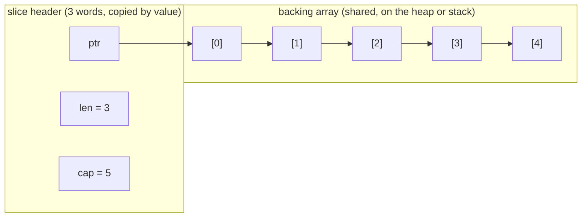
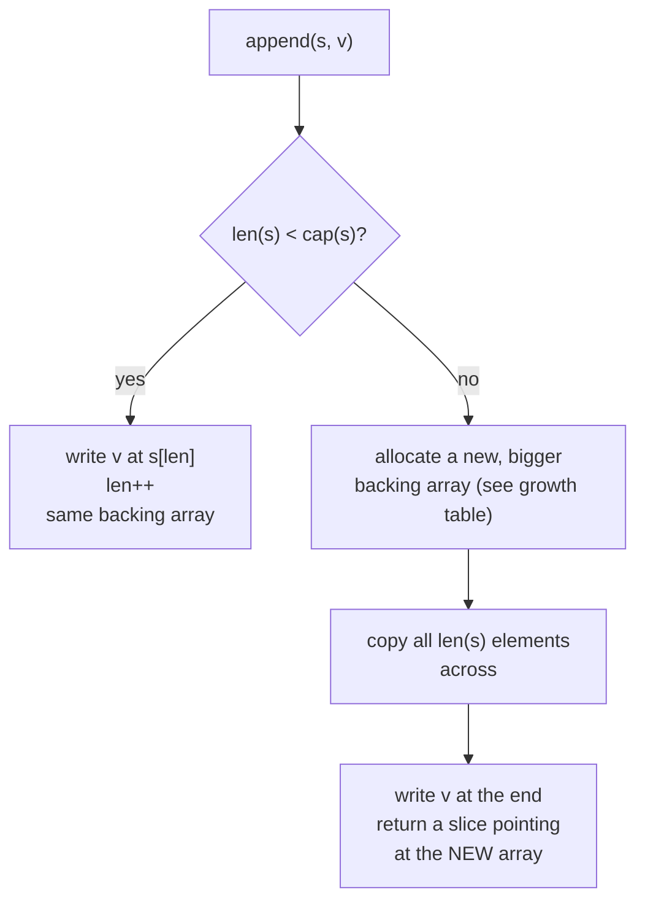
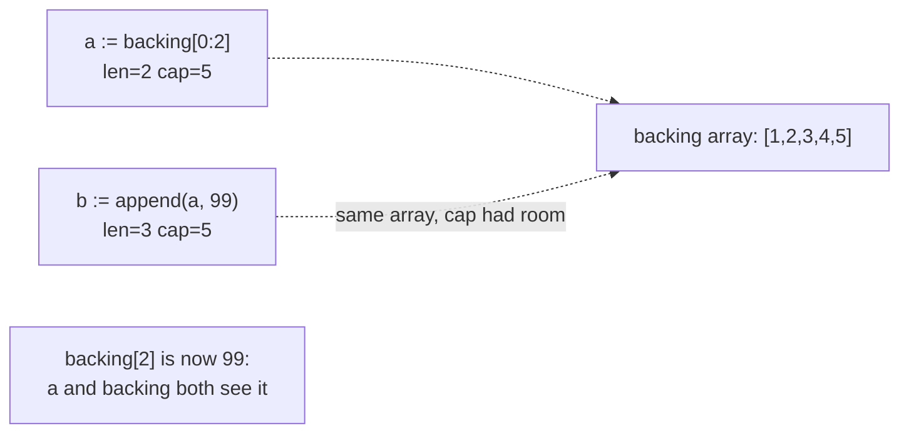

# Arrays and Dynamic Arrays (Go Slices)

> [!summary] TL;DR
> An array is a fixed number of values packed next to each other in memory, so `element i` is one address computation away. A Go slice is a small header — pointer, length, capacity — pointing at such a backing array, and `append` grows that backing array by copying into a bigger one when it runs out of room.

> [!abstract] Core idea
> - Contiguous memory means `O(1)` index access and excellent cache locality: reading element `i+1` right after element `i` is nearly free.
> - A Go slice is a 3-word header (`ptr`, `len`, `cap`); the header is copied by value, but it points at shared backing memory.
> - `append` only allocates a new backing array when `len == cap`; otherwise it writes in place. The growth factor is roughly 2x below 256 elements, decaying toward 1.25x above it.
> - Two slices can alias the same backing array. Writing through one can silently change what the other sees, until an `append` on one of them grows past its capacity.

## 1. Why it exists

Say you're processing a day's worth of sensor readings, one `float64` per second: 86,400 values. If you store them as 86,400 separately heap-allocated nodes (like a linked list), each one is wherever the allocator happened to put it — scattered across memory. Summing them means following 86,400 pointers, and **each pointer follow that misses the CPU cache costs roughly 100 ns** (documented: typical DRAM random-access latency, see [[Memory Hierarchy and CPU Caches]]), versus **well under 1 ns** for the next element in a cache line already loaded. Scattered, that's upward of 8 ms just in memory stalls; contiguous, the CPU's prefetcher sees the sequential pattern and keeps the pipeline fed, finishing in a small fraction of that.

Store the same 86,400 values as one `[]float64` instead: they sit back-to-back in one allocation, `element[i]` is `base + i*8` bytes, and summing them is a tight loop the CPU can prefetch and vectorize. This is why arrays and slices are the default structure in nearly every language: the operation most code does most — iterate, or jump to an index — is exactly the one contiguous memory makes cheap.

## 2. Mental model

A static array (`[5]int`) is a fixed, labelled set of parking spots: 5 spots, fixed size, each one addressed by its number.

A slice is a **parking valet's ticket**, not the parking lot itself: it's a small card holding three numbers — where the lot starts (`ptr`), how many spots are currently in use (`len`), and how many spots exist before the lot needs to expand (`cap`). Handing someone your ticket (passing the slice to a function, assigning it to another variable) copies the card, not the parking lot. Both tickets point at the same lot until someone fills it up and the valet has to move every car to a bigger lot (`append` past capacity) — at that point, the two tickets start pointing at different lots.

## 3. How it works

### The slice header



`len` is how many elements this slice can see (`s[0:len]` is valid); `cap` is how many elements fit in the backing array starting from `ptr` before a reallocation is needed. `cap(s) - len(s)` is free room `append` can use without copying.

### append and growth



The growth decision (Go 1.18+, `runtime/slice.go`, function `nextslicecap`) is documented as: if the new length needs more than double the old capacity, grow exactly to the new length; otherwise, below 256 elements the capacity doubles, and at or above 256 elements it grows by roughly 1.25x (`newcap += (newcap + 3*256) / 4`, repeated until big enough). The actual allocator then rounds that number up to the nearest size class it keeps pre-allocated, which is why measured capacities don't land exactly on the formula's raw output.

**Measured** (Go 1.24.4, darwin/arm64, `go run` appending ints one at a time from a nil slice):

| len that triggers growth | new cap | growth vs previous cap |
| --- | --- | --- |
| 1 | 1 | — |
| 2 | 2 | 2x |
| 3 | 4 | 2x |
| 5 | 8 | 2x |
| 9 | 16 | 2x |
| 17 | 32 | 2x |
| 33 | 64 | 2x |
| 65 | 128 | 2x |
| 129 | 256 | 2x |
| 257 | 512 | 2x (last doubling; crosses the 256 threshold) |
| 513 | 848 | 1.66x (formula gives 832; rounded up to the 848 size class) |
| 849 | 1280 | 1.51x |
| 1281 | 1792 | 1.40x |

### Aliasing



Because `a`'s capacity (5) is bigger than its length (2), `append(a, 99)` writes `99` into `backing[2]` **in place** — it does not need a new array. Anyone else still holding `backing` now sees that write. This is the aliasing bug: two slices that look independent are secretly sharing memory until one of them is forced to reallocate.

## 4. Worked example

### Whiteboard version

```go
s := make([]int, 0, 2)  // len=0, cap=2
s = append(s, 1, 2)     // len=2, cap=2: backing array full
s = append(s, 3)        // len=3, cap=4: no room, so a NEW array is allocated and [1,2] is copied in
```

After the third line, the original 2-element backing array is unreachable (nothing points to it anymore) and will be garbage collected; `s` now points at a fresh 4-element array holding `[1, 2, 3, _]`.

### Full version: growth, insert/delete, aliasing, and row-major 2-D layout

Tested on Go 1.24.4 (darwin/arm64); `go vet` and `go test -race` both pass.

```go
// NextCap implements the documented two-phase growth decision from the Go
// runtime (runtime/slice.go, nextslicecap, Go 1.18+): below a 256-element
// threshold capacity doubles; above it, growth decays toward 1.25x. The
// actual allocator then rounds the result up to the nearest size class,
// which is why measured capacities (see the table above) are slightly
// larger than this formula's raw output.
func NextCap(oldCap, newLen int) int {
	if newLen > 2*oldCap {
		return newLen
	}
	const threshold = 256
	if oldCap < threshold {
		return 2 * oldCap
	}
	newCap := oldCap
	for newCap < newLen {
		newCap += (newCap + 3*threshold) / 4
	}
	return newCap
}

// Insert inserts v at index i, shifting everything after it one place right.
// O(n) because every following element moves.
func Insert[T any](s []T, i int, v T) []T {
	var zero T
	s = append(s, zero)
	copy(s[i+1:], s[i:])
	s[i] = v
	return s
}

// Delete removes the element at index i, shifting everything after it one
// place left. O(n). It clears the now-unused last slot so a pointer or
// interface value there doesn't keep its target alive.
func Delete[T any](s []T, i int) []T {
	copy(s[i:], s[i+1:])
	var zero T
	s[len(s)-1] = zero
	return s[:len(s)-1]
}

// RowMajorIndex maps a (row, col) pair in a width-column grid to the index
// in a flat, row-major []T. Row-major means row 0's elements come first,
// then row 1's, and so on.
func RowMajorIndex(row, col, width int) int {
	return row*width + col
}
```

```go
func TestAliasing(t *testing.T) {
	backing := []int{1, 2, 3, 4, 5}
	a := backing[0:2] // len=2, cap=5: shares backing's array
	b := append(a, 99)
	if backing[2] != 99 {
		t.Fatalf("expected append to alias and overwrite backing[2], got %d", backing[2])
	}
	if &b[0] != &backing[0] {
		t.Fatalf("expected b to still share backing's array")
	}

	// The full slice expression s[low:high:max] caps capacity at max, so an
	// append beyond it allocates a fresh array instead of aliasing.
	c := backing[0:2:2] // len=2, cap=2: cap pinned to len
	d := append(c, 100)
	if backing[2] != 99 {
		t.Fatalf("backing[2] should be untouched by the capped append, got %d", backing[2])
	}
	if &d[0] == &backing[0] {
		t.Fatalf("expected d to have a new backing array after growing past the pinned cap")
	}
}

func TestNextCap(t *testing.T) {
	cases := []struct{ oldCap, newLen, want int }{
		{1, 2, 2},
		{2, 3, 4},
		{128, 129, 256},
		{256, 257, 512},
		{512, 513, 832}, // raw formula; the allocator rounds this up to the 848 size class
	}
	for _, c := range cases {
		if got := NextCap(c.oldCap, c.newLen); got != c.want {
			t.Errorf("NextCap(%d,%d) = %d, want %d", c.oldCap, c.newLen, got, c.want)
		}
	}
}
```

### 2-D arrays as flat, row-major slices

A day's weather as rows of `(date, high, low)` is cleanest as `[][3]float64` or, for a fixed shape, a single flat `[]float64` of length `rows*cols` indexed with `RowMajorIndex`. The flat form is one allocation (contiguous, cache-friendly); `[][]float64` ("slice of slices") is `rows` separate allocations, one per row, each a pointer hop away from the next — convenient when rows have different lengths, worse for cache locality when they don't.

### The aliasing-leak trap

```go
huge := make([]byte, 1<<20) // 1 MiB
tiny := huge[0:16]          // still references the whole 1 MiB backing array
```

`tiny` looks small, but as long as it's reachable, the garbage collector cannot free the full 1 MiB backing array behind it. Fix it by copying the slice you actually need: `tiny := append([]byte(nil), huge[0:16]...)`.

## 5. Variants and comparison

| Option | How it works | Use when | Cost |
| --- | --- | --- | --- |
| `[N]T` static array | Fixed size, a value type: assigning or passing it copies all `N` elements | Size is known at compile time and small, or you want value semantics | `O(1)` access; copy is `O(N)` |
| `[]T` slice | Header over a growable backing array | The general-purpose default for ordered data | `O(1)` access, `O(1)` amortised append |
| `[][]T` (slice of slices) | Each row is its own allocation | Rows genuinely vary in length (ragged arrays) | Extra allocation and a pointer hop per row |
| Flat `[]T` + row-major index | One allocation, manual index math | A fixed-shape 2-D (or N-D) grid | `O(1)` access, best cache locality |
| `slices` package (`sort`, `slices.Insert`, `slices.BinarySearch`) | Generic helpers over `[]T` | You'd otherwise hand-roll the same loop | Same cost as the hand-written version, less code |

## 6. Trade-offs and when not to use

- Insert/delete in the middle is `O(n)` because everything after the index must shift. If your workload is insert/delete-heavy in the middle and never needs random access by index, a different structure wins — see [[Linked Lists]].
- A slice you keep appending to in a loop without a size hint re-copies its backing array `O(log n)` times total (still `O(n)` amortised), but each copy is a real allocation; pre-size with `make([]T, 0, n)` when `n` is known, to skip all of them.
- Aliasing is a real footgun: a function that returns a sub-slice of its input can leave the caller surprised when a later `append` on either side mutates the other. Document (or avoid) returning aliased sub-slices from library functions.
- Static arrays (`[N]T`) are rarely the right default in application code: their value semantics (full copy on assignment or when passed to a function) are a common source of accidental `O(N)` copies; reach for them for small, fixed-shape data (a hash sum's bytes, a 3D vector) rather than general collections.

## 7. In production

- **Real systems:** Go's own standard library leans on slices everywhere — `bytes.Buffer`, `strings.Builder`, `bufio.Reader` are all slice-backed; the `slices` package (stable since Go 1.21) wraps sort, search, and insert/delete over `[]T` with pdqsort under the hood.
- **Failure modes → fixes:** unbounded `append` in a hot loop causing GC pressure → pre-size with `make([]T, 0, n)`; a sub-slice of a huge buffer kept around (e.g., `bytes.Split` results from a large file) pinning the whole buffer in memory → copy out only what you need; concurrent `append` on a shared slice from multiple goroutines racing on the header's `len`/`cap` → guard with a mutex or give each goroutine its own slice and merge at the end.
- **What to monitor:** allocations per request (`go test -benchmem`, or `pprof`'s `alloc_objects`), and GC pause frequency if a service appends heavily without pre-sizing.

## 8. Deep dive

- **Why 256 is the growth threshold.** Doubling forever would waste more and more memory per growth as capacity gets large (doubling a slice of 1,000,000 wastes up to 1,000,000 slots); decaying toward 1.25x bounds the wasted fraction while keeping the number of reallocations logarithmic in the final size.
- **Size classes.** Go's allocator only hands out memory in a fixed set of size classes (8, 16, 24, 32, 48, … bytes per object), so a requested capacity is rounded up to whichever class fits. That's the gap between the growth formula's raw output (832) and the measured capacity (848) in the table above.
- **Arrays vs slices at the type level.** `[N]T` is part of the type (`[5]int` and `[6]int` are different types, incompatible without conversion); `[]T` has no size in its type, which is exactly what lets a function accept a slice of any length. Passing an array to a function copies it; passing a slice copies only the 3-word header.
- **Escape analysis decides where the backing array lives.** `make([]T, n)` with a small, compile-time-constant `n` that never escapes the function can be allocated on the stack instead of the heap, skipping GC entirely; this is the compiler's job, not something this slice header diagram shows directly — see [[Pointers, Values and Escape Analysis]] for the mechanics and how to check it with `go build -gcflags="-m"`.

## 9. Five classic interview patterns over slices

These five patterns cover most array/slice interview problems. All five only need the contiguous-memory properties from section 3: `O(1)` index access and cheap sequential scans.

Tested on Go 1.24.4 (darwin/arm64): `go vet` and `go test -race` both pass.

```go
// TwoSumSorted finds a pair in a sorted slice that sums to target, using two
// pointers that close in from both ends. O(n) time, O(1) extra space — no
// need for the O(n) extra space a hash-map version would use.
func TwoSumSorted(sorted []int, target int) (int, int, bool) {
	lo, hi := 0, len(sorted)-1
	for lo < hi {
		sum := sorted[lo] + sorted[hi]
		switch {
		case sum == target:
			return lo, hi, true
		case sum < target:
			lo++
		default:
			hi--
		}
	}
	return 0, 0, false
}

// MaxWindowSum returns the largest sum of any k consecutive elements, sliding
// a fixed-size window one step at a time instead of resumming it from
// scratch at every position. O(n) time instead of the naive O(n*k).
func MaxWindowSum(nums []int, k int) int {
	sum := 0
	for i := 0; i < k; i++ {
		sum += nums[i]
	}
	best := sum
	for i := k; i < len(nums); i++ {
		sum += nums[i] - nums[i-k] // drop the element leaving the window, add the one entering it
		if sum > best {
			best = sum
		}
	}
	return best
}

// PrefixSums returns a length len(nums)+1 array where prefix[i] is the sum of
// nums[0:i]. One O(n) build then answers any "sum of a range" query in O(1)
// via RangeSum, instead of re-summing the range every time.
func PrefixSums(nums []int) []int {
	prefix := make([]int, len(nums)+1)
	for i, v := range nums {
		prefix[i+1] = prefix[i] + v
	}
	return prefix
}

func RangeSum(prefix []int, l, r int) int { return prefix[r+1] - prefix[l] }

// MaxSubArray is Kadane's algorithm: the maximum sum of any contiguous
// subarray, allowing negative numbers. At each index it decides whether
// extending the running subarray or restarting here is better — a running
// sum that's gone negative can only hurt what follows. O(n) time, O(1) space.
func MaxSubArray(nums []int) int {
	best, cur := nums[0], nums[0]
	for _, v := range nums[1:] {
		if cur < 0 {
			cur = v
		} else {
			cur += v
		}
		if cur > best {
			best = cur
		}
	}
	return best
}

// MinEatingSpeed is "binary search on the answer": instead of searching the
// input array, it searches the space of possible eating speeds (1..the
// largest pile) for the smallest speed that still finishes every pile within
// h hours. This only works because "can finish at this speed" is monotonic
// (true for every speed at or above the answer, false below it) — the same
// shape as a capacity or rate-limit search.
func MinEatingSpeed(piles []int, h int) int {
	lo, hi := 1, 0
	for _, p := range piles {
		if p > hi {
			hi = p
		}
	}
	canFinish := func(speed int) bool {
		hours := 0
		for _, p := range piles {
			hours += (p + speed - 1) / speed // ceil(p / speed)
		}
		return hours <= h
	}
	for lo < hi {
		mid := lo + (hi-lo)/2
		if canFinish(mid) {
			hi = mid
		} else {
			lo = mid + 1
		}
	}
	return lo
}
```

## 10. Interview questions

> [!question]- What exactly is a Go slice, at the memory level?
> A 3-word header: a pointer to the first element it can see, a length (how many elements are valid), and a capacity (how many elements fit in the backing array before a reallocation is needed). The header is copied by value; the backing array is shared.

> [!question]- Trap: if I pass a slice to a function and the function appends to it, will the caller see the new element?
> It depends on whether the append fit within the original capacity. If `len < cap`, the append writes into the shared backing array, but the caller's own `len` field is unchanged by the callee's local header, so the caller still won't see the new length — only a later read via an index the caller's length already covers would. If the append exceeded capacity, the callee's slice now points at an entirely different array, and the caller sees nothing of it.

> [!question]- Two slices come from the same backing array. Under what condition does writing through one affect the other?
> Whenever their index ranges overlap in the shared backing array and neither side has yet triggered a reallocation (via an `append` past capacity on one of them, or an explicit copy).

> [!question]- When would you choose `[N]T` (a static array) over `[]T`?
> When the size is fixed and known at compile time, value semantics are wanted (a full copy on assignment, useful for something like a fixed-size hash or coordinate), or the data is small enough that it can live on the stack without triggering heap allocation.

> [!question]- How would you avoid repeated reallocation when building a large slice from a known-size source?
> Pre-allocate with `make([]T, 0, n)` when `n` is known or estimable, so `append` never needs to grow the backing array during the loop.

> [!question]- A function returns `data[:10]` from a 1 MB input slice. What's the subtle memory problem, and how do you fix it?
> The returned slice still references the entire 1 MB backing array, so the garbage collector can't reclaim any of it as long as the small slice is reachable. Fix it by copying the needed bytes into a fresh, right-sized slice: `append([]byte(nil), data[:10]...)`.

> [!question]- Why does cache locality make a slice beat a linked list for sequential iteration, even when both are O(n)?
> The slice's elements sit in consecutive memory addresses, so after the first access the CPU's prefetcher loads the next cache line before the program asks for it. A linked list's next address isn't known until the current node is read, so each hop is a potential cache miss — on modern DRAM, roughly 100 ns (documented, typical figure) versus well under 1 ns for data already in L1 cache.

## 11. Cheat sheet

- Slice = header (`ptr`, `len`, `cap`) over a shared backing array; copying the header doesn't copy the data.
- `append` grows in place while `len < cap`; past that, it allocates a new array and copies, roughly 2x below 256 elements, ~1.25x above.
- Two slices sharing a backing array can alias; `s[a:b:c]` (the full slice expression) pins capacity to prevent surprise aliasing on append.
- Middle insert/delete is `O(n)`; index access and end-append are `O(1)` (amortised for append).
- Pre-size with `make([]T, 0, n)` when `n` is known, to skip every intermediate reallocation.
- A tiny sub-slice of a huge array keeps the whole array alive; copy out what you need to let the rest be collected.
- `[N]T` is a value type (full-copy semantics); `[]T` is the default for general collections.
- Flat `[]T` with row-major indexing beats `[][]T` for cache locality on fixed-shape 2-D data.
- Five patterns cover most array interview problems: two pointers, sliding window, prefix sums, Kadane's algorithm, binary search on the answer.

## Links

- **Before this:** [[Data Structures Overview and Big-O Cheat Sheet]]
- **Next:** [[Linked Lists]], [[Stacks, Queues and Deques]]
- **Compare with:** [[Memory Hierarchy and CPU Caches]] (why contiguous memory is fast), [[Pointers, Values and Escape Analysis]] (stack vs heap allocation for `make`)
