# Arrays and Dynamic Arrays (Go Slices)

> [!summary] TL;DR
> An array is a fixed number of values packed next to each other in memory, so `element i` is one address computation away. A Go slice is a small header — pointer, length, capacity — pointing at such a backing array, and `append` grows that backing array by copying into a bigger one when it runs out of room.

> [!abstract] Core idea
> - Contiguous memory means `O(1)` index access and excellent cache locality: reading element `i+1` right after element `i` is nearly free.
> - A Go slice is a 3-word header (`ptr`, `len`, `cap`); the header is copied by value, but it points at shared backing memory.
> - `append` only allocates a new backing array when `len == cap`; otherwise it writes in place. The growth factor is roughly 2x below 256 elements, decaying toward 1.25x above it.
> - Two slices can alias the same backing array. Writing through one can silently change what the other sees, until an `append` on one of them grows past its capacity.

## Start here: the basics 🟢

> [!info] How to read this note (pick your level)
> - 🟢 **New to this?** Read "From zero" below, then sections 1, 2, 8 and the cheat sheet (11). Stop there, that is a full first pass.
> - 🟡 **Know the basics?** Add section 3 (how it works), 4 (worked example), 5 and 6.
> - 🔴 **Interview / SDE-3 prep?** Add 7, 9 and 10. Headings are tagged 🟢🟡🔴 so you always know where you are.

**From zero, in 60 seconds** 🟢

Your program needs to keep a list of things. Say, today's orders.

The simplest way: put them in memory side by side, like boxes in a row. That row of boxes is called an **array**. Because the boxes are in a row, finding box number 500 is instant — the computer just does one small math step.

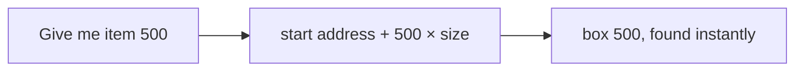

One problem: the row has a fixed size. What if more orders arrive? Go's answer is the **slice**: a small note card that says "my row starts here, I'm using this many boxes, and this many exist". When the row fills up, Go quietly builds a bigger row, copies everything over, and updates the card.

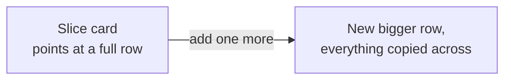

That is it. The rest of this note is just these 4 questions:
1. Why are rows of boxes so fast? (sections 1-2)
2. What exactly is on that note card, and how does growing work? (section 3)
3. When do two cards secretly share one row, and why does that bite? (sections 3-4)
4. What goes wrong in real code, and what do interviewers ask? (sections 6-10)

**The problem in one story.**
You keep a list of today's orders in your program.
New orders keep arriving, so the list must grow.
You also want "give me order number 500" to be instant.
An array gives instant lookup; a Go slice adds the "it can grow" part.

**Words you need first**

| Word | Plain meaning | Tiny example |
| --- | --- | --- |
| Memory address | A number naming one byte in RAM | Byte number `4096` |
| Contiguous | Stored back-to-back with no gaps | Values in boxes 10, 11, 12, 13 |
| Index | The position of an element, starting at 0 | `s[0]` is the first element |
| Pointer | A value that holds an address | `ptr` points at element 0 |
| Length (`len`) | How many elements are in use | `len(s) == 3` |
| Capacity (`cap`) | How many elements fit before growing | `cap(s) == 5` |
| Allocate / copy | Reserve new memory, then move data into it | Growing from 4 to 8 slots |
| Garbage collector (GC) | Go's automatic freeing of unused memory | An old array nobody points at is freed |

**Picture it**

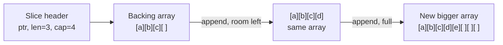

**Analogy.** A slice is like a bookmark card on a shelf of numbered slots: it says where the shelf starts, how many slots are used, and how many exist.
Where it breaks: when the shelf fills, Go quietly builds a bigger shelf and moves everything, and old cards still point at the old shelf.

**How the rest of this note builds up**

- First, why packed memory is fast (section 1) and the parking-lot mental model (section 2).
- Then the slice header, `append` growth and aliasing (section 3), with a worked 2-D example (section 4).
- Then variants, trade-offs and production failure modes (sections 5-7).
- Finally the SDE-3 deep dive on growth thresholds, size classes and escape analysis (section 9), plus interview questions.

> [!tip] Remember
> An array is values packed side by side; a slice is a small card (`ptr`, `len`, `cap`) pointing at one.

## 1. Why it exists 🟢

Say you're processing a day's worth of sensor readings, one `float64` per second: 86,400 values. You need somewhere to put them, and the two obvious choices behave very differently.

### Scattered memory vs. packed memory

**In plain words:** A computer's main memory (RAM) is one giant row of numbered boxes.

If every value you store gets its own box wherever one happens to be free, reading them back means jumping all over that row. If instead all your values sit in one unbroken stretch of boxes, reading them back is just walking forward one box at a time.

**Picture it:**

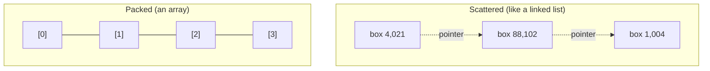

**Example:** Store the 86,400 readings as 86,400 separately heap-allocated nodes (as a linked list would) and each one lands wherever the allocator happened to put it.

Summing them means following 86,400 pointers, and **each pointer follow that misses the CPU cache costs roughly 100 ns** (documented: typical DRAM random-access latency, see [[Memory Hierarchy and CPU Caches]]), versus **well under 1 ns** for the next element in a cache line already loaded. Scattered, that's upward of 8 ms just in memory stalls.

Store the same values as one `[]float64` instead: they sit back-to-back, `element[i]` is `base + i*8` bytes, and the CPU's prefetcher keeps the pipeline fed, finishing in a small fraction of that.

**Why it matters:** This is why arrays and slices are the default structure in nearly every language: the operation most code does most — iterate, or jump to an index — is exactly the one contiguous memory makes cheap.

This structure of values packed next to each other is called an **array**. A **slice** is Go's growable wrapper around one.

> [!tip] Remember
> Contiguous memory isn't just a storage detail — it's the reason sequential access over an array is dramatically faster than the same access pattern over a pointer-chasing structure.

## 2. Mental model 🟢

### The parking-lot analogy

**In plain words:** A static array (`[5]int`) is a fixed, labelled parking lot: 5 spots, fixed size, each one addressed by its number — you can't add a 6th spot without building a new lot.

A slice is a **parking valet's ticket**, not the lot itself: a small card holding three numbers:
- where the lot starts (`ptr`),
- how many spots are currently in use (`len`),
- and how many spots exist before the lot needs to expand (`cap`).

**Picture it:**

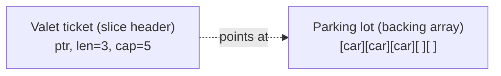

**Example:** Handing someone your ticket — passing the slice to a function, assigning it to another variable — copies the card, not the parking lot.

Both tickets point at the same lot until someone fills it up and the valet has to move every car to a bigger lot (`append` past capacity); only then do the two tickets start pointing at different lots.

**Why it matters:** Confusing "copying a slice" with "copying its data" is the single most common Go slice bug.

Copying the header is cheap (3 words) and happens on every function call; copying the data only happens when you explicitly loop or `append` past capacity.

**Where the analogy breaks down:** a real parking valet never *moves cars without telling you*; a Go slice's backing array can be silently reallocated by `append`, after which your old ticket (an alias made before the append) points at a lot the new ticket has already abandoned.

> [!warning] Common mistake
> Assuming that writing through one slice always shows up in another slice that shares its backing array. It does — until an `append` on either one exceeds capacity and allocates a new array. After that point the two slices have quietly stopped sharing memory, with no error or signal that it happened.

## 3. How it works 🟡

### The slice header

**In plain words:** A slice value itself is tiny — three machine words — no matter how many elements it can see. The data lives separately, in the backing array.

**Picture it:**

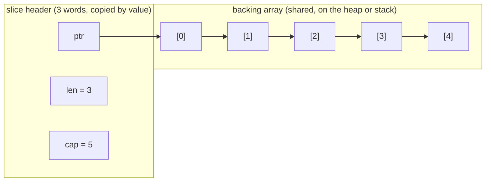

`len` is how many elements this slice can see (`s[0:len]` is valid); `cap` is how many elements fit in the backing array starting from `ptr` before a reallocation is needed.

**Example:** For the header above, `cap(s) - len(s)` = `5 - 3` = `2`: two more elements can be appended before the runtime must allocate a new, bigger array.

**Why it matters:** Because the header is only 3 words, passing a slice to a function — even one with a million elements — never copies the million elements, only the 24 bytes describing where they are.

### append and growth, step by step

**In plain words:** `append` has exactly two paths: write into existing free space, or grow into a new array. Which path it takes depends on one comparison.

**Step by step, what `append(s, v)` does:**
1. Check whether `len(s) < cap(s)` — is there a free slot already reserved?
2. If yes: write `v` into that slot, increment `len`, and return a slice still pointing at the same backing array.
3. If no: allocate a new, bigger backing array (see the growth table below for how much bigger).
4. Copy all `len(s)` existing elements into the new array.
5. Write `v` at the end, and return a slice pointing at the **new** array — the old one is now unreachable unless something else still references it.

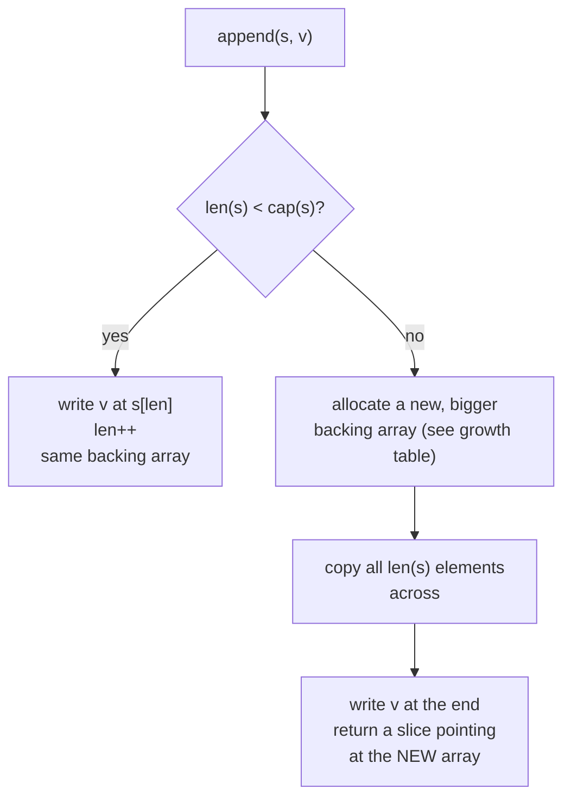

The growth decision (Go 1.18+, `runtime/slice.go`, function `nextslicecap`) is documented as:

1. If the new length needs more than double the old capacity, grow exactly to the new length.
2. Otherwise, below 256 elements the capacity doubles.
3. At or above 256 elements it grows by roughly 1.25x (`newcap += (newcap + 3*256) / 4`, repeated until big enough).

The actual allocator then rounds that number up to the nearest size class it keeps pre-allocated, which is why measured capacities don't land exactly on the formula's raw output.

**Measured** (Go 1.24.4, darwin/arm64, `go run` appending ints one at a time from a nil slice):

| len that triggers growth | new cap | growth vs previous cap |
| --- | --- | --- |
| 1 | 1 | — |
| 2 | 2 | 2x |
| 3 | 4 | 2x |
| 5 | 8 | 2x |
| 9 | 16 | 2x |
| 17 | 32 | 2x |
| 33 | 64 | 2x |
| 65 | 128 | 2x |
| 129 | 256 | 2x |
| 257 | 512 | 2x (last doubling; crosses the 256 threshold) |
| 513 | 848 | 1.66x (formula gives 832; rounded up to the 848 size class) |
| 849 | 1280 | 1.51x |
| 1281 | 1792 | 1.40x |

> [!warning] Common mistake
> Assuming `append` always allocates. In the common case — a slice with spare capacity — it does not; the cost of `append` is amortized `O(1)` precisely because most calls take the cheap path. See [[Complexity Analysis - Big-O and Amortized Cost]] for the full argument.

> [!tip] Remember
> `append` writes in place while `len < cap`, and reallocates-and-copies only when it must. The growth factor shrinks from ~2x to ~1.25x above 256 elements to bound wasted memory.

### Aliasing: two tickets, one lot

**In plain words:** "Aliasing" means two slice variables secretly pointing at the same backing array, so a write through one is visible through the other — until one of them reallocates.

**Picture it:**

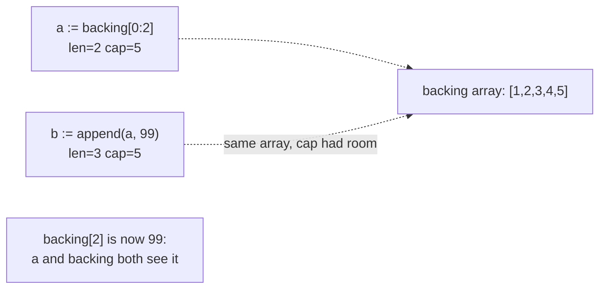

**Example:** Because `a`'s capacity (5) is bigger than its length (2), `append(a, 99)` writes `99` into `backing[2]` **in place** — it does not need a new array. Anyone else still holding `backing` now sees that write.

**Why it matters:** This is the aliasing bug: two slices that look independent are secretly sharing memory until one of them is forced to reallocate. A function that returns a sub-slice of its input can leave the caller surprised later.

**What happens if** you want to stop two slices from aliasing on purpose? Use the full slice expression `s[low:high:max]`, which pins capacity to `max`. Any `append` beyond that capacity is then forced onto a fresh array instead of silently overwriting shared memory — see the Go note's aliasing test for this in code.

> [!tip] Remember
> Two slices over the same backing array only stay independent once one of them has reallocated (or you've deliberately capped capacity with `s[low:high:max]`).

## 4. Worked example 🟡

A day's weather, as rows of `(date, high, low)`, is a concrete case where the choice between layouts matters.

1. Store it as `[][3]float64` ("slice of slices"): each row is its own heap allocation, a pointer hop away from its neighbor — convenient when rows genuinely vary in length, worse for cache locality when they don't.
2. Store it as one flat `[]float64` of length `rows*cols`, indexed by `row*width + col` (**row-major** order: row 0's elements come first, then row 1's, and so on): one allocation, contiguous, cache-friendly.

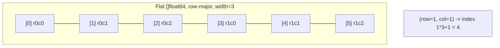

Inserting or deleting in the middle of either layout costs `O(n)`, because every following element has to shift one place to make or close the gap — the array doesn't have a "hole," so the elements after the gap physically move:

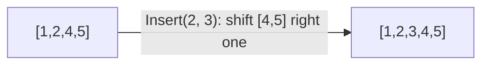

```go
s := make([]int, 0, 2)  // len=0, cap=2
s = append(s, 1, 2)     // len=2, cap=2: backing array full
s = append(s, 3)        // len=3, cap=4: new array allocated, [1,2] copied in
```

After the third line, the original 2-element backing array is unreachable and will be garbage collected; `s` now points at a fresh 4-element array holding `[1, 2, 3, _]`.

**The aliasing-leak trap:** a tiny sub-slice of a huge array keeps the *whole* array alive for the garbage collector, because the sub-slice's header still points inside it:

```go
huge := make([]byte, 1<<20) // 1 MiB
tiny := huge[0:16]          // still references the whole 1 MiB backing array
```

`tiny` looks small, but as long as it's reachable, the garbage collector cannot free the 1 MiB behind it. The fix is to copy out only what you need: `tiny := append([]byte(nil), huge[0:16]...)`.

Runnable Go version: [[Arrays and Dynamic Arrays (Go Slices) - Go]].

## 5. Variants and comparison 🟡

| Option | How it works | Use when | Cost |
| --- | --- | --- | --- |
| `[N]T` static array | Fixed size, a value type: assigning or passing it copies all `N` elements | Size is known at compile time and small, or you want value semantics | `O(1)` access; copy is `O(N)` |
| `[]T` slice | Header over a growable backing array | The general-purpose default for ordered data | `O(1)` access, `O(1)` amortised append |
| `[][]T` (slice of slices) | Each row is its own allocation | Rows genuinely vary in length (ragged arrays) | Extra allocation and a pointer hop per row |
| Flat `[]T` + row-major index | One allocation, manual index math | A fixed-shape 2-D (or N-D) grid | `O(1)` access, best cache locality |
| `slices` package (`sort`, `slices.Insert`, `slices.BinarySearch`) | Generic helpers over `[]T` | You'd otherwise hand-roll the same loop | Same cost as the hand-written version, less code |

## 6. Trade-offs and when not to use 🟡

- Insert/delete in the middle is `O(n)` because everything after the index must shift. If your workload is insert/delete-heavy in the middle and never needs random access by index, a different structure wins — see [[Linked Lists]].
- A slice you keep appending to in a loop without a size hint re-allocates its backing array `O(log n)` times total (still `O(n)` amortised), but each reallocation is a real allocation; pre-size with `make([]T, 0, n)` when `n` is known, to skip all of them.
- Aliasing is a real footgun: a function that returns a sub-slice of its input can leave the caller surprised when a later `append` on either side mutates the other. Document (or avoid) returning aliased sub-slices from library functions.
- Static arrays (`[N]T`) are rarely the right default in application code: their value semantics (full copy on assignment or when passed to a function) are a common source of accidental `O(N)` copies; reach for them for small, fixed-shape data (a hash sum's bytes, a 3D vector) rather than general collections.

> [!tip] Remember
> The same contiguous layout that makes slices fast at reading and appending at the end makes them slow at inserting or deleting in the middle — pick the structure that matches your actual access pattern.

## 7. In production 🔴

- **Real systems:** Go's own standard library leans on slices everywhere — `bytes.Buffer`, `strings.Builder`, `bufio.Reader` are all slice-backed; the `slices` package (stable since Go 1.21) wraps sort, search, and insert/delete over `[]T` with pdqsort under the hood.
- **Failure modes → fixes:**
  - unbounded `append` in a hot loop causing GC pressure → pre-size with `make([]T, 0, n)`;
  - a sub-slice of a huge buffer kept around (e.g., `bytes.Split` results from a large file) pinning the whole buffer in memory → copy out only what you need;
  - concurrent `append` on a shared slice from multiple goroutines racing on the header's `len`/`cap` → guard with a mutex or give each goroutine its own slice and merge at the end.
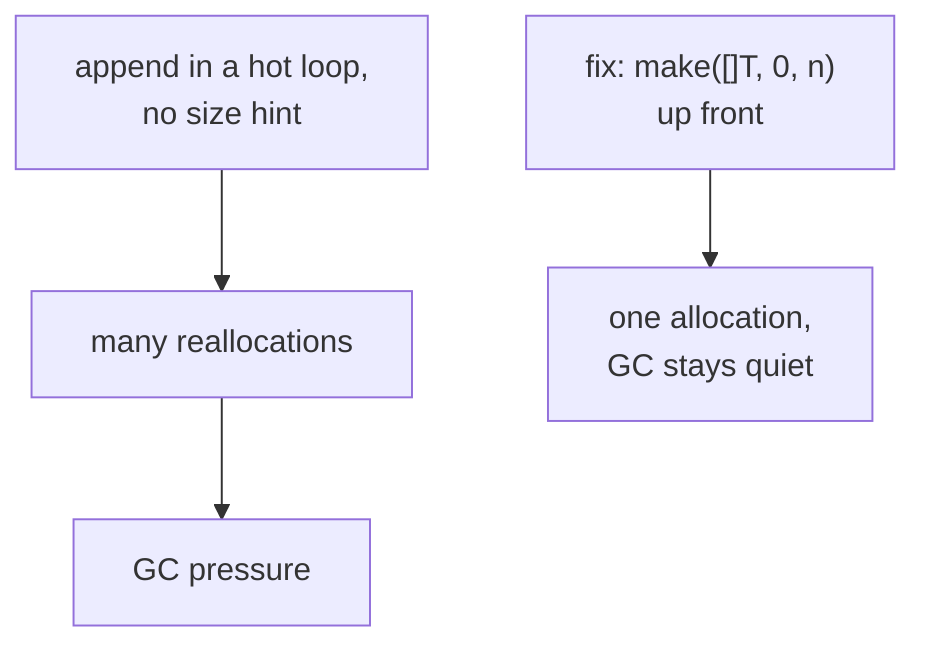

- **What to monitor:** allocations per request (`go test -benchmem`, or `pprof`'s `alloc_objects`), and GC pause frequency if a service appends heavily without pre-sizing.

## 8. Whiteboard version 🟢

If someone asks you to explain slices at a whiteboard with no code:

1. Draw a row of boxes labelled 0 to 4 — that's the backing array.
2. Draw a small card beside it with three fields: `ptr → box 0`, `len = 3`, `cap = 5`.
3. Shade boxes 0, 1, 2 to show they're "in use" (`len`); leave 3 and 4 unshaded (`cap - len` spare room).
4. Append once: shade box 3, bump `len` to 4. No new row of boxes needed — there was spare room.
5. Append past capacity: draw a *new*, bigger row of boxes, copy the shaded ones across, point the card at the new row.

That five-step picture is the entire mental model; everything in section 3 is this diagram with precise numbers attached.

## 9. Deep dive 🔴

- **Why 256 is the growth threshold.** Doubling forever would waste more and more memory per growth as capacity gets large (doubling a slice of 1,000,000 wastes up to 1,000,000 slots); decaying toward 1.25x bounds the wasted fraction while keeping the number of reallocations logarithmic in the final size.
- **Size classes.** Go's allocator only hands out memory in a fixed set of size classes (8, 16, 24, 32, 48, … bytes per object), so a requested capacity is rounded up to whichever class fits. That's the gap between the growth formula's raw output (832) and the measured capacity (848) in the table above.
- **Arrays vs slices at the type level.** `[N]T` is part of the type (`[5]int` and `[6]int` are different types, incompatible without conversion); `[]T` has no size in its type, which is exactly what lets a function accept a slice of any length. Passing an array to a function copies it; passing a slice copies only the 3-word header.
- **Escape analysis decides where the backing array lives.** `make([]T, n)` with a small, compile-time-constant `n` that never escapes the function can be allocated on the stack instead of the heap, skipping GC entirely; this is the compiler's job, not something the slice header diagram shows directly — see [[Pointers, Values and Escape Analysis]] for the mechanics and how to check it with `go build -gcflags="-m"`.

## 10. Interview questions 🔴

> [!question]- What exactly is a Go slice, at the memory level?
> A 3-word header: a pointer to the first element it can see, a length (how many elements are valid), and a capacity (how many elements fit in the backing array before a reallocation is needed). The header is copied by value; the backing array is shared.

> [!question]- Trap: if I pass a slice to a function and the function appends to it, will the caller see the new element?
> It depends on whether the append fit within the original capacity.
>
> If `len < cap`, the append writes into the shared backing array, but the caller's own `len` field is unchanged by the callee's local header, so the caller still won't see the new length — only a later read via an index the caller's length already covers would.
>
> If the append exceeded capacity, the callee's slice now points at an entirely different array, and the caller sees nothing of it.

> [!question]- Two slices come from the same backing array. Under what condition does writing through one affect the other?
> Whenever their index ranges overlap in the shared backing array and neither side has yet triggered a reallocation (via an `append` past capacity on one of them, or an explicit copy).

> [!question]- When would you choose `[N]T` (a static array) over `[]T`?
> When the size is fixed and known at compile time, value semantics are wanted (a full copy on assignment, useful for something like a fixed-size hash or coordinate), or the data is small enough that it can live on the stack without triggering heap allocation.

> [!question]- How would you avoid repeated reallocation when building a large slice from a known-size source?
> Pre-allocate with `make([]T, 0, n)` when `n` is known or estimable, so `append` never needs to grow the backing array during the loop.

> [!question]- A function returns `data[:10]` from a 1 MB input slice. What's the subtle memory problem, and how do you fix it?
> The returned slice still references the entire 1 MB backing array, so the garbage collector can't reclaim any of it as long as the small slice is reachable. Fix it by copying the needed bytes into a fresh, right-sized slice: `append([]byte(nil), data[:10]...)`.

> [!question]- Why does cache locality make a slice beat a linked list for sequential iteration, even when both are O(n)?
> The slice's elements sit in consecutive memory addresses, so after the first access the CPU's prefetcher loads the next cache line before the program asks for it. A linked list's next address isn't known until the current node is read, so each hop is a potential cache miss — on modern DRAM, roughly 100 ns (documented, typical figure) versus well under 1 ns for data already in L1 cache.

## 11. Cheat sheet 🟢

- Slice = header (`ptr`, `len`, `cap`) over a shared backing array; copying the header doesn't copy the data.
- `append` grows in place while `len < cap`; past that, it allocates a new array and copies, roughly 2x below 256 elements, ~1.25x above.
- Two slices sharing a backing array can alias; `s[a:b:c]` (the full slice expression) pins capacity to prevent surprise aliasing on append.
- Middle insert/delete is `O(n)`; index access and end-append are `O(1)` (amortised for append).
- Pre-size with `make([]T, 0, n)` when `n` is known, to skip every intermediate reallocation.
- A tiny sub-slice of a huge array keeps the whole array alive; copy out what you need to let the rest be collected.
- `[N]T` is a value type (full-copy semantics); `[]T` is the default for general collections.
- Flat `[]T` with row-major indexing beats `[][]T` for cache locality on fixed-shape 2-D data.
- The five classic slice interview patterns (two pointers, sliding window, prefix sums, Kadane's algorithm, binary search on the answer) are implemented and tested in [[Arrays and Dynamic Arrays (Go Slices) - Go]].

## Links

- **Before this:** [[Data Structures Overview and Big-O Cheat Sheet]]
- **Next:** [[Linked Lists]], [[Stacks, Queues and Deques]]
- **Compare with:** [[Memory Hierarchy and CPU Caches]] (why contiguous memory is fast), [[Pointers, Values and Escape Analysis]] (stack vs heap allocation for `make`)
- **Runnable code:** [[Arrays and Dynamic Arrays (Go Slices) - Go]]

### Watch on YouTube

- [Understand how to append slices in Golang](https://www.youtube.com/watch?v=zHBcLf7QY4s) · Ardan Labs · Go-specific walkthrough of slice headers and append/growth behavior from a reputable Go shop
