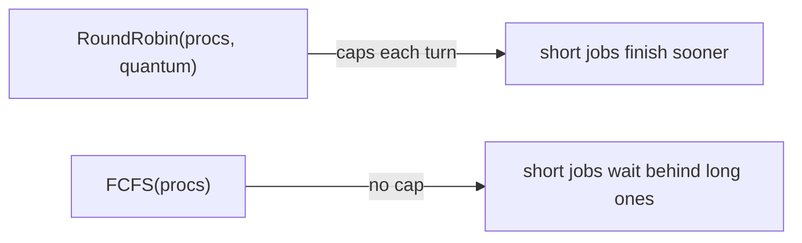
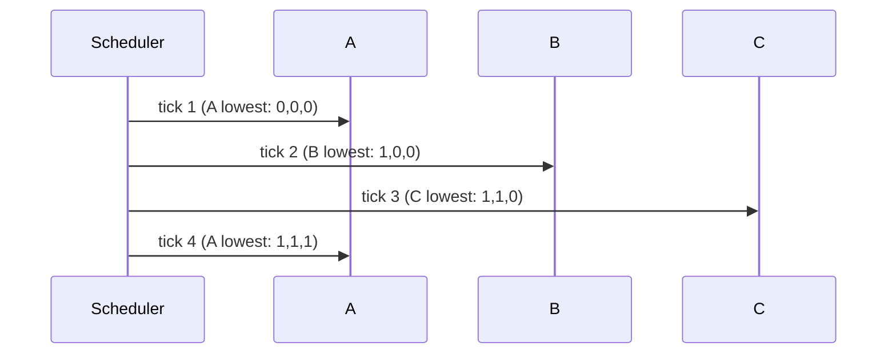

# CPU Scheduling - Go

> [!summary] TL;DR
> Three simulators in Go — round robin, FCFS, and a simplified CFS-style vruntime picker — plus a cgroup v2 `cpu.max` parser, all tested against hand-worked traces from [[CPU Scheduling]].

## Before the code

- **Structs and slices** (`[]Proc`): a list of small records; `copy` makes a private copy so the caller's list is never changed.
- **Maps** (`map[string]int`): Go's built-in hash table, used here to store each process's finish time by name.
- **Multiple return values** (`cpus, unlimited, err`): Go functions can return several values; errors come back as a normal value, not an exception.
- **`defer`**: runs `f.Close()` when the function returns, whichever path it takes.
- **Table-driven tests with `t.Run`**: one test loops over a list of cases and runs each as a named subtest.
- **What to run:** `go vet ./... && go test -race -v ./...` inside the module. No goroutines, interfaces or generics are needed here.

## What this code shows

The theory note describes four mechanisms in words and diagrams:

1. quantum-based preemption,
2. the convoy effect under no preemption at all,
3. parsing a resource limit out of a config file,
4. and a fairness rule that compares running totals instead of assigning fixed turns.

Each has a direct code counterpart below, and each counterpart is tested against a number the theory note already worked out by hand, so the two notes check each other rather than one simply restating the other.

| Code | Concept in [[CPU Scheduling]] |
| --- | --- |
| `RoundRobin` | Preemptive, quantum-based scheduling, [[CPU Scheduling#Whiteboard version: round robin vs. FCFS]] |
| `FCFS` | The convoy effect, same section |
| `CPUQuota` | Parsing a cgroup v2 `cpu.max` file, [[CPU Scheduling#cgroups CPU quotas and throttling]] |
| `TraceVRuntime` | The CFS "always pick lowest vruntime" rule, worked numerically in [[CPU Scheduling#Linux: CFS and EEVDF, step by step]] |

## Setup

- Module `cpusched`, Go 1.24, standard library only.
- Four files: `sim.go` (the `Proc` type and the two classic simulators), `quota.go` (the cgroup parser), `vruntime.go` (the CFS-style trace), and `sim_test.go` (every test).
- Run: `go vet ./... && go test -race -v ./...`
- Nothing in this package touches the network, the filesystem outside of `t.TempDir()`, or any OS scheduling API — it's pure, deterministic computation, so the tests run in well under a second and give identical results on any machine.

## Code

### Step 1: round robin

**Concept.** `RoundRobin` is the code form of the hand-traced example in [[CPU Scheduling#Whiteboard version: round robin vs. FCFS]]: a queue of processes, each one capped to a fixed `quantum` per turn, cycling until all are done.

The alternative — not capping the run length — degrades to FCFS and reintroduces the convoy effect, which is exactly the problem round robin exists to avoid.

```go
// Proc is one runnable unit in the scheduling simulations below. Burst is
// the remaining CPU time it needs, in abstract ticks.
type Proc struct {
	Name  string
	Burst int
}
```

**How it works.** `Burst` is mutated as the simulation runs, so each simulator (`RoundRobin`, `FCFS`) keeps its own local copy of the input slice rather than mutating the caller's — the next block's `copy(queue, procs)` is why.

```go
// RoundRobin simulates non-preemptive-arrival, preemptive-execution
// round-robin scheduling with a fixed quantum (what Linux's O(1) scheduler
// and early CFS approximate with time slices). It returns each process's
// completion time. All processes are assumed to arrive at time 0 and are
// queued in FCFS order on ties, like a single run queue.
func RoundRobin(procs []Proc, quantum int) map[string]int {
	completion := make(map[string]int, len(procs))
	queue := make([]Proc, len(procs))
	copy(queue, procs)

	clock := 0
	for len(queue) > 0 {
		p := queue[0]
		queue = queue[1:]

		run := p.Burst
		if run > quantum {
			run = quantum
		}
		clock += run
		p.Burst -= run

		if p.Burst == 0 {
			completion[p.Name] = clock
		} else {
			queue = append(queue, p)
		}
	}
	return completion
}
```

**How it works.**

1. `queue` is a copy of `procs`, so the simulation never mutates the caller's slice.
2. Each loop iteration pops the front process, runs it for `min(p.Burst, quantum)` ticks, and advances `clock` by that amount.
3. If the process still has burst remaining, it goes to the back of `queue` — "preemptive execution" means it gets interrupted and must wait its turn again.
4. If it finished (`p.Burst == 0`), its completion time is recorded and it leaves the queue for good.

### Step 2: FCFS, for comparison

**Concept.** `FCFS` is deliberately the simplest possible scheduler: no preemption, no quantum, just "run everything in arrival order, to completion."

It exists in this file specifically so a test can measure the convoy effect by comparing its completion times against `RoundRobin`'s on the same input.

```go
// FCFS simulates first-come-first-served scheduling: each process runs to
// completion in arrival order, with no preemption.
func FCFS(procs []Proc) map[string]int {
	completion := make(map[string]int, len(procs))
	clock := 0
	for _, p := range procs {
		clock += p.Burst
		completion[p.Name] = clock
	}
	return completion
}
```

**How it works.**

1. The loop runs processes strictly in input order — no queue manipulation needed, since nothing is ever preempted.
2. Each process's completion time is simply the running total of every burst up to and including its own — the cumulative sum of arrival-order bursts.



### Step 3: parsing a cgroup v2 quota

**Concept.** `CPUQuota` implements the parsing and rounding described in [[CPU Scheduling#cgroups CPU quotas and throttling]]: read the two numbers out of `cpu.max`, divide quota by period, and round up — because a container that can use 1.5 CPUs' worth of time still needs 2 OS threads able to run simultaneously to ever actually use all of it.

The "max" case (no limit) is handled as a distinct return value rather than, say, a very large number, so callers can't accidentally treat "unlimited" as "a specific large quota."

```go
// CPUQuota reads a cgroup v2 cpu.max file (format "<quota> <period>", or
// "max <period>" for no limit) and returns the number of whole CPUs that
// quota allows, rounded up. Go 1.25+ does this same arithmetic on Linux to
// pick a container-aware default for GOMAXPROCS.
func CPUQuota(path string) (cpus int, unlimited bool, err error) {
	f, err := os.Open(path)
	if err != nil {
		return 0, false, err
	}
	defer f.Close()

	sc := bufio.NewScanner(f)
	if !sc.Scan() {
		return 0, false, fmt.Errorf("cpu.max: empty file")
	}
	fields := strings.Fields(sc.Text())
	if len(fields) != 2 {
		return 0, false, fmt.Errorf("cpu.max: malformed line %q", sc.Text())
	}
	if fields[0] == "max" {
		return 0, true, nil
	}
```

**How it works, so far.**

1. `bufio.Scanner` reads one line — `cpu.max` is always a single line.
2. `strings.Fields` splits on whitespace into exactly two tokens, quota and period; a malformed file (wrong token count) is reported as an error rather than silently misparsed.
3. `fields[0] == "max"` is checked before any numeric parsing, since "max" isn't a number, and returns immediately with `unlimited = true`.

The function isn't done yet — the closing brace above is inside the `if`, not the function. The rest parses the two numbers and rounds.

```go
	quota, err := strconv.ParseFloat(fields[0], 64)
	if err != nil {
		return 0, false, fmt.Errorf("cpu.max: bad quota: %w", err)
	}
	period, err := strconv.ParseFloat(fields[1], 64)
	if err != nil {
		return 0, false, fmt.Errorf("cpu.max: bad period: %w", err)
	}

	cpus = int(quota / period)
	if frac := quota/period - float64(cpus); frac > 1e-9 {
		cpus++ // round up: a 1.5-CPU quota needs 2 OS threads to ever use it all
	}
	if cpus < 1 {
		cpus = 1
	}
	return cpus, false, nil
}
```

**How it works, continued.**

1. The division and `1e-9` epsilon comparison round up a fractional quota (e.g. `1.5` CPUs) to `2`, because an OS-thread count has to be a whole number able to run concurrently.
2. `cpus < 1` is clamped to `1` as a defensive floor — a quota file should never produce zero usable CPUs.

### Step 4: a worked vruntime trace

**Concept.** `TraceVRuntime` is the simplified CFS model walked through by hand in [[CPU Scheduling#Linux: CFS and EEVDF, step by step]]: every thread starts at `vruntime = 0`, and each tick the scheduler runs whoever currently has the lowest `vruntime`, then adds 1 to it.

Real CFS scales that increment by the inverse of a thread's `nice`-derived weight; this model assumes equal weight for every thread, which is enough to demonstrate the "always run whoever is furthest behind" rule without the weight arithmetic.

```go
// VRuntimeStep is one scheduling decision in a simplified CFS trace: which
// thread ran that tick, and every thread's vruntime after it ran.
type VRuntimeStep struct {
	Tick      int
	Ran       string
	VRuntimes map[string]int
}
```

**How it works.** `VRuntimes` is a full snapshot (not just one thread's value) so a caller — or a test, or the theory note's worked table — can inspect every thread's state after each single tick, not only the winner's.

```go
// TraceVRuntime simulates ticks rounds of CFS-style picking: each tick, run
// the thread with the lowest vruntime (ties broken by name, for a
// deterministic trace), then add 1 to its vruntime.
func TraceVRuntime(names []string, ticks int) []VRuntimeStep {
	vr := make(map[string]int, len(names))
	for _, n := range names {
		vr[n] = 0
	}
	sorted := append([]string(nil), names...)
	sort.Strings(sorted)
```

**How it works, setup.** Every thread starts in `vr` at `0`.

`sorted` is a stable, alphabetically ordered copy of the thread names, used only to make tie-breaking deterministic — the trace needs to be reproducible, not because alphabetical order has any scheduling meaning in real CFS.

```go
	steps := make([]VRuntimeStep, 0, ticks)
	for t := 1; t <= ticks; t++ {
		pick := sorted[0]
		for _, n := range sorted {
			if vr[n] < vr[pick] {
				pick = n
			}
		}
		vr[pick]++
		snapshot := make(map[string]int, len(vr))
		for k, v := range vr {
			snapshot[k] = v
		}
		steps = append(steps, VRuntimeStep{Tick: t, Ran: pick, VRuntimes: snapshot})
	}
	return steps
}
```

**How it works, the tick loop.**

1. Each tick, the inner loop scans for the thread with the current lowest `vruntime`, scanning in `sorted` order so ties always resolve the same way.
2. The winner's `vruntime` is incremented by 1 — the simplified "one tick of running costs one unit of virtual time" rule.
3. A fresh `snapshot` map is copied out of `vr` for this step, so later mutations of `vr` in future ticks don't retroactively change an earlier step's recorded state.



## Design decisions

None of this code touches a real OS scheduler — it's all in-process simulation, which is deliberate: the point is to make the *algorithm's* behavior checkable with exact, reproducible numbers, the same numbers the theory note works out by hand.

A simulation that called into real scheduling APIs would be testing the OS and the Go runtime's own interaction with it, not the algorithm itself, and its results would vary machine to machine, defeating the purpose of having a reproducible, hand-checkable trace at all.

This mirrors a broader pattern worth naming: when a theory note makes a claim about an *algorithm's* behavior (as opposed to a claim about a specific OS, kernel version or piece of hardware), the cleanest test is a small, deterministic, in-process model of just that algorithm — not an integration test against the real system the algorithm happens to run inside of in production.

| Decision | Alternative | Trade-off |
| --- | --- | --- |
| `RoundRobin`/`FCFS` return a plain `map[string]int` | A slice of structs preserving order | Simpler for tests to assert against by name; loses the original arrival order, which the simulators don't need to report |
| `CPUQuota` returns `(cpus, unlimited, err)` | Encode "unlimited" as a sentinel value like `-1` | Explicit about the no-limit case; avoids a caller accidentally treating a sentinel as a real CPU count |
| `TraceVRuntime` uses equal weight for all threads | Model `nice`-derived weights too | Keeps the function focused on the core "lowest vruntime always wins" rule; real CFS's weight scaling is a multiplier on top of this same rule |
| Tie-break by alphabetical name | Tie-break by arrival order or random | Deterministic and reproducible for tests and for the worked-example table in the theory note |

## Tests

### TestRoundRobinMatchesHandTrace

**Property.** `RoundRobin` on P1(10), P2(5), P3(8) with quantum 4 must produce the exact completion times worked out by hand in the theory note: P1 at 23, P2 at 17, P3 at 21.

| Input | Expected |
| --- | --- |
| `[{P1,10},{P2,5},{P3,8}]`, quantum 4 | `{P1:23, P2:17, P3:21}` |

```go
func TestRoundRobinMatchesHandTrace(t *testing.T) {
	procs := []Proc{{"P1", 10}, {"P2", 5}, {"P3", 8}}
	got := RoundRobin(procs, 4)
	want := map[string]int{"P1": 23, "P2": 17, "P3": 21}
	if !reflect.DeepEqual(got, want) {
		t.Fatalf("got %v, want %v", got, want)
	}
}
```

A failure here would mean the quantum-capping or re-queueing logic has drifted from the documented algorithm — worth re-deriving the hand trace in the theory note before assuming the test is wrong.

### TestFCFSConvoyEffect and TestFCFSRunsInOrder

**Property.** `TestFCFSConvoyEffect` proves the convoy effect exists: a short job queued behind a long one must finish *later* under FCFS than under round robin. `TestFCFSRunsInOrder` checks that FCFS completion times are simply the cumulative sum of bursts in arrival order.

| Test | Input | Expected |
| --- | --- | --- |
| `TestFCFSConvoyEffect` | `[{long,100},{short,1}]` | FCFS's `short` completion > RR's `short` completion |
| `TestFCFSRunsInOrder` | `[{P1,3},{P2,2},{P3,7}]` | `{P1:3, P2:5, P3:12}` |

```go
func TestFCFSConvoyEffect(t *testing.T) {
	procs := []Proc{{"long", 100}, {"short", 1}}
	fcfs := FCFS(procs)
	rr := RoundRobin(procs, 4)
	if fcfs["short"] <= rr["short"] {
		t.Fatalf("FCFS short completion %d should be worse than RR's %d", fcfs["short"], rr["short"])
	}
}

func TestFCFSRunsInOrder(t *testing.T) {
	procs := []Proc{{"P1", 3}, {"P2", 2}, {"P3", 7}}
	got := FCFS(procs)
	want := map[string]int{"P1": 3, "P2": 5, "P3": 12}
	if !reflect.DeepEqual(got, want) {
		t.Fatalf("got %v, want %v", got, want)
	}
}
```

A failure in `TestFCFSConvoyEffect` would mean the two simulators no longer show the behavior difference the theory note's comparison depends on — i.e. the "why round robin exists" argument would no longer be demonstrated by the code.

### TestCPUQuota

**Property.** The parser must handle an exact quota, a quota needing rounding up, and the unlimited ("max") case correctly.

| Case | `cpu.max` line | Expected |
| --- | --- | --- |
| exact-one | `"100000 100000"` | 1 CPU, not unlimited |
| rounds-up | `"150000 100000"` | 2 CPUs (1.5 rounds up), not unlimited |
| unlimited | `"max 100000"` | unlimited, CPU count not asserted |

```go
func TestCPUQuota(t *testing.T) {
	cases := []struct {
		name      string
		line      string
		wantCPUs  int
		wantUnlim bool
	}{
		{"exact-one", "100000 100000", 1, false},
		{"rounds-up", "150000 100000", 2, false},
		{"unlimited", "max 100000", 0, true},
	}
```

The three cases are the table above in code form; each is run as its own `t.Run` subtest below.

```go
	for _, tc := range cases {
		t.Run(tc.name, func(t *testing.T) {
			dir := t.TempDir()
			path := filepath.Join(dir, "cpu.max")
			if err := os.WriteFile(path, []byte(tc.line+"\n"), 0o644); err != nil {
				t.Fatalf("os.WriteFile: %v", err)
			}
			cpus, unlimited, err := CPUQuota(path)
			if err != nil {
				t.Fatalf("CPUQuota: %v", err)
			}
			if unlimited != tc.wantUnlim {
				t.Fatalf("unlimited = %v, want %v", unlimited, tc.wantUnlim)
			}
			if !tc.wantUnlim && cpus != tc.wantCPUs {
				t.Fatalf("cpus = %d, want %d", cpus, tc.wantCPUs)
			}
		})
	}
}
```

Each subtest writes a real temp file with the case's `cpu.max` line, then calls `CPUQuota` and checks both return values. A failure in the `rounds-up` case specifically would mean the epsilon-comparison rounding logic regressed — the exact scenario Go 1.25's container-aware `GOMAXPROCS` has to get right for a fractional-CPU quota.

### TestTraceVRuntimeAlternatesFairly

**Property.** With two equal-weight threads, CFS-style picking must alternate perfectly (A, B, A, B, ...), because the scheduler always runs whoever has the lower `vruntime`, and one tick of running makes that thread the higher one — this is the formal version of the hand-worked three-thread table in the theory note, reduced to two threads so the pattern is unambiguous.

| Input | Expected |
| --- | --- |
| `TraceVRuntime(["A","B"], 6)` | Ran sequence `A,B,A,B,A,B`; final vruntime `{A:3, B:3}` |

```go
func TestTraceVRuntimeAlternatesFairly(t *testing.T) {
	steps := TraceVRuntime([]string{"A", "B"}, 6)
	want := []string{"A", "B", "A", "B", "A", "B"}
	for i, s := range steps {
		if s.Ran != want[i] {
			t.Fatalf("tick %d: ran %s, want %s", s.Tick, s.Ran, want[i])
		}
	}
	last := steps[len(steps)-1].VRuntimes
	if last["A"] != 3 || last["B"] != 3 {
		t.Fatalf("after 6 ticks want vruntime 3/3, got %v", last)
	}
}
```

A failure here would mean the "lowest vruntime always wins" rule — the single most important sentence in CFS's design — isn't actually being followed by the implementation.

## Running it

A quick map of what each command below checks:

- `go vet ./...` — static analysis, catching mistakes like a format-string argument mismatch or an unreachable branch before any test even runs.
- `go test ./...` — runs every test in the package once.
- `-race` — reruns under the race detector; here it's a no-op safety net, since nothing in this package is concurrent, but it's the same command used on every other Go note in this vault, which matters more once a package *does* have goroutines.

```text
go vet ./... && go test -race ./...
```

Measured with `go test -race ./...` on Go 1.24.4, darwin/arm64 (2026-11-09):

```text
ok  	rollscratch/cpusched	1.619s
```

**Reading the output.** `ok` means all five tests passed under the race detector.

None of this code is concurrent, so the race detector run is a cheap extra check rather than testing anything genuinely racy; the elapsed time is dominated by test-binary compilation, since none of the simulators do real I/O (the `CPUQuota` test uses `t.TempDir()`, a fast in-memory-backed temp directory).

## Running it, what the numbers mean in context

The `ok` result above says every behavior claim this note makes — the convoy effect, the exact hand-traced round-robin completion times, the cgroup quota rounding, and the vruntime alternation — is backed by a passing, repeatable check, not just prose description.

If a future Go version changed `cpu.max` parsing semantics, or if a bug crept into the round-robin re-queueing logic, these tests would catch it before the theory note's claims went stale.

## Pitfalls in the code

- **`RoundRobin` and `FCFS` key their result maps by `Proc.Name`.** Two processes with the same name silently overwrite each other's completion time in the map — fine for these simulations' distinct test names, but a real scheduler needs a unique process ID, not a human-readable label. If you adapt this code to simulate a larger, generated workload, switch the map key to an index or a synthetic ID first.
- **`CPUQuota`'s `1e-9` epsilon** is a floating-point tolerance for the rounding comparison; an even smaller quota/period fraction near that epsilon could in principle round the wrong way, though cgroup quotas in practice use round microsecond values that don't get close to it.
- **`TraceVRuntime`'s tie-break is alphabetical, not FIFO.** This differs from real CFS, which breaks ties by tree-insertion order (effectively arrival order); the alphabetical choice here is purely to make the trace reproducible in a doc, not a claim about kernel internals. Don't read anything into *which* thread happens to win a tie — only that one of them must, deterministically, for the trace to be checkable at all.
- **None of the simulators model preemption cost.** A real context switch has a cost (see the theory note's deep dive on cache/TLB pollution); these simulators treat every switch as free, which is correct for comparing *algorithms* but would understate real wall-clock time if used to predict an actual system's throughput.

Reading this code alongside the theory note is meant to work in both directions: if a claim in the theory note's "Why it matters" callouts ever seems off, the fastest way to check it is to run the matching test here and read the assertion failure, rather than re-deriving the numbers by hand again.

Conversely, if one of these tests ever needs changing, the theory note's worked examples are the specification it must still satisfy — a passing test suite with a theory note that no longer matches it is a sign the two have drifted apart, not that either one is safely ignorable.

## Exercises

These three exercises follow the same pattern as the theory note's own "what happens if" callouts: predict first, in writing, then run the code and compare.

The value is in noticing *where* your prediction and the actual result diverge, not in getting every prediction right on the first try.

1. Change `TraceVRuntime`'s tie-break from alphabetical to reverse-alphabetical (iterate `sorted` from the end) and predict the new `Ran` sequence for `["A","B"]` over 6 ticks. Then run it.
2. Add a third thread `"C"` to `TestTraceVRuntimeAlternatesFairly`'s input and predict the `Ran` sequence for 9 ticks, matching the three-thread table in [[CPU Scheduling#Linux: CFS and EEVDF, step by step]]. Then verify.
3. Change `RoundRobin`'s quantum from 4 to 100 in `TestRoundRobinMatchesHandTrace` and predict what the completion times become (hint: it should match `FCFS`'s completion times for the same input). Then run it to confirm.

## Links

- **Theory:** [[CPU Scheduling]]
- **Related:** [[Runtime - Goroutine Scheduler (GMP)]] (a cooperative scheduler for goroutines, built on top of the OS scheduling this note models), [[Concurrency Primitives - Mutex, Semaphore, Atomics]] (what threads actually contend over while waiting for a core)
