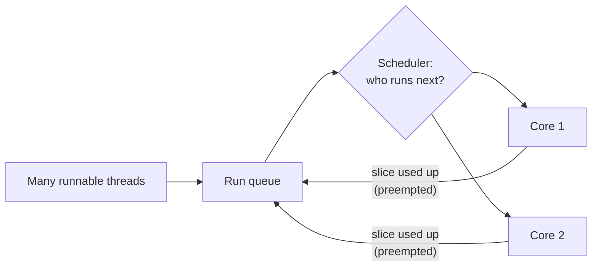
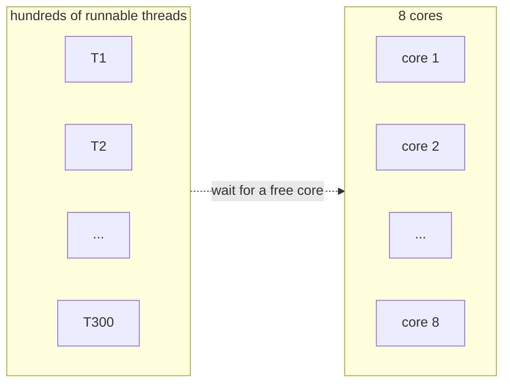
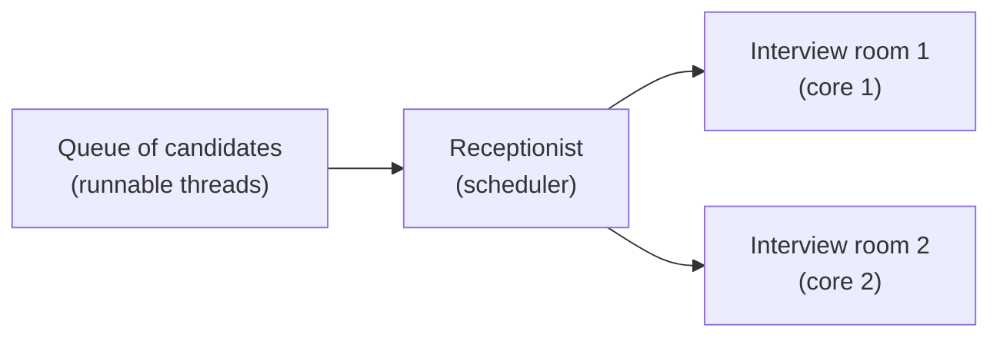
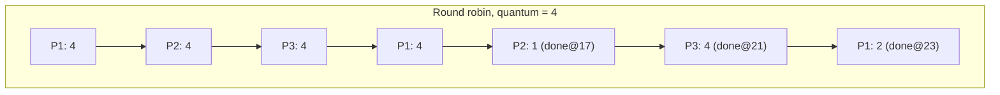
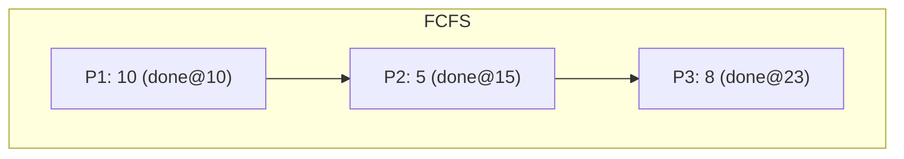
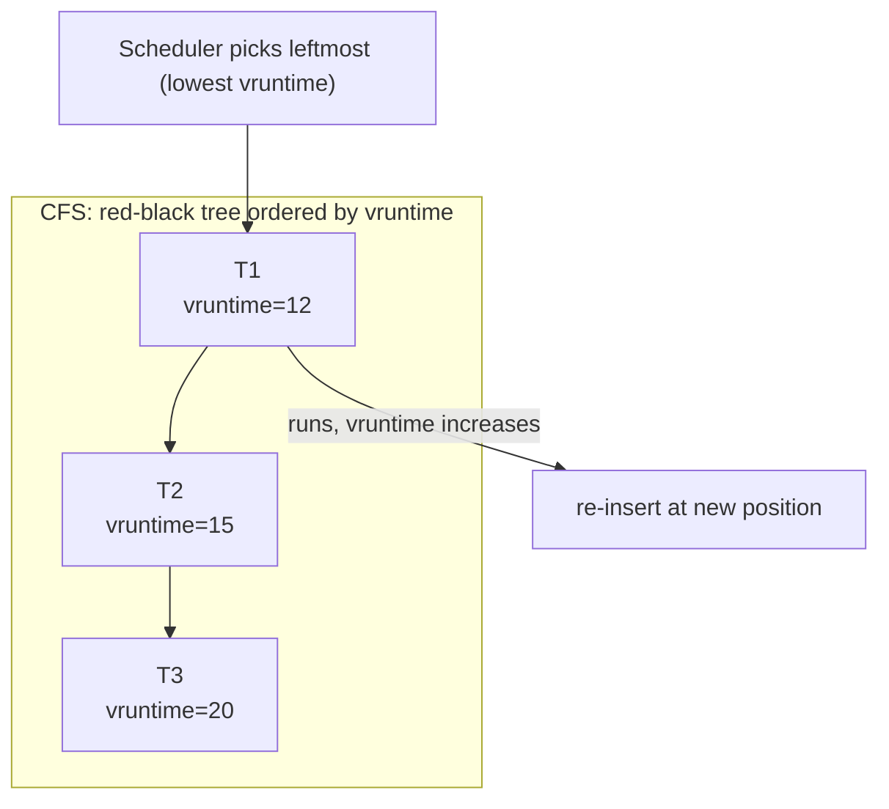
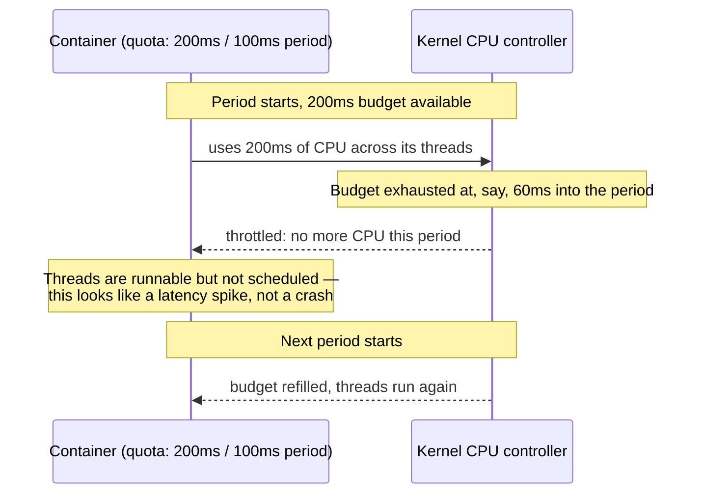
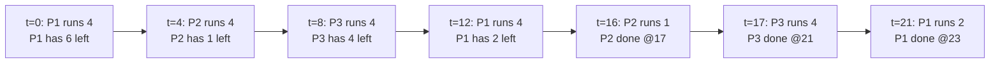

# CPU Scheduling

> [!summary] TL;DR
> A CPU scheduler decides which of the many runnable threads gets a core right now, and for how long. The goal is to make a small number of cores feel like every runnable thread is making progress, trading off throughput, fairness and responsiveness.

> [!abstract] Core idea
> - With more runnable threads than cores, something has to wait. The scheduler picks the order and the time slice.
> - Classic algorithms (FCFS, round robin, priority, MLFQ) trade fairness against throughput against responsiveness; no single algorithm wins on all three.
> - Linux's CFS, and EEVDF since kernel 6.6, don't use fixed time slices at all — they track how much "virtual runtime" each thread has used and always run whoever is furthest behind.
> - In containers, `cgroups` CPU quotas can **throttle** a process to less CPU than the host has, even if no other process wants it — a common cause of latency spikes that look like nothing is wrong with the code.
> - Go's own scheduler (the GMP model) runs *goroutines* on top of OS threads; it is a separate, cooperative scheduler built on top of everything in this note, covered in [[Runtime - Goroutine Scheduler (GMP)]].

## Start here: the basics

**The problem in one story.**
Your laptop has 8 cores but is running a browser, a music player, a chat app and a code editor.
Together they have hundreds of threads that all want to run.
Only 8 can actually run at any instant.
Something has to decide who goes now, who waits, and for how long, so the music never stutters and nothing waits forever.
That "something" is the CPU scheduler.

**Words you need first**

| Word | Plain meaning | Tiny example |
| --- | --- | --- |
| Core | One part of the CPU that runs one thread at a time | An 8-core laptop runs 8 threads at once |
| Thread | One sequence of instructions the OS can run | Your Go server's OS threads |
| Runnable | Ready to run, just waiting for a free core | A thread with work, not waiting on disk |
| Run queue | The list of runnable threads waiting for a core | 300 threads waiting for 8 cores |
| Time slice (quantum) | How long a thread may run before it must give up the core | 4 ticks, then back of the line |
| Preemption | The OS pausing a running thread to let another run | Stopping P1 after its 4 ticks |
| Context switch | Saving one thread's state and loading another's | Swapping P1 out, P2 in |
| Container quota | A cap on how much CPU time a container may use | "2 CPUs" in a Kubernetes limit |

**Picture it**

**Analogy.** A doctor's waiting room with a few doctors. The receptionist decides who goes in next and how long each visit can last.
Where it breaks: a real receptionist cannot pause a patient mid-visit and resume them later for free; the OS does exactly that, and the pause has a hidden cost (cold caches).

**How the rest of this note builds up**

- First, why scheduling exists (section 1) and the receptionist mental model (section 2).
- Then classic algorithms by hand: FCFS, round robin and the convoy effect, then SJF, priority and MLFQ (section 3).
- Then what Linux really does: CFS and EEVDF with `vruntime`, then cgroup quotas and `GOMAXPROCS` (section 3).
- Finally the SDE-3 deep dive: production throttling, EEVDF vs CFS, context-switch cost and CPU pinning (sections 7-9).

> [!tip] Remember
> More threads than cores means someone always waits; the scheduler decides who, and for how long.

## 1. Why it exists

### More runnable work than cores

**In plain words:** Every server has a fixed, small number of CPU cores — 8, 16, maybe 64. But the operating system usually has far more things that *want* to run than it has cores to run them on.

**Picture it:**

**Example:** A single moderately busy Go service can easily have hundreds of OS threads blocked or runnable at once.

The Go runtime starts one OS thread per blocked syscall, plus `GOMAXPROCS` threads for running goroutines (see [[Runtime - Goroutine Scheduler (GMP)]]).

The kernel must decide, many thousands of times per second, which thread runs on which core next, and for how long, before being preempted to let someone else have a turn.

**Why it matters:** Get this wrong and symptoms show up directly in your service's latency.

A request-handling thread that's ready to run but sits in the run queue for 20 ms behind lower-priority background work adds 20 ms to that request's tail latency — with no code change anywhere near your request handler.

The scheduler is invisible infrastructure until it isn't.

> [!tip] Remember
> The scheduler exists because there is always more runnable work than cores; its whole job is deciding the order, fairly and without starving anyone.

## 2. Mental model

### The receptionist analogy

**In plain words:** Picture every runnable thread sitting in a queue at the door of a small number of identical interview rooms (the cores). The **scheduler** is the receptionist deciding who goes in next and how long their interview slot is.

**Picture it:**

**Example:** A **context switch** is the receptionist stopping one candidate mid-sentence, saving exactly where they were, and calling in the next — the CPU registers, program counter and memory-mapping state (covered as part of a context switch in [[Processes, Threads and Context Switching]]) are what gets saved and restored.

**Why it matters:** The receptionist's *policy* is the scheduling algorithm, and different policies produce wildly different experiences for the people waiting.

- "First one who arrived" (FCFS) is simple but lets a long-winded candidate block everyone behind them.
- "Everyone gets exactly 10 minutes, then back of the line" (round robin) is fair but wastes time on candidates who only needed 30 seconds.

**Where the analogy breaks down:** Linux's actual default policy, CFS/EEVDF, has no fixed interview length at all — it's closer to "whoever has had the least total interview time so far, relative to how much they deserve, goes next," continuously recalculated rather than assigned in advance.

## 3. How it works

### Whiteboard version: round robin vs. FCFS

**In plain words:** The easiest way to see why scheduling policy matters is to run the same three jobs under two different policies and compare when each one finishes.

**Step by step (round robin, quantum = 4):** Three processes arrive at once needing 10, 5 and 8 ticks of CPU time.

1. P1 runs for 4 ticks (its quantum), has 6 left, goes to the back of the queue.
2. P2 runs for 4 ticks, has 1 left, goes to the back.
3. P3 runs for 4 ticks, has 4 left, goes to the back.
4. P1 runs its remaining... no — P1 gets another 4-tick turn, down to 2 left.
5. P2 runs its last 1 tick and finishes at tick 17.
6. P3 runs its remaining 4 ticks and finishes at tick 21.
7. P1 runs its last 2 ticks and finishes at tick 23.

**Example, compared:** First-come-first-served runs each to completion in arrival order instead of interleaving — P2 and P3 wait behind the *whole* of P1's burst even though they're each much shorter:

**Why it matters:** Under FCFS, P2 — which only needed 5 ticks — doesn't finish until tick 15, purely because it arrived behind a longer job. This is called the **convoy effect**: a condition where one long job delays every short job queued behind it, even though interleaving them would have let the short jobs finish almost immediately.

> [!warning] Common mistake
> Assuming "finishes last" means "ran longest." In the FCFS trace above, P3 finishes at the same tick (23) under both policies — it's P2 that suffers under FCFS, purely from being stuck behind P1 in the queue.

### Classic algorithms, compared

| Algorithm | Rule | Problem it has |
| --- | --- | --- |
| FCFS | Run in arrival order, to completion | Convoy effect: one long job delays every short job behind it |
| Round robin (RR) | Each gets a fixed quantum, then back of the queue | Too-small quantum wastes time on context switches; too-large degrades to FCFS |
| Shortest job first (SJF) | Run the shortest remaining job next | Needs to know burst time in advance (usually estimated); can starve long jobs |
| Priority scheduling | Highest-priority runnable job runs next | Low-priority jobs can starve forever without aging |
| Multi-level feedback queue (MLFQ) | Multiple RR queues at different priorities; a job that uses its whole quantum drops a priority level, one that yields early stays or rises | Tunable but complex; most real schedulers (including old Linux, Windows) are a variant of this |

**Why it matters:** MLFQ's insight is the one that matters in practice:

- A thread that keeps using its *entire* time slice is probably CPU-bound batch work, so demote it.
- A thread that gives up the CPU early (because it's waiting on I/O or a lock) is probably interactive or latency-sensitive, so keep it at high priority.

This is exactly the profile of a typical backend request handler: mostly waiting on the database or network, briefly bursting CPU — which is why such threads tend to stay responsive even under a loaded MLFQ-style scheduler without any special tuning.

> [!tip] Remember
> Every classic algorithm trades fairness, throughput and responsiveness against each other differently; there is no free lunch, only a choice of which trade-off suits the workload.

### Linux: CFS and EEVDF, step by step

**In plain words:** Linux abandoned fixed time slices and priority queues for its default scheduling class (`SCHED_OTHER`) starting with the **Completely Fair Scheduler (CFS)**, introduced in kernel 2.6.23. Its core idea is simple once stated: always run whoever has used the *least* CPU time so far, relative to their fair share.

**Step by step, what CFS does on every scheduling decision:**

1. Track each runnable thread's **virtual runtime (`vruntime`)** — roughly, CPU time consumed, scaled by the inverse of its priority (`nice` value).
2. Keep all runnable threads in a red-black tree, ordered by `vruntime`.
3. Pick the leftmost node in the tree: whoever has the lowest `vruntime`, i.e. has been waiting relatively the longest.
4. Let that thread run. Its `vruntime` increases as it runs.
5. Re-insert it into the tree at its new (higher) position, and repeat from step 3.

**Example, with numbers:** Three equal-priority threads, A, B and C, all start at `vruntime = 0`. Assume one tick of running adds 1 to a thread's `vruntime` (equal weight, the simplest case):

| Tick | Scheduler picks | Reasoning | vruntime after (A, B, C) |
| --- | --- | --- | --- |
| 1 | A | all tied at 0, A wins the tie-break | (1, 0, 0) |
| 2 | B | B is now the lowest (0) | (1, 1, 0) |
| 3 | C | C is now the lowest (0) | (1, 1, 1) |
| 4 | A | all tied again at 1, A wins the tie-break | (2, 1, 1) |
| 5 | B | B is lowest (1) | (2, 2, 1) |
| 6 | C | C is lowest (1) | (2, 2, 2) |

Runnable Go version of this exact trace: [[CPU Scheduling - Go]].

**Why it matters:** Nobody ever gets a fixed slice; everyone's running tally is compared continuously, which is what makes CFS "fair" in a much stronger sense than round robin's "everyone gets 4 ticks regardless of how busy they've already been."

**What happens if** two threads have different priorities (`nice` values)? A higher-priority thread's `vruntime` increases *more slowly* per tick of real time (it's scaled by the inverse of its weight), so it looks "behind" more often and gets picked more frequently — nice values bias the comparison, they don't change the comparison rule itself.

Since kernel **6.6** (2023), Linux's default scheduling class is **EEVDF** (Earliest Eligible Virtual Deadline First), which replaces CFS.

EEVDF keeps the same virtual-time fairness idea but also tracks a virtual deadline per thread and picks the thread with the earliest deadline among those that are "eligible" (haven't used more than their fair share yet).

> [!warning] Common mistake
> Assuming CFS was purely fair in every sense. CFS could let a thread that has been sleeping accumulate an unfair burst of CPU time once it woke up ("sleeper fairness" gaming), because a long-sleeping thread's `vruntime` stays low while everyone else's climbs. EEVDF bounds how far ahead or behind a thread's virtual time can drift, closing this gap.

> [!tip] Remember
> CFS/EEVDF replace "everyone gets a fixed slice" with "everyone's accumulated virtual time is compared continuously, and the furthest-behind thread always goes next."

### cgroups CPU quotas and throttling

**In plain words:** A **cgroup** (control group) is a kernel mechanism for grouping processes and bounding the resources that group can use — CPU, memory, I/O. Container runtimes (Docker, Kubernetes) set a container's CPU limit by writing to its cgroup's CPU controller.

**Picture it:**

**Example:** cgroup v2 expresses a CPU limit in `cpu.max`, as `"<quota> <period>"` in microseconds — e.g. `"200000 100000"` means 200 ms of CPU time per 100 ms period, i.e. a limit of 2 full cores' worth of time, regardless of how many cores the host actually has.

If a container's threads try to use more CPU time than its quota allows within a period, the kernel **throttles** it: those threads simply don't get scheduled again until the next period starts, even if cores are sitting idle.

**Why it matters:** This shows up as a request that was running fine suddenly stalling for tens of milliseconds, then resuming — because it hit its quota mid-request and had to wait out the rest of the period. From the outside, nothing in application logs explains it.

### GOMAXPROCS and the quota mismatch

**In plain words:** `GOMAXPROCS` tells the Go runtime how many OS threads to use for running goroutines simultaneously. By default it's set to `runtime.NumCPU()` — the number of *logical* CPUs the **host** machine has, not the container's cgroup quota.

**What happens if** a container is limited to 2 CPUs on a 64-core host, before this mismatch was fixed? `GOMAXPROCS` defaults to 64.

The Go scheduler happily spins up far more OS threads than the cgroup quota can ever actually run concurrently, each one getting throttled constantly and fighting over the same 2-core budget — inflating scheduling latency and GC pause coordination overhead.

Projects like `uber-go/automaxprocs` existed specifically to read the cgroup quota at startup and call `runtime.GOMAXPROCS()` with the right number.

**Documented (Go 1.25 release notes):** starting with Go 1.25, the runtime itself reads the container's cgroup CPU quota on Linux and sets a container-aware default for `GOMAXPROCS`, updating it automatically if the quota changes at runtime (e.g. a Kubernetes vertical autoscaler adjusting limits).

This makes a dedicated `automaxprocs`-style call unnecessary on Go 1.25+ for the common case, though explicitly setting `GOMAXPROCS` is still correct when you want a value different from the quota (for example, deliberately bursting above a soft limit).

> [!tip] Remember
> `GOMAXPROCS` defaulting to the *host's* CPU count, not the *container's* quota, is a classic source of mystery latency in containerized Go services — Go 1.25+ fixes the default, but it's worth checking which version a service is actually running on.

## 4. Worked example

Three processes (P1=10, P2=5, P3=8) under round robin with quantum 4, traced tick by tick:

The completion times — P1 at 23, P2 at 17, P3 at 21 — are exactly what the "step by step" trace in section 3 walked through by hand.

Compare them against FCFS's completion times (10, 15, 23): round robin trades a slightly later finish for P1 and P3 for a dramatically earlier finish for P2, which is the entire point of preemption.

Runnable Go version of both simulators, plus the cgroup quota parser and the vruntime trace: [[CPU Scheduling - Go]].

## 5. Variants and comparison

| Algorithm | How it works | Use when | Cost |
| --- | --- | --- | --- |
| FCFS | Run to completion in arrival order | Batch jobs with no latency requirement | Convoy effect under mixed job lengths |
| Round robin | Fixed quantum, cycle through a queue | Simple fairness guarantee needed | Throughput loss if the quantum is too small |
| SJF / shortest remaining time | Always run the (remaining) shortest job | Burst times are known or estimable | Needs prediction; can starve long jobs |
| Priority + aging | Highest priority runs; waiting raises priority over time | Mixed-importance workloads | Tuning priorities and aging rate is fiddly |
| MLFQ | Multiple queues; demote CPU-hogs, protect I/O-bound jobs | General-purpose OS scheduling without knowing job lengths in advance | More moving parts to reason about |
| CFS / EEVDF (Linux default) | Always run whoever has the least virtual runtime so far (EEVDF: earliest eligible virtual deadline) | Linux's default for ordinary threads (`SCHED_OTHER`) | No fixed quantum to tune; complexity is in the kernel, not your config |

## 6. Trade-offs and when not to use

- Fairness and throughput conflict directly: perfectly fair time-slicing context-switches more, which costs cache locality (see [[Memory Hierarchy and CPU Caches]]) and pure CPU cycles spent switching instead of working.
- Real-time workloads (audio, control systems) can't tolerate "eventually fair" — Linux has separate real-time scheduling classes (`SCHED_FIFO`, `SCHED_RR`) outside CFS/EEVDF entirely, with strict priority and no fairness guarantee against lower-priority threads.
- cgroup CPU quotas trade predictable multi-tenant isolation for throttling latency spikes; a workload that's bursty rather than steady-state often needs a higher `cpu.max` burst allowance or `cpu.weight`-based soft limits instead of a hard quota.
- Tuning `nice`/priority rarely helps a backend service in practice — the actual bottleneck is almost always I/O wait (database, network) or lock contention, not CPU scheduling order. Profile before assuming the scheduler is the problem.

> [!tip] Remember
> A "faster scheduler" is almost never the fix for a slow backend service — check I/O wait and lock contention first.

## 7. In production

- **Real systems:** every Linux server you deploy a Go service on uses CFS (kernel < 6.6) or EEVDF (6.6+) by default; Kubernetes sets `cpu.max` from a Pod's CPU `limits`, and CPU `requests` translate into `cpu.weight` (relative share) rather than a hard cap.
- **Failure modes → fixes:**
	- Random latency spikes under a hard CPU limit → check `/sys/fs/cgroup/.../cpu.stat`'s `nr_throttled` and `throttled_usec`; raise the limit, lower concurrency, or (Go 1.25+) trust the runtime's container-aware `GOMAXPROCS` instead of overriding it incorrectly.
	- A "noisy neighbor" container starves others on a shared host → set `cpu.weight` (relative shares) appropriately, or move to dedicated cores (`cpuset`) for latency-critical workloads.
	- A batch job degrades an interactive service's latency on the same host → `nice` the batch job down, or put it in its own cgroup with a lower `cpu.weight`.
- **What to monitor:** `cpu.stat`'s `nr_throttled` / `throttled_usec` per container, run-queue length (`/proc/loadavg`'s load average, or `vmstat`'s `r` column), context-switch rate (`vmstat`'s `cs` column), and `GOMAXPROCS` vs the actual quota.

## 8. Whiteboard version

If someone asks you to explain CPU scheduling at a whiteboard with no code:

1. Draw a short queue of boxes labelled P1, P2, P3 with burst times written inside (10, 5, 8).
2. Draw one box labelled "core."
3. For FCFS: draw an arrow from P1 straight to the core for its full burst, then P2, then P3 — one long, uninterrupted run each.
4. For round robin: draw the same three boxes, but chop each burst into 4-tick segments and interleave the arrows — P1(4), P2(4), P3(4), P1(4), P2(1), P3(4), P1(2).
5. Point at how much later P2 finishes under FCFS (tick 15) than under round robin (tick 17) — wait, actually point out P2 finishes *earlier* under round robin relative to how long it had to wait behind P1's full burst; the real teaching moment is P3, which finishes at tick 23 under *both*, showing the convoy effect specifically delays the *short* job stuck behind a long one, not every job uniformly.

That hand-drawn comparison is the entire convoy-effect argument; CFS replaces step 4's fixed 4-tick segments with "always pick whoever has the lowest accumulated virtual runtime," which the vruntime trace table in section 3 works out by hand.

## 9. Deep dive

- **Why EEVDF over CFS.** CFS's fairness was purely about accumulated `vruntime`; a thread that slept for a long time came back with a low `vruntime` and could legitimately "catch up" by hogging the CPU for a while, which hurts latency-sensitive neighbors even though it's technically fair over a long enough window. EEVDF bounds eligibility by a virtual deadline computed from a requested slice length, so a thread can't bank an unbounded amount of catch-up credit; this gives more predictable tail latency for everything else running alongside it.
- **Context switch cost is not just the switch.** Saving/restoring registers is cheap (sub-microsecond); the real cost is **cache and TLB pollution** — the new thread starts with cold L1/L2 caches and a cold TLB (see [[Memory Hierarchy and CPU Caches]] and [[Virtual Memory, Paging and the TLB]]), so its first several memory accesses are slow even though the switch "finished" instantly.
- **CPU pinning and `cpuset` cgroups.** For the lowest, most predictable latency, some systems (HFT, some database engines) pin specific threads to specific cores via `cpuset` and isolate those cores from the rest of the scheduler (`isolcpus`/`nohz_full`), trading flexibility for eliminating scheduling jitter entirely on the hot path.
- **The relationship to Go's own scheduler.** Everything above is the OS scheduler deciding which *OS thread* runs on which core. Go additionally schedules *goroutines* onto a smaller number of OS threads itself (the GMP model), which is a cooperative, userspace scheduling layer sitting on top of this one — see [[Runtime - Goroutine Scheduler (GMP)]] for how that works and why it exists even though the OS already schedules threads.

## 10. Interview questions

> [!question]- Why did Linux move away from fixed time-slice scheduling?
> Fixed time slices force a trade-off: too long hurts interactive responsiveness, too short wastes time on context switches, and the right value depends on the workload. CFS (and now EEVDF) instead track each thread's accumulated virtual runtime and always run whoever is relatively furthest behind, which adapts automatically without a tunable slice length.

> [!question]- What's the convoy effect, and which algorithm avoids it?
> Under FCFS, a long-running process ahead in the queue makes every shorter process behind it wait for its entire burst, even though those shorter jobs could have finished almost immediately. Round robin (and any preemptive algorithm) avoids it by capping how long any one process can monopolize the CPU before yielding to the next.

> [!question]- A Go service is deployed with a 2-CPU Kubernetes limit on a 64-core node. What goes wrong if `GOMAXPROCS` isn't set correctly, and why?
> Before Go 1.25 (without a tool like `automaxprocs`), `GOMAXPROCS` defaults to the host's logical CPU count — 64 here — not the cgroup quota. The Go scheduler then tries to run far more concurrent work than the 2-CPU quota can sustain, so the cgroup throttles the container repeatedly within each period, inflating scheduling and GC coordination latency. Go 1.25+ reads the cgroup quota itself and sets a container-aware default.
> [!trap] "Just set `GOMAXPROCS` higher to get more throughput" is backwards here — the quota is a hard ceiling regardless of `GOMAXPROCS`; the fix is matching `GOMAXPROCS` *down* to the quota, not up.

> [!question]- What does cgroup CPU throttling look like from inside the throttled process?
> The process's threads are runnable — not blocked on anything — but the kernel simply doesn't schedule them again until the next quota period starts. From the outside this looks exactly like a latency spike with no obvious cause in application logs; `cpu.stat`'s `nr_throttled` and `throttled_usec` in the container's cgroup are the signal to check.

> [!question]- Priority scheduling can starve low-priority processes forever. How do real schedulers fix this?
> Aging: gradually raise a waiting process's effective priority the longer it waits, so it eventually becomes the highest priority and is guaranteed to run. MLFQ achieves something similar by promoting a process back up a queue level after it's been starved for a configured period.

> [!question]- Does a faster CPU scheduler make your API faster?
> Rarely, for a typical backend service. Most request latency is spent waiting on I/O (database queries, downstream HTTP calls — see [[I-O Models - Blocking, epoll, io_uring and the Go Netpoller]]), not waiting in the OS run queue for a CPU core. Scheduling only becomes the bottleneck under CPU saturation, heavy context-switch churn, or cgroup throttling — profile first.

> [!question]- In the vruntime worked example, why does thread A run first on tick 1 if all three threads are tied at vruntime 0?
> CFS (and EEVDF) need a deterministic tie-break when multiple threads have equal virtual runtime; which thread wins a tie is an implementation detail (insertion order in the tree, in this simplified model), not a fairness guarantee about who "deserves" to go first. The fairness guarantee is about the *long-run* distribution of CPU time, not about who wins any single tie.

## 11. Cheat sheet

- The scheduler decides which runnable thread gets a core, and for how long; more runnable work than cores means something always waits.
- FCFS: simple, convoy effect. Round robin: fair, needs quantum tuning. MLFQ: demotes CPU-hogs, protects I/O-bound threads.
- Linux default (`SCHED_OTHER`): CFS before kernel 6.6, EEVDF since — both schedule by virtual runtime/deadline, not a fixed slice.
- cgroup v2 `cpu.max` = `"<quota> <period>"` in µs; exceeding it mid-period gets you throttled, not killed.
- `GOMAXPROCS` defaults to host logical CPUs, not the container's quota, unless the runtime is container-aware (Go 1.25+) or you set it yourself (or via `automaxprocs`).
- Context-switch cost is mostly cold caches/TLB afterward, not the switch itself.
- Real-time classes (`SCHED_FIFO`/`SCHED_RR`) sit outside CFS/EEVDF entirely for workloads that can't tolerate "eventually fair".
- Most backend latency is I/O wait, not scheduling delay — profile before tuning scheduler knobs.

## Links

- **Before this:** [[Processes, Threads and Context Switching]]
- **Next:** [[Concurrency Primitives - Mutex, Semaphore, Atomics]], [[I-O Models - Blocking, epoll, io_uring and the Go Netpoller]]
- **Compare with:** [[Runtime - Goroutine Scheduler (GMP)]] (a cooperative scheduler built on top of OS threads, not a replacement for this)
- **Runnable code:** [[CPU Scheduling - Go]]

### Watch on YouTube

- [CPU Scheduling Algorithms – Round Robin & Multilevel Queue / Operating Systems / L-8](https://www.youtube.com/watch?v=SmDPOsvMdoc) · Concept Core · Clear walkthrough of round robin and multilevel queue scheduling with worked examples
