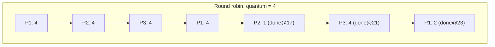
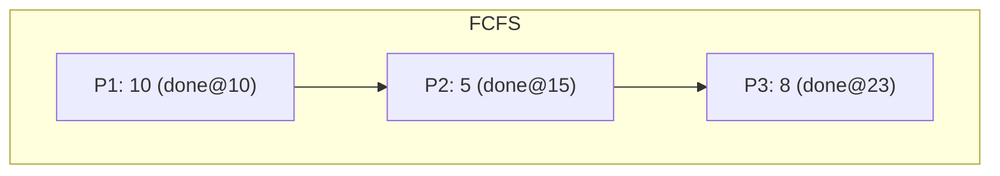
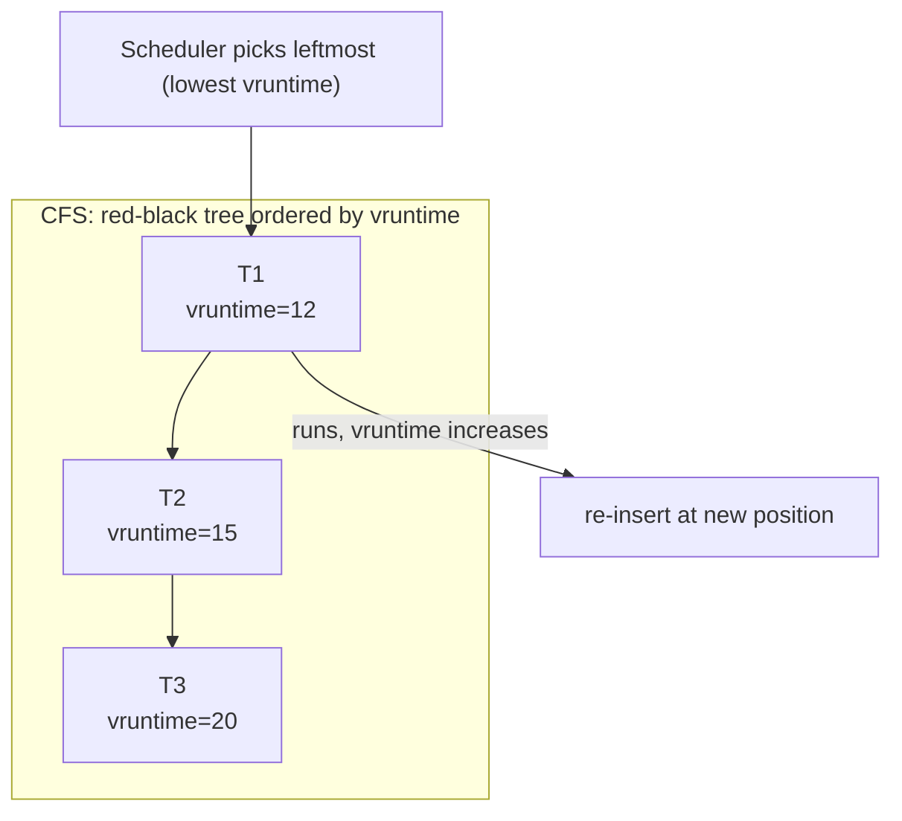
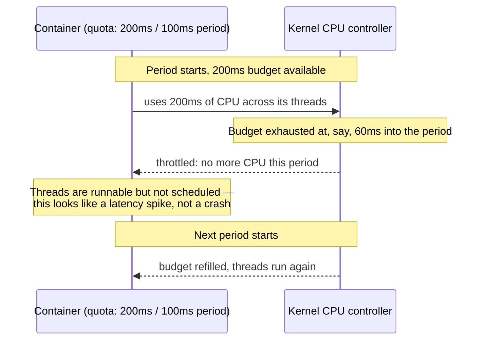

# CPU Scheduling

> [!summary] TL;DR
> A CPU scheduler decides which of the many runnable threads gets a core right now, and for how long. The goal is to make a small number of cores feel like every runnable thread is making progress, trading off throughput, fairness and responsiveness.

> [!abstract] Core idea
> - With more runnable threads than cores, something has to wait. The scheduler picks the order and the time slice.
> - Classic algorithms (FCFS, round robin, priority, MLFQ) trade fairness against throughput against responsiveness; no single algorithm wins on all three.
> - Linux's CFS, and EEVDF since kernel 6.6, don't use fixed time slices at all — they track how much "virtual runtime" each thread has used and always run whoever is furthest behind.
> - In containers, `cgroups` CPU quotas can **throttle** a process to less CPU than the host has, even if no other process wants it — a common cause of latency spikes that look like nothing is wrong with the code.
> - Go's own scheduler (the GMP model) runs *goroutines* on top of OS threads; it is a separate, cooperative scheduler built on top of everything in this note, covered in [[Runtime - Goroutine Scheduler (GMP)]].

## 1. Why it exists

A typical server has 8 or 16 CPU cores. A single moderately busy Go service can easily have hundreds of OS threads blocked or runnable at once (the Go runtime starts one OS thread per blocked syscall, plus `GOMAXPROCS` threads for running goroutines — see [[Runtime - Goroutine Scheduler (GMP)]]). The OS has far more runnable work than it has cores to run it on.

The kernel must decide, many thousands of times per second, which thread runs on which core next, and for how long, before being preempted to let someone else have a turn. Get this wrong and symptoms show up directly in your service's latency: a request-handling thread that's ready to run but sits in the run queue for 20ms behind lower-priority background work adds 20ms to that request's tail latency, with no code change anywhere near your request handler.

## 2. Mental model

Picture every runnable thread sitting in a queue at the door of a small number of identical interview rooms (the cores). The **scheduler** is the receptionist deciding who goes in next and how long their interview slot is. A **context switch** is the receptionist stopping one candidate mid-sentence, saving exactly where they were, and calling in the next — the CPU registers, program counter and memory-mapping state (covered as part of a context switch in [[Processes, Threads and Context Switching]]) are what gets saved and restored.

The receptionist's policy is the scheduling algorithm. "First one who arrived" (FCFS) is simple but lets a long-winded candidate block everyone behind them. "Everyone gets exactly 10 minutes, then back of the line" (round robin) is fair but wastes time on all the candidates who only needed 30 seconds. Linux's actual policy, CFS/EEVDF, is closer to: "whoever has had the least total interview time so far, relative to how much they deserve, goes next" — nobody ever gets a fixed slice; everyone's running tally is compared continuously.

## 3. How it works

### Whiteboard version

Three processes arrive at once needing 10, 5 and 8 ticks of CPU time. Round robin with a quantum of 4 interleaves them instead of running each to completion:



Compare with first-come-first-served, which runs each to completion in arrival order — P2 and P3 wait behind the whole of P1's burst even though they're each much shorter (the **convoy effect**):



### Classic algorithms

| Algorithm | Rule | Problem it has |
| --- | --- | --- |
| FCFS | Run in arrival order, to completion | Convoy effect: one long job delays every short job behind it |
| Round robin (RR) | Each gets a fixed quantum, then back of the queue | Too-small quantum wastes time on context switches; too-large degrades to FCFS |
| Shortest job first (SJF) | Run the shortest remaining job next | Needs to know burst time in advance (usually estimated); can starve long jobs |
| Priority scheduling | Highest-priority runnable job runs next | Low-priority jobs can starve forever without aging |
| Multi-level feedback queue (MLFQ) | Multiple RR queues at different priorities; a job that uses its whole quantum drops a priority level, one that yields early stays or rises | Tunable but complex; most real schedulers (including old Linux, Windows) are a variant of this |

MLFQ's insight is the one that matters in practice: a thread that keeps using its *entire* time slice is probably CPU-bound batch work, so demote it; a thread that gives up the CPU early (because it's waiting on I/O or a lock) is probably interactive or latency-sensitive, so keep it at high priority. This is exactly the profile of a typical backend request handler: mostly waiting on the database or network, briefly bursting CPU — which is why such threads tend to stay responsive even under a loaded MLFQ-style scheduler without any special tuning.

### Linux: CFS and EEVDF

Linux abandoned fixed time slices and priority queues for its default scheduling class (`SCHED_OTHER`) starting with the **Completely Fair Scheduler (CFS)**, introduced in kernel 2.6.23. CFS tracks each runnable thread's **virtual runtime (`vruntime`)** — roughly, CPU time consumed, scaled by the inverse of its priority (`nice` value) — and keeps all runnable threads in a red-black tree ordered by `vruntime`. The scheduler always picks the leftmost node: whoever has the *least* virtual runtime so far, i.e. whoever has been waiting relatively the longest.



Since kernel **6.6** (2023), Linux's default scheduling class is **EEVDF** (Earliest Eligible Virtual Deadline First), which replaces CFS. EEVDF keeps the same virtual-time fairness idea but also tracks a virtual deadline per thread and picks the thread with the earliest deadline among those that are "eligible" (haven't used more than their fair share yet). This fixes a known CFS weakness: CFS could let a thread that has been sleeping accumulate an unfair burst of CPU time once it woke up ("sleeper fairness" gaming); EEVDF bounds how far ahead or behind a thread's virtual time can drift, giving more predictable latency for both batch and interactive threads without separate heuristics for each.

### cgroups CPU quotas and throttling

A **cgroup** (control group) is a kernel mechanism for grouping processes and bounding the resources that group can use — CPU, memory, I/O. Container runtimes (Docker, Kubernetes) set a container's CPU limit by writing to its cgroup's CPU controller. cgroup v2 expresses a CPU limit in `cpu.max`, as `"<quota> <period>"` in microseconds — e.g. `"200000 100000"` means 200ms of CPU time per 100ms period, i.e. a limit of 2 full cores' worth of time, regardless of how many cores the host actually has.

If a container's threads try to use more CPU time than its quota allows within a period, the kernel **throttles** it: those threads simply don't get scheduled again until the next period starts, even if cores are sitting idle. This shows up as a request that was running fine suddenly stalling for tens of milliseconds, then resuming — because it hit its quota mid-request and had to wait out the rest of the period.



This is where **`GOMAXPROCS`** matters directly: by default Go sets `GOMAXPROCS` to `runtime.NumCPU()`, the number of *logical* CPUs the host machine (or VM) has — not the container's quota. A container limited to 2 CPUs on a 64-core host would, before this was fixed, run with `GOMAXPROCS=64`: the Go scheduler would happily spin up far more OS threads than the cgroup quota can ever actually run concurrently, each one getting throttled constantly and fighting over the same 2-core budget, which inflates scheduling latency and GC pause coordination overhead. Projects like `uber-go/automaxprocs` existed specifically to read the cgroup quota at startup and call `runtime.GOMAXPROCS()` with the right number.

**Documented (Go 1.25 release notes):** starting with Go 1.25, the runtime itself reads the container's cgroup CPU quota on Linux and sets a container-aware default for `GOMAXPROCS`, updating it automatically if the quota changes at runtime (e.g. a Kubernetes vertical autoscaler adjusting limits). This makes a dedicated `automaxprocs`-style call unnecessary on Go 1.25+ for the common case, though explicitly setting `GOMAXPROCS` is still correct when you want a value different from the quota (for example, deliberately bursting above a soft limit).

## 4. Worked example

### Whiteboard version

```go
func RoundRobin(procs []Proc, quantum int) map[string]int {
	completion := make(map[string]int, len(procs))
	queue := append([]Proc(nil), procs...)
	clock := 0
	for len(queue) > 0 {
		p := queue[0]
		queue = queue[1:]
		run := min(p.Burst, quantum)
		clock += run
		p.Burst -= run
		if p.Burst == 0 {
			completion[p.Name] = clock
		} else {
			queue = append(queue, p)
		}
	}
	return completion
}
```

### Full simulators: round robin, FCFS, and reading a cgroup quota

```go
package cpusched

import (
	"bufio"
	"fmt"
	"os"
	"strconv"
	"strings"
)

// CPUQuota reads a cgroup v2 cpu.max file (format "<quota> <period>", or
// "max <period>" for no limit) and returns the number of whole CPUs that
// quota allows, rounded up. Go 1.25+ does this same arithmetic on Linux to
// pick a container-aware default for GOMAXPROCS.
func CPUQuota(path string) (cpus int, unlimited bool, err error) {
	f, err := os.Open(path)
	if err != nil {
		return 0, false, err
	}
	defer f.Close()

	sc := bufio.NewScanner(f)
	if !sc.Scan() {
		return 0, false, fmt.Errorf("cpu.max: empty file")
	}
	fields := strings.Fields(sc.Text())
	if len(fields) != 2 {
		return 0, false, fmt.Errorf("cpu.max: malformed line %q", sc.Text())
	}
	if fields[0] == "max" {
		return 0, true, nil
	}

	quota, err := strconv.ParseFloat(fields[0], 64)
	if err != nil {
		return 0, false, fmt.Errorf("cpu.max: bad quota: %w", err)
	}
	period, err := strconv.ParseFloat(fields[1], 64)
	if err != nil {
		return 0, false, fmt.Errorf("cpu.max: bad period: %w", err)
	}

	cpus = int(quota / period)
	if frac := quota/period - float64(cpus); frac > 1e-9 {
		cpus++ // round up: a 1.5-CPU quota needs 2 OS threads to ever use it all
	}
	if cpus < 1 {
		cpus = 1
	}
	return cpus, false, nil
}

// Proc is one runnable unit in the scheduling simulations below. Burst is
// the remaining CPU time it needs, in abstract ticks.
type Proc struct {
	Name  string
	Burst int
}

// RoundRobin simulates non-preemptive-arrival, preemptive-execution
// round-robin scheduling with a fixed quantum (what Linux's O(1) scheduler
// and early CFS approximate with time slices). It returns each process's
// completion time. All processes are assumed to arrive at time 0 and are
// queued in FCFS order on ties, like a single run queue.
func RoundRobin(procs []Proc, quantum int) map[string]int {
	completion := make(map[string]int, len(procs))
	queue := make([]Proc, len(procs))
	copy(queue, procs)

	clock := 0
	for len(queue) > 0 {
		p := queue[0]
		queue = queue[1:]

		run := p.Burst
		if run > quantum {
			run = quantum
		}
		clock += run
		p.Burst -= run

		if p.Burst == 0 {
			completion[p.Name] = clock
		} else {
			queue = append(queue, p)
		}
	}
	return completion
}

// FCFS simulates first-come-first-served scheduling: each process runs to
// completion in arrival order, with no preemption.
func FCFS(procs []Proc) map[string]int {
	completion := make(map[string]int, len(procs))
	clock := 0
	for _, p := range procs {
		clock += p.Burst
		completion[p.Name] = clock
	}
	return completion
}
```

```go
// TestRoundRobinMatchesHandTrace checks RR against a trace worked out by
// hand: P1(10) P2(5) P3(8), quantum 4, all arriving at time 0.
//
//	t=0  P1 runs 4   -> P1=6,  queue [P2 P3 P1]
//	t=4  P2 runs 4   -> P2=1,  queue [P3 P1 P2]
//	t=8  P3 runs 4   -> P3=4,  queue [P1 P2 P3]
//	t=12 P1 runs 4   -> P1=2,  queue [P2 P3 P1]
//	t=16 P2 runs 1   -> done at t=17
//	t=17 P3 runs 4   -> done at t=21
//	t=21 P1 runs 2   -> done at t=23
func TestRoundRobinMatchesHandTrace(t *testing.T) {
	procs := []Proc{{"P1", 10}, {"P2", 5}, {"P3", 8}}
	got := RoundRobin(procs, 4)
	want := map[string]int{"P1": 23, "P2": 17, "P3": 21}
	if !reflect.DeepEqual(got, want) {
		t.Fatalf("got %v, want %v", got, want)
	}
}

// TestFCFSConvoyEffect shows the classic convoy problem: one long process
// first makes every later process wait for the whole of its burst, which RR
// avoids by capping any single run to the quantum.
func TestFCFSConvoyEffect(t *testing.T) {
	procs := []Proc{{"long", 100}, {"short", 1}}
	fcfs := FCFS(procs)
	rr := RoundRobin(procs, 4)
	if fcfs["short"] <= rr["short"] {
		t.Fatalf("FCFS short completion %d should be worse than RR's %d", fcfs["short"], rr["short"])
	}
}

// TestFCFSRunsInOrder checks that FCFS completion times are simply the
// cumulative sum of burst times in arrival order.
func TestFCFSRunsInOrder(t *testing.T) {
	procs := []Proc{{"P1", 3}, {"P2", 2}, {"P3", 7}}
	got := FCFS(procs)
	want := map[string]int{"P1": 3, "P2": 5, "P3": 12}
	if !reflect.DeepEqual(got, want) {
		t.Fatalf("got %v, want %v", got, want)
	}
}

// TestCPUQuota checks the cgroup v2 cpu.max parsing and rounding: an exact
// quota, a quota that needs rounding up, and the unlimited ("max") case.
func TestCPUQuota(t *testing.T) {
	cases := []struct {
		name      string
		line      string
		wantCPUs  int
		wantUnlim bool
	}{
		{"exact-one", "100000 100000", 1, false},
		{"rounds-up", "150000 100000", 2, false},
		{"unlimited", "max 100000", 0, true},
	}
	for _, tc := range cases {
		t.Run(tc.name, func(t *testing.T) {
			dir := t.TempDir()
			path := filepath.Join(dir, "cpu.max")
			if err := os.WriteFile(path, []byte(tc.line+"\n"), 0o644); err != nil {
				t.Fatalf("WriteFile: %v", err)
			}
			cpus, unlimited, err := CPUQuota(path)
			if err != nil {
				t.Fatalf("CPUQuota: %v", err)
			}
			if unlimited != tc.wantUnlim {
				t.Fatalf("unlimited = %v, want %v", unlimited, tc.wantUnlim)
			}
			if !tc.wantUnlim && cpus != tc.wantCPUs {
				t.Fatalf("cpus = %d, want %d", cpus, tc.wantCPUs)
			}
		})
	}
}
```

**Tested:** `go vet` and `go test -race` both pass on Go 1.24.4, darwin/arm64 (2026-11-06) — 4 tests including `TestCPUQuota` (table test over `"100000 100000"` → 1 CPU, `"150000 100000"` → rounds up to 2, `"max 100000"` → unlimited) and `TestFCFSRunsInOrder`.

## 5. Variants and comparison

| Algorithm | How it works | Use when | Cost |
| --- | --- | --- | --- |
| FCFS | Run to completion in arrival order | Batch jobs with no latency requirement | Convoy effect under mixed job lengths |
| Round robin | Fixed quantum, cycle through a queue | Simple fairness guarantee needed | Throughput loss if the quantum is too small |
| SJF / shortest remaining time | Always run the (remaining) shortest job | Burst times are known or estimable | Needs prediction; can starve long jobs |
| Priority + aging | Highest priority runs; waiting raises priority over time | Mixed-importance workloads | Tuning priorities and aging rate is fiddly |
| MLFQ | Multiple queues; demote CPU-hogs, protect I/O-bound jobs | General-purpose OS scheduling without knowing job lengths in advance | More moving parts to reason about |
| CFS / EEVDF (Linux default) | Always run whoever has the least virtual runtime so far (EEVDF: earliest eligible virtual deadline) | Linux's default for ordinary threads (`SCHED_OTHER`) | No fixed quantum to tune; complexity is in the kernel, not your config |

## 6. Trade-offs and when not to use

- Fairness and throughput conflict directly: perfectly fair time-slicing context-switches more, which costs cache locality (see [[Memory Hierarchy and CPU Caches]]) and pure CPU cycles spent switching instead of working.
- Real-time workloads (audio, control systems) can't tolerate "eventually fair" — Linux has separate real-time scheduling classes (`SCHED_FIFO`, `SCHED_RR`) outside CFS/EEVDF entirely, with strict priority and no fairness guarantee against lower-priority threads.
- cgroup CPU quotas trade predictable multi-tenant isolation for throttling latency spikes; a workload that's bursty rather than steady-state often needs a higher `cpu.max` burst allowance or `cpu.weight`-based soft limits instead of a hard quota.
- Tuning `nice`/priority rarely helps a backend service in practice — the actual bottleneck is almost always I/O wait (database, network) or lock contention, not CPU scheduling order. Profile before assuming the scheduler is the problem.

## 7. In production

- **Real systems:** every Linux server you deploy a Go service on uses CFS (kernel < 6.6) or EEVDF (6.6+) by default; Kubernetes sets `cpu.max` from a Pod's CPU `limits`, and CPU `requests` translate into `cpu.weight` (relative share) rather than a hard cap.
- **Failure modes → fixes:**
	- Random latency spikes under a hard CPU limit → check `/sys/fs/cgroup/.../cpu.stat`'s `nr_throttled` and `throttled_usec`; raise the limit, lower concurrency, or (Go 1.25+) trust the runtime's container-aware `GOMAXPROCS` instead of overriding it incorrectly.
	- A "noisy neighbor" container starves others on a shared host → set `cpu.weight` (relative shares) appropriately, or move to dedicated cores (`cpuset`) for latency-critical workloads.
	- A batch job degrades an interactive service's latency on the same host → `nice` the batch job down, or put it in its own cgroup with a lower `cpu.weight`.
- **What to monitor:** `cpu.stat`'s `nr_throttled` / `throttled_usec` per container, run-queue length (`/proc/loadavg`'s load average, or `vmstat`'s `r` column), context-switch rate (`vmstat`'s `cs` column), and `GOMAXPROCS` vs the actual quota.

## 8. Deep dive

- **Why EEVDF over CFS.** CFS's fairness was purely about accumulated `vruntime`; a thread that slept for a long time came back with a low `vruntime` and could legitimately "catch up" by hogging the CPU for a while, which hurts latency-sensitive neighbors even though it's technically fair over a long enough window. EEVDF bounds eligibility by a virtual deadline computed from a requested slice length, so a thread can't bank an unbounded amount of catch-up credit; this gives more predictable tail latency for everything else running alongside it.
- **Context switch cost is not just the switch.** Saving/restoring registers is cheap (sub-microsecond); the real cost is **cache and TLB pollution** — the new thread starts with cold L1/L2 caches and a cold TLB (see [[Memory Hierarchy and CPU Caches]] and [[Virtual Memory, Paging and the TLB]]), so its first several memory accesses are slow even though the switch "finished" instantly.
- **CPU pinning and `cpuset` cgroups.** For the lowest, most predictable latency, some systems (HFT, some database engines) pin specific threads to specific cores via `cpuset` and isolate those cores from the rest of the scheduler (`isolcpus`/`nohz_full`), trading flexibility for eliminating scheduling jitter entirely on the hot path.
- **The relationship to Go's own scheduler.** Everything above is the OS scheduler deciding which *OS thread* runs on which core. Go additionally schedules *goroutines* onto a smaller number of OS threads itself (the GMP model), which is a cooperative, userspace scheduling layer sitting on top of this one — see [[Runtime - Goroutine Scheduler (GMP)]] for how that works and why it exists even though the OS already schedules threads.

## 9. Interview questions

> [!question]- Why did Linux move away from fixed time-slice scheduling?
> Fixed time slices force a trade-off: too long hurts interactive responsiveness, too short wastes time on context switches, and the right value depends on the workload. CFS (and now EEVDF) instead track each thread's accumulated virtual runtime and always run whoever is relatively furthest behind, which adapts automatically without a tunable slice length.

> [!question]- What's the convoy effect, and which algorithm avoids it?
> Under FCFS, a long-running process ahead in the queue makes every shorter process behind it wait for its entire burst, even though those shorter jobs could have finished almost immediately. Round robin (and any preemptive algorithm) avoids it by capping how long any one process can monopolize the CPU before yielding to the next.

> [!question]- A Go service is deployed with a 2-CPU Kubernetes limit on a 64-core node. What goes wrong if `GOMAXPROCS` isn't set correctly, and why?
> Before Go 1.25 (without a tool like `automaxprocs`), `GOMAXPROCS` defaults to the host's logical CPU count — 64 here — not the cgroup quota. The Go scheduler then tries to run far more concurrent work than the 2-CPU quota can sustain, so the cgroup throttles the container repeatedly within each period, inflating scheduling and GC coordination latency. Go 1.25+ reads the cgroup quota itself and sets a container-aware default.
> [!trap] "Just set `GOMAXPROCS` higher to get more throughput" is backwards here — the quota is a hard ceiling regardless of `GOMAXPROCS`; the fix is matching `GOMAXPROCS` *down* to the quota, not up.

> [!question]- What does cgroup CPU throttling look like from inside the throttled process?
> The process's threads are runnable — not blocked on anything — but the kernel simply doesn't schedule them again until the next quota period starts. From the outside this looks exactly like a latency spike with no obvious cause in application logs; `cpu.stat`'s `nr_throttled` and `throttled_usec` in the container's cgroup are the signal to check.

> [!question]- Priority scheduling can starve low-priority processes forever. How do real schedulers fix this?
> Aging: gradually raise a waiting process's effective priority the longer it waits, so it eventually becomes the highest priority and is guaranteed to run. MLFQ achieves something similar by promoting a process back up a queue level after it's been starved for a configured period.

> [!question]- Does a faster CPU scheduler make your API faster?
> Rarely, for a typical backend service. Most request latency is spent waiting on I/O (database queries, downstream HTTP calls — see [[I-O Models - Blocking, epoll, io_uring and the Go Netpoller]]), not waiting in the OS run queue for a CPU core. Scheduling only becomes the bottleneck under CPU saturation, heavy context-switch churn, or cgroup throttling — profile first.

## 10. Cheat sheet

- The scheduler decides which runnable thread gets a core, and for how long; more runnable work than cores means something always waits.
- FCFS: simple, convoy effect. Round robin: fair, needs quantum tuning. MLFQ: demotes CPU-hogs, protects I/O-bound threads.
- Linux default (`SCHED_OTHER`): CFS before kernel 6.6, EEVDF since — both schedule by virtual runtime/deadline, not a fixed slice.
- cgroup v2 `cpu.max` = `"<quota> <period>"` in µs; exceeding it mid-period gets you throttled, not killed.
- `GOMAXPROCS` defaults to host logical CPUs, not the container's quota, unless the runtime is container-aware (Go 1.25+) or you set it yourself (or via `automaxprocs`).
- Context-switch cost is mostly cold caches/TLB afterward, not the switch itself.
- Real-time classes (`SCHED_FIFO`/`SCHED_RR`) sit outside CFS/EEVDF entirely for workloads that can't tolerate "eventually fair".
- Most backend latency is I/O wait, not scheduling delay — profile before tuning scheduler knobs.

## Links

- **Before this:** [[Processes, Threads and Context Switching]]
- **Next:** [[Concurrency Primitives - Mutex, Semaphore, Atomics]], [[I-O Models - Blocking, epoll, io_uring and the Go Netpoller]]
- **Compare with:** [[Runtime - Goroutine Scheduler (GMP)]] (a cooperative scheduler built on top of OS threads, not a replacement for this)
