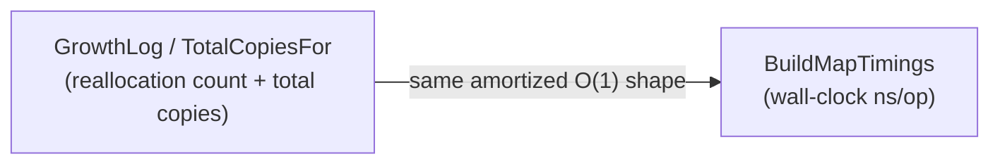

# Complexity Analysis - Big-O and Amortized Cost - Go

> [!summary] TL;DR
> Two measured demonstrations of amortized `O(1)` cost in Go — slice `append` and map insertion — with tests that check reallocation counts grow logarithmically while per-operation cost stays flat, backing every number in [[Complexity Analysis - Big-O and Amortized Cost]].

> [!info] How to read this note (pick your level)
> - 🟢 **New to this?** Read "From zero" below, then "Before the code", "What this code shows" and "Running it".
> - 🟡 **Know the basics?** Work through the Code steps 1-3 and the Tests.
> - 🔴 **Interview / SDE-3 prep?** Add Design decisions, Pitfalls and the Exercises. Headings are tagged 🟢🟡🔴 so you always know where you are.

> [!note] Before this note
> - [[Number Representation and Text Encoding]]: numbers double in powers of 2 (1, 2, 4, 8, ... 1,024), which is why "grow by doubling" reaches a million in about 20 steps. Read [[Complexity Analysis - Big-O and Amortized Cost]] first too: "amortized `O(1)`" means cheap on average over many calls.

**From zero, in 60 seconds** 🟢

This file is the runnable half of [[Complexity Analysis - Big-O and Amortized Cost]]. The theory note claims that Go's `append` and map inserts are cheap on average even though single calls can be expensive. This file does not just repeat the claim — it measures it: small Go programs count every real reallocation and time real map builds, and tests fail if the numbers ever stop matching the theory. Read each "Step" top to bottom: plain-words line, code, then a numbered walk-through.

## Before the code 🟢

- **Slices and `append`**: a Go slice is a growable list; `append` adds an element and may move it to a bigger backing array.
- **`cap()`**: the reserved room in a slice; a change in `cap` after `append` means a reallocation happened.
- **Maps**: Go's built-in hash table, `map[int]int`; it grows its bucket array as it fills.
- **Structs**: `ReallocPoint` and `MapTiming` are plain records holding measured numbers.
- **`time.Now` / `time.Since`**: wall-clock timing used to measure map build cost.
- **`testing` package**: `TestXxx` functions run with `go test`; `t.Logf` prints data, `t.Fatalf` fails. Run `go vet ./... && go test -race -v ./...`.

## What this code shows 🟢

| Code | Concept in [[Complexity Analysis - Big-O and Amortized Cost]] |
| --- | --- |
| `GrowthLog`, `TotalCopiesFor` | Measuring slice `append`'s amortized `O(1)` cost, [[Complexity Analysis - Big-O and Amortized Cost#Measuring Go's actual slice growth]] |
| `BuildMapTimings` | The second measured example, map insertion, [[Complexity Analysis - Big-O and Amortized Cost#A second measured example: Go map insertion]] |
| `TestReallocCountIsLogarithmic` | Reallocations grow `O(log n)`, not `O(n)`, same section |
| `TestTotalCopiesIsLinearInN` | Total copying work is `O(n)`, which is what makes per-append cost amortized `O(1)` |
| `TestMapInsertStaysRoughlyFlat` | Map insertion's ns/op stays bounded as `n` grows 1,000x |

## Setup 🟢

- Module `complexity`, Go 1.24, standard library only.
- Run: `go vet ./... && go test -race -v ./...`

## Code 🟡

> 🟢 → 🟡 **You now know** what the two experiments measure. **Next we read the code:** a diary of every slice reallocation, a total of all copying work, and a stopwatch on map building. Each step starts with one plain-words line.

### Step 1: logging every slice reallocation

**In plain words:** this code appends items one by one and writes down every moment Go had to build a bigger array — like keeping a diary of every time the valet moved your cars to a larger lot.

**Concept.** [[Complexity Analysis - Big-O and Amortized Cost#Measuring Go's actual slice growth]] claims reallocations happen `O(log n)` times and the total copying work is `O(n)`; `GrowthLog` makes that claim checkable by recording every point where `cap(s)` actually changed as `n` elements are appended one at a time.

The alternative — trusting the runtime's documented growth formula without measuring it — is what [[Arrays and Dynamic Arrays (Go Slices) - Go]]'s `NextCap` does; this file instead measures the *consequence* of that formula (how many reallocations, how much copying) rather than the formula itself.

```go
// ReallocPoint records one point where append had to grow the backing
// array: the slice's length and the new capacity the runtime chose.
type ReallocPoint struct {
	Len int
	Cap int
}
```

**How it works.** `Len` and `Cap` are recorded together because the *gap* between the length that triggered growth and the new capacity is exactly the spare room the next several appends get to use for free.

**What this code does, in plain words:** start with an empty slice, add `n` numbers one at a time, and every time `cap` jumps (a new, bigger array was made) write down the length and the new capacity.

```go
// GrowthLog appends n elements to a nil slice one at a time and records
// every point where the runtime had to reallocate (cap() changed), i.e.
// every real copy.
func GrowthLog(n int) []ReallocPoint {
	var s []int
	var log []ReallocPoint
	prevCap := cap(s)
	for i := 0; i < n; i++ {
		s = append(s, i)
		if cap(s) != prevCap {
			log = append(log, ReallocPoint{Len: len(s), Cap: cap(s)})
			prevCap = cap(s)
		}
	}
	return log
}
```

**How it works.**

1. `s` starts `nil`, so `cap(s)` starts at `0`.
2. After each `append`, comparing the new `cap(s)` against `prevCap` detects exactly the appends that triggered a real reallocation — every other append left `cap` unchanged, meaning it wrote into existing spare room.
3. Only the reallocation points are logged, not every append, so `len(log)` directly answers "how many times did the runtime actually copy the backing array?"

### Step 2: turning the log into a total-cost number

**In plain words:** this adds up all the copying work those growth events caused, giving one total number we can divide by n to get the average cost per append.

**Concept.** `TotalCopiesFor` converts the reallocation log into the one number amortized analysis actually bounds: the *total* element-copies across the whole sequence of `n` appends.

The theory note's claim "amortized `O(1)` per append" is precisely the claim that this total, divided by `n`, stays bounded by a constant — this function computes the numerator of that division.

```go
// TotalCopiesFor returns the total number of element-copies that n
// sequential appends to a nil slice cause across all reallocations: the sum,
// over every reallocation, of the length at that point (every existing
// element is copied into the new backing array). This is the quantity
// amortized analysis bounds at O(n) total, i.e. O(1) per append on average,
// even though any single append can be O(n).
func TotalCopiesFor(n int) int {
	log := GrowthLog(n)
	total := 0
	for _, p := range log {
		// The copy that produced this reallocation moved the *previous*
		// length's worth of elements (the old backing array's contents).
		total += p.Len - 1 // the just-appended element itself isn't a copy
	}
	return total
}
```

**How it works.**

1. Each `ReallocPoint` in the log corresponds to one reallocation; at that moment, the runtime copied every *previously existing* element into the new array.
2. `p.Len - 1` is that previous element count: `p.Len` already includes the just-appended element that triggered the growth, which itself wasn't copied (it's written fresh into the new array).
3. Summing this across every reallocation gives the grand total of element-copies caused by building the slice from empty to `n` elements.

### Step 3: the second measured example — map insertion

**In plain words:** same experiment, different structure — build maps of growing sizes with a stopwatch running, and check the time per insert stays flat instead of growing with the map.

**Concept.** [[Complexity Analysis - Big-O and Amortized Cost#A second measured example: Go map insertion]] generalizes the amortized-`O(1)` argument beyond slices.

Go's built-in `map` grows its bucket array the same way (doubling, then incrementally evacuating old buckets), so inserting into a map should show the same "flat ns/op regardless of final size" signature that slice append does.

`BuildMapTimings` measures exactly that, for several sizes, so the claim is checked rather than merely asserted by analogy.

```go
// MapTiming records how long it took to build a Go map of N sequential
// int keys from empty, one Insert at a time, and the resulting average
// nanoseconds per insert.
type MapTiming struct {
	N       int
	TotalNS int64
	NSPerOp float64
}

// BuildMapTimings times building a fresh map for each requested size and
// reports the average per-insert cost. If map insertion were genuinely
// O(n) per call, NSPerOp would grow with N; amortized O(1) predicts it
// stays roughly flat.
func BuildMapTimings(sizes []int) []MapTiming {
	out := make([]MapTiming, 0, len(sizes))
	for _, n := range sizes {
		m := make(map[int]int)
		start := time.Now()
		for i := 0; i < n; i++ {
			m[i] = i
		}
		elapsed := time.Since(start)
		out = append(out, MapTiming{
			N:       n,
			TotalNS: elapsed.Nanoseconds(),
			NSPerOp: float64(elapsed.Nanoseconds()) / float64(n),
		})
	}
	return out
}
```

**How it works.**

1. For each requested size `n`, a brand-new, empty map is built from scratch — this measures the cost of *growing* a map from nothing, not of looking things up in an already-sized one.
2. `time.Now()`/`time.Since` wall-clock-times the whole build; dividing by `n` gives the average nanoseconds per insert, the same "per-operation average" framing as the slice table.
3. The function returns one `MapTiming` per requested size, so a caller (or a test, or the theory note's table) can see how `NSPerOp` behaves as `n` grows 10x, 100x, 1,000x.



## Design decisions 🔴

> 🟡 → 🔴 **You now know** how each function measures growth and how the tests check the numbers. **Next comes the advanced part:** why it was measured this way, where the measurements can mislead, and exercises.

| Decision | Alternative | Trade-off |
| --- | --- | --- |
| `GrowthLog` detects reallocation by comparing `cap(s)` before/after | Instrument the runtime directly (not possible from user code) | Black-box but reliable: `cap()` is the only externally visible signal of a reallocation, and it's exactly right |
| `TotalCopiesFor` derived from `GrowthLog`'s output | Count copies with a custom allocator or `runtime/trace` | Far simpler, and sufficient: the theory note only needs the *total*, not a trace of individual memory writes |
| `BuildMapTimings` measures wall-clock time, not an operation count | Count rehash/bucket-evacuation events like `GrowthLog` does for slices | Go's `map` doesn't expose a `cap()`-equivalent signal for bucket growth, so timing is the only externally observable proxy available from user code |
| Map benchmark uses a generous 50x band in its test | A tight, exact bound | Wall-clock timing is noisy (GC pauses, when the garbage collector briefly slows the program; scheduler jitter, small random delays in when code gets a CPU); a tight bound would make the test flaky (passing and failing at random) on a shared CI (automatic build-and-test server) machine without making the underlying claim any more true |

## Tests 🟡

### TestReallocCountIsLogarithmic

**Property.** The number of reallocations for `n` appends must grow like `O(log n)`, not `O(n)`: doubling `n` should only add a handful more reallocations, because each one roughly doubles capacity.

| n | Measured reallocations | Final capacity |
| --- | --- | --- |
| 1,000 | 12 | 1,280 |
| 10,000 | 19 | 12,288 |
| 100,000 | 28 | 110,592 |
| 1,000,000 | 38 | 1,055,744 |

```go
func TestReallocCountIsLogarithmic(t *testing.T) {
	for _, n := range []int{1_000, 10_000, 100_000, 1_000_000} {
		log := GrowthLog(n)
		maxExpected := int(math.Ceil(math.Log2(float64(n)))) + 20 // generous slack for Go's growth-factor curve
		if len(log) > maxExpected {
			t.Fatalf("n=%d: %d reallocations, want <= %d (should grow like log2(n))", n, len(log), maxExpected)
		}
		t.Logf("n=%-9d reallocations=%-3d final cap=%d", n, len(log), log[len(log)-1].Cap)
	}
}
```

A failure here would mean the number of reallocations is growing faster than logarithmically — which would mean either the test's generous slack is too tight, or (far more concerning) the runtime's growth strategy has regressed toward something closer to "grow by a fixed small increment," which would break the amortized-`O(1)` guarantee entirely.

### TestTotalCopiesIsLinearInN

**Property.** The total element-copies across all reallocations, for `n` appends, must stay bounded by a small constant multiple of `n` — that constant-multiple bound is exactly what "amortized `O(1)` per append" means.

| n | Measured total copies | Copies / n |
| --- | --- | --- |
| 1,000 | 1,871 | 1.87 |
| 10,000 | 32,415 | 3.24 |
| 100,000 | 402,079 | 4.02 |
| 1,000,000 | 4,154,015 | 4.15 |

```go
func TestTotalCopiesIsLinearInN(t *testing.T) {
	for _, n := range []int{1_000, 10_000, 100_000, 1_000_000} {
		copies := TotalCopiesFor(n)
		if copies > 5*n {
			t.Fatalf("n=%d: total copies = %d, want <= %d (5n) for amortized O(1) appends", n, copies, 5*n)
		}
		t.Logf("n=%-9d total element-copies=%-9d  copies/n=%.2f", n, copies, float64(copies)/float64(n))
	}
}
```

A failure here (total copies exceeding `5n`) would directly contradict the theory note's central claim — it would mean `append`'s average cost per call is growing with `n`, not staying constant.

### TestGrowthIsMonotonic

**Property.** `cap()` growth must be monotonically non-decreasing (it only stays the same or goes up, never down), and every reallocation's new capacity must be strictly greater than the length that triggered it — a basic sanity check that the measured log itself is internally consistent before trusting the two tests above.

```go
func TestGrowthIsMonotonic(t *testing.T) {
	log := GrowthLog(50_000)
	prevCap := 0
	for _, p := range log {
		if p.Cap <= prevCap {
			t.Fatalf("capacity did not increase: %d -> %d", prevCap, p.Cap)
		}
		if p.Cap < p.Len {
			t.Fatalf("capacity %d smaller than length %d at a realloc point", p.Cap, p.Len)
		}
		prevCap = p.Cap
	}
}
```

If this test failed, it would mean `GrowthLog` itself has a bug — the two measurement tests above would then be computing statistics over a broken log, so this test runs first, conceptually, as a check on the measuring instrument.

### TestMapInsertStaysRoughlyFlat

**Property.** As `n` grows 1,000x (1,000 → 1,000,000), the average per-insert cost should stay within a bounded band, not grow linearly with `n`.

| n | Measured ns/op |
| --- | --- |
| 1,000 | 77.2 |
| 10,000 | 71.2 |
| 100,000 | 53.5 |
| 1,000,000 | 101.3 |

```go
func TestMapInsertStaysRoughlyFlat(t *testing.T) {
	timings := BuildMapTimings([]int{1_000, 10_000, 100_000, 1_000_000})
	base := timings[0].NSPerOp
	for _, tm := range timings {
		t.Logf("n=%-9d total=%-12dns  ns/op=%.1f", tm.N, tm.TotalNS, tm.NSPerOp)
		if tm.NSPerOp > base*50 {
			t.Fatalf("n=%d: ns/op=%.1f grew more than 50x over the n=1,000 baseline (%.1f); expected amortized O(1), not O(n)", tm.N, tm.NSPerOp, base)
		}
	}
}
```

A generous 50x band absorbs scheduler noise and GC pauses on a shared test machine while still catching genuine `O(n)`-per-insert behavior, which would blow far past it (a real `O(n)` regression at `n=1,000,000` would mean roughly a 1,000x slowdown per insert, not 50x).

A failure here would mean map insertion's cost is growing with `n` instead of staying flat — contradicting the theory note's generalization from slices to maps.

## Running it 🟢

```text
go vet ./... && go test -race ./...
```

Measured with `go test -race -v ./...` on Go 1.24.4, darwin/arm64 (2026-11-09):

```text
=== RUN   TestReallocCountIsLogarithmic
    growth_test.go:18: n=1000      reallocations=12  final cap=1280
    growth_test.go:18: n=1000000   reallocations=38  final cap=1055744
--- PASS: TestReallocCountIsLogarithmic (0.03s)
=== RUN   TestTotalCopiesIsLinearInN
    growth_test.go:32: n=1000      total element-copies=1871       copies/n=1.87
    growth_test.go:32: n=1000000   total element-copies=4154015    copies/n=4.15
--- PASS: TestTotalCopiesIsLinearInN (0.02s)
=== RUN   TestGrowthIsMonotonic
--- PASS: TestGrowthIsMonotonic (0.00s)
=== RUN   TestMapInsertStaysRoughlyFlat
    growth_test.go:62: n=1000      total=77208       ns  ns/op=77.2
    growth_test.go:62: n=1000000   total=101349583   ns  ns/op=101.3
--- PASS: TestMapInsertStaysRoughlyFlat (0.11s)
PASS
ok  	rollscratch/complexity	2.245s
```

**Reading the output.** Each `t.Logf` line prints one data point from the measured tables above; the trimmed excerpt here shows the first and last size for each test to keep the output short, while the full four-size run is what produced every row in the theory note's tables.

`PASS` on all four tests under the race detector (`-race`, a Go tool that catches unsafe shared-memory access between goroutines) confirms both "reallocations are logarithmic" and "map insertion's per-op cost stays flat" are not just plausible arguments but checked facts about this exact Go version and platform.

## Pitfalls in the code 🔴

- **The map timing test is wall-clock-based, not operation-count-based**, unlike the slice tests (which count real reallocations). That makes `TestMapInsertStaysRoughlyFlat` inherently noisier — a busy CI machine or a GC pause mid-benchmark can inflate one data point. The generous 50x band exists specifically to absorb that noise without weakening the underlying claim.
- **`GrowthLog` and `TotalCopiesFor` only model a nil-slice, one-at-a-time append pattern.** A program that appends in batches (`append(s, many, values...)`) or pre-sizes with `make([]T, 0, n)` has a completely different reallocation profile — these functions measure the worst common case (no pre-sizing), not every possible append pattern.
- **`BuildMapTimings` measures build time, not steady-state lookup time.** A map that's already built and is only being read from has very different performance characteristics (no growth happening at all), which this code doesn't measure.

## Exercises 🔴

1. Modify `GrowthLog` to also record the *ratio* `cap(s) / prevCap` at each reallocation point, and predict how that ratio changes as `n` crosses 256 (hint: compare to the growth table in [[Arrays and Dynamic Arrays (Go Slices)]]). Then run it.
2. Add a third measured example to `BuildMapTimings`'s sibling: time deleting all `n` keys from a fully built map one at a time, and predict whether deletion shows the same flat-ns/op shape as insertion (map deletion doesn't shrink the bucket array in Go, so predict accordingly before running).
3. Change `TestTotalCopiesIsLinearInN`'s bound from `5*n` to `3*n` and predict which `n` values (if any) in the test's list would then fail, using the measured "copies/n" column in the theory note's table. Then run it to confirm.

## Self-check 🟢🟡

> [!question]- How does `GrowthLog` know a reallocation happened?
> `cap(s)` changed after an `append`.

> [!question]- For `n = 1,000,000`, about how many reallocations were measured?
> 38, which is roughly logarithmic, not a million.

> [!question]- Why does `TotalCopiesFor` add `p.Len - 1`, not `p.Len`?
> The element that triggered the growth is written fresh into the new array; only the older ones are copied.

> [!question]- What would `NSPerOp` look like if map insert were really `O(n)` per call?
> It would grow about 1,000x as `n` grows 1,000x, instead of staying around 50-100 ns.

> [!question]- Why does the map test use a wide 50x band?
> Timing is noisy (GC, scheduler), and a tight band would fail at random.

> [!question]- If you pre-size with `make([]int, 0, n)`, what does `GrowthLog`-style counting show?
> Zero reallocations, because there is already room for all `n` items.

## Links

- **Theory:** [[Complexity Analysis - Big-O and Amortized Cost]]
- **Related:** [[Arrays and Dynamic Arrays (Go Slices) - Go]] (the slice growth formula itself), [[Hash Tables and Go Maps]] (map internals this note's measurements rely on)
