# Complexity Analysis - Big-O and Amortized Cost

> [!summary] TL;DR
> Big-O describes how an algorithm's running time or memory use grows as the input size `n` grows, ignoring constant factors and lower-order terms — it answers "does this get twice as slow, or a thousand times slower, if I give it ten times the data?" Amortized analysis answers a related but different question: if an operation is usually cheap but occasionally expensive, what is its *average* cost per call over a long sequence of calls?

> [!abstract] Core idea
> - Big-O (`O`), Big-Theta (`Θ`), and Big-Omega (`Ω`) describe upper, tight, and lower bounds on growth rate as `n → ∞`, dropping constants and lower-order terms.
> - The common classes, from fastest to slowest growth, are `O(1) < O(log n) < O(n) < O(n log n) < O(n²) < O(2ⁿ) < O(n!)`.
> - Amortized cost is the average cost per operation over a worst-case *sequence* of operations, not the cost of any single operation — Go's slice `append` and map insertion are both textbook examples.
> - Space complexity matters as much as time complexity and is analyzed the same way.
> - Constants matter in practice: an `O(n)` algorithm with a huge constant factor can be slower than an `O(n log n)` one for all realistic `n`.

## Start here: the basics 🟢

> [!info] How to read this note (pick your level)
> - 🟢 **New to this?** Read "From zero" below, then sections 1, 2, 8 and the cheat sheet (11). Stop there, that is a full first pass.
> - 🟡 **Know the basics?** Add section 3 (the formal bounds and the classes) and 4 (the measured worked example), plus 5 and 6.
> - 🔴 **Interview / SDE-3 prep?** Add 7, 9 and 10. Headings are tagged 🟢🟡🔴 so you always know where you are.

> [!note] Before this note
> - [[Number Representation and Text Encoding]]: computers count in powers of 2, so 2¹⁰ = 1,024 (about a thousand) and 2²⁰ is about a million. That makes `log₂` numbers easy: `log₂(1,000,000)` is about 20.

**From zero, in 60 seconds** 🟢

Your code works on a list. Someday that list will be much bigger. Will the code still be fast?

**Big-O** is the simple language for answering that. It does not ask "how fast is it now?" — it asks "if the list gets 10 times bigger, does the work get 10 times bigger, or 100 times, or barely change?"

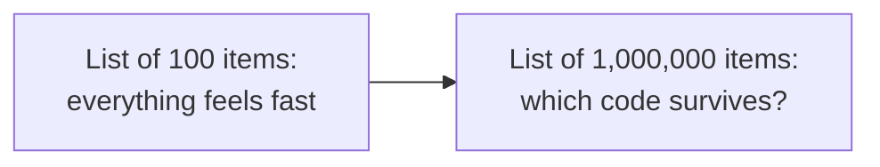

The shape of the growth is what matters. Code that does one pass over the list grows with the list ("O of n"). Code with a loop inside a loop grows with the list squared ("O of n squared") — that one dies first.

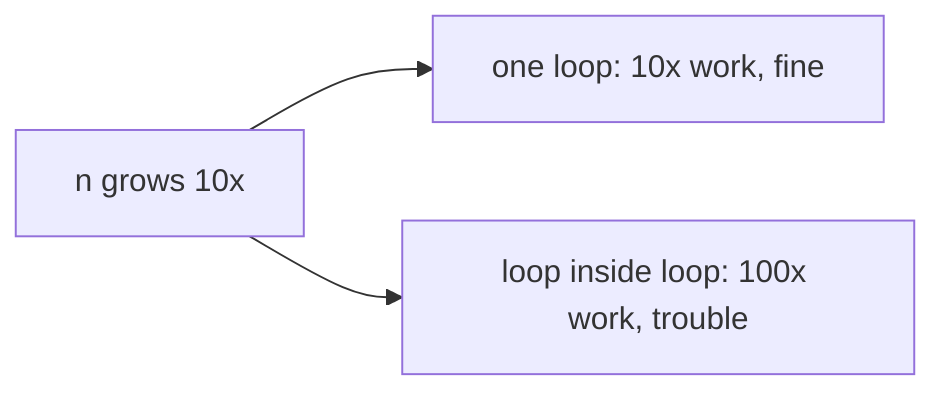

One more idea: **amortized** cost. Some operations are usually free but occasionally expensive. Spread the rare expensive one across all the cheap ones and the average stays tiny — like a yearly gym fee spread over daily visits.

That is it. The rest of this note is just these 3 questions:
1. How do I name a growth shape precisely? (sections 1-3)
2. What does "amortized O(1)" really mean, with real measured numbers? (section 4)
3. When does Big-O mislead you, and what do interviewers probe? (sections 6-10)

### The problem in one story

You write a function that checks a list of 100 users for duplicates. It runs instantly.
Six months later the list has 1,000,000 users and the same function takes hours.
Nothing in the code changed; only the size of the input did.
Complexity analysis is the tool that predicts this before it happens.

### Words you need first

| Word | Plain meaning | Tiny example |
| --- | --- | --- |
| Input size `n` | How much data the code works on | A list of 1,000 items has `n = 1,000` |
| Operation | One small step the computer does | One comparison `a < b` |
| Growth rate | How the step count changes when `n` gets bigger | Double the list, double the steps |
| Constant factor | A fixed multiplier Big-O ignores | `3n` and `n` are both `O(n)` |
| Logarithm (`log n`) | How many times you can halve `n` before reaching 1 | `log₂(1,000,000)` ≈ 20 |
| Worst case | The most steps for any input of size `n` | Searched value is last in the list |
| Slice / capacity | A Go growable list; capacity is its reserved room | `make([]int, 0, 8)` has room for 8 |
| Amortized | Average cost per call over many calls | One costly call spread over 100 cheap ones |
| Bound | A line the cost will not cross (a ceiling or a floor) | "never more than `5n` steps" |
| Binary search | Find a value in a sorted list by checking the middle and throwing away half each time | 1,000,000 items in about 20 checks |
| Backing array / reallocation | The real memory under a slice; reallocation means getting a bigger one and copying everything over | 8 slots full, so get 16 and copy 8 |
| SLA (latency) | A promise about how fast each request must be | "99% of requests under 200 ms" |
| Hash map | A key → value store that finds a key in about one step | Go `map[string]int` |

### Picture it

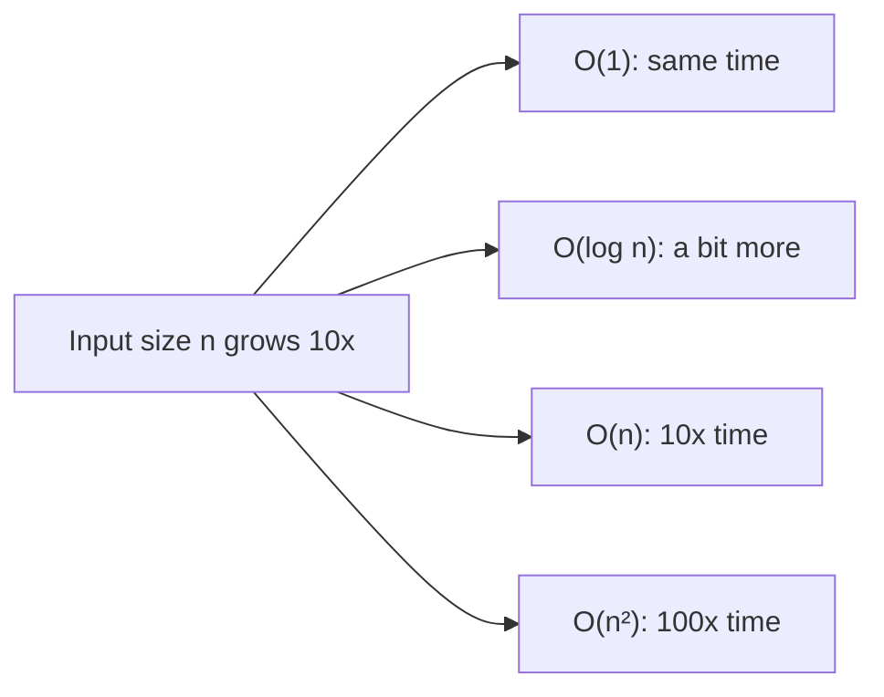

### Analogy

Big-O is like asking how a commute grows with distance, not how fast your car is: walking (`n²`) versus driving (`n`) matters more than buying faster shoes.
Where it breaks: for very short trips (small `n`), the "slow" option can actually win because setup costs (constants) dominate.

### How the rest of this note builds up

- First, why predicting growth matters, and two analogies (errands and a gym membership).
- Then the formal bounds `O`, `Ω`, `Θ`, the common classes with real numbers, and best/average/worst case.
- Then a measured worked example: Go slice `append` and map insertion, showing amortized `O(1)`.
- Finally, trade-offs, production failure modes, and the SDE-3 deep dive on Go's growth factor and the banker's method.

> [!tip] Remember
> Big-O asks "what happens when `n` gets 10x bigger?", not "how fast is it right now?".

## 1. Why it exists 🟢

### Predicting speed before running anything

**In plain words:** Before you write two different solutions to the same problem and time them both, there's a way to predict, on paper, which one will stay fast as the input grows — without running either one.

**Picture it:**

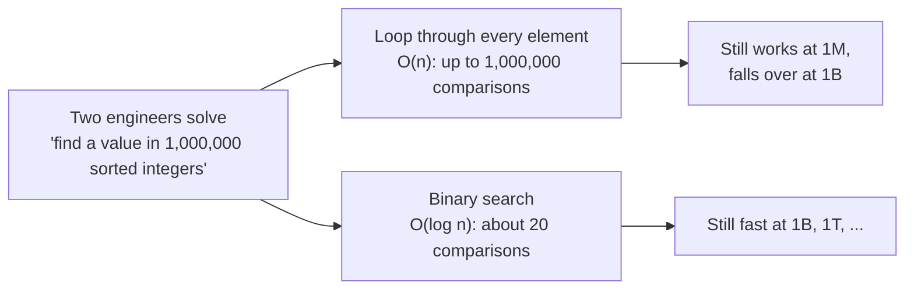

**Example:** Both solutions are "correct" at `n = 1,000,000`. Big-O is the language that lets you predict, *before running either one*, that binary search will still be fast at a billion elements while the linear scan will not.

Concretely: at `n = 1,000,000`, an `O(n)` algorithm doing one simple operation per step might take on the order of a millisecond; an `O(n²)` algorithm on the same input is not "a bit slower" — it's on the order of `10^12` operations, hours instead of milliseconds.

**Why it matters:** The *shape* of the growth curve, not the exact constant, is what determines whether an algorithm is usable at production scale. A machine ten times faster does not rescue an `O(n²)` algorithm from a big enough `n` — it just delays the problem by one order of magnitude.

> [!tip] Remember
> Big-O predicts whether an algorithm survives scaling the input, which no amount of faster hardware can substitute for once `n` gets large enough.

### Real-life example: "Find friends on WhatsApp" 🟢

When you install WhatsApp, it checks which of your 500 phone contacts already use the app, against a list of hundreds of crores of users.
Comparing each contact with every user one by one (a loop inside a loop) would take forever.
Instead the server looks each contact up in a hash map, which is about one step per contact, so 500 contacts cost about 500 steps.
That change, from `O(n × m)` to `O(n)`, is the difference between "instant" and "never finishes".
Big-O is how an engineer sees this before writing a single line.

## 2. Mental model 🟢

### The errand-list analogy

**In plain words:** Imagine you're told "this errand takes `n` minutes" versus "this errand takes `n²` minutes," where `n` is the number of items on your list.

**Picture it:**

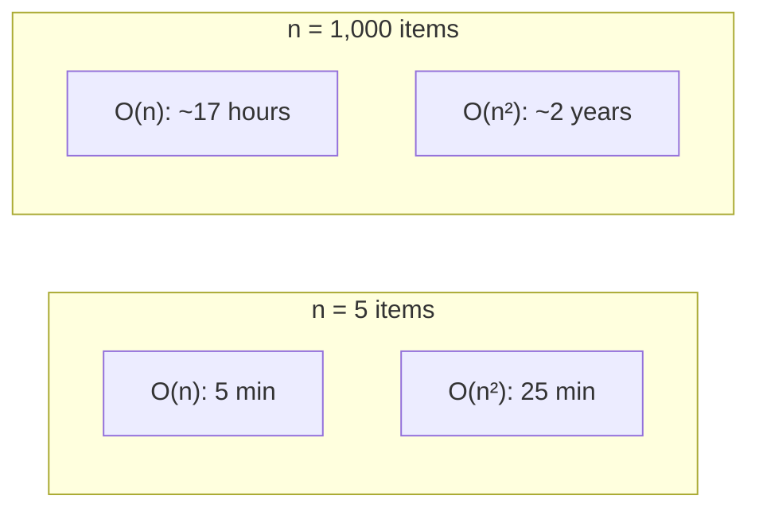

**Example:** For a 5-item list, that's 5 minutes vs. 25 minutes — annoying but survivable. For a 1,000-item list, it's about 17 hours vs. roughly 2 years. The gap between the two curves didn't grow linearly with the list — it exploded.

**Why it matters:** Big-O is the habit of asking "which curve am I on?" before asking "how fast is my computer?"

**Where the analogy breaks down:** a slow errand is merely unpleasant; a slow algorithm in a production system with a latency budget (the maximum time a request is allowed to take) can be an outage.

### The gym-membership analogy (amortized cost)

**In plain words:** Amortized cost is like a gym membership: you pay a large fee occasionally (the yearly renewal) but mostly do cheap, low-cost visits.

**Picture it:**

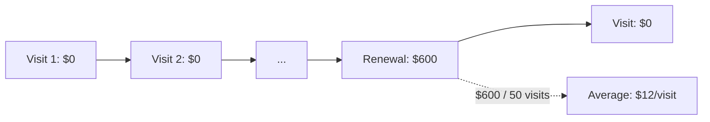

**Example:** If you ask "what's my cost per visit over the whole year," you divide the big occasional cost across all the visits — giving a small, steady number — even though any individual visit on renewal day looks expensive.

**Why it matters:** This is exactly how Go's slice `append` works: almost every call is free (writes into spare capacity), but occasionally one call pays for a full reallocation and copy — and the *average*, spread across all calls, stays small and constant.

> [!warning] Common mistake
> Confusing "amortized `O(1)`" with "every single call is `O(1)`." They are different claims. A hard per-call latency SLA cares about the worst single call, which amortized analysis explicitly does not bound.

## Common beginner mistakes 🟢

- **Keeping constants, like `O(2n + 5)`** → Big-O only cares about the shape of growth → write `O(n)`.
- **Adding nested loops instead of multiplying** → a loop of `n` inside a loop of `n` is `n × n`, not `n + n` → nested means multiply (`O(n²)`), one after another means add (`O(n)`).
- **Forgetting the hidden loop inside a library call** → `slices.Contains` inside a `for` loop is a loop inside a loop → count the cost of every call you make, not just your own `for`.
- **Thinking `O(log n)` is "a bit faster than `O(n)`"** → at a million items it is 20 steps versus 1,000,000 → treat `log n` as "almost free".
- **Saying "amortized `O(1)`" means every call is fast** → one call can still be `O(n)` → pre-size with `make([]T, 0, n)` when a single slow call hurts.

## 3. How it works 🟡

> 🟢 → 🟡 **You now know** that Big-O is about how work grows when the input grows, and that "amortized" means "averaged over many calls". **Next we open the box:** the three exact kinds of bound, the seven common growth classes with real numbers, and why the same code can be fast on one input and slow on another. Each subsection starts with a plain walk-through.

### Formal definitions, informally

**In plain words:** Big-O, Big-Omega and Big-Theta are three different kinds of bound on a growth curve — upper, lower, and both at once.

**Step by step (linear search on a list of 1,000 names):**
1. Count the steps: in the worst case you check all 1,000 names; in the best case just 1.
2. Big-O (ceiling): it never takes more than about `n` steps, so it is `O(n)`.
3. Big-Omega (floor): it always takes at least 1 step, so it is `Ω(1)`.
4. Big-Theta needs the ceiling and floor to match. They match for the worst case (always `n` checks when the name is missing), so worst-case linear search is `Θ(n)`.

- **`O(g(n))`** ("Big-O", upper bound): the algorithm's running time grows *no faster than* `g(n)`, for large enough `n`, up to a constant factor. "At most this fast-growing."
- **`Ω(g(n))`** ("Big-Omega", lower bound): the running time grows *at least as fast* as `g(n)`. "At least this fast-growing."
- **`Θ(g(n))`** ("Big-Theta", tight bound): both `O(g(n))` and `Ω(g(n))` hold — the running time grows *exactly* like `g(n)`, up to constants.

**Picture it:**

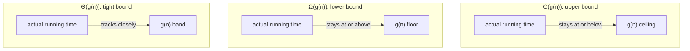

**Example:** In casual engineering conversation, "Big-O" is almost always used to mean the tight bound (`Θ`): "binary search is `O(log n)`" really means `Θ(log n)` — it's not merely *no worse than* logarithmic, it genuinely *is* logarithmic.

**Why it matters:** Saying `O(n²)` is technically true of an `O(n)` algorithm too (it's certainly no worse than `n²`), but it's a much weaker, less useful statement. When precision matters, reach for `Θ`.

### Common complexity classes, with real numbers

**In plain words:** Seven named classes cover almost every algorithm you'll encounter, ordered from "doesn't care how big `n` gets" to "unusable past a tiny `n`."

**Step by step (how to name the class of your own code):**
1. Find what grows: here, `n` = number of orders.
2. One loop over the orders → `O(n)`.
3. A loop over orders, and inside it a loop over orders again → `O(n²)`.
4. Halving the problem each step (like binary search) → `O(log n)`.
5. Sorting first, then one loop → `O(n log n)` + `O(n)` = `O(n log n)`; keep only the biggest term.

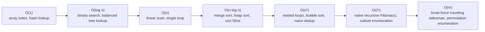

**Example, with numbers** at `n = 1,000` (a modest input), operation counts on each curve (illustrative, assuming 1 operation ≈ 1 ns — an estimate to show relative scale, not a real measurement):

| Class | Operations at n=1,000 | Rough wall-clock at 1ns/op |
| --- | --- | --- |
| `O(1)` | 1 | ~1 ns |
| `O(log n)` | ~10 | ~10 ns |
| `O(n)` | 1,000 | ~1 µs |
| `O(n log n)` | ~10,000 | ~10 µs |
| `O(n²)` | 1,000,000 | ~1 ms |
| `O(2ⁿ)` | ~10^301 | longer than the age of the universe |
| `O(n!)` | astronomically larger still | not computable |

**Why it matters:** The jump from `O(n²)` to `O(2ⁿ)` at `n = 1,000` isn't "a bit worse" — it's the difference between a millisecond and a number with 300 digits.

This is why interview questions probing "can you do better than the brute-force nested loop" aren't pedantic: at real production scale (`n` in the millions), an `O(n²)` algorithm is simply not viable, full stop, regardless of hardware.

> [!tip] Remember
> The seven classes aren't evenly spaced — the gaps between them explode as `n` grows, especially the jump from polynomial (`n`, `n²`: `n` raised to a fixed power) to exponential (`2ⁿ`, `n!`: the work multiplies with every extra item).

### Best, average, and worst case

**In plain words:** A single algorithm can have different complexities depending on *which* input you give it, not just how big it is.

**Step by step, for linear search on an array:**
1. Best case: the value you're looking for is the first element — `O(1)`.
2. Worst case: the value is last, or absent entirely — `O(n)`, every element checked.
3. Average case, over random positions: roughly `n/2` checks — still `O(n)`.

**Example:** Quicksort is `Θ(n log n)` on average but `O(n²)` in the worst case (already-sorted input with a naive pivot choice; the pivot is the item quicksort splits the list around) — which is exactly why production sort implementations use randomized or median-of-three pivot selection (pick the middle value of three samples), or fall back to a different algorithm (introsort, a hybrid that switches to heapsort when quicksort goes badly) when recursion depth suggests the worst case is happening.

**Why it matters:** "This algorithm is `O(n log n)`" is an incomplete sentence unless you also say *which case* — a system with a strict latency SLA needs to design for the worst case, not the average.

> [!warning] Common mistake
> Quoting an algorithm's average-case complexity as if it were a guarantee. Average case assumes a distribution of inputs (often "random"); a production system facing adversarial (crafted on purpose to be slow) or pathological input (deliberately or by bad luck) can hit the worst case instead.

## 4. Worked example 🟡

### Whiteboard version

1. Appending to a Go slice sometimes requires the runtime to allocate a new, larger backing array and copy every existing element into it — an `O(n)` operation.
2. Most appends, though, just write into existing spare capacity — an `O(1)` operation.
3. Because the expensive reallocation roughly *doubles* capacity each time, it happens only `O(log n)` times over `n` appends.
4. So the *total* copying work across all of them is bounded by a small constant times `n`.
5. Dividing that total by `n` appends gives an *amortized* `O(1)` cost per append, even though any single append can cost `O(n)` in the worst case.

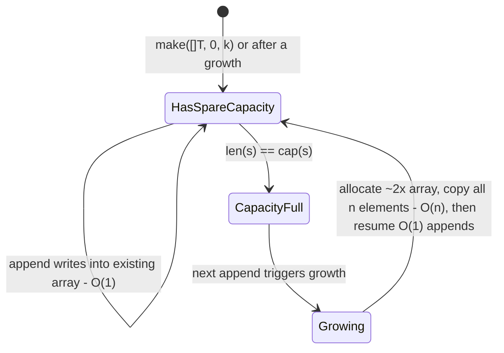

### Measuring Go's actual slice growth

**In plain words:** the table below is real measured proof — append a million items one by one, and the expensive "grow and copy" step happens only 38 times, so the average cost per append stays tiny and flat.

**Measured** (this code, Go 1.24.4, darwin/arm64, 2026-11-09):

| n | Reallocations | Final capacity | Total element-copies | Copies / n |
| --- | --- | --- | --- | --- |
| 1,000 | 12 | 1,280 | 1,871 | 1.87 |
| 10,000 | 19 | 12,288 | 32,415 | 3.24 |
| 100,000 | 28 | 110,592 | 402,079 | 4.02 |
| 1,000,000 | 38 | 1,055,744 | 4,154,015 | 4.15 |

The reallocation count grows logarithmically (12 → 38 while `n` grows 1,000×), while the copies-per-append ratio stays bounded around 2–4 regardless of `n` — exactly the amortized-`O(1)` signature.

For small slices, growth is a clean doubling, producing the capacity sequence `1, 2, 4, 8, 16, 32, …`.

For larger slices Go's runtime tapers the growth factor down toward roughly 1.25× to avoid over-allocating memory, which is why the ratio above drifts upward slightly rather than staying exactly flat — it is still bounded by a constant, just not identical at every scale.

### A second measured example: Go map insertion

**In plain words:** Slice `append` is not a one-off curiosity — the same "usually cheap, occasionally expensive, bounded on average" shape applies to Go's built-in `map`, which also grows its bucket array (the row of slots where keys are stored; doubling it, then evacuating, meaning moving, old buckets into the new array a few at a time) whenever its load factor (how full the slots are on average) crosses an internal threshold.

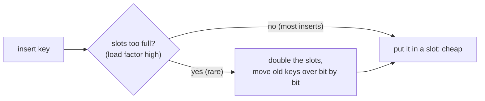

**Example, measured** (this code, Go 1.24.4, darwin/arm64, building a fresh map of `n` sequential int keys from empty, timing the whole build):

| n | Total build time | ns per insert |
| --- | --- | --- |
| 1,000 | 77.2 µs | 77.2 |
| 10,000 | 711.7 µs | 71.2 |
| 100,000 | 5.35 ms | 53.5 |
| 1,000,000 | 101.3 ms | 101.3 |

**Why it matters:** If map insertion were genuinely `O(n)` per call, the ns-per-insert column would grow roughly linearly with `n` — a 1,000x increase in `n` would mean roughly a 1,000x increase in per-insert cost.

Instead it stays within the same order of magnitude across three orders of magnitude of `n` (53–101 ns/op, not 53 ns growing toward 53,000 ns), which is exactly the amortized-`O(1)` signature the slice table above also shows.

The absolute numbers bounce around more than the slice table (map insertion also does hashing and bucket-overflow handling, which add noise), but the *shape* — flat, not growing with `n` — is the point.

> [!tip] Remember
> Amortized `O(1)` isn't a special property of slices; it's a general pattern for "grow by doubling" data structures, including Go's map, Python's list, Java's `ArrayList`, and hash tables in general.

### Space complexity

**In plain words:** the same growth question, but asked about memory instead of time — how much extra room does the code need as the input grows?

Space complexity is analyzed with the same notation, counting memory instead of operations.

- A function that builds a new slice of size `n` is `O(n)` space.
- One that reverses a slice in place with two swapping indices is `O(1)` *extra* space (not counting the input itself, which is standard convention).
- The slice-growth example above is also an `O(n)` space algorithm: the backing array's capacity is always within a constant factor of its length.

Runnable Go version (both measurements, plus the underlying tests): [[Complexity Analysis - Big-O and Amortized Cost - Go]].

## 5. Variants and comparison 🟡

| Notation | Meaning | Typical use |
| --- | --- | --- |
| `O(g(n))` | Upper bound: grows no faster than `g(n)` | "This algorithm is at most this bad" |
| `Ω(g(n))` | Lower bound: grows at least as fast as `g(n)` | "This algorithm can't be better than this" |
| `Θ(g(n))` | Tight bound: both of the above | What engineers usually mean by casual "Big-O" |
| Worst case | Maximum cost over all inputs of size `n` | What you should design for in a public-facing system |
| Average case | Expected cost over a distribution of inputs | Useful when inputs really are close to random |
| Amortized | Average cost per operation over a worst-case sequence | Data structures with occasional expensive rebalancing (dynamic arrays, hash table resizing) |

## 6. Trade-offs and when not to use 🟡

**In plain words:** Big-O is about big inputs. For small inputs, the "slower" class can win, because Big-O throws away the fixed setup costs.

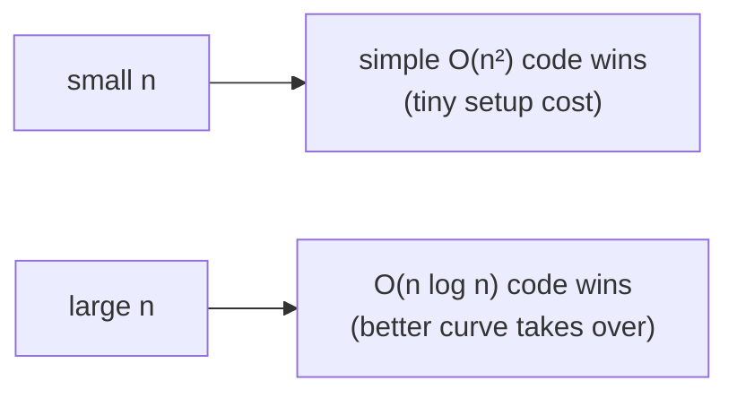

- A better Big-O class is not automatically faster in practice: an `O(n)` algorithm with a large constant (e.g. heavy per-element work, poor cache locality, meaning data scattered in memory so the CPU's fast cache keeps missing) can lose to an `O(n log n)` algorithm with tiny constants and great cache behavior, for every `n` you'll actually encounter.
	- This is why, for example, insertion sort (`O(n²)`) is often used for small sub-arrays inside production sort implementations (including Go's) — its constant factor is low enough to beat `O(n log n)` algorithms for small `n`.
- Amortized analysis describes average cost over a sequence; it says nothing about any *individual* operation's worst case.
	- A system with a hard per-request latency SLA can't rely on "it's amortized `O(1)`" if a single unlucky request happening to trigger the expensive case would violate the SLA — that's a case for pre-allocating capacity, not just trusting amortized bounds.
- Big-O deliberately ignores constants and lower-order terms, which makes it the wrong tool for comparing two implementations of the *same* asymptotic class (the same growth shape for very large `n`) (two `O(n log n)` sorts) — that comparison needs real benchmarking, not asymptotic analysis.

> [!tip] Remember
> Amortized bounds are about averages over sequences; they're the wrong tool for a single request's worst case, and Big-O comparisons within the same class are the wrong tool for picking between two real implementations.

## 7. In production 🔴

> 🟡 → 🔴 **You now know** the three bounds, the seven classes, best/average/worst case, and real measurements that show amortized `O(1)`. **Next comes the advanced part:** how this shows up in real systems, why Go tapers its growth factor, the banker's method of proof, and interview traps.

- **Real systems:** Go's `append` uses amortized-`O(1)` growth (shown above).
	- Dynamic arrays in essentially every language (Python lists, Java `ArrayList`, C++ `std::vector`) use the same doubling-capacity strategy for the same reason.
	- Hash table resizing (growing the bucket array and rehashing all entries) is amortized `O(1)` per insertion by the same logic, used in Go's `map`, Java's `HashMap`, and Redis's dictionary implementation.
- **Failure modes → fixes:**
	- Code pre-allocates nothing and appends to a slice in a hot loop processing millions of items → call `make([]T, 0, expectedSize)` to pre-size the slice and skip all the reallocation copying entirely, turning amortized `O(1)` into actual `O(1)` for every append.
	- A nested loop over two large collections (`O(n²)`) is written where a hash-map lookup (`O(n)` overall) would do → recognize the pattern "for each item, scan the whole other collection" as a red flag at any non-trivial `n`.
	- An algorithm with good average-case complexity (e.g. naive quicksort) hits its worst case in production due to adversarial or already-sorted input → use randomized pivot selection or a hybrid algorithm with a guaranteed worst-case bound (Go's `sort.Slice` uses introsort internally for exactly this reason).
- **What to monitor:** for data-processing code, wall-clock time or operation counts as `n` grows in production (not just in a benchmark) — a function that looked fine at `n=1,000` in staging can reveal `O(n²)` behavior painfully at `n=1,000,000` in production.

## 8. Whiteboard version 🟢

If someone asks you to explain amortized analysis at a whiteboard with no code:

1. Draw a row of boxes representing a slice's backing array, with a few shaded (used) and a few unshaded (spare capacity).
2. Draw a tally mark under each `append` that lands in spare capacity — label it "$0" (free).
3. When the shaded boxes reach the end, draw a new, longer row of boxes below it and arrows copying every shaded box across — label this one "$n" (expensive).
4. Count: across a long sequence of appends, how many "$n" events happened versus how many "$0" events? Roughly `log₂(n)` expensive events versus `n` total appends.
5. Divide total cost by total appends: the few expensive events, spread across many cheap ones, average out to a small constant — that's the amortized bound.

That five-step picture, plus the banker's-method explanation in the deep dive below, is the entire argument; the measured tables above just put exact numbers on it.

## 9. Deep dive 🔴

- **Why does Go's slice grow by roughly doubling, then taper off?** Doubling keeps the number of reallocations logarithmic in `n`, which is what bounds total copying work at `O(n)`.
	- But doubling an already-huge slice over-allocates a lot of memory in absolute terms.
	- So Go's runtime (since early versions, refined since) uses a steeper growth factor for small slices and tapers toward roughly 1.25× for large ones, trading slightly more frequent reallocation for less wasted memory at scale — visible in the measured table above, where the copies-per-append ratio creeps up with `n` rather than staying perfectly flat.
- **The accounting/banker's method for amortized analysis**: one rigorous way to prove an amortized bound is to imagine each cheap operation "pays" a small constant extra fee into a virtual account, and the expensive operation "spends" from that account instead of being charged to the single caller unlucky enough to trigger it.
	- For slice append: each `O(1)` append can be thought of as prepaying for its own eventual copy during some future reallocation, so that when the reallocation happens, the cost is drawn from fees already collected, not freshly charged all at once.
- **`O(2ⁿ)` in practice**: naive recursive Fibonacci (`fib(n) = fib(n-1) + fib(n-2)` with no memoization) recomputes the same sub-problems exponentially many times. Memoizing it (caching sub-problem results) turns the same algorithm into `O(n)` — the same recursive *structure*, a completely different complexity class, purely by avoiding repeated work.
	- This is the core idea behind dynamic programming.
- **Why `n!` shows up at all**: brute-force algorithms that try every permutation of `n` items (a naive traveling-salesman solver, for instance) are `O(n!)`, which grows so fast that `n=20` already exceeds what's computable in a human lifetime.
	- This is exactly why such problems need heuristics, approximation algorithms, or fundamentally different approaches (dynamic programming, branch-and-bound) rather than brute force at any realistic scale.

## 10. Interview questions 🔴

> [!question]- What's the practical difference between Big-O, Big-Omega, and Big-Theta?
> Big-O is an upper bound (grows no faster than), Big-Omega is a lower bound (grows at least as fast as), and Big-Theta is both at once — a tight bound meaning the algorithm genuinely grows at that rate. When people casually say "this is `O(n log n)`" about, say, merge sort, they usually mean the stronger `Θ(n log n)`, since merge sort's running time doesn't just have an upper bound there, it's tightly bound there.

> [!question]- Explain why Go's slice `append` is "amortized O(1)" even though a single call can be `O(n)`.
> Most calls to `append` just write into existing spare capacity, costing `O(1)`. Occasionally, when capacity is exhausted, the runtime allocates a new, larger backing array (roughly doubling capacity) and copies every existing element over, costing `O(n)` for that one call.
>
> Because the backing array's capacity roughly doubles each time, this expensive step happens only `O(log n)` times over a sequence of `n` appends, and the total copying work across all of them sums to `O(n)` — so when you divide that total cost by the `n` appends, the *average* cost per append is `O(1)`, even though the worst-case single call is `O(n)`.

> [!question]- Trap: if an algorithm is `O(n)` and another is `O(n²)`, the `O(n)` one is always faster. True or false?
> False. Big-O describes asymptotic growth, ignoring constant factors, so it only guarantees the `O(n)` algorithm wins for *sufficiently large* `n`. For small or moderate `n`, an `O(n²)` algorithm with a tiny constant factor and great cache locality can easily beat an `O(n)` algorithm with heavy per-element overhead — which is exactly why production sort implementations switch to simple `O(n²)` insertion sort for small sub-arrays.

> [!question]- Why does amortized analysis not help you if you have a hard per-request latency SLA?
> Amortized analysis bounds the *average* cost over a long sequence of operations, saying nothing about any single operation's worst case. A request that happens to be the unlucky one triggering the expensive step (e.g. a slice reallocation copying millions of elements) still pays that full cost on its own.
>
> That can blow a strict per-request SLA even though the system is "amortized O(1)" overall. The fix is to eliminate the worst case directly — e.g. pre-allocate capacity — not to rely on amortized bounds for latency-sensitive paths.

> [!question]- What's the difference between time complexity and space complexity, and can they trade off against each other?
> Time complexity counts operations as a function of input size `n`; space complexity counts memory the same way. They often trade off directly: memoizing a recursive function turns `O(2ⁿ)` time into `O(n)` time by spending `O(n)` extra space to cache sub-problem results.
>
> Recognizing this trade-off (and which resource is actually scarce for your system — CPU time or memory) is a core part of algorithm design, not an afterthought.

> [!question]- Give an example of best case, average case, and worst case differing for the same algorithm.
> Quicksort with a naive first-element pivot: best/average case is `Θ(n log n)` for reasonably random input, but worst case is `O(n²)` on already-sorted or adversarially chosen input, because the naive pivot choice produces maximally unbalanced partitions every time. This is exactly why production implementations randomize the pivot or choose median-of-three, pushing the practical worst case far out of reach for real-world input.

> [!question]- Why do production sort functions (like Go's `sort.Slice`) not use pure quicksort or pure merge sort?
> Pure quicksort risks `O(n²)` worst-case behavior on adversarial input; pure merge sort guarantees `Θ(n log n)` but always uses `O(n)` extra space and has worse constants on small inputs.
>
> Production implementations (introsort, Timsort, and Go's internal sort) use a hybrid: quicksort-like partitioning for the common case, a guaranteed-`O(n log n)` fallback (heapsort) if recursion depth suggests the worst case is happening, and simple insertion sort for small sub-arrays where its low constant factor wins outright.

## 11. Cheat sheet 🟢

- Big-O = upper bound, Big-Omega = lower bound, Big-Theta = tight bound; "Big-O" in casual speech usually means Big-Theta.
- Growth order, fastest to slowest: `O(1) < O(log n) < O(n) < O(n log n) < O(n²) < O(2ⁿ) < O(n!)`.
- Amortized cost = total cost over a worst-case sequence of operations, divided by the number of operations — not the cost of any single call.
- Go's slice `append`: occasional `O(n)` reallocation (roughly doubling capacity), amortized `O(1)` per append overall. Go's `map` insertion shows the same flat-ns/op signature as it grows its bucket array.
- Pre-size slices with `make([]T, 0, n)` when `n` is known, to skip reallocation copying entirely in hot paths.
- Space complexity is analyzed the same way as time complexity; the two often trade off (memoization trades space for time).
- Constants matter: a better asymptotic class doesn't guarantee a faster algorithm for realistic input sizes — benchmark when comparing implementations in the same class or in nearby classes at moderate `n`.
- Amortized bounds don't protect a hard per-request SLA from the occasional expensive operation — eliminate the worst case directly when that matters.

## Self-check 🟢🟡

> [!question]- A loop of `n` runs inside another loop of `n`. What is the Big-O?
> `O(n²)`: nested loops multiply.

> [!question]- About how many steps does binary search need for 1,000,000 sorted items?
> About 20, because `log₂(1,000,000)` ≈ 20.

> [!question]- What is `O(3n + 100)` simplified?
> `O(n)`: drop constants and smaller terms.

> [!question]- Why is Go's `append` amortized `O(1)` if one call can copy the whole slice?
> Capacity roughly doubles, so copies happen only about `log n` times; total copying is about `n`, so the average per append is constant.

> [!question]- Quicksort is `Θ(n log n)` on average. When can it be `O(n²)`?
> When the pivot choice keeps splitting badly, like a first-element pivot on already-sorted input.

> [!question]- Your API has a strict 50 ms per-request SLA and appends millions of items to a slice. What should you do?
> Pre-size it with `make([]T, 0, n)`, so no single request pays for a big copy; amortized `O(1)` does not protect one request.

## Links

- **Before this:** [[Number Representation and Text Encoding]]
- **Next:** [[Data Structures Overview and Big-O Cheat Sheet]], [[Arrays and Dynamic Arrays (Go Slices)]]
- **Compare with:** [[Sorting, Searching and Interview Patterns]] (complexity classes applied to specific algorithms), [[Hash Tables and Go Maps]] (the map growth measured above)
- **Runnable code:** [[Complexity Analysis - Big-O and Amortized Cost - Go]]

### Watch on YouTube

- [Asymptotic Notations - Simplified](https://www.youtube.com/watch?v=ddsP7NecEBk) · Abdul Bari · Foundational, highly-regarded explanation of Big-O/Omega/Theta notation
- [What is Amortized Time Complexity? - Code a Dynamic Array](https://www.youtube.com/watch?v=EOjoQxdOBgU) · Gaurav Sen · Directly covers amortized cost using the dynamic-array/append example this note relies on
