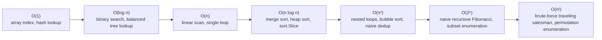
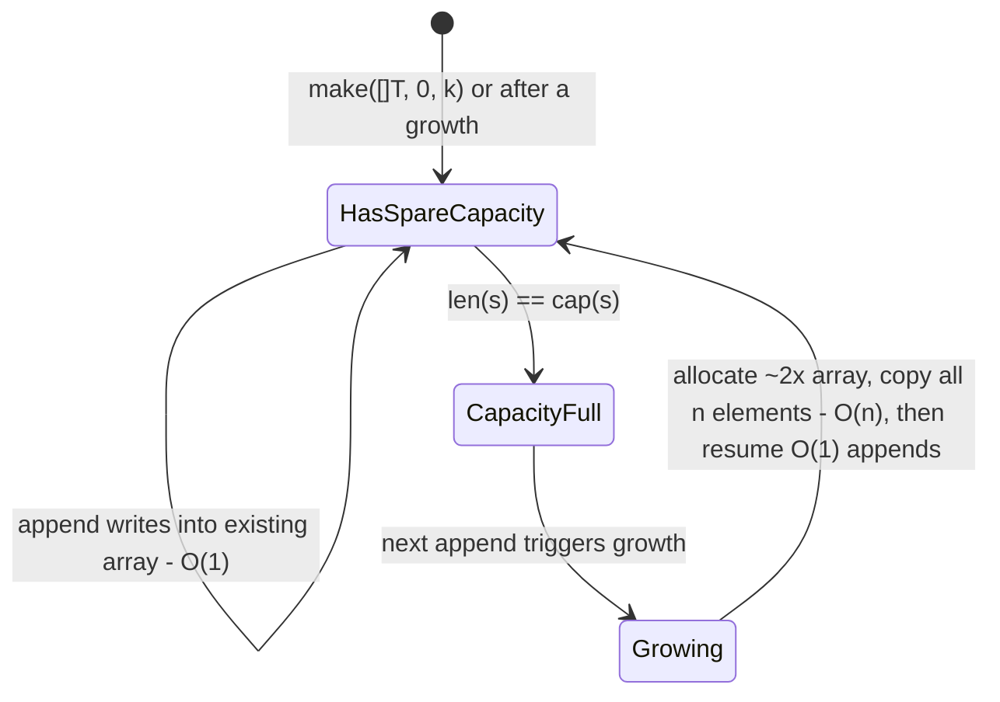

# Complexity Analysis - Big-O and Amortized Cost

> [!summary] TL;DR
> Big-O describes how an algorithm's running time or memory use grows as the input size `n` grows, ignoring constant factors and lower-order terms — it answers "does this get twice as slow, or a thousand times slower, if I give it ten times the data?" Amortized analysis answers a related but different question: if an operation is usually cheap but occasionally expensive, what is its *average* cost per call over a long sequence of calls?

> [!abstract] Core idea
> - Big-O (`O`), Big-Theta (`Θ`), and Big-Omega (`Ω`) describe upper, tight, and lower bounds on growth rate as `n → ∞`, dropping constants and lower-order terms.
> - The common classes, from fastest to slowest growth, are `O(1) < O(log n) < O(n) < O(n log n) < O(n²) < O(2ⁿ) < O(n!)`.
> - Amortized cost is the average cost per operation over a worst-case *sequence* of operations, not the cost of any single operation — Go's slice `append` is the textbook example.
> - Space complexity matters as much as time complexity and is analyzed the same way.
> - Constants matter in practice: an `O(n)` algorithm with a huge constant factor can be slower than an `O(n log n)` one for all realistic `n`.

## 1. Why it exists

Two engineers each write a function that finds a value in a sorted list of a million integers. One loops through every element (`O(n)`, up to a million comparisons). The other does binary search (`O(log n)`, about 20 comparisons). Both are "correct." Big-O is the language that lets you predict, *before running either one*, that the second will still be fast at a billion elements while the first will not — without needing to benchmark every input size by hand.

Concretely: at `n = 1,000,000`, an `O(n)` algorithm doing one simple operation per step might take on the order of a millisecond; an `O(n²)` algorithm on the same input is not "a bit slower," it's on the order of `10^12` operations — hours instead of milliseconds. The *shape* of the growth curve, not the exact constant, is what determines whether an algorithm is usable at production scale.

## 2. Mental model

Imagine you're told "this errand takes `n` minutes" vs. "this errand takes `n²` minutes," where `n` is the number of items on your list. For a 5-item list, that's 5 minutes vs. 25 minutes — annoying but survivable. For a 1,000-item list, it's about 17 hours vs. roughly 2 years. Big-O is the habit of asking "which curve am I on?" before asking "how fast is my computer?" — because no amount of faster hardware rescues you from being on the wrong curve once `n` gets large enough.

Amortized cost is like a gym membership: you pay a large fee occasionally (the yearly renewal) but mostly do cheap, low-cost visits. If you ask "what's my cost per visit over the whole year," you divide the big occasional cost across all the visits — giving a small, steady number — even though any individual visit on renewal day looks expensive.

## 3. How it works

### Formal definitions, informally

- **`O(g(n))`** ("Big-O", upper bound): the algorithm's running time grows *no faster than* `g(n)`, for large enough `n`, up to a constant factor. "At most this fast-growing."
- **`Ω(g(n))`** ("Big-Omega", lower bound): the running time grows *at least as fast* as `g(n)`. "At least this fast-growing."
- **`Θ(g(n))`** ("Big-Theta", tight bound): both `O(g(n))` and `Ω(g(n))` hold — the running time grows *exactly* like `g(n)`, up to constants. This is the strongest, most informative statement, and is often what people mean when they loosely say "Big-O."

In casual engineering conversation, "Big-O" is almost always used to mean the tight bound (`Θ`), e.g. "binary search is `O(log n)`" really means `Θ(log n)` — it's not merely *no worse than* logarithmic, it genuinely *is* logarithmic.

### Common complexity classes, with real `n`



At `n = 1,000` (a modest input), operation counts on each curve (illustrative, assuming 1 operation ≈ 1 ns — an estimate to show relative scale, not a real measurement):

| Class | Operations at n=1,000 | Rough wall-clock at 1ns/op |
| --- | --- | --- |
| `O(1)` | 1 | ~1 ns |
| `O(log n)` | ~10 | ~10 ns |
| `O(n)` | 1,000 | ~1 µs |
| `O(n log n)` | ~10,000 | ~10 µs |
| `O(n²)` | 1,000,000 | ~1 ms |
| `O(2ⁿ)` | ~10^301 | longer than the age of the universe |
| `O(n!)` | astronomically larger still | not computable |

The jump from `O(n²)` to `O(2ⁿ)` at `n = 1,000` isn't "a bit worse" — it's the difference between a millisecond and a number with 300 digits. This is why interview questions probing "can you do better than the brute-force nested loop" aren't pedantic: at real production scale (`n` in the millions), an `O(n²)` algorithm is simply not viable, full stop, regardless of hardware.

### Best, average, and worst case

A single algorithm can have different complexities depending on the input. Linear search is `O(1)` best case (the value is first), `O(n)` worst case (the value is last or absent), and `O(n)` average case for a random position. Quicksort is `Θ(n log n)` on average but `O(n²)` in the worst case (already-sorted input with a naive pivot choice) — which is exactly why production sort implementations use randomized or median-of-three pivot selection, or fall back to a different algorithm (introsort) when recursion depth suggests the worst case is happening.

## 4. Worked example

### Whiteboard version

Appending to a Go slice sometimes requires the runtime to allocate a new, larger backing array and copy every existing element into it — an `O(n)` operation — but most appends just write into existing spare capacity — an `O(1)` operation. Because the expensive reallocation roughly *doubles* capacity each time, it happens only `O(log n)` times over `n` appends, and the *total* copying work across all of them is bounded by a small constant times `n`. Dividing that total by `n` appends gives an *amortized* `O(1)` cost per append, even though any single append can cost `O(n)` in the worst case.

### Measuring Go's actual slice growth



```go
// Package complexity demonstrates amortized analysis using Go's own slice
// growth, the textbook example of amortized O(1) cost for an operation that
// is occasionally O(n).
package complexity

// ReallocPoint records one point where append had to grow the backing
// array: the slice's length and the new capacity the runtime chose.
type ReallocPoint struct {
	Len int
	Cap int
}

// GrowthLog appends n elements to a nil slice one at a time and records
// every point where the runtime had to reallocate (cap() changed), i.e.
// every real copy.
func GrowthLog(n int) []ReallocPoint {
	var s []int
	var log []ReallocPoint
	prevCap := cap(s)
	for i := 0; i < n; i++ {
		s = append(s, i)
		if cap(s) != prevCap {
			log = append(log, ReallocPoint{Len: len(s), Cap: cap(s)})
			prevCap = cap(s)
		}
	}
	return log
}

// TotalCopiesFor returns the total number of element-copies that n
// sequential appends to a nil slice cause across all reallocations: the sum,
// over every reallocation, of the length at that point (every existing
// element is copied into the new backing array). This is the quantity
// amortized analysis bounds at O(n) total, i.e. O(1) per append on average,
// even though any single append can be O(n).
func TotalCopiesFor(n int) int {
	log := GrowthLog(n)
	total := 0
	for _, p := range log {
		// The copy that produced this reallocation moved the *previous*
		// length's worth of elements (the old backing array's contents).
		total += p.Len - 1 // the just-appended element itself isn't a copy
	}
	return total
}
```

Test, passing under `go test -race` on Go 1.24.4:

```go
package complexity

import (
	"math"
	"testing"
)

// The number of reallocations for n appends grows like O(log n), not O(n):
// doubling n only adds a handful more reallocations, because each one
// roughly doubles capacity.
func TestReallocCountIsLogarithmic(t *testing.T) {
	for _, n := range []int{1_000, 10_000, 100_000, 1_000_000} {
		log := GrowthLog(n)
		maxExpected := int(math.Ceil(math.Log2(float64(n)))) + 20 // generous slack for Go's growth-factor curve
		if len(log) > maxExpected {
			t.Fatalf("n=%d: %d reallocations, want <= %d (should grow like log2(n))", n, len(log), maxExpected)
		}
		t.Logf("n=%-9d reallocations=%-3d final cap=%d", n, len(log), log[len(log)-1].Cap)
	}
}

// Total element-copies across all reallocations is O(n): bounded by a small
// constant multiple of n, even though individual appends cost up to O(n).
// That constant-multiple bound is exactly what "amortized O(1) per append"
// means.
func TestTotalCopiesIsLinearInN(t *testing.T) {
	for _, n := range []int{1_000, 10_000, 100_000, 1_000_000} {
		copies := TotalCopiesFor(n)
		if copies > 5*n {
			t.Fatalf("n=%d: total copies = %d, want <= %d (5n) for amortized O(1) appends", n, copies, 5*n)
		}
		t.Logf("n=%-9d total element-copies=%-9d  copies/n=%.2f", n, copies, float64(copies)/float64(n))
	}
}

// cap() growth is monotonically non-decreasing and every reallocation's
// capacity is strictly greater than the length that triggered it.
func TestGrowthIsMonotonic(t *testing.T) {
	log := GrowthLog(50_000)
	prevCap := 0
	for _, p := range log {
		if p.Cap <= prevCap {
			t.Fatalf("capacity did not increase: %d -> %d", prevCap, p.Cap)
		}
		if p.Cap < p.Len {
			t.Fatalf("capacity %d smaller than length %d at a realloc point", p.Cap, p.Len)
		}
		prevCap = p.Cap
	}
}
```

**Measured** (this code, Go 1.24.4, darwin/arm64, 2026-11-06):

| n | Reallocations | Final capacity | Total element-copies | Copies / n |
| --- | --- | --- | --- | --- |
| 1,000 | 12 | 1,280 | 1,871 | 1.87 |
| 10,000 | 19 | 12,288 | 32,415 | 3.24 |
| 100,000 | 28 | 110,592 | 402,079 | 4.02 |
| 1,000,000 | 38 | 1,055,744 | 4,154,015 | 4.15 |

The reallocation count grows logarithmically (12 → 38 while `n` grows 1,000×), while the copies-per-append ratio stays bounded around 2–4 regardless of `n` — exactly the amortized-`O(1)` signature. For small slices, growth is a clean doubling: appending one element at a time to an empty slice produces the capacity sequence `1, 2, 4, 8, 16, 32, …` (measured on this Go version); for larger slices Go's runtime tapers the growth factor down toward roughly 1.25× to avoid over-allocating memory, which is why the ratio above drifts upward slightly rather than staying exactly flat — it is still bounded by a constant, just not identical at every scale.

### Space complexity

Space complexity is analyzed with the same notation, counting memory instead of operations. A function that builds a new slice of size `n` is `O(n)` space; one that reverses a slice in place with two swapping indices is `O(1)` *extra* space (not counting the input itself, which is standard convention). The slice-growth example above is also an `O(n)` space algorithm: the backing array's capacity is always within a constant factor of its length.

## 5. Variants and comparison

| Notation | Meaning | Typical use |
| --- | --- | --- |
| `O(g(n))` | Upper bound: grows no faster than `g(n)` | "This algorithm is at most this bad" |
| `Ω(g(n))` | Lower bound: grows at least as fast as `g(n)` | "This algorithm can't be better than this" |
| `Θ(g(n))` | Tight bound: both of the above | What engineers usually mean by casual "Big-O" |
| Worst case | Maximum cost over all inputs of size `n` | What you should design for in a public-facing system |
| Average case | Expected cost over a distribution of inputs | Useful when inputs really are close to random |
| Amortized | Average cost per operation over a worst-case sequence | Data structures with occasional expensive rebalancing (dynamic arrays, hash table resizing) |

## 6. Trade-offs and when not to use

- A better Big-O class is not automatically faster in practice: an `O(n)` algorithm with a large constant (e.g. heavy per-element work, poor cache locality) can lose to an `O(n log n)` algorithm with tiny constants and great cache behavior, for every `n` you'll actually encounter. This is why, for example, insertion sort (`O(n²)`) is often used for small sub-arrays inside production sort implementations (including Go's) — its constant factor is low enough to beat `O(n log n)` algorithms for small `n`.
- Amortized analysis describes average cost over a sequence; it says nothing about any *individual* operation's worst case. A system with a hard per-request latency SLA can't rely on "it's amortized `O(1))`" if a single unlucky request happening to trigger the expensive case would violate the SLA — that's a case for pre-allocating capacity, not just trusting amortized bounds.
- Big-O deliberately ignores constants and lower-order terms, which makes it the wrong tool for comparing two implementations of the *same* asymptotic class (two `O(n log n)` sorts) — that comparison needs real benchmarking, not asymptotic analysis.

## 7. In production

- **Real systems:** Go's `append` uses amortized-`O(1)` growth (shown above). Dynamic arrays in essentially every language (Python lists, Java `ArrayList`, C++ `std::vector`) use the same doubling-capacity strategy for the same reason. Hash table resizing (growing the bucket array and rehashing all entries) is amortized `O(1)` per insertion by the same logic, used in Go's `map`, Java's `HashMap`, and Redis's dictionary implementation.
- **Failure modes → fixes:**
	- Code pre-allocates nothing and appends to a slice in a hot loop processing millions of items → call `make([]T, 0, expectedSize)` to pre-size the slice and skip all the reallocation copying entirely, turning amortized `O(1)` into actual `O(1)` for every append.
	- A nested loop over two large collections (`O(n²)`) is written where a hash-map lookup (`O(n)` overall) would do → recognize the pattern "for each item, scan the whole other collection" as a red flag at any non-trivial `n`.
	- An algorithm with good average-case complexity (e.g. naive quicksort) hits its worst case in production due to adversarial or already-sorted input → use randomized pivot selection or a hybrid algorithm with a guaranteed worst-case bound (Go's `sort.Slice` uses introsort internally for exactly this reason).
- **What to monitor:** for data-processing code, wall-clock time or operation counts as `n` grows in production (not just in a benchmark) — a function that looked fine at `n=1,000` in staging can reveal `O(n²)` behavior painfully at `n=1,000,000` in production.

## 8. Deep dive

- **Why does Go's slice grow by roughly doubling, then taper off?** Doubling keeps the number of reallocations logarithmic in `n`, which is what bounds total copying work at `O(n)`. But doubling an already-huge slice over-allocates a lot of memory in absolute terms, so Go's runtime (since early versions, refined since) uses a steeper growth factor for small slices and tapers toward roughly 1.25× for large ones, trading slightly more frequent reallocation for less wasted memory at scale — visible in the measured table above, where the copies-per-append ratio creeps up with `n` rather than staying perfectly flat.
- **The accounting/banker's method for amortized analysis**: one rigorous way to prove an amortized bound is to imagine each cheap operation "pays" a small constant extra fee into a virtual account, and the expensive operation "spends" from that account instead of being charged to the single caller unlucky enough to trigger it. For slice append: each `O(1)` append can be thought of as prepaying for its own eventual copy during some future reallocation, so that when the reallocation happens, the cost is drawn from fees already collected, not freshly charged all at once.
- **`O(2ⁿ)` in practice**: naive recursive Fibonacci (`fib(n) = fib(n-1) + fib(n-2)` with no memoization) recomputes the same sub-problems exponentially many times. Memoizing it (caching sub-problem results) turns the same algorithm into `O(n)` — the same recursive *structure*, a completely different complexity class, purely by avoiding repeated work. This is the core idea behind dynamic programming.
- **Why `n!` shows up at all**: brute-force algorithms that try every permutation of `n` items (a naive traveling-salesman solver, for instance) are `O(n!)`, which grows so fast that `n=20` already exceeds what's computable in a human lifetime — this is exactly why such problems need heuristics, approximation algorithms, or fundamentally different approaches (dynamic programming, branch-and-bound) rather than brute force at any realistic scale.

## 9. Interview questions

> [!question]- What's the practical difference between Big-O, Big-Omega, and Big-Theta?
> Big-O is an upper bound (grows no faster than), Big-Omega is a lower bound (grows at least as fast as), and Big-Theta is both at once — a tight bound meaning the algorithm genuinely grows at that rate. When people casually say "this is `O(n log n)`" about, say, merge sort, they usually mean the stronger `Θ(n log n)`, since merge sort's running time doesn't just have an upper bound there, it's tightly bound there.

> [!question]- Explain why Go's slice `append` is "amortized O(1)" even though a single call can be `O(n)`.
> Most calls to `append` just write into existing spare capacity, costing `O(1)`. Occasionally, when capacity is exhausted, the runtime allocates a new, larger backing array (roughly doubling capacity) and copies every existing element over, costing `O(n)` for that one call. Because the backing array's capacity roughly doubles each time, this expensive step happens only `O(log n)` times over a sequence of `n` appends, and the total copying work across all of them sums to `O(n)` — so when you divide that total cost by the `n` appends, the *average* cost per append is `O(1)`, even though the worst-case single call is `O(n)`.

> [!question]- Trap: if an algorithm is `O(n)` and another is `O(n²)`, the `O(n)` one is always faster. True or false?
> False. Big-O describes asymptotic growth, ignoring constant factors, so it only guarantees the `O(n)` algorithm wins for *sufficiently large* `n`. For small or moderate `n`, an `O(n²)` algorithm with a tiny constant factor and great cache locality can easily beat an `O(n)` algorithm with heavy per-element overhead — which is exactly why production sort implementations switch to simple `O(n²)` insertion sort for small sub-arrays.

> [!question]- Why does amortized analysis not help you if you have a hard per-request latency SLA?
> Amortized analysis bounds the *average* cost over a long sequence of operations, saying nothing about any single operation's worst case. A request that happens to be the unlucky one triggering the expensive step (e.g. a slice reallocation copying millions of elements) still pays that full cost on its own, which can blow a strict per-request SLA even though the system is "amortized O(1)" overall. The fix is to eliminate the worst case directly — e.g. pre-allocate capacity — not to rely on amortized bounds for latency-sensitive paths.

> [!question]- What's the difference between time complexity and space complexity, and can they trade off against each other?
> Time complexity counts operations as a function of input size `n`; space complexity counts memory the same way. They often trade off directly: memoizing a recursive function turns `O(2ⁿ)` time into `O(n)` time by spending `O(n)` extra space to cache sub-problem results. Recognizing this trade-off (and which resource is actually scarce for your system — CPU time or memory) is a core part of algorithm design, not an afterthought.

> [!question]- Give an example of best case, average case, and worst case differing for the same algorithm.
> Quicksort with a naive first-element pivot: best/average case is `Θ(n log n)` for reasonably random input, but worst case is `O(n²)` on already-sorted or adversarially chosen input, because the naive pivot choice produces maximally unbalanced partitions every time. This is exactly why production implementations randomize the pivot or choose median-of-three, pushing the practical worst case far out of reach for real-world input.

> [!question]- Why do production sort functions (like Go's `sort.Slice`) not use pure quicksort or pure merge sort?
> Pure quicksort risks `O(n²)` worst-case behavior on adversarial input; pure merge sort guarantees `Θ(n log n)` but always uses `O(n)` extra space and has worse constants on small inputs. Production implementations (introsort, Timsort, and Go's internal sort) use a hybrid: quicksort-like partitioning for the common case, a guaranteed-`O(n log n)` fallback (heapsort) if recursion depth suggests the worst case is happening, and simple insertion sort for small sub-arrays where its low constant factor wins outright.

## 10. Cheat sheet

- Big-O = upper bound, Big-Omega = lower bound, Big-Theta = tight bound; "Big-O" in casual speech usually means Big-Theta.
- Growth order, fastest to slowest: `O(1) < O(log n) < O(n) < O(n log n) < O(n²) < O(2ⁿ) < O(n!)`.
- Amortized cost = total cost over a worst-case sequence of operations, divided by the number of operations — not the cost of any single call.
- Go's slice `append`: occasional `O(n)` reallocation (roughly doubling capacity), amortized `O(1)` per append overall; `GrowthLog`/`TotalCopiesFor` above measure this directly.
- Pre-size slices with `make([]T, 0, n)` when `n` is known, to skip reallocation copying entirely in hot paths.
- Space complexity is analyzed the same way as time complexity; the two often trade off (memoization trades space for time).
- Constants matter: a better asymptotic class doesn't guarantee a faster algorithm for realistic input sizes — benchmark when comparing implementations in the same class or in nearby classes at moderate `n`.
- Amortized bounds don't protect a hard per-request SLA from the occasional expensive operation — eliminate the worst case directly when that matters.

## Links

- **Before this:** [[Number Representation and Text Encoding]]
- **Next:** [[Data Structures Overview and Big-O Cheat Sheet]], [[Arrays and Dynamic Arrays (Go Slices)]]
- **Compare with:** [[Sorting, Searching and Interview Patterns]] (complexity classes applied to specific algorithms)
