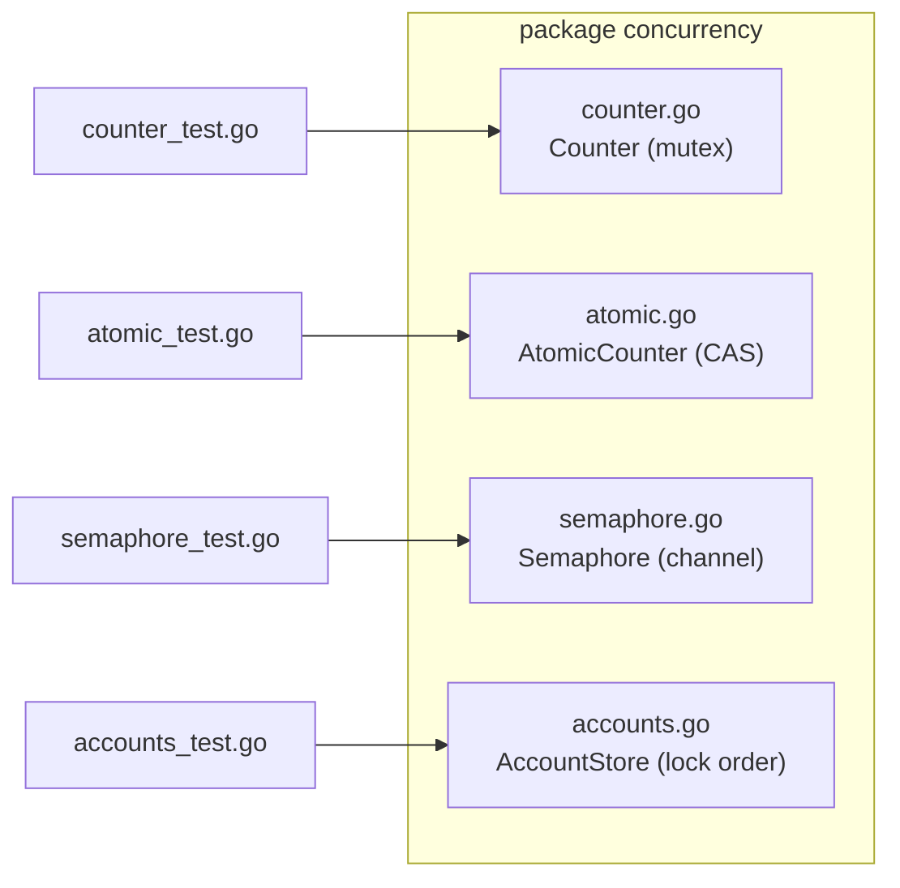

# Concurrency Primitives - Mutex, Semaphore, Atomics - Go

> [!summary] TL;DR
> The runnable side of [[Concurrency Primitives - Mutex, Semaphore, Atomics]]: a mutex-protected counter and its atomic/CAS twin, a channel-backed semaphore, a deadlock-free two-account transfer, and five tests that prove each primitive's guarantee under real concurrent load (including a hammered CAS loop and a 500-way concurrent transfer).

> [!info] How to read this note (pick your level)
> - 🟢 **New to this?** Read "From zero" below, then "Before the code", "What this code shows" and "Running it".
> - 🟡 **Know the basics?** Work through the Code steps 1-4 and the Tests.
> - 🔴 **Interview / SDE-3 prep?** Add Design decisions, Pitfalls and the Exercises. Headings are tagged 🟢🟡🔴 so you always know where you are.

> [!note] Before this note
> - [[Processes, Threads and Context Switching]]: goroutines run side by side and share memory, and any of them can be paused at any moment. Read [[Concurrency Primitives - Mutex, Semaphore, Atomics]] first too: a mutex lets one in, a semaphore lets N in, an atomic is one unbreakable step.

**From zero, in 60 seconds** 🟢

This file is the runnable half of [[Concurrency Primitives - Mutex, Semaphore, Atomics]]. The theory note explains locks, semaphores and atomics with stories and pictures; this one builds each of them in real Go and then attacks them with hundreds of goroutines at once to prove they hold up. Read each "Step" top to bottom: a plain-words line, the code, then a numbered walk-through. The tests at the end are the proof — each one would fail (or hang) if the primitive above it were broken.

## Before the code 🟢

- **Goroutines** (`go func() { ... }()`): lightweight threads run by the Go runtime. The tests start hundreds at once to create real contention.
- **`sync.Mutex`** (`Lock` / `Unlock`): a lock that lets one goroutine into a block of code at a time.
- **`sync/atomic`** (`atomic.Int64`, `Add`, `Load`, `CompareAndSwap`): single-step, uninterruptible operations on one number, with no lock.
- **Buffered channels** (`make(chan struct{}, n)`): a queue with `n` slots; sending blocks when full, which makes it a counting semaphore.
- **`defer` and `sync.WaitGroup`**: `defer` runs a call when the function returns (used for `Unlock`); `WaitGroup` waits until every started goroutine calls `Done`.
- **What to run:** `go vet ./... && go test -race -v ./...` inside the module. `-race` turns on the data race detector.

## What this code shows 🟢

| Code | Concept in the theory note |
| --- | --- |
| `Counter.Inc` / `Value` | A mutex serializes a critical section ([[Concurrency Primitives - Mutex, Semaphore, Atomics#3. How it works 🟡]]) |
| `AtomicCounter.Inc` / `Value` | A single hardware instruction, no blocking ([[Concurrency Primitives - Mutex, Semaphore, Atomics#Atomics and compare-and-swap]]) |
| `AtomicCounter.IncIfLessThan` | A manual CAS retry loop — the ABA-aware building block ([[Concurrency Primitives - Mutex, Semaphore, Atomics#The ABA problem: why CAS is harder than it looks]]) |
| `Semaphore`, `NewSemaphore`, `Acquire`, `Release` | A buffered channel as a counting semaphore ([[Concurrency Primitives - Mutex, Semaphore, Atomics#Semaphores]]) |
| `AccountStore.TransferConsistentOrder` | A fixed global lock order breaks circular wait ([[Concurrency Primitives - Mutex, Semaphore, Atomics#Deadlock]]) |
| `TestChannelHappensBefore` | The Go memory model's channel send/receive happens-before edge ([[Concurrency Primitives - Mutex, Semaphore, Atomics#8. Deep dive 🔴]]) |



## Setup 🟢

- Go 1.24, standard library only — no third-party dependencies.
- Layout: a module `concurrency` with `counter.go`, `atomic.go`, `semaphore.go`, `accounts.go`, and one test file per source file.
- Run it with `go vet ./... && go test -race -v ./...`.
- Everything here runs with no external services.

## Code 🟡

> 🟢 → 🟡 **You now know** which four tools this package builds and how to run the tests. **Next we read the code:** a locked counter, its lock-free twin, a channel used as a semaphore, and a transfer that can never deadlock. Each step starts with one plain-words line.

### Step 1: a mutex-protected counter

**In plain words:** a counter that cannot lose increments — every goroutine must take the lock before touching the number, so updates happen one at a time.

**Concept.** This is the baseline from [[Concurrency Primitives - Mutex, Semaphore, Atomics#Whiteboard version]]: `mu` turns the three-step read-modify-write (load, add, store) into one atomic-looking unit, because only the goroutine holding `mu` can run `c.n++`.

The alternative — no lock at all — is exactly the race condition traced in the theory note's section 1 table.

A second alternative, `sync/atomic`, is faster but can't protect more than one field at once. This type is the one to reach for whenever the critical section touches more than a single word, or does more work than a single increment.

```go
package concurrency

import "sync"

// Counter is safe for concurrent use: every Inc and Value is serialized by
// mu, so there is a single total order of increments.
type Counter struct {
	mu sync.Mutex
	n  int
}

func (c *Counter) Inc() {
	c.mu.Lock()
	defer c.mu.Unlock()
	c.n++
}

func (c *Counter) Value() int {
	c.mu.Lock()
	defer c.mu.Unlock()
	return c.n
}
```

**How it works.**
1. `mu sync.Mutex` is embedded by value, not by pointer — `Counter` must always be used through a pointer receiver (`*Counter`) so the mutex itself is never copied, which would silently create two independent locks guarding the same data.
2. `defer c.mu.Unlock()` runs even if a future version of `Inc` panics partway through, so the lock is never left held forever.
3. `Value` takes the same lock as `Inc`, not a separate read path — without that, a reader could observe `n` mid-update on some architectures, even though a single `int` write looks atomic in source code.

### Step 2: the atomic twin and a manual CAS loop

**In plain words:** the same counter with no lock at all — the CPU's own unbreakable add does the work, and the retry loop handles "increment only if still under the limit".

**Concept.** `AtomicCounter` implements [[Concurrency Primitives - Mutex, Semaphore, Atomics#Atomics and compare-and-swap]]: `Add` and `Load` cover simple increments without a lock.

`IncIfLessThan` needs a manual compare-and-swap loop because "increment, but only if the result stays under a limit" is a conditional update `atomic.Int64.Add` can't express alone.

The alternative design — wrap the whole thing in a `sync.Mutex` — would also be correct, but throws away the lock-free advantage that's the entire reason to reach for `sync/atomic` in the first place.

```go
package concurrency

import "sync/atomic"

// AtomicCounter does the same job as Counter without a mutex, using a
// hardware compare-and-swap loop (via sync/atomic) instead of a blocking lock.
type AtomicCounter struct {
	n atomic.Int64
}

func (c *AtomicCounter) Inc() { c.n.Add(1) }

func (c *AtomicCounter) Value() int64 { return c.n.Load() }

// IncIfLessThan increments the counter and reports true, but only if doing so
// keeps it below limit. It is the manual compare-and-swap (CAS) loop that
// atomic.Int64.Add cannot express on its own: read, decide, then swap only if
// nothing else changed the value in between; retry on a lost race.
func (c *AtomicCounter) IncIfLessThan(limit int64) bool {
	for {
		cur := c.n.Load()
		if cur >= limit {
			return false
		}
		if c.n.CompareAndSwap(cur, cur+1) {
			return true
		}
		// Someone else updated n between Load and CompareAndSwap; retry.
	}
}
```

**How it works.**
1. `atomic.Int64` (not a plain `int64`) is a Go 1.19+ type that forces every access through its methods — there's no way to accidentally read or write the field directly and bypass the atomicity.
2. The `for` loop is the CAS-retry pattern: `Load` reads the current value, the `if` decides what the new value *should* be, and `CompareAndSwap(cur, cur+1)` only commits if nothing changed `cur` in between.
3. A failed `CompareAndSwap` doesn't return an error — it just means another goroutine won the race first, so the loop reads the now-current value and tries again.
   This is what section 2's "ABA problem" subsection warns is subtler than it looks, because a *different* goroutine's change that happens to leave the value looking identical would fool this check too.

### Step 3: a channel-backed semaphore

**In plain words:** a buffered channel is already a counting gate — sending takes a space, receiving frees one, and a full buffer makes newcomers wait. Three lines and the semaphore is done.

**Concept.** This implements [[Concurrency Primitives - Mutex, Semaphore, Atomics#Semaphores]] using Go's own concurrency primitive instead of hand-rolling a counter and a condition variable.

The alternative — `golang.org/x/sync/semaphore` — adds a weighted, context-cancellable `Acquire`, which this simple version doesn't need for a fixed-size pool.

```go
package concurrency

// Semaphore bounds how many goroutines may hold a resource at once, using a
// buffered channel as the counting primitive: a full channel blocks Acquire
// exactly like a classic counting semaphore blocks on P() when the count
// reaches zero.
type Semaphore chan struct{}

func NewSemaphore(n int) Semaphore {
	return make(Semaphore, n)
}

func (s Semaphore) Acquire() { s <- struct{}{} }

func (s Semaphore) Release() { <-s }
```

**How it works.**
1. `chan struct{}` costs zero bytes per element — the channel is used purely for its blocking behavior, not to carry a value.
2. `Acquire` sends: it succeeds immediately while the buffer has room, and blocks once the buffer (the "garage") is full.
3. `Release` receives, freeing a buffer slot and, if another goroutine's `Acquire` was blocked, letting it proceed — the exact handoff drawn in the theory note's garage diagram.

### Step 4: a deadlock-free transfer

**In plain words:** two locks, one iron rule — everybody always locks A before B, so two transfers can never end up each holding the lock the other needs.

**Concept.** `AccountStore` is the worked example from [[Concurrency Primitives - Mutex, Semaphore, Atomics#Deadlock]]: two separate locks guard two balances, and the fix for the classic "A locks muA then muB, B locks muB then muA" deadlock is a single global lock order.

The rejected alternative — a reverse-order transfer function for the B→A direction — is exactly the deadlock-prone design the theory note describes; it isn't shipped here, because proving it deadlocks on purpose would mean writing a test designed to hang.

```go
package concurrency

import "sync"

// AccountStore guards two balances behind two separate locks, used below to
// demonstrate the fixed, deadlock-free lock ordering (the deadlock-prone
// reverse-order variant is described in the theory note, not shipped here,
// because proving it deadlocks would mean hanging a test on purpose).
type AccountStore struct {
	muA, muB sync.Mutex
	balanceA int
	balanceB int
}

// TransferConsistentOrder moves amount from A to B. Both transfer functions
// always lock muA before muB, so two concurrent transfers in opposite
// directions can never each hold one lock while waiting for the other: there
// is a single global lock order, which is the standard fix for the circular
// wait condition.
func (s *AccountStore) TransferConsistentOrder(amount int) {
	s.muA.Lock()
	defer s.muA.Unlock()
	s.muB.Lock()
	defer s.muB.Unlock()
	s.balanceA -= amount
	s.balanceB += amount
}
```

**How it works.**
1. Both locks are acquired in the same order (`muA` first, always) regardless of which direction money moves — this is the entire fix.
   A version that locked `muB` first for transfers in the other direction would reintroduce the circular-wait condition.
2. `defer` unlocks in reverse order (`muB`, then `muA`) automatically, since deferred calls run LIFO (last in, first out: the last `defer` written runs first) — this doesn't affect correctness here, but it's worth noticing because it's not the order you wrote them in.
3. Holding both locks for the whole function keeps the two balance updates atomic as a pair — releasing `muA` between the two field updates would let another transfer observe a half-moved amount.

> [!example]- Full file (concurrency package, all four source files concatenated)
> ```go
> // counter.go
> package concurrency
>
> import "sync"
>
> type Counter struct {
> 	mu sync.Mutex
> 	n  int
> }
>
> func (c *Counter) Inc() {
> 	c.mu.Lock()
> 	defer c.mu.Unlock()
> 	c.n++
> }
>
> func (c *Counter) Value() int {
> 	c.mu.Lock()
> 	defer c.mu.Unlock()
> 	return c.n
> }
>
> // atomic.go
> package concurrency
>
> import "sync/atomic"
>
> type AtomicCounter struct {
> 	n atomic.Int64
> }
>
> func (c *AtomicCounter) Inc() { c.n.Add(1) }
> func (c *AtomicCounter) Value() int64 { return c.n.Load() }
>
> func (c *AtomicCounter) IncIfLessThan(limit int64) bool {
> 	for {
> 		cur := c.n.Load()
> 		if cur >= limit {
> 			return false
> 		}
> 		if c.n.CompareAndSwap(cur, cur+1) {
> 			return true
> 		}
> 	}
> }
>
> // semaphore.go
> package concurrency
>
> type Semaphore chan struct{}
>
> func NewSemaphore(n int) Semaphore { return make(Semaphore, n) }
> func (s Semaphore) Acquire()       { s <- struct{}{} }
> func (s Semaphore) Release()       { <-s }
>
> // accounts.go
> package concurrency
>
> import "sync"
>
> type AccountStore struct {
> 	muA, muB sync.Mutex
> 	balanceA int
> 	balanceB int
> }
>
> func (s *AccountStore) TransferConsistentOrder(amount int) {
> 	s.muA.Lock()
> 	defer s.muA.Unlock()
> 	s.muB.Lock()
> 	defer s.muB.Unlock()
> 	s.balanceA -= amount
> 	s.balanceB += amount
> }
> ```

## Tests 🟡

### `TestCounterConcurrentIncrements`

Proves the mutex-protected counter never loses an increment under real concurrent load.

| Input | Expected output |
| --- | --- |
| 100 goroutines × 1000 increments each | `Value()` == 100000 |

A failure here (any value less than 100000) would mean the mutex isn't actually excluding concurrent `c.n++` calls — the exact race condition from the theory note's section 1.

**What this code does, in plain words:** start 100 goroutines, have each add 1 a thousand times, wait for all of them, and check the counter shows exactly 100,000.

```go
func TestCounterConcurrentIncrements(t *testing.T) {
	c := &Counter{}
	var wg sync.WaitGroup
	const goroutines, perGoroutine = 100, 1000
	for i := 0; i < goroutines; i++ {
		wg.Add(1)
		go func() {
			defer wg.Done()
			for j := 0; j < perGoroutine; j++ {
				c.Inc()
			}
		}()
	}
	wg.Wait()
	if got, want := c.Value(), goroutines*perGoroutine; got != want {
		t.Fatalf("got %d, want %d", got, want)
	}
}
```

### `TestChannelHappensBefore`

Proves the Go memory model's channel rule directly: a send happens-before the matching receive completes, so an unsynchronized write before the send is safely visible after the receive.

| Input | Expected output |
| --- | --- |
| goroutine writes `msg = "hello"` then sends on `done`; main receives, then reads `msg` | `msg == "hello"`, and `go test -race` reports no race |

A failure (or a race-detector flag) here would mean the channel's happens-before guarantee doesn't hold — which would be a bug in the Go runtime itself, not in this code.

The test exists to make the guarantee visible, not to catch a realistic regression.

```go
func TestChannelHappensBefore(t *testing.T) {
	done := make(chan struct{})
	msg := ""

	go func() {
		msg = "hello" // unsynchronized write ...
		done <- struct{}{}
	}()

	<-done // ... but the receive happens-after the send, so this read is safe
	if msg != "hello" {
		t.Fatalf("got %q, want %q", msg, "hello")
	}
}
```

### `TestIncIfLessThanNeverOvershoots`

Proves the CAS retry loop is correct under contention: 50 goroutines race to increment the same counter toward a shared limit, and the final value must land exactly on the limit — not over (a lost check) and not under (a lost increment).

| Input | Expected output |
| --- | --- |
| 50 goroutines, each looping `IncIfLessThan(1000)` until it returns `false` | `Value() == 1000` exactly |

A failure above 1000 would mean two goroutines both read the same `cur` and both succeeded past the limit — a broken CAS. A failure below 1000 would mean a goroutine gave up too early.

**What this code does, in plain words:** start 50 goroutines that all keep trying to add 1 while the counter is under 1,000, and check it stops at exactly 1,000, never 1,001.

```go
func TestIncIfLessThanNeverOvershoots(t *testing.T) {
	c := &AtomicCounter{}
	const limit = 1000
	var wg sync.WaitGroup
	for i := 0; i < 50; i++ {
		wg.Add(1)
		go func() {
			defer wg.Done()
			for {
				if !c.IncIfLessThan(limit) {
					return
				}
			}
		}()
	}
	wg.Wait()
	if got := c.Value(); got != limit {
		t.Fatalf("got %d, want exactly %d (no overshoot, no undershoot)", got, limit)
	}
}
```

### `TestSemaphoreBoundsConcurrency`

Proves the channel-backed semaphore never lets more than `capacity` goroutines hold it at once, by tracking the live holder count with its own atomic and recording the high-water mark (the highest number of holders ever seen at once).

| Input | Expected output |
| --- | --- |
| capacity 3, 20 goroutines racing to `Acquire`/sleep 2ms/`Release` | observed maximum concurrent holders ≤ 3 |

A failure (max holders > 3) would mean the channel's buffer isn't actually enforcing the bound — a bug in the standard library's channel implementation, or a logic error in `Acquire`/`Release` themselves.

The high-water mark itself needs the same CAS-retry pattern as `IncIfLessThan`, since "update to n only if n is bigger than the current max" is a conditional update:

```go
func recordHighWaterMark(live, maxLive *atomic.Int32) {
	n := live.Load()
	for {
		cur := maxLive.Load()
		if n <= cur || maxLive.CompareAndSwap(cur, n) {
			break
		}
	}
}
```

**What this code does, in plain words:** start 20 goroutines that each take a slot, wait 2 ms, and give it back, while a side counter records the most holders ever inside at once; that number must be 3 or less.

```go
func TestSemaphoreBoundsConcurrency(t *testing.T) {
	const capacity = 3
	sem := NewSemaphore(capacity)

	var live atomic.Int32
	var maxLive atomic.Int32
	var wg sync.WaitGroup
	for i := 0; i < 20; i++ {
		wg.Add(1)
		go func() {
			defer wg.Done()
			sem.Acquire()
			defer sem.Release()

			live.Add(1)
			recordHighWaterMark(&live, &maxLive)
			time.Sleep(2 * time.Millisecond)
			live.Add(-1)
		}()
	}
	wg.Wait()

	if got := maxLive.Load(); got > capacity {
		t.Fatalf("max concurrent holders = %d, want <= %d", got, capacity)
	}
}
```

### `TestTransferConsistentOrderNoDeadlock`

Proves the fixed lock order actually prevents the deadlock it's meant to prevent, by running many concurrent transfers that would hang forever under a reverse-order design.

| Input | Expected output |
| --- | --- |
| 500 concurrent `TransferConsistentOrder(1)` calls, starting balances 500000 / 0 | test returns (doesn't hang) within its timeout; final balances 499500 / 500 |

A failure here would show up as the whole test process hanging (the Go test runner's default timeout eventually kills it) rather than a normal assertion failure — that hang *is* the deadlock.

**What this code does, in plain words:** run 500 transfers of ₹1 at the same time; if the test finishes and the balances are 499,500 and 500, nothing deadlocked and no money was lost.

```go
func TestTransferConsistentOrderNoDeadlock(t *testing.T) {
	s := &AccountStore{balanceA: 500000, balanceB: 0}
	var wg sync.WaitGroup
	for i := 0; i < 500; i++ {
		wg.Add(1)
		go func() {
			defer wg.Done()
			s.TransferConsistentOrder(1)
		}()
	}
	wg.Wait()

	s.muA.Lock()
	s.muB.Lock()
	defer s.muA.Unlock()
	defer s.muB.Unlock()
	if s.balanceA != 500000-500 || s.balanceB != 500 {
		t.Fatalf("balances = %d, %d; want %d, %d", s.balanceA, s.balanceB, 500000-500, 500)
	}
}
```

## Design decisions 🔴

> 🟡 → 🔴 **You now know** what each primitive does and how the tests hammer it with real concurrent goroutines. **Next comes the advanced part:** why each design was chosen over its alternative, the ways this code can still be misused, and exercises.

| Choice | Alternative | Trade-off |
| --- | --- | --- |
| `chan struct{}` for `Semaphore` | `golang.org/x/sync/semaphore.Weighted` | The channel version has zero dependencies and is simpler to read; the `x/sync` version adds context cancellation and weighted acquires, worth it once a caller needs to abandon a wait cleanly |
| Manual CAS loop in `IncIfLessThan` | Wrap everything in a `sync.Mutex` | The CAS loop avoids blocking under low contention, but degrades toward a busy-wait (spinning in a loop, burning CPU, instead of sleeping) under very high contention — see the theory note's trade-offs section |
| Fixed lock order in `AccountStore` | Try-lock with backoff (try to take the lock, and if busy, wait a little and try again), or a single lock for both balances | A single shared lock is simpler and also deadlock-free, but serializes (forces one-at-a-time) transfers that don't even touch the same pair of accounts; the fixed-order two-lock design keeps unrelated account pairs independent |
| `atomic.Int64` wrapper type (not a plain `int64` with free functions) | `atomic.AddInt64(&n, 1)` style (pre-Go 1.19) | The wrapper type makes it a compile error to touch the field without going through an atomic method; the older free-function style compiles even if you forget and read the field directly |

## Running it 🟢

```bash
go vet ./...
go test -race -v ./...
```

Measured (Go 1.24.4, darwin/arm64, 2026-11-09):

```text
=== RUN   TestCounterConcurrentIncrements
--- PASS: TestCounterConcurrentIncrements (0.06s)
=== RUN   TestChannelHappensBefore
--- PASS: TestChannelHappensBefore (0.00s)
=== RUN   TestIncIfLessThanNeverOvershoots
--- PASS: TestIncIfLessThanNeverOvershoots (0.00s)
=== RUN   TestSemaphoreBoundsConcurrency
--- PASS: TestSemaphoreBoundsConcurrency (0.02s)
=== RUN   TestTransferConsistentOrderNoDeadlock
--- PASS: TestTransferConsistentOrderNoDeadlock (0.00s)
PASS
ok  	concurrency	1.546s
```

Reading it: all five tests pass under `-race`.

That means the race detector found zero unsynchronized concurrent accesses across 100+20+50+500 concurrently running goroutines combined. It is the strongest practical evidence that each primitive's guarantee actually holds, not just that the assertions happened to pass once.

## Pitfalls in the code 🔴

- `Counter` and `AtomicCounter` must always be used through a pointer (`*Counter`, not `Counter`) — copying either by value (e.g., passing one by value into a function) copies the mutex or the atomic value, creating a second independent lock or counter that no longer protects the same data.
	- `go vet` catches this for `sync.Mutex` (`copylocks`), which is one reason this note runs `go vet` before every test run.
- `Semaphore`'s `Release()` has no guard against being called more times than `Acquire()` — an extra `Release()` silently frees a slot nobody was really holding, letting one too many goroutines in at once.
	- Production code typically pairs `Acquire`/`Release` with `defer` right after a successful acquire, as the tests above do, to make this class of bug harder to introduce.
- `AccountStore.TransferConsistentOrder` only prevents deadlock if **every** code path that touches `muA` and `muB` goes through this same lock order — a single other function added later that locks `muB` before `muA` reintroduces the exact deadlock this design was built to avoid.

## Exercises 🔴

1. **Change it, predict the result:** remove the `defer` from `Counter.Inc` and call `c.mu.Unlock()` as the last line of the function instead. Does `TestCounterConcurrentIncrements` still pass? What changes if a future version of `Inc` gains an early `return` before that last line?
2. **Change it, predict the result:** in `AccountStore`, write a second method `TransferReverseOrder` that locks `muB` before `muA`, and call it concurrently with `TransferConsistentOrder` in a test. Predict whether it deadlocks, then run it with a test timeout (`go test -timeout 3s`) to check.
   Explain why the fixed-order rule has to apply to *every* function touching both locks, not just the "main" one.
3. **Change it, predict the result:** lower `TestSemaphoreBoundsConcurrency`'s capacity to 1 and its goroutine count to 2. Predict the new maximum concurrent holders before running it, and explain in one sentence why a capacity-1 semaphore is just a mutex with extra steps.

## Self-check 🟢🟡

> [!question]- Why must `Counter` always be used through a pointer (`*Counter`)?
> Copying it copies the mutex too, and the copy's lock protects nothing.

> [!question]- What does `Acquire` do when the semaphore channel is full?
> The send blocks, so the goroutine waits until someone calls `Release`.

> [!question]- What does `-race` add to `go test`?
> It turns on the race detector, which flags unsynchronized access to shared memory.

> [!question]- In `IncIfLessThan`, what happens when `CompareAndSwap` fails?
> Another goroutine changed the value first; the loop re-reads it and tries again.

> [!question]- Why does `TransferConsistentOrder` lock `muA` before `muB` in every direction?
> One fixed order means no two transfers can each hold the lock the other needs, so there is no circular wait.

> [!question]- Why does the semaphore test track the high-water mark with a CAS loop and not `Add`?
> "Set the max only if the new number is bigger" is a conditional update, which plain `Add` cannot express.

## Links

- **Theory:** [[Concurrency Primitives - Mutex, Semaphore, Atomics]]
- **Related:** [[sync Primitives and Atomics]], [[Memory Model and Data Races]], [[Goroutines and Channels]]
