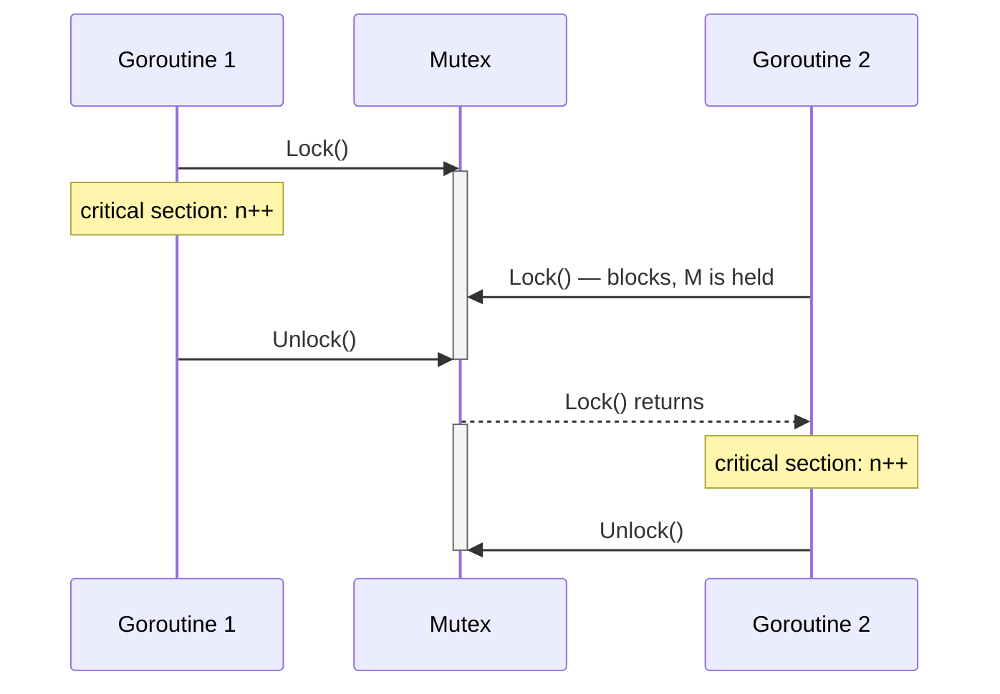
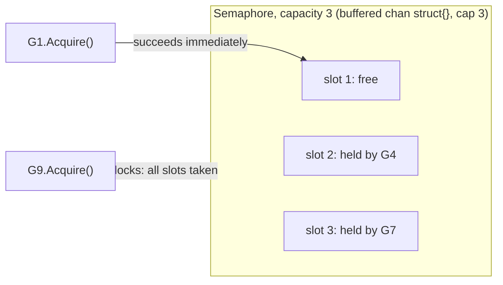
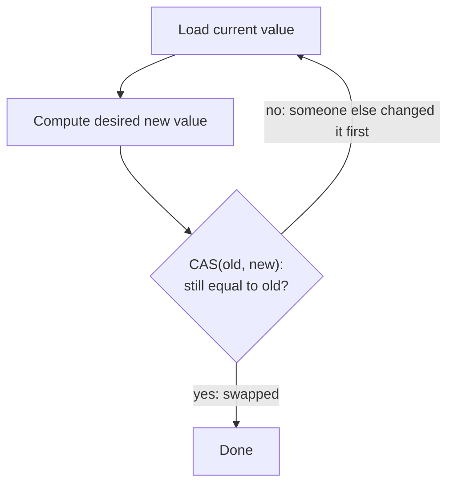
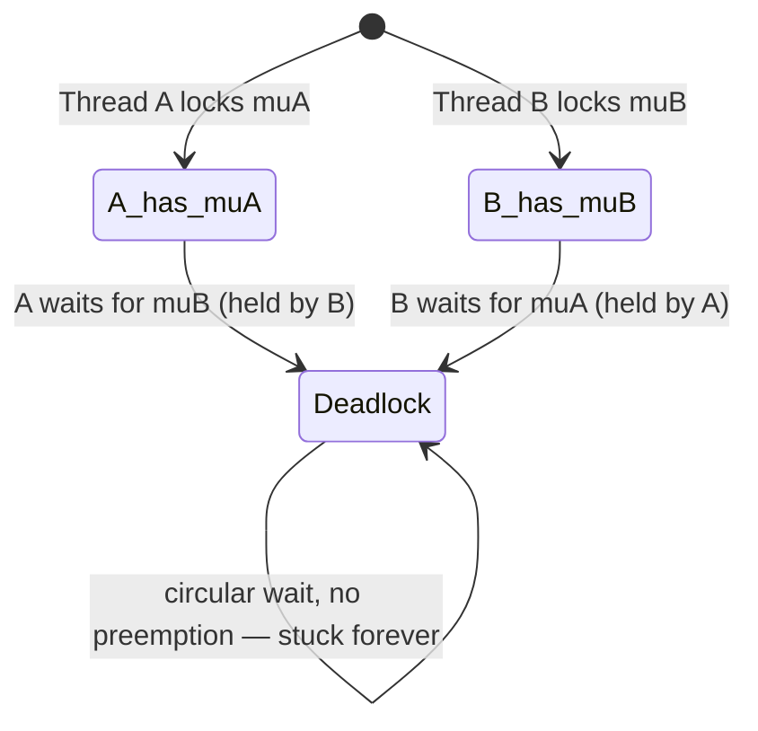

# Concurrency Primitives - Mutex, Semaphore, Atomics

> [!summary] TL;DR
> When multiple threads touch the same memory, you need a rule for who goes first — a **mutex** lets one in at a time, a **semaphore** lets up to N in at a time, and **atomics** make a single operation on one word indivisible without any blocking at all. Pick the weakest tool that's still correct.

> [!abstract] Core idea
> - A **race condition** is two threads accessing the same memory, at least one a write, with no ordering between them — the outcome depends on timing, which makes it nondeterministic and hard to reproduce.
> - A **mutex** (mutual exclusion lock) makes a block of code run as if it were atomic, at the cost of making other threads wait.
> - A **semaphore** generalizes a mutex to "up to N concurrent holders", useful for bounding concurrency rather than forbidding it entirely.
> - **Atomics** (compare-and-swap, add, load, store) use a CPU instruction that can't be interrupted mid-operation, avoiding blocking for simple cases.
> - **Deadlock** needs four conditions at once (Coffman): mutual exclusion, hold-and-wait, no preemption, circular wait. Break any one and it can't happen.
> - The **Go memory model**'s happens-before relation is what actually tells you whether a value written by one goroutine is guaranteed visible to another — a mutex, channel or atomic op is what establishes that relation; a plain variable write gives you none.

## 1. Why it exists

Two goroutines both run `balance++` on a shared `int`. That single line is really three CPU steps: load `balance` into a register, add one, store it back. If both goroutines interleave those steps — goroutine A loads 100, goroutine B loads 100 (before A's store), A stores 101, B stores 101 — two increments happened but the balance only went up by one. This is a **race condition**: the final result depends on the exact interleaving of instructions across threads, which the scheduler (see [[CPU Scheduling]]) controls and you don't.

This isn't a rare edge case. Run `go test -race` on naive concurrent code and it reliably fires, because the race detector instruments every memory access and flags any pair of concurrent accesses to the same location where at least one is a write and there's no happens-before edge between them — exactly the condition above.

## 2. Mental model

- A **mutex** is a single door with one key. Whoever holds the key is inside; everyone else queues outside. `Lock()` takes the key (waiting if it's taken); `Unlock()` returns it.
- A **semaphore** is a parking garage with N spaces and a barrier that counts cars in and out. `Acquire` waits for a free space; `Release` frees one. A mutex is a semaphore with exactly 1 space.
- **Atomics** are a vending machine's single coin slot: the hardware guarantees the whole "check balance, dispense, debit" sequence either completes as one indivisible unit or the machine detects a conflict and makes you retry — no separate "lock the machine" step needed.
- **Happens-before** is not "ran earlier in wall-clock time" — it's a guarantee the language gives you that one goroutine's write is visible to another goroutine's read. Two operations with no happens-before edge between them can be reordered, cached, or observed in either order by different CPU cores; "A ran first" on your screen proves nothing about what B can see without one.

## 3. How it works

### Whiteboard version

A counter protected by a mutex: only one goroutine executes the critical section at a time, so the read-modify-write above can't interleave.



### Mutex vs RWMutex

`sync.Mutex` excludes everyone, readers included. `sync.RWMutex` lets any number of readers hold `RLock()` concurrently, but a writer's `Lock()` waits for all current readers to finish and blocks new readers until it's done — correct for read-heavy data (a config cache refreshed rarely, read constantly) where exclusive locking would serialize reads that don't actually conflict with each other.

### Semaphores

A semaphore holds a count. `Acquire` decrements it, blocking if it's already zero; `Release` increments it, waking a waiter if any. The simplest correct implementation in Go is a buffered channel: its buffer slot count *is* the semaphore's count, and the blocking behavior of sending to a full channel or receiving from an empty one gives you `Acquire`/`Release` for free. (The standard library also ships `golang.org/x/sync/semaphore` with a weighted, context-cancellable `Acquire` for cases needing more than a fixed-weight count.)



### Atomics and compare-and-swap

An atomic operation is a single CPU instruction (on x86-64, backed by the `LOCK` instruction prefix; on ARM64, by load-linked/store-conditional or the newer LSE atomic instructions) that reads, modifies and writes a word with a hardware guarantee that no other core can observe or interleave a partial step. `sync/atomic`'s `Add`, `Load` and `Store` cover the simple cases directly. **Compare-and-swap (CAS)** is the general building block underneath: "if the current value is still what I last read, replace it with this new value; otherwise tell me it changed and don't touch it." Every lock-free data structure is, at its core, a loop around CAS:



### Deadlock

A deadlock needs all four Coffman conditions simultaneously:

1. **Mutual exclusion** — a resource can only be held by one thread at a time (true of any lock).
2. **Hold and wait** — a thread holds one resource while waiting for another.
3. **No preemption** — a held resource can't be forcibly taken away.
4. **Circular wait** — thread A waits on a resource B holds, and B waits on one A holds (a cycle).

The classic trigger: thread A locks `muA` then tries to lock `muB`; thread B locks `muB` then tries to lock `muA`. If both get their first lock before either reaches the second, neither can ever proceed.



The standard fix breaks circular wait: give every lock a fixed global order and always acquire locks in that order, everywhere in the codebase. If every transfer locks the lower-numbered account before the higher-numbered one, A→B and B→A transfers never deadlock, because both always try `muA` before `muB`.

## 4. Worked example

### Whiteboard version

```go
type Counter struct {
	mu sync.Mutex
	n  int
}

func (c *Counter) Inc() {
	c.mu.Lock()
	defer c.mu.Unlock()
	c.n++
}
```

### Mutex, atomics, CAS, semaphore and deadlock-free lock ordering

```go
package concurrency

import (
	"sync"
	"sync/atomic"
)

// Counter is safe for concurrent use: every Inc and Value is serialized by
// mu, so there is a single total order of increments.
type Counter struct {
	mu sync.Mutex
	n  int
}

func (c *Counter) Inc() {
	c.mu.Lock()
	defer c.mu.Unlock()
	c.n++
}

func (c *Counter) Value() int {
	c.mu.Lock()
	defer c.mu.Unlock()
	return c.n
}

// AtomicCounter does the same job as Counter without a mutex, using a
// hardware compare-and-swap loop (via sync/atomic) instead of a blocking lock.
type AtomicCounter struct {
	n atomic.Int64
}

func (c *AtomicCounter) Inc() { c.n.Add(1) }

func (c *AtomicCounter) Value() int64 { return c.n.Load() }

// IncIfLessThan increments the counter and reports true, but only if doing so
// keeps it below limit. It is the manual compare-and-swap (CAS) loop that
// atomic.Int64.Add cannot express on its own: read, decide, then swap only if
// nothing else changed the value in between; retry on a lost race.
func (c *AtomicCounter) IncIfLessThan(limit int64) bool {
	for {
		cur := c.n.Load()
		if cur >= limit {
			return false
		}
		if c.n.CompareAndSwap(cur, cur+1) {
			return true
		}
		// Someone else updated n between Load and CompareAndSwap; retry.
	}
}

// Semaphore bounds how many goroutines may hold a resource at once, using a
// buffered channel as the counting primitive: a full channel blocks Acquire
// exactly like a classic counting semaphore blocks on P() when the count
// reaches zero.
type Semaphore chan struct{}

func NewSemaphore(n int) Semaphore {
	return make(Semaphore, n)
}

func (s Semaphore) Acquire() { s <- struct{}{} }

func (s Semaphore) Release() { <-s }

// AccountStore guards two balances behind two separate locks, used below to
// demonstrate both a deadlock-prone ordering and the fixed, consistent one.
type AccountStore struct {
	muA, muB sync.Mutex
	balanceA int
	balanceB int
}

// TransferConsistentOrder moves amount from A to B. Both transfer functions
// always lock muA before muB, so two concurrent transfers in opposite
// directions can never each hold one lock while waiting for the other: there
// is a single global lock order, which is the standard fix for the circular
// wait condition.
func (s *AccountStore) TransferConsistentOrder(amount int) {
	s.muA.Lock()
	defer s.muA.Unlock()
	s.muB.Lock()
	defer s.muB.Unlock()
	s.balanceA -= amount
	s.balanceB += amount
}
```

```go
func TestCounterConcurrentIncrements(t *testing.T) {
	c := &Counter{}
	var wg sync.WaitGroup
	const goroutines, perGoroutine = 100, 1000
	for i := 0; i < goroutines; i++ {
		wg.Add(1)
		go func() {
			defer wg.Done()
			for j := 0; j < perGoroutine; j++ {
				c.Inc()
			}
		}()
	}
	wg.Wait()
	if got, want := c.Value(), goroutines*perGoroutine; got != want {
		t.Fatalf("got %d, want %d", got, want)
	}
}

// TestChannelHappensBefore demonstrates the Go memory model's channel rule: a
// send on a channel happens-before the corresponding receive completes. The
// goroutine below writes msg with no lock, then sends; the main goroutine
// receives, then reads msg. The race detector proves there is no race only
// because the channel operations establish that ordering.
func TestChannelHappensBefore(t *testing.T) {
	done := make(chan struct{})
	msg := ""

	go func() {
		msg = "hello" // unsynchronized write ...
		done <- struct{}{}
	}()

	<-done // ... but the receive happens-after the send, so this read is safe
	if msg != "hello" {
		t.Fatalf("got %q, want %q", msg, "hello")
	}
}
```

**Tested:** `go vet` and `go test -race` both pass on Go 1.24.4, darwin/arm64 (2026-11-06) — 6 tests total, including `TestIncIfLessThanNeverOvershoots` (hammers the CAS loop from 50 goroutines, asserts the counter never exceeds the limit), `TestSemaphoreBoundsConcurrency` (tracks live holder count under a separate mutex and asserts it never exceeds the semaphore's capacity), and `TestTransferConsistentOrderNoDeadlock` (500 concurrent transfers via the consistent-order path finish without hanging; a build that locked `muB` before `muA` for the reverse direction would deadlock under this same workload — proving it would require making the race detector's sibling tool, the deadlock-prone variant, hang on purpose, so that variant is described here rather than shipped).

## 5. Variants and comparison

| Primitive | How it works | Use when | Cost |
| --- | --- | --- | --- |
| `sync.Mutex` | One holder at a time | Protecting a critical section that's cheap relative to lock overhead | Blocks all other goroutines, readers included |
| `sync.RWMutex` | Many readers or one writer | Read-heavy shared state | Writer can starve under constant read load; more overhead than `Mutex` for write-heavy cases |
| Counting semaphore (buffered channel or `x/sync/semaphore`) | Up to N holders | Bounding concurrency: connection pools, worker limits, rate limiting | Still blocks past capacity; weighted variant adds bookkeeping |
| `sync/atomic` (Add/Load/Store/CAS) | Single hardware instruction, no blocking | A single word (counter, flag, pointer) with simple update logic | Can't protect multi-field invariants; CAS loops can live-lock under very high contention |
| Channels | Goroutines communicate by sending ownership of data, not sharing memory + a lock | Pipelines, fan-out/fan-in, signalling completion | Slower per-op than a bare mutex for pure mutual exclusion; higher-level and usually clearer |

> [!warning] Interview trap
> "Use atomics everywhere, they're faster" is wrong once more than one field must change together. `atomic.Int64` makes a single counter update indivisible; it says nothing about two fields staying consistent with each other. Multi-field invariants need a mutex (or a single atomic pointer swap to a whole new immutable struct).

## 6. Trade-offs and when not to use

- A mutex held across a blocking call (network I/O, another lock, a channel send with no ready receiver) can turn a short critical section into a long one, stalling every other goroutine waiting on it — never do I/O while holding a lock meant to protect in-memory state.
- `RWMutex` only pays off when reads significantly outnumber writes and the critical section is long enough that read parallelism actually matters; for short, cheap critical sections, a plain `Mutex` can outperform it because `RWMutex` has more internal bookkeeping.
- CAS loops degrade under heavy contention: many goroutines racing to CAS the same word can retry repeatedly (closer to a busy-wait than a block), burning CPU instead of sleeping — a mutex, which the scheduler can park waiters on, often wins under high contention despite being "slower" in the uncontended case.
- Channels add goroutine-scheduling and allocation overhead that a bare `atomic.Int64.Add` or a tight mutex section doesn't have; using a channel purely as a mutex substitute (one buffered slot) is a reasonable idiom, but a buffered channel is not a faster mutex in general.

## 7. In production

- **Real systems:** Go's own runtime uses atomics extensively for its scheduler's internal counters and the garbage collector's write barriers; `sync.Map` internally mixes atomics and a mutex to make the common read-mostly case lock-free; database connection pools (`database/sql`, `pgxpool`) are counting semaphores bounding how many connections are checked out at once.
- **Failure modes → fixes:**
	- Intermittent, hard-to-reproduce wrong values or panics → almost always a missing lock around shared mutable state; run `go test -race` and the full test suite under `-race` in CI, not just locally once.
	- A goroutine-count or latency cliff under load → check for a mutex held across a slow call, or a semaphore/connection pool sized too small for the concurrency the service actually needs.
	- A service that just stops making progress, with all goroutines parked → deadlock from inconsistent lock ordering; `kill -QUIT` a Go process (or hit its `pprof` goroutine dump) to see every goroutine's stack and find the cycle.
	- CPU pegged at 100% with no progress → a CAS loop livelocking under extreme contention; switch the hot path to a mutex or reduce contention by sharding the counter (one atomic per CPU, summed occasionally).
- **What to monitor:** `-race` results in CI as a hard gate, not advisory; goroutine count over time (a leak often means goroutines stuck waiting on a lock or channel that will never be released); lock-hold-time histograms if your mutex wrapper supports them; connection-pool wait time as a proxy for semaphore contention.

## 8. Deep dive

- **The Go memory model's happens-before relation**, formalized in `go.dev/ref/mem`, is the actual contract: a goroutine's write `W` is guaranteed visible to a read `R` in another goroutine only if there is a happens-before edge from `W` to `R`. The language guarantees such an edge for: a `Mutex.Unlock()` happens-before the next `Lock()` that acquires it; a send on a channel happens-before the corresponding receive completes; the closing of a channel happens-before a receive that returns because it was closed; and `sync.Once.Do`'s function call happens-before any `Do` call returns. Without one of these (or an atomic operation, which the memory model also defines ordering for), the compiler and CPU are free to reorder or cache the write, and two goroutines can legitimately observe different values — this is exactly what `go test -race` is built to catch, and exactly why "it worked when I tested it without the lock" proves nothing.
- **Why CAS, not just lock-free "increment"**: an atomic add is enough for a simple counter, but most lock-free algorithms need "update X to a new value computed from X's old value, but only if nothing else changed X first" — that's the ABA-problem-aware core of CAS, and it's what lock-free stacks, queues and `sync.Map`'s fast path are built from.
- **Spinlocks vs blocking mutexes**: a spinlock busy-waits (loops on CAS) instead of yielding to the scheduler, which is only a win when the expected wait is shorter than a context switch would cost — the Go runtime itself uses brief spinning before parking a goroutine on a contended `sync.Mutex`, a hybrid of both strategies.
- **This note covers the general, OS/CS-level concurrency primitives.** Go-specific deeper material — `sync.Once`, `sync.Map`, `sync.Pool`, `errgroup`, and the full Go memory model's formal treatment of data races — lives in [[sync Primitives and Atomics]] and [[Memory Model and Data Races]]; goroutine-to-goroutine communication patterns built on channels live in [[Goroutines and Channels]].

## 9. Interview questions

> [!question]- What exactly is a race condition, and why doesn't it always reproduce?
> Two or more threads access the same memory location concurrently, at least one access is a write, and there's no synchronization establishing an order between them. The outcome depends on the scheduler's exact interleaving of instructions, which varies run to run, under load, and across hardware — so the bug can pass thousands of test runs and still be real.

> [!question]- When would you choose a semaphore over a mutex?
> When more than one concurrent holder is actually safe and desirable — bounding how many goroutines hit a downstream service at once, or how many worker slots are active — rather than forbidding all concurrency. A mutex is the special case of a semaphore with exactly one slot.

> [!question]- What four conditions must all hold for a deadlock to occur, and how do you break it?
> Mutual exclusion, hold-and-wait, no preemption, and circular wait (Coffman's conditions). In practice you break circular wait: define a global lock acquisition order and never violate it anywhere in the codebase, so no cycle of "waiting for a lock someone else holds while holding one they need" can form.

> [!question]- Is `atomic.Int64.Add` enough to keep two related counters consistent with each other?
> No. Each atomic operation is indivisible on its own, but two separate atomic updates to two different fields are not atomic *together* — another goroutine can observe one updated and the other not yet. Multi-field invariants need a mutex around both updates, or a single atomic swap of a pointer to a new immutable struct holding both fields.
> [!trap] This is the single most common wrong answer to "is this lock-free code correct" — each individual operation being atomic says nothing about cross-field consistency.

> [!question]- Your service deadlocks under load but never in local testing. How do you debug it in production without redeploying?
> Trigger a goroutine dump without killing the process — `kill -QUIT` on the PID (prints all goroutine stacks and exits) is destructive, so prefer wiring up `net/http/pprof`'s `/debug/pprof/goroutine?debug=2` endpoint ahead of time, which dumps every goroutine's stack live. Look for goroutines blocked on `Lock()` or a channel operation and trace which lock each one is waiting for versus holding, to find the cycle.

> [!question]- What does the Go memory model actually guarantee about a plain (non-atomic, non-mutex-protected) shared variable?
> Essentially nothing, across goroutines. Without a happens-before edge (from a mutex, channel operation, atomic access, or `sync.Once`), the compiler and CPU may reorder, cache in a register, or otherwise make one goroutine's write invisible or out-of-order to another goroutine's read — this is precisely what `go test -race` flags, independent of whether the bug ever manifests as a visibly wrong value in a given run.

## 10. Cheat sheet

- Race condition = concurrent access to shared memory, at least one write, no ordering between them.
- Mutex = exclusive; RWMutex = many readers or one writer; semaphore = up to N concurrent holders.
- Atomics (Load/Store/Add/CAS) avoid blocking for single-word updates; CAS is "swap only if unchanged, else retry".
- Deadlock needs all four Coffman conditions; break circular wait with a global lock ordering.
- Happens-before (not wall-clock order) is what makes a write visible to another goroutine — mutexes, channel ops, atomics and `sync.Once` establish it; plain variables don't.
- Never hold a lock across a blocking I/O call.
- `go test -race` in CI is the real defense against all of the above, not careful reading of the code.
- Go-specific deep dive (`sync.Once`, `sync.Map`, the formal memory model) lives in [[sync Primitives and Atomics]] and [[Memory Model and Data Races]].

## Links

- **Before this:** [[Processes, Threads and Context Switching]], [[CPU Scheduling]]
- **Next:** [[I-O Models - Blocking, epoll, io_uring and the Go Netpoller]], [[Goroutines and Channels]]
- **Compare with:** [[sync Primitives and Atomics]] (Go-specific APIs: `sync.Once`, `sync.Map`, `errgroup`), [[Memory Model and Data Races]] (the formal happens-before treatment)
