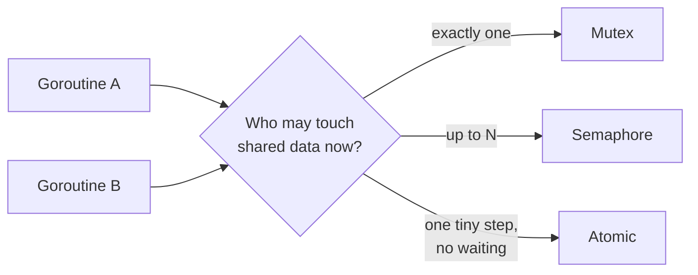
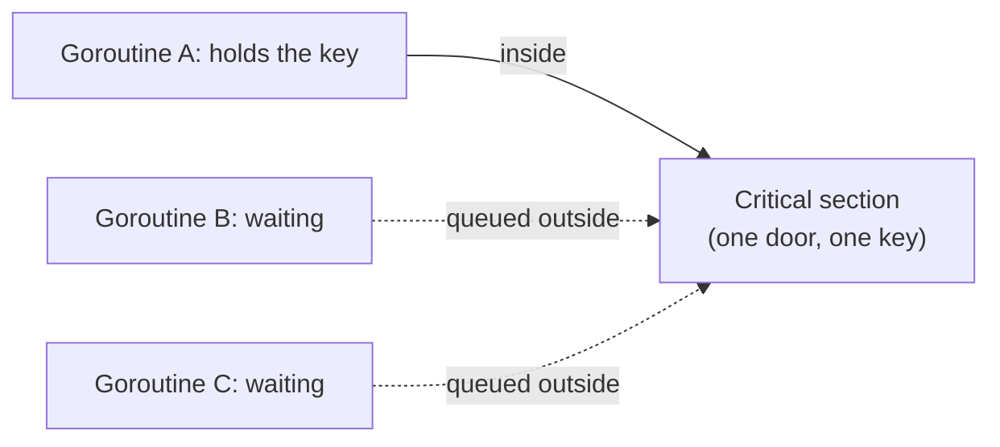
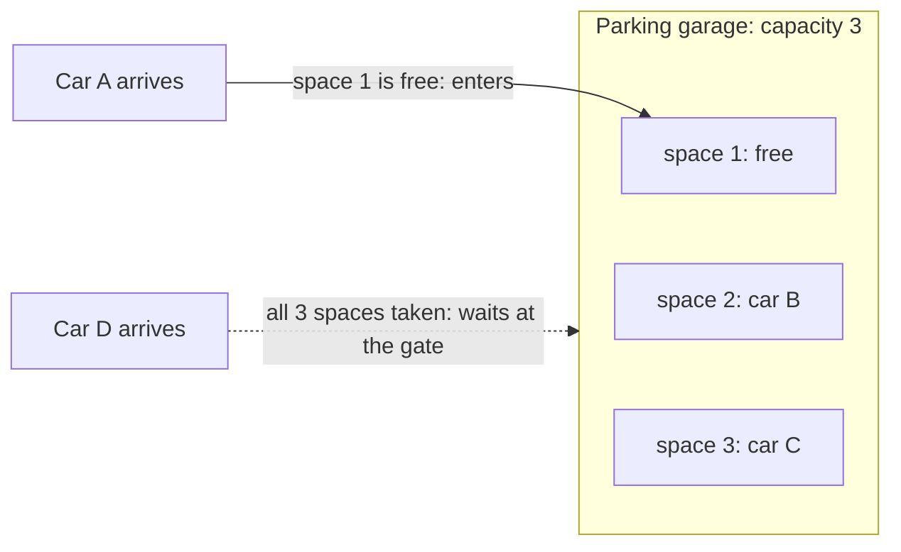
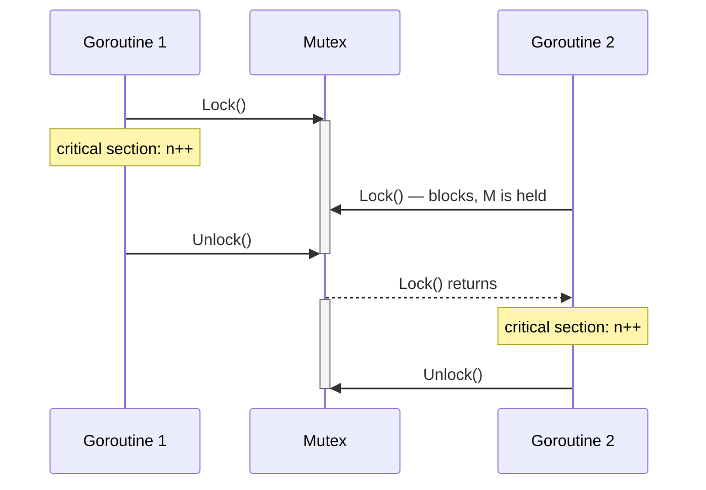
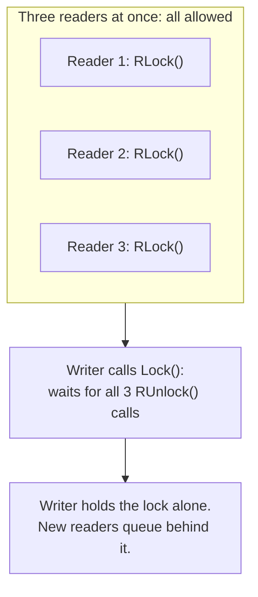
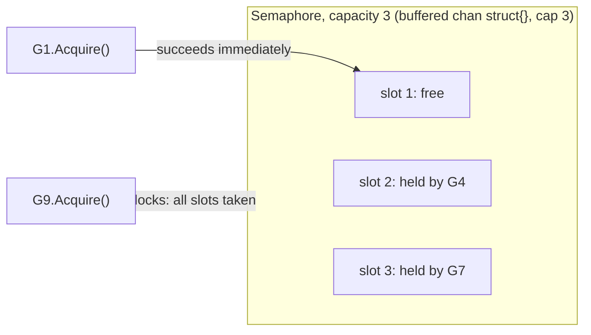
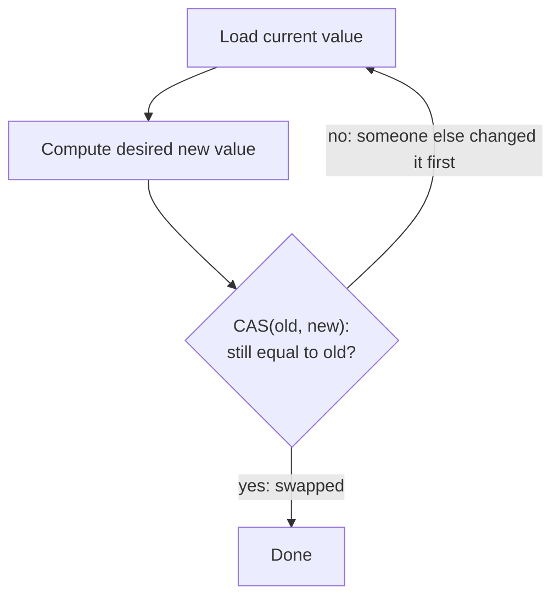
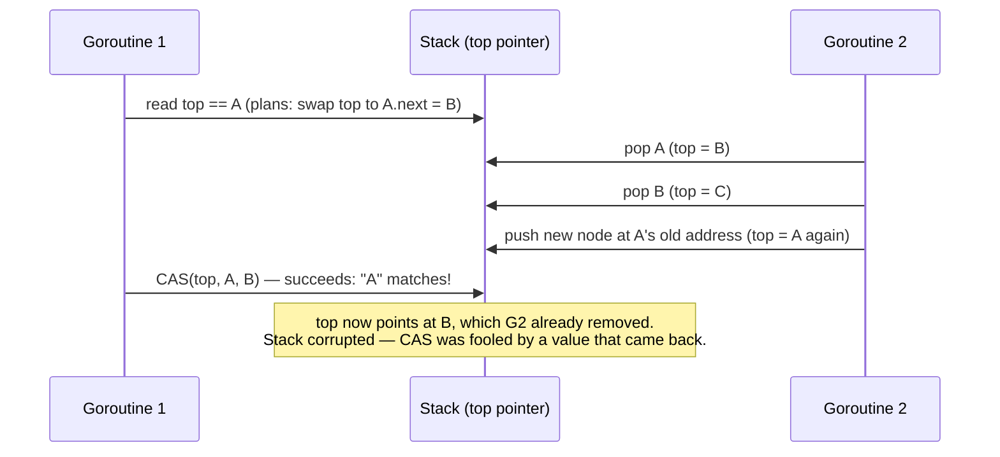
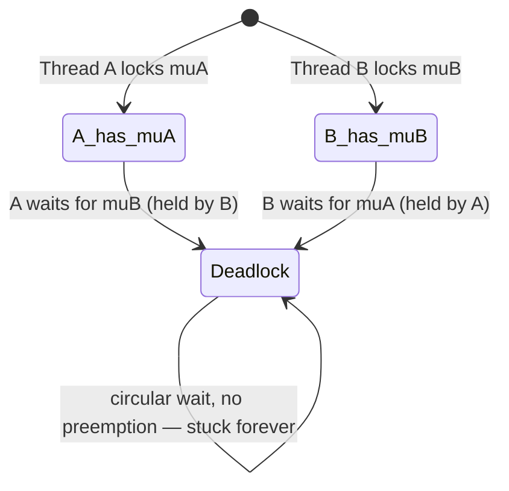

# Concurrency Primitives - Mutex, Semaphore, Atomics

> [!summary] TL;DR
> When multiple threads touch the same memory, you need a rule for who goes first — a **mutex** lets one in at a time, a **semaphore** lets up to N in at a time, and **atomics** make a single operation on one word indivisible without any blocking at all. Pick the weakest tool that's still correct.

> [!abstract] Core idea
> - A **race condition** is two threads accessing the same memory, at least one a write, with no ordering between them — the outcome depends on timing, which makes it nondeterministic and hard to reproduce.
> - A **mutex** (mutual exclusion lock) makes a block of code run as if it were atomic, at the cost of making other threads wait.
> - A **semaphore** generalizes a mutex to "up to N concurrent holders", useful for bounding concurrency rather than forbidding it entirely.
> - **Atomics** (compare-and-swap, add, load, store) use a CPU instruction that can't be interrupted mid-operation, avoiding blocking for simple cases.
> - **Deadlock** needs four conditions at once (Coffman): mutual exclusion, hold-and-wait, no preemption, circular wait. Break any one and it can't happen.
> - The **Go memory model**'s happens-before relation is what actually tells you whether a value written by one goroutine is guaranteed visible to another — a mutex, channel or atomic op is what establishes that relation; a plain variable write gives you none.

## Start here: the basics

**The problem in one story.**
Two people share one bank account and both open the banking app at the same moment.
Each sees 100, each deposits 1, each app saves "101".
Two deposits happened, but the account shows only one.
This note is about the tools that make the second person wait their turn.

**Words you need first**

| Word | Plain meaning | Tiny example |
| --- | --- | --- |
| Thread / goroutine | One line of work the program runs, side by side with others | Two goroutines each handling one web request |
| Shared memory | A variable more than one thread can read and write | A global `balance int` |
| Critical section | Code that touches shared data and must not overlap with itself | The line `balance++` |
| Race condition | The result depends on which thread happens to run first | Two deposits, only one counted |
| Lock / unlock | Claim the right to enter, then give it back | `mu.Lock()` ... `mu.Unlock()` |
| Block / wait | A thread pauses until something it needs is free | Goroutine B paused inside `Lock()` |
| Atomic | Happens as one step that cannot be split or interrupted | `atomic.Int64.Add(1)` |
| Deadlock | Threads wait on each other forever, so nobody moves | A holds lock 1 and wants 2; B holds 2 and wants 1 |

**Picture it**



**Analogy.** A single-person bathroom with a lock on the door: whoever is inside locks it, everyone else waits in line.
Where it breaks: a bathroom line is fair and visible; real lock waiters may not be served in arrival order, and nothing stops a buggy program from walking in without locking.

**How the rest of this note builds up**

- First, why races happen (section 1) and a mental model of each tool: door, garage, coin slot (section 2).
- Then how mutexes, RWMutex, semaphores and compare-and-swap work, plus the ABA problem and deadlock (section 3).
- Then a traced example and a comparison table (sections 4-5).
- Finally the SDE-3 deep dive: trade-offs, production failure modes, and the Go memory model's happens-before (sections 6-8).

> [!tip] Remember
> Shared data plus more than one writer needs a rule for who goes first; mutex, semaphore and atomics are three such rules.

## 1. Why it exists

Two goroutines both run `balance++` on a shared `int`. That one line of Go is really three separate CPU steps underneath:

1. Load `balance` into a register.
2. Add one to the register.
3. Store the register back to memory.

A single CPU core never mixes those three steps up for one goroutine — the problem only appears once a *second* goroutine's three steps can interleave with the first's.

Picture the bad interleaving directly, with starting balance 100:

| Step | Goroutine A | Goroutine B | Memory value of `balance` |
| --- | --- | --- | --- |
| 1 | load 100 into register | — | 100 |
| 2 | — | load 100 into register | 100 |
| 3 | add 1 → register holds 101 | — | 100 |
| 4 | store 101 to memory | — | 101 |
| 5 | — | add 1 → register holds 101 | 101 |
| 6 | — | store 101 to memory | **101** |

Two increments happened. The balance only went up by one, because B's load (step 2) read the value from *before* A's store (step 4) landed.

This is a **race condition**: the final result depends on the exact interleaving of instructions across threads, which the scheduler (see [[CPU Scheduling]]) controls and you don't.

This isn't a rare edge case. Run `go test -race` on naive concurrent code and it reliably fires.

That is because the race detector instruments every memory access and flags any pair of concurrent accesses to the same location where at least one is a write and there's no happens-before edge between them — exactly the condition in the table above.

> [!warning] Common mistake
> "It worked in every test run, so it's fine" proves nothing. A race condition's outcome depends on scheduler timing, which varies with load, core count, and even which other process the OS happens to run next — passing one hundred quiet local test runs says nothing about behavior under production load. `go test -race` instruments the memory accesses themselves, so it can catch the bug even on a run where the wrong interleaving never actually happened to occur.

> [!tip] Remember
> A race condition is not "the program crashed" — it's "the answer depends on timing you don't control." It can look completely correct for months and then silently corrupt data under load.

## 2. Mental model

Each primitive below answers the same question — "who may touch the shared data right now?" — with a different rule. An analogy helps fix each rule in memory before the mechanics.

### A mutex is a single door with one key

**In plain words:** A **mutex** (mutual exclusion lock) lets exactly one goroutine run the protected code at a time. `Lock()` takes the key, waiting if someone already holds it; `Unlock()` returns it.

**Picture it:**



**Example:** Three goroutines call `Lock()` within a microsecond of each other. Exactly one proceeds immediately; the other two block inside `Lock()` until the first calls `Unlock()`, at which point the runtime wakes exactly one of the waiters.

**Why it matters:** Without the mutex, the `balance++` race from section 1 happens every time two goroutines' read-modify-write steps overlap.

### A semaphore is a parking garage with N spaces

**In plain words:** A **semaphore** generalizes a mutex to "up to N concurrent holders" instead of exactly one. `Acquire()` waits for a free space; `Release()` frees one.

**Picture it:**



**Example:** A connection pool sized at 10 lets the 11th concurrent caller block at `Acquire()` until one of the first 10 calls `Release()`.

**Why it matters:** A mutex is just a semaphore with exactly one space — the two aren't different tools, they're the same tool at different capacities.

**Where the analogy breaks down:** a real parking garage has cars that can leave in any order; a semaphore doesn't track *which* goroutine holds which slot, only the count — it can't stop the same goroutine from calling `Release()` twice by mistake and over-counting free slots.

### Atomics are a vending machine's single coin slot

**In plain words:** An **atomic** operation (load, store, add, compare-and-swap) is a single CPU instruction that reads, modifies and writes one word with a hardware guarantee that no other core can observe or interleave a partial step — no blocking, no queue.

**Picture it:** see the CAS loop diagram in section 3 — there is no "door" or "garage" here, because nothing ever waits; a failed attempt just retries immediately.

**Example:** `atomic.Int64.Add(1)` on a counter is one indivisible hardware instruction; two goroutines calling it concurrently never lose an increment the way the plain `balance++` from section 1 did, because the CPU itself guarantees the three steps (load, add, store) happen as one unit.

**Why it matters:** atomics are the cheapest correct tool for a single word, but — as the interview trap in section 5 covers — they say nothing about keeping *two* fields consistent with each other.

### Happens-before is a guarantee, not a clock reading

**In plain words:** **Happens-before** is not "ran earlier in wall-clock time." It's a guarantee the language gives you that one goroutine's write is visible to another goroutine's read. Two operations with no happens-before edge between them can be reordered, cached, or observed in either order by different CPU cores.

**Example:** goroutine A writes `x = 1` then `y = 1`, with no lock or channel involved. Goroutine B reads `y` then `x`. Without a happens-before edge, B is legally allowed to see `y == 1` but `x == 0` — the compiler and CPU may reorder A's two writes, because nothing told them not to.

**Why it matters:** "A ran first" on your screen, in your terminal's print order, proves nothing about what a *different goroutine* can observe without a happens-before edge. This is exactly what section 8 formalizes.

## 3. How it works

### Whiteboard version

A counter protected by a mutex: only one goroutine executes the critical section at a time, so the read-modify-write from section 1 can't interleave.



### Mutex vs RWMutex

`sync.Mutex` excludes everyone, readers included.

`sync.RWMutex` lets any number of readers hold `RLock()` concurrently, but a writer's `Lock()` waits for all current readers to finish and blocks new readers until it's done.

That is correct for read-heavy data (a config cache refreshed rarely, read constantly) where exclusive locking would serialize reads that don't actually conflict with each other.



### Semaphores

A semaphore holds a count. `Acquire` decrements it, blocking if it's already zero; `Release` increments it, waking a waiter if any.

The simplest correct implementation in Go is a buffered channel: its buffer slot count *is* the semaphore's count, and the blocking behavior of sending to a full channel or receiving from an empty one gives you `Acquire`/`Release` for free.

(The standard library also ships `golang.org/x/sync/semaphore` with a weighted, context-cancellable `Acquire` for cases needing more than a fixed-weight count.)



### Atomics and compare-and-swap

An atomic operation is a single CPU instruction (on x86-64, backed by the `LOCK` instruction prefix; on ARM64, by load-linked/store-conditional or the newer LSE atomic instructions) that reads, modifies and writes a word with a hardware guarantee that no other core can observe or interleave a partial step.

`sync/atomic`'s `Add`, `Load` and `Store` cover the simple cases directly.

**Compare-and-swap (CAS)** is the general building block underneath: "if the current value is still what I last read, replace it with this new value; otherwise tell me it changed and don't touch it."

Every lock-free data structure is, at its core, a loop around CAS:



### The ABA problem: why CAS is harder than it looks

CAS checks "is the value still what I last read?" — but it compares *values*, not *history*.

If a value changes away and then changes back to the exact same value between your load and your CAS, your CAS sees no difference and swaps anyway, even though the world moved in between.

Walk it through with a lock-free stack whose top pointer starts at node **A**:

1. Goroutine 1 reads `top == A` (it plans to pop A, replacing `top` with `A.next`, which is **B**).
2. Before goroutine 1's CAS runs, goroutine 2 pops **A** (top becomes B), pops **B** (top becomes C), and then pushes a *brand-new* node that happens to be allocated at the same address as the old **A** and pushes it back on top (top becomes A again — same address, different logical node).
3. Goroutine 1 now runs `CAS(top, A, B)`. The comparison `top == A` is true — it's the same pointer value — so the swap succeeds. But **B** is no longer part of the stack; goroutine 2 already popped it in step 2. The stack is now corrupted: `top` points at a node that isn't connected to anything valid below it.



**Why it matters:** this is why production lock-free structures add a version counter or generation tag alongside the pointer (a "tagged pointer" or `atomic.Pointer` plus a separate monotonically increasing stamp).

The CAS then compares "value *and* version," not value alone — two states with the same pointer but different versions no longer look identical to the CAS.

> [!warning] Common mistake
> Assuming "CAS succeeded" means "nothing happened in between." It only means "the value I'm comparing against looks the same right now" — which the ABA problem shows is not the same guarantee.

> [!tip] Remember
> Mutex = one door, one key. Semaphore = N parking spaces. Atomics = no door at all, just a single hardware-guaranteed step — fast, but blind to history, which is exactly what the ABA problem exploits.

### Deadlock

A deadlock needs all four Coffman conditions simultaneously:

1. **Mutual exclusion** — a resource can only be held by one thread at a time (true of any lock).
2. **Hold and wait** — a thread holds one resource while waiting for another.
3. **No preemption** — a held resource can't be forcibly taken away.
4. **Circular wait** — thread A waits on a resource B holds, and B waits on one A holds (a cycle).

The classic trigger: thread A locks `muA` then tries to lock `muB`; thread B locks `muB` then tries to lock `muA`. If both get their first lock before either reaches the second, neither can ever proceed.



The standard fix breaks circular wait: give every lock a fixed global order and always acquire locks in that order, everywhere in the codebase.

If every transfer locks the lower-numbered account before the higher-numbered one, A→B and B→A transfers never deadlock, because both always try `muA` before `muB`.

> [!tip] Remember
> Breaking any single Coffman condition prevents deadlock. In practice, breaking circular wait (a fixed lock order) is almost always the cheapest fix, because the other three conditions are usually inherent to what a lock is for.

## 4. Worked example

### Whiteboard version

```go
type Counter struct {
	mu sync.Mutex
	n  int
}

func (c *Counter) Inc() {
	c.mu.Lock()
	defer c.mu.Unlock()
	c.n++
}
```

Trace it with two goroutines calling `Inc()` at nearly the same instant, starting from `n == 0`:

1. Goroutine A calls `Inc()`, reaches `c.mu.Lock()` first, and acquires the mutex.
2. Goroutine B calls `Inc()`, reaches `c.mu.Lock()` a few nanoseconds later, and blocks — the mutex is held.
3. Goroutine A runs `c.n++` (now `n == 1`) and returns, which calls the deferred `c.mu.Unlock()`.
4. The runtime wakes goroutine B's blocked `Lock()` call; B now holds the mutex.
5. Goroutine B runs `c.n++` (now `n == 2`) and returns, unlocking in turn.

No interleaving of the two `c.n++` operations is possible, because the mutex guarantees steps 3 and 5 can never overlap.

The full implementation — `AtomicCounter`, the CAS-based `IncIfLessThan`, the channel-based `Semaphore`, and the deadlock-free `AccountStore` transfer — plus all five tests (including a hammered CAS-loop test, a live-holder-count semaphore test, and a 500-way concurrent-transfer test that would hang on a bad lock order) live in the runnable version: [[Concurrency Primitives - Mutex, Semaphore, Atomics - Go]].

## 5. Variants and comparison

| Primitive | How it works | Use when | Cost |
| --- | --- | --- | --- |
| `sync.Mutex` | One holder at a time | Protecting a critical section that's cheap relative to lock overhead | Blocks all other goroutines, readers included |
| `sync.RWMutex` | Many readers or one writer | Read-heavy shared state | Writer can starve under constant read load; more overhead than `Mutex` for write-heavy cases |
| Counting semaphore (buffered channel or `x/sync/semaphore`) | Up to N holders | Bounding concurrency: connection pools, worker limits, rate limiting | Still blocks past capacity; weighted variant adds bookkeeping |
| `sync/atomic` (Add/Load/Store/CAS) | Single hardware instruction, no blocking | A single word (counter, flag, pointer) with simple update logic | Can't protect multi-field invariants; CAS loops can live-lock under very high contention |
| Channels | Goroutines communicate by sending ownership of data, not sharing memory + a lock | Pipelines, fan-out/fan-in, signalling completion | Slower per-op than a bare mutex for pure mutual exclusion; higher-level and usually clearer |

> [!warning] Interview trap
> "Use atomics everywhere, they're faster" is wrong once more than one field must change together. `atomic.Int64` makes a single counter update indivisible; it says nothing about two fields staying consistent with each other. Multi-field invariants need a mutex (or a single atomic pointer swap to a whole new immutable struct).

## 6. Trade-offs and when not to use

- A mutex held across a blocking call (network I/O, another lock, a channel send with no ready receiver) can turn a short critical section into a long one, stalling every other goroutine waiting on it — never do I/O while holding a lock meant to protect in-memory state.
- `RWMutex` only pays off when reads significantly outnumber writes and the critical section is long enough that read parallelism actually matters; for short, cheap critical sections, a plain `Mutex` can outperform it because `RWMutex` has more internal bookkeeping.
- CAS loops degrade under heavy contention: many goroutines racing to CAS the same word can retry repeatedly (closer to a busy-wait than a block), burning CPU instead of sleeping — a mutex, which the scheduler can park waiters on, often wins under high contention despite being "slower" in the uncontended case.
- Channels add goroutine-scheduling and allocation overhead that a bare `atomic.Int64.Add` or a tight mutex section doesn't have; using a channel purely as a mutex substitute (one buffered slot) is a reasonable idiom, but a buffered channel is not a faster mutex in general.

> [!tip] Remember
> Pick the weakest tool that's still correct: a single word with simple logic → atomic; bounded concurrency → semaphore; a short critical section → mutex; data ownership passed between goroutines → channel.

## 7. In production

- **Real systems:** Go's own runtime uses atomics extensively for its scheduler's internal counters and the garbage collector's write barriers; `sync.Map` internally mixes atomics and a mutex to make the common read-mostly case lock-free; database connection pools (`database/sql`, `pgxpool`) are counting semaphores bounding how many connections are checked out at once.
- **Failure modes → fixes:**
	- Intermittent, hard-to-reproduce wrong values or panics → almost always a missing lock around shared mutable state; run `go test -race` and the full test suite under `-race` in CI, not just locally once.
	- A goroutine-count or latency cliff under load → check for a mutex held across a slow call, or a semaphore/connection pool sized too small for the concurrency the service actually needs.
	- A service that just stops making progress, with all goroutines parked → deadlock from inconsistent lock ordering; `kill -QUIT` a Go process (or hit its `pprof` goroutine dump) to see every goroutine's stack and find the cycle.
	- CPU pegged at 100% with no progress → a CAS loop livelocking under extreme contention; switch the hot path to a mutex or reduce contention by sharding the counter (one atomic per CPU, summed occasionally).
- **What to monitor:** `-race` results in CI as a hard gate, not advisory; goroutine count over time (a leak often means goroutines stuck waiting on a lock or channel that will never be released); lock-hold-time histograms if your mutex wrapper supports them; connection-pool wait time as a proxy for semaphore contention.

## 8. Deep dive

- **The Go memory model's happens-before relation**, formalized in `go.dev/ref/mem`, is the actual contract: a goroutine's write `W` is guaranteed visible to a read `R` in another goroutine only if there is a happens-before edge from `W` to `R`.
	- The language guarantees such an edge for:
		- a `Mutex.Unlock()` happens-before the next `Lock()` that acquires it;
		- a send on a channel happens-before the corresponding receive completes;
		- the closing of a channel happens-before a receive that returns because it was closed;
		- `sync.Once.Do`'s function call happens-before any `Do` call returns.
	- Without one of these (or an atomic operation, which the memory model also defines ordering for), the compiler and CPU are free to reorder or cache the write, and two goroutines can legitimately observe different values.
	- This is exactly what `go test -race` is built to catch, and exactly why "it worked when I tested it without the lock" proves nothing.
- **Why CAS, not just lock-free "increment"**: an atomic add is enough for a simple counter, but most lock-free algorithms need "update X to a new value computed from X's old value, but only if nothing else changed X first" — that's the ABA-problem-aware core of CAS (walked through in section 2), and it's what lock-free stacks, queues and `sync.Map`'s fast path are built from.
- **Spinlocks vs blocking mutexes**: a spinlock busy-waits (loops on CAS) instead of yielding to the scheduler, which is only a win when the expected wait is shorter than a context switch would cost — the Go runtime itself uses brief spinning before parking a goroutine on a contended `sync.Mutex`, a hybrid of both strategies.
- **This note covers the general, OS/CS-level concurrency primitives.** Go-specific deeper material — `sync.Once`, `sync.Map`, `sync.Pool`, `errgroup`, and the full Go memory model's formal treatment of data races — lives in [[sync Primitives and Atomics]] and [[Memory Model and Data Races]]; goroutine-to-goroutine communication patterns built on channels live in [[Goroutines and Channels]].

## 9. Interview questions

> [!question]- What exactly is a race condition, and why doesn't it always reproduce?
> Two or more threads access the same memory location concurrently, at least one access is a write, and there's no synchronization establishing an order between them. The outcome depends on the scheduler's exact interleaving of instructions, which varies run to run, under load, and across hardware — so the bug can pass thousands of test runs and still be real.

> [!question]- When would you choose a semaphore over a mutex?
> When more than one concurrent holder is actually safe and desirable — bounding how many goroutines hit a downstream service at once, or how many worker slots are active — rather than forbidding all concurrency. A mutex is the special case of a semaphore with exactly one slot.

> [!question]- What four conditions must all hold for a deadlock to occur, and how do you break it?
> Mutual exclusion, hold-and-wait, no preemption, and circular wait (Coffman's conditions). In practice you break circular wait: define a global lock acquisition order and never violate it anywhere in the codebase, so no cycle of "waiting for a lock someone else holds while holding one they need" can form.

> [!question]- Is `atomic.Int64.Add` enough to keep two related counters consistent with each other?
> No. Each atomic operation is indivisible on its own, but two separate atomic updates to two different fields are not atomic *together* — another goroutine can observe one updated and the other not yet. Multi-field invariants need a mutex around both updates, or a single atomic swap of a pointer to a new immutable struct holding both fields.
> [!trap] This is the single most common wrong answer to "is this lock-free code correct" — each individual operation being atomic says nothing about cross-field consistency.

> [!question]- Your service deadlocks under load but never in local testing. How do you debug it in production without redeploying?
> Trigger a goroutine dump without killing the process.
>
> `kill -QUIT` on the PID (prints all goroutine stacks and exits) is destructive, so prefer wiring up `net/http/pprof`'s `/debug/pprof/goroutine?debug=2` endpoint ahead of time, which dumps every goroutine's stack live.
>
> Look for goroutines blocked on `Lock()` or a channel operation and trace which lock each one is waiting for versus holding, to find the cycle.

> [!question]- What does the Go memory model actually guarantee about a plain (non-atomic, non-mutex-protected) shared variable?
> Essentially nothing, across goroutines. Without a happens-before edge (from a mutex, channel operation, atomic access, or `sync.Once`), the compiler and CPU may reorder, cache in a register, or otherwise make one goroutine's write invisible or out-of-order to another goroutine's read — this is precisely what `go test -race` flags, independent of whether the bug ever manifests as a visibly wrong value in a given run.

> [!question]- What is the ABA problem, and why does a version counter fix it?
> A CAS only compares the current value against the value you last read; if the value changes away and back to the same value in between, CAS can't tell the difference and swaps anyway, even though the data structure moved underneath you. Pairing the value with a monotonically increasing version (a tagged pointer) fixes it, because two states with the same value but different history now compare unequal.

## 10. Cheat sheet

- Race condition = concurrent access to shared memory, at least one write, no ordering between them.
- Mutex = exclusive; RWMutex = many readers or one writer; semaphore = up to N concurrent holders.
- Atomics (Load/Store/Add/CAS) avoid blocking for single-word updates; CAS is "swap only if unchanged, else retry."
- The ABA problem: CAS compares values, not history — a value that changes away and back fools it. Fix with a version/generation stamp.
- Deadlock needs all four Coffman conditions; break circular wait with a global lock ordering.
- Happens-before (not wall-clock order) is what makes a write visible to another goroutine — mutexes, channel ops, atomics and `sync.Once` establish it; plain variables don't.
- Never hold a lock across a blocking I/O call.
- `go test -race` in CI is the real defense against all of the above, not careful reading of the code.
- Go-specific deep dive (`sync.Once`, `sync.Map`, the formal memory model) lives in [[sync Primitives and Atomics]] and [[Memory Model and Data Races]].

## Links

- **Before this:** [[Processes, Threads and Context Switching]], [[CPU Scheduling]]
- **Next:** [[I-O Models - Blocking, epoll, io_uring and the Go Netpoller]], [[Goroutines and Channels]]
- **Compare with:** [[sync Primitives and Atomics]] (Go-specific APIs: `sync.Once`, `sync.Map`, `errgroup`), [[Memory Model and Data Races]] (the formal happens-before treatment)
- **Runnable code:** [[Concurrency Primitives - Mutex, Semaphore, Atomics - Go]]

### Watch on YouTube

- [Mutex vs Semaphore Explained / Concurrency in a Nutshell](https://www.youtube.com/watch?v=iwJt6hqWfTE) · Nutshell · Short, clear comparison of mutex vs semaphore matching the note's core distinction
