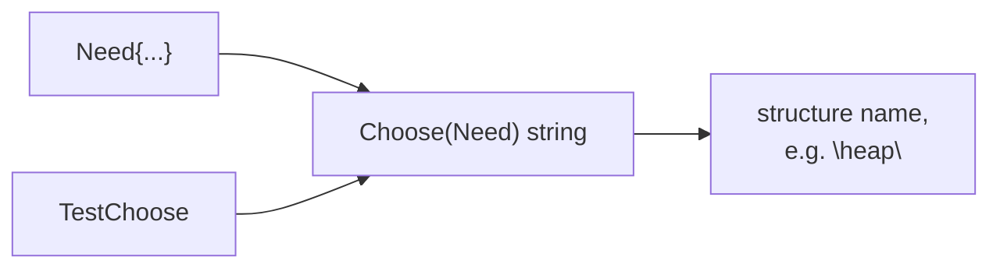

# Data Structures Overview and Big-O Cheat Sheet - Go

> [!summary] TL;DR
> The runnable side of [[Data Structures Overview and Big-O Cheat Sheet]]: a small `Choose` function that turns the theory note's decision flowchart into testable Go code, so "which structure for this need" is something a test checks instead of only a diagram.

## Before the code

- **Structs**: `Need` groups several `bool` fields into one value; unset fields default to `false`.
- **Bodyless `switch`**: `switch { case cond: ... }` checks each condition top to bottom and takes the first true one.
- **Table-driven tests**: a slice of anonymous structs (`name`, `need`, `want`) looped over in one test function.
- **`%+v` / `%q` verbs**: print a struct with field names, and a string in quotes, in failure messages.
- **What to run**: `go vet ./... && go test -race -v ./...` inside a module named `datastructures`.

## What this code shows

| Code | Concept in the theory note |
| --- | --- |
| `Need` struct | The seven questions the flowchart branches on ([[Data Structures Overview and Big-O Cheat Sheet#Choosing a structure]]) |
| `Choose` | The flowchart itself, as a `switch` with the same branch order | 
| `TestChoose` | Confirms each branch returns the structure the flowchart names |



## Setup

- Go 1.24, standard library only — no third-party dependencies.
- Layout: a module `datastructures` with `choose.go` and `choose_test.go`.
- Run it with `go vet ./... && go test -race -v ./...`.

## Code

### Step 1: `Need`, the seven questions the flowchart asks

**Concept.** Each field mirrors one branch of [[Data Structures Overview and Big-O Cheat Sheet#Choosing a structure]]'s decision flowchart.

The alternative — a single `enum`-style string field naming one need — was rejected because real code sometimes needs more than one property at once (the leaderboard example needs both `AlwaysNeedTheMin` and `RandomAccessByKey`).

A struct of booleans lets `Choose` pick a priority order explicitly instead of forcing the caller to collapse several needs into one label.

```go
package datastructures

// Need describes what a piece of code requires from its collection.
type Need struct {
	OrderedByInsertion bool // must iterate in the order items were added
	RandomAccessByKey  bool // must look values up by an arbitrary key, not position
	RandomAccessByPos  bool // must jump straight to position i
	FIFO               bool // must process items in first-in-first-out order
	LIFO               bool // must process items in last-in-first-out order
	AlwaysNeedTheMin   bool // must repeatedly pull the smallest (or highest-priority) item
	RangeQueries       bool // must find all items between two keys, in order
}
```

**How it works.**
1. Every field is a plain `bool`, not a pointer or an enum — the zero value (`false`) means "this isn't a need," so a caller only has to set the fields that actually apply.
2. The comments are part of the design: each one restates the exact phrase from the flowchart's decision node, so the mapping from diagram to code stays obvious without needing to re-derive it.

### Step 2: `Choose`, the flowchart as a switch

**Concept.** This function is deliberately a priority-ordered `switch`, not a lookup table, because some needs should win over others when a caller's `Need` sets more than one field.

`AlwaysNeedTheMin` is checked first because a heap satisfies "give me the min" far better than any structure further down the list would, even if a lower-priority field is also set.

The rejected alternative, a map from `Need` to structure name, can't express that priority at all, since a map key would have to be the whole struct, and there'd be no way to say "if several fields are true, prefer this one."

```go
package datastructures

// Choose returns the structure this note recommends for the given need.
// It mirrors section 3's decision flowchart so the choice is testable.
func Choose(n Need) string {
	switch { // switch on true: first matching case wins, so order = priority
	case n.AlwaysNeedTheMin:
		return "heap"
	case n.FIFO:
		return "queue (ring buffer or channel)"
	case n.LIFO:
		return "stack (slice)"
	case n.RangeQueries:
		return "tree (sorted structure)"
	case n.RandomAccessByKey:
		return "hash table (map)"
	case n.RandomAccessByPos:
		return "slice"
	case n.OrderedByInsertion:
		return "slice (append-only) or linked list (frequent mid-list insert/delete)"
	default:
		return "slice" // the default: contiguous, cache-friendly, simplest
	}
}
```

**How it works.**
1. A bodyless `switch { case cond1: ...; case cond2: ... }` (switch on `true`, effectively) runs each `case` condition top to bottom and takes the first match — this is what encodes the priority order from point 1 above.
2. The `default` case returns `"slice"`, matching the theory note's advice to start with a slice or map and only reach for something more specialised once a measured need justifies it.
3. Returning a `string`, not a typed constant, is a deliberate simplification for a teaching function — production code mapping to an actual structure choice would more likely return a constructor or a type, not a label.

## Tests

### `TestChoose`

Proves each of the flowchart's five most distinctive branches (the ones with no overlap in their boolean fields) returns the name the flowchart names for that need.

It also checks one overlapping case, the leaderboard, to pin the priority order: when both `AlwaysNeedTheMin` and `RandomAccessByKey` are set, the heap wins.

| Input (`Need`) | Expected output |
| --- | --- |
| `{AlwaysNeedTheMin: true}` | `"heap"` |
| `{FIFO: true}` | `"queue (ring buffer or channel)"` |
| `{LIFO: true}` | `"stack (slice)"` |
| `{RangeQueries: true}` | `"tree (sorted structure)"` |
| `{RandomAccessByKey: true}` | `"hash table (map)"` |
| `{AlwaysNeedTheMin: true, RandomAccessByKey: true}` | `"heap"` |

A failure here would mean `Choose`'s `switch` branch order or return strings drifted out of sync with the flowchart in the theory note — exactly the kind of silent documentation/code mismatch this test exists to catch.

```go
package datastructures

import "testing"

func TestChoose(t *testing.T) {
	cases := []struct {
		name string
		need Need
		want string
	}{
		{"priority scheduling", Need{AlwaysNeedTheMin: true}, "heap"},
		{"task queue", Need{FIFO: true}, "queue (ring buffer or channel)"},
		{"undo stack", Need{LIFO: true}, "stack (slice)"},
		{"range scan", Need{RangeQueries: true}, "tree (sorted structure)"},
		{"cache lookup", Need{RandomAccessByKey: true}, "hash table (map)"},
		// overlap: the switch order must make the heap win
		{"leaderboard: min wins over key", Need{AlwaysNeedTheMin: true, RandomAccessByKey: true}, "heap"},
	}
	for _, c := range cases {
		if got := Choose(c.need); got != c.want {
			t.Errorf("%s: Choose(%+v) = %q, want %q", c.name, c.need, got, c.want)
		}
	}
}
```

## Design decisions

| Choice | Alternative | Trade-off |
| --- | --- | --- |
| Struct of booleans (`Need`) | A single enum field | The struct lets a caller express more than one true need at once (as the leaderboard example does); an enum would force collapsing multiple needs into one label before calling `Choose` |
| Priority-ordered `switch` | A map keyed by `Need` | The switch can express "prefer this branch when several fields are true"; a map lookup has no concept of priority between overlapping keys |
| Returns a descriptive `string` | Returns a typed constant or constructor | A string is easier to read in a test table and keeps this teaching function decoupled from any one real implementation; production code mapping to an actual structure would more likely return a constructor |

## Running it

```bash
go vet ./...
go test -race -v ./...
```

Measured (Go 1.24.4, darwin/arm64, 2026-11-13):

```text
=== RUN   TestChoose
--- PASS: TestChoose (0.00s)
PASS
ok  	datastructures	1.428s
```

Reading it: one test, six table cases (not `t.Run` subtests, so they report as one PASS), all passing — confirming `Choose`'s priority order matches the flowchart's branch order exactly, with no drift between the diagram and the code.

## Pitfalls in the code

- Adding a new field to `Need` without also adding a `case` for it in `Choose` silently falls through to whatever `case` comes next (or `default`) — there's no compiler warning for an unhandled boolean field, unlike an unhandled case in a `switch` over an enum type.
- The priority order in `Choose` is load-bearing: swapping the order of two `case` branches changes behaviour for any `Need` that sets both of their fields, with no type error to catch the swap.

## Exercises

1. **Change it, predict the result:** add a new field `NeedsPrefixSearch bool` to `Need`, with a `case` in `Choose` returning `"trie"`. Where in the priority order should it go relative to `RandomAccessByKey`, and why — think about which need a trie actually satisfies better.
2. **Change it, predict the result:** reorder the `AlwaysNeedTheMin` and `FIFO` cases in `Choose` (put `FIFO` first). Construct a `Need{AlwaysNeedTheMin: true, FIFO: true}` and predict what `Choose` now returns before running it.
3. **Change it, predict the result:** change `Choose`'s `default` case to return `"hash table (map)"` instead of `"slice"`. Explain in one sentence why the theory note's advice ("start with a slice or map") still holds even though you changed which one is the literal default.

## Links

- **Theory:** [[Data Structures Overview and Big-O Cheat Sheet]]
