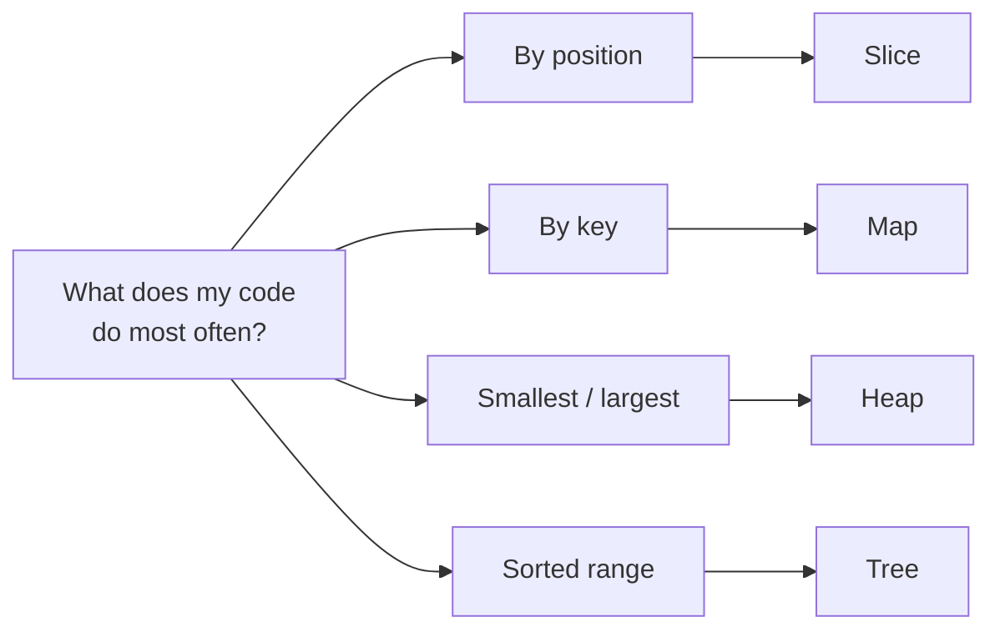
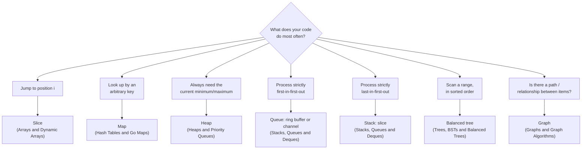
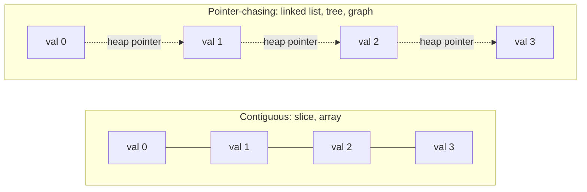
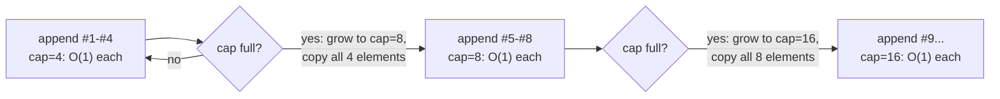
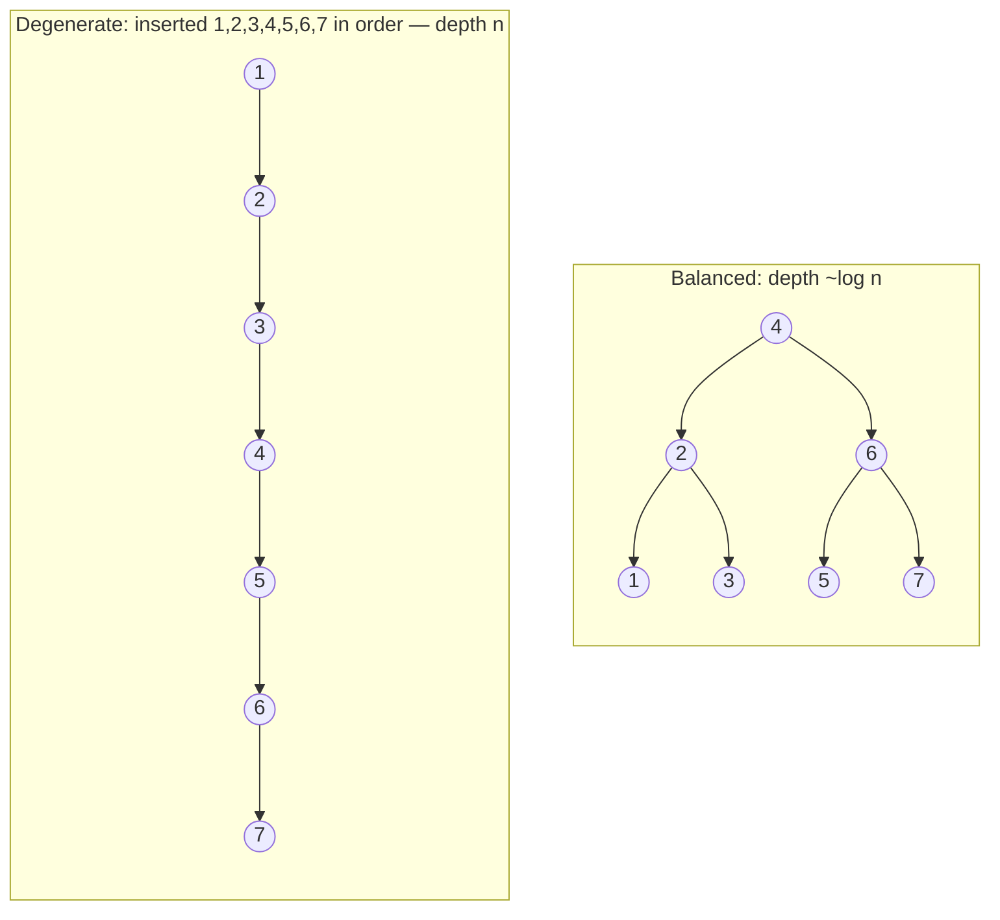
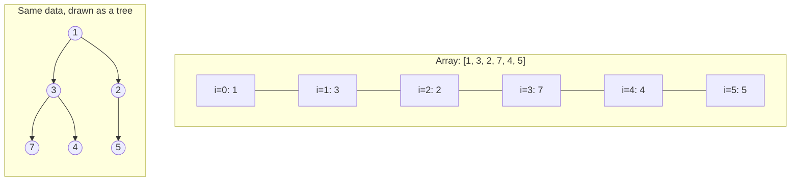

# Data Structures Overview and Big-O Cheat Sheet

> [!summary] TL;DR
> A data structure is just a way to arrange values in memory so that the operations your code actually does — look up, insert, delete, iterate in order — are cheap. This note is the map: one table of every structure's cost, a flowchart for picking the right one, and a link to each structure's own deep-dive note.

> [!abstract] Core idea
> - Every data structure is a trade: it makes some operations fast by making others slower, or by using more memory.
> - "Fast" has two different meanings here: the Big-O **shape** of the cost (does it grow with `n`?), and the **constant factor** from cache locality (contiguous memory is fast to scan even when the Big-O is the same).
> - Pick a structure by naming the operation your code does most often, then matching it against the table below.
> - When in doubt, start with a slice or a map. Reach for a tree, heap, or specialised structure only once you know *why* a slice or map isn't enough.

## Start here: the basics

### The problem in one story

You keep 10,000 contacts on your phone. Finding "Priya" by scrolling one by one is slow.
Your phone keeps them sorted, so it can jump to "P" instead.
A different app wants "who called most recently" — sorting by name does not help there.
Same data, different question, different best arrangement. That arrangement is a data structure.

### Words you need first

| Word | Plain meaning | Tiny example |
| --- | --- | --- |
| Data structure | A way to arrange values in memory | A list, a dictionary, a tree |
| Operation | Something your code does to the data | Look up, insert, delete, list in order |
| `n` | How many items you are storing | 10,000 contacts → `n = 10,000` |
| Big-O | How the work grows as `n` grows | `O(n)`: twice the items, about twice the work |
| `O(1)` | Same work no matter how big `n` is | Reading item 42 of a slice |
| `O(log n)` | Work grows very slowly; halves the search each step | 1,000,000 sorted items → about 20 steps |
| Slice / map | Go's built-in list and key→value dictionary | `[]int{1,2}`, `map[string]int{"a": 1}` |
| Cache locality | Values next to each other in memory are faster to read together | Scanning a slice beats chasing list pointers |

### Picture it

### Analogy

A data structure is like how you organise a kitchen: spices on a rack by name, knives in a block, plates stacked. Each layout makes one kind of grab fast.
Where it breaks: a kitchen rarely holds a million items, so the "hidden" costs here (memory layout, resizing) have no kitchen equivalent.

### How the rest of this note builds up

- First, **Why it exists** and **Mental model**: one leaderboard story and the four basic ways of finding something.
- Then **How it works**: the choosing flowchart, memory layout, amortised cost, balanced trees and heaps.
- Then the **master table** in Variants and comparison, the one-page cost reference.
- Finally the SDE-3 **Deep dive** on why Big-O hides constants, layout and latency spikes, plus interview questions.

> [!tip] Remember
> Name the operation your code does most, then pick the structure that makes that operation cheap.

## 1. Why it exists

Say you're building a leaderboard that supports three operations: add a player's score, look up a player's score by name, and list the top 10 scores.

Pick the wrong structure and one of those operations becomes slow at scale:

- Store players in a plain unsorted slice: adding is `O(1)`, but finding "top 10" means sorting all `n` players every time, `O(n log n)` per request.
- Store them in a `map[string]int`: looking up by name is `O(1)` average, but there is no order at all, so "top 10" still means collecting and sorting everything.
- Store them in a max-heap keyed by score, plus a `map[string]int` for name lookups: adding is `O(log n)`, finding the top 10 is `O(10 log n)`, and name lookup stays `O(1)`.

None of these is "the right data structure" in the abstract. The heap-plus-map combination wins **for this specific mix of operations**.

A cache that only ever needs recency order would reach for a different pair (map plus doubly linked list — see [[Linked Lists]]). The job of this note is to make that match-up mechanical instead of a guess.

> [!tip] Remember
> There is no single "best" data structure — only the best structure for the exact mix of operations your code performs most often.

## 2. Mental model

Think of a data structure as answering one question: **"when I ask for item X, how much work do you do before you can touch it?"**

### Four basic answers, one analogy each

**In plain words:** almost every structure in this note is a variation on one of four basic ways of finding something: jump straight to it, narrow a search window, compute where it should be, or follow a trail from where you last were.

| Basic answer | Analogy | Structure |
| --- | --- | --- |
| "Give me position `i`" in one step | A numbered row of lockers — you walk straight to locker 42 | Slice: `address = base + i × size` |
| "Give me everything between X and Y" by narrowing a window | A library's card catalog, alphabetised, so you skip straight to the "M" drawer | Sorted array or balanced tree, `O(log n)` steps |
| "Give me the value for key X" by computing where it lives | A post office's PO box number — the box number *is* a function of your name, not a thing you search for | Hash table, `O(1)` average |
| "Give me the next (or most recent) item" | A single-file queue at a counter — the next person is whoever is standing right there | Linked list, stack, queue, `O(1)` |

**Why it matters:** once you recognise which of these four questions your code is really asking, the right family of structures follows almost automatically — the rest of this note is just the specialisations built on top of these four.

**Where the analogy breaks down:** a real post office's PO boxes never collide (each box has exactly one owner).

A hash table's "box number" is a hash of the key modulo the table size, so two different keys *can* compute to the same box — see the hash table diagram in section 3 for what happens next.

Everything else — trees, heaps, graphs, tries, skip lists, union-find — is a specialisation of one of these four answers, built to make one more operation (ordered range scans, "the current minimum", "is there a path", "the longest shared prefix") just as cheap.

## 3. How it works

### Choosing a structure

**In plain words:** name the one operation your code does most often, and the flowchart below points at the structure built for exactly that operation.

**Picture it:**

**Example:** the leaderboard from section 1 asks "always need the current min/max" (for top scores) *and* "look up by an arbitrary key" (for name lookup) — two different branches, so it legitimately needs two structures together.

**Why it matters:** picking a structure before naming the operation is guessing; naming the operation first turns the choice into a lookup.

Two structures sit outside this flowchart because they specialise one branch further:

- A **trie** (see [[Tries, Suffix Trees and Suffix Arrays]]) is a map specialised for keys that share prefixes (autocomplete, routers).
- **Union-find** (see [[Union-Find and Skip Lists]]) answers "are these two items in the same group?" faster than a graph traversal would, for a structure that only ever merges groups.

> [!warning] Common mistake
> Picking the structure that's fastest for the *one* operation you thought of first, while ignoring the others your code also needs. The leaderboard example needs two structures together precisely because no single one is cheap at both jobs.

### Memory layout: the hidden second axis

**In plain words:** Big-O hides a real cost — whether the structure's values sit next to each other in memory or are scattered behind pointers. Two structures with identical Big-O can still differ by 10x or more in wall-clock time because of this.

**Picture it:**

**Example:** scanning 1,000 contiguous `int64` values touches about 8 cache lines total (each cache line holds 8 values); scanning 1,000 linked-list nodes touches up to 1,000 separate cache lines, one per node, because each node's address is unknown until the previous one is loaded.

**Why it matters:** reading the contiguous layout sequentially lets the CPU prefetch the next cache line before you ask for it; reading the scattered layout is a cache miss at nearly every step.

See [[Memory Hierarchy and CPU Caches]] for the actual latency numbers behind "cache miss." This is exactly why [[Linked Lists]] explains why a slice usually beats a linked list in Go even when their Big-O for an operation is identical.

### Amortised cost: why a single `append` can be slow even though "append is O(1)"

**In plain words:** "amortised `O(1)`" means the *average* cost per call is constant over a long sequence of calls — but a few individual calls in that sequence are much more expensive, because that's when the underlying array has to grow and everything gets copied.

**Picture it:**

**Example:** appending to a slice that doubles its capacity each time it's full costs `O(1)` for most calls, but the specific call that triggers a grow from capacity 1,000,000 to 2,000,000 copies a million elements in that one call — `O(n)` for that call alone.

Averaged over the whole sequence of appends, the cost still works out to `O(1)` per call, which is what "amortised" means.

**Why it matters:** a system with a strict p99 latency budget can be hurt by the occasional expensive resize even though the *average* cost looks fine — this is exactly the kind of spike [[Complexity Analysis - Big-O and Amortized Cost]] proves with the accounting-method argument.

### A balanced tree versus a degenerate one

**In plain words:** "binary search tree lookup is `O(log n)`" is only true when the tree is **balanced** — roughly the same depth on both sides of every node. Insert values in sorted order into a plain BST with no rebalancing, and it degenerates into something shaped exactly like a linked list.

**Picture it:**

**Example:** looking up `7` in the balanced tree takes 3 comparisons (`4 → 6 → 7`). Looking up `7` in the degenerate tree takes 7 comparisons — every single node, because it's really just a linked list wearing a tree's name.

**Why it matters:** this is precisely why the master table below lists a plain BST's *worst-case* search as `O(n)`, not `O(log n)`.

Only a tree that actively rebalances itself (AVL, red-black, B-tree) can guarantee `O(log n)` in the worst case; see [[Trees, BSTs and Balanced Trees]] for how rebalancing prevents this.

> [!warning] Common mistake
> Quoting a BST's cost as `O(log n)` without checking whether it's actually kept balanced. An unbalanced BST's worst case is `O(n)` — exactly as bad as a linked list — and sorted or near-sorted input is precisely the case that triggers it.

### A heap is a tree hiding inside an array

**In plain words:** a binary heap keeps the "always know the current min/max" property using a plain array, not pointers — the tree shape is implicit in the array index arithmetic.

**Picture it:**

**Example:** node at array index `i` has children at indices `2i+1` and `2i+2` — index 1's children are at indices 3 and 4, exactly matching the tree drawing above. No pointer is ever stored; the parent/child relationship is pure arithmetic on the index.

**Why it matters:** this is why a heap's `Access` (peek at the min/max) is `O(1)` — it's always at index 0 — while `Insert`/`Delete` are `O(log n)`, the cost of re-establishing the heap property by swapping along one root-to-leaf path.

## 4. Worked example

### Whiteboard version

For the leaderboard from section 1: "add player", "look up by name", "top 10" maps to heap (current max) + map (lookup by key). Confirm it against the flowchart: "always need the current minimum/maximum" → heap; "look up by an arbitrary key" → map.

Two different needs, two structures, used together — this is normal, not a sign you picked wrong.

The `Need`/`Choose` function that turns this flowchart into testable Go code, plus its test, live in the runnable version: [[Data Structures Overview and Big-O Cheat Sheet - Go]].

## 5. Variants and comparison

### The master table

`n` is the number of elements. All costs below are average case unless a worst-case column exists; "amortised" means the cost averaged over a sequence of operations, explained in [[Complexity Analysis - Big-O and Amortized Cost]].

The **worst case** column is a true worst case throughout the table — including for the balanced BST row, whose worst case assumes it has degenerated as shown in section 3, not that it stayed balanced.

| Structure | Access | Search | Insert | Delete | Worst case (search) | Memory layout | Go type / package | Typical real use |
| --- | --- | --- | --- | --- | --- | --- | --- | --- |
| Slice / dynamic array | `O(1)` | `O(n)` (`O(log n)` sorted) | `O(1)` amortised at the end, `O(n)` in the middle | `O(n)` in the middle | `O(n)` | Contiguous | `[]T` | Lists, buffers, stacks |
| Static array | `O(1)` | `O(n)` | n/a (fixed size) | n/a | `O(n)` | Contiguous | `[N]T` | Fixed-size records, matrices |
| Singly/doubly linked list | `O(n)` | `O(n)` | `O(1)` at a known node | `O(1)` at a known node | `O(n)` | Scattered (heap nodes) | `container/list` | LRU recency order, deques |
| Stack | `O(1)` top only | `O(n)` | `O(1)` top | `O(1)` top | `O(n)` | Contiguous (slice-backed) | `[]T` as a stack | Undo/redo, call stack, DFS |
| Queue (ring buffer) | `O(1)` front/back | `O(n)` | `O(1)` amortised | `O(1)` | `O(n)` | Contiguous (circular) | custom, `container/ring` | Task queues, BFS |
| Hash table | n/a | `O(1)` avg | `O(1)` avg | `O(1)` avg | `O(n)` (hash flooding / all collisions) | Buckets, scattered values | `map[K]V` | Caches, lookups, sets |
| Binary search tree (unbalanced if untended) | `O(log n)` balanced | `O(log n)` balanced | `O(log n)` balanced | `O(log n)` balanced | `O(n)` (degenerates to a linked list — see section 3) | Scattered | `google/btree`, sorted slice | Ordered sets, range queries |
| B-tree / B+tree (self-balancing by construction) | `O(log n)` | `O(log n)` | `O(log n)` | `O(log n)` | `O(log n)` (balance is an invariant, not a hope) | Fixed-size disk/memory pages | DB indexes (see [[Storage Engines - B-tree vs LSM and WAL]]) | Database indexes |
| Heap (binary) | `O(1)` min/max only | `O(n)` | `O(log n)` | `O(log n)` | `O(n)` (search for an arbitrary value, not the min/max) | Contiguous (array) | `container/heap` | Priority queues, schedulers, top-K |
| Trie | n/a | `O(m)`, `m` = key length | `O(m)` | `O(m)` | `O(m)` | Scattered (one node per branch) | custom | Autocomplete, IP routing |
| Graph (adjacency list) | n/a | `O(V+E)` traversal | `O(1)` edge | `O(degree)` edge | `O(V+E)` | Scattered | `map[int][]int` | Networks, dependency graphs |
| Union-find | n/a | `O(α(n))` ≈ `O(1)` | n/a | n/a (no delete) | `O(α(n))` | Contiguous (parent array) | custom | Kruskal's MST, connectivity |
| Skip list | `O(log n)` expected | `O(log n)` expected | `O(log n)` expected | `O(log n)` expected | `O(n)` (rare, randomised) | Scattered, multiple levels | custom (Redis sorted sets) | Ordered sets without tree rotations |

> [!tip] Remember
> A table of "typical" costs is not the same as a table of guaranteed worst cases. The row for any structure that *can* degrade (plain BST, hash table under adversarial keys) should always carry its honest worst case, not just its common-case behavior.

### How to read a row you don't recognise yet

Every row above gets its own note with the full mechanism, a tested Go implementation, and interview problems:

- [[Arrays and Dynamic Arrays (Go Slices)]] — slice header, growth, aliasing.
- [[Linked Lists]] — singly/doubly, `container/list`, LRU.
- [[Stacks, Queues and Deques]] — slice stack, ring-buffer queue, channels, monotonic patterns.
- [[Hash Tables and Go Maps]] — buckets, load factor, Go map internals.
- [[Trees, BSTs and Balanced Trees]] — BST, AVL/red-black, B-trees.
- [[Heaps and Priority Queues]] — array-backed binary heap, `container/heap`.
- [[Graphs and Graph Algorithms]] — BFS/DFS/Dijkstra, representations.
- [[Tries, Suffix Trees and Suffix Arrays]] — prefix trees, suffix structures.
- [[Union-Find and Skip Lists]] — disjoint-set union, probabilistic ordered lists.

## 6. Trade-offs and when not to use

- **Picking a fancy structure too early is a cost, not a win.** A tree or heap has real overhead (pointer chasing, rebalancing, more allocations) that a slice or map doesn't. Reach for one only once a measured bottleneck names the operation it would fix.
- **Big-O ignores constants.** A linked list's `O(1)` insert and a slice's `O(n)` insert can lose to the slice in practice for small-to-medium `n`, because the slice's contiguous memory makes every touched byte cheap and the linked list's pointer chases are all cache misses (see [[Memory Hierarchy and CPU Caches]]).
- **The "right" structure depends on the whole operation mix, not one operation.** Optimising only the most common operation while ignoring the others (e.g., picking an unsorted slice because inserts are `O(1)`, while range queries silently become `O(n log n)`) is the most common real mistake.
- **Concurrent access changes the answer.** A structure that's `O(1)` single-threaded may need a mutex, sharding, or a different structure entirely (`sync.Map`, channels) once multiple goroutines touch it; see each structure's own note for its concurrency story, and [[Concurrency Primitives - Mutex, Semaphore, Atomics]] for the primitives themselves.

> [!warning] What happens if… you use a plain BST for data that arrives already sorted?
> Every insert goes to the same side (always "greater than the last one"), building the exact degenerate, linked-list-shaped tree from section 3 — `O(n)` for every operation, with none of a tree's benefit. This is precisely why production ordered structures (`google/btree`, database indexes) are self-balancing by construction, not plain BSTs.

## 7. In production

**Real systems:**

- A web server's router is a trie or radix tree ([[Tries, Suffix Trees and Suffix Arrays]]).
- A load balancer's consistent-hash ring is a sorted structure over hashed positions (see [[Consistent Hashing]]).
- A database index is a B+tree ([[Storage Engines - B-tree vs LSM and WAL]]).
- A job scheduler's "run next" queue is a heap ([[Heaps and Priority Queues]]).
- Kruskal's minimum spanning tree algorithm is union-find plus a sorted edge list ([[Union-Find and Skip Lists]]).

**Failure modes → fixes:**

| Failure mode | Fix |
| --- | --- |
| Choosing an unsorted slice for a lookup-heavy workload | Switch to a map once profiling shows linear scans dominating |
| Choosing a map where insertion order matters | Go maps randomise iteration order on purpose, so pair the map with a slice of keys or switch to a sorted structure |
| Choosing a linked list for cache-sensitive hot-path code | Benchmark against a slice first; almost always the slice wins below cache-capacity sizes |
| Choosing a plain BST for data from an untrusted or naturally sorted source | It degenerates exactly as section 3 shows, so use a self-balancing structure instead |

**What to monitor:**

- Allocations per operation (`go test -benchmem`).
- p99 latency of the operation your structure serves (the amortisation subsection above explains why p99, not just p50, is where a slice's occasional resize shows up).
- For anything backed by a hash table: load factor and the collision/resize rate.

## 8. Deep dive

Big-O describes how a cost **grows**, not how large it is at any one `n`. Two structures with the same asymptotic cost can differ by orders of magnitude at the `n` your program actually sees, because of three things Big-O deliberately throws away:

1. **Constant factors.** `O(1)` hash lookup still does a multiply, a modulo, and a cache-line load; `O(1)` slice-index access is just an address computation. The hash lookup is slower in absolute terms even though both are `O(1)`.
2. **Memory layout.** Contiguous access patterns (arrays, slices) let hardware prefetchers hide memory latency; pointer-chasing patterns (lists, trees, graphs) cannot be prefetched because the next address isn't known until the current node is loaded. [[Memory Hierarchy and CPU Caches]] has the measured and documented latency numbers behind this.
3. **Amortisation hides worst-case spikes.** A slice `append` is `O(1)` amortised, but any single call that triggers a grow is `O(n)` for that one call, as walked through in section 3. [[Complexity Analysis - Big-O and Amortized Cost]] proves this with the accounting-method argument and shows where it matters (a p99 latency spike, not just a p50 average).

The practical rule that falls out of all three: **measure before you specialise**. Start with the simplest structure that is asymptotically correct for your operation mix (usually a slice or map), and move to something more specialised only once a profile or benchmark shows it's the bottleneck.

## 9. Interview questions

> [!question]- You need O(1) lookup by key and to keep insertion order. What do you reach for, and why doesn't a plain map give you this?
> A Go map's iteration order is intentionally randomised, so insertion order needs a second structure: a slice of keys alongside the map, or a map from key to a doubly linked list node (the same pattern an LRU cache uses, see [[Linked Lists]]).

> [!question]- Why would you ever choose a linked list over a slice in Go, given slices are usually faster?
> Only when you must insert or delete at a known interior node very frequently without shifting every following element, and you don't need random access by index — for example, the recency list inside an LRU cache (`container/list`), where nodes move to the front on every access.

> [!question]- Trap: "Big-O tells you which structure is faster." True or false?
> False. Big-O tells you how cost **scales** with `n`; it says nothing about the constant factor. A linked list and a slice can both be `O(n)` to search, but the slice is almost always faster in wall-clock time at realistic sizes because of cache locality.

> [!question]- Your service needs "give me the k highest-priority jobs" repeatedly, as new jobs keep arriving. Which structure, and what's the cost per operation?
> A heap. Insert is `O(log n)`, and extracting the max/min is `O(log n)`; getting the current best is `O(1)` peek. A sorted slice would make insert `O(n)` to keep it sorted, which loses once jobs arrive continuously.

> [!question]- When does a hash table's O(1) average case break down to O(n)?
> When many keys collide into the same bucket — either from a bad hash function, or from an attacker deliberately choosing keys that collide (hash-flooding), which is why Go maps randomise their hash seed per process.

> [!question]- You're choosing between a B-tree and a binary search tree for a database index. What's the deciding factor?
> Disk/page access cost, and the guarantee of staying balanced. A B-tree's high fan-out means a lookup touches far fewer pages (each page read is a disk or memory-page fetch), and unlike a plain BST it's self-balancing by construction, so it never degenerates the way section 3 shows a plain BST can. See [[Storage Engines - B-tree vs LSM and WAL]].

> [!question]- What's the difference between "union-find" and just running BFS/DFS to check if two nodes are connected?
> Union-find answers "same group?" in near-constant amortised time per query after the groups are built (with path compression and union by rank), and it supports merging groups online. A fresh BFS/DFS per query is `O(V+E)` every time, which is far more expensive if you ask the question repeatedly as merges happen.

## 10. Cheat sheet

- Name the operation your code does most, then match it to the flowchart in section 3.
- Slice: `O(1)` index, `O(n)` middle insert/delete, cache-friendly, the default choice.
- Map: `O(1)` average lookup by key, no ordering guarantee.
- Heap: `O(1)` peek, `O(log n)` insert/pop; use whenever you always need the current min/max.
- Linked list: `O(1)` insert/delete at a known node, but `O(n)` to reach it; rarely wins over a slice in Go.
- Tree/B-tree: `O(log n)` everything **only while balanced**; a plain BST can degenerate to `O(n)` — B-trees fix this by construction. Trees keep order for range queries.
- Trie: `O(m)` by key length, not by count of keys; shines when keys share prefixes.
- Union-find: near-`O(1)` "same group?" and merge, no delete.
- Amortised `O(1)` ≠ every call is cheap — a resize/grow call still costs `O(n)` on its own.
- Big-O is about growth, not magnitude: always sanity-check with a benchmark at your real `n`.

## Links

- **Before this:** none — this is the entry point for `01 CS Fundamentals`'s data-structure notes.
- **Next:** [[Arrays and Dynamic Arrays (Go Slices)]], [[Linked Lists]], [[Stacks, Queues and Deques]], [[Hash Tables and Go Maps]]
- **Compare with:** [[Complexity Analysis - Big-O and Amortized Cost]] (the formal cost model this note's table relies on), [[Memory Hierarchy and CPU Caches]] (why the constants behind Big-O differ)
- **Runnable code:** [[Data Structures Overview and Big-O Cheat Sheet - Go]]

### Watch on YouTube

- [ALL Data Structures in 15MINS! Data Structures Revision, Data Structures Crash Course](https://www.youtube.com/watch?v=5seZMzTyNLA) · KnowledgeCatch · Fast top-level revision across arrays, lists, trees, heaps, hash tables, graphs — matches the note's map/cheat-sheet role
