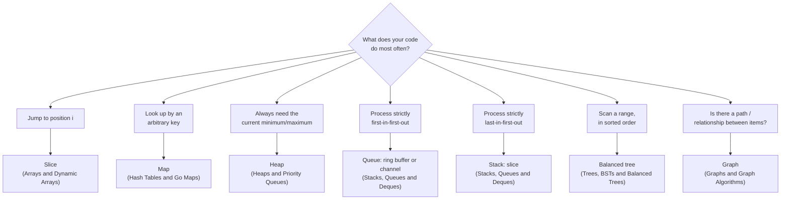
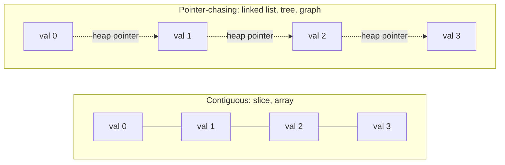

# Data Structures Overview and Big-O Cheat Sheet

> [!summary] TL;DR
> A data structure is just a way to arrange values in memory so that the operations your code actually does — look up, insert, delete, iterate in order — are cheap. This note is the map: one table of every structure's cost, a flowchart for picking the right one, and a link to each structure's own deep-dive note.

> [!abstract] Core idea
> - Every data structure is a trade: it makes some operations fast by making others slower, or by using more memory.
> - "Fast" has two different meanings here: the Big-O **shape** of the cost (does it grow with `n`?), and the **constant factor** from cache locality (contiguous memory is fast to scan even when the Big-O is the same).
> - Pick a structure by naming the operation your code does most often, then matching it against the table below.
> - When in doubt, start with a slice or a map. Reach for a tree, heap, or specialised structure only once you know *why* a slice or map isn't enough.

## 1. Why it exists

Say you're building a leaderboard that supports three operations: add a player's score, look up a player's score by name, and list the top 10 scores. Pick the wrong structure and one of those operations becomes slow at scale:

- Store players in a plain unsorted slice: adding is `O(1)`, but finding "top 10" means sorting all `n` players every time, `O(n log n)` per request.
- Store them in a `map[string]int`: looking up by name is `O(1)` average, but there is no order at all, so "top 10" still means collecting and sorting everything.
- Store them in a max-heap keyed by score, plus a `map[string]int` for name lookups: adding is `O(log n)`, finding the top 10 is `O(10 log n)`, and name lookup stays `O(1)`.

None of these is "the right data structure" in the abstract. The heap-plus-map combination wins **for this specific mix of operations**. A cache that only ever needs recency order would reach for a different pair (map plus doubly linked list — see [[Linked Lists]]). The job of this note is to make that match-up mechanical instead of a guess.

## 2. Mental model

Think of a data structure as answering one question: **"when I ask for item X, how much work do you do before you can touch it?"**

- A slice answers "give me position `i`" in one step: `address = base + i × size`.
- A sorted array or balanced tree answers "give me everything between X and Y" by narrowing a search window, `O(log n)` steps.
- A hash table answers "give me the value for key X" in one step on average, by computing where X *should* live instead of searching for it.
- A linked list and a stack/queue answer "give me the next (or most recent, or oldest) item" in one step, because that item is always exactly where you left off.

Everything else — trees, heaps, graphs, tries, skip lists, union-find — is a specialisation of one of these four answers, built to make one more operation (ordered range scans, "the current minimum", "is there a path", "the longest shared prefix") just as cheap.

## 3. How it works

### Choosing a structure



Two structures sit outside this flowchart because they specialise one branch further: a **trie** (see [[Tries, Suffix Trees and Suffix Arrays]]) is a map specialised for keys that share prefixes (autocomplete, routers); **union-find** (see [[Union-Find and Skip Lists]]) answers "are these two items in the same group?" faster than a graph traversal would, for a structure that only ever merges groups.

### Memory layout: the hidden second axis

Big-O hides a real cost: whether the structure's values sit next to each other in memory or are scattered behind pointers.



Reading the contiguous layout sequentially lets the CPU prefetch the next cache line before you ask for it; reading the scattered layout is a cache miss at nearly every step, because each node's address depends on a value you only learn once you've already dereferenced the previous node. See [[Memory Hierarchy and CPU Caches]] for the actual latency numbers behind "cache miss". This is exactly why [[Linked Lists]] explains why a slice usually beats a linked list in Go even when their Big-O for an operation is identical.

## 4. Worked example

### Whiteboard version

For the leaderboard from section 1: "add player", "look up by name", "top 10" maps to heap (current max) + map (lookup by key). Confirm it against the flowchart: "always need the current minimum/maximum" → heap; "look up by an arbitrary key" → map. Two different needs, two structures, used together — this is normal, not a sign you picked wrong.

### Checking the decision in code

The function below mirrors the flowchart as runnable logic, so "which structure for this need" is something a test can check instead of only a diagram.

```go
// Need describes what a piece of code requires from its collection.
type Need struct {
	OrderedByInsertion bool // must iterate in the order items were added
	RandomAccessByKey  bool // must look values up by an arbitrary key, not position
	RandomAccessByPos  bool // must jump straight to position i
	FIFO               bool // must process items in first-in-first-out order
	LIFO               bool // must process items in last-in-first-out order
	AlwaysNeedTheMin   bool // must repeatedly pull the smallest (or highest-priority) item
	RangeQueries       bool // must find all items between two keys, in order
}

// Choose returns the structure this note recommends for the given need.
// It mirrors section 3's decision flowchart so the choice is testable.
func Choose(n Need) string {
	switch {
	case n.AlwaysNeedTheMin:
		return "heap"
	case n.FIFO:
		return "queue (ring buffer or channel)"
	case n.LIFO:
		return "stack (slice)"
	case n.RangeQueries:
		return "tree (sorted structure)"
	case n.RandomAccessByKey:
		return "hash table (map)"
	case n.RandomAccessByPos:
		return "slice"
	case n.OrderedByInsertion:
		return "slice (append-only) or linked list (frequent mid-list insert/delete)"
	default:
		return "slice" // the default: contiguous, cache-friendly, simplest
	}
}
```

```go
func TestChoose(t *testing.T) {
	cases := []struct {
		name string
		need Need
		want string
	}{
		{"priority scheduling", Need{AlwaysNeedTheMin: true}, "heap"},
		{"task queue", Need{FIFO: true}, "queue (ring buffer or channel)"},
		{"undo stack", Need{LIFO: true}, "stack (slice)"},
		{"range scan", Need{RangeQueries: true}, "tree (sorted structure)"},
		{"cache lookup", Need{RandomAccessByKey: true}, "hash table (map)"},
	}
	for _, c := range cases {
		if got := Choose(c.need); got != c.want {
			t.Errorf("%s: Choose(%+v) = %q, want %q", c.name, c.need, got, c.want)
		}
	}
}
```

Tested on Go 1.24.4 (darwin/arm64): `go vet` and `go test -race` both pass.

## 5. Variants and comparison

### The master table

`n` is the number of elements. All costs below are average case unless a worst-case column exists; "amortised" means the cost averaged over a sequence of operations, explained in [[Complexity Analysis - Big-O and Amortized Cost]].

| Structure | Access | Search | Insert | Delete | Worst case (search) | Memory layout | Go type / package | Typical real use |
| --- | --- | --- | --- | --- | --- | --- | --- | --- |
| Slice / dynamic array | `O(1)` | `O(n)` (`O(log n)` sorted) | `O(1)` amortised at the end, `O(n)` in the middle | `O(n)` in the middle | `O(n)` | Contiguous | `[]T` | Lists, buffers, stacks |
| Static array | `O(1)` | `O(n)` | n/a (fixed size) | n/a | `O(n)` | Contiguous | `[N]T` | Fixed-size records, matrices |
| Singly/doubly linked list | `O(n)` | `O(n)` | `O(1)` at a known node | `O(1)` at a known node | `O(n)` | Scattered (heap nodes) | `container/list` | LRU recency order, deques |
| Stack | `O(1)` top only | `O(n)` | `O(1)` top | `O(1)` top | `O(n)` | Contiguous (slice-backed) | `[]T` as a stack | Undo/redo, call stack, DFS |
| Queue (ring buffer) | `O(1)` front/back | `O(n)` | `O(1)` amortised | `O(1)` | `O(n)` | Contiguous (circular) | custom, `container/ring` | Task queues, BFS |
| Hash table | n/a | `O(1)` avg | `O(1)` avg | `O(1)` avg | `O(n)` (hash flooding / all collisions) | Buckets, scattered values | `map[K]V` | Caches, lookups, sets |
| Binary search tree (balanced) | `O(log n)` | `O(log n)` | `O(log n)` | `O(log n)` | `O(log n)` (balanced) | Scattered | `google/btree`, sorted slice | Ordered sets, range queries |
| B-tree / B+tree | `O(log n)` | `O(log n)` | `O(log n)` | `O(log n)` | `O(log n)` | Fixed-size disk/memory pages | DB indexes (see [[Storage Engines - B-tree vs LSM and WAL]]) | Database indexes |
| Heap (binary) | `O(1)` min/max only | `O(n)` | `O(log n)` | `O(log n)` | `O(log n)` | Contiguous (array) | `container/heap` | Priority queues, schedulers, top-K |
| Trie | n/a | `O(m)`, `m` = key length | `O(m)` | `O(m)` | `O(m)` | Scattered (one node per branch) | custom | Autocomplete, IP routing |
| Graph (adjacency list) | n/a | `O(V+E)` traversal | `O(1)` edge | `O(degree)` edge | `O(V+E)` | Scattered | `map[int][]int` | Networks, dependency graphs |
| Union-find | n/a | `O(α(n))` ≈ `O(1)` | n/a | n/a (no delete) | `O(α(n))` | Contiguous (parent array) | custom | Kruskal's MST, connectivity |
| Skip list | `O(log n)` expected | `O(log n)` expected | `O(log n)` expected | `O(log n)` expected | `O(n)` (rare, randomised) | Scattered, multiple levels | custom (Redis sorted sets) | Ordered sets without tree rotations |

### How to read a row you don't recognise yet

Every row above gets its own note with the full mechanism, a tested Go implementation, and interview problems:

- [[Arrays and Dynamic Arrays (Go Slices)]] — slice header, growth, aliasing.
- [[Linked Lists]] — singly/doubly, `container/list`, LRU.
- [[Stacks, Queues and Deques]] — slice stack, ring-buffer queue, channels, monotonic patterns.
- [[Hash Tables and Go Maps]] — buckets, load factor, Go map internals.
- [[Trees, BSTs and Balanced Trees]] — BST, AVL/red-black, B-trees.
- [[Heaps and Priority Queues]] — array-backed binary heap, `container/heap`.
- [[Graphs and Graph Algorithms]] — BFS/DFS/Dijkstra, representations.
- [[Tries, Suffix Trees and Suffix Arrays]] — prefix trees, suffix structures.
- [[Union-Find and Skip Lists]] — disjoint-set union, probabilistic ordered lists.

## 6. Trade-offs and when not to use

- **Picking a fancy structure too early is a cost, not a win.** A tree or heap has real overhead (pointer chasing, rebalancing, more allocations) that a slice or map doesn't. Reach for one only once a measured bottleneck names the operation it would fix.
- **Big-O ignores constants.** A linked list's `O(1)` insert and a slice's `O(n)` insert can lose to the slice in practice for small-to-medium `n`, because the slice's contiguous memory makes every touched byte cheap and the linked list's pointer chases are all cache misses (see [[Memory Hierarchy and CPU Caches]]).
- **The "right" structure depends on the whole operation mix, not one operation.** Optimising only the most common operation while ignoring the others (e.g., picking an unsorted slice because inserts are `O(1)`, while range queries silently become `O(n log n)`) is the most common real mistake.
- **Concurrent access changes the answer.** A structure that's `O(1)` single-threaded may need a mutex, sharding, or a different structure entirely (`sync.Map`, channels) once multiple goroutines touch it; see each structure's own note for its concurrency story.

## 7. In production

- **Real systems:** a web server's router is a trie or radix tree ([[Tries, Suffix Trees and Suffix Arrays]]); a load balancer's consistent-hash ring is a sorted structure over hashed positions (see [[Consistent Hashing]]); a database index is a B+tree ([[Storage Engines - B-tree vs LSM and WAL]]); a job scheduler's "run next" queue is a heap ([[Heaps and Priority Queues]]); Kruskal's minimum spanning tree algorithm is union-find plus a sorted edge list ([[Union-Find and Skip Lists]]).
- **Failure modes → fixes:** choosing an unsorted slice for a lookup-heavy workload → switch to a map once profiling shows linear scans dominating; choosing a map where insertion order matters → Go maps randomise iteration order on purpose, so pair the map with a slice of keys or switch to a sorted structure; choosing a linked list for cache-sensitive hot-path code → benchmark against a slice first, almost always the slice wins below cache-capacity sizes.
- **What to monitor:** allocations per operation (`go test -benchmem`), p99 latency of the operation your structure serves, and — for anything backed by a hash table — load factor and the collision/resize rate.

## 8. Deep dive

Big-O describes how a cost **grows**, not how large it is at any one `n`. Two structures with the same asymptotic cost can differ by orders of magnitude at the `n` your program actually sees, because of three things Big-O deliberately throws away:

1. **Constant factors.** `O(1)` hash lookup still does a multiply, a modulo, and a cache-line load; `O(1)` slice-index access is just an address computation. The hash lookup is slower in absolute terms even though both are `O(1)`.
2. **Memory layout.** Contiguous access patterns (arrays, slices) let hardware prefetchers hide memory latency; pointer-chasing patterns (lists, trees, graphs) cannot be prefetched because the next address isn't known until the current node is loaded. [[Memory Hierarchy and CPU Caches]] has the measured and documented latency numbers behind this.
3. **Amortisation hides worst-case spikes.** A slice `append` is `O(1)` amortised, but any single call that triggers a grow is `O(n)` for that one call. [[Complexity Analysis - Big-O and Amortized Cost]] proves this with the accounting-method argument and shows where it matters (a p99 latency spike, not just a p50 average).

The practical rule that falls out of all three: **measure before you specialise**. Start with the simplest structure that is asymptotically correct for your operation mix (usually a slice or map), and move to something more specialised only once a profile or benchmark shows it's the bottleneck.

## 9. Interview questions

> [!question]- You need O(1) lookup by key and to keep insertion order. What do you reach for, and why doesn't a plain map give you this?
> A Go map's iteration order is intentionally randomised, so insertion order needs a second structure: a slice of keys alongside the map, or a map from key to a doubly linked list node (the same pattern an LRU cache uses, see [[Linked Lists]]).

> [!question]- Why would you ever choose a linked list over a slice in Go, given slices are usually faster?
> Only when you must insert or delete at a known interior node very frequently without shifting every following element, and you don't need random access by index — for example, the recency list inside an LRU cache (`container/list`), where nodes move to the front on every access.

> [!question]- Trap: "Big-O tells you which structure is faster." True or false?
> False. Big-O tells you how cost **scales** with `n`; it says nothing about the constant factor. A linked list and a slice can both be `O(n)` to search, but the slice is almost always faster in wall-clock time at realistic sizes because of cache locality.

> [!question]- Your service needs "give me the k highest-priority jobs" repeatedly, as new jobs keep arriving. Which structure, and what's the cost per operation?
> A heap. Insert is `O(log n)`, and extracting the max/min is `O(log n)`; getting the current best is `O(1)` peek. A sorted slice would make insert `O(n)` to keep it sorted, which loses once jobs arrive continuously.

> [!question]- When does a hash table's O(1) average case break down to O(n)?
> When many keys collide into the same bucket — either from a bad hash function, or from an attacker deliberately choosing keys that collide (hash-flooding), which is why Go maps randomise their hash seed per process.

> [!question]- You're choosing between a B-tree and a binary search tree for a database index. What's the deciding factor?
> Disk/page access cost. A B-tree's high fan-out means a lookup touches far fewer pages (each page read is a disk or memory-page fetch), so it wins whenever the structure is too large to fit in a single cache level — which is the usual case for a database index. See [[Storage Engines - B-tree vs LSM and WAL]].

> [!question]- What's the difference between "union-find" and just running BFS/DFS to check if two nodes are connected?
> Union-find answers "same group?" in near-constant amortised time per query after the groups are built (with path compression and union by rank), and it supports merging groups online. A fresh BFS/DFS per query is `O(V+E)` every time, which is far more expensive if you ask the question repeatedly as merges happen.

## 10. Cheat sheet

- Name the operation your code does most, then match it to the flowchart in section 3.
- Slice: `O(1)` index, `O(n)` middle insert/delete, cache-friendly, the default choice.
- Map: `O(1)` average lookup by key, no ordering guarantee.
- Heap: `O(1)` peek, `O(log n)` insert/pop; use whenever you always need the current min/max.
- Linked list: `O(1)` insert/delete at a known node, but `O(n)` to reach it; rarely wins over a slice in Go.
- Tree/B-tree: `O(log n)` everything, and keeps order for range queries; B-trees add high fan-out for disk/page-friendly access.
- Trie: `O(m)` by key length, not by count of keys; shines when keys share prefixes.
- Union-find: near-`O(1)` "same group?" and merge, no delete.
- Big-O is about growth, not magnitude: always sanity-check with a benchmark at your real `n`.

## Links

- **Before this:** none — this is the entry point for `01 CS Fundamentals`'s data-structure notes.
- **Next:** [[Arrays and Dynamic Arrays (Go Slices)]], [[Linked Lists]], [[Stacks, Queues and Deques]], [[Hash Tables and Go Maps]]
- **Compare with:** [[Complexity Analysis - Big-O and Amortized Cost]] (the formal cost model this note's table relies on), [[Memory Hierarchy and CPU Caches]] (why the constants behind Big-O differ)
