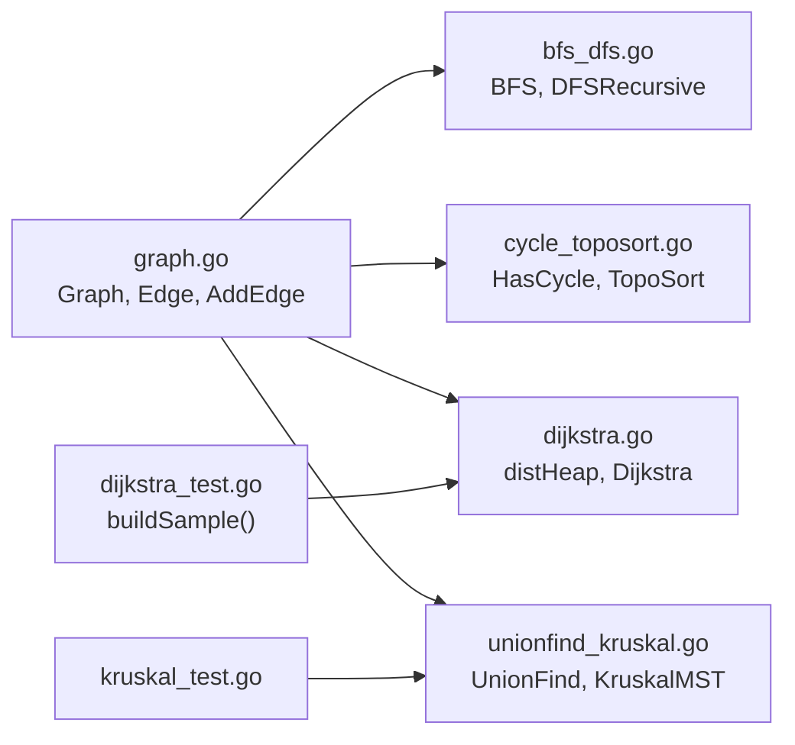

# Graphs and Graph Algorithms - Go

> [!summary] TL;DR
> The runnable side of [[Graphs and Graph Algorithms]]: an adjacency-list `Graph`, BFS, recursive DFS, three-color cycle detection, Kahn's topological sort, a heap-backed Dijkstra, and union-find-backed Kruskal's MST — tested against one shared sample graph.

> [!info] How to read this note (pick your level)
> - 🟢 **New to this?** Read "From zero" below, then "Before the code", "What this code shows" and "Setup". Stop there, that is a full first pass.
> - 🟡 **Know the basics?** Add the Code steps, Tests and Design decisions.
> - 🔴 **Interview / SDE-3 prep?** Add Pitfalls and do the Exercises. Headings are tagged 🟢🟡🔴 so you always know where you are.

> [!note] Before this note
> - [[Heaps and Priority Queues]]: a min-heap hands back the smallest item fast; Dijkstra's `distHeap` is one.
> - [[Stacks, Queues and Deques]]: BFS needs a first-in-first-out queue; DFS uses the call stack.
> - [[Hash Tables and Go Maps]]: `map[int][]Edge` finds a vertex's neighbour list by key in about one step.
> - Read [[Graphs and Graph Algorithms]] first too: it traces every algorithm below by hand on the same sample graph.

**From zero, in 60 seconds** 🟢

This file is the hands-on twin of [[Graphs and Graph Algorithms]]. That note explains, in pictures and words, how to store a network of connected things (a graph) and walk it: level by level (BFS), deep first (DFS), cheapest first (Dijkstra), in dependency order (topological sort), and how to spot loops. This note is the same material as working Go code: one small `Graph` type, then each algorithm built on it step by step, each step opening with the idea in plain words before the code. Two tests run everything against one tiny 4-vertex sample graph that the theory note traces by hand, so the code and the diagrams prove each other. Read the theory note first, then read this top to bottom; the Go you need is maps, slices, recursion and one standard-library heap.

## Before the code 🟢

- **Maps (`map[int][]Edge`)**: Go's built-in hash table; here it maps each vertex to its list of outgoing edges.
- **Slices as queues**: `queue = queue[1:]` drops the front item; `append` adds to the back.
- **Recursive closures**: `var visit func(int)` then `visit = func...` lets a function literal call itself (used by DFS and cycle detection).
- **Interfaces (`container/heap`)**: implement `Len`, `Less`, `Swap`, `Push`, `Pop` and the standard library gives you a min-heap.
- **`iota` constants**: auto-numbered `white=0, gray=1, black=2`, so a fresh map entry starts as white.
- **What to run**: `go vet ./... && go test -race -v ./...` in a scratch module (no goroutines here, so `-race` just confirms none are needed).

## What this code shows 🟢

| Code | Concept in the theory note |
| --- | --- |
| `Graph`, `Edge`, `AddEdge` | Adjacency list representation ([[Graphs and Graph Algorithms#Representations]]) |
| `BFS` | Level-by-level traversal ([[Graphs and Graph Algorithms#BFS: breadth-first search]]) |
| `DFSRecursive` | Depth-first traversal ([[Graphs and Graph Algorithms#DFS: depth-first search]]) |
| `HasCycle` | Three-color DFS ([[Graphs and Graph Algorithms#Cycle detection (directed graphs): three-color DFS]]) |
| `TopoSort` | Kahn's algorithm ([[Graphs and Graph Algorithms#Topological sort: Kahn's algorithm]]) |
| `Dijkstra`, `distHeap` | Min-heap frontier shortest paths ([[Graphs and Graph Algorithms#Dijkstra's algorithm: shortest paths with non-negative weights]]) |
| `UnionFind`, `KruskalMST` | Disjoint-set union and MST ([[Graphs and Graph Algorithms#Union-find and Kruskal's MST]]) |



## Setup 🟢

- Go 1.24, standard library only (`container/heap`, `sort`) — no third-party dependencies.
- Layout: a module `graph` with `graph.go`, `bfs_dfs.go`, `cycle_toposort.go`, `dijkstra.go`, `unionfind_kruskal.go`, and two test files.
- Run it with `go vet ./... && go test -race -v ./...`.

## Code 🟡

> 🟢 → 🟡 **You now know** what each file holds and how to run the tests. **Next we read the code:** the graph type, then BFS and DFS, cycle detection, topological sort, Dijkstra and Kruskal, one step each, every step opening with a plain-words line.

### Step 1: the graph type and adjacency list

**In plain words:** store the graph as a notebook with one page per vertex, listing who it points to — that is all an adjacency list is.

**Concept.** This is [[Graphs and Graph Algorithms#Representations]]'s default choice made concrete: `map[int][]Edge` gives `O(degree(u))` neighbor iteration at `O(V+E)` total space, which every algorithm below builds on.

The rejected alternative, `[][]int` (adjacency matrix), was not used because this note's sample graphs are sparse — the matrix's `O(V²)` space would be mostly wasted zero entries.

```go
package graph

type Edge struct {
	To     int
	Weight int
}

type Graph struct {
	adj map[int][]Edge
}

func New() *Graph { return &Graph{adj: make(map[int][]Edge)} }

func (g *Graph) AddEdge(u, v, weight int) {
	g.adj[u] = append(g.adj[u], Edge{To: v, Weight: weight})
	if _, ok := g.adj[v]; !ok {
		g.adj[v] = nil
	}
}
```

**How it works.**
1. `adj` is unexported (lower-case name, so code outside the package cannot touch it) — every algorithm in this package reaches the graph only through `AddEdge` and its own traversal, keeping the internal map from being mutated incorrectly from outside the package.
2. `AddEdge` only adds the directed edge `u → v`; an undirected graph (as Kruskal's MST needs) is modeled by calling `AddEdge` twice, once each direction, or — as `KruskalMST` does below — by working from a flat `WEdge` list instead of this adjacency-list type at all.
3. The `if _, ok := ...; !ok` line ensures `v` has an entry in `adj` even with zero out-edges — without it, `TopoSort`'s in-degree counting would miss vertices that are only ever a destination, never a source.

### Step 2: BFS and recursive DFS

**In plain words:** BFS walks the graph like ripples in a pond (nearest first, using a waiting line); DFS walks it like exploring a maze (go deep, back up when stuck).

**Concept.** These implement the two traversal orders from [[Graphs and Graph Algorithms#BFS: breadth-first search]] and [[Graphs and Graph Algorithms#DFS: depth-first search]]. `BFS` uses an explicit queue (a plain slice); `DFSRecursive` uses Go's own call stack via a recursive closure.

The alternative for DFS — an explicit stack — is mentioned in the theory note for very deep or adversarial graphs, but isn't shown here because the recursive form is clearer for a graph of any reasonable size.

```go
package graph

func BFS(g *Graph, start int) []int {
	visited := map[int]bool{start: true}
	queue := []int{start}
	var order []int
	for len(queue) > 0 {
		u := queue[0]
		queue = queue[1:]
		order = append(order, u)
		for _, e := range g.adj[u] {
			if !visited[e.To] {
				visited[e.To] = true
				queue = append(queue, e.To)
			}
		}
	}
	return order
}
```

**What this code does, in plain words:** mark the start vertex, add it to the output, then for each neighbour not yet marked, call the same function on it; when a vertex has no new neighbours, the call returns and we fall back to the vertex before it.

```go
func DFSRecursive(g *Graph, start int) []int {
	visited := map[int]bool{}
	var order []int
	var visit func(u int)
	visit = func(u int) {
		if visited[u] {
			return
		}
		visited[u] = true
		order = append(order, u)
		for _, e := range g.adj[u] {
			visit(e.To)
		}
	}
	visit(start)
	return order
}
```

**How it works.**
1. `BFS`'s `queue = queue[1:]` is a slice re-slice, not a true dequeue — it's `O(1)` because it just moves the slice header's start pointer forward, at the cost of the backing array never shrinking until the whole slice is garbage-collected; fine for a one-shot traversal, worth revisiting for a long-lived hot-path queue.
2. `visited[start] = true` is set *before* BFS enters the loop, marking the start vertex visited immediately — this prevents it from ever being re-enqueued if some other vertex has an edge back to it.
3. `DFSRecursive`'s `visit` is declared as a `var` before being assigned a closure that calls itself — this two-step form (`var visit func(u int); visit = func(u int) { ...; visit(...) }`) is the idiomatic way to write a recursive closure in Go, since a closure can't refer to itself in its own `:=` declaration.

### Step 3: three-color cycle detection

**In plain words:** while exploring, paint each vertex white (not seen), gray (on the path I am walking right now) or black (fully done). Bumping into a gray one means you walked in a circle.

**Concept.** This implements [[Graphs and Graph Algorithms#Cycle detection (directed graphs): three-color DFS]] exactly: a `colorOf` map standing in for the white/gray/black states, with a gray-to-gray edge as the cycle signal.

The alternative — tracking only a single `visited` boolean — can't distinguish "on the current path" from "visited on an earlier, now-finished branch," which is precisely the bug this three-color scheme avoids.

```go
package graph

const (
	white = iota
	gray
	black
)
```

The three constants give the three DFS states names; the zero value (`white`, since `iota` starts at 0) means every vertex starts unvisited with no initialization loop needed.

**What this code does, in plain words:** for each vertex still white, walk deep: paint it gray on the way in; if a road leads to a gray vertex, report a cycle; paint it black on the way out.

```go
// HasCycle: three-color DFS. A gray -> gray edge is a back edge: a cycle.
func HasCycle(g *Graph) bool {
	colorOf := make(map[int]int) // missing key reads as 0 = white
	var visit func(u int) bool
	visit = func(u int) bool {
		colorOf[u] = gray
		for _, e := range g.adj[u] {
			switch colorOf[e.To] {
			case gray:
				return true
			case white:
				if visit(e.To) {
					return true
				}
			}
		}
		colorOf[u] = black
		return false
	}
	for v := range g.adj {
		if colorOf[v] == white {
			if visit(v) {
				return true
			}
		}
	}
	return false
}
```

**How it works.**
1. `colorOf` defaults every unseen vertex to `white` (Go's zero value for `int` is 0, which `iota` assigns to `white`) — no explicit initialization pass is needed.
2. The outer `for v := range g.adj` loop restarts DFS from any still-white vertex, which matters for a graph with multiple disconnected components — a single `visit(start)` call would miss cycles in a component the start vertex can't reach.
3. `colorOf[u] = black` only runs after the `for _, e := range` loop finishes exploring every neighbor — that ordering is what makes "black" mean "fully explored," not just "visited."

### Step 4: topological sort (Kahn's algorithm)

**In plain words:** keep picking any task that has no unfinished prerequisites, do it, and cross it off everyone else's list. If you get stuck with tasks left over, there is a circular dependency.

**Concept.** This is [[Graphs and Graph Algorithms#Topological sort: Kahn's algorithm]] directly: repeatedly remove in-degree-0 vertices.

The alternative — DFS-based topological sort (post-order, meaning record each vertex when you finish it, then reverse) — is equally valid and is what many textbooks show first, but Kahn's version was chosen here because its `len(order) == len(g.adj)` check gives cycle detection for free, without a separate pass.

```go
package graph

// TopoSort: Kahn's algorithm. ok=false means the graph has a cycle.
func TopoSort(g *Graph) (order []int, ok bool) {
	inDegree := make(map[int]int)
	for v := range g.adj {
		inDegree[v] = 0
	}
	for _, edges := range g.adj {
		for _, e := range edges {
			inDegree[e.To]++
		}
	}
	var queue []int
	for v, d := range inDegree {
		if d == 0 {
			queue = append(queue, v)
		}
	}
```

The first loop initializes every vertex's in-degree to 0 before the second loop increments it — without this, a vertex with in-degree 0 that's never a map key would be invisible to the seeding step below.

`queue` then seeds with every vertex that starts at in-degree 0 — in a DAG with multiple independent starting points, all of them go in at once, not just one.

**What this code does, in plain words:** take a ready task off the front of the line, add it to the order, and lower the "waiting on" count of every task that needed it; any task whose count hits 0 joins the line.

```go
	for len(queue) > 0 {
		u := queue[0]
		queue = queue[1:]
		order = append(order, u)
		for _, e := range g.adj[u] {
			inDegree[e.To]--
			if inDegree[e.To] == 0 {
				queue = append(queue, e.To)
			}
		}
	}
	return order, len(order) == len(g.adj)
}
```

**How it works.**
1. Removing `u` from the queue decrements the in-degree of every vertex it points to — exactly "this dependency is now satisfied."
2. Any neighbor whose in-degree just hit 0 is enqueued immediately, continuing the frontier outward one layer at a time, much like BFS.
3. `len(order) == len(g.adj)` is the cycle check: every vertex that was ever added via `AddEdge` appears as a key in `g.adj` (see step 1's `g.adj[v] = nil` line), so if some of them never reached in-degree 0, `order` comes up short.

### Step 5: Dijkstra with a min-heap frontier

**In plain words:** always expand from the cheapest place you can currently reach — a min-heap is just the gadget that hands you "cheapest so far" quickly.

**Concept.** `distHeap` implements Go's `container/heap` interface to give [[Graphs and Graph Algorithms#Dijkstra's algorithm: shortest paths with non-negative weights]] its min-heap frontier.

The alternative — scanning the whole `dist` map for the minimum each iteration — would be `O(V)` per pop instead of `O(log V)`, turning the overall algorithm from `O((V+E) log V)` into `O(V² )`-ish for dense graphs; the heap is what makes Dijkstra scale.

```go
package graph

import "container/heap"

type pqItem struct {
	vertex, dist int
}
type distHeap []pqItem

func (h distHeap) Len() int           { return len(h) }
func (h distHeap) Less(i, j int) bool { return h[i].dist < h[j].dist }
func (h distHeap) Swap(i, j int)      { h[i], h[j] = h[j], h[i] }
func (h *distHeap) Push(x any)        { *h = append(*h, x.(pqItem)) }
func (h *distHeap) Pop() any {
	old := *h
	n := len(old)
	v := old[n-1]
	*h = old[:n-1]
	return v
}
```

**How it works.**
1. `Less(i, j)` compares by `dist`, which is what makes this a *min*-heap — `container/heap` always keeps the smallest element (by `Less`) at index 0, ready to pop.
2. `Push` and `Pop` take a pointer receiver (`*distHeap`) because they resize the underlying slice — a value receiver's changes wouldn't be visible to the caller, exactly the pointer-vs-value distinction [[Concurrency Primitives - Mutex, Semaphore, Atomics - Go#Step 1: a mutex-protected counter]] flags for `sync.Mutex`.
3. `Pop` removes from the *end* of the slice, not the front — `container/heap`'s internal `Pop` call always swaps the true minimum to the end first, so popping the end is popping the logical minimum, just relocated there by the heap's own sift-down.

**What this code does, in plain words:** set the start's distance to 0 and push it; then keep popping the closest vertex, skip it if a better distance is already known, and for each road out of it, if the road gives a shorter distance to the neighbour, save it and push the neighbour.

```go
// Dijkstra: shortest distances from start. Requires non-negative weights.
// O((V+E) log V) with a binary heap frontier.
func Dijkstra(g *Graph, start int) map[int]int {
	dist := map[int]int{start: 0}
	h := &distHeap{{vertex: start, dist: 0}}
	for h.Len() > 0 {
		cur := heap.Pop(h).(pqItem)
		if d, ok := dist[cur.vertex]; ok && cur.dist > d {
			continue // a shorter path was already finalized
		}
		for _, e := range g.adj[cur.vertex] {
			nd := cur.dist + e.Weight
			if d, ok := dist[e.To]; !ok || nd < d {
				dist[e.To] = nd
				heap.Push(h, pqItem{vertex: e.To, dist: nd})
			}
		}
	}
	return dist
}
```

**How it works.**
1. `if d, ok := dist[cur.vertex]; ok && cur.dist > d { continue }` skips a stale heap entry — the same vertex can be pushed more than once (once per relaxation that improved its distance), so this line discards any copy that's no longer the best known distance by the time it's popped.
2. The relaxation check `!ok || nd < d` is the one line that embodies "is going through `cur.vertex` cheaper than what I already know?" — exactly the relaxation step the theory note's sequence diagram walks through.
3. `heap.Push`/`heap.Pop` are the package-level `container/heap` functions, not `distHeap`'s own methods directly — they wrap the methods with the sift-up/sift-down (moving an item up or down the heap until it sits in the right place) bookkeeping that keeps the heap property intact after each call.

### Step 6: union-find and Kruskal's MST

**In plain words:** to wire every city together as cheaply as possible, take the cheapest cables first and skip any cable joining two cities that are already connected. Union-find is the quick "already connected?" checker.

**Concept.** `UnionFind` implements [[Graphs and Graph Algorithms#Union-find and Kruskal's MST]]'s path-compression-plus-union-by-rank design, and `KruskalMST` uses it to answer "would this edge close a cycle?" in near-constant time.

The alternative to union-find here — re-running BFS/DFS after every edge to check connectivity — is explicitly rejected in the theory note's interview questions section, because it would turn an `O(E log E)` algorithm into something far more expensive.

```go
package graph

import "sort"

type UnionFind struct {
	parent, rank []int
}

func NewUnionFind(n int) *UnionFind {
	uf := &UnionFind{parent: make([]int, n), rank: make([]int, n)}
	for i := range uf.parent {
		uf.parent[i] = i
	}
	return uf
}

func (uf *UnionFind) Find(x int) int {
	if uf.parent[x] != x {
		uf.parent[x] = uf.Find(uf.parent[x]) // path compression
	}
	return uf.parent[x]
}
```

**How it works.**
1. `NewUnionFind` starts every vertex as its own parent (`uf.parent[i] = i`) — initially, every vertex is in its own singleton component.
2. `Find`'s recursive case `uf.parent[x] = uf.Find(uf.parent[x])` is path compression: it repoints `x` directly at the root it eventually finds, so the *next* `Find(x)` call is `O(1)` instead of re-walking the same chain.
3. The base case `uf.parent[x] == x` means `x` *is* its component's root — the recursion bottoms out there.

**What this code does, in plain words:** find the group leader of each item; if they are the same, say "already joined" (false); otherwise hang the shorter tree (lower rank) under the taller one's leader and say "joined" (true).

```go
func (uf *UnionFind) Union(x, y int) bool {
	rx, ry := uf.Find(x), uf.Find(y)
	if rx == ry {
		return false // already connected: this edge would close a cycle
	}
	switch {
	case uf.rank[rx] < uf.rank[ry]:
		uf.parent[rx] = ry
	case uf.rank[rx] > uf.rank[ry]:
		uf.parent[ry] = rx
	default:
		uf.parent[ry] = rx
		uf.rank[rx]++
	}
	return true
}
```

**How it works.**

`Union`'s return value doubles as the "would this close a cycle?" answer Kruskal needs — `false` means `x` and `y` were already in the same component (adding this edge would close a cycle), `true` means the merge happened.

The `rank` comparison in the `switch` is union by rank: always attach the shorter tree under the taller one's root, which is what keeps future `Find` calls' paths short even before path compression kicks in.

**What this code does, in plain words:** copy the edge list, sort it cheapest first, and keep each edge whose two ends are in different groups, joining those groups as you go.

```go
// WEdge is a weighted, undirected edge between vertices U and V, the shape
// Kruskal's algorithm works from (a flat edge list, not an adjacency list).
type WEdge struct {
	U, V, Weight int
}

// KruskalMST returns a minimum spanning tree's edges for an n-vertex
// undirected graph given as a flat edge list: sort edges by weight, then
// greedily keep any edge that connects two different union-find
// components. O(E log E), dominated by the sort.
func KruskalMST(n int, edges []WEdge) []WEdge {
	sorted := append([]WEdge(nil), edges...)
	sort.Slice(sorted, func(i, j int) bool { return sorted[i].Weight < sorted[j].Weight })

	uf := NewUnionFind(n)
	var mst []WEdge
	for _, e := range sorted {
		if uf.Union(e.U, e.V) {
			mst = append(mst, e)
		}
	}
	return mst
}
```

**How it works.**

`KruskalMST` copies `edges` into `sorted` before sorting (`append([]WEdge(nil), edges...)`) specifically so it never mutates the caller's slice in place — `sort.Slice` sorts whatever slice you hand it, and silently reordering the caller's own data would be a surprising side effect.

The loop then greedily keeps any edge whose `Union` call returns `true`, which is exactly "connects two different components."

> [!example]- Full file (graph package, all five source files concatenated)
> ```go
> // graph.go
> package graph
>
> type Edge struct{ To, Weight int }
> type Graph struct{ adj map[int][]Edge }
>
> func New() *Graph { return &Graph{adj: make(map[int][]Edge)} }
> func (g *Graph) AddEdge(u, v, weight int) {
> 	g.adj[u] = append(g.adj[u], Edge{To: v, Weight: weight})
> 	if _, ok := g.adj[v]; !ok {
> 		g.adj[v] = nil
> 	}
> }
>
> // bfs_dfs.go
> package graph
>
> func BFS(g *Graph, start int) []int {
> 	visited := map[int]bool{start: true}
> 	queue := []int{start}
> 	var order []int
> 	for len(queue) > 0 {
> 		u := queue[0]
> 		queue = queue[1:]
> 		order = append(order, u)
> 		for _, e := range g.adj[u] {
> 			if !visited[e.To] {
> 				visited[e.To] = true
> 				queue = append(queue, e.To)
> 			}
> 		}
> 	}
> 	return order
> }
>
> func DFSRecursive(g *Graph, start int) []int {
> 	visited := map[int]bool{}
> 	var order []int
> 	var visit func(u int)
> 	visit = func(u int) {
> 		if visited[u] {
> 			return
> 		}
> 		visited[u] = true
> 		order = append(order, u)
> 		for _, e := range g.adj[u] {
> 			visit(e.To)
> 		}
> 	}
> 	visit(start)
> 	return order
> }
>
> // cycle_toposort.go
> package graph
>
> const (
> 	white = iota
> 	gray
> 	black
> )
>
> func HasCycle(g *Graph) bool {
> 	colorOf := make(map[int]int)
> 	var visit func(u int) bool
> 	visit = func(u int) bool {
> 		colorOf[u] = gray
> 		for _, e := range g.adj[u] {
> 			switch colorOf[e.To] {
> 			case gray:
> 				return true
> 			case white:
> 				if visit(e.To) {
> 					return true
> 				}
> 			}
> 		}
> 		colorOf[u] = black
> 		return false
> 	}
> 	for v := range g.adj {
> 		if colorOf[v] == white {
> 			if visit(v) {
> 				return true
> 			}
> 		}
> 	}
> 	return false
> }
>
> func TopoSort(g *Graph) (order []int, ok bool) {
> 	inDegree := make(map[int]int)
> 	for v := range g.adj {
> 		inDegree[v] = 0
> 	}
> 	for _, edges := range g.adj {
> 		for _, e := range edges {
> 			inDegree[e.To]++
> 		}
> 	}
> 	var queue []int
> 	for v, d := range inDegree {
> 		if d == 0 {
> 			queue = append(queue, v)
> 		}
> 	}
> 	for len(queue) > 0 {
> 		u := queue[0]
> 		queue = queue[1:]
> 		order = append(order, u)
> 		for _, e := range g.adj[u] {
> 			inDegree[e.To]--
> 			if inDegree[e.To] == 0 {
> 				queue = append(queue, e.To)
> 			}
> 		}
> 	}
> 	return order, len(order) == len(g.adj)
> }
>
> // dijkstra.go
> package graph
>
> import "container/heap"
>
> type pqItem struct{ vertex, dist int }
> type distHeap []pqItem
>
> func (h distHeap) Len() int           { return len(h) }
> func (h distHeap) Less(i, j int) bool { return h[i].dist < h[j].dist }
> func (h distHeap) Swap(i, j int)      { h[i], h[j] = h[j], h[i] }
> func (h *distHeap) Push(x any)        { *h = append(*h, x.(pqItem)) }
> func (h *distHeap) Pop() any {
> 	old := *h
> 	n := len(old)
> 	v := old[n-1]
> 	*h = old[:n-1]
> 	return v
> }
>
> func Dijkstra(g *Graph, start int) map[int]int {
> 	dist := map[int]int{start: 0}
> 	h := &distHeap{{vertex: start, dist: 0}}
> 	for h.Len() > 0 {
> 		cur := heap.Pop(h).(pqItem)
> 		if d, ok := dist[cur.vertex]; ok && cur.dist > d {
> 			continue
> 		}
> 		for _, e := range g.adj[cur.vertex] {
> 			nd := cur.dist + e.Weight
> 			if d, ok := dist[e.To]; !ok || nd < d {
> 				dist[e.To] = nd
> 				heap.Push(h, pqItem{vertex: e.To, dist: nd})
> 			}
> 		}
> 	}
> 	return dist
> }
>
> // unionfind_kruskal.go
> package graph
>
> import "sort"
>
> type UnionFind struct{ parent, rank []int }
>
> func NewUnionFind(n int) *UnionFind {
> 	uf := &UnionFind{parent: make([]int, n), rank: make([]int, n)}
> 	for i := range uf.parent {
> 		uf.parent[i] = i
> 	}
> 	return uf
> }
>
> func (uf *UnionFind) Find(x int) int {
> 	if uf.parent[x] != x {
> 		uf.parent[x] = uf.Find(uf.parent[x])
> 	}
> 	return uf.parent[x]
> }
>
> func (uf *UnionFind) Union(x, y int) bool {
> 	rx, ry := uf.Find(x), uf.Find(y)
> 	if rx == ry {
> 		return false
> 	}
> 	switch {
> 	case uf.rank[rx] < uf.rank[ry]:
> 		uf.parent[rx] = ry
> 	case uf.rank[rx] > uf.rank[ry]:
> 		uf.parent[ry] = rx
> 	default:
> 		uf.parent[ry] = rx
> 		uf.rank[rx]++
> 	}
> 	return true
> }
>
> type WEdge struct{ U, V, Weight int }
>
> func KruskalMST(n int, edges []WEdge) []WEdge {
> 	sorted := append([]WEdge(nil), edges...)
> 	sort.Slice(sorted, func(i, j int) bool { return sorted[i].Weight < sorted[j].Weight })
> 	uf := NewUnionFind(n)
> 	var mst []WEdge
> 	for _, e := range sorted {
> 		if uf.Union(e.U, e.V) {
> 			mst = append(mst, e)
> 		}
> 	}
> 	return mst
> }
> ```

## Tests 🟡

### `TestDijkstraShortestPaths`

Proves Dijkstra picks the genuinely cheapest path, not just the fewest hops: on the sample graph, the 2-hop route `0→1→3` (total weight 3) must beat the equally-2-hop route `0→2→3` (total weight 6).

| Input | Expected output |
| --- | --- |
| `buildSample()` graph: `0→1(w1)`, `1→3(w2)`, `0→2(w4)`, `2→3(w2)`; `Dijkstra(g, 0)` | `{0:0, 1:1, 2:4, 3:3}` |

A failure where `dist[3]` came out as `6` instead of `3` would mean Dijkstra picked the path by hop count instead of total weight — exactly the BFS-vs-Dijkstra confusion the theory note's first interview question covers.

**What this code does, in plain words:** build the 4-vertex sample graph, run Dijkstra from vertex 0, and check the distances are exactly `{0:0, 1:1, 2:4, 3:3}`.

```go
package graph

import (
	"reflect"
	"testing"
)

// buildSample builds the graph used throughout the theory note:
// 0->1 (w1), 1->3 (w2), 0->2 (w4), 2->3 (w2).
func buildSample() *Graph {
	g := New()
	g.AddEdge(0, 1, 1)
	g.AddEdge(1, 3, 2)
	g.AddEdge(0, 2, 4)
	g.AddEdge(2, 3, 2)
	return g
}

func TestDijkstraShortestPaths(t *testing.T) {
	g := buildSample()
	dist := Dijkstra(g, 0)
	want := map[int]int{0: 0, 1: 1, 2: 4, 3: 3}
	if !reflect.DeepEqual(dist, want) {
		t.Fatalf("Dijkstra = %v; want %v", dist, want)
	}
}
```

### `TestKruskalMST`

Proves Kruskal's MST picks exactly the cheapest non-cycle-closing edges on a 4-vertex graph, skipping the pricier ones that would close a cycle.

| Input | Expected output |
| --- | --- |
| Edges (U,V,W): (0,1,1), (1,2,2), (0,2,4), (2,3,3), (1,3,5) | MST has exactly 3 edges (`n-1` for `n=4`), total weight 6 |

A failure with a total weight above 6, or fewer/more than 3 edges, would mean the greedy edge selection picked a pricier edge over a cheaper one, or failed to correctly detect a cycle via union-find.

**What this code does, in plain words:** run Kruskal on five weighted edges between 4 vertices and check it keeps exactly 3 edges with total weight 6.

```go
func TestKruskalMST(t *testing.T) {
	edges := []WEdge{
		{U: 0, V: 1, Weight: 1}, {U: 1, V: 2, Weight: 2},
		{U: 0, V: 2, Weight: 4}, {U: 2, V: 3, Weight: 3},
		{U: 1, V: 3, Weight: 5},
	}
	mst := KruskalMST(4, edges)
	if len(mst) != 3 {
		t.Fatalf("got %d edges; want 3 (n-1 for n=4)", len(mst))
	}
	total := 0
	for _, e := range mst {
		total += e.Weight
	}
	if total != 6 {
		t.Fatalf("MST total weight = %d; want 6", total)
	}
}
```

## Design decisions 🟡

| Choice | Alternative | Trade-off |
| --- | --- | --- |
| Adjacency list (`map[int][]Edge`) | Adjacency matrix (`[][]int`) | The list is `O(V+E)` space, right for the sparse sample graphs here; a matrix gives `O(1)` edge lookup at `O(V²)` space, worth it only for dense graphs |
| Kahn's algorithm for topological sort | DFS-based post-order topological sort | Kahn's gives cycle detection for free via `len(order) == len(g.adj)`; the DFS version needs a separate check or relies on `HasCycle` run first |
| Recursive `DFSRecursive` and `HasCycle` | Iterative, explicit-stack DFS | The recursive form is far more readable; the iterative form avoids exhausting Go's growable goroutine stack on an extremely deep or adversarial graph |
| Flat `WEdge` list for `KruskalMST` | Reusing the `Graph`/`Edge` adjacency-list type | Kruskal's algorithm only ever needs to sort and scan every edge once — a flat list avoids paying for adjacency-list structure Kruskal's never uses |
| `container/heap` interface for `distHeap` | A third-party priority queue package | The standard library's `container/heap` has zero dependencies and is the idiomatic choice for a single `Push`/`Pop`/peek priority queue in Go |

## Running it 🟡

```bash
go vet ./...
go test -race -v ./...
```

Measured (Go 1.24.4, darwin/arm64, 2026-11-09):

```text
=== RUN   TestDijkstraShortestPaths
--- PASS: TestDijkstraShortestPaths (0.00s)
=== RUN   TestKruskalMST
--- PASS: TestKruskalMST (0.00s)
PASS
ok  	graph	1.490s
```

Reading it: both tests pass under `-race` with zero flagged data races (none expected — this package has no concurrency of its own), and the sample graph's shortest-path and MST results match by-hand tracing of the theory note's diagrams exactly.

## Pitfalls in the code 🔴

> 🟡 → 🔴 **You now know** how each algorithm is coded and how the two tests check them against hand-worked answers. **Next comes the advanced part:** the subtle ways this code can waste memory, return wrong answers or panic, and exercises.

- `BFS` and `TopoSort` both re-slice `queue = queue[1:]` to dequeue — this never reclaims the already-dequeued elements' backing array space until the whole slice is discarded, which is fine for a one-shot traversal but would leak memory in a long-lived, continuously-refilled queue; a ring buffer (see [[Stacks, Queues and Deques]]) avoids this.
- `Dijkstra`'s `dist` map can hold multiple stale entries in the heap for the same vertex (pushed once per improving relaxation) — forgetting the `cur.dist > d` staleness check would make the algorithm re-process a vertex with an already-worse distance, silently degrading performance (though not correctness, since the check still runs before any work).
- `KruskalMST` assumes vertex IDs are `0..n-1` with no gaps, because `NewUnionFind(n)` allocates exactly `n` slots — passing an edge list with a vertex ID `>= n` panics on an out-of-range slice index.

## Exercises 🔴

1. **Change it, predict the result:** add a fifth edge `0→3` with weight `2` to `buildSample()`. Predict the new `Dijkstra(g, 0)` result for vertex 3 before running it — does the new direct edge beat the existing `0→1→3` path?
2. **Change it, predict the result:** remove the staleness check (`if d, ok := dist[cur.vertex]; ok && cur.dist > d { continue }`) from `Dijkstra`. Does `TestDijkstraShortestPaths` still pass? Explain why removing it changes performance but not (for this algorithm) correctness.
3. **Change it, predict the result:** call `HasCycle` on a graph built only with `g.AddEdge(0, 1, 1)` and `g.AddEdge(1, 0, 1)` (two directed edges forming a 2-cycle). Predict `true` or `false` before running it, and explain which gray-to-gray edge the three-color DFS catches.

## Self-check 🟢🟡

> [!question]- Why does `AddEdge` also create an empty entry for `v`?
> So vertices that only receive edges still appear in `adj`, and `TopoSort` counts them.

> [!question]- In `BFS`, why is `visited[start] = true` set before the loop?
> So the start is never queued again if some edge points back to it.

> [!question]- What does `HasCycle` return for edges `0→1` and `1→0`?
> `true`: walking 0 → 1 → 0 reaches a gray vertex.

> [!question]- How does `TopoSort` know there is a cycle?
> `len(order)` is smaller than the number of vertices; some never reached in-degree 0.

> [!question]- Why does `Dijkstra` skip a popped item when `cur.dist > d`?
> It is a stale, older entry for a vertex that already has a shorter distance.

> [!question]- What does `Union` returning `false` mean to `KruskalMST`?
> Both ends are already in one group, so this edge would make a loop; skip it.

## Links

- **Theory:** [[Graphs and Graph Algorithms]]
- **Related:** [[Union-Find and Skip Lists]], [[Heaps and Priority Queues]], [[Stacks, Queues and Deques]]
