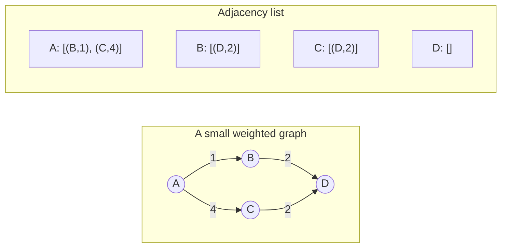
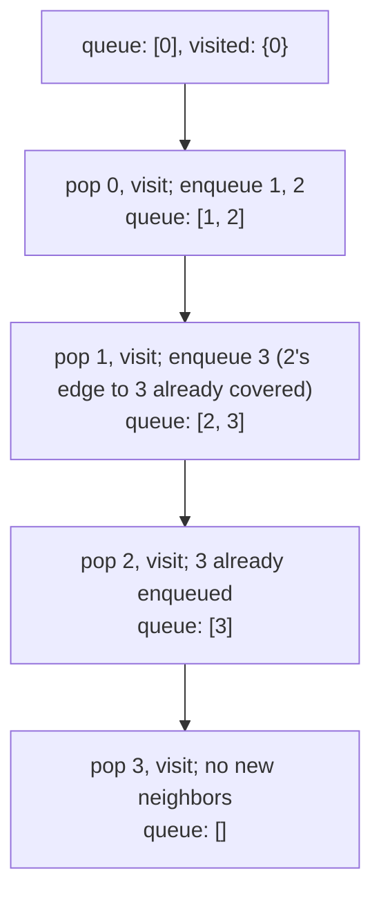
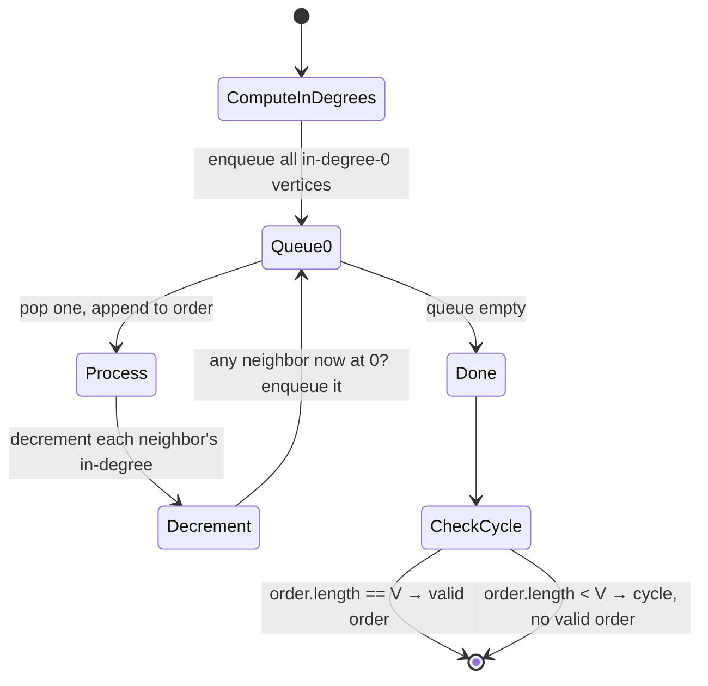

# Graphs and Graph Algorithms

> [!summary] TL;DR
> A graph is a set of **vertices** (nodes) connected by **edges**, used whenever data is naturally a network of relationships rather than a hierarchy — social connections, road networks, service dependencies, build order. BFS and DFS explore a graph in O(V+E); Dijkstra finds shortest paths with non-negative weights; topological sort orders a dependency graph; union-find groups vertices into connected components.

> [!abstract] Core idea
> - A graph is **vertices + edges**; edges can be directed or undirected, weighted or unweighted.
> - **BFS** explores level by level (shortest path by edge count); **DFS** explores depth-first (good for cycle detection, topological order).
> - **Dijkstra** finds shortest weighted paths using a min-heap frontier, same shape as [[Heaps and Priority Queues]].
> - **Topological sort** only exists for a DAG (directed, acyclic graph) — if there's a cycle, there's no valid order.

## 1. Why it exists

Say you're building a package manager: package A depends on B and C, B depends on D, and you need to install everything in an order where every dependency comes before the package that needs it. Or you're building a road-routing service: given a map of intersections and road segments with drive times, find the fastest route between two points. Neither problem is a hierarchy (a tree) — a package can be depended on by many others, and a road network has cycles (you can get back to where you started). Both are graphs, and both have a standard, well-understood algorithm: topological sort for the first, Dijkstra's algorithm for the second.

## 2. Mental model

A graph is a map of "what connects to what." Picture a subway map: stations are vertices, the lines between them are edges. If the lines have direction (one-way streets), it's a **directed** graph; if they have travel times, it's **weighted**. Most of this note is "how do you walk this map systematically" (BFS/DFS) and "how do you walk it to answer a specific question" (shortest path, dependency order, is there a cycle).

## 3. How it works

### Terms

- **Vertex** (or node): one point in the graph. **Edge**: a connection between two vertices.
- **Degree**: the number of edges touching a vertex (in-degree and out-degree separately, for directed graphs).
- **Path**: a sequence of edges connecting a sequence of vertices. **Cycle**: a path that returns to its starting vertex.
- **DAG** (directed acyclic graph): a directed graph with no cycles — the shape dependency graphs and build pipelines must have.
- **Connected component**: a maximal set of vertices all reachable from each other (for undirected graphs).

### Representations

| Representation | Space | Edge lookup `(u,v)` | Iterate u's neighbors | Use when |
|---|---|---|---|---|
| Adjacency list (`map[int][]Edge` or `[][]int`) | O(V+E) | O(degree(u)) | O(degree(u)) — optimal | Sparse graphs (most real graphs): default choice |
| Adjacency matrix (`[][]bool` or `[][]int` of weights) | O(V²) | O(1) | O(V) — wasteful if sparse | Dense graphs, or when O(1) edge lookup matters more than space |
| Edge list (`[]Edge{U, V, Weight}`) | O(E) | O(E) — slow | O(E) — slow | Algorithms that only need to process every edge once, e.g. Kruskal's MST |



In Go, this is naturally `map[int][]Edge` where `Edge{To int; Weight int}` — the hash table from [[Hash Tables and Go Maps]] doing the "which vertices exist, and what do they point to" bookkeeping.

### BFS: breadth-first search

Explore level by level using a **queue**: visit the start vertex, enqueue its neighbors, then repeatedly dequeue a vertex and enqueue any of *its* unvisited neighbors. The first time you reach any vertex, you've reached it by the shortest path **in edge count** (not weight) — this only holds for unweighted graphs.



Cost: `O(V+E)` — every vertex enqueued once, every edge examined once.

### DFS: depth-first search

Explore as deep as possible before backtracking, using a **stack** — either the call stack (recursive) or an explicit stack (iterative, avoiding Go's goroutine stack limits on very deep graphs). DFS is the natural tool for cycle detection and topological sort because it naturally tracks "what's on the current path."

### Cycle detection (directed graphs): three-color DFS

Mark every vertex **white** (unvisited), **gray** (on the current DFS path, not yet fully explored), or **black** (fully explored, including all its descendants). A cycle exists exactly when DFS encounters an edge to a **gray** vertex — a "back edge" to something still on the current path, not merely something visited earlier in a different branch.

### Topological sort: Kahn's algorithm

Only defined for a DAG. Repeatedly remove any vertex with **in-degree 0** (no remaining unprocessed dependency), append it to the output order, and decrement the in-degree of everything it pointed to. If every vertex gets removed, the output is a valid topological order; if some vertices remain stuck with in-degree > 0, the graph has a cycle and no valid order exists.



### Dijkstra's algorithm: shortest paths with non-negative weights

Maintain a `dist` map (shortest known distance to each vertex) and a min-heap frontier keyed by distance — exactly the [[Heaps and Priority Queues]] mechanism. Repeatedly pop the closest unvisited vertex, and for each of its edges, check if going through it gives a shorter path to the neighbor (**relaxation**); if so, update `dist` and push the neighbor. Requires non-negative weights because the algorithm commits to a vertex's shortest distance once popped — a later negative-weight edge could invalidate that commitment, which Bellman-Ford handles instead (at `O(VE)` instead of `O((V+E) log V)`).

## 4. Worked example

### Whiteboard version

The bare mechanism: adjacency list plus BFS.

```go
type Edge struct{ To, Weight int }
type Graph struct{ adj map[int][]Edge }

func BFS(g *Graph, start int) []int {
	visited := map[int]bool{start: true}
	queue := []int{start}
	var order []int
	for len(queue) > 0 {
		u := queue[0]
		queue = queue[1:]
		order = append(order, u)
		for _, e := range g.adj[u] {
			if !visited[e.To] {
				visited[e.To] = true
				queue = append(queue, e.To)
			}
		}
	}
	return order
}
```

The full version below adds the graph type, DFS (both forms), cycle detection, topological sort, Dijkstra, and union-find + Kruskal's MST — tested on Go 1.24. On the sample graph `0→1 (w1)`, `1→3 (w2)`, `0→2 (w4)`, `2→3 (w2)`:

```go
package graph

import "container/heap"

type Edge struct {
	To     int
	Weight int
}

type Graph struct {
	adj map[int][]Edge
}

func New() *Graph { return &Graph{adj: make(map[int][]Edge)} }

func (g *Graph) AddEdge(u, v, weight int) {
	g.adj[u] = append(g.adj[u], Edge{To: v, Weight: weight})
	if _, ok := g.adj[v]; !ok {
		g.adj[v] = nil
	}
}

func BFS(g *Graph, start int) []int {
	visited := map[int]bool{start: true}
	queue := []int{start}
	var order []int
	for len(queue) > 0 {
		u := queue[0]
		queue = queue[1:]
		order = append(order, u)
		for _, e := range g.adj[u] {
			if !visited[e.To] {
				visited[e.To] = true
				queue = append(queue, e.To)
			}
		}
	}
	return order
}

func DFSRecursive(g *Graph, start int) []int {
	visited := map[int]bool{}
	var order []int
	var visit func(u int)
	visit = func(u int) {
		if visited[u] {
			return
		}
		visited[u] = true
		order = append(order, u)
		for _, e := range g.adj[u] {
			visit(e.To)
		}
	}
	visit(start)
	return order
}

const (
	white = iota
	gray
	black
)

// HasCycle: three-color DFS. A gray -> gray edge is a back edge: a cycle.
func HasCycle(g *Graph) bool {
	colorOf := make(map[int]int)
	var visit func(u int) bool
	visit = func(u int) bool {
		colorOf[u] = gray
		for _, e := range g.adj[u] {
			switch colorOf[e.To] {
			case gray:
				return true
			case white:
				if visit(e.To) {
					return true
				}
			}
		}
		colorOf[u] = black
		return false
	}
	for v := range g.adj {
		if colorOf[v] == white {
			if visit(v) {
				return true
			}
		}
	}
	return false
}

// TopoSort: Kahn's algorithm. ok=false means the graph has a cycle.
func TopoSort(g *Graph) (order []int, ok bool) {
	inDegree := make(map[int]int)
	for v := range g.adj {
		inDegree[v] = 0
	}
	for _, edges := range g.adj {
		for _, e := range edges {
			inDegree[e.To]++
		}
	}
	var queue []int
	for v, d := range inDegree {
		if d == 0 {
			queue = append(queue, v)
		}
	}
	for len(queue) > 0 {
		u := queue[0]
		queue = queue[1:]
		order = append(order, u)
		for _, e := range g.adj[u] {
			inDegree[e.To]--
			if inDegree[e.To] == 0 {
				queue = append(queue, e.To)
			}
		}
	}
	return order, len(order) == len(g.adj)
}

type pqItem struct {
	vertex, dist int
}
type distHeap []pqItem

func (h distHeap) Len() int           { return len(h) }
func (h distHeap) Less(i, j int) bool { return h[i].dist < h[j].dist }
func (h distHeap) Swap(i, j int)      { h[i], h[j] = h[j], h[i] }
func (h *distHeap) Push(x any)        { *h = append(*h, x.(pqItem)) }
func (h *distHeap) Pop() any {
	old := *h
	n := len(old)
	v := old[n-1]
	*h = old[:n-1]
	return v
}

// Dijkstra: shortest distances from start. Requires non-negative weights.
// O((V+E) log V) with a binary heap frontier.
func Dijkstra(g *Graph, start int) map[int]int {
	dist := map[int]int{start: 0}
	h := &distHeap{{vertex: start, dist: 0}}
	for h.Len() > 0 {
		cur := heap.Pop(h).(pqItem)
		if d, ok := dist[cur.vertex]; ok && cur.dist > d {
			continue // a shorter path was already finalized
		}
		for _, e := range g.adj[cur.vertex] {
			nd := cur.dist + e.Weight
			if d, ok := dist[e.To]; !ok || nd < d {
				dist[e.To] = nd
				heap.Push(h, pqItem{vertex: e.To, dist: nd})
			}
		}
	}
	return dist
}
```

Test proving Dijkstra picks the genuinely cheapest path, not just the fewest hops (`0→1→3` costs 3 and beats the 2-hop-but-pricier `0→2→3` at cost 6):

```go
func TestDijkstraShortestPaths(t *testing.T) {
	g := buildSample() // 0->1(w1), 1->3(w2), 0->2(w4), 2->3(w2)
	dist := Dijkstra(g, 0)
	want := map[int]int{0: 0, 1: 1, 2: 4, 3: 3}
	if !reflect.DeepEqual(dist, want) {
		t.Fatalf("Dijkstra = %v; want %v", dist, want)
	}
}
```

**Measured** (Go 1.24.4, `go test -race`, this code): on the sample graph, `Dijkstra(g, 0)` returns `{0:0, 1:1, 2:4, 3:3}` — correctly preferring the 2-hop route through vertex 1 (total weight 3) over the 2-hop route through vertex 2 (total weight 6).

### Union-find and Kruskal's MST

A **minimum spanning tree (MST)** connects every vertex with the cheapest possible total edge weight and no cycles. **Kruskal's algorithm**: sort all edges by weight, then greedily add each edge that connects two *different* components, skipping any edge that would close a cycle (both endpoints already in the same component). That same-component check is exactly what **union-find** (disjoint-set union) answers in near-O(1): `Find(x)` returns x's component representative (with **path compression**, repointing every visited node straight at the root); `Union(x, y)` merges two components (attaching the shorter tree under the taller one, **union by rank**, to keep future `Find` calls fast). The full analysis of path compression's amortized cost, and the related ordered-structure problem skip lists solve, live in [[Union-Find and Skip Lists]] — here is the slice Kruskal needs (add `"sort"` to this file's imports for `KruskalMST` below):

```go
type UnionFind struct {
	parent, rank []int
}

func NewUnionFind(n int) *UnionFind {
	uf := &UnionFind{parent: make([]int, n), rank: make([]int, n)}
	for i := range uf.parent {
		uf.parent[i] = i
	}
	return uf
}

func (uf *UnionFind) Find(x int) int {
	if uf.parent[x] != x {
		uf.parent[x] = uf.Find(uf.parent[x]) // path compression
	}
	return uf.parent[x]
}

func (uf *UnionFind) Union(x, y int) bool {
	rx, ry := uf.Find(x), uf.Find(y)
	if rx == ry {
		return false // already connected: this edge would close a cycle
	}
	switch {
	case uf.rank[rx] < uf.rank[ry]:
		uf.parent[rx] = ry
	case uf.rank[rx] > uf.rank[ry]:
		uf.parent[ry] = rx
	default:
		uf.parent[ry] = rx
		uf.rank[rx]++
	}
	return true
}

// WEdge is a weighted, undirected edge between vertices U and V, the shape
// Kruskal's algorithm works from (a flat edge list, not an adjacency list).
type WEdge struct {
	U, V, Weight int
}

// KruskalMST returns a minimum spanning tree's edges for an n-vertex
// undirected graph given as a flat edge list: sort edges by weight, then
// greedily keep any edge that connects two different union-find
// components. O(E log E), dominated by the sort.
func KruskalMST(n int, edges []WEdge) []WEdge {
	sorted := append([]WEdge(nil), edges...)
	sort.Slice(sorted, func(i, j int) bool { return sorted[i].Weight < sorted[j].Weight })

	uf := NewUnionFind(n)
	var mst []WEdge
	for _, e := range sorted {
		if uf.Union(e.U, e.V) {
			mst = append(mst, e)
		}
	}
	return mst
}
```

Test proving Kruskal's MST on a 4-vertex graph picks exactly the 3 cheapest non-cycle-closing edges (weights 1, 2, 3; total 6), skipping the pricier 4- and 5-weight edges:

```go
func TestKruskalMST(t *testing.T) {
	edges := []WEdge{
		{U: 0, V: 1, Weight: 1}, {U: 1, V: 2, Weight: 2},
		{U: 0, V: 2, Weight: 4}, {U: 2, V: 3, Weight: 3},
		{U: 1, V: 3, Weight: 5},
	}
	mst := KruskalMST(4, edges)
	if len(mst) != 3 {
		t.Fatalf("got %d edges; want 3 (n-1 for n=4)", len(mst))
	}
	total := 0
	for _, e := range mst {
		total += e.Weight
	}
	if total != 6 {
		t.Fatalf("MST total weight = %d; want 6", total)
	}
}
```

## 5. Variants and comparison

| Algorithm | Finds | Requires | Cost |
|---|---|---|---|
| BFS | Shortest path by edge count (unweighted) | Nothing special | O(V+E) |
| DFS | Reachability, cycle detection, topological order | Nothing special | O(V+E) |
| Dijkstra | Shortest weighted path | Non-negative weights | O((V+E) log V) with a binary heap |
| Bellman-Ford | Shortest weighted path, detects negative cycles | Works with negative weights | O(VE) |
| A\* | Shortest weighted path, faster in practice | An admissible heuristic (never overestimates) | O((V+E) log V), fewer nodes expanded than Dijkstra |
| Kahn's (topological sort) | A valid processing order | A DAG (no cycles) | O(V+E) |
| Kruskal's (MST) | Minimum spanning tree | Undirected, weighted | O(E log E) (dominated by the sort) |
| Union-find | Connected components, cycle checks | — | Near O(1) amortized per op (see [[Union-Find and Skip Lists]]) |

## 6. Trade-offs and when not to use

- BFS/DFS visit every reachable vertex and edge — `O(V+E)` — there's no way to do better if you genuinely need to explore the whole reachable graph.
- Dijkstra breaks silently wrong (not a crash, just an incorrect answer) on negative edge weights, because it commits to a vertex's shortest distance as soon as it's popped from the heap. Use Bellman-Ford if negative weights are possible.
- An adjacency matrix wastes `O(V²)` space on a sparse graph (most real-world graphs: a social network has far fewer friendships than `V²` possible pairs) — default to an adjacency list unless you specifically need `O(1)` edge-existence checks on a dense graph.
- Topological sort and cycle detection are meaningless on an undirected graph in the directed sense described here — undirected cycle detection uses union-find instead (two endpoints of an edge already in the same component means a cycle).

## 7. In production

- **Real systems:**
	- Facebook's TAO (the social graph serving layer) and Neo4j (a dedicated graph database) store and query relationship data as a graph natively, rather than reconstructing it from SQL joins every time.
	- Map and routing services (road networks) run Dijkstra- or A\*-family algorithms over a graph of intersections and road segments, often precomputed with contraction hierarchies for speed at scale.
	- Build systems and package managers (Go's own module graph, `npm`, `make`) use topological sort to decide a valid build/install order from a dependency graph.
	- Service dependency graphs (which microservice calls which) use the same representation to compute blast radius for an outage or a safe deployment order.
	- Deadlock detection in databases and OS schedulers models "who's waiting on whom" as a directed graph and checks for cycles — a wait-for cycle is a deadlock.
	- Go's own garbage collector uses **tri-color marking** (white/gray/black, the exact same three states as the cycle-detection DFS above) to track which heap objects have been visited during a mark phase, covered in [[Process Memory Layout - Stack vs Heap]].
- **Failure modes → fixes:**
	- Dijkstra given negative weights silently returns a wrong (too-high) distance for some vertex → validate weights are non-negative, or switch to Bellman-Ford.
	- Recursive DFS on a very deep or adversarial graph can exhaust the call stack → use the iterative, explicit-stack form.
	- A dependency graph with an accidental cycle (circular imports, circular service calls) has no valid topological order → detect the cycle (Kahn's algorithm reports it directly: `len(order) < V`) and surface it as a build/deploy error instead of silently picking an arbitrary order.
- **What to monitor:** for a routing or dependency service, query latency as the graph grows (does it stay near `O(log V)`-ish per lookup, or does it degrade toward `O(V)`?), and the depth/size of DFS recursion on production data, not just test fixtures.

## 8. Deep dive

### Why Dijkstra needs non-negative weights

Dijkstra's correctness proof relies on **greedy finalization**: once a vertex is popped from the frontier with the smallest tentative distance, that distance is treated as final, because every other path to it would have to go through some other, non-popped vertex whose distance is at least as large — and weights only add, never subtract, so no such path could possibly be shorter. A negative edge breaks that argument: a path through a vertex with a *larger* current tentative distance could still end up cheaper overall if it crosses a negative edge later. Bellman-Ford instead relaxes every edge up to `V-1` times, never assuming any distance is final until the last pass, which is why it tolerates negative weights (and can detect negative cycles: if a `V`-th pass still finds an improvement, a negative cycle exists).

### Path compression's effect on union-find's complexity

Naive union-find (no path compression, no union by rank) can degrade to `O(n)` per `Find` in the worst case — a tall, unbalanced tree of parent pointers. Path compression alone (flattening every visited node to point directly at the root on each `Find`) already gives an amortized bound close to `O(log n)`; combined with union by rank, the amortized cost per operation becomes `O(α(n))`, where `α` is the inverse Ackermann function — a quantity that is, for any input size that could ever exist in practice, at most 4. This is one of the few data structures where the asymptotic bound is, for all practical purposes, constant time. The fuller treatment, including the related ordered-structure problem skip lists solve (and where Redis uses them for sorted sets), lives in [[Union-Find and Skip Lists]].

### BFS vs. DFS for cycle detection

BFS can detect cycles in an undirected graph (a visited neighbor that isn't your immediate parent means a cycle) but is awkward for directed cycle detection, because "already visited" doesn't distinguish "visited on this path" from "visited on a completely different branch that happens to share a descendant." DFS's three-color scheme makes that distinction explicit (gray = on the current path), which is why directed cycle detection is conventionally taught with DFS, not BFS.

### Classic practice problems

**Number of islands** (treat a grid as an implicit graph where adjacent land cells are edges; BFS or DFS from each unvisited land cell, counting how many times you start a fresh search); **course schedule** (can all courses be finished given prerequisite pairs — exactly cycle detection or topological sort on the prerequisite DAG); **clone graph** (DFS or BFS while keeping a hash map from original node to its clone, so shared references are cloned once, not duplicated); **network delay time** (Dijkstra from the broadcasting node; the answer is the maximum distance across all reachable nodes, or -1 if some node is unreachable); **word ladder** (BFS over an implicit graph where words are vertices and an edge connects two words differing by one letter — shortest transformation sequence is a shortest-path-by-edge-count problem).

## 9. Interview questions

> [!question]- When does BFS give you the shortest path, and when does it not?
> BFS gives the shortest path by **edge count** on an unweighted graph, because it explores strictly level by level. On a weighted graph it can return a path with more total weight than the true shortest one — Dijkstra (or BFS variants like 0-1 BFS for only two distinct weights) is needed instead.

> [!question]- Why does Dijkstra fail on negative edge weights?
> It finalizes a vertex's shortest distance as soon as that vertex is popped from the frontier, assuming no cheaper path could appear later — an assumption that only holds when weights never decrease a path's total, i.e., are non-negative. A later negative edge can invalidate an already-finalized distance.

> [!question]- How do you detect a cycle in a directed graph?
> Three-color DFS: mark each vertex white (unvisited), gray (on the current DFS path), or black (fully explored). An edge to a gray vertex is a back edge to something still on the current path — a cycle. An edge to a black vertex is fine; that vertex was already fully explored on a different branch.

> [!question]- Trap: can you topologically sort a graph with a cycle?
> No — a topological order requires every edge to point "forward" in the order, which is only possible if there's no cycle (a DAG). Kahn's algorithm detects this directly: if the final order has fewer vertices than the graph, some vertices never reached in-degree 0, meaning a cycle exists.

> [!question]- Adjacency list vs. adjacency matrix: which would you pick for a social graph with a million users?
> Adjacency list. A social graph is sparse — each user has at most a few thousand connections, far fewer than the million-minus-one a matrix would reserve space for per user — so an adjacency list's O(V+E) space beats a matrix's O(V²) by orders of magnitude.

> [!question]- What does union-find give you that BFS/DFS from scratch wouldn't, for Kruskal's algorithm?
> A near-O(1) amortized "are these two vertices already connected" check, maintained incrementally as edges are added — re-running BFS/DFS from scratch after every edge to check connectivity would cost O(V+E) per edge, turning an O(E log E) algorithm into O(E(V+E)).

## 10. Cheat sheet

- Representations: adjacency list (sparse, default, O(V+E) space) vs. adjacency matrix (dense, O(1) edge check, O(V²) space).
- BFS = queue, level by level, shortest path by edge count on unweighted graphs. O(V+E).
- DFS = stack (recursive or explicit), good for cycle detection and topological order. O(V+E).
- Directed cycle detection: three-color DFS; a gray→gray edge is a cycle.
- Topological sort (Kahn's): repeatedly remove in-degree-0 vertices; fewer vertices in the output than in the graph means a cycle.
- Dijkstra: min-heap frontier, non-negative weights only, O((V+E) log V). Bellman-Ford handles negative weights at O(VE).
- Union-find: near-O(1) amortized Find/Union via path compression + union by rank; powers Kruskal's MST's cycle check.
- Real uses: dependency resolution (build systems, package managers), routing (maps), service dependency graphs, deadlock detection (wait-for cycles), Go's GC tri-color marking.

## Links

- **Before this:** [[Heaps and Priority Queues]], [[Stacks, Queues and Deques]], [[Hash Tables and Go Maps]]
- **Next:** [[Union-Find and Skip Lists]], [[Runtime - Goroutine Scheduler (GMP)]]
- **Compare with:** [[Trees, BSTs and Balanced Trees]] (a tree is a graph with no cycles and one path between any two vertices)
