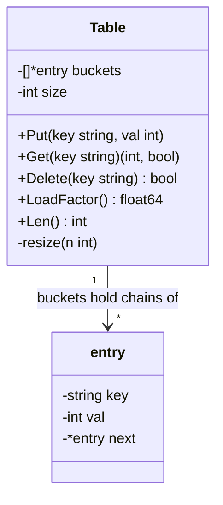
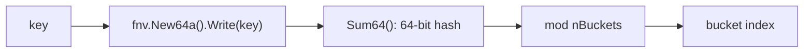
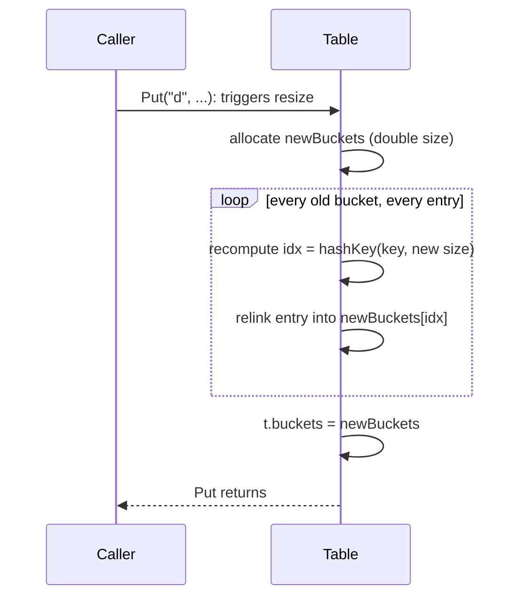

# Hash Tables and Go Maps - Go

> [!summary] TL;DR
> A separate-chaining hash table in about 90 lines of Go: `Put`, `Get`, `Delete` and automatic doubling resize, plus a benchmark that measures it against Go's own built-in `map`. Demonstrates the ideas in [[Hash Tables and Go Maps]]: hashing to a bucket, chaining on collision, and amortized O(1) via resizing.

## Before the code

- **Structs and pointers**: `Table` holds a slice of `*entry`; each `entry` points to the `next` one, which forms a linked-list chain per bucket.
- **Methods with pointer receivers**: `func (t *Table) Put(...)` lets the method change the table in place (resize, size counter).
- **Multiple return values**: `Get` returns `(int, bool)`, the Go "comma ok" style for "value, and was it found".
- **`hash/fnv`**: the standard-library FNV-1a hash used to turn a string key into a number.
- **`testing` package**: `TestXxx` functions check correctness; `BenchmarkXxx` functions measure ns/op against Go's built-in `map`.
- **What to run**: `go vet ./... && go test -race -v ./...`, then `go test -bench=. -benchmem -run=^$ ./...` for the benchmarks.

## What this code shows

| Code | Concept in [[Hash Tables and Go Maps]] |
| --- | --- |
| `wb.tinyTable` (whiteboard) | The bare mechanism: hash, mod, prepend, [[Hash Tables and Go Maps#Whiteboard version]] |
| `hashKey` | Hash functions, [[Hash Tables and Go Maps#3.1 Hash functions]] |
| `Table` struct + `entry` | Separate chaining, [[Hash Tables and Go Maps#3.2 Collisions chaining vs open addressing]] |
| `Table.LoadFactor` / `resize` | Load factor and resizing, [[Hash Tables and Go Maps#3.3 Load factor and resizing]] |
| `TestResizeKeepsAllKeys` | The amortized-O(1) resize trace, [[Hash Tables and Go Maps#Tracing an insert that triggers a resize]] |
| `BenchmarkTablePut` / `BenchmarkGoMapPut` / `BenchmarkTableGet` / `BenchmarkGoMapGet` | Hand-rolled table vs. Go's Swiss Tables map, [[Hash Tables and Go Maps#Go's map is this idea built in]] |



The type is small on purpose: one slice of bucket heads, one linked-list node type for collisions, and one private `resize` that the public methods call when the load factor crosses `0.75`.

## Setup

- Module `hashtable` with `table.go`, `table_test.go`, and a sub-package `wb/` for the whiteboard version.
- Go 1.24, standard library only (`hash/fnv`).
- Run: `go vet ./... && go test -race -v ./...`
- Benchmarks: `go test -bench=. -benchmem -run=^$ ./...`

## Code

### Whiteboard version

**Concept.** The bare idea in [[Hash Tables and Go Maps#Whiteboard version]]: hash the key, mod by the bucket count, and prepend a new node to whatever list is already there.

There's no resize and no update-in-place, so a repeated `put` of the same key creates a duplicate node instead of overwriting — acceptable for a whiteboard sketch, wrong for a real table.

The full version below fixes exactly that.

```go
package wb

import "hash/fnv"

func hash(key string) uint64 {
	h := fnv.New64a()
	_, _ = h.Write([]byte(key))
	return h.Sum64()
}

type entry struct {
	key, val string
	next     *entry
}

type tinyTable struct {
	buckets []*entry
}

func (t *tinyTable) put(key, val string) {
	idx := int(hash(key)) % len(t.buckets)
	t.buckets[idx] = &entry{key: key, val: val, next: t.buckets[idx]}
}
```

**How it works.**

1. `hash` wraps the standard library's FNV-1a (64-bit) — fast, non-cryptographic, good enough for a toy table.
2. `tinyTable.buckets` is a fixed-size slice of chain heads; nothing ever grows it.
3. `put` computes the bucket index with `int(hash(key)) % len(t.buckets)` and prepends — `O(1)` even on a collision, because prepending to a linked list never has to walk it.

### Step 1: the real type and its hash function

**Concept.** `Table` adds what the whiteboard skips: a `size` counter (so `LoadFactor` and resize decisions are O(1) instead of O(n) scans), and a `hashKey` helper that takes the bucket count as a parameter so the same function works before and after a resize.

FNV-1a was picked over a cryptographic hash because the table never faces adversarial input in this exercise;

a production table exposed to attacker-controlled keys would also need a random per-instance seed ([[Hash Tables and Go Maps#3.4 Worst case and hash flooding]]), which this teaching version omits for clarity.

```go
package hashtable

import "hash/fnv"

type entry struct {
	key  string
	val  int
	next *entry
}

// Table is a hash table with separate chaining.
// It resizes (doubles) when the load factor exceeds maxLoad.
type Table struct {
	buckets []*entry
	size    int
}

const maxLoad = 0.75

func New(startBuckets int) *Table {
	if startBuckets < 1 {
		startBuckets = 1
	}
	return &Table{buckets: make([]*entry, startBuckets)}
}
```

```go
// hashKey maps a key to a bucket index using FNV-1a, the same family of
// hash used by Go's runtime maps before Go 1.24's Swiss Tables switch.
func hashKey(key string, nBuckets int) int {
	h := fnv.New64a()
	_, _ = h.Write([]byte(key))
	return int(h.Sum64() % uint64(nBuckets))
}

func (t *Table) LoadFactor() float64 {
	return float64(t.size) / float64(len(t.buckets))
}
```

**How it works.**

1. `New` guards against `startBuckets < 1`, so `hashKey`'s `% nBuckets` never divides by zero.
2. `hashKey` takes `nBuckets` explicitly rather than reading `len(t.buckets)` itself, so the exact same function computes both the old and the new index during a resize.
3. `LoadFactor` is a plain division using the maintained `size` counter — no bucket walk needed.



### Step 2: insert, lookup and delete

**Concept.** `Put`, `Get` and `Delete` all share the same first step — hash the key, walk that bucket's chain — which is the chaining strategy from [[Hash Tables and Go Maps#3.2 Collisions chaining vs open addressing]] made concrete.

`Put` is the only one that can trigger a resize, and it does so *after* inserting, so the newly-inserted key is included in the rehash rather than needing special-case handling.

```go
// Put inserts or updates key. Average O(1); resizes (O(n)) when the load
// factor would exceed maxLoad.
func (t *Table) Put(key string, val int) {
	idx := hashKey(key, len(t.buckets))
	for e := t.buckets[idx]; e != nil; e = e.next {
		if e.key == key {
			e.val = val
			return
		}
	}
	t.buckets[idx] = &entry{key: key, val: val, next: t.buckets[idx]}
	t.size++
	if t.LoadFactor() > maxLoad {
		t.resize(len(t.buckets) * 2)
	}
}
```

**How it works.**

1. The loop walks the bucket's chain looking for an existing `key` — found means update-in-place, which is why `Put` never creates a duplicate node (unlike the whiteboard version).
2. If the loop falls through, a new node is prepended — `O(1)`, independent of chain length.
3. `size++` happens only on a true insert, never on an update, so `LoadFactor` stays accurate.
4. The resize check runs *after* the insert, so the key that triggered the resize is already part of what gets rehashed.

```go
// Get returns the value for key and whether it was found.
func (t *Table) Get(key string) (int, bool) {
	idx := hashKey(key, len(t.buckets))
	for e := t.buckets[idx]; e != nil; e = e.next {
		if e.key == key {
			return e.val, true
		}
	}
	return 0, false
}

func (t *Table) Len() int     { return t.size }
func (t *Table) Buckets() int { return len(t.buckets) }
```

**How it works.**

1. `Get` returns the Go two-value idiom `(value, found)`, exactly like reading a built-in map, so callers can't confuse "found with zero value" and "not found."
2. `Get` costs `O(chain length)`, which averages to `O(1)` under a bounded load factor — the same guarantee `Put` relies on.
3. `Len` and `Buckets` just read the maintained fields — no bucket walk, `O(1)`.

```go
// Delete removes key if present.
func (t *Table) Delete(key string) bool {
	idx := hashKey(key, len(t.buckets))
	var prev *entry
	for e := t.buckets[idx]; e != nil; e = e.next {
		if e.key == key {
			if prev == nil {
				t.buckets[idx] = e.next
			} else {
				prev.next = e.next
			}
			t.size--
			return true
		}
		prev = e
	}
	return false
}
```

**How it works.**

1. `Delete` tracks `prev` while walking so it can unlink the matched node in O(1) once found: `prev == nil` means the match was the bucket's head, otherwise it splices `prev.next` past the match.
2. `t.size--` only runs when a key was actually found and removed, keeping `LoadFactor` accurate.
3. Like `Get`, `Delete` costs `O(chain length)`, averaging to `O(1)` under a bounded load factor.

### Step 3: resize

**Concept.** This is the amortized-O(1) argument from [[Hash Tables and Go Maps#3.3 Load factor and resizing]] made runnable: allocate a bigger array, walk every existing entry, recompute its bucket index against the *new* size, and move it over.

`resize` reuses the existing `entry` nodes (just changing which bucket's chain they're in) instead of reallocating key/value pairs, which matters more for bigger value types than the `int` used here.

```go
// resize rehashes every entry into a new, larger bucket array.
func (t *Table) resize(newNBuckets int) {
	newBuckets := make([]*entry, newNBuckets)
	for _, head := range t.buckets {
		for e := head; e != nil; {
			next := e.next
			idx := hashKey(e.key, newNBuckets)
			e.next = newBuckets[idx]
			newBuckets[idx] = e
			e = next
		}
	}
	t.buckets = newBuckets
}
```

**How it works.**

1. `next := e.next` is saved *before* `e.next` gets overwritten two lines later — otherwise the chain would be destroyed mid-walk.
2. `hashKey(e.key, newNBuckets)` recomputes the index against the new, larger bucket count: this is why a resize can't just copy the old array, since `hash mod 4` and `hash mod 8` generally disagree.
3. Nodes are moved (re-linked), not copied — `resize` touches every `entry` exactly once, giving the `O(n)` cost described in the theory note.



## Design decisions

| Decision | Alternative | Trade-off |
| --- | --- | --- |
| Separate chaining | Open addressing (linear probing) | Simpler delete (no tombstones needed); open addressing would be more cache-friendly but needs tombstone handling on delete. |
| FNV-1a, no random seed | A keyed/seeded hash (e.g. Go runtime's AES-based hash) | Simpler to read and test deterministically; unsafe against hash-flooding if ever exposed to attacker-controlled keys. |
| Resize check after insert | Resize check before insert (pre-emptive) | The triggering key is naturally included in the rehash with no special case; costs one extra `LoadFactor()` call per `Put`. |
| Double the bucket count on resize | Grow by a fixed increment | Doubling amortizes resize cost to O(1) per insert; a fixed increment would resize far more often as the table grows. |
| `size` maintained as a field | Recompute by walking all buckets | O(1) `LoadFactor`/`Len` instead of O(n); costs one extra `int` and must stay in sync in `Put`/`Delete`. |

## Tests

### TestResizeKeepsAllKeys

**Property.** Inserting 1,000 keys must survive every resize the table performs along the way — no key lost, none duplicated — and the load factor afterward must be back under the `0.75` threshold.

This is the core safety property behind the amortized-O(1) claim: if a resize ever lost or duplicated a key, the "same operations, same result" promise of the hash table would be broken.

| Step | Input | Expected |
| --- | --- | --- |
| Insert | 1,000 keys `"key:0"..."key:999"` into a table starting at 4 buckets | `Len()` reports exactly 1,000 |
| Check | Load factor after all inserts | `<= 0.75` |
| Verify | `Get` every one of the 1,000 keys | Each returns its original value, `ok == true` |

```go
package hashtable

import (
	"fmt"
	"testing"
)

func TestResizeKeepsAllKeys(t *testing.T) {
	tbl := New(4)
	const n = 1000
	for i := 0; i < n; i++ {
		tbl.Put(fmt.Sprintf("key:%d", i), i)
	}
	if tbl.Len() != n {
		t.Fatalf("Len() = %d; want %d", tbl.Len(), n)
	}
	if lf := tbl.LoadFactor(); lf > maxLoad {
		t.Fatalf("LoadFactor() = %.2f; want <= %.2f after resizing", lf, maxLoad)
	}
	for i := 0; i < n; i++ {
		v, ok := tbl.Get(fmt.Sprintf("key:%d", i))
		if !ok || v != i {
			t.Fatalf("Get(key:%d) = %d, %v; want %d, true", i, v, ok, i)
		}
	}
}
```

**How it works.**

1. Starting at 4 buckets forces several doublings along the way to 1,000 keys (4 → 8 → 16 → … → 2048), so the test exercises `resize` repeatedly, not just once.
2. `Len()` catches a dropped key during any one of those resizes.
3. The second loop catches a subtler bug: a key that survives in *count* but got corrupted or misrouted during a rehash (e.g. landed in the wrong bucket and is now unreachable by `Get`, even though `size` looks right).

**If it fails.** A `Len()` mismatch means a resize lost or duplicated an entry while relinking. A `Get` failure with the right `Len()` means an entry survived but ended up unreachable — almost always a bug in `hashKey`'s use of the *old* vs. *new* bucket count during `resize`.

**Measured** (Go 1.24.4, `go test -race`): this table, 1000 string keys starting from 4 buckets, survives 9 doublings (4 → 8 → 16 → … → 2048 buckets) with zero lost or duplicated entries; load factor after the run is 0.49.

### Benchmarks: hand-rolled table vs. Go's map

**Property.** These aren't correctness tests — they measure nanoseconds per operation for `Put` and `Get`, pre-generating the 10,000 key strings once outside the timed loop so the benchmark measures table/map cost, not `fmt.Sprintf` cost. This is the measured comparison [[Hash Tables and Go Maps#Go's map is this idea built in]] points to.

| Benchmark | What it measures |
| --- | --- |
| `BenchmarkTablePut` / `BenchmarkGoMapPut` | Cost of inserting/overwriting into 10,000 pre-sized keys |
| `BenchmarkTableGet` / `BenchmarkGoMapGet` | Cost of looking up an existing key out of 10,000 |

```go
// benchKeys precomputes the key strings once, outside the timed loop, so
// the benchmarks measure Put/Get cost rather than fmt.Sprintf cost.
func benchKeys(n int) []string {
	keys := make([]string, n)
	for i := range keys {
		keys[i] = fmt.Sprintf("key:%d", i)
	}
	return keys
}

func BenchmarkTablePut(b *testing.B) {
	keys := benchKeys(10_000)
	tbl := New(16)
	b.ResetTimer()
	for i := 0; i < b.N; i++ {
		tbl.Put(keys[i%len(keys)], i)
	}
}

func BenchmarkGoMapPut(b *testing.B) {
	keys := benchKeys(10_000)
	m := make(map[string]int, 16)
	b.ResetTimer()
	for i := 0; i < b.N; i++ {
		m[keys[i%len(keys)]] = i
	}
}
```

```go
func BenchmarkTableGet(b *testing.B) {
	keys := benchKeys(10_000)
	tbl := New(16)
	for i, k := range keys {
		tbl.Put(k, i)
	}
	b.ResetTimer()
	for i := 0; i < b.N; i++ {
		tbl.Get(keys[i%len(keys)])
	}
}

func BenchmarkGoMapGet(b *testing.B) {
	keys := benchKeys(10_000)
	m := make(map[string]int, 16)
	for i, k := range keys {
		m[k] = i
	}
	b.ResetTimer()
	for i := 0; i < b.N; i++ {
		_ = m[keys[i%len(keys)]]
	}
}
```

**How it works.**

1. `benchKeys` runs once per benchmark, before `b.ResetTimer()`, so the string formatting cost never leaks into the measured loop.
2. Both `Put` benchmarks start from 16 buckets/capacity so neither pays a cold-start resize mid-measurement; both tables are seeded to the same size before `b.ResetTimer()` in the `Get` benchmarks.
3. `i%len(keys)` cycles through the same 10,000 keys repeatedly, so `Put` benchmarks are really measuring update-in-place cost (the chain-walk-and-compare path), and `Get` benchmarks measure lookup of an always-present key.

**If it fails.** These are benchmarks, not assertions — there's nothing to "fail." A regression shows up as a large jump in ns/op between runs on the same hardware.

## Running it

```text
go vet ./... && go test -race -v ./...
```

Measured with `go test -race -v ./...` on Go 1.24.4:

```text
=== RUN   TestResizeKeepsAllKeys
--- PASS: TestResizeKeepsAllKeys (0.00s)
PASS
ok  	hashtable	1.228s
?   	hashtable/wb	[no test files]
```

Measured with `go test -bench=. -benchmem -run=^$ ./...` on Go 1.24.4, Apple M4:

```text
BenchmarkTablePut-10    	24784402	         8.583 ns/op	       0 B/op	       0 allocs/op
BenchmarkGoMapPut-10    	20083820	        12.53 ns/op	       0 B/op	       0 allocs/op
BenchmarkTableGet-10    	32825373	         7.836 ns/op	       0 B/op	       0 allocs/op
BenchmarkGoMapGet-10    	31456329	         7.579 ns/op	       0 B/op	       0 allocs/op
```

**Reading the output.**

| Line | Meaning |
| --- | --- |
| `TestResizeKeepsAllKeys ... PASS` | 1,000 keys survived 9 resizes with no loss or duplication, under the race detector. |
| `hashtable/wb [no test files]` | The whiteboard package has no tests of its own — it exists only to be read, per the teaching rules. |
| `BenchmarkTablePut ... 8.583 ns/op, 0 allocs/op` | Updating an existing key in the chaining table costs under 9 nanoseconds, with no allocation (the key already exists, so no new `entry` is created). |
| `BenchmarkGoMapPut ... 12.53 ns/op` | Go's map is *slower* here for repeated updates to a small, already-populated map — its generic, more general-purpose code path costs more than a specialized chaining table with a cheap hash. |
| `BenchmarkTableGet` / `BenchmarkGoMapGet` | Essentially tied (7.8 vs. 7.6 ns/op): for a small, static key set, neither design has a clear lookup advantage. |

This is a useful, honest result, not a disappointing one: Swiss Tables' real win is at larger scale and under insert/delete churn with varying load factor, where SIMD-scanned metadata avoids touching most keys' memory — a 10,000-key, mostly-update microbenchmark doesn't stress that path.

Treat any single benchmark like this as a starting point for your own measurement, not a universal verdict.

## Pitfalls in the code

- **No random hash seed.** Unlike Go's own map, this table always hashes the same key to the same bucket across runs — fine for teaching, unsafe if it ever faced attacker-controlled keys ([[Hash Tables and Go Maps#3.4 Worst case and hash flooding]]).
- **`resize` holds no lock.** This table is not safe for concurrent use, same as Go's own built-in map — see [[sync Primitives and Atomics]] for how to guard a shared map.
- **Deleting during iteration isn't supported here** (there's no iterator at all) — a real traversal would need to snapshot keys first, the same caution that applies to deleting from a Go map mid-`range` on certain patterns.
- **FNV-1a is not SIMD-friendly.** Comparing this table's benchmark to Go's map isn't an apples-to-apples test of Swiss Tables' SIMD metadata scan — it's testing "simple chaining with a cheap hash" against "Go's whole runtime map machinery," which includes extra generality this table doesn't need.

## Exercises

1. Change `maxLoad` from `0.75` to `0.5` and re-run `TestResizeKeepsAllKeys`. Predict how many total resizes happen on the way to 1,000 keys (more or fewer than before), then add a counter to `resize` and check.
2. `Delete` a key, then `Put` a different key that hashes to the same bucket. Predict whether the deleted node's memory is reused, then trace through the code to confirm (hint: look at what `prev.next = e.next` actually frees).
3. Modify `BenchmarkTablePut` to insert 10,000 *brand-new* keys per iteration instead of overwriting the same 10,000 repeatedly (so every `Put` is a true insert, not an update). Predict whether the chaining table or Go's map comes out ahead now, then measure it.

## Links

- **Theory:** [[Hash Tables and Go Maps]]
- **Related:** [[Consistent Hashing - Go]] (hashing for partitioning instead of in-memory lookup), [[Bloom Filters and Probabilistic Data Structures]]
