# Hash Tables and Go Maps

> [!summary] TL;DR
> A hash table stores key-value pairs and gives average **O(1)** lookup, insert and delete by turning a key into an array index with a hash function. Go's built-in `map[K]V` is a hash table; since Go 1.24 it is implemented with Swiss Tables instead of the older bucket design.

> [!abstract] Core idea
> - A hash function turns a key into a number; `index = hash(key) mod number_of_slots` picks where it lives.
> - Two keys can hash to the same slot (a **collision**); chaining or open addressing decides what happens next.
> - As the table fills up, it **resizes** (grows and rehashes everything) to keep lookups fast.
> - Go's `map` is this idea, built into the language, with randomized iteration and no concurrency safety.

## Start here: the basics 🟢

> [!info] How to read this note (pick your level)
> - 🟢 **New to this?** Read "From zero" below, then sections 1, 2 and the cheat sheet (10). Stop there, that is a full first pass.
> - 🟡 **Know the basics?** Add section 3 (how it works), 4 (worked example), 5 and 6.
> - 🔴 **Interview / SDE-3 prep?** Add 7, 8 and 9. Headings are tagged 🟢🟡🔴 so you always know where you are.

**From zero, in 60 seconds** 🟢

You have a big pile of data, say a million users. You want to find one user fast. Checking them one by one is way too slow.

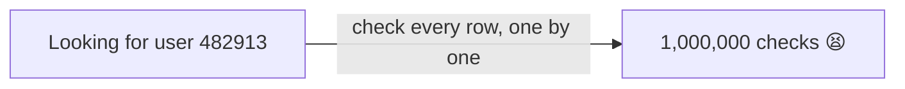

A **hash table** fixes this with a trick: a small recipe (the **hash function**) turns the user's name into a slot number. You jump straight to that slot. One step, no searching.

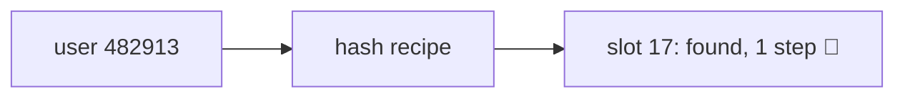

Sometimes two names land on the same slot (a **collision**). That is fine; the table has a plan for sharing. Go's built-in `map` is exactly this, ready-made.

The rest of this note is just these 4 questions:
1. Why is searching too slow in the first place?
2. How does the key-to-slot trick actually work, and what about collisions?
3. What happens when the table gets full?
4. What is special about Go's `map`?

**The problem in one story.**
You run a library with a million books.
A visitor asks for "The Hobbit".
Walking every shelf would take all day.
Instead, a rule tells you "titles starting with H live on shelf 8", so you walk straight there.
A hash table is that rule, done by a computer in nanoseconds.

**Words you need first**

| Word | Plain meaning | Tiny example |
| --- | --- | --- |
| Key | The thing you look up by | `"alice"` in `ages["alice"]` |
| Value | The data stored for that key | `31` |
| Array / slot | A numbered row of boxes; each box is a slot | `slots[0..7]` |
| Hash function | A recipe that turns any key into a number | `hash("alice") = 9137` |
| Index (via mod) | The slot number: hash remainder after dividing by slot count | `9137 mod 8 = 1` |
| Collision | Two keys landing on the same slot | `"alice"` and `"bob"` both → slot 1 |
| Load factor | How full the table is: entries ÷ slots | 6 entries / 8 slots = 0.75 |
| Big-O `O(1)` | Cost stays the same no matter how big the data gets | one lookup in 10 or 10M keys |

**Picture it**

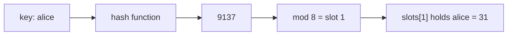

**Analogy.** A coat check: your ticket number tells the attendant exactly which hook to check, so nobody searches every hook.
Where it breaks: hooks never move, but a hash table sometimes rebuilds itself bigger and moves every entry (a resize).

**How the rest of this note builds up**

- First, why searching is too slow and the one-line idea behind hashing (sections 1-2).
- Then the mechanics: hash functions, collisions, load factor and resizing (section 3), traced by hand in section 4.
- Then variants, trade-offs and production use (sections 5-7).
- Finally the SDE-3 deep dive on Go's map internals (old buckets vs. Swiss Tables), `sync.Map`, and interview questions (sections 8-10).

> [!tip] Remember
> Hash the key, take it mod the slot count, go straight to that slot: average O(1), as long as collisions stay rare.

## 1. Why it exists 🟢

Say you need to look up a user by ID among 10 million users. An array keyed by position only works if IDs are small, dense integers — real IDs are sparse (`user:482913`), so most array slots would sit empty.

A sorted array with binary search works for any key, giving `O(log n)` — about 24 comparisons for 10 million rows — but every insert has to shift, on average, half the array to keep it sorted.

### 1.1 The idea in one line

**In plain words:** instead of searching for a key, compute where it must be. A **hash table** (also called a hash map or dictionary) is a structure that turns a key directly into an array index, so looking it up costs one computation instead of a search.

**Picture it:**

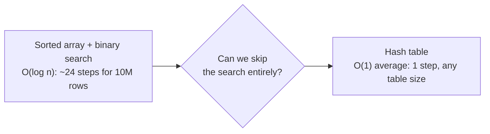

**Example:** looking up `user:482913` in a hash table is one hash computation (a few nanoseconds) and one array access, regardless of whether the table holds 100 users or 100 million.

**Why it matters:** this is the only reason dictionaries, caches, and database indexes on equality predicates (`WHERE id = ?`) can stay fast as data grows — without it, every one of those would slow down as your dataset grows, not just at launch.

> [!tip] Remember
> A hash table trades "fully sorted" for "O(1) average lookup" by computing a slot instead of searching for one.

## 2. Mental model 🟢

**The restaurant-coat-check analogy:** imagine a coat check with 100 numbered hooks.

Instead of searching every hook for your coat, the attendant uses a rule — say, "your ticket number mod 100" — to know exactly which hook to check first.

If that hook already has a coat on it from someone else's ticket, there's a plan for sharing the hook (a second coat hangs behind the first, or the attendant tries the next hook over).

That sharing plan is what turns "a wall of hooks" into "a hash table with chaining" or "a hash table with open addressing."

**Where the analogy breaks down:** a real coat check hook can hold several coats without a formal rule; a hash table bucket needs an explicit collision strategy (below), and — unlike hooks, which stay fixed — the whole hook wall sometimes has to be torn down and rebuilt bigger (a **resize**) as more coats arrive.

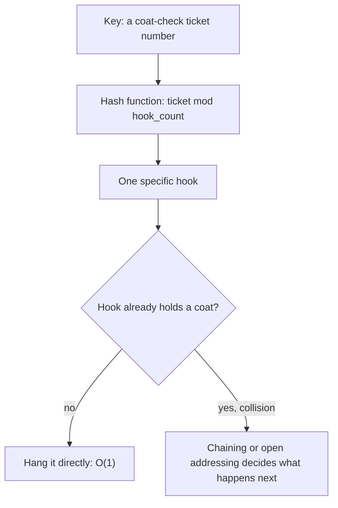

> [!tip] Remember
> The hash function's whole job is to turn "search for it" into "go directly to it" — collisions are the cost of that shortcut.

## 3. How it works 🟡

### 3.1 Hash functions

**In plain words:** a **hash function** is a small program that takes any key — a string, a number, anything — and deterministically produces a fixed-size number (commonly 64 bits). That number is what the table uses to pick a slot.

A hash function must be:
- **Deterministic** — the same key always produces the same hash, every time, within one program run.
- **Uniform** — keys spread evenly across buckets, so no slot gets overloaded.
- **Fast** — it runs on every lookup, so it must be cheaper than the lookup it enables.

It does **not** need to be cryptographically secure. A cryptographic hash (SHA-256) is deterministic and reasonably uniform, but it is slower than necessary — hash tables use fast, non-cryptographic hashes such as FNV, Murmur3, or (what Go uses internally) AES-based hashing on hardware with AES-NI.

**Picture it:**

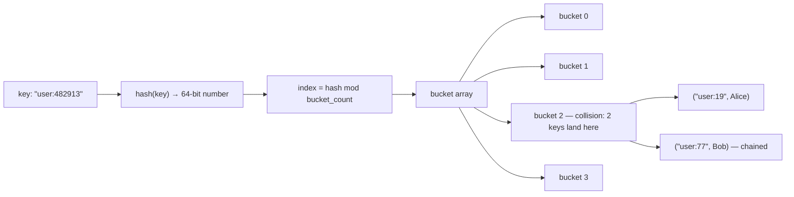

**Example:** with 4 buckets, `hash("user:19") mod 4 = 2` and `hash("user:77") mod 4 = 2` — two completely different keys, same bucket. That's not a bug; with only 4 buckets and millions of possible keys, collisions are mathematically guaranteed (the pigeonhole principle), so every real hash table needs a plan for them.

> [!warning] Common mistake
> Thinking a "good" hash function never collides. It can't — there are vastly more possible keys than buckets. A good hash function only promises that collisions are *evenly spread*, not that they never happen.

**Why it matters:** a slow or poorly-mixed hash function (one that clusters similar keys into the same few buckets) silently turns an `O(1)` structure into something closer to a linked list.

### 3.2 Collisions: chaining vs. open addressing

**In plain words:** once two keys land in the same slot, the table needs a rule for where the second one actually goes. The two families of rules are **chaining** (keep a small list per slot) and **open addressing** (find a different empty slot nearby).

| Strategy | How it works | Memory | Weakness |
|---|---|---|---|
| **Separate chaining** | Each bucket holds a linked list (or small slice) of all keys that hash there. | One pointer/slice header of overhead per bucket. | A bucket's list can grow long under a bad hash or heavy load. |
| **Open addressing (linear probing)** | On a collision, scan forward to the next empty slot. | No extra pointers: keys live directly in the array. | Clustering: a run of full slots makes nearby lookups slower. |
| **Open addressing (quadratic probing)** | On a collision, scan slots `1², 2², 3², …` away instead of `1, 2, 3, …` | Same as linear probing. | Spreads out clusters, but can fail to probe every slot unless the table size and step formula are chosen carefully. |
| **Open addressing (Robin Hood)** | Like linear probing, but a new key can steal a slot from an entry that is "richer" (closer to its ideal slot), evening out probe lengths. | Same as linear probing. | More bookkeeping per insert. |

**Picture it:**

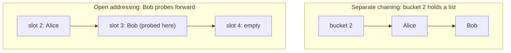

**Example:** inserting Alice then Bob, both hashing to slot 2 of 5:

- Chaining puts both in slot 2's list (O(1) insert, slot 2 now holds 2 entries).
- Linear probing puts Alice in slot 2 and Bob in slot 3 (still O(1) here, but now a lookup for *anyone* hashing to slot 3 has to check slot 3, notice it's Bob not them, and keep scanning).

**Why it matters:** chaining degrades gracefully (a long list is still just a slow list); open addressing degrades by cascading — one cluster of collisions makes every nearby slot slower to probe, including keys that never collided in the first place.

> [!tip] Remember
> Chaining = "share the hook." Open addressing = "take the next hook." Go's own map (below) uses a refined form of open addressing.

### 3.3 Load factor and resizing

**In plain words:** **load factor** is how full the table is: `(number of keys) / (number of buckets)`. A low load factor wastes memory; a high one turns O(1) lookups into long chains or long probe sequences.

**Example:** a table with 1,000 keys and 2,000 buckets has load factor 0.5 — comfortably sparse. The same 1,000 keys in 1,100 buckets (load factor 0.91) means almost every bucket is touched, and chains or probe sequences get noticeably longer.

When the load factor crosses a threshold, the table **resizes**: it allocates a larger bucket array (commonly double the size) and rehashes every existing key into it, because the bucket a key belongs to depends on the bucket count — you can't keep the old bucket assignments after growing the array.

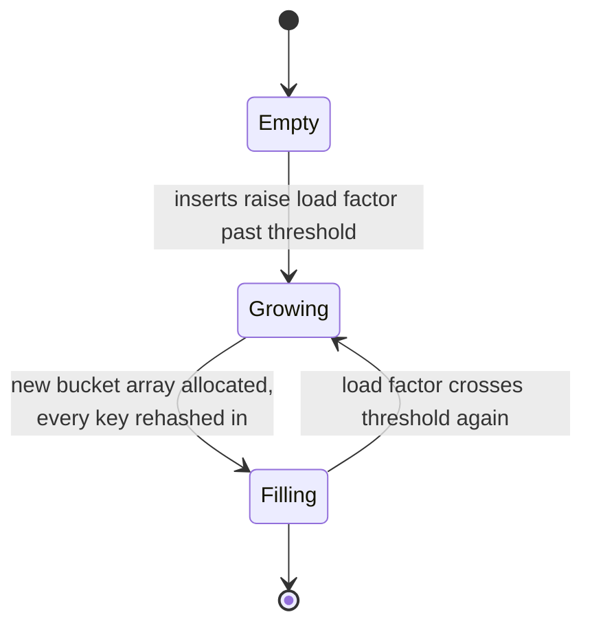

That single resize is `O(n)` — touching every key — but it happens rarely enough (geometrically less often as the table grows, because the threshold is a fraction of a doubling table) that the *amortized* cost per insert stays `O(1)`.

This is the identical argument used for slice growth in [[Arrays and Dynamic Arrays (Go Slices)]]: most inserts are cheap, a rare insert is expensive, and averaged over many inserts the expensive ones vanish into the cost.

> [!warning] Common mistake
> Treating every single insert as O(1), full stop. One specific insert call — the one that triggers the resize — really does cost O(n). What's O(1) is the *average over many inserts*, not every individual one. If your system has a hard per-request latency budget, that one unlucky insert can blow through it.

**What happens if you never resize?** Load factor climbs without bound, chains/probe sequences grow linearly with the number of keys, and lookups degrade toward O(n) — you'd still have a correct hash table, just a slow array.

> [!tip] Remember
> Resizing is what keeps load factor bounded; without it, a hash table slowly turns into a disguised linked list or array scan.

### 3.4 Worst case and hash flooding

**In plain words:** the O(1) average assumes a well-mixed hash and a reasonable load factor. If every key collides into one bucket, lookup degrades to `O(n)` — and an attacker who knows your hash function can make that happen on purpose.

This is called **hash flooding**: an attacker who controls input that becomes hash-table keys (HTTP form field names, JSON object keys, URL query parameters) crafts many keys that all hash to the same bucket, and your `O(1)` structure becomes an `O(n)`-per-lookup bottleneck under their chosen traffic — a real denial-of-service vector against naive hash tables.

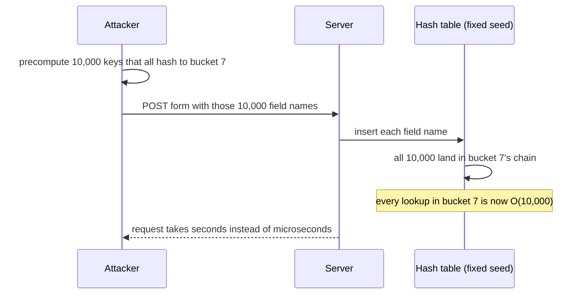

**Why it matters:** this moved from "theoretical" to "patched in production" — PHP, Python and several web frameworks shipped fixes after this was demonstrated publicly against real servers around 2011–2012.

The fix is to seed the hash function with a random value chosen at table-creation time, so an attacker cannot predict ahead of time which keys will collide. Go's runtime does exactly this: every map gets its own random seed at creation, so the same source code hashes the same key differently across two different runs of the program.

> [!tip] Remember
> A hash table exposed to attacker-controlled keys needs a per-instance random seed, or its O(1) guarantee is just a guarantee the attacker can break.

## 4. Worked example 🟡

### Whiteboard version

**In plain words:** this is the smallest hash table you could write on a whiteboard — hash the key, pick a bucket, hang the entry there.

The bare mechanism: an array of chains, insert appends to the chain at `hash(key) mod len(buckets)`.

```go
type entry struct {
	key, val string
	next     *entry
}

func (t *tinyTable) put(key, val string) {
	idx := int(hash(key)) % len(t.buckets)
	t.buckets[idx] = &entry{key: key, val: val, next: t.buckets[idx]}
}
```

That's the whole idea: hash, mod, prepend to that bucket's list. The runnable version adds automatic resizing, update-in-place and delete — the production concerns a real hash table needs.

### Tracing an insert that triggers a resize

**In plain words:** let's watch, step by step, the one unlucky insert that forces the whole table to rebuild itself bigger.

Take a table that starts with 4 buckets and a resize threshold (**max load factor**) of 0.75 — so it resizes once it holds more than 3 keys.

1. Insert `"a"`, `"b"`, `"c"`: 3 keys in 4 buckets, load factor 0.75 — right at the threshold, no resize yet.
2. Insert `"d"`: 4 keys in 4 buckets, load factor 1.0 — over the threshold.
3. The table allocates a new array of 8 buckets.
4. It walks every one of the 4 existing keys and rehashes each into the new, larger array (`hash(key) mod 8`, not `mod 4` — the bucket assignment changes because the modulus changed).
5. The insert of `"d"` finishes only after that rehash — so this one `Put` call did `O(4)` work instead of `O(1)`.
6. Load factor is now `4/8 = 0.5`, comfortably under threshold again.

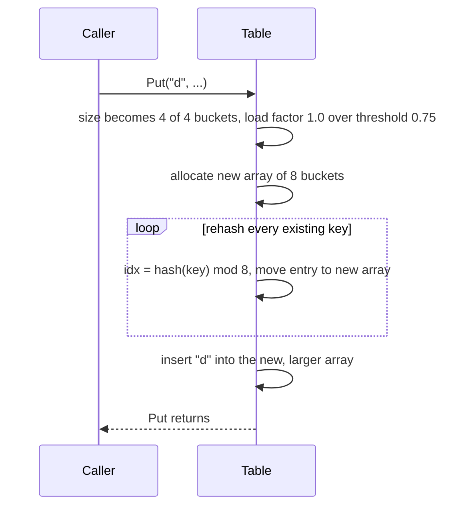

**Measured** (Go 1.24.4, `go test -race`, this table, 1000 string keys starting from 4 buckets): all 1000 keys survive 9 doublings (4 → 8 → 16 → … → 2048 buckets) with zero lost or duplicated entries, and the load factor after the run is 0.49.

### Go's `map` is this idea, built in

**In plain words:** you never write any of the above in real Go — the language ships the same machine as `map`, already tuned.

```go
m := make(map[string]int)
m["alice"] = 30
v, ok := m["alice"] // v == 30, ok == true
delete(m, "alice")
```

Same contract, average `O(1)` operations, but compiler- and runtime-supported instead of hand-written, and tuned far beyond the toy version above — with its own resize strategy, its own collision handling (Swiss Tables, below), and a random per-map hash seed baked in automatically.

**Measured, hand-rolled table vs. Go's `map`** (Go 1.24.4, Apple M4, `go test -bench=. -benchmem`, keys pre-generated outside the timed loop, 10,000 string keys): `Put` on the hand-rolled chaining table ran at 8.6 ns/op versus 12.5 ns/op for Go's map;

`Get` was close either way, 7.8 ns/op versus 7.6 ns/op.

At this scale (10,000 keys, update-heavy workload) the simple chaining table is not slower — Swiss Tables' real advantage shows up at larger scale and higher load factor, where its SIMD-scanned metadata bytes avoid touching most keys' memory at all (see the deep dive), not necessarily on a small, mostly-updates microbenchmark like this one.

Runnable Go version: [[Hash Tables and Go Maps - Go]]

> [!tip] Remember
> A resize is O(n) for the one Put that triggers it, and that cost is what buys O(1) amortized for every Put around it.

## 5. Variants and comparison 🟡

| Approach | How it works | Use when | Cost |
|---|---|---|---|
| Separate chaining | Each bucket is a list of colliding entries | Default choice; simple, degrades gracefully | O(1) average, O(n) worst case per bucket |
| Open addressing (linear/quadratic probing) | Probe forward in the same array on collision | Cache-friendly, no pointer chasing | Clustering under high load factor |
| Robin Hood hashing | Open addressing with bounded probe-length variance | You want predictable tail latency | More work per insert/delete |
| **Swiss Tables** (Go 1.24+ maps, Abseil `flat_hash_map`) | Open addressing + SIMD-scanned 1-byte control metadata per group of slots | Default for a modern general-purpose map | O(1) average; very low constant factor from SIMD |
| Sorted slice + binary search | No hashing; keys kept sorted | Small, rarely-mutated sets; range queries | O(log n) lookup, O(n) insert |
| [[Tries, Suffix Trees and Suffix Arrays|Trie]] | Tree keyed by key prefix | Keys share prefixes (strings, IP ranges) | O(key length) lookup, naturally sorted iteration |

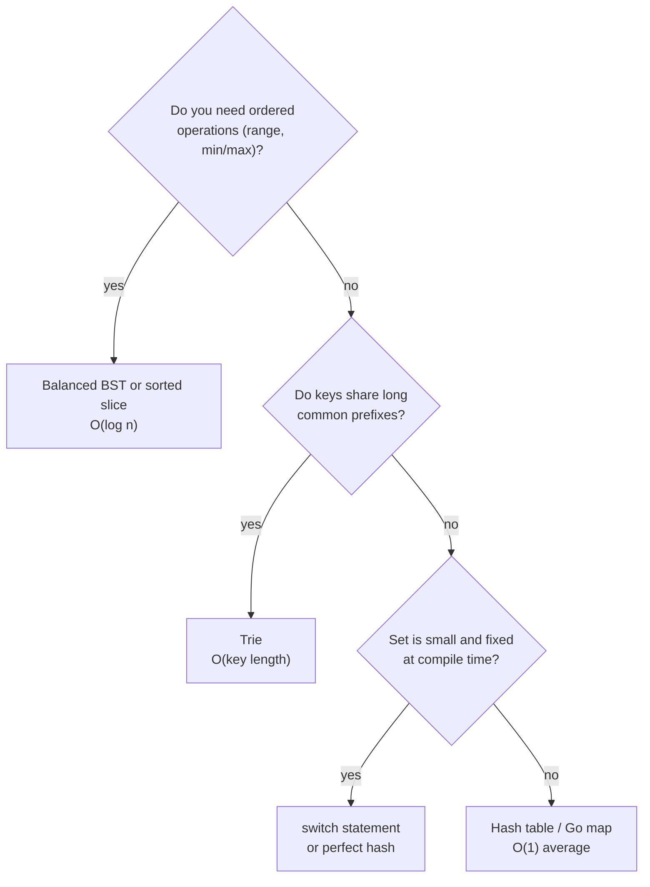

## 6. Trade-offs and when not to use 🟡

- **No ordering.** A hash table cannot answer "give me keys between X and Y" or "the smallest key" efficiently — use a sorted structure ([[Trees, BSTs and Balanced Trees]], or a sorted slice) instead.
- **Memory overhead.** Buckets reserve capacity ahead of need; a hash table of `n` small entries typically uses more memory than a sorted array of the same entries.
- **Hashing cost.** For very small, fixed key sets known at compile time, a `switch` statement or a perfect hash can beat a general hash table.
- **Iteration order.** If you need stable, reproducible iteration (snapshots, tests, deterministic serialization), a hash table alone won't give it — pair it with a slice of keys in the order you want, or use an ordered-map library.

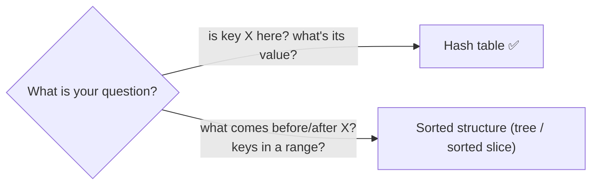

> [!tip] Remember
> Reach for a hash table when the question is "does this key exist / what's its value," not "what comes before/after this key."

## 7. In production 🔴

- **Real systems:**
	- Go's `map[K]V`, Python's `dict`, Java's `HashMap`, Redis's main keyspace (itself a hash table, separate from the "hash" data type it also offers).
	- Java's `HashMap` **treeifies** a bucket (converts its linked list to a red-black tree) once it holds 8+ entries, turning a worst-case `O(n)` bucket scan into `O(log n)` — a defense against hash-flooding and bad luck that Go's map does not need because Go caps the load factor more aggressively and randomizes bucket iteration order and the hash seed.
	- Database hash indexes (PostgreSQL's `hash` index type) for equality lookups, though B-tree indexes ([[Storage Engines - B-tree vs LSM and WAL]]) remain the default because they also support range scans.
- **Failure modes → fixes:**
	- Hash flooding from attacker-controlled keys → random per-process hash seed (Go does this automatically for every map).
	- Memory blowup from a table that only ever grows → rebuild into a fresh table sized for current load instead of resizing in place, if the language/library supports shrinking.
	- "Why did my map iteration order change between two runs of the same program?" → Go (and most modern hash maps) randomizes iteration order on purpose; never depend on it.
- **What to monitor:** load factor (if you control the table), resize frequency, and — for a cache sitting on a hash table — hit ratio (see [[Memory Hierarchy and CPU Caches]] for the hardware-cache version of the same idea, and `08 Caching & Redis` for the application-cache version).

## 8. Deep dive 🔴

### Go maps before 1.24: buckets with tophash bytes

**In plain words:** old Go maps were a row of small 8-coat racks; when a rack filled, an extra rack was chained behind it.

Up through Go 1.23, the runtime map was a chained-bucket design: each bucket held up to 8 key-value slots plus an array of 8 **tophash** bytes (the high byte of each slot's hash), used to skip most slots without a full key comparison.

When a bucket's 8 slots filled, the runtime chained an **overflow bucket** onto it rather than growing the whole table immediately.

Growth happened incrementally: a resize allocated double the buckets, but old entries were migrated lazily, a few per subsequent map operation, to avoid a single large pause.

The resize trigger was a load factor of about 6.5 (yes, greater than 1 — because of the 8-slot buckets and overflow chaining, a load factor above 1 was still efficient).

### Go 1.24+: Swiss Tables

**In plain words:** new Go maps keep a tiny one-byte "name tag" per slot, and the CPU can check 16 name tags in one glance before touching any real key.

Starting in Go 1.24, the runtime map implementation switched to a **Swiss Table** design (the same family as Abseil's `flat_hash_map`), documented in the Go 1.24 release notes.

Instead of 8-slot buckets with overflow chains, a Swiss Table is open addressing over groups of slots, each group guarded by one metadata byte per slot (empty, deleted, or the top 7 bits of that slot's hash).

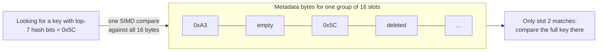

A lookup scans a group's metadata bytes with a single SIMD-style comparison, checking many slots' tophash at once instead of one at a time, before touching the actual keys.

This is both faster (fewer cache misses, more work per CPU instruction) and more memory-compact than the old bucket-and-overflow layout, while keeping the same external contract: same average-case `O(1)`, same `map[K]V` syntax.

### Rules every Go engineer should know

**In plain words:** these are the house rules of Go maps — each one bites people in real code at least once.

- **Iteration order is randomized**, deliberately, on every `range` over a map — a language guarantee, not an implementation accident, precisely so code never comes to depend on an order the runtime is free to change.
- **Concurrent writes are not safe.** Two goroutines writing to the same map concurrently (or one writing while another reads) trigger `fatal error: concurrent map writes` — a hard runtime crash, not a recoverable `panic`, specifically so silent data races in map internals cannot go unnoticed. Protect a shared map with a `sync.Mutex`/`sync.RWMutex`, shard it across several locked sub-maps, or use `sync.Map` (see below). This is covered in depth in [[sync Primitives and Atomics]].
- **Map values aren't addressable.** You cannot do `m["k"].field = x` for a struct value in a map — take a copy, mutate it, and write it back, or store pointers (`map[K]*V`) instead.
- **Reading a nil map returns the zero value**; **writing to a nil map panics**. Always `make()` a map (or let a struct literal/composite literal do it) before writing.
- **`maps` package** (standard library since Go 1.21): `maps.Clone`, `maps.Equal`, `maps.Keys`/`maps.Values` (iterator-based since Go 1.23) for the operations every hand-written loop used to duplicate.
- **Sets as `map[T]struct{}`.** Go has no built-in set type; `struct{}` occupies zero bytes, so `map[string]struct{}` is the idiomatic zero-overhead set, checked with the two-value form: `if _, ok := set[x]; ok`.

> [!warning] Common mistake
> Assuming `m["missing-key"]` panics like an out-of-bounds slice access. It doesn't — it quietly returns the zero value for `V`. Always use the two-value form `v, ok := m[key]` when "not present" needs to be distinguished from "present with the zero value."

### `sync.Map`

**In plain words:** `sync.Map` is a special map for "write once, read by everyone" — not a general thread-safe map.

`sync.Map` is a specialized concurrent map for two patterns the standard library docs call out explicitly: (1) a key written once and read many times by many goroutines (a cache that's populated once, read forever), or (2) disjoint sets of keys accessed by disjoint sets of goroutines.

It is **not** a general drop-in replacement for `map` + mutex — under heavy concurrent writes to overlapping keys, a plain `map` guarded by a `sync.RWMutex` or sharded into several locked maps often performs better, because `sync.Map` optimizes specifically for the read-mostly case.

### Classic practice problems

**In plain words:** most interview hash-table questions are one of these five patterns in disguise.

These are the hash-table patterns that show up most often in interviews:

- **two-sum** (hash set of values seen so far, check `target - v` before inserting, O(n)),
- **group anagrams** (hash map keyed by each string's sorted letters),
- **subarray sum equals k** (hash map of prefix-sum → count, so a subarray summing to k is found in O(n) instead of O(n²)),
- **longest consecutive sequence** (hash set of all values, then only start counting a run from a value whose predecessor isn't in the set, giving O(n) instead of the O(n log n) a sort would cost),
- **LRU cache** (hash map of key → list node, paired with a doubly linked list for O(1) move-to-front and evict-the-tail — see `08 Caching & Redis` for the full LRU note).

## 9. Interview questions 🔴

> [!question]- Why is hash table lookup O(1) on average but O(n) in the worst case?
> The hash function distributes keys across buckets; with a good hash and a bounded load factor, each bucket holds a small, roughly constant number of entries, so a lookup touches O(1) entries on average. In the worst case — every key hashing to the same bucket, by bad luck or attack — a lookup degrades to scanning all n entries in that one bucket.

> [!question]- What is a load factor, and what happens when it gets too high?
> Load factor is `keys / buckets`. As it rises, chains (or open-addressing probe sequences) get longer, so lookups slow down. The table resizes — allocates more buckets and rehashes every key — once load factor crosses a threshold, trading an occasional O(n) resize for an amortized O(1) per operation.

> [!question]- Is Go's `map` safe for concurrent use?
> No. Concurrent writes (or a write racing a read) trigger `fatal error: concurrent map writes`, a crash that cannot be recovered with `recover()`. Use a mutex, shard the map, or use `sync.Map` for the read-mostly / disjoint-keys access patterns it's built for.

> [!question]- Trap: does iterating a Go map twice in a row give the same order?
> No, and this is deliberate. The Go runtime randomizes map iteration order specifically so no program can come to depend on an order that implementation details (like Go 1.24's Swiss Tables migration) are free to change. If you need a stable order, sort the keys yourself.

> [!question]- What changed in Go 1.24's map implementation, and why does it matter?
> Go 1.24 replaced the bucket-and-overflow-chain design with Swiss Tables: open addressing over groups of slots with one metadata byte per slot, scanned together instead of one at a time. It matters for performance (fewer cache misses, more throughput per CPU cycle) but not for correctness or the API — `map[K]V` behaves the same from the outside.

> [!question]- How would you build a set in Go, and why that way?
> `map[T]struct{}`, checked with `if _, ok := set[x]; ok`. `struct{}` has zero size, so the map stores only keys, not wasted values — the idiomatic zero-overhead set in a language with no built-in set type.

> [!question]- Hash table vs. BST for an in-memory index: when would you pick the BST?
> When you need ordered operations the hash table can't give you efficiently: range scans, "next key after X", min/max, or sorted iteration. A balanced BST gives those in O(log n); a hash table gives none of them better than O(n).

## 10. Cheat sheet 🟢

- `index = hash(key) mod bucket_count`; average O(1) get/put/delete, worst case O(n).
- Collisions: separate chaining (linked lists per bucket) vs. open addressing (probe for the next free slot).
- Load factor = keys / buckets; crossing a threshold triggers a resize (rehash everything), amortized O(1) per insert.
- Go maps: random iteration order, concurrent writes crash (`fatal error`, not a `panic`), map values aren't addressable, writing to a `nil` map panics.
- Go 1.24+ switched maps to Swiss Tables (SIMD-scanned metadata bytes, open addressing) from the older 8-slot-bucket-plus-overflow design.
- `sync.Map` is for read-mostly or disjoint-key concurrent access, not a general mutex replacement.
- Sets: `map[T]struct{}`. Bloom filters trade a small false-positive rate for O(1) space-efficient set membership at scale — see [[Bloom Filters and Probabilistic Data Structures]].
- `hash(key) mod N` is also how naive partitioning works, and why it breaks when N changes — see [[Consistent Hashing]].

## Links 🟢

- **Go implementation:** [[Hash Tables and Go Maps - Go]]
- **Before this:** [[Arrays and Dynamic Arrays (Go Slices)]], [[Complexity Analysis - Big-O and Amortized Cost]]
- **Next:** [[Consistent Hashing]], [[Bloom Filters and Probabilistic Data Structures]]
- **Compare with:** [[Trees, BSTs and Balanced Trees]] (ordered operations a hash table can't do), [[Tries, Suffix Trees and Suffix Arrays]] (prefix-structured keys)

### Watch on YouTube

- [Hash Tables, Visualized (How O(1) Lookups Work)](https://www.youtube.com/watch?v=eUbSeqLMyHg) · Generalist Programmer · Visual walkthrough of hashing, buckets, collisions and resizing
