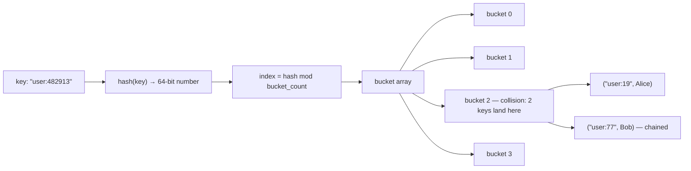
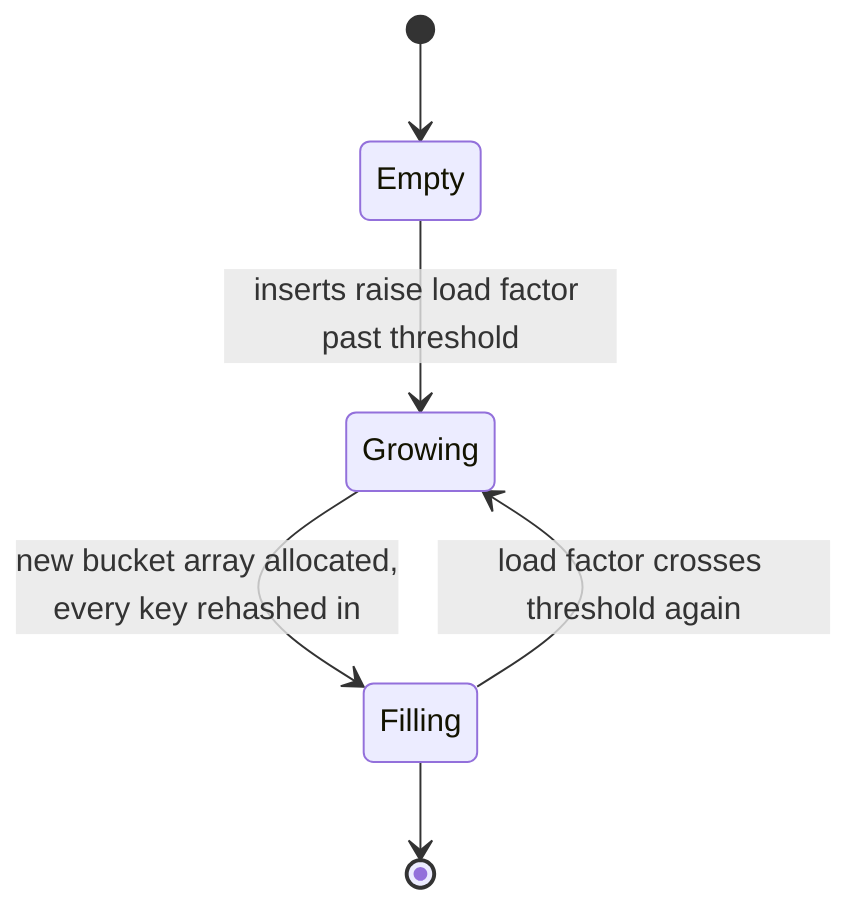

# Hash Tables and Go Maps

> [!summary] TL;DR
> A hash table stores key-value pairs and gives average **O(1)** lookup, insert and delete by turning a key into an array index with a hash function. Go's built-in `map[K]V` is a hash table; since Go 1.24 it is implemented with Swiss Tables instead of the older bucket design.

> [!abstract] Core idea
> - A hash function turns a key into a number; `index = hash(key) mod number_of_slots` picks where it lives.
> - Two keys can hash to the same slot (a **collision**); chaining or open addressing decides what happens next.
> - As the table fills up, it **resizes** (grows and rehashes everything) to keep lookups fast.
> - Go's `map` is this idea, built into the language, with randomized iteration and no concurrency safety.

## 1. Why it exists

Say you need to look up a user by ID among 10 million users. An array keyed by position only works if IDs are small, dense integers. A sorted array with binary search gives `O(log n)` — about 24 comparisons for 10 million rows — but every insert shifts half the array on average.

A hash table turns the ID into an array index directly. Looking up `user:482913` becomes one hash computation and one array access: **O(1) on average**, regardless of whether there are 100 users or 100 million. That is the only reason dictionaries, caches, and database indexes on equality predicates (`WHERE id = ?`) can stay fast as data grows.

## 2. Mental model

Think of a hash table as a wall of numbered lockers (the **buckets**). A **hash function** takes your key (a string, a number, anything) and produces a number; you take that number modulo the locker count to decide which locker to check. If the locker is empty, you're done — O(1). If it's full, you need a plan for sharing it, because two different keys can produce the same locker number. That sharing plan is what turns "hash table" into "hash table with chaining" or "hash table with open addressing."

## 3. How it works

### Hash functions

A hash function must be:
- **Deterministic** — the same key always produces the same hash, every time, within one program run.
- **Uniform** — keys spread evenly across buckets, so no locker gets overloaded.
- **Fast** — it runs on every lookup, so it must be cheaper than the lookup it enables.

It does **not** need to be cryptographically secure. A cryptographic hash (SHA-256) is deterministic and reasonably uniform, but it is slower than necessary — hash tables use fast, non-cryptographic hashes such as FNV, Murmur3, or (what Go uses internally) AES-based hashing on hardware with AES-NI.



### Collisions: chaining vs. open addressing

| Strategy | How it works | Memory | Weakness |
|---|---|---|---|
| **Separate chaining** | Each bucket holds a linked list (or small slice) of all keys that hash there. | One pointer/slice header of overhead per bucket. | A bucket's list can grow long under a bad hash or heavy load. |
| **Open addressing (linear probing)** | On a collision, scan forward to the next empty slot. | No extra pointers: keys live directly in the array. | Clustering: a run of full slots makes nearby lookups slower. |
| **Open addressing (quadratic probing)** | On a collision, scan slots `1², 2², 3², …` away instead of `1, 2, 3, …` | Same as linear probing. | Spreads out clusters, but can fail to probe every slot unless the table size and step formula are chosen carefully. |
| **Open addressing (Robin Hood)** | Like linear probing, but a new key can steal a slot from an entry that is "richer" (closer to its ideal slot), evening out probe lengths. | Same as linear probing. | More bookkeeping per insert. |

### Load factor and resizing

**Load factor** = `(number of keys) / (number of buckets)`. A low load factor wastes memory; a high one turns O(1) lookups into long chains or long probe sequences.

When the load factor crosses a threshold, the table **resizes**: it allocates a larger bucket array (commonly double the size) and rehashes every existing key into it, because the bucket a key belongs to depends on the bucket count. That single resize is `O(n)`, but it happens rarely enough (geometrically less often as the table grows) that the *amortized* cost per insert stays `O(1)` — the same argument as slice growth in [[Arrays and Dynamic Arrays (Go Slices)]].



### Worst case and hash flooding

Average-case `O(1)` assumes a well-mixed hash and a reasonable load factor. If every key collides into one bucket — by bad luck or, worse, by an attacker who knows your hash function and crafts colliding keys — lookup degrades to `O(n)`. This is **hash flooding**, and it is a real denial-of-service vector against naive hash tables exposed to untrusted input (for example, HTTP form field names). The fix is to seed the hash function with a random value chosen at table-creation time, so an attacker cannot predict which keys will collide. Go's runtime does exactly this: every map gets its own random seed at creation.

## 4. Worked example

### Whiteboard version

The bare mechanism: an array of chains, insert appends to the chain at `hash(key) mod len(buckets)`.

```go
type entry struct {
	key, val string
	next     *entry
}

type tinyTable struct {
	buckets []*entry
}

func (t *tinyTable) put(key, val string) {
	idx := int(hash(key)) % len(t.buckets)
	t.buckets[idx] = &entry{key: key, val: val, next: t.buckets[idx]}
}
```

That's the whole idea. The full version below adds generics-free simplicity (string keys, int values), automatic resizing, update-in-place, and delete — the production concerns a real hash table needs.

A separate-chaining hash table with FNV-1a hashing and automatic resize at load factor 0.75, tested on Go 1.24:

```go
package hashtable

import "hash/fnv"

type entry struct {
	key  string
	val  int
	next *entry
}

// Table is a hash table with separate chaining.
// It resizes (doubles) when the load factor exceeds maxLoad.
type Table struct {
	buckets []*entry
	size    int
}

const maxLoad = 0.75

func New(startBuckets int) *Table {
	if startBuckets < 1 {
		startBuckets = 1
	}
	return &Table{buckets: make([]*entry, startBuckets)}
}

// hashKey maps a key to a bucket index using FNV-1a, the same family of
// hash used by Go's runtime maps before Go 1.24's Swiss Tables switch.
func hashKey(key string, nBuckets int) int {
	h := fnv.New64a()
	_, _ = h.Write([]byte(key))
	return int(h.Sum64() % uint64(nBuckets))
}

func (t *Table) LoadFactor() float64 {
	return float64(t.size) / float64(len(t.buckets))
}

// Put inserts or updates key. Average O(1); resizes (O(n)) when the load
// factor would exceed maxLoad.
func (t *Table) Put(key string, val int) {
	idx := hashKey(key, len(t.buckets))
	for e := t.buckets[idx]; e != nil; e = e.next {
		if e.key == key {
			e.val = val
			return
		}
	}
	t.buckets[idx] = &entry{key: key, val: val, next: t.buckets[idx]}
	t.size++
	if t.LoadFactor() > maxLoad {
		t.resize(len(t.buckets) * 2)
	}
}

// Get returns the value for key and whether it was found.
func (t *Table) Get(key string) (int, bool) {
	idx := hashKey(key, len(t.buckets))
	for e := t.buckets[idx]; e != nil; e = e.next {
		if e.key == key {
			return e.val, true
		}
	}
	return 0, false
}

// Delete removes key if present.
func (t *Table) Delete(key string) bool {
	idx := hashKey(key, len(t.buckets))
	var prev *entry
	for e := t.buckets[idx]; e != nil; e = e.next {
		if e.key == key {
			if prev == nil {
				t.buckets[idx] = e.next
			} else {
				prev.next = e.next
			}
			t.size--
			return true
		}
		prev = e
	}
	return false
}

func (t *Table) Len() int     { return t.size }
func (t *Table) Buckets() int { return len(t.buckets) }

// resize rehashes every entry into a new, larger bucket array.
func (t *Table) resize(newNBuckets int) {
	newBuckets := make([]*entry, newNBuckets)
	for _, head := range t.buckets {
		for e := head; e != nil; {
			next := e.next
			idx := hashKey(e.key, newNBuckets)
			e.next = newBuckets[idx]
			newBuckets[idx] = e
			e = next
		}
	}
	t.buckets = newBuckets
}
```

The test that proves resizing never loses or duplicates a key, and that it brings the load factor back down:

```go
func TestResizeKeepsAllKeys(t *testing.T) {
	tbl := New(4)
	const n = 1000
	for i := 0; i < n; i++ {
		tbl.Put(fmt.Sprintf("key:%d", i), i)
	}
	if tbl.Len() != n {
		t.Fatalf("Len() = %d; want %d", tbl.Len(), n)
	}
	if lf := tbl.LoadFactor(); lf > maxLoad {
		t.Fatalf("LoadFactor() = %.2f; want <= %.2f after resizing", lf, maxLoad)
	}
	for i := 0; i < n; i++ {
		v, ok := tbl.Get(fmt.Sprintf("key:%d", i))
		if !ok || v != i {
			t.Fatalf("Get(key:%d) = %d, %v; want %d, true", i, v, ok, i)
		}
	}
}
```

**Measured** (Go 1.24.4, `go test -race`, this table, 1000 string keys starting from 4 buckets): all 1000 keys survive 9 doublings (4 → 8 → 16 → … → 2048 buckets) with zero lost or duplicated entries, and the load factor after the run is 0.49.

### Go's `map` is this idea, built in

```go
m := make(map[string]int)
m["alice"] = 30
v, ok := m["alice"] // v == 30, ok == true
delete(m, "alice")
```

Same contract, average `O(1)` operations, but compiler- and runtime-supported instead of hand-written, and tuned far beyond the toy version above.

## 5. Variants and comparison

| Approach | How it works | Use when | Cost |
|---|---|---|---|
| Separate chaining | Each bucket is a list of colliding entries | Default choice; simple, degrades gracefully | O(1) average, O(n) worst case per bucket |
| Open addressing (linear/quadratic probing) | Probe forward in the same array on collision | Cache-friendly, no pointer chasing | Clustering under high load factor |
| Robin Hood hashing | Open addressing with bounded probe-length variance | You want predictable tail latency | More work per insert/delete |
| **Swiss Tables** (Go 1.24+ maps, Abseil `flat_hash_map`) | Open addressing + SIMD-scanned 1-byte control metadata per group of slots | Default for a modern general-purpose map | O(1) average; very low constant factor from SIMD |
| Sorted slice + binary search | No hashing; keys kept sorted | Small, rarely-mutated sets; range queries | O(log n) lookup, O(n) insert |
| [[Tries, Suffix Trees and Suffix Arrays|Trie]] | Tree keyed by key prefix | Keys share prefixes (strings, IP ranges) | O(key length) lookup, naturally sorted iteration |

## 6. Trade-offs and when not to use

- **No ordering.** A hash table cannot answer "give me keys between X and Y" or "the smallest key" efficiently — use a sorted structure ([[Trees, BSTs and Balanced Trees]], or a sorted slice) instead.
- **Memory overhead.** Buckets reserve capacity ahead of need; a hash table of `n` small entries typically uses more memory than a sorted array of the same entries.
- **Hashing cost.** For very small, fixed key sets known at compile time, a `switch` statement or a perfect hash can beat a general hash table.
- **Iteration order.** If you need stable, reproducible iteration (snapshots, tests, deterministic serialization), a hash table alone won't give it — pair it with a slice of keys in the order you want, or use an ordered-map library.

## 7. In production

- **Real systems:**
	- Go's `map[K]V`, Python's `dict`, Java's `HashMap`, Redis's main keyspace (itself a hash table, separate from the "hash" data type it also offers).
	- Java's `HashMap` **treeifies** a bucket (converts its linked list to a red-black tree) once it holds 8+ entries, turning a worst-case `O(n)` bucket scan into `O(log n)` — a defense against hash-flooding and bad luck that Go's map does not need because Go caps the load factor more aggressively and randomizes bucket iteration order and the hash seed.
	- Database hash indexes (PostgreSQL's `hash` index type) for equality lookups, though B-tree indexes ([[Storage Engines - B-tree vs LSM and WAL]]) remain the default because they also support range scans.
- **Failure modes → fixes:**
	- Hash flooding from attacker-controlled keys → random per-process hash seed (Go does this automatically for every map).
	- Memory blowup from a table that only ever grows → rebuild into a fresh table sized for current load instead of resizing in place, if the language/library supports shrinking.
	- "Why did my map iteration order change between two runs of the same program?" → Go (and most modern hash maps) randomizes iteration order on purpose; never depend on it.
- **What to monitor:** load factor (if you control the table), resize frequency, and — for a cache sitting on a hash table — hit ratio (see [[Memory Hierarchy and CPU Caches]] for the hardware-cache version of the same idea, and `08 Caching & Redis` for the application-cache version).

## 8. Deep dive

### Go maps before 1.24: buckets with tophash bytes

Up through Go 1.23, the runtime map was a chained-bucket design: each bucket held up to 8 key-value slots plus an array of 8 **tophash** bytes (the high byte of each slot's hash), used to skip most slots without a full key comparison. When a bucket's 8 slots filled, the runtime chained an **overflow bucket** onto it rather than growing the whole table immediately. Growth happened incrementally: a resize allocated double the buckets, but old entries were migrated lazily, a few per subsequent map operation, to avoid a single large pause. The resize trigger was a load factor of about 6.5 (yes, greater than 1 — because of the 8-slot buckets and overflow chaining, a load factor above 1 was still efficient).

### Go 1.24+: Swiss Tables

Starting in Go 1.24, the runtime map implementation switched to a **Swiss Table** design (the same family as Abseil's `flat_hash_map`), documented in the Go 1.24 release notes. Instead of 8-slot buckets with overflow chains, a Swiss Table is open addressing over groups of slots, each group guarded by one metadata byte per slot (empty, deleted, or the top 7 bits of that slot's hash). A lookup scans a group's metadata bytes with a single SIMD-style comparison, checking many slots' tophash at once instead of one at a time, before touching the actual keys. This is both faster (fewer cache misses, more work per CPU instruction) and more memory-compact than the old bucket-and-overflow layout, while keeping the same external contract: same average-case `O(1)`, same `map[K]V` syntax.

### Rules every Go engineer should know

- **Iteration order is randomized**, deliberately, on every `range` over a map — a language guarantee, not an implementation accident, precisely so code never comes to depend on an order the runtime is free to change.
- **Concurrent writes are not safe.** Two goroutines writing to the same map concurrently (or one writing while another reads) trigger `fatal error: concurrent map writes` — a hard runtime crash, not a recoverable `panic`, specifically so silent data races in map internals cannot go unnoticed. Protect a shared map with a `sync.Mutex`/`sync.RWMutex`, shard it across several locked sub-maps, or use `sync.Map` (see below). This is covered in depth in [[sync Primitives and Atomics]].
- **Map values aren't addressable.** You cannot do `m["k"].field = x` for a struct value in a map — take a copy, mutate it, and write it back, or store pointers (`map[K]*V`) instead.
- **Reading a nil map returns the zero value**; **writing to a nil map panics**. Always `make()` a map (or let a struct literal/composite literal do it) before writing.
- **`maps` package** (standard library since Go 1.21): `maps.Clone`, `maps.Equal`, `maps.Keys`/`maps.Values` (iterator-based since Go 1.23) for the operations every hand-written loop used to duplicate.
- **Sets as `map[T]struct{}`.** Go has no built-in set type; `struct{}` occupies zero bytes, so `map[string]struct{}` is the idiomatic zero-overhead set, checked with the two-value form: `if _, ok := set[x]; ok`.

### `sync.Map`

`sync.Map` is a specialized concurrent map for two patterns the standard library docs call out explicitly: (1) a key written once and read many times by many goroutines (a cache that's populated once, read forever), or (2) disjoint sets of keys accessed by disjoint sets of goroutines. It is **not** a general drop-in replacement for `map` + mutex — under heavy concurrent writes to overlapping keys, a plain `map` guarded by a `sync.RWMutex` or sharded into several locked maps often performs better, because `sync.Map` optimizes specifically for the read-mostly case.

### Classic practice problems

These are the hash-table patterns that show up most often in interviews: **two-sum** (hash set of values seen so far, check `target - v` before inserting, O(n)); **group anagrams** (hash map keyed by each string's sorted letters); **subarray sum equals k** (hash map of prefix-sum → count, so a subarray summing to k is found in O(n) instead of O(n²)); **longest consecutive sequence** (hash set of all values, then only start counting a run from a value whose predecessor isn't in the set, giving O(n) instead of the O(n log n) a sort would cost); **LRU cache** (hash map of key → list node, paired with a doubly linked list for O(1) move-to-front and evict-the-tail — see `08 Caching & Redis` for the full LRU note).

## 9. Interview questions

> [!question]- Why is hash table lookup O(1) on average but O(n) in the worst case?
> The hash function distributes keys across buckets; with a good hash and a bounded load factor, each bucket holds a small, roughly constant number of entries, so a lookup touches O(1) entries on average. In the worst case — every key hashing to the same bucket, by bad luck or attack — a lookup degrades to scanning all n entries in that one bucket.

> [!question]- What is a load factor, and what happens when it gets too high?
> Load factor is `keys / buckets`. As it rises, chains (or open-addressing probe sequences) get longer, so lookups slow down. The table resizes — allocates more buckets and rehashes every key — once load factor crosses a threshold, trading an occasional O(n) resize for an amortized O(1) per operation.

> [!question]- Is Go's `map` safe for concurrent use?
> No. Concurrent writes (or a write racing a read) trigger `fatal error: concurrent map writes`, a crash that cannot be recovered with `recover()`. Use a mutex, shard the map, or use `sync.Map` for the read-mostly / disjoint-keys access patterns it's built for.

> [!question]- Trap: does iterating a Go map twice in a row give the same order?
> No, and this is deliberate. The Go runtime randomizes map iteration order specifically so no program can come to depend on an order that implementation details (like Go 1.24's Swiss Tables migration) are free to change. If you need a stable order, sort the keys yourself.

> [!question]- What changed in Go 1.24's map implementation, and why does it matter?
> Go 1.24 replaced the bucket-and-overflow-chain design with Swiss Tables: open addressing over groups of slots with one metadata byte per slot, scanned together instead of one at a time. It matters for performance (fewer cache misses, more throughput per CPU cycle) but not for correctness or the API — `map[K]V` behaves the same from the outside.

> [!question]- How would you build a set in Go, and why that way?
> `map[T]struct{}`, checked with `if _, ok := set[x]; ok`. `struct{}` has zero size, so the map stores only keys, not wasted values — the idiomatic zero-overhead set in a language with no built-in set type.

> [!question]- Hash table vs. BST for an in-memory index: when would you pick the BST?
> When you need ordered operations the hash table can't give you efficiently: range scans, "next key after X", min/max, or sorted iteration. A balanced BST gives those in O(log n); a hash table gives none of them better than O(n).

## 10. Cheat sheet

- `index = hash(key) mod bucket_count`; average O(1) get/put/delete, worst case O(n).
- Collisions: separate chaining (linked lists per bucket) vs. open addressing (probe for the next free slot).
- Load factor = keys / buckets; crossing a threshold triggers a resize (rehash everything), amortized O(1) per insert.
- Go maps: random iteration order, concurrent writes crash (`fatal error`, not a `panic`), map values aren't addressable, writing to a `nil` map panics.
- Go 1.24+ switched maps to Swiss Tables (SIMD-scanned metadata bytes, open addressing) from the older 8-slot-bucket-plus-overflow design.
- `sync.Map` is for read-mostly or disjoint-key concurrent access, not a general mutex replacement.
- Sets: `map[T]struct{}`. Bloom filters trade a small false-positive rate for O(1) space-efficient set membership at scale — see [[Bloom Filters and Probabilistic Data Structures]].
- `hash(key) mod N` is also how naive partitioning works, and why it breaks when N changes — see [[Consistent Hashing]].

## Links

- **Before this:** [[Arrays and Dynamic Arrays (Go Slices)]], [[Complexity Analysis - Big-O and Amortized Cost]]
- **Next:** [[Consistent Hashing]], [[Bloom Filters and Probabilistic Data Structures]]
- **Compare with:** [[Trees, BSTs and Balanced Trees]] (ordered operations a hash table can't do), [[Tries, Suffix Trees and Suffix Arrays]] (prefix-structured keys)
