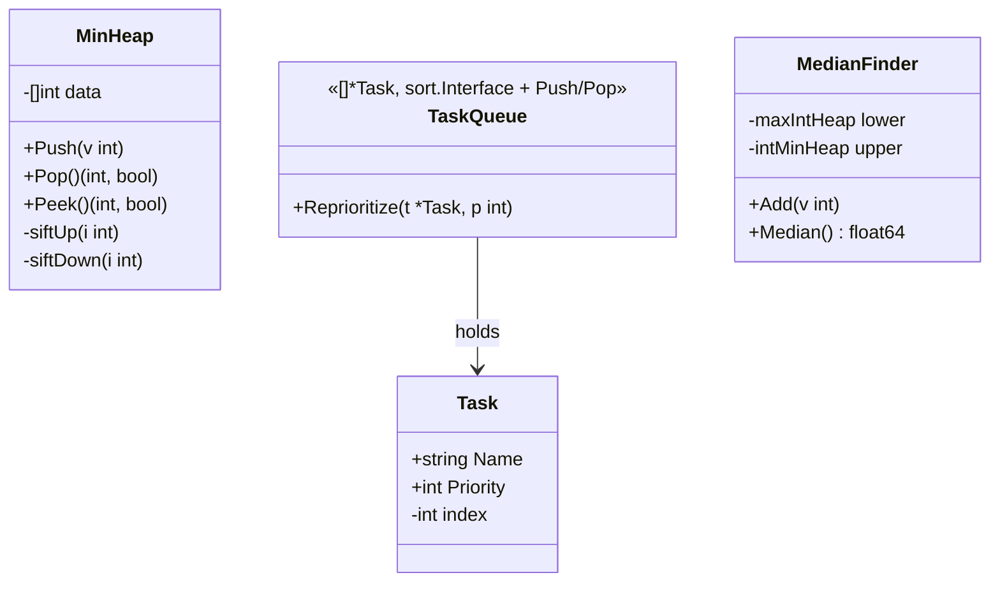
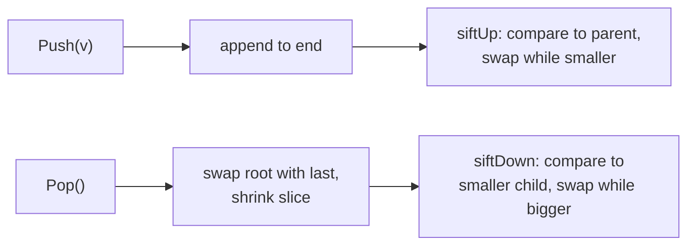
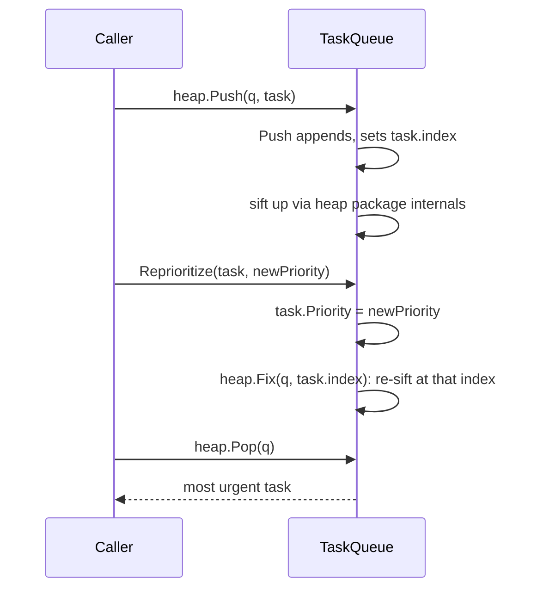
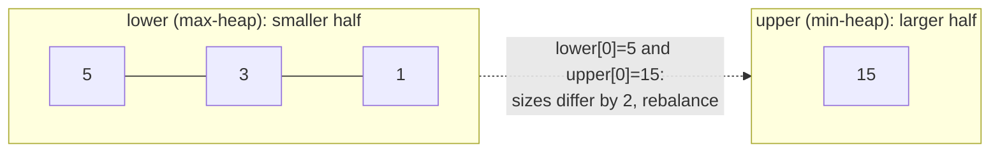

# Heaps and Priority Queues - Go

> [!summary] TL;DR
> Four small, runnable heaps: a hand-rolled `MinHeap`, a `container/heap`-based `TaskQueue` with in-place reprioritizing, a size-k `TopKLargest`, and a two-heap `MedianFinder`. Together they demonstrate every mechanism in [[Heaps and Priority Queues]]: sift-up, sift-down, O(n) heapify, `heap.Fix`, and the size-k and two-heap patterns.

> [!info] How to read this note (pick your level)
> - 🟢 **New to this?** Read "From zero" and "Before the code", then just Step 1 (the hand-rolled MinHeap). Stop there.
> - 🟡 **Know the basics?** Add Steps 2-3, the design decisions and the tests.
> - 🔴 **Interview / SDE-3 prep?** Add "Running it", the pitfalls and the exercises. Headings are tagged 🟢🟡🔴.

> [!note] Before this note
> - [[Arrays and Dynamic Arrays (Go Slices)]]: the whole heap lives in one slice, and `append` grows it.
> - [[Trees, BSTs and Balanced Trees]]: root, parent, child and leaf. Here the tree is only imagined; index math (`2i+1`, `2i+2`, `(i-1)/2`) finds parents and children.
> - Read [[Heaps and Priority Queues]] first too: sift-up, sift-down and heapify are traced there by hand.

**From zero** 🟢 — This file is the hands-on twin of [[Heaps and Priority Queues]]. It builds four small working heaps in Go: a from-scratch min-heap (to see the mechanics), a task queue using Go's standard `container/heap` (the way real code does it), a "keep the k biggest" helper, and a running-median tracker. Read the theory note first if any word feels new; here, read each code block top to bottom, then the numbered "How it works" list under it.

## Before the code 🟢

- **Slices** (`[]int`): Go's growable arrays; the heap lives in one slice and uses index math for parent/child.
- **Methods on types**: `func (h *MinHeap) Push(...)` attaches behavior to a struct; the pointer receiver lets it change the slice.
- **Interfaces**: `container/heap` works with any type that has `Len`, `Less`, `Swap`, `Push`, `Pop`.
- **`any` and type assertions**: `heap.Pop` returns `any`, so the code converts it back with `x.(*Task)` or `x.(int)`.
- **Multiple return values**: `Pop() (int, bool)` returns the value plus an "ok" flag for the empty case.
- **What to run**: put the code and tests in one package, then `go vet ./...` and `go test -race ./...`.

## What this code shows 🟢

| Code | Concept in [[Heaps and Priority Queues]] |
| --- | --- |
| `MinHeap.Push` (whiteboard) | Append + sift-up, [[Heaps and Priority Queues#3.2 Push append then sift up]] |
| `NewMinHeap` | O(n) heapify, [[Heaps and Priority Queues#3.4 Heapify building a heap in On not On log n]] |
| `MinHeap.Pop` / `siftDown` | Swap-with-last + sift-down, [[Heaps and Priority Queues#3.3 Pop swap with the last element then sift down]] |
| `TaskQueue` + `container/heap` | Go's 5-method heap interface, [[Heaps and Priority Queues#Go's container/heap the standard interface]] |
| `TaskQueue.Reprioritize` / `heap.Fix` | Decrease-key via index bookkeeping, [[Heaps and Priority Queues#Decrease-key and why plain container/heap doesn't give you one]] |
| `TopKLargest` | Size-k min-heap pattern, [[Heaps and Priority Queues#Tracing a size-K top-K scan]] |
| `MedianFinder` | Two-heap running median, [[Heaps and Priority Queues#Classic practice problems]] |



Four independent, self-contained pieces of code in one package: `MinHeap` is the hand-rolled mechanism, `TaskQueue` is the idiomatic `container/heap` pattern, and `TopKLargest`/`MedianFinder` are two interview-standard applications built on top of `container/heap`.

## Setup 🟢

- Module `pq` with `minheap.go`, `taskqueue.go`, `topk.go`, `median.go`, and matching `_test.go` files.
- Go 1.24, standard library only (`container/heap`, `sort`).
- Run: `go vet ./... && go test -race -v ./...`

## Code 🟡

> 🟢 → 🟡 **You now know** what the four heaps are for. **Next we read the code:** first a heap built by hand so the index math is visible, then the standard `container/heap` way, then top-K and the running median. Each step starts with one plain-words line.

### Step 1: a hand-rolled MinHeap

**In plain words:** we build the heap by hand first — one slice, plus two helpers that let values bubble up or sink down — so the index math stops being magic.

**Concept.** This is §3.2–§3.4 of [[Heaps and Priority Queues]] made literal:

- `data` is the flat array from the array-layout section.
- `siftUp` is the push mechanism, and `siftDown` is the pop mechanism.
- `NewMinHeap` is the O(n) heapify.

Writing it by hand first, before using `container/heap`, makes the index arithmetic (`2i+1`, `2i+2`, `(i-1)/2`) concrete instead of hidden behind an interface.

The alternative — only ever using `container/heap` — would work, but would hide exactly the mechanism this note exists to teach.

```go
package pq

// MinHeap is a binary min-heap stored in a slice.
type MinHeap struct {
	data []int
}

// NewMinHeap builds a heap from nums in O(n) using bottom-up heapify.
func NewMinHeap(nums []int) *MinHeap {
	h := &MinHeap{data: append([]int(nil), nums...)}
	for i := len(h.data)/2 - 1; i >= 0; i-- {
		h.siftDown(i)
	}
	return h
}

func (h *MinHeap) Len() int { return len(h.data) }

func (h *MinHeap) Peek() (int, bool) {
	if len(h.data) == 0 {
		return 0, false
	}
	return h.data[0], true
}
```

**How it works.**

1. `NewMinHeap` copies `nums` (so the caller's slice isn't mutated by reference) and starts sifting from `len(h.data)/2 - 1` — the last non-leaf index — down to `0`, which is the heapify algorithm from [[Heaps and Priority Queues#3.4 Heapify building a heap in On not On log n]].
2. `Peek` is `O(1)`: the minimum is always `data[0]` by the heap invariant, so no search is needed.
3. `Len` just reads the slice length — no traversal.

**What this code does, in plain words:** `Push` adds the value at the end and lets it climb; `Pop` saves the top, moves the last value to the top, shrinks the slice, and lets that value sink back down.

```go
func (h *MinHeap) Push(v int) {
	h.data = append(h.data, v)
	h.siftUp(len(h.data) - 1)
}

func (h *MinHeap) Pop() (int, bool) {
	n := len(h.data)
	if n == 0 {
		return 0, false
	}
	top := h.data[0]
	h.data[0] = h.data[n-1]
	h.data = h.data[:n-1]
	if len(h.data) > 0 {
		h.siftDown(0)
	}
	return top, true
}
```

**How it works.**

1. `Push` appends (growing the underlying array via Go's slice-append amortization, see [[Arrays and Dynamic Arrays (Go Slices)]]) and then calls `siftUp` on the new last index — exactly the "append, then sift up" mechanism.
2. `Pop` first checks for the empty case, returning `(0, false)` rather than panicking on `data[0]`.
3. Moving `data[n-1]` into `data[0]` before shrinking is what avoids ever leaving a "hole": the array is always valid at every point during the operation.
4. `siftDown` only runs `if len(h.data) > 0` — popping the last remaining element needs no sift at all.

**What this code does, in plain words:** `siftUp` keeps swapping a value with its parent while the parent is bigger; `siftDown` keeps swapping a value with its smaller child while that child is smaller.

```go
func (h *MinHeap) siftUp(i int) {
	for i > 0 {
		parent := (i - 1) / 2
		if h.data[parent] <= h.data[i] {
			break
		}
		h.data[parent], h.data[i] = h.data[i], h.data[parent]
		i = parent
	}
}

func (h *MinHeap) siftDown(i int) {
	n := len(h.data)
	for {
		left, right := 2*i+1, 2*i+2
		smallest := i
		if left < n && h.data[left] < h.data[smallest] {
			smallest = left
		}
		if right < n && h.data[right] < h.data[smallest] {
			smallest = right
		}
		if smallest == i {
			return
		}
		h.data[i], h.data[smallest] = h.data[smallest], h.data[i]
		i = smallest
	}
}
```

**How it works.**

1. `siftUp`'s loop condition `h.data[parent] <= h.data[i]` is the stopping rule: once the parent is no bigger, the heap property holds all the way up, so the loop breaks instead of continuing needlessly.
2. `siftDown` checks **both** children (`left` and `right`) and tracks whichever is smallest, avoiding the common mistake of comparing against only one child ([[Heaps and Priority Queues#3.3 Pop swap with the last element then sift down]]).
3. `smallest == i` is the stopping condition: neither child is smaller than the current node, so the heap property holds and no further swapping is needed.
4. Both functions are bounded by the tree's height, `O(log n)`, because each iteration moves one level up or down.



### Step 2: the standard `container/heap` interface

**In plain words:** Go's standard library does not give you a heap type — it gives you a 5-method plug socket; implement those methods on your own type and the library drives it as a heap.

**Concept.** Go's standard library doesn't ship a heap type directly — it ships `container/heap`, which turns *any* type satisfying a 5-method interface (`sort.Interface`'s `Len`/`Less`/`Swap`, plus `Push`/`Pop`) into a heap ([[Heaps and Priority Queues#Go's container/heap the standard interface]]).

This is the idiomatic way to build a priority queue in Go, and it's what `TopKLargest` and `MedianFinder` below both build on.

`Task.index` exists only so `Reprioritize` can call `heap.Fix` in `O(log n)` instead of needing an `O(n)` search to find the element first — the decrease-key problem from the deep dive.

```go
package pq

import (
	"container/heap"
	"sort" // TopKLargest sorts its result
)

// Task is one item in a priority queue of scheduled work: lower Priority
// runs first — the same shape a job scheduler or timer heap uses.
type Task struct {
	Name     string
	Priority int
	index    int // maintained by heap.Interface for Fix/Remove
}

type TaskQueue []*Task

func (q TaskQueue) Len() int           { return len(q) }
func (q TaskQueue) Less(i, j int) bool { return q[i].Priority < q[j].Priority }
func (q TaskQueue) Swap(i, j int) {
	q[i], q[j] = q[j], q[i]
	q[i].index = i
	q[j].index = j
}
```

**How it works.**

1. `Less(i, j)` defines "more urgent" as "lower `Priority`" — a min-heap by priority number, matching a scheduler where priority 1 beats priority 10.
2. `Swap` does the usual element swap, but *also* updates each task's `index` field — this is the detail that makes `heap.Fix` possible later, and it's easy to forget when hand-rolling this interface.
3. `TaskQueue` is a slice type, not a struct, so it satisfies the interface with value receivers for the read-only methods.

**What this code does, in plain words:** `Push` adds a task and records its position; `Pop` takes the last task off the slice (the heap package has already moved the most urgent one there); `Reprioritize` changes a task's priority and asks `heap.Fix` to move it to its new correct spot.

```go
func (q *TaskQueue) Push(x any) {
	t := x.(*Task)
	t.index = len(*q)
	*q = append(*q, t)
}

func (q *TaskQueue) Pop() any {
	old := *q
	n := len(old)
	t := old[n-1]
	old[n-1] = nil // avoid a memory leak: drop the pointer
	*q = old[:n-1]
	return t
}

// Reprioritize changes t's priority and restores heap order in O(log n)
// via heap.Fix, instead of removing and re-pushing.
func (q *TaskQueue) Reprioritize(t *Task, newPriority int) {
	t.Priority = newPriority
	heap.Fix(q, t.index)
}
```

**How it works.**

1. `Push` and `Pop` take and return `any` because that's the signature `heap.Interface` requires — a pre-generics design. The type assertion `x.(*Task)` is where that gets unwrapped back to a concrete type.
2. `Push` sets `t.index = len(*q)` *before* appending, so the index is correct the moment the task becomes reachable by `Swap`.
3. `old[n-1] = nil` in `Pop` is a Go-specific detail: without it, the now-unused last slot of the underlying array would still hold a pointer, keeping that `*Task` alive for the garbage collector even though logically it's gone.
4. `Reprioritize` is the decrease-key operation: it updates the field directly, then calls `heap.Fix` with the task's own tracked `index` — `O(log n)`, because `Fix` only has to sift that one position up or down, not search for it.



### Step 3: top-K and the running median

**In plain words:** two classic uses — keep only the k biggest values from a stream, and keep the live middle value of a stream using two heaps leaning against each other.

**Concept.** Both of these build on a second, minimal `heap.Interface` implementation (`intMinHeap`/`maxIntHeap`) rather than reusing `TaskQueue`, because they operate on plain `int`s, not `*Task`s — a good example of why `container/heap` asks you to implement the interface per concrete type instead of offering one generic heap.

- `TopKLargest` is the size-k pattern from [[Heaps and Priority Queues#Tracing a size-K top-K scan]]: keep a min-heap capped at size `k`, and only replace-and-sift when a new value beats the current weakest kept value.
- `MedianFinder` is the two-heap pattern: a max-heap for the lower half, a min-heap for the upper half, rebalanced after every `Add` so their sizes never differ by more than one.

**What this code does, in plain words:** the five methods `container/heap` needs, for a plain slice of ints, where smaller numbers come out first.

```go
// intMinHeap is the smallest container/heap.Interface implementation that
// works for a plain []int: compare, swap, and the two slice-resizing
// methods heap.Push/heap.Pop call through the interface.
type intMinHeap []int

func (h intMinHeap) Len() int           { return len(h) }
func (h intMinHeap) Less(i, j int) bool { return h[i] < h[j] }
func (h intMinHeap) Swap(i, j int)      { h[i], h[j] = h[j], h[i] }
func (h *intMinHeap) Push(x any)        { *h = append(*h, x.(int)) }
func (h *intMinHeap) Pop() any {
	old := *h
	n := len(old)
	v := old[n-1]
	*h = old[:n-1]
	return v
}
```

**How it works.**

1. `Less(i, j)` is the whole definition of "min": the smaller value sorts first, so `h[0]` is always the current minimum of whatever is in the heap.
2. `Push`/`Pop` mirror `TaskQueue`'s shape but operate on a plain `int` instead of a `*Task` — this second, parallel implementation is the cost of `container/heap` not being generic over "any comparable type."
3. This type is unexported (`intMinHeap`, lowercase) because it's an implementation detail of `TopKLargest` and `MedianFinder`, not part of this package's public API.

Only `TopKLargest` itself is exported:

**What this code does, in plain words:** keep a min-heap of at most `k` numbers; once it is full, a new number gets in only if it beats the smallest one on top, which is then thrown out; finally sort the survivors.

```go
// TopKLargest returns the k largest values in nums, ascending.
func TopKLargest(nums []int, k int) []int {
	h := &intMinHeap{}
	heap.Init(h)
	for _, v := range nums {
		if h.Len() < k {
			heap.Push(h, v)
			continue
		}
		if v > (*h)[0] {
			(*h)[0] = v
			heap.Fix(h, 0)
		}
	}
	out := append([]int(nil), (*h)...)
	sort.Ints(out)
	return out
}
```

**How it works.**

1. `heap.Init(h)` is a no-op here (`h` starts empty), but it's idiomatic to always call it before the first `heap.Push`/`heap.Pop`, since `Init` is what turns an arbitrary slice into a valid heap in `O(n)` using heapify internally.
2. While the heap holds fewer than `k` elements, every value is pushed unconditionally — there's nothing yet to compare against.
3. Once the heap is full, `(*h)[0]` is the current weakest of the `k` kept values (the root of a min-heap); only a value that beats it replaces the root, followed by `heap.Fix(h, 0)` to restore the heap property in `O(log k)`.
4. The final `sort.Ints` gives a stable, ascending answer — the heap itself only guarantees the *set* of k largest, not their order.

**What this code does, in plain words:** the same int heap with the comparison flipped so the biggest comes out first, and a struct that holds two heaps: one for the smaller half of the numbers, one for the bigger half.

```go
// maxIntHeap is intMinHeap with the comparison flipped, used as the "lower
// half" heap in MedianFinder.
type maxIntHeap []int

func (h maxIntHeap) Len() int           { return len(h) }
func (h maxIntHeap) Less(i, j int) bool { return h[i] > h[j] }
func (h maxIntHeap) Swap(i, j int)      { h[i], h[j] = h[j], h[i] }
func (h *maxIntHeap) Push(x any)        { *h = append(*h, x.(int)) }
func (h *maxIntHeap) Pop() any {
	old := *h
	n := len(old)
	v := old[n-1]
	*h = old[:n-1]
	return v
}

// MedianFinder maintains the median of a stream of ints using two heaps:
// a max-heap for the smaller half seen so far, a min-heap for the larger
// half, kept balanced to within one element of each other.
type MedianFinder struct {
	lower maxIntHeap // smaller half, largest on top
	upper intMinHeap // larger half, smallest on top
}
```

**How it works.**

1. `maxIntHeap.Less` flips the comparison (`h[i] > h[j]`) compared to `intMinHeap` — that single flip is the entire difference between a min-heap and a max-heap in this design.
2. `MedianFinder.lower` keeps the smaller half of all values seen, with the *largest* of that smaller half on top — so `lower[0]` is "the biggest of the small ones," right at the median boundary.
3. `upper` keeps the larger half, with the *smallest* of that larger half on top — `upper[0]` is "the smallest of the big ones," the other side of the median boundary.

**What this code does, in plain words:** `Add` drops a new number into the correct half, then moves one number across if one half has become 2 bigger than the other; `Median` reads the top of the bigger half, or averages the two tops when the halves are equal.

```go
// Add inserts v and rebalances the two heaps so their sizes never differ
// by more than one element.
func (m *MedianFinder) Add(v int) {
	if m.lower.Len() == 0 || v <= m.lower[0] {
		heap.Push(&m.lower, v)
	} else {
		heap.Push(&m.upper, v)
	}
	if m.lower.Len() > m.upper.Len()+1 {
		heap.Push(&m.upper, heap.Pop(&m.lower))
	} else if m.upper.Len() > m.lower.Len()+1 {
		heap.Push(&m.lower, heap.Pop(&m.upper))
	}
}

// Median returns the current median in O(1): the top of the larger heap,
// or the average of both tops if the heaps are equal in size.
func (m *MedianFinder) Median() float64 {
	switch {
	case m.lower.Len() > m.upper.Len():
		return float64(m.lower[0])
	case m.upper.Len() > m.lower.Len():
		return float64(m.upper[0])
	default:
		return float64(m.lower[0]+m.upper[0]) / 2
	}
}
```

**How it works.**

1. `Add` first decides which heap a new value belongs in: values `<=` the current "biggest of the small half" go to `lower`, everything else to `upper`.
2. The two `if`/`else if` rebalancing checks move exactly one element across when a size imbalance of more than one appears — never more than one element moves per `Add`, keeping the whole operation `O(log n)`.
3. `Median` never pops anything — it only peeks at `lower[0]`/`upper[0]`, which is why reading the median is `O(1)` even though maintaining the two heaps costs `O(log n)` per insert.



## Design decisions 🟡

| Decision | Alternative | Trade-off |
| --- | --- | --- |
| Hand-rolled `MinHeap` plus a separate `container/heap`-based `TaskQueue` | Only `container/heap` everywhere | The hand-rolled version makes sift-up/down concrete for teaching; `container/heap` is what production code should actually use. |
| `Task.index` field, updated in `Swap` | Linear search for the element before calling `Fix` | O(log n) `Reprioritize` instead of O(n); costs one extra `int` field per task and discipline to keep `Swap` correct. |
| Separate `intMinHeap`/`maxIntHeap` types for `TopKLargest`/`MedianFinder` | One generic heap type parameterized over a comparison function | Simpler to read with Go's pre-generics-style `container/heap` interface; a generic version would need a function field or Go generics constraint boilerplate. |
| `MedianFinder` rebalances by at most one element per `Add` | Rebalance fully after every insert | O(log n) worst case per `Add` instead of a potentially larger rebalance; relies on the invariant "sizes differ by at most one" never being violated by more than one insert at a time. |
| `TopKLargest` returns a freshly sorted slice | Return the heap's internal slice unsorted | Callers get a predictable, ascending answer; costs one extra `O(k log k)` sort at the end. |

## Tests 🟡

### TestMinHeapPushPopIsSorted

**Property.** Pushing a sequence of values and popping them all back out must yield them in fully ascending order — proving the min-heap invariant actually holds through repeated pushes and pops, not just once.

| Step | Input | Expected |
| --- | --- | --- |
| Push | `5, 3, 8, 1, 9, 2, 7` one at a time | (no direct output; builds the heap) |
| Pop repeatedly until empty | — | `[1, 2, 3, 5, 7, 8, 9]` |

**What this code does, in plain words:** push seven numbers in a mixed order, pop until empty, and check they come out smallest to largest.

```go
func TestMinHeapPushPopIsSorted(t *testing.T) {
	h := NewMinHeap(nil)
	for _, v := range []int{5, 3, 8, 1, 9, 2, 7} {
		h.Push(v)
	}
	var got []int
	for h.Len() > 0 {
		v, _ := h.Pop()
		got = append(got, v)
	}
	want := []int{1, 2, 3, 5, 7, 8, 9}
	if !reflect.DeepEqual(got, want) {
		t.Fatalf("pop order = %v; want %v", got, want)
	}
}
```

**How it works.**

1. `NewMinHeap(nil)` starts from an empty heap, so every value arrives via `Push`, exercising `siftUp` exclusively (no heapify here).
2. Popping until `Len() == 0` and collecting every result is the strongest possible check: if even one swap in `siftUp` or `siftDown` were wrong, the output would almost certainly come out of order.

**If it fails.** An out-of-order result means either `siftUp` or `siftDown` has a comparison or swap bug — check whether it's the first few or last few elements that are wrong, which usually narrows it to one of the two functions.

### TestNewMinHeapHeapifyPutsMinAtRoot

**Property.** Building a heap directly from an existing, unsorted slice (heapify, not repeated pushes) must still put the true minimum at the root.

| Input | Expected |
| --- | --- |
| `NewMinHeap([]int{9, 4, 7, 1, 2})` | `Peek()` returns `(1, true)` |

```go
func TestNewMinHeapHeapifyPutsMinAtRoot(t *testing.T) {
	h := NewMinHeap([]int{9, 4, 7, 1, 2})
	got, ok := h.Peek()
	if !ok || got != 1 {
		t.Fatalf("Peek() = %d, %v; want 1, true", got, ok)
	}
}
```

**How it works.** This directly exercises the `O(n)` heapify path (`siftDown` starting from the last non-leaf node) rather than `siftUp`, so it's a distinct code path from the push/pop test above — a bug specific to heapify's starting index or loop bound wouldn't be caught by the push/pop test alone.

**If it fails.** A wrong `Peek()` after heapify, but a correct result after manual pushes, points specifically at `NewMinHeap`'s starting index (`len(h.data)/2 - 1`) or its loop direction.

### TestTaskQueueOrderAndFix

**Property.** A `TaskQueue` must pop tasks in priority order, and `Reprioritize` must correctly move a task to a new position — including becoming the next one popped if its new priority makes it the most urgent.

| Step | Input | Expected |
| --- | --- | --- |
| Push `low(10)`, `mid(5)`, `high(1)` | — | — |
| Pop | — | `"high"` (lowest Priority number = most urgent) |
| `Reprioritize(mid, 0)` then pop | — | `"mid"` (now more urgent than `low`) |

**What this code does, in plain words:** push three tasks, check the most urgent pops first, then make `mid` the most urgent with `Reprioritize` and check it pops next.

```go
func TestTaskQueueOrderAndFix(t *testing.T) {
	q := &TaskQueue{}
	heap.Init(q)
	low := &Task{Name: "low", Priority: 10}
	mid := &Task{Name: "mid", Priority: 5}
	high := &Task{Name: "high", Priority: 1}
	heap.Push(q, low)
	heap.Push(q, mid)
	heap.Push(q, high)

	first := heap.Pop(q).(*Task)
	if first.Name != "high" {
		t.Fatalf("first popped = %s; want high", first.Name)
	}
	q.Reprioritize(mid, 0) // mid is now the most urgent
	second := heap.Pop(q).(*Task)
	if second.Name != "mid" {
		t.Fatalf("second popped = %s; want mid after Reprioritize", second.Name)
	}
}
```

**How it works.**

1. The first `Pop` proves basic ordering: among priorities 10, 5, 1, the lowest number (`high`, priority 1) comes out first.
2. `Reprioritize(mid, 0)` sets `mid`'s priority below `low`'s remaining priority of 10, so the second check proves `heap.Fix` actually re-sorted the heap in place rather than leaving `mid` at its old position.

**If it fails.** The first assertion failing means `Less`, `Swap`, or the underlying `container/heap` usage is wrong. The second assertion failing with the first passing specifically implicates `Reprioritize`/`heap.Fix` or the `index` bookkeeping in `Swap`.

### TestTopKLargest

**Property.** `TopKLargest` must return exactly the k largest values, in ascending order, matching a known hand-worked answer.

| Input | Expected |
| --- | --- |
| `TopKLargest([]int{3,1,5,12,2,11,9,7}, 3)` | `[9, 11, 12]` |

```go
func TestTopKLargest(t *testing.T) {
	got := TopKLargest([]int{3, 1, 5, 12, 2, 11, 9, 7}, 3)
	want := []int{9, 11, 12}
	if !reflect.DeepEqual(got, want) {
		t.Fatalf("TopKLargest = %v; want %v", got, want)
	}
}
```

**How it works.** This is the exact trace from [[Heaps and Priority Queues#Tracing a size-K top-K scan]], checked against a hand-computed answer rather than a second algorithm, so the test is as simple as possible to verify by inspection.

**If it fails.** A wrong result that's still a 3-element ascending slice usually means the replace-and-sift condition (`v > (*h)[0]`) has an off-by-one or wrong-direction comparison. A result with the wrong length means the `h.Len() < k` branch is wrong.

### TestMedianFinderStream

**Property.** Adding values one at a time to the stream `5, 15, 1, 3` must produce the medians `5, 10, 5, 4` after each step — matching hand computation (`{5}→5`, `{5,15}→10`, `{1,5,15}→5`, `{1,3,5,15}→4`).

| Step | Stream so far | Expected median |
| --- | --- | --- |
| 1 | `{5}` | 5 |
| 2 | `{5, 15}` | 10 |
| 3 | `{1, 5, 15}` | 5 |
| 4 | `{1, 3, 5, 15}` | 4 |

**What this code does, in plain words:** add 5, 15, 1, 3 one at a time and check the median after each add is 5, 10, 5, 4.

```go
func TestMedianFinderStream(t *testing.T) {
	var m MedianFinder
	stream := []int{5, 15, 1, 3}
	want := []float64{5, 10, 5, 4}
	for i, v := range stream {
		m.Add(v)
		if got := m.Median(); got != want[i] {
			t.Fatalf("after adding %v: Median() = %v; want %v", stream[:i+1], got, want[i])
		}
	}
}
```

**How it works.** Checking the median *after every single `Add`* (not just at the end) catches a rebalancing bug immediately at the step where it happens, rather than only at the final size — this is why the test asserts inside the loop instead of once after it.

**If it fails.** A wrong median at step 2 (`{5, 15}`, equal-size heaps) points at the "average both tops" branch of `Median`. A wrong median at step 3 or 4 (unequal sizes) points at the rebalancing logic in `Add`.

## Running it 🔴

> 🟡 → 🔴 **You now know** how each heap is coded and how the tests check them against hand-worked answers. **Next comes the advanced part:** reading the test output, the Go-specific traps (index bookkeeping, memory leaks, concurrency), and exercises.

```text
go vet ./... && go test -race -v ./...
```

Measured with `go test -race -v ./...` on Go 1.24.4:

```text
=== RUN   TestMedianFinderStream
--- PASS: TestMedianFinderStream (0.00s)
=== RUN   TestMinHeapPushPopIsSorted
--- PASS: TestMinHeapPushPopIsSorted (0.00s)
=== RUN   TestNewMinHeapHeapifyPutsMinAtRoot
--- PASS: TestNewMinHeapHeapifyPutsMinAtRoot (0.00s)
=== RUN   TestTaskQueueOrderAndFix
--- PASS: TestTaskQueueOrderAndFix (0.00s)
=== RUN   TestTopKLargest
--- PASS: TestTopKLargest (0.00s)
PASS
ok  	pq	1.473s
```

**Reading the output.**

| Line | Meaning |
| --- | --- |
| `TestMedianFinderStream ... PASS` | All four running-median checks matched the hand computation, under the race detector. |
| `TestMinHeapPushPopIsSorted ... PASS` | Nine pushes and pops through the hand-rolled heap came back in fully ascending order. |
| `TestNewMinHeapHeapifyPutsMinAtRoot ... PASS` | O(n) heapify correctly found the minimum without a single `Push` call. |
| `TestTaskQueueOrderAndFix ... PASS` | Both priority ordering and `heap.Fix`-based reprioritizing worked. |
| `TestTopKLargest ... PASS` | The size-k heap pattern returned the exact 3 largest values. |
| `ok pq 1.473s` | The whole package passed under `-race`, meaning none of the heap operations have a data race (they aren't meant to be used concurrently without external locking — see [[sync Primitives and Atomics]]). |

## Pitfalls in the code 🔴

- **`MinHeap` is not safe for concurrent use.** Like Go's own `map`, nothing here synchronizes access; a shared heap across goroutines needs an external `sync.Mutex`.
- **Comparing against only one child in `siftDown`** is the single most common bug when hand-rolling a heap — the code here deliberately computes `smallest` by checking both `left` and `right` before swapping.
- **Forgetting to update `index` inside `Swap`** breaks `heap.Fix`/`Reprioritize` silently: the heap would still pop things in the right order, but `Fix` would operate on a stale index and could corrupt the heap. This is why `TaskQueue.Swap` updates both `q[i].index` and `q[j].index` on every swap, not just one.
- **`TaskQueue.Pop` sets the vacated slot to `nil`** before shrinking the slice — skipping this is a classic Go memory-leak pattern: the underlying array would keep a `*Task` reachable long after logically removing it, until the array itself is garbage collected.
- **`TopKLargest`'s heap only guarantees the *set*, not the order** of the k largest values — the final `sort.Ints` is not optional if a caller expects ascending output.

## Exercises 🔴

1. In `siftDown`, change `h.data[left] < h.data[smallest]` to always compare against `left` only (drop the `right` check). Predict which test fails first and why, then run the tests to confirm.
2. Add a `Remove(index int)` method to `TaskQueue` that removes an arbitrary task (not just the root) using `heap.Remove`. Predict what it needs to track to find the task's current index, then implement it using the existing `index` field.
3. Modify `MedianFinder.Add` to rebalance by more than one element in a single pass (e.g. move all excess elements at once instead of one `if`/`else if`). Predict whether this changes the worst-case time complexity of `Add`, then verify with `TestMedianFinderStream`.

## Self-check 🟢🟡

> [!question]- Where does `NewMinHeap` start sifting down, and why there?
> At `len(h.data)/2 - 1`, the last non-leaf; every index after it is a leaf with nothing to fix.

> [!question]- What does `Pop` return on an empty `MinHeap`?
> `(0, false)`, instead of panicking.

> [!question]- Which five methods does `container/heap` need?
> `Len`, `Less`, `Swap`, `Push`, `Pop`.

> [!question]- Why does `TaskQueue.Swap` also update each task's `index`?
> So `heap.Fix` can be called with the task's current position in `O(log n)`, without searching.

> [!question]- What is the only difference between `intMinHeap` and `maxIntHeap`?
> `Less` is flipped: `h[i] < h[j]` versus `h[i] > h[j]`.

> [!question]- After adding 5, 15, 1, 3 to `MedianFinder`, why is the median 4?
> The halves are {1, 3} and {5, 15}, equal size, so the median is the average of 3 and 5.

## Links 🟢

- **Theory:** [[Heaps and Priority Queues]]
- **Related:** [[Graphs and Graph Algorithms]] (min-heap as Dijkstra's frontier), [[Scheduled Jobs - Cron to Durable Schedulers]]
