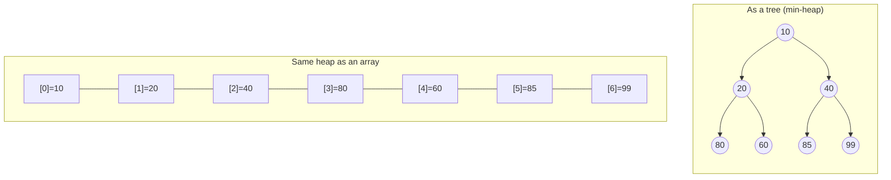
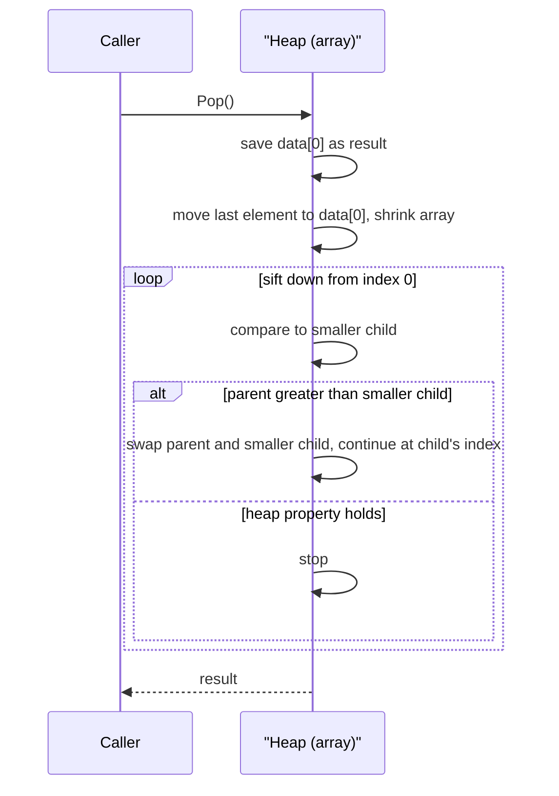

# Heaps and Priority Queues

> [!summary] TL;DR
> A heap is a tree-shaped structure, stored in a plain array, that keeps the minimum (or maximum) element accessible in O(1) while push and pop both cost O(log n). It is the data structure behind priority queues: "give me the most urgent item next," not "give me items in the order I added them."

> [!abstract] Core idea
> - A binary heap is a **complete binary tree** stored as a flat array — no pointers, just index arithmetic: children of index `i` are at `2i+1` and `2i+2`.
> - It only guarantees parent ≤ children (min-heap) or parent ≥ children (max-heap) — it is **not fully sorted**, unlike a BST.
> - Push appends then "sifts up"; pop swaps the root with the last element then "sifts down" — both O(log n).
> - Go's `container/heap` turns any type implementing a 5-method interface into a heap; Go's own runtime uses a 4-ary heap for per-thread timers.

## 1. Why it exists

Say a job scheduler holds 100,000 pending tasks, each with a deadline, and must always run whichever task is most urgent next — not the one that arrived first (that's a queue) and not any task picked at random. Keeping the list fully sorted would cost `O(n log n)` to build and `O(n)` per insert (shifting a sorted array) just to keep that order as new tasks arrive constantly.

A heap gives up full sorting and keeps only the single invariant the scheduler actually needs — "the root is always the most urgent" — which is far cheaper to maintain: `O(log n)` to insert a new task, `O(log n)` to remove the most urgent one, `O(1)` to peek at it. This is also exactly the data structure behind Dijkstra's and A\*'s "always process the closest/cheapest frontier node next" (see [[Graphs and Graph Algorithms]]).

## 2. Mental model

Think of a heap as a family tree of priorities, not values: a manager's priority is always at least as urgent as their direct reports' (for a min-heap, "urgent" means a small number). You can promise nothing about how a manager's priority compares to a *different* manager's reports — only the direct parent-child relationship is constrained. That weaker promise is exactly why building and maintaining a heap is cheaper than keeping everything fully sorted.

## 3. How it works

### Array layout of a complete binary tree

A heap is a **complete binary tree**: every level is full except possibly the last, which fills left to right with no gaps. That completeness is what lets it live in a plain array with no pointers:

- Node at index `i` has children at `2i+1` (left) and `2i+2` (right).
- Node at index `i` has parent at `(i-1)/2` (integer division).



`[1]`'s children are at `2·1+1=3` (`80`) and `2·1+2=4` (`60`) — exactly matching the tree picture.

### Push: append, then sift up

Add the new element at the end of the array (the next open leaf slot), then compare it to its parent and swap upward as long as it's smaller (min-heap) than its parent. Cost: `O(log n)`, bounded by the tree's height.

### Pop: swap with the last element, then sift down

Swap the root (the element being removed) with the last element in the array, shrink the array by one, then repeatedly compare the new root to its smaller child and swap downward until the heap property holds again. Cost: `O(log n)`.



### Heapify: building a heap in O(n), not O(n log n)

Naively calling push `n` times costs `O(n log n)`. Instead, **heapify** starts from the last *non-leaf* node (`index = n/2 - 1`) and sifts each one down, working backward to the root. Because most nodes in a complete binary tree are near the bottom (where sift-down does almost no work), the total cost sums to `O(n)` — a classic amortized-analysis result, not an estimate.

### Heapsort

Build a max-heap in place (`O(n)`), then repeatedly swap the root (the current maximum) with the last unsorted element and sift down the shrunken heap. This sorts in `O(n log n)` time with `O(1)` extra space — in place, unlike merge sort.

## 4. Worked example

### Whiteboard version

The bare mechanism: push and pop with sift-up/down, no heapify yet.

```go
type MinHeap struct{ data []int }

func (h *MinHeap) Push(v int) {
	h.data = append(h.data, v)
	i := len(h.data) - 1
	for i > 0 && h.data[(i-1)/2] > h.data[i] {
		h.data[(i-1)/2], h.data[i] = h.data[i], h.data[(i-1)/2]
		i = (i - 1) / 2
	}
}
```

The full version adds `Peek`, `Pop`, and `O(n)` heapify construction from an existing slice:

```go
package pq

// MinHeap is a binary min-heap stored in a slice.
type MinHeap struct {
	data []int
}

// NewMinHeap builds a heap from nums in O(n) using bottom-up heapify.
func NewMinHeap(nums []int) *MinHeap {
	h := &MinHeap{data: append([]int(nil), nums...)}
	for i := len(h.data)/2 - 1; i >= 0; i-- {
		h.siftDown(i)
	}
	return h
}

func (h *MinHeap) Len() int { return len(h.data) }

func (h *MinHeap) Peek() (int, bool) {
	if len(h.data) == 0 {
		return 0, false
	}
	return h.data[0], true
}

func (h *MinHeap) Push(v int) {
	h.data = append(h.data, v)
	h.siftUp(len(h.data) - 1)
}

func (h *MinHeap) Pop() (int, bool) {
	n := len(h.data)
	if n == 0 {
		return 0, false
	}
	top := h.data[0]
	h.data[0] = h.data[n-1]
	h.data = h.data[:n-1]
	if len(h.data) > 0 {
		h.siftDown(0)
	}
	return top, true
}

func (h *MinHeap) siftUp(i int) {
	for i > 0 {
		parent := (i - 1) / 2
		if h.data[parent] <= h.data[i] {
			break
		}
		h.data[parent], h.data[i] = h.data[i], h.data[parent]
		i = parent
	}
}

func (h *MinHeap) siftDown(i int) {
	n := len(h.data)
	for {
		left, right := 2*i+1, 2*i+2
		smallest := i
		if left < n && h.data[left] < h.data[smallest] {
			smallest = left
		}
		if right < n && h.data[right] < h.data[smallest] {
			smallest = right
		}
		if smallest == i {
			return
		}
		h.data[i], h.data[smallest] = h.data[smallest], h.data[i]
		i = smallest
	}
}
```

Test proving pop order is always ascending (the min-heap invariant actually works):

```go
func TestMinHeapPushPopIsSorted(t *testing.T) {
	h := NewMinHeap(nil)
	for _, v := range []int{5, 3, 8, 1, 9, 2, 7} {
		h.Push(v)
	}
	var got []int
	for h.Len() > 0 {
		v, _ := h.Pop()
		got = append(got, v)
	}
	want := []int{1, 2, 3, 5, 7, 8, 9}
	if !reflect.DeepEqual(got, want) {
		t.Fatalf("pop order = %v; want %v", got, want)
	}
}
```

**Measured** (Go 1.24.4, `go test -race`): `NewMinHeap([]int{9,4,7,1,2})` (O(n) heapify) puts `1` at the root in a single call, confirmed by `Peek()`.

### Go's `container/heap`: the standard interface

Go's standard library doesn't ship a heap type directly — it ships `container/heap`, which turns *any* type satisfying a 5-method interface (`sort.Interface`'s `Len`/`Less`/`Swap`, plus `Push`/`Pop`) into a heap. This is the idiomatic way to build a priority queue in Go, used for scheduled-job queues and Dijkstra's frontier alike:

```go
package pq

import "container/heap"

// Task is one item in a priority queue of scheduled work: lower Priority
// runs first — the same shape a job scheduler or timer heap uses.
type Task struct {
	Name     string
	Priority int
	index    int // maintained by heap.Interface for Fix/Remove
}

type TaskQueue []*Task

func (q TaskQueue) Len() int           { return len(q) }
func (q TaskQueue) Less(i, j int) bool { return q[i].Priority < q[j].Priority }
func (q TaskQueue) Swap(i, j int) {
	q[i], q[j] = q[j], q[i]
	q[i].index = i
	q[j].index = j
}

func (q *TaskQueue) Push(x any) {
	t := x.(*Task)
	t.index = len(*q)
	*q = append(*q, t)
}

func (q *TaskQueue) Pop() any {
	old := *q
	n := len(old)
	t := old[n-1]
	old[n-1] = nil // avoid a memory leak: drop the pointer
	*q = old[:n-1]
	return t
}

// Reprioritize changes t's priority and restores heap order in O(log n)
// via heap.Fix, instead of removing and re-pushing.
func (q *TaskQueue) Reprioritize(t *Task, newPriority int) {
	t.Priority = newPriority
	heap.Fix(q, t.index)
}
```

Test proving `heap.Fix` re-orders correctly after a priority changes mid-flight:

```go
func TestTaskQueueOrderAndFix(t *testing.T) {
	q := &TaskQueue{}
	heap.Init(q)
	low := &Task{Name: "low", Priority: 10}
	mid := &Task{Name: "mid", Priority: 5}
	high := &Task{Name: "high", Priority: 1}
	heap.Push(q, low)
	heap.Push(q, mid)
	heap.Push(q, high)

	first := heap.Pop(q).(*Task)
	if first.Name != "high" {
		t.Fatalf("first popped = %s; want high", first.Name)
	}
	q.Reprioritize(mid, 0) // mid is now the most urgent
	second := heap.Pop(q).(*Task)
	if second.Name != "mid" {
		t.Fatalf("second popped = %s; want mid after Reprioritize", second.Name)
	}
}
```

### Top-K with a size-K heap

Finding the K largest of n items by sorting everything costs `O(n log n)`. Keeping a size-K **min**-heap instead — push while under K, otherwise compare the new value to the heap's current minimum and replace-and-sift if larger — costs `O(n log k)`, far cheaper when `k ≪ n`:

```go
func TopKLargest(nums []int, k int) []int {
	h := &intMinHeap{}
	heap.Init(h)
	for _, v := range nums {
		if h.Len() < k {
			heap.Push(h, v)
			continue
		}
		if v > (*h)[0] {
			(*h)[0] = v
			heap.Fix(h, 0)
		}
	}
	// ... collect and sort the k-sized result for a stable answer
}
```

Test: `TopKLargest([]int{3,1,5,12,2,11,9,7}, 3)` returns `[9, 11, 12]` — measured directly against a `sort`-based reference in the same test file.

### K-way merge with a heap

Merging `k` already-sorted lists (or log files, or sorted result pages from `k` shards) naively costs `O(n log k)` if done pairwise one list at a time, or worse if done badly. A min-heap makes it clean: seed the heap with the first element of each of the `k` lists (`O(k log k)`), then repeatedly pop the smallest, append it to the output, and push the next element from whichever list that value came from. Each of the `n` total elements is pushed and popped once, so the whole merge costs `O(n log k)` — the same shape as top-K, because both are "keep only the `k` currently-relevant candidates in a heap instead of looking at everything."

### Running median with two heaps

A classic interview problem: maintain the median of a stream of numbers as they arrive, one at a time. The trick is **two heaps**: a max-heap for the smaller half of the numbers seen so far, a min-heap for the larger half, kept balanced to within one element of each other. The median is then `O(1)` to read — it's the top of the larger heap, or the average of both tops if they're equal in size:

```go
func (m *MedianFinder) Add(v int) {
	if m.lower.Len() == 0 || v <= m.lower[0] {
		heap.Push(&m.lower, v)
	} else {
		heap.Push(&m.upper, v)
	}
	if m.lower.Len() > m.upper.Len()+1 {
		heap.Push(&m.upper, heap.Pop(&m.lower))
	} else if m.upper.Len() > m.lower.Len()+1 {
		heap.Push(&m.lower, heap.Pop(&m.upper))
	}
}
```

Test: adding the stream `5, 15, 1, 3` produces medians `5, 10, 5, 4` after each step — matching hand computation (`{5}→5`, `{5,15}→10`, `{1,5,15}→5`, `{1,3,5,15}→4`), confirmed by `go test -race`.

## 5. Variants and comparison

| Structure | Peek min/max | Push | Pop | Arbitrary search | Use when |
|---|---|---|---|---|---|
| Binary heap (array) | O(1) | O(log n) | O(log n) | O(n) | General-purpose priority queue |
| 4-ary heap | O(1) | O(log₄ n) | O(log₄ n), more comparisons per level | O(n) | Fewer levels, more children to compare per sift-down; Go's runtime timer heap uses this |
| Sorted array | O(1) | O(n) | O(n) or O(1) at the sorted end | O(log n) | Rare writes, frequent range queries |
| Balanced BST (as a priority queue) | O(log n) | O(log n) | O(log n) | O(log n) | You also need arbitrary search/ordering, not just min/max — see [[Trees, BSTs and Balanced Trees]] |
| Fibonacci heap | O(1) amortized | O(1) amortized | O(log n) amortized | O(n) | Theoretical: improves Dijkstra's asymptotic bound, rarely used in practice due to large constants |

## 6. Trade-offs and when not to use

- A heap is **not fully sorted** — you can only cheaply extract the min (or max), not ask "what's the 2nd smallest?" without popping the first.
- `O(n)` arbitrary search: if you need to frequently check "is X anywhere in here?" or update an arbitrary element's priority *without already holding its index*, a heap alone is the wrong structure — pair it with a hash map from key to heap index (as `TaskQueue.index` does above) if you need `Reprioritize`/`Remove` by key.
- For a small, fixed k (top-K problems), a size-k heap beats sorting everything; but if k is close to n, just sort.
- Heap operations on pointer-heavy elements (not plain ints) still only move pointers during swaps, but comparison cost can dominate if `Less` is expensive — keep comparisons cheap.

## 7. In production

- **Real systems:**
	- Go's own runtime keeps each P's (processor's) pending timers in a **4-ary heap** (`runtime/time.go`), not binary — fewer tree levels for the same number of timers means fewer cache-line jumps per sift, at the cost of comparing up to 4 children instead of 2 per step. `time.Timer`, `time.After`, and context deadlines all ultimately sit in this structure.
	- Dijkstra's algorithm and A\* use a min-heap as the "frontier": always expand the closest/cheapest unvisited node next (see [[Graphs and Graph Algorithms]]).
	- OS process schedulers and job queues (delayed and recurring job systems) use a priority queue keyed by next-run time — see [[Scheduled Jobs - Cron to Durable Schedulers]] and [[CPU Scheduling]].
	- `heapsort` is used inside some standard-library sort implementations as the fallback when quicksort's recursion depth exceeds a threshold (introspective sort), to guarantee worst-case `O(n log n)` instead of quicksort's `O(n²)`.
- **Failure modes → fixes:**
	- "Heap" the data structure confused with **heap memory** (the region the garbage collector manages) — these are unrelated concepts that happen to share a name; see [[Process Memory Layout - Stack vs Heap]] for the memory one.
	- Stale entries in a priority queue (a task was canceled but its heap entry wasn't removed) → lazy deletion: check validity when popped and skip/discard stale entries, or maintain an index map for `O(log n)` true removal.
	- Unbounded growth of a job queue under sustained overload → bound queue size, shed or reprioritize lowest-priority work, and monitor queue depth.
- **What to monitor:** queue depth (`Len()`), time an item spends in the queue before being popped (queueing delay), and for a job scheduler specifically, how often `Reprioritize`/`Fix` fires vs. plain push/pop.

## 8. Deep dive

### Why heapify is O(n), not O(n log n)

A naive argument says "sift-down costs O(log n), and we call it n/2 times, so it's O(n log n)." That overcounts: sift-down's cost is bounded by a node's **height in the tree**, not the tree's overall height, and in a complete binary tree, half the nodes are leaves (height 0, no work), a quarter are at height 1, an eighth at height 2, and so on. Summing `(height) × (count of nodes at that height)` across all levels gives a series that converges to `O(n)` — the same style of amortized argument as dynamic array growth.

### Decrease-key and why plain `container/heap` doesn't give you one

Dijkstra's classic textbook presentation calls for a "decrease-key" operation: when you find a cheaper path to a node already in the frontier, lower its priority in place. Go's `container/heap` doesn't expose that directly — you implement it yourself via `heap.Fix(h, index)` once you know the element's current index, which is why the `TaskQueue` example above tracks `index` as a field on each element, updated inside `Swap`. Without that index bookkeeping, "find this element to fix its priority" would cost `O(n)`, defeating the purpose.

### Heap vs. heap memory

These names collide by historical accident, not by design: "heap" the data structure (this note) is unrelated to "heap" the memory region the Go runtime manages for dynamically allocated objects, freed by the garbage collector. Confusing them is a common interview slip — see [[Process Memory Layout - Stack vs Heap]] for the latter.

### Classic practice problems

**Kth largest element** (a size-k min-heap, same pattern as `TopKLargest` above, or `quickselect` for O(n) average without a heap); **top-K frequent elements** (hash map to count frequencies, then a size-k min-heap keyed by count); **meeting rooms II** (minimum rooms needed for overlapping intervals: a min-heap of end times — push a new meeting's end time, and if the earliest end time is ≤ the new meeting's start, pop it first, reusing that room); **task scheduler** (CPU task scheduling with a cooldown between identical tasks: a max-heap of remaining counts per task type, greedily running the most frequent task available each cycle).

## 9. Interview questions

> [!question]- Why is building a heap from n elements O(n) instead of O(n log n)?
> Sift-down's cost is bounded by a node's height, not the whole tree's height, and most nodes in a complete binary tree are near the bottom where sift-down does almost no work. Summing cost-by-height across the whole tree converges to O(n), not O(n log n).

> [!question]- How would you find the k largest elements of a huge, unsorted stream?
> Keep a size-k min-heap: push the first k elements, then for each remaining element compare it to the heap's minimum (the root) and replace-and-sift-down only if it's larger. Total cost O(n log k), much cheaper than sorting everything when k is small.

> [!question]- Trap: is a heap a sorted structure?
> No. A heap only guarantees parent ≤ children (min-heap), so you can extract the minimum cheaply, but the rest of the structure is not in sorted order — you cannot read off the 2nd-smallest element without popping the smallest first.

> [!question]- Why does Go's runtime use a 4-ary heap for timers instead of a binary heap?
> Fewer levels for the same number of elements (log base 4 instead of log base 2) means fewer cache-line jumps during sift operations, which matters more than the extra comparisons per level (up to 4 children instead of 2) on modern hardware where memory latency dominates raw comparison cost.

> [!question]- How do you implement a priority queue in Go?
> Implement `container/heap`'s interface — `Len`, `Less`, `Swap` (from `sort.Interface`) plus `Push` and `Pop` — on a slice type, then drive it with `heap.Init`, `heap.Push`, `heap.Pop`, and `heap.Fix` for in-place priority changes.

> [!question]- How would you maintain a running median of a number stream?
> Two heaps: a max-heap for the smaller half of values seen, a min-heap for the larger half, rebalanced after every insert so their sizes never differ by more than one. The median is then O(1) to read from the tops.

> [!question]- Trap: are "heap" (data structure) and "heap memory" the same thing?
> No, despite the shared name. The heap data structure is a tree-shaped priority structure (this note); heap memory is the region a garbage collector manages for dynamically allocated objects — see [[Process Memory Layout - Stack vs Heap]].

## 10. Cheat sheet

- Array layout: children of index `i` at `2i+1`, `2i+2`; parent at `(i-1)/2`.
- Push = append + sift-up, O(log n). Pop = swap root with last + sift-down, O(log n). Peek = O(1).
- Heapify an existing slice in O(n), not O(n log n) — start from the last non-leaf node.
- Heapsort: build a max-heap, then repeatedly swap root to the end and shrink — O(n log n), O(1) extra space.
- Go: implement `container/heap`'s 5-method interface; use `heap.Fix` for in-place priority changes, not remove-and-re-push.
- Top-K: a size-k min-heap, O(n log k), beats sorting everything when k is small.
- K-way merge: seed a min-heap with the first element of each of the k sorted lists, pop-and-replace one at a time — O(n log k) total.
- Running median: two heaps (max-heap for the lower half, min-heap for the upper half), kept balanced within one element.
- Go's runtime timer heap is 4-ary, not binary — fewer levels, more children per comparison.
- "Heap" the data structure and "heap memory" are unrelated ideas that share a name.

## Links

- **Before this:** [[Arrays and Dynamic Arrays (Go Slices)]], [[Trees, BSTs and Balanced Trees]]
- **Next:** [[Graphs and Graph Algorithms]], [[Scheduled Jobs - Cron to Durable Schedulers]]
- **Compare with:** [[Trees, BSTs and Balanced Trees]] (full ordering vs. a heap's weaker parent/child-only guarantee)
