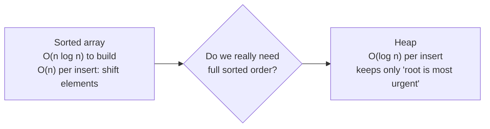
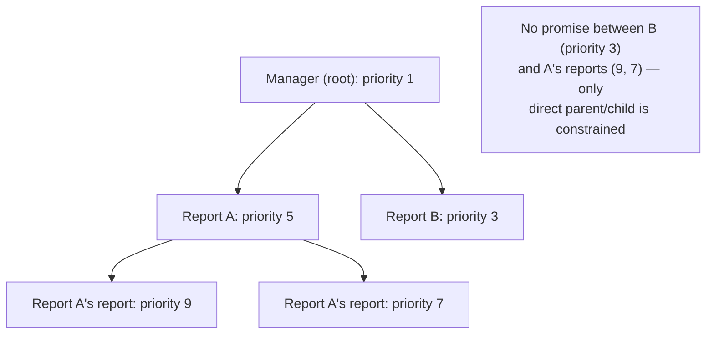
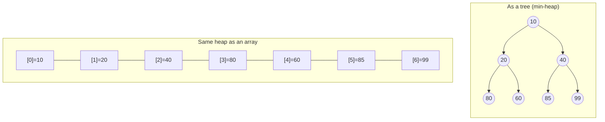
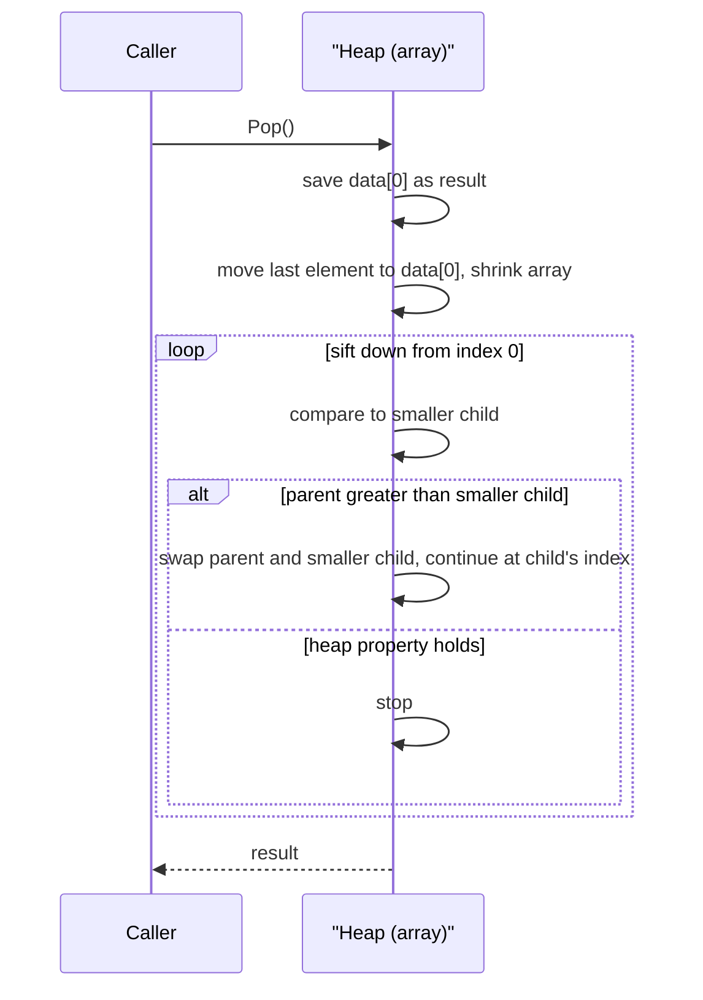
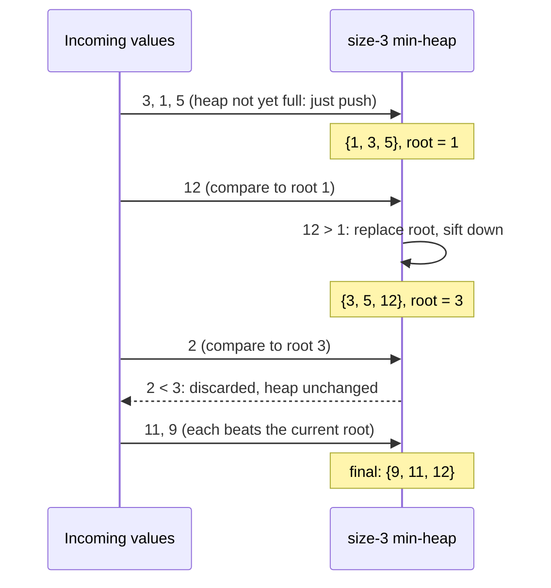
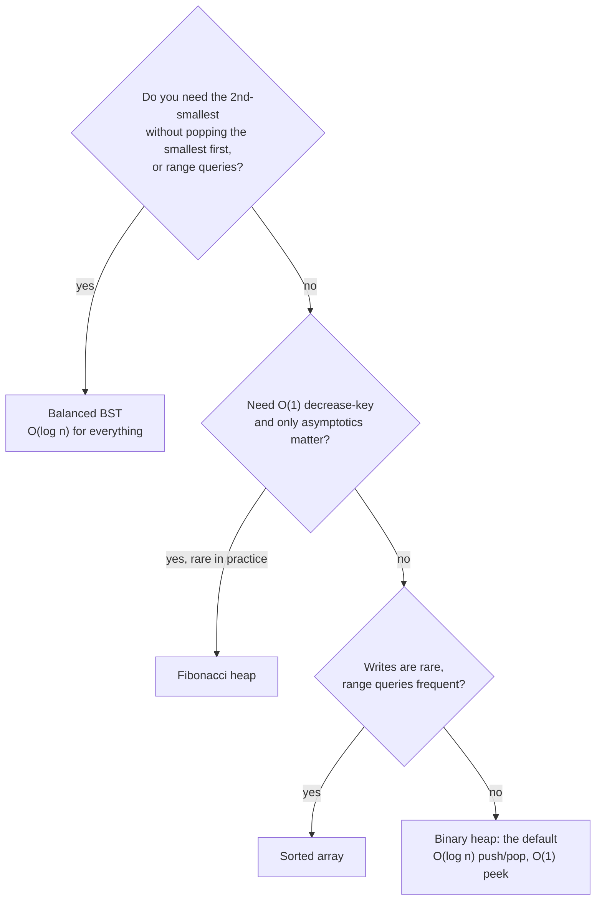
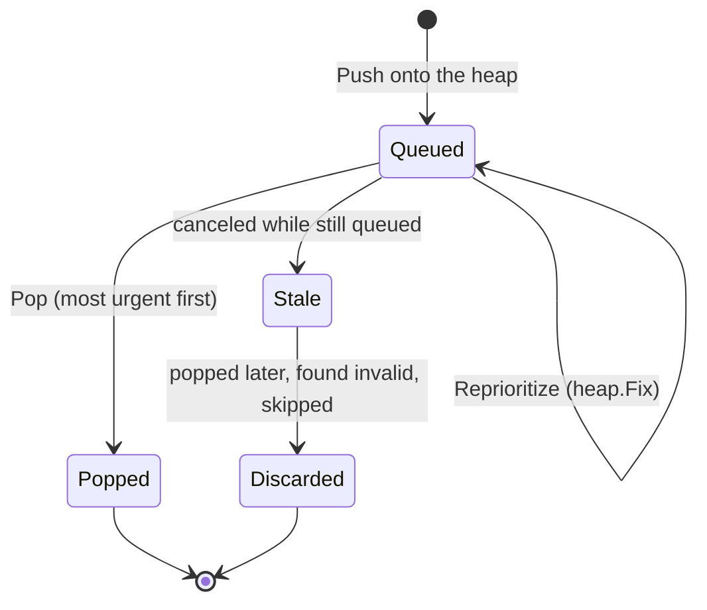

# Heaps and Priority Queues

> [!summary] TL;DR
> A heap is a tree-shaped structure, stored in a plain array, that keeps the minimum (or maximum) element accessible in O(1) while push and pop both cost O(log n). It is the data structure behind priority queues: "give me the most urgent item next," not "give me items in the order I added them."

> [!abstract] Core idea
> - A binary heap is a **complete binary tree** stored as a flat array — no pointers, just index arithmetic: children of index `i` are at `2i+1` and `2i+2`.
> - It only guarantees parent ≤ children (min-heap) or parent ≥ children (max-heap) — it is **not fully sorted**, unlike a BST.
> - Push appends then "sifts up"; pop swaps the root with the last element then "sifts down" — both O(log n).
> - Go's `container/heap` turns any type implementing a 5-method interface into a heap; Go's own runtime uses a 4-ary heap for per-thread timers.

## 1. Why it exists

Say a job scheduler holds 100,000 pending tasks, each with a deadline, and must always run whichever task is most urgent next — not the one that arrived first (that's a queue, see [[Stacks, Queues and Deques]]) and not any task picked at random.

### 1.1 Why "keep it fully sorted" is too expensive

**In plain words:** you might think "just keep the list sorted by urgency." The problem is that keeping a list sorted while things keep arriving is expensive — a new arrival has to be inserted in the middle, which means shifting everything after it.

**Picture it:**



**Example:** inserting task 50,001 into a sorted array of 50,000 tasks means shifting, on average, 25,000 elements one slot over — just to keep the list ordered, even though the scheduler never asked "what's the 2nd most urgent task," only "what's the most urgent one."

**Why it matters:** a **priority queue** (defined properly below) gives up the guarantee nobody was using — full order — and keeps only the one guarantee the scheduler actually needs. That's the entire reason it's cheaper.

> [!tip] Remember
> If you only ever ask "give me the most urgent item," paying to keep *everything* sorted is wasted work. A heap pays for exactly the guarantee you use.

### 1.2 What a priority queue promises

A heap gives up full sorting and keeps only the single invariant the scheduler actually needs — "the root is always the most urgent" — which is far cheaper to maintain: `O(log n)` to insert a new task, `O(log n)` to remove the most urgent one, `O(1)` to peek at it.

This is also exactly the data structure behind Dijkstra's and A\*'s "always process the closest/cheapest frontier node next" (see [[Graphs and Graph Algorithms]]).

> [!tip] Remember
> A **priority queue** is the abstract promise ("give me the most urgent item"); a **heap** is the concrete array-based structure that delivers on it cheaply.

## 2. Mental model

**The hospital-triage-nurse analogy:** imagine a triage nurse managing patients in a waiting room. The nurse doesn't rank every patient against every other patient — that would take forever as new patients kept arriving. Instead, the nurse only promises: "the patient I call next is at least as urgent as anyone still waiting behind them." A manager's priority (in an org chart) works the same way: it's at least as urgent as their direct reports', but nothing is promised about how one manager's priority compares to a *different* manager's reports.

**Where the analogy breaks down:** a heap's "parent/child" relationship is strict array-index math (`2i+1`, `2i+2`), not an org chart that grows organically — and unlike a hospital queue, a heap has no notion of "patients who are tied," only the relative order the comparison function defines.



**Why it matters:** that weaker promise — only parent-vs-direct-child, nothing between unrelated branches — is exactly why building and maintaining a heap is cheaper than keeping everything fully sorted.

> [!tip] Remember
> A heap only constrains parent vs. its own children. Two "cousin" nodes can be in any order relative to each other.

## 3. How it works

### 3.1 Array layout of a complete binary tree

**In plain words:** a heap is a **complete binary tree**: every level is full except possibly the last, which fills left to right with no gaps. That completeness — no holes anywhere except possibly at the very end — is what lets it live in a plain array with no pointers at all.

- Node at index `i` has children at `2i+1` (left) and `2i+2` (right).
- Node at index `i` has parent at `(i-1)/2` (integer division).

**Picture it:**



**Example:** `[1]`'s children are at `2·1+1=3` (`80`) and `2·1+2=4` (`60`) — exactly matching the tree picture. No pointer was followed to find them; it's pure arithmetic on the index.

**Why it matters:** no pointers means no per-node allocation and excellent cache locality — a heap of a million ints is one contiguous slice, not a million scattered allocations the way a pointer-based tree would be.

> [!warning] Common mistake
> Assuming a heap is a binary search tree because both are "trees." A BST is ordered left-to-right (left subtree < node < right subtree); a heap only orders parent vs. child, with no left/right ordering promise at all. You cannot do an in-order traversal of a heap and get sorted output.

### 3.2 Push: append, then sift up

**In plain words:** add the new element at the end of the array (the next open leaf slot), then compare it to its parent and swap upward as long as it's smaller (min-heap) than its parent.

**Step by step:**
1. Append the new value to the end of the array — it's now a valid leaf, just possibly in the wrong place.
2. Compare it to its parent (`(i-1)/2`).
3. If it's smaller than its parent (for a min-heap), swap them.
4. Repeat from the new position until either the parent is smaller, or the element reaches the root.

**Example:** inserting `5` into `[10, 20, 40, 80, 60, 85, 99]` appends it at index 7, whose parent is index 3 (`80`). `5 < 80`, so swap: now index 3 holds `5`, whose parent is index 1 (`20`). `5 < 20`, swap again: now index 1 holds `5`, whose parent is index 0 (`10`). `5 < 10`, swap once more — `5` reaches the root in 3 swaps, bounded by the tree's height (`log₂ 8 ≈ 3`).

**Why it matters:** cost is `O(log n)`, bounded by the tree's height — doubling the number of elements adds only one more comparison, not twice the work.

> [!tip] Remember
> Push is "put it at the end, then let it bubble up to where it belongs" — never more swaps than the tree is tall.

### 3.3 Pop: swap with the last element, then sift down

**In plain words:** swap the root (the element being removed) with the last element in the array, shrink the array by one, then repeatedly compare the new root to its smaller child and swap downward until the heap property holds again.



**Example:** popping the root `10` from `[10, 20, 40, 80, 60, 85, 99]`: move the last element (`99`) to index 0, shrink to `[99, 20, 40, 80, 60, 85]`. Compare `99` to its children `20` and `40` — smaller child is `20`, so swap: `[20, 99, 40, 80, 60, 85]`. Now `99` is at index 1, whose only child is `60` (index 4) — swap again: `[20, 60, 40, 80, 99, 85]`. `99` has no children now, so sifting stops. Final array satisfies the heap property again.

**Why it matters:** cost is `O(log n)`, same bound as push — the single element that moved to the root sinks down at most one level per comparison.

> [!warning] Common mistake
> Forgetting to compare against *both* children and picking the smaller one. Comparing against only the left child (or only the right) can leave the heap property violated on the side you skipped.

> [!tip] Remember
> Pop always removes the root; the array never develops a "hole" because the last element fills it before sifting begins.

### 3.4 Heapify: building a heap in O(n), not O(n log n)

**In plain words:** naively calling push `n` times costs `O(n log n)`. Instead, **heapify** starts from the last *non-leaf* node (`index = n/2 - 1`) and sifts each one down, working backward toward the root.

**Why this is cheaper:** most nodes in a complete binary tree are near the bottom, where sift-down does almost no work (a leaf needs zero sift-down steps; a node one level up needs at most one). Summing the cost across every level of the tree converges to `O(n)` total — a classic amortized-analysis result, not an estimate (worked out fully in the deep dive).

**What happens if you built a heap by pushing one element at a time instead?** It would still end up correct, just slower: `O(n log n)` instead of `O(n)`, because each of the `n` pushes individually costs up to `O(log n)`, and there's no way for those individual costs to "share" work the way heapify's bottom-up sift-downs do.

> [!tip] Remember
> Building from a known slice: always prefer heapify (`O(n)`) over `n` individual pushes (`O(n log n)`).

### 3.5 Heapsort

**In plain words:** build a max-heap in place (`O(n)`), then repeatedly swap the root (the current maximum) with the last unsorted element and sift down the shrunken heap.

**Example:** with 5 elements, heapify costs `O(5)`, then 4 pop-like swaps each cost up to `O(log 5) ≈ 3` comparisons — the whole sort finishes in `O(n log n)` time using only `O(1)` extra space, because every swap happens within the original array.

**Why it matters:** unlike merge sort, heapsort needs no second array — it sorts in place, which is why some standard-library sort implementations fall back to it as a worst-case guarantee (see the production section).

> [!tip] Remember
> Heapsort = build a max-heap, then "pop" repeatedly into the space the heap is vacating. Same `O(n log n)` as merge sort, but `O(1)` extra space instead of `O(n)`.

## 4. Worked example

### Whiteboard version

The bare mechanism: push and pop with sift-up/down, no heapify yet.

```go
func (h *MinHeap) Push(v int) {
	h.data = append(h.data, v)
	i := len(h.data) - 1
	for i > 0 && h.data[(i-1)/2] > h.data[i] {
		h.data[(i-1)/2], h.data[i] = h.data[i], h.data[(i-1)/2]
		i = (i - 1) / 2
	}
}
```

That's the whole mechanism from §3.2, made literal: append, then swap upward while the parent is bigger. The runnable version adds `Peek`, `Pop`, and `O(n)` heapify construction from an existing slice.

### Tracing a size-K top-K scan

A common real use is scanning a huge stream and keeping only the `k` largest values seen so far, using a size-`k` **min**-heap (counter-intuitively, min — the smallest of the "keepers" sits at the root, ready to be evicted the moment something bigger shows up).

1. Start with an empty min-heap and `k = 3`.
2. Values arrive one at a time: `3, 1, 5, 12, 2, 11, 9, 7`.
3. While the heap holds fewer than `k` elements, just push: after `3, 1, 5` the heap holds `{1, 3, 5}` (root `1`, the smallest of the three kept so far).
4. Next value `12` arrives. Compare it to the root (`1`): `12 > 1`, so `12` beats the weakest kept value — replace the root with `12` and sift down. Heap is now `{3, 5, 12}` (root `3`).
5. Next value `2` arrives. Compare to root `3`: `2 < 3`, so `2` is *not* one of the top 3 — discard it, heap unchanged.
6. Continue through `11` (beats root `3` → heap becomes `{5, 11, 12}`) and `9` (beats root `5` → heap becomes `{9, 11, 12}`); `7` does not beat root `9` → discarded.
7. Final heap `{9, 11, 12}` — exactly the 3 largest values in the stream, found in `O(n log k)` instead of sorting all 8 values in `O(n log n)`.



**Measured** (Go 1.24.4, `go test -race`): `TopKLargest([]int{3,1,5,12,2,11,9,7}, 3)` returns `[9, 11, 12]`, matching the trace above and a `sort`-based reference answer in the same test.

Runnable Go version: [[Heaps and Priority Queues - Go]]

> [!tip] Remember
> For "top k of a huge stream," a size-k heap costs `O(n log k)` — far cheaper than sorting everything (`O(n log n)`) once `k` is much smaller than `n`.

## 5. Variants and comparison

| Structure | Peek min/max | Push | Pop | Arbitrary search | Use when |
|---|---|---|---|---|---|
| Binary heap (array) | O(1) | O(log n) | O(log n) | O(n) | General-purpose priority queue |
| 4-ary heap | O(1) | O(log₄ n) | O(log₄ n), more comparisons per level | O(n) | Fewer levels, more children to compare per sift-down; Go's runtime timer heap uses this |
| Sorted array | O(1) | O(n) | O(n) or O(1) at the sorted end | O(log n) | Rare writes, frequent range queries |
| Balanced BST (as a priority queue) | O(log n) | O(log n) | O(log n) | O(log n) | You also need arbitrary search/ordering, not just min/max — see [[Trees, BSTs and Balanced Trees]] |
| Fibonacci heap | O(1) amortized | O(1) amortized | O(log n) amortized | O(n) | Theoretical: improves Dijkstra's asymptotic bound, rarely used in practice due to large constants |



## 6. Trade-offs and when not to use

- A heap is **not fully sorted** — you can only cheaply extract the min (or max), not ask "what's the 2nd smallest?" without popping the first.
- `O(n)` arbitrary search: if you need to frequently check "is X anywhere in here?" or update an arbitrary element's priority *without already holding its index*, a heap alone is the wrong structure — pair it with a hash map from key to heap index if you need `Reprioritize`/`Remove` by key (see the Go note for exactly this pattern).
- For a small, fixed k (top-K problems), a size-k heap beats sorting everything; but if k is close to n, just sort.
- Heap operations on pointer-heavy elements (not plain ints) still only move pointers during swaps, but comparison cost can dominate if `Less` is expensive — keep comparisons cheap.

> [!warning] Common mistake
> Reaching for a heap to answer "is X in this collection?" A heap gives you that only in `O(n)` — the same as an unsorted list. Use a hash table ([[Hash Tables and Go Maps]]) for membership checks, and a heap only for "what's the most/least urgent."

## 7. In production

- **Real systems:**
	- Go's own runtime keeps each P's (processor's) pending timers in a **4-ary heap** (`runtime/time.go`), not binary — fewer tree levels for the same number of timers means fewer cache-line jumps per sift, at the cost of comparing up to 4 children instead of 2 per step. `time.Timer`, `time.After`, and context deadlines all ultimately sit in this structure.
	- Dijkstra's algorithm and A\* use a min-heap as the "frontier": always expand the closest/cheapest unvisited node next (see [[Graphs and Graph Algorithms]]).
	- OS process schedulers and job queues (delayed and recurring job systems) use a priority queue keyed by next-run time — see [[Scheduled Jobs - Cron to Durable Schedulers]] and [[CPU Scheduling]].
	- `heapsort` is used inside some standard-library sort implementations as the fallback when quicksort's recursion depth exceeds a threshold (introspective sort), to guarantee worst-case `O(n log n)` instead of quicksort's `O(n²)`.
- **Failure modes → fixes:**
	- "Heap" the data structure confused with **heap memory** (the region the garbage collector manages) — these are unrelated concepts that happen to share a name; see [[Process Memory Layout - Stack vs Heap]] for the memory one.
	- Stale entries in a priority queue (a task was canceled but its heap entry wasn't removed) → lazy deletion: check validity when popped and skip/discard stale entries, or maintain an index map for `O(log n)` true removal.
	- Unbounded growth of a job queue under sustained overload → bound queue size, shed or reprioritize lowest-priority work, and monitor queue depth.
- **What to monitor:** queue depth (`Len()`), time an item spends in the queue before being popped (queueing delay), and for a job scheduler specifically, how often `Reprioritize`/`Fix` fires vs. plain push/pop.



## 8. Deep dive

### Why heapify is O(n), not O(n log n)

A naive argument says "sift-down costs O(log n), and we call it n/2 times, so it's O(n log n)." That overcounts: sift-down's cost is bounded by a node's **height in the tree**, not the tree's overall height, and in a complete binary tree, half the nodes are leaves (height 0, no work), a quarter are at height 1, an eighth at height 2, and so on.

| Height above leaves | Fraction of nodes at that height | Max sift-down work per node |
|---|---|---|
| 0 (leaves) | 1/2 | 0 |
| 1 | 1/4 | 1 |
| 2 | 1/8 | 2 |
| 3 | 1/16 | 3 |
| … | … | … |

Summing `(height) × (fraction of nodes at that height) × n` across all levels gives a series that converges to `O(n)` total work — the same style of amortized argument as dynamic array growth in [[Arrays and Dynamic Arrays (Go Slices)]].

### Decrease-key and why plain `container/heap` doesn't give you one

Dijkstra's classic textbook presentation calls for a "decrease-key" operation: when you find a cheaper path to a node already in the frontier, lower its priority in place. Go's `container/heap` doesn't expose that directly — you implement it yourself via `heap.Fix(h, index)` once you know the element's current index, which is why a task-queue implementation tracks `index` as a field on each element, updated inside `Swap` (see the Go note). Without that index bookkeeping, "find this element to fix its priority" would cost `O(n)`, defeating the purpose.

### Heap vs. heap memory

These names collide by historical accident, not by design: "heap" the data structure (this note) is unrelated to "heap" the memory region the Go runtime manages for dynamically allocated objects, freed by the garbage collector. Confusing them is a common interview slip — see [[Process Memory Layout - Stack vs Heap]] for the latter.

### Classic practice problems

**Kth largest element** (a size-k min-heap, same pattern as the top-K trace above, or `quickselect` for O(n) average without a heap); **top-K frequent elements** (hash map to count frequencies, then a size-k min-heap keyed by count); **meeting rooms II** (minimum rooms needed for overlapping intervals: a min-heap of end times — push a new meeting's end time, and if the earliest end time is ≤ the new meeting's start, pop it first, reusing that room); **task scheduler** (CPU task scheduling with a cooldown between identical tasks: a max-heap of remaining counts per task type, greedily running the most frequent task available each cycle); **k-way merge** (merging `k` already-sorted lists: seed a min-heap with the first element of each list in `O(k log k)`, then repeatedly pop the smallest, append it to the output, and push the next element from whichever list it came from — the whole merge costs `O(n log k)`, the same shape as top-K because both keep only the `k` currently-relevant candidates in the heap); **running median of a stream** (two heaps — a max-heap for the smaller half of numbers seen, a min-heap for the larger half, rebalanced after every insert so their sizes never differ by more than one — the median is then `O(1)` to read, the top of the larger heap or the average of both tops if equal in size; see the Go note for a full runnable `MedianFinder`).

## 9. Interview questions

> [!question]- Why is building a heap from n elements O(n) instead of O(n log n)?
> Sift-down's cost is bounded by a node's height, not the whole tree's height, and most nodes in a complete binary tree are near the bottom where sift-down does almost no work. Summing cost-by-height across the whole tree converges to O(n), not O(n log n).

> [!question]- How would you find the k largest elements of a huge, unsorted stream?
> Keep a size-k min-heap: push the first k elements, then for each remaining element compare it to the heap's minimum (the root) and replace-and-sift-down only if it's larger. Total cost O(n log k), much cheaper than sorting everything when k is small.

> [!question]- Trap: is a heap a sorted structure?
> No. A heap only guarantees parent ≤ children (min-heap), so you can extract the minimum cheaply, but the rest of the structure is not in sorted order — you cannot read off the 2nd-smallest element without popping the smallest first.

> [!question]- Why does Go's runtime use a 4-ary heap for timers instead of a binary heap?
> Fewer levels for the same number of elements (log base 4 instead of log base 2) means fewer cache-line jumps during sift operations, which matters more than the extra comparisons per level (up to 4 children instead of 2) on modern hardware where memory latency dominates raw comparison cost.

> [!question]- How do you implement a priority queue in Go?
> Implement `container/heap`'s interface — `Len`, `Less`, `Swap` (from `sort.Interface`) plus `Push` and `Pop` — on a slice type, then drive it with `heap.Init`, `heap.Push`, `heap.Pop`, and `heap.Fix` for in-place priority changes.

> [!question]- How would you maintain a running median of a number stream?
> Two heaps: a max-heap for the smaller half of values seen, a min-heap for the larger half, rebalanced after every insert so their sizes never differ by more than one. The median is then O(1) to read from the tops.

> [!question]- Trap: are "heap" (data structure) and "heap memory" the same thing?
> No, despite the shared name. The heap data structure is a tree-shaped priority structure (this note); heap memory is the region a garbage collector manages for dynamically allocated objects — see [[Process Memory Layout - Stack vs Heap]].

## 10. Cheat sheet

- Array layout: children of index `i` at `2i+1`, `2i+2`; parent at `(i-1)/2`.
- Push = append + sift-up, O(log n). Pop = swap root with last + sift-down, O(log n). Peek = O(1).
- Heapify an existing slice in O(n), not O(n log n) — start from the last non-leaf node.
- Heapsort: build a max-heap, then repeatedly swap root to the end and shrink — O(n log n), O(1) extra space.
- Go: implement `container/heap`'s 5-method interface; use `heap.Fix` for in-place priority changes, not remove-and-re-push.
- Top-K: a size-k min-heap, O(n log k), beats sorting everything when k is small.
- K-way merge: seed a min-heap with the first element of each of the k sorted lists, pop-and-replace one at a time — O(n log k) total.
- Running median: two heaps (max-heap for the lower half, min-heap for the upper half), kept balanced within one element.
- Go's runtime timer heap is 4-ary, not binary — fewer levels, more children per comparison.
- "Heap" the data structure and "heap memory" are unrelated ideas that share a name.

## Links

- **Go implementation:** [[Heaps and Priority Queues - Go]]
- **Before this:** [[Arrays and Dynamic Arrays (Go Slices)]], [[Trees, BSTs and Balanced Trees]]
- **Next:** [[Graphs and Graph Algorithms]], [[Scheduled Jobs - Cron to Durable Schedulers]]
- **Compare with:** [[Trees, BSTs and Balanced Trees]] (full ordering vs. a heap's weaker parent/child-only guarantee)
