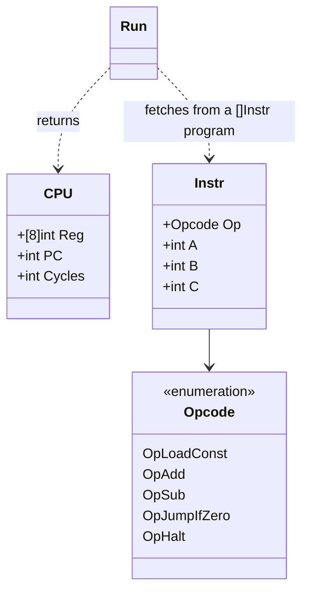
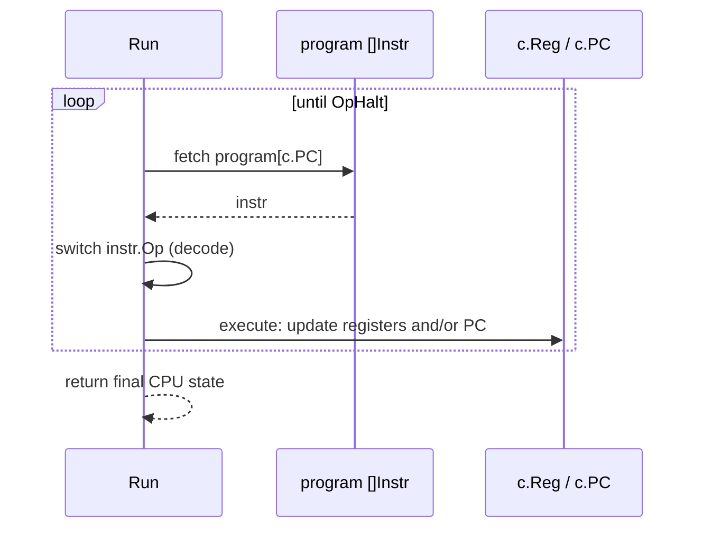

# How a Computer Runs a Program - Go

> [!summary] TL;DR
> A minimal register machine in about 60 lines of Go — five instructions, eight registers, one program counter — that makes [[How a Computer Runs a Program]]'s fetch-decode-execute loop runnable and steppable instead of only diagrammed.

## Before the code

- **Custom types (`type Opcode int`)**: give a plain `int` its own name so opcodes cannot be mixed up with other numbers.
- **`iota` constants**: Go numbers each constant in the block automatically (0, 1, 2, ...), like an instruction set assigning opcode numbers.
- **Structs and fixed arrays (`[8]int`)**: `CPU` and `Instr` group fields; an array has a size fixed at compile time, like a real register file.
- **`for {}` with `switch`**: an endless loop that exits only via `return`; the `switch` picks the code path per opcode.
- **`testing` package**: functions named `TestXxx` in `_test.go` files run with `go test`.
- **What to run**: `go vet ./... && go test -race -v ./...` inside the module.

## What this code shows

| Code | Concept in [[How a Computer Runs a Program]] |
| --- | --- |
| `CPU` struct | Registers and the program counter as the only directly-addressable state, [[How a Computer Runs a Program#2. Mental model]] |
| `Instr` / `Opcode` | An instruction as a fixed-shape value: opcode plus operands, [[How a Computer Runs a Program#1.1 The CPU understands only one thing]] |
| `Run`'s `for` loop | The fetch-decode-execute cycle itself, [[How a Computer Runs a Program#3.1 The fetch-decode-execute cycle]] |
| the `switch` inside `Run` | Decode (which case) + execute (the case body) in one place | 
| `TestCountdownSumsFiveToOne` | The worked trace: a loop summing 5 down to 1, [[How a Computer Runs a Program#Tracing fmt.Println hi through the pipeline]] |



The whole package is one function, `Run`, plus the two small types it operates on.

There is no assembler, no linker, no loader here — only the fetch-decode-execute loop itself, which is the one piece of the pipeline a few dozen lines of Go can make fully concrete.

## Setup

- Module `fde` with `fde.go` and `fde_test.go`.
- Go 1.24, standard library only (`testing`).
- Run: `go vet ./... && go test -race -v ./...`

## Code

### Step 1: instructions and CPU state

**Concept.** This is [[How a Computer Runs a Program#2. Mental model]]'s "eight sticky notes and a pointer finger" made literal as Go types.

`CPU` holds exactly the state that survives between instructions — registers and the program counter — matching the note's claim that registers are the CPU's only directly-addressable storage.

`Instr` is a fixed-shape value (an opcode plus up to three integer operands) rather than, say, a string to parse, because a real CPU's instructions are fixed-width binary, not text — parsing text at execution time would misrepresent the mechanism being taught.

```go
// Package fde is a minimal fetch-decode-execute loop: a tiny register machine
// with a program counter, a handful of registers, and five instructions. It
// exists to make the CPU's instruction cycle concrete, not to be a real VM.
package fde

// Opcode identifies one instruction.
type Opcode int

const (
	OpLoadConst Opcode = iota // LOADC rX, imm   -> reg[X] = imm
	OpAdd                     // ADD   rX, rY, rZ -> reg[X] = reg[Y] + reg[Z]
	OpSub                     // SUB   rX, rY, rZ -> reg[X] = reg[Y] - reg[Z]
	OpJumpIfZero              // JZ    rX, target -> if reg[X] == 0: PC = target
	OpHalt                    // HALT
)

// Instr is one fetched instruction: an opcode plus up to three operands.
type Instr struct {
	Op      Opcode
	A, B, C int
}
```

**How it works.**

1. `Opcode` is a Go `int` under an `iota` block — the same trick a real instruction set uses to assign a small binary number to each operation.
2. The comments on each constant (`LOADC rX, imm -> ...`) are the "assembly mnemonic" view of each opcode — exactly the symbolic layer [[How a Computer Runs a Program#3.2 Compile assemble link load]] describes the assembler as translating into binary.
3. `Instr.A`, `.B`, `.C` are reused differently per opcode (destination register, source registers, or a jump target) — a real instruction set does the same thing with fixed instruction-field layouts, just with bits instead of named struct fields.

```go
// CPU holds the architectural state that survives between instructions:
// registers and the program counter. Real CPUs add flags and a stack
// pointer; this one keeps only what the loop needs.
type CPU struct {
	Reg    [8]int
	PC     int
	Cycles int // one fetch-decode-execute iteration per increment
}
```

**How it works.**

1. `Reg [8]int` is a fixed-size array of 8 registers — deliberately small and fixed, like the real limited register files `3.1` describes.
2. `PC` is the program counter: the one piece of state that decides which instruction gets fetched next.
3. `Cycles` isn't architectural state a real CPU would expose this way — it's added purely so the test can assert that the loop actually ran at least once, a teaching convenience rather than a hardware feature.

### Step 2: the loop itself

**Concept.** `Run` *is* [[How a Computer Runs a Program#3.1 The fetch-decode-execute cycle]]: the `for` loop's body does fetch (`program[c.PC]`), decode (the `switch` on `instr.Op`), and execute (each `case`'s body) on every single iteration, exactly mirroring the note's three-stage diagram.

There is no separate "decode" step producing control signals the way real hardware does — the Go `switch` statement collapses decode and execute into one dispatch, which is the one simplification this teaching version takes versus real silicon.

```go
// Run executes program starting at PC=0 until OpHalt, and returns the final
// CPU state.
func Run(program []Instr) CPU {
	var c CPU
	for {
		// Fetch: read the instruction the PC points at.
		instr := program[c.PC]
		c.Cycles++

		// Decode + execute: the switch is the decoder, each case the
		// execute stage for that opcode.
		switch instr.Op {
		case OpLoadConst:
			c.Reg[instr.A] = instr.B
			c.PC++
		case OpAdd:
			c.Reg[instr.A] = c.Reg[instr.B] + c.Reg[instr.C]
			c.PC++
		case OpSub:
			c.Reg[instr.A] = c.Reg[instr.B] - c.Reg[instr.C]
			c.PC++
```

**How it works, so far.**

1. `instr := program[c.PC]` is fetch: it reads whatever instruction sits at the current program-counter position, exactly like a real CPU reading memory at the address the PC holds.
2. `c.Cycles++` happens once per loop iteration — one increment per fetch-decode-execute cycle, which is how the test below confirms the loop ran rather than returning immediately.
3. Every arithmetic case (`OpAdd`, `OpSub`, `OpLoadConst`) ends with `c.PC++`: "move to the next instruction" is the default writeback behavior, and it's explicit in every branch rather than implicit, matching how a real CPU's PC increment is itself just another step of the cycle.

The remaining two cases close out the `switch` and the function:

```go
		case OpJumpIfZero:
			if c.Reg[instr.A] == 0 {
				c.PC = instr.B
			} else {
				c.PC++
			}
		case OpHalt:
			return c
		default:
			panic("fde: unknown opcode")
		}
	}
}
```

**How it works, continued.**

4. `OpJumpIfZero` is the one case that *doesn't* always do `c.PC++` — it conditionally sets `PC` to a jump target instead, which is the entire mechanism behind loops and branches in real code.
5. `OpHalt` returns immediately instead of falling through to `c.PC++`, ending the loop — the only exit from the otherwise-infinite `for {}`.
6. The `default: panic(...)` case exists because `program[c.PC]` has no type-level guarantee of holding only valid opcodes — if a bug produced garbage in `instr.Op`, failing loudly beats silently doing nothing.



## Design decisions

| Decision | Alternative | Trade-off |
| --- | --- | --- |
| `switch` on `Opcode` for decode+execute | A jump table of function pointers per opcode | The switch is simpler to read and trace for teaching; a function-pointer table is closer to how some real decoders dispatch, at the cost of extra indirection. |
| Fixed `[8]int` register file | A `[]int` slice sized at construction | Matches a real CPU's fixed, small register count; a slice would allow an unrealistic "unlimited registers" machine. |
| `instr.A/B/C` reused per-opcode | A separate struct type per opcode | One struct keeps `Instr` a single, fixed-size value (closer to real fixed-width instruction encoding); separate types would need an interface or type switch to store in one `[]Instr` slice. |
| Panic on an unknown opcode | Silently ignore and continue | A loud failure surfaces a bug in the program slice immediately, rather than masking it as a silently-wrong result. |
| `Cycles` counter on `CPU` | No cycle counting at all | Lets the test assert the loop actually executed instructions, at the cost of one field that has no real hardware equivalent. |

## Tests

### TestCountdownSumsFiveToOne

**Property.** A small loop program — set a counter to 5, then repeatedly add the counter to an accumulator and decrement it until it hits zero — must produce the correct sum (`5+4+3+2+1 = 15`) and must actually execute at least one fetch-decode-execute cycle to get there.

This directly exercises every opcode except nothing is skipped: `OpLoadConst` (three times, for the initial values), `OpJumpIfZero` (both as the loop test and as the unconditional jump back), `OpAdd`, `OpSub`, and `OpHalt`.

| Register | Role | Starting value |
| --- | --- | --- |
| `r0` | loop counter | 5 |
| `r1` | accumulator | 0 |
| `r2` | constant 1 (subtracted each iteration) | 1 |
| `r7` | always 0 (used for an unconditional jump) | 0 (zero value, never set) |

| Input | Expected |
| --- | --- |
| Run the 8-instruction countdown-sum program | `cpu.Reg[1] == 15` |
| Same | `cpu.Cycles > 0` |

```go
func TestCountdownSumsFiveToOne(t *testing.T) {
	// r0 = counter (starts at 5), r1 = accumulator (starts at 0), r2 = constant 1
	program := []Instr{
		/*0*/ {Op: OpLoadConst, A: 0, B: 5},
		/*1*/ {Op: OpLoadConst, A: 1, B: 0},
		/*2*/ {Op: OpLoadConst, A: 2, B: 1},
		/*3*/ {Op: OpJumpIfZero, A: 0, B: 7}, // loop test: if counter == 0, exit
		/*4*/ {Op: OpAdd, A: 1, B: 1, C: 0},  // acc += counter
		/*5*/ {Op: OpSub, A: 0, B: 0, C: 2},  // counter -= 1
		/*6*/ {Op: OpJumpIfZero, A: 7, B: 3}, // r7 is always 0: unconditional jump back
		/*7*/ {Op: OpHalt},
	}

	cpu := Run(program)

	if got, want := cpu.Reg[1], 15; got != want {
		t.Fatalf("accumulator = %d, want %d", got, want)
	}
	if cpu.Cycles == 0 {
		t.Fatal("expected at least one fetch-decode-execute cycle")
	}
}
```

**How it works.**

1. Instructions 0–2 set up the three registers the loop needs: this is pure `OpLoadConst`, no branching yet.
2. Instruction 3 is the loop's exit test: "if the counter register is zero, jump to instruction 7 (`OpHalt`)." This is a direct, deliberate use of a conditional branch, not a side effect.
3. Instructions 4–5 are the loop body: add the counter into the accumulator, then decrement the counter.
4. Instruction 6 relies on a trick worth noticing: `r7` was never explicitly set, so it holds Go's zero value, `0` — and `OpJumpIfZero` on a register that's always `0` is an unconditional jump, reused here to jump back to instruction 3 and repeat the loop test.
5. `cpu.Reg[1]` after the loop fully unwinds holds `5+4+3+2+1 = 15`, checked directly against the hand-computed expected sum.
6. `cpu.Cycles == 0` would only be possible if `Run` returned without executing a single instruction — asserting it's nonzero is a basic sanity check that the loop body actually ran.

**If it fails.** A wrong accumulator value with `Cycles > 0` points at an opcode's execute logic (most likely `OpAdd`, `OpSub`, or the jump-target math).

A test that never returns (hangs) points at `OpJumpIfZero`'s branch condition or target, most likely the "unconditional jump back" at instruction 6 looping forever instead of being gated correctly by instruction 3's exit check.

**Measured** (Go 1.24.4, `go vet` and `go test -race`):

```text
$ go vet ./...
$ go test -race ./...
ok  	fde	1.530s
```

Each loop iteration of `Run` is one fetch (`program[c.PC]`), one decode (the `switch`), and one execute (the chosen `case`) — exactly the three stages a real CPU repeats, minus pipelining and caching.

## Running it

```text
go vet ./... && go test -race -v ./...
```

Measured with `go test -race -v ./...` on Go 1.24.4:

```text
=== RUN   TestCountdownSumsFiveToOne
--- PASS: TestCountdownSumsFiveToOne (0.00s)
PASS
ok  	fde	1.455s
```

**Reading the output.**

| Line | Meaning |
| --- | --- |
| `TestCountdownSumsFiveToOne ... PASS` | The 8-instruction program correctly summed 5 down to 1 and ran at least one cycle, with the race detector finding nothing to flag (the package has no concurrency at all, so this is a sanity confirmation rather than a meaningful stress test). |
| `ok fde 1.455s` | The whole package built and passed; most of that time is Go toolchain startup overhead for such a small test. |

## Pitfalls in the code

- **No bounds checking on `program[c.PC]`.** A program whose jump targets go out of range (negative, or past the end of the slice) panics with an index-out-of-range error instead of a clean "invalid program" message — acceptable for a teaching VM, not for anything meant to run untrusted programs.
- **No stack, no function calls.** This machine has no `CALL`/`RET` opcodes and no stack pointer — it can express loops (via `OpJumpIfZero`) but not subroutines. A real CPU's stack pointer and calling convention are covered conceptually in [[Process Memory Layout - Stack vs Heap]], not reproduced here.
- **The "unconditional jump" trick relies on an always-zero register.** Using `r7` as an always-zero register for `OpJumpIfZero`-based unconditional jumps works only because nothing in the test program ever writes to `r7`. A larger program would need either a dedicated `OpJump` opcode or a register the programmer is careful never to touch.
- **`Cycles` and other bookkeeping fields have no equivalent in the theory note's hardware description.** They exist purely to make this package testable in Go; don't mistake them for an architectural CPU feature.

## Exercises

1. Add a new opcode, `OpMul` (register multiply), following the same pattern as `OpAdd`/`OpSub`. Predict which lines need to change (hint: the `const` block, and exactly one new `case`), then write a small test program that computes `3 * 4` and confirms the result.
2. Remove the `c.Cycles++` line and re-run `TestCountdownSumsFiveToOne`. Predict which assertion fails, then confirm by running the test.
3. Change instruction 6 in `TestCountdownSumsFiveToOne` from `{Op: OpJumpIfZero, A: 7, B: 3}` to jump to instruction 4 instead of instruction 3. Predict whether the program still halts, and if so, whether the final accumulator value changes — then run it to check (careful: consider adding a cycle limit first in case your prediction is wrong and the loop never terminates).

## Links

- **Theory:** [[How a Computer Runs a Program]]
- **Related:** [[Processes, Threads and Context Switching]], [[System Calls and User vs Kernel Mode]]
