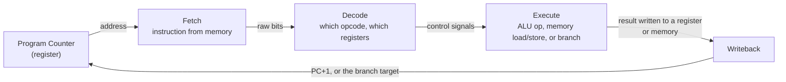
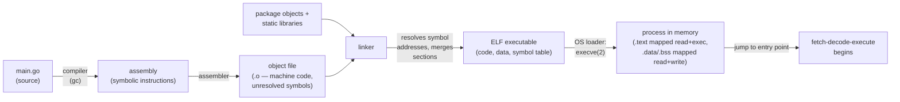
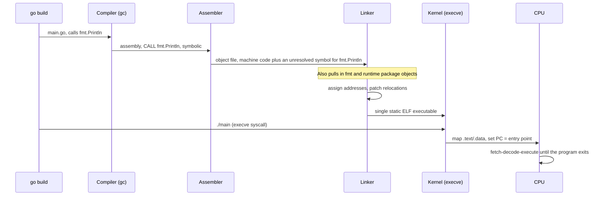

# How a Computer Runs a Program

> [!summary] TL;DR
> A CPU runs a program by repeating one loop forever: fetch the next instruction from memory, decode what it means, and execute it using a handful of on-chip **registers**. Getting from your source file to that loop takes four separate steps — compile, assemble, link, load — and the file that comes out of linking (an **ELF** binary on Linux) is what the operating system loads and the CPU's fetch-decode-execute loop runs.

> [!abstract] Core idea
> - A CPU is a loop: fetch an instruction, decode it, execute it, repeat — forever, millions to billions of times a second.
> - **Registers** are the CPU's only directly-addressable storage; every instruction reads and writes them, never RAM directly except via explicit load/store.
> - Your source code becomes a running process through four stages: **compile** (source → assembly), **assemble** (assembly → machine code in an object file), **link** (object files + libraries → one executable), **load** (executable → process in memory).
> - **Static linking** copies library code into the executable; **dynamic linking** leaves a reference for the OS loader to resolve at run time. Go defaults to static binaries; linking C code via `cgo` forces dynamic linking against `libc`.

## 1. Why it exists

Say you write a Go program with one line, `fmt.Println("hi")`, and run `go build`. Nothing about that sentence is something silicon understands. A CPU is a fixed circuit: it has no idea what a string is, what `Println` means, or what a function call is. It understands exactly one thing — read a fixed-width number from a fixed address, treat it as an instruction, and change some fixed-size registers and memory locations accordingly.

Two gaps need closing before "print hi" becomes electricity moving through transistors:

1. **The language gap.** `fmt.Println("hi")` has to become a sequence of instructions the CPU's instruction set (on a typical cloud server, x86-64 or ARM64) actually defines — load an address into a register, write bytes to a buffer, trigger a system call to hand the bytes to the kernel.
2. **The loading gap.** Those instructions have to end up at known addresses in memory, with the CPU's **program counter** pointed at the first one, before the fetch-decode-execute loop can start running them at all.

The compile/assemble/link/load pipeline closes the first gap; the operating system's loader closes the second. Skip either step and there is no program to run — only text in a file.

## 2. Mental model

Think of the CPU as a reader at a desk with eight sticky notes (registers) and a pointer finger (the program counter, PC) that always points at the next instruction. The reader can only do five things: read a sticky note, write a sticky note, do arithmetic on two sticky notes, look at a memory address and copy it onto a sticky note (or back), and move the pointer finger. The reader never "understands" the program — it just keeps doing whatever the instruction under its finger says, then moves the finger to the next one (or wherever a jump instruction says to).

Turning your source file into a stack of instructions for that reader, in the right order, at the right addresses, is the whole job of compiling, assembling, linking and loading.

## 3. How it works

### The fetch-decode-execute cycle



Every instruction goes through all four stages. On a simple CPU this takes several clock cycles per instruction; a real superscalar CPU pipelines and reorders this across many instructions in flight at once (covered in [[CPU Scheduling]] for the OS-level analogue, and left as hardware-internals detail here). The architectural registers — general-purpose ones, the PC, and a stack pointer — are the only state the CPU can read or write directly; everything else is one load or store instruction away in the memory hierarchy (see [[Memory Hierarchy and CPU Caches]]).

### Compile, assemble, link, load



1. **Compile.** The compiler (Go's `gc`, or `gcc`/`clang` for C) parses source text, checks types, and emits assembly: human-readable instruction mnemonics (`MOVQ`, `CALL`, `RET`) that still use symbolic names for functions and variables rather than final addresses.
2. **Assemble.** The assembler turns each mnemonic into its binary encoding and writes an **object file** — machine code plus a **symbol table** (names the file defines, like `main.sayHi`, and names it still needs, like `runtime.printstring`) and **relocation entries** (placeholders saying "patch this address once you know where symbol X ends up"). Nothing is runnable yet: addresses are still relative to an unknown base.
3. **Link.** The linker takes every object file the build produces, plus any libraries, and does two jobs: it picks final addresses for every symbol and lays out the file's **sections** (`.text` for code, `.data` for initialized globals, `.bss` for zeroed globals, `.rodata` for constants), then it walks every relocation entry and patches in the real address. The output is one **executable**: on Linux, an **ELF** (Executable and Linkable Format) file.
4. **Load.** When you run the binary, the kernel's loader (triggered by the `execve(2)` system call — see [[System Calls and User vs Kernel Mode]]) reads the ELF headers, maps `.text` into the new process's address space as read-and-execute, maps `.data`/`.bss` as read-and-write, sets up the initial stack, and points the CPU's program counter at the ELF header's entry-point address. From that instant, the fetch-decode-execute loop is reading real instructions, and the "program" is now a running **process** (see [[Processes, Threads and Context Switching]] for what a process is once it exists, and [[Process Memory Layout - Stack vs Heap]] for the rest of that address space).

### Inside an ELF file

An ELF file is a header plus a list of sections:

| Part | Holds | Loaded as |
|---|---|---|
| ELF header | entry-point address, architecture, section table location | read by the loader, not mapped |
| `.text` | machine code | read + execute |
| `.rodata` | string literals, constants | read-only |
| `.data` | initialized global variables | read + write |
| `.bss` | zeroed global variables (no bytes stored on disk) | read + write, zero-filled |
| `.symtab` / `.dynsym` | symbol names and addresses | not mapped (static) / read at load time (dynamic) |

You can see this on any Linux box with `readelf -S ./a.out` (section headers) or `objdump -d ./a.out` (disassembly back to assembly mnemonics).

## 4. Worked example

### Whiteboard version

A CPU's loop, stripped to its bones, is: `instr := fetch(pc); decode-and-execute(instr); pc = next(pc, instr)`. The toy machine below makes that literal in Go — five instructions, eight registers, one loop — so "fetch-decode-execute" stops being an abstract phrase.

### A tiny fetch-decode-execute loop in Go

The full program below is a minimal register machine: `LOADC` (load a constant), `ADD`, `SUB`, `JZ` (jump if zero), and `HALT`. It compiles and its test passes under `go test -race` on Go 1.24.

```go
// Package fde is a minimal fetch-decode-execute loop: a tiny register machine
// with a program counter, a handful of registers, and five instructions. It
// exists to make the CPU's instruction cycle concrete, not to be a real VM.
package fde

// Opcode identifies one instruction.
type Opcode int

const (
	OpLoadConst Opcode = iota // LOADC rX, imm   -> reg[X] = imm
	OpAdd                     // ADD   rX, rY, rZ -> reg[X] = reg[Y] + reg[Z]
	OpSub                     // SUB   rX, rY, rZ -> reg[X] = reg[Y] - reg[Z]
	OpJumpIfZero              // JZ    rX, target -> if reg[X] == 0: PC = target
	OpHalt                    // HALT
)

// Instr is one fetched instruction: an opcode plus up to three operands.
type Instr struct {
	Op      Opcode
	A, B, C int
}

// CPU holds the architectural state that survives between instructions:
// registers and the program counter. Real CPUs add flags and a stack
// pointer; this one keeps only what the loop needs.
type CPU struct {
	Reg    [8]int
	PC     int
	Cycles int // one fetch-decode-execute iteration per increment
}

// Run executes program starting at PC=0 until OpHalt, and returns the final
// CPU state.
func Run(program []Instr) CPU {
	var c CPU
	for {
		// Fetch: read the instruction the PC points at.
		instr := program[c.PC]
		c.Cycles++

		// Decode + execute: the switch is the decoder, each case the
		// execute stage for that opcode.
		switch instr.Op {
		case OpLoadConst:
			c.Reg[instr.A] = instr.B
			c.PC++
		case OpAdd:
			c.Reg[instr.A] = c.Reg[instr.B] + c.Reg[instr.C]
			c.PC++
		case OpSub:
			c.Reg[instr.A] = c.Reg[instr.B] - c.Reg[instr.C]
			c.PC++
		case OpJumpIfZero:
			if c.Reg[instr.A] == 0 {
				c.PC = instr.B
			} else {
				c.PC++
			}
		case OpHalt:
			return c
		default:
			panic("fde: unknown opcode")
		}
	}
}
```

The test runs a small loop program (sum `5+4+3+2+1`) and checks both the result and that at least one cycle ran:

```go
func TestCountdownSumsFiveToOne(t *testing.T) {
	// r0 = counter (starts at 5), r1 = accumulator (starts at 0), r2 = constant 1
	program := []Instr{
		/*0*/ {Op: OpLoadConst, A: 0, B: 5},
		/*1*/ {Op: OpLoadConst, A: 1, B: 0},
		/*2*/ {Op: OpLoadConst, A: 2, B: 1},
		/*3*/ {Op: OpJumpIfZero, A: 0, B: 7}, // loop test: if counter == 0, exit
		/*4*/ {Op: OpAdd, A: 1, B: 1, C: 0},  // acc += counter
		/*5*/ {Op: OpSub, A: 0, B: 0, C: 2},  // counter -= 1
		/*6*/ {Op: OpJumpIfZero, A: 7, B: 3}, // r7 is always 0: unconditional jump back
		/*7*/ {Op: OpHalt},
	}

	cpu := Run(program)

	if got, want := cpu.Reg[1], 15; got != want {
		t.Fatalf("accumulator = %d, want %d", got, want)
	}
	if cpu.Cycles == 0 {
		t.Fatal("expected at least one fetch-decode-execute cycle")
	}
}
```

```text
$ go vet ./fde/...
$ go test -race ./fde/...
ok  	cs1scratch/fde	1.530s
```

Each loop iteration of `Run` is one fetch (`program[c.PC]`), one decode (the `switch`), and one execute (the chosen `case`) — exactly the three stages a real CPU repeats, minus pipelining and caching.

### Tracing the real pipeline on a `Println`



## 5. Variants and comparison

| Linking strategy | How it works | Use when | Cost |
|---|---|---|---|
| Static linking | Linker copies the library's machine code into the executable at build time | You want one self-contained file to deploy — the default for Go | Bigger binary; a security fix in a library needs a rebuild |
| Dynamic linking | Executable stores only the library's name; the OS loader (or `ld.so`) maps the shared library (`.so`) into the process and patches calls at load/run time | Many processes share one library in RAM (e.g. `libc` on a Linux desktop); you want to patch a library without rebuilding every binary | Small binary, but needs the right `.so` versions present at run time ("DLL hell") |
| Static + dynamic mix (Go with `cgo`) | Go code and the Go runtime are statically linked; any C code pulled in via `cgo` (e.g. `net` package's DNS resolver on some configurations, or `database/sql` drivers using C libraries) is linked dynamically against `libc` | You must call a C library with no pure-Go equivalent | Loses the "copy one binary anywhere" property; the target machine needs a compatible `libc` |

## 6. Trade-offs and when not to use

- Static binaries are simple to deploy (`scp` one file into a `FROM scratch` container) but every security patch to a dependency means rebuilding and redeploying every binary that linked it.
- Dynamic linking saves disk and RAM when many processes share one library, but introduces a run-time dependency: the right shared library must exist on the target machine, which is exactly the class of bug ("works on my machine") static linking avoids.
- None of this applies to interpreted or JIT-compiled languages in the same way: Python source is parsed into bytecode and interpreted by the CPython VM at run time, and the JVM both interprets bytecode and JIT-compiles hot methods to native code while running — there is no single ahead-of-time link step producing one native executable.

## 7. In production

- **Real systems:** Go's own toolchain (`go build`) runs exactly this pipeline (`compile` → `go tool asm` → `go tool link`), and its default output is a statically linked, single-file ELF (or Mach-O/PE) binary — the reason a `FROM scratch` Docker image containing nothing but a Go binary can run at all. C and C++ build systems (`make`, `cmake`) expose the same four stages explicitly, often as separate `cc -c` (compile+assemble) and `cc` (link) invocations.
- **Failure modes → fixes:**
  - `undefined reference to 'foo'` at link time → a symbol was declared but never defined, or its object file was never passed to the linker; fix the build graph.
  - `cgo` silently turning a static build into a dynamic one → set `CGO_ENABLED=0` to force a pure static build, or `go build -ldflags '-linkmode external -extldflags "-static"'` if `cgo` is required but a static binary is still wanted.
  - A binary runs on the build machine but fails with "version `GLIBC_2.34' not found" on an older server → a dynamically linked binary was built against a newer `libc` than the target has; rebuild statically or match OS versions.
- **What to monitor:** build reproducibility (pinned toolchain and dependency versions), binary size (static binaries grow with every statically linked dependency), and, for dynamically linked services, which shared library versions are actually installed on each host.

## 8. Deep dive

- **Why Go defaults to static binaries.** The Go linker statically links the entire Go runtime (the scheduler, garbage collector, and standard library) into every binary by default, because the runtime needs tight control over stacks, goroutine scheduling (see [[Runtime - Goroutine Scheduler (GMP)]]) and memory management (see [[Runtime - Memory Allocator and Garbage Collector]]) that a dynamically-loaded, independently-versioned runtime could not guarantee. `cgo` breaks this: once C code is linked in, the C runtime's own startup and threading expectations force at least `libc` to be linked dynamically (on Linux; `CGO_ENABLED=0` avoids this entirely by disabling `cgo` and using Go's pure-Go standard-library implementations, e.g. for DNS resolution, instead of calling into `libc`).
- **Relocations, concretely.** When the assembler emits an object file for a call to a function defined elsewhere, it cannot know that function's final address yet, so it emits a relocation entry: "at byte offset N in `.text`, write the address of symbol `fmt.Println`, interpreted as a PC-relative 32-bit offset." The linker's job is mechanical: assign every symbol an address, then process every relocation entry and write the real bytes.
- **Position-independent executables (PIE).** Most modern Linux distributions build executables as PIE by default so the kernel can load them at a randomized base address each run (ASLR), which means even a statically-resolved relocation is expressed relative to a base the loader only picks at `execve` time, not at link time.
- **What the loader actually does, step by step:** `execve(2)` → kernel validates the ELF header and architecture → kernel maps `PT_LOAD` segments (roughly, `.text` and `.data`/`.bss`) into a fresh address space → kernel maps the stack and, if present, the dynamic linker (`ld-linux.so`) → control transfers either straight to the entry point (static binary) or to the dynamic linker, which resolves remaining symbols against shared libraries before jumping to the entry point.
- **The instruction-cycle detail elided above.** Real CPUs do not execute one instruction fully before starting the next; they pipeline fetch/decode/execute for many instructions simultaneously and predict branches ahead of the fetch stage. That hardware-scheduling layer, and the OS-level scheduling layer that decides which process's instructions the CPU fetches next, are both covered in [[CPU Scheduling]].

## 9. Interview questions

> [!question]- What are the four steps between source code and a running process?
> Compile (source → assembly), assemble (assembly → object file with machine code and unresolved symbols), link (object files + libraries → one executable with every address resolved), load (OS maps the executable into a new process's memory and sets the program counter to its entry point).

> [!question]- What does "fetch-decode-execute" actually mean, mechanically?
> Fetch: read the instruction at the address the program counter holds. Decode: work out which operation and which registers/memory it touches. Execute: perform the operation (arithmetic, a memory load/store, or a jump) and update the program counter to the next instruction or the branch target. Repeat.

> [!question]- Why does a Go binary not need a `.so` file for its own runtime, but sometimes does need `libc`?
> Go statically links its compiler-generated code and its entire runtime (scheduler, GC, standard library) into the executable by default. `libc` only enters the picture through `cgo`: if any imported code calls into C (directly, or via a database driver, or via certain OS-specific standard-library paths), that C code is linked dynamically against the system's `libc`, because `CGO_ENABLED=1` is the default when a C toolchain is present.

> [!question]- Trap: if an object file already contains machine code, why isn't it runnable yet?
> Its addresses are symbolic and relative: calls to functions defined in other object files or libraries are left as relocation entries ("patch this location with the address of symbol X"), and the file has no fixed load address or entry point. The linker has to resolve every symbol to a real address and merge all the object files' sections before anything is executable.

> [!question]- What is an ELF file, concretely?
> The standard executable and shared-library format on Linux: a header naming the architecture and the entry-point address, followed by sections such as `.text` (code), `.rodata` (constants), `.data` (initialized globals) and `.bss` (zeroed globals), plus a symbol table. The OS loader reads the header and section table to decide what to map into memory and where to start executing.

> [!question]- What happens if the linker can't find a symbol a function calls?
> A link-time error, `undefined reference to 'symbol'`: the object file that is supposed to define that symbol was never produced or never passed to the linker. This is different from a run-time "symbol not found" error from a dynamic loader, which means a shared library the executable depends on is missing or the wrong version at load time.

> [!question]- Why can't the CPU just read and execute your Go source file directly?
> The CPU's instruction set only understands fixed-width binary opcodes operating on registers and memory addresses — it has no notion of functions, types, or strings. Every step of compiling, assembling and linking exists purely to turn source text into that fixed binary encoding, with every address resolved, before the CPU's fetch-decode-execute loop can run any of it.

## 10. Cheat sheet

- CPU loop: fetch instruction at PC → decode → execute (ALU op, load/store, or branch) → repeat.
- Registers are the CPU's only directly-addressable storage; everything else needs an explicit load or store.
- Pipeline: compile (→ assembly) → assemble (→ object file, unresolved symbols) → link (→ one executable, every address resolved) → load (OS maps it into a process and sets PC to the entry point).
- An object file is not runnable: its symbols are unresolved relocation entries.
- ELF = Linux's executable format: header (entry point) + sections (`.text`, `.rodata`, `.data`, `.bss`) + symbol table.
- Static linking copies library code in (one deployable file); dynamic linking defers it to load time (`.so`, shared across processes, but a run-time dependency).
- Go defaults to fully static binaries; `cgo` forces dynamic linking against `libc` unless `CGO_ENABLED=0`.

## Links

- **Before this:** none — this is the entry point for 01 CS Fundamentals.
- **Next:** [[Memory Hierarchy and CPU Caches]], [[Processes, Threads and Context Switching]], [[System Calls and User vs Kernel Mode]]
- **Compare with:** [[Process Memory Layout - Stack vs Heap]] (the address space the loader builds), [[Runtime - Goroutine Scheduler (GMP)]] (how Go schedules work once a process is running)
