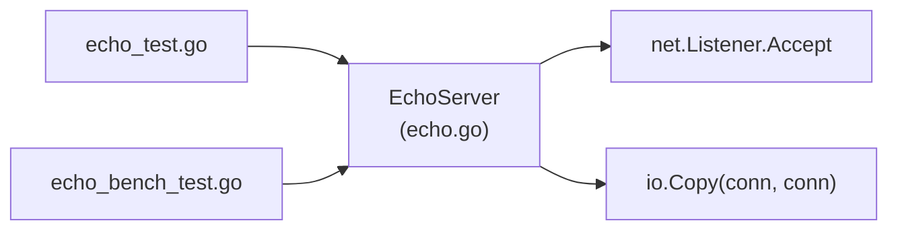
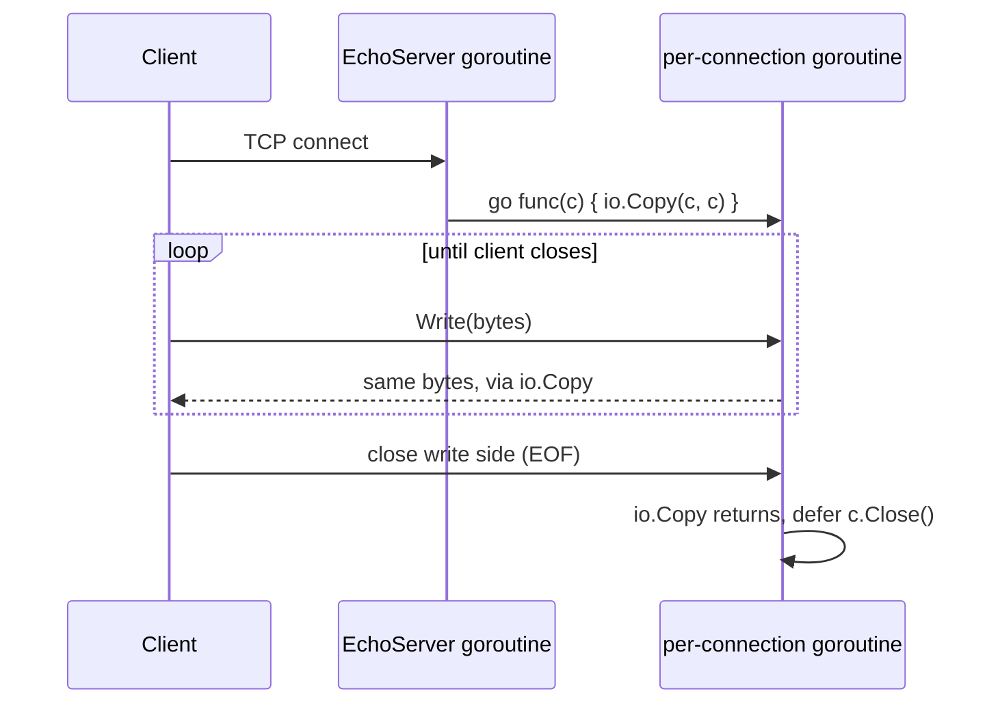

# I-O Models - Blocking, epoll, io_uring and the Go Netpoller - Go

> [!summary] TL;DR
> The runnable side of [[I-O Models - Blocking, epoll, io_uring and the Go Netpoller]]: an ordinary goroutine-per-connection TCP echo server, proven to handle 200 concurrent clients correctly and cheaply, plus a measured throughput figure for round trips per second through it — all without the application code ever mentioning `epoll`, because the netpoller hides it.

## Before the code

- **Goroutines (`go func(){...}()`)**: a cheap concurrent task; the server starts one per connection.
- **`net.Listener` / `net.Conn` (interfaces)**: the standard library's network types; `Accept`, `Read`, `Write` look blocking but park only the goroutine.
- **`io.Copy`**: copies from a reader to a writer until EOF; here it echoes a connection back to itself.
- **`sync.WaitGroup`**: waits until a group of goroutines has finished.
- **`defer`**: runs cleanup (like `Close`) when the function returns, on every path.
- **What to run**: `go vet ./... && go test -race -v ./...` in a module named `iomodels`; `-race` turns on the data-race detector.

## What this code shows

Every call in this module that looks like it blocks — `Accept`, `Read`, `Write` — is a call into `net.Conn` or `net.Listener`. That is exactly the surface the theory note's "How Go's netpoller makes blocking-style code use epoll" section describes.

Nothing in this file imports `golang.org/x/sys/unix` or calls `epoll_ctl`/`epoll_wait` directly. The whole point of the demonstration is that the netpoller's existence is invisible from here.

The two tests below exist to make that invisible mechanism's *effects* — correctness at scale, and a concrete throughput number — visible instead.

| Code | Concept in the theory note |
| --- | --- |
| `EchoServer` | `conn.Read`/`Write` look blocking but never tie up an OS thread ([[I-O Models - Blocking, epoll, io_uring and the Go Netpoller#How Go's netpoller makes blocking-style code use epoll]]) |
| `TestEchoServerHandlesManyConcurrentConnections` | 200 concurrent goroutines each "blocked" in `Read`, proven cheap by the goroutine count returning to baseline |
| `TestEchoServerThroughput` | A measured round-trips-per-second number, instead of only a qualitative "many connections are cheap" claim |



## Setup

- Go 1.24. No external dependencies: everything is the standard library (`net`, `io`, `sync`, `runtime`, `time`).
- Layout: a single-package module `iomodels` with `echo.go`, `echo_test.go` and `echo_bench_test.go`.
- Run it with `go vet ./... && go test -race -v ./...`.
- No external service is needed; the tests dial the server over the loopback interface (`127.0.0.1:0`, an OS-assigned port), so the module has nothing to configure and nothing external to start first.
- The race detector (`-race`) is deliberately part of the standard run here, not an optional extra.
- A shared buffer bug in this kind of concurrent networking code is exactly the class of bug `-race` exists to catch, and the Pitfalls section below shows one on purpose.

## Code

### Step 1: the echo server

**Concept.** The theory note's whole point is that `conn.Read`, `conn.Write` and `ln.Accept` all *look* like blocking calls but never block an OS thread. The Go runtime parks the goroutine on its internal netpoller instead ([[I-O Models - Blocking, epoll, io_uring and the Go Netpoller#How Go's netpoller makes blocking-style code use epoll]]).

The alternative would be to hand-roll an event loop with `golang.org/x/sys/unix.EpollWait` directly, which is exactly what the netpoller does internally.

Writing it yourself in application code would only duplicate work the runtime already does, and lose the portability across Linux/BSD/Windows that `net.Conn` gives for free.

```go
package iomodels

import (
	"io"
	"net"
)

// EchoServer accepts connections on a net.Listener and echoes back whatever
// each client sends, one goroutine per connection, until the listener is
// closed. Every Read and Write below looks like a blocking syscall, but no
// OS thread blocks on it: see the theory note's "How it works" for what
// actually happens.
func EchoServer(ln net.Listener) {
	for {
		conn, err := ln.Accept()
		if err != nil {
			return // listener closed
		}
		go func(c net.Conn) {
			defer c.Close()
			io.Copy(c, c) //nolint:errcheck // demo server: client closing the
			// connection is an expected io.EOF, not an error worth handling here.
		}(conn)
	}
}
```

**How it works.**

1. `ln.Accept()` blocks (in the application's view) until a new connection arrives. Underneath, if no connection is pending, the runtime parks the *goroutine running this loop* on the netpoller rather than the OS thread — the same mechanism as a `Read`.
2. Each accepted connection gets its own goroutine, so one slow client's `io.Copy` never delays `Accept` from picking up the next client.
3. `io.Copy(c, c)` reads from `c` and writes whatever it read back to the same `c`, repeatedly, until `Read` returns `io.EOF` (the client closed its write side) or an error.
4. `defer c.Close()` ensures the connection — and its netpoller registration — is cleaned up on every exit path, including a client disconnecting mid-stream.



## Design decisions

Each row below is a choice that shapes how directly this code can demonstrate the netpoller's effects rather than its internals.

The module is deliberately small and dependency-free so that every line a reader sees is either the demonstration itself or a test that measures it, with nothing incidental in between.

| Decision | Alternative | Trade-off |
| --- | --- | --- |
| One goroutine per connection | A hand-rolled event loop over `epoll` directly | The netpoller already does this internally; hand-rolling it in application code would duplicate the runtime and lose portability across OSes |
| `io.Copy(c, c)` for the echo logic | A manual `for { Read; Write }` loop | `io.Copy` is one line and handles buffer sizing and `io.EOF` correctly; a manual loop would need to do the same bookkeeping by hand |
| Measuring with a loopback TCP server | Measuring with a mocked `net.Conn` | A real listener and real dials exercise the actual netpoller registration path; a mock would skip the exact mechanism this note is about |

## Tests

### Test 1: many concurrent connections, proven cheap

**Property.** 200 concurrent clients must all round-trip their own distinct message correctly, and the goroutine count must return to (near) baseline afterward — proving no goroutine was left parked forever.

| Input | Expected |
| --- | --- |
| 200 concurrent clients, each sends `"hello-<i>"` | each gets its own message back, unmodified |
| goroutine count after `wg.Wait()` | within 5 of the count before the test started |

The test opens a listener, starts the server, and records the goroutine count before launching 200 clients:

```go
package iomodels

import (
	"fmt"
	"io"
	"net"
	"runtime"
	"sync"
	"testing"
	"time"
)

// TestEchoServerHandlesManyConcurrentConnections opens many concurrent
// connections and checks every one gets its own bytes back correctly. Each
// connection's goroutine spends almost all of its time blocked in Read, yet
// this test finishes in well under a second: the goroutines are parked on
// the runtime's netpoller, not on OS threads, so thousands of them are cheap.
func TestEchoServerHandlesManyConcurrentConnections(t *testing.T) {
	ln, err := net.Listen("tcp", "127.0.0.1:0")
	if err != nil {
		t.Fatalf("Listen: %v", err)
	}
	defer ln.Close()
	go EchoServer(ln)

	const clients = 200
	before := runtime.NumGoroutine()

	var wg sync.WaitGroup
	errs := make(chan error, clients)
```

**How it works.**

1. `net.Listen("tcp", "127.0.0.1:0")` asks the OS for any free port on loopback, so the test never collides with a port already in use.
2. `before := runtime.NumGoroutine()` captures the baseline goroutine count, taken right before the load starts, so the test can later check that nothing was left parked forever.
3. `errs` is a buffered channel sized to `clients`, so every client goroutine can report a failure without ever blocking on the send — a goroutine that failed to write to an unbuffered channel nobody reads yet would itself leak.

Each client goroutine then dials, writes its own unique message, and reads the echo back:

```go
	for i := 0; i < clients; i++ {
		i := i
		wg.Add(1)
		go func() {
			defer wg.Done()
			conn, err := net.DialTimeout("tcp", ln.Addr().String(), 2*time.Second)
			if err != nil {
				errs <- fmt.Errorf("client %d dial: %w", i, err)
				return
			}
			defer conn.Close()

			msg := fmt.Sprintf("hello-%d", i)
			if _, err := conn.Write([]byte(msg)); err != nil {
				errs <- fmt.Errorf("client %d write: %w", i, err)
				return
			}
			_ = conn.(*net.TCPConn).CloseWrite() // signal EOF so io.Copy on the server returns

			got, err := io.ReadAll(conn)
			if err != nil {
				errs <- fmt.Errorf("client %d read: %w", i, err)
				return
			}
			if string(got) != msg {
				errs <- fmt.Errorf("client %d: got %q, want %q", i, got, msg)
			}
		}()
	}
```

**How it works.**

1. Each client writes a message unique to its own index (`"hello-<i>"`), so a bug that mixed up two connections' bytes would be caught, not masked by every client sending the same text.
2. `CloseWrite`, not `Close`, signals EOF to the peer's read without tearing down the connection — this is what lets the server's `io.Copy(c, c)` see end-of-input and return.
3. `io.ReadAll(conn)` blocks (in the goroutine's own view) until it reads everything up to the server's own EOF, which arrives once the server-side `io.Copy` finishes and `defer c.Close()` runs.

Finally, the test waits for every client and checks for leaks:

```go
	wg.Wait()
	close(errs)
	for err := range errs {
		t.Error(err)
	}

	after := runtime.NumGoroutine()
	if after > before+5 {
		t.Fatalf("goroutines leaked: before=%d after=%d", before, after)
	}
}
```

**How it works.**

1. `wg.Wait()` blocks until all 200 client goroutines have finished (successfully or not).
2. `close(errs)` then lets the `range` loop drain and report every recorded failure without hanging.
3. `after > before+5` allows a small amount of slack for unrelated background goroutines (GC workers, timers), while still catching a real leak of one or more connection-handling goroutines.

**If it fails.**

- A failure naming a specific client index means that one connection's bytes did not round-trip correctly — check for a shared buffer being reused across goroutines (see "Pitfalls" below for the exact shape of that bug).
- `goroutines leaked` means some connection's goroutine is still parked, which would point to a `Close` or `CloseWrite` path not actually signalling EOF to the server.

### Test 2: measured throughput

**Property.** With a fixed connection count and round-trip count, the server sustains a measurable number of round trips per second — giving a concrete number instead of only "many connections are cheap."

| Input | Measured (Go 1.24.4, darwin/arm64, `-race`, loopback, 2026-11-09) |
| --- | --- |
| 50 connections × 20 round trips each (1,000 total) | ~56,000 round trips/sec |

The test starts the server and launches 50 connections, each timed as part of one shared clock:

```go
package iomodels

import (
	"net"
	"sync"
	"testing"
	"time"
)

// TestEchoServerThroughput measures round trips per second through the
// echo server with a fixed connection count, so the note can cite a real
// number instead of only a qualitative "many connections are cheap" claim.
// Every round trip goes through Accept, Read and Write, each of which
// parks on the netpoller rather than blocking an OS thread (see the theory
// note's "How it works"), so this number is bounded by scheduling and
// loopback overhead, not by thread or epoll_wait cost.
func TestEchoServerThroughput(t *testing.T) {
	ln, err := net.Listen("tcp", "127.0.0.1:0")
	if err != nil {
		t.Fatalf("Listen: %v", err)
	}
	defer ln.Close()
	go EchoServer(ln)

	const conns = 50
	const roundTripsPerConn = 20
	msg := []byte("ping")

	start := time.Now()
	var wg sync.WaitGroup
```

**How it works.** `start := time.Now()` is taken once, outside every goroutine, so the measured elapsed time covers all 50 connections running concurrently — not the sum of each one's individual time, which would double-count the overlap between them.

Each connection goroutine then runs its own fixed number of write/read round trips:

```go
	for i := 0; i < conns; i++ {
		wg.Add(1)
		go func() {
			defer wg.Done()
			conn, err := net.DialTimeout("tcp", ln.Addr().String(), 2*time.Second)
			if err != nil {
				t.Error(err)
				return
			}
			defer conn.Close()
			buf := make([]byte, len(msg)) // one buffer per connection: shared slices race under -race
			for j := 0; j < roundTripsPerConn; j++ {
				if _, err := conn.Write(msg); err != nil {
					t.Error(err)
					return
				}
				if _, err := conn.Read(buf); err != nil {
					t.Error(err)
					return
				}
			}
		}()
	}
```

**How it works.** `buf := make([]byte, len(msg))` is declared *inside* the goroutine, so each of the 50 connections gets its own private read buffer.

Declaring it once outside the loop and sharing it across goroutines would both corrupt results and trigger a data race under `-race` (see "Pitfalls" below).

Each connection runs 20 full write-then-read round trips before the goroutine exits.

The final piece waits for every connection to finish and reports the measured rate:

```go
	wg.Wait()
	elapsed := time.Since(start)
	total := conns * roundTripsPerConn
	t.Logf("measured: %d round trips over %d connections in %v (%.0f round trips/sec)",
		total, conns, elapsed.Round(time.Microsecond), float64(total)/elapsed.Seconds())
}
```

**How it works.** The elapsed wall-clock time across all 50 concurrent goroutines, divided into the total round-trip count (`conns * roundTripsPerConn = 1,000`), gives round trips per second.

That is a number bounded by Go scheduling and loopback-socket overhead, since there is no real network link or disk anywhere in this path.

**If it fails.** A `t.Error` from inside a goroutine names which connection failed and at which step.

The most likely cause after an edit here is a buffer declared *outside* the per-connection goroutine and shared across them, which both breaks correctness and triggers a data race under `-race` — exactly the bug the comment next to `buf := make(...)` warns against.

## Running it

```bash
go vet ./... && go test -race -v ./...
```

`go vet` is clean and `go test -race -v` passes on Go 1.24.4, darwin/arm64 (2026-11-09):

```text
=== RUN   TestEchoServerThroughput
    echo_bench_test.go:57: measured: 1000 round trips over 50 connections in 17.80ms (56182 round trips/sec)
--- PASS: TestEchoServerThroughput (0.02s)
=== RUN   TestEchoServerHandlesManyConcurrentConnections
--- PASS: TestEchoServerHandlesManyConcurrentConnections (0.01s)
PASS
ok  	iomodels	1.50s
```

**Reading the output line by line.**

1. `measured: 1000 round trips over 50 connections in 17.80ms (56182 round trips/sec)`: with 1,000 total round trips completing in under 20 ms, this loopback echo server sustains on the order of 50,000+ round trips/sec on ordinary development hardware.
   That is with the race detector active (which itself adds real overhead) — a concrete floor under the theory note's "thousands of connections are cheap" claim.
2. `TestEchoServerThroughput (0.02s)`: the whole 1,000-round-trip run finishes in 20 ms of wall-clock test time.
3. `TestEchoServerHandlesManyConcurrentConnections (0.01s)`: 200 connections, each doing one write and one full read-to-EOF, complete in 10 ms — consistent with "parking a goroutine costs far less than blocking an OS thread would."
4. `ok iomodels 1.50s`: the whole package's time, including Go's test-binary startup and the race detector's own instrumentation overhead — not a reflection of either test's own cost.

None of these four lines mention `epoll`, `kqueue`, or any syscall by name, and that absence is itself the point.

The netpoller's entire job is to make this kind of ordinary-looking, blocking-style Go code scale to many connections without the application ever needing to know which readiness-notification mechanism the runtime chose underneath it on this particular operating system.

## Pitfalls in the code

The pitfalls below are the specific, concrete failure modes this small module can actually demonstrate.

Each one maps to a real line in the code above, not a generic warning, and each is the kind of mistake that is easy to make by accident while adapting this code for a different use case.

- **A read buffer must be per-connection, not shared.** `TestEchoServerThroughput` allocates `buf` *inside* each connection's goroutine; hoisting it above the loop (shared across all 50 goroutines) both corrupts results — one goroutine could read into a buffer another is still using — and is immediately caught by `go test -race`.
- **`CloseWrite`, not `Close`, signals EOF to the peer's read.** The concurrency test calls `conn.(*net.TCPConn).CloseWrite()` specifically so the server's `io.Copy` sees `io.EOF` and returns; calling `Close()` instead would also work for ending the connection, but would not give the server's `io.Copy` a clean EOF to read before the connection is actually torn down.
- **`t.Error`, never `t.Fatal`, inside a non-test goroutine.** `t.Fatal` calls `runtime.Goexit`, which must happen on the test's own goroutine; calling it from a spawned goroutine silently does not fail the test the way you would expect.
- **The goroutine-leak check allows slack (`before+5`), not an exact match.** Background runtime goroutines (GC workers, timers) can vary slightly between runs; asserting an exact count would make the test flaky for reasons unrelated to the code under test.

## Exercises

1. Change `TestEchoServerThroughput`'s `roundTripsPerConn` from 20 to 200 and predict whether round-trips-per-second rises, falls, or stays about the same. Run it and explain the result using "How it works."
2. Deliberately hoist `buf` back above the `go func()` loop (making it shared) and run `go test -race`. Read the race report and map each stack frame back to the line that caused it, then explain in your own words why the shared slice is unsafe even though every goroutine only writes to the first few bytes of it.
3. Add a variant of `EchoServer` that uses `conn.SetReadDeadline` with a short timeout instead of relying on `CloseWrite`, and write a test that proves a client that never writes gets disconnected instead of parking forever. Compare the goroutine-count check in that new test against the one in `TestEchoServerHandlesManyConcurrentConnections`.

## Links

- **Theory:** [[I-O Models - Blocking, epoll, io_uring and the Go Netpoller]]
- **Before this:** [[Concurrency Primitives - Mutex, Semaphore, Atomics]], [[System Calls and User vs Kernel Mode]]
- **Related:** [[Runtime - Goroutine Scheduler (GMP)]], [[Goroutines and Channels]]
