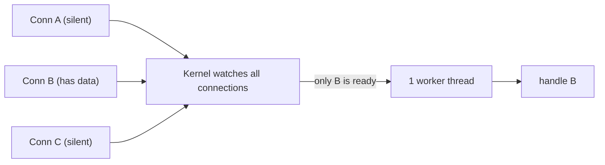
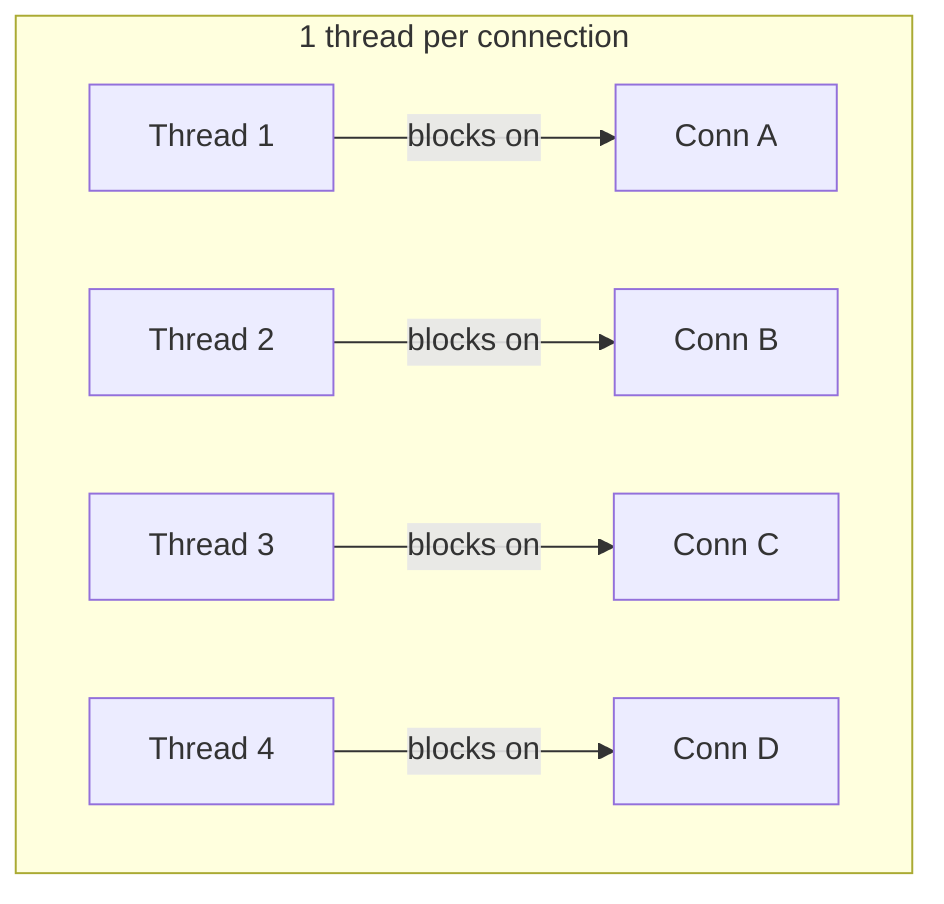
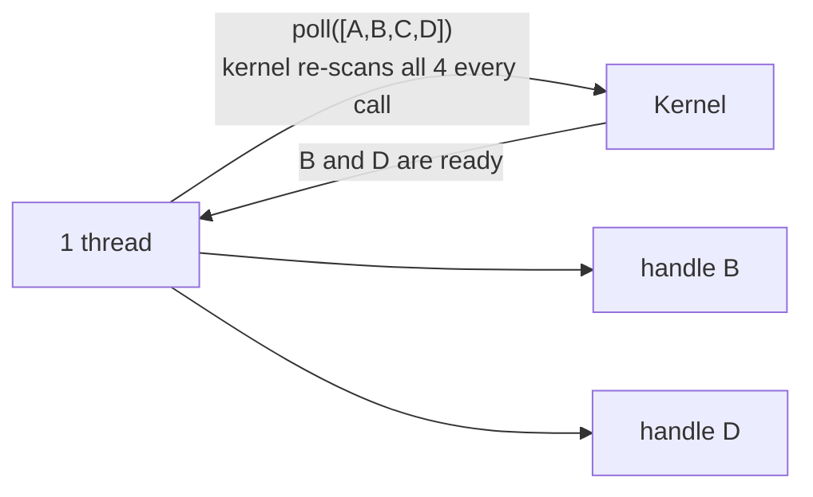
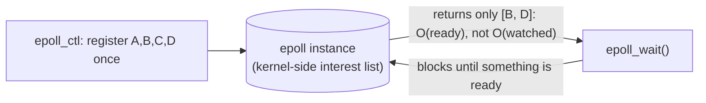
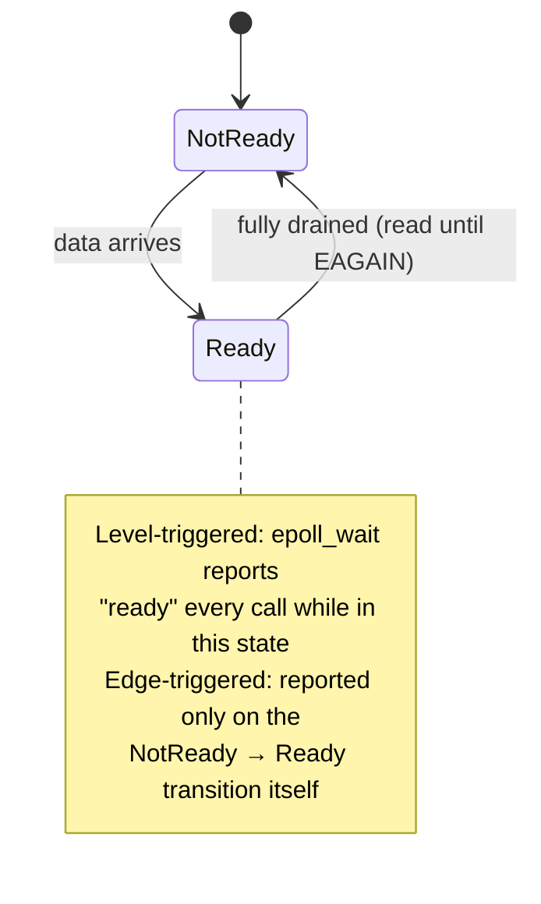
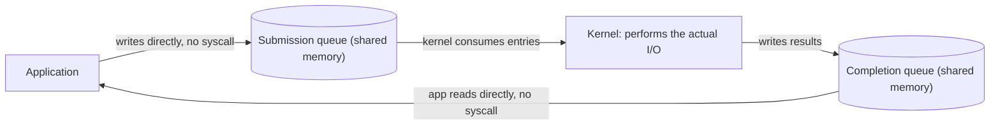
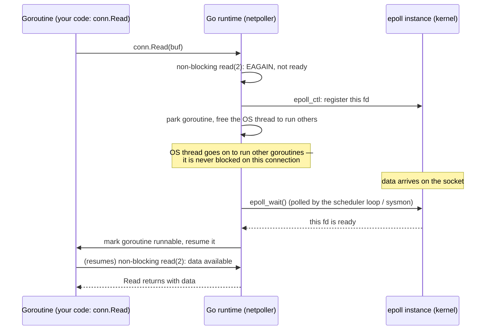
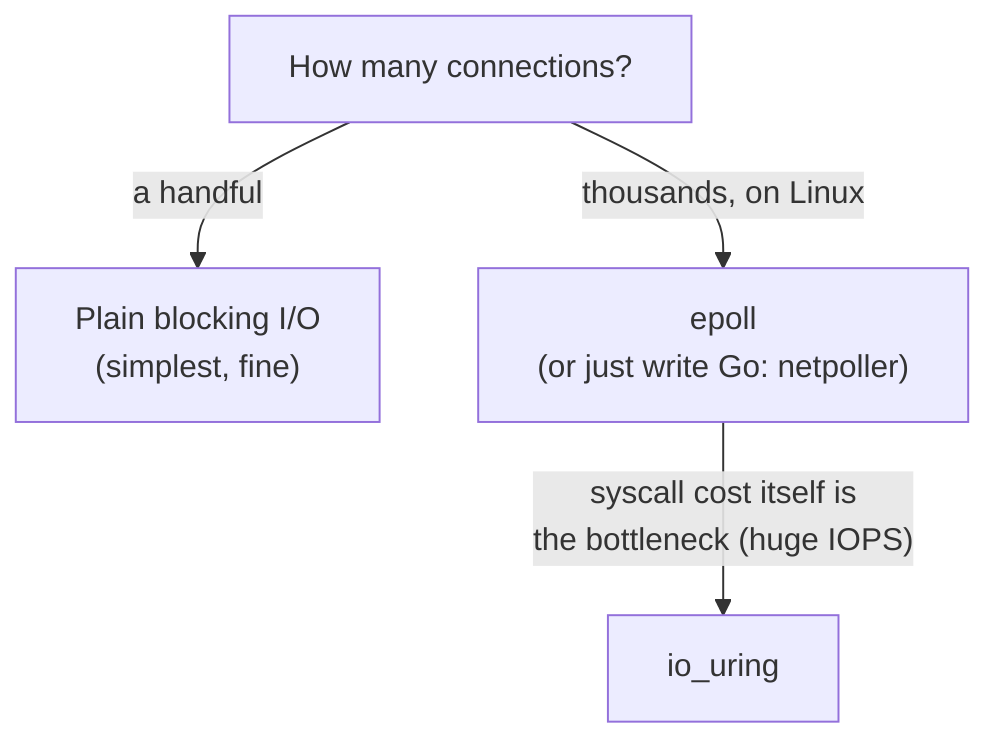

# I-O Models - Blocking, epoll, io_uring and the Go Netpoller

> [!summary] TL;DR
> A program handling many network connections at once has to choose how it finds out which ones are ready: ask the kernel one at a time and wait (blocking), ask and get told immediately either way (non-blocking), or hand the kernel a whole list and let it tell you which are ready (`select`/`poll`/`epoll`, or io_uring's even more general model). Go gives you blocking-looking code that is actually built on the non-blocking, `epoll`-based model underneath.

> [!abstract] Core idea
> - **Blocking I/O**: the calling thread stops until the operation finishes. Simple, but one thread per connection doesn't scale to tens of thousands of connections.
> - **Non-blocking I/O**: the call returns immediately, either with data or "not ready yet" (`EAGAIN`). You still need to know *when* to retry.
> - **`select`/`poll`**: ask the kernel "which of these N file descriptors are ready?" in one call — but the kernel re-scans the whole list every call, so this is `O(N)` per wait regardless of how many are actually ready.
> - **`epoll`** (Linux): register interest once; the kernel pushes only the *ready* descriptors back to you, so waiting is `O(ready)`, not `O(watched)`.
> - **`io_uring`** (Linux, kernel 5.1+): goes further — submit a whole batch of I/O operations (not just "tell me when ready"; the read/write itself) via a shared ring buffer, with the kernel completing them asynchronously and almost no syscalls per operation.
> - **Go's netpoller** uses `epoll` (Linux), kqueue (BSD/Darwin) or IOCP (Windows) under the hood so that application code can write plain blocking-looking `conn.Read()` calls while the runtime parks the *goroutine*, not an OS thread, until data is ready.

## Start here: the basics 🟢

> [!info] How to read this note (pick your level)
> - 🟢 **New to this?** Read "From zero" below, then sections 1, 2 and the cheat sheet (10). Stop there, that is a full first pass.
> - 🟡 **Know the basics?** Add section 3 (how it works), 4 (worked example), 5 and 6.
> - 🔴 **Interview / SDE-3 prep?** Add 7, 8 and 9. Headings are tagged 🟢🟡🔴 so you always know where you are.

> [!note] Before this note
> - [[Concurrency Primitives - Mutex, Semaphore, Atomics]]: several pieces of work can run at the same time, and something must decide who waits.
> - [[System Calls and User vs Kernel Mode]]: your program cannot touch the network itself; it asks the kernel with a "syscall", and each ask has a small cost.

**From zero, in 60 seconds** 🟢

Your server talks to thousands of people at once. Each open conversation is a **connection**. Most connections are quiet most of the time.

The slow, old way: give every connection its own waiting worker (an OS **thread**). Workers are expensive, so 50,000 connections means 50,000 mostly-sleeping workers.


The smart way: keep a few workers, and ask the operating system "which connections have something for me right now?" The OS answers with just the ready ones. That asking mechanism is called **epoll** on Linux.


Go hides all of this: you write simple "wait for data" code, and the Go runtime does the epoll trick for you underneath.

The rest of this note is just these 4 questions:
1. Why does one-thread-per-connection fail at scale?
2. How do `select`/`poll`, `epoll` and `io_uring` each answer "who is ready?"
3. How does Go make blocking-looking code use epoll secretly?
4. What breaks in production and what do interviewers ask?

### The problem in one story

A chat app has 50,000 people connected at once.
Most of them are silent most of the time, but anyone might type at any moment.
The server must notice each message quickly without wasting a worker on every silent person.
This note is about how a program asks "who has something for me right now?"

### Words you need first

| Word | Plain meaning | Tiny example |
| --- | --- | --- |
| I/O | Moving bytes in or out of the program (network, disk) | Reading a message from a socket |
| Socket / connection | One open network link to another machine | One browser tab talking to your server |
| File descriptor (fd) | A small number the kernel gives you to name an open file or socket | `fd 7` = the connection to Alice |
| Kernel | The core of the OS that owns hardware and does real I/O | Linux |
| Syscall | A request from your program to the kernel | `read(fd, buf)` |
| Thread | A unit of execution the OS schedules; costs memory | One worker in a thread pool |
| Blocking | The call waits until the result is ready | `read` sits until bytes arrive |
| Goroutine | Go's very cheap task, run on a few OS threads by the runtime | `go handle(conn)` |
| Non-blocking call | A call that returns at once, even if there is nothing to read yet | `read` returns "nothing yet" instead of waiting |
| `EAGAIN` | The kernel's "not ready, try again later" answer to a non-blocking call | Alice has not typed anything yet |
| epoll | Linux's way to watch many sockets and hear only about the ready ones | 50,000 watched, 3 reported |
| Park (a goroutine) | Put a goroutine to sleep without holding an OS thread | Goroutine waits for Alice; thread serves Bob |
| Ring buffer | A fixed-size list used in a circle; writer and reader chase each other | io_uring's request tray and result tray |
| IOPS | I/O operations per second; how many reads/writes a system does | A fast SSD: hundreds of thousands of IOPS |

### Picture it



### Analogy

A waiter with many tables: instead of standing at one table, they watch for call buttons and only go where a button is lit.
Where it breaks: a real waiter can't be in two places, but the kernel can also do the I/O itself for you (io_uring), which has no waiter equivalent.

### How the rest of this note builds up

- First, why one thread per connection fails at scale ("Why it exists") and the waiter model.
- Then the mechanisms in order: blocking, `select`/`poll`, `epoll` (level vs edge triggered), `io_uring`.
- Then how Go's netpoller hides `epoll` behind plain `conn.Read`, traced step by step.
- Finally the SDE-3 deep dive: trade-offs, production failure modes, and the per-process netpoller and disk-I/O details.

> [!tip] Remember
> Don't give each connection its own waiting thread; let the kernel tell you which connections are ready.

## 1. Why it exists 🟢

A single machine serving 50,000 concurrent long-lived connections (WebSocket fan-out, meaning one server pushing messages down many always-open connections; a chat server; long-polling clients, which keep a request open until the server has news) faces a hard constraint. An OS thread costs:

- real memory for its stack (commonly 1–8 MB reserved address space per thread, even if resident usage is lower), and
- a real context switch cost (the CPU saving one thread's state and loading another's; see [[CPU Scheduling]]) every time the kernel moves between threads.

A naive "one blocking thread per connection" design for 50,000 connections means 50,000 OS threads, most of them asleep waiting for input at any moment.

The kernel scheduler now has to manage all of them, and the memory alone can run into tens of gigabytes before the program does any real work.

The industry's answer, generalized across the C10K-and-beyond problem ("C10K" = how to serve 10,000 connections on one machine, a famous 1999 challenge): don't dedicate an OS thread to each connection.

Instead, use a small number of threads that each ask the kernel "which of these many connections have something ready right now?" and only do work for the ones that do. The mechanism for asking that question efficiently is the whole subject of this note.

### Real-life example 🟢

WhatsApp keeps a connection open to every phone that has the app running, even when nobody is chatting.
One server may hold hundreds of thousands of these quiet connections.
When your friend sends "hi", only that one connection wakes up and the server forwards the message.
If the server gave each phone its own sleeping thread, it would run out of memory long before it ran out of users.
So chat servers (WhatsApp's backend was famously built on Erlang, which uses the same "a few threads, many cheap tasks" idea) lean on epoll-style waiting.

## 2. Mental model 🟢

Imagine a waiter (a thread) responsible for many tables (connections):

- **Blocking I/O**: the waiter stands at one table and waits for that specific customer to finish ordering before serving anyone else. Works for one table; useless for fifty.
- **Non-blocking + polling**: the waiter walks past every table in turn, asking "ready to order?" If not, moves on and comes back later. Correct for many tables, but wastes effort checking tables that aren't ready, over and over.
- **`epoll`**: the waiter puts a small flag on each table when the customer presses a call button. The waiter just watches for raised flags instead of walking the room — attention scales with how many tables actually need something, not with how many tables exist.
- **`io_uring`**: instead of "tell me when table 7 is ready, then I'll go take their order", the waiter hands the kitchen a stack of order slips in advance ("bring these dishes out whenever each one is done") and a runner drops off finished plates — the waiter does almost no per-dish back-and-forth at all.

## Common beginner mistakes 🟢

- **"Goroutines are fast, so Go needs no epoll"** → goroutines are only cheap to create; without the netpoller each waiting `Read` would still hold an OS thread → remember: cheap goroutines + netpoller together make Go scale.
- **Reading only once after an edge-triggered epoll alert** → the alert does not repeat, so leftover bytes sit unread forever → keep reading until you get `EAGAIN`.
- **Setting no deadline on a `net.Conn`** → a client that goes silent keeps its goroutine parked forever, and goroutines pile up → call `SetReadDeadline` / `SetWriteDeadline`.
- **Expecting a disk file read to be handled like a socket** → epoll does not cover regular files, so a slow disk read in Go still uses a whole OS thread → treat heavy disk I/O as thread-bound work.
- **Reaching for epoll or io_uring in a small tool** → for a handful of connections plain blocking code is simpler and just as fast → start simple; switch only when connection count is the real problem.

## 3. How it works 🟡

> 🟢 → 🟡 **You now know** why one thread per connection runs out of memory, and that the fix is to let the kernel say which connections are ready. **Next we open the box** and compare the real mechanisms: `select`/`poll`, `epoll`, `io_uring`, and how Go hides `epoll` behind a plain `conn.Read`. Each subsection starts with a short step-by-step walk; the full detail follows it.

### Whiteboard version

The same four connections, handled three different ways: one blocking thread each, one thread polling all of them in a loop, and one thread asking `epoll` which ones are ready.

**Step by step:**
1. Four friends (A, B, C, D) are connected. Only B and D send a message.
2. Blocking: four threads each wait on one friend. Two of them wait for nothing.
3. `poll`: one thread hands the kernel all four names every time; the kernel checks all four and says "B and D".
4. `epoll`: one thread registers the four names once; later the kernel just says "B and D", without re-checking A and C.







### `select` and `poll`: ask about everything, every time

**In plain words:** you hand the kernel your whole guest list every single time and ask "anyone ready?" — even if the list has 10,000 names and only one changed.

**Step by step:**
1. The server has 10,000 open sockets, numbered by their file descriptors.
2. It calls `poll` and passes all 10,000 numbers to the kernel.
3. The kernel checks all 10,000 and finds that socket 42 has data.
4. `poll` returns; the server reads socket 42.
5. It calls `poll` again, passing all 10,000 numbers again. The work per call grows with the list, not with the number of ready sockets.

`select(2)` and `poll(2)` both take a list of file descriptors and block until at least one is ready, then return which ones.

The cost that limits them at scale: every call passes the *entire* list to the kernel again, and the kernel scans all of it again, even if only one of 10,000 descriptors changed state since the last call.

That makes each wait `O(N)` in the number of watched descriptors, not in the number that are actually ready — fine for a handful of file descriptors, a real bottleneck at thousands.

### `epoll`: level-triggered vs edge-triggered

**In plain words:** you register each guest once, and from then on the kernel taps you only about the ones who actually raised a hand. The two trigger modes decide whether it keeps tapping you (level) or taps exactly once (edge).

**Step by step:**
1. The server creates one epoll instance (a watch list that lives inside the kernel).
2. For each new connection, it calls `epoll_ctl` once: "watch socket 42 for incoming data".
3. It calls `epoll_wait` and sleeps.
4. Bob sends 100 bytes on socket 42. The kernel puts socket 42 on a "ready" list and wakes the server.
5. `epoll_wait` returns just `[42]`. The server reads socket 42. The other 9,999 sockets cost nothing on this call.

`epoll` splits the work into two steps:

1. `epoll_ctl` registers (or modifies, or removes) interest in a file descriptor *once*, storing it in a kernel-side data structure.
2. `epoll_wait` then blocks and returns only the descriptors that became ready, without re-scanning everything that's merely being watched.

This makes waiting proportional to how much is actually happening, not to how much is being watched.

`epoll` supports two triggering modes, and mixing them up is a classic source of bugs:

- **Level-triggered (default)**: `epoll_wait` keeps reporting a descriptor as ready for as long as there's unread data (or buffer space to write into). Safe by default — if you don't drain it all this time, you'll be told again next time.
- **Edge-triggered (`EPOLLET`)**: you're told *once*, at the moment readiness transitions from not-ready to ready. If you don't read until you get `EAGAIN` (fully draining the socket buffer) on that notification, you will not be told again even though data is still sitting there — the edge already passed.



Edge-triggered is more efficient (fewer redundant wake-ups under high throughput).

But it requires the application to loop reading until it hits `EAGAIN` on every notification, or it will silently stop receiving data that's actually sitting in the kernel buffer.

Nginx and most high-performance event loops use edge-triggered mode for exactly this throughput reason, paired with disciplined drain-to-`EAGAIN` loops.

### `io_uring`: shared ring buffers, not one syscall per operation

**In plain words:** instead of being told "table 7 is ready" and then going there yourself, you drop a stack of order slips in a shared tray and the kernel does the work and drops results in another tray — almost no back-and-forth trips (syscalls) at all.

**Step by step:**
1. At start-up, the app and kernel set up two shared trays in memory: requests (SQ) and results (CQ).
2. The app writes 50 request slips into the SQ: "read socket 7 into buffer 1", "read file X into buffer 2", and so on.
3. It makes one syscall (or none, in `SQPOLL` mode) to say "slips are waiting".
4. The kernel does the actual reads and writes in the background.
5. As each one finishes, the kernel drops a result slip in the CQ: "socket 7: 512 bytes read".
6. The app reads the CQ whenever it likes. 50 operations cost about one trip into the kernel instead of 50.

`epoll` (and `select`/`poll`) only ever answer "is it ready?" — you still make a separate `read(2)`/`write(2)` syscall to actually move the bytes.

Each syscall has real overhead (a user→kernel mode transition; see [[System Calls and User vs Kernel Mode]]) plus, since 2018's Meltdown/Spectre mitigations (security fixes for CPU bugs that made each user-to-kernel switch slower), extra cost from stricter CPU isolation between user and kernel space.

`io_uring` (Linux 5.1+, 2019) takes a different approach: the application and kernel share two ring buffers in memory — a **submission queue (SQ)** and a **completion queue (CQ)**.

1. The app writes a submission entry describing an operation (read this fd into this buffer, write that fd, accept a connection, …) directly into the SQ, with no syscall required to submit it in the common case.
2. The kernel processes entries from the SQ asynchronously and writes results into the CQ.
3. The app can batch many operations per actual syscall (or, with `IORING_SETUP_SQPOLL`, a dedicated kernel thread polls the SQ and the application never syscalls at all on the hot path).
4. The app can check for completions without blocking if it wants to do other work in between.



This matters most for very high IOPS (I/O operations per second) workloads (storage-heavy services, some proxies) where syscall overhead itself is the bottleneck.

It is a genuinely different model from `epoll` (which only ever reports readiness) because `io_uring` can perform the I/O operation itself asynchronously, including operations `epoll` has no notion of at all, like file reads.

### How Go's netpoller makes blocking-style code use `epoll`

**In plain words:** your Go code says "read and wait", but the runtime secretly says "not ready? fine, pause just this goroutine, reuse the thread, and wake the goroutine when epoll says data arrived."

**Step by step:**
1. Goroutine G1 calls `conn.Read` on Alice's connection. Alice has not typed yet.
2. The runtime tries a quick non-blocking read and gets `EAGAIN` ("nothing yet").
3. The runtime adds Alice's socket to its one epoll watch list and puts G1 to sleep (parks it). The OS thread moves on to run G2, G3, …
4. Alice types "hi". The kernel marks her socket ready.
5. The runtime's regular `epoll_wait` check sees Alice's socket, wakes G1, and G1's `Read` returns "hi", as if it had simply waited.

This is the part that lets Go programmers write `conn.Read(buf)` and have it *look* blocking while the runtime does none of the one-thread-per-connection work described in "Why it exists".

When a goroutine calls `conn.Read` and the socket has no data yet:

1. The runtime issues a non-blocking `read(2)` first. If data is already there, it returns immediately — no parking needed.
2. If it gets `EAGAIN` (not ready), the runtime registers the file descriptor's interest with the process-wide `epoll` instance it maintains internally (one per Go process on Linux), then **parks the goroutine** — not the OS thread — and hands that OS thread back to the scheduler to run other goroutines.
3. A separate part of the runtime (invoked from the scheduler's own loop, and also from a dedicated `sysmon` thread, a background watchdog thread inside every Go program, when nothing else is running) periodically calls `epoll_wait` to ask the kernel which registered descriptors became ready.
4. When `epoll_wait` reports this descriptor is ready, the runtime marks the parked goroutine runnable again and hands it back to a scheduler P (a "processor" slot; Go runs at most `GOMAXPROCS` of them at once) to resume — right where `conn.Read` left off, with no visible difference to the calling code from an actual blocking call.



The effect: thousands of goroutines can each be "blocked" in a `Read` call, costing only a few KB of goroutine stack each (growable, starting around 2 KB in Go 1.24).

Meanwhile the actual OS thread count stays near `GOMAXPROCS` plus however many are genuinely needed for blocked syscalls the netpoller can't cover. Disk I/O mostly goes through blocking syscalls on separate OS threads, not the netpoller — only network-ish, pollable file descriptors use this path.

This is the mechanism, not goroutines themselves, that lets Go's concurrency model scale to large connection counts without the application writing a single line of event-loop code.

See [[Runtime - Goroutine Scheduler (GMP)]] for how the M:N scheduling of goroutines onto OS threads works more generally, and [[Goroutines and Channels]] for the concurrency-building-blocks side of the same model.

## 4. Worked example 🟡

### Whiteboard version

**In plain words:** this tiny server gives every connection its own goroutine, and it still scales — because goroutines are cheap and the netpoller does the real waiting.

```go
func EchoServer(ln net.Listener) {
	for {
		conn, _ := ln.Accept()
		go func(c net.Conn) { io.Copy(c, c) }(conn)
	}
}
```

This looks like ordinary blocking code — `Accept`, `Read` and `Write` inside `io.Copy` all appear to block the calling goroutine.

Underneath, every one of them goes through the sequence in "How it works": a non-blocking syscall attempt first, parking on the netpoller only if the kernel isn't ready yet.

### Tracing one request through the sequence diagram

Follow a single client through the "How Go's netpoller makes blocking-style code use epoll" sequence diagram above, step by step:

1. A client dials the listener. `ln.Accept()` returns immediately (in the common case), handing the new `net.Conn` to a fresh goroutine.
2. That goroutine calls `conn.Read(buf)`. The runtime tries a non-blocking `read(2)` first. If the client hasn't sent anything yet, this returns `EAGAIN` instantly — no thread waits for it.
3. The runtime registers this connection's file descriptor with the process-wide `epoll` instance (`epoll_ctl`), then parks the goroutine.
   The OS thread that was running it is immediately free to run other goroutines — nothing about this step is unique to this one connection; the same thread may now service hundreds of other parked goroutines' work.
4. Some time later, the client actually sends data. The kernel marks that file descriptor ready.
5. The scheduler's own loop (or the dedicated `sysmon` thread, if nothing else is runnable) calls `epoll_wait`, which returns this descriptor among the ready set.
6. The runtime marks the parked goroutine runnable again. A scheduler `P` resumes it, and the non-blocking `read(2)` this time succeeds — `conn.Read` returns with data, exactly as if it had been an ordinary blocking call all along.

### A measured number for "many connections are cheap"

**In plain words:** real measurements showing that thousands of "waiting" connections cost kilobytes each in Go, not megabytes.

**Measured** (this code, Go 1.24.4, darwin/arm64, `-race`, loopback, 2026-11-09):

- a goroutine-per-connection TCP echo server sustains roughly **56,000 round trips/sec** across 50 concurrent connections (1,000 total round trips in 17.8 ms);
- separately, it handles 200 concurrent clients correctly with the live goroutine count returning to baseline once every client finishes — proving no goroutine was left parked forever.

Both numbers come from the Go note's own tests, not from an external load generator, so they reflect Go scheduling and loopback-socket overhead specifically, not real network latency.

**Representative numbers (estimate):** on Linux, a single Go process handling 100,000 idle, mostly-silent WebSocket connections typically holds roughly 2–8 KB of goroutine stack per connection (much of it the minimum stack before growth).

Compare that with the 1–8 MB of address space an OS-thread-per-connection design would reserve per connection — two to three orders of magnitude less memory for the same connection count.

(Documented behavior, not independently benchmarked here: see the Go runtime source for `netpoll_epoll.go`, and the initial goroutine stack size in `runtime/stack.go`, both in `sources`.)

Runnable Go version: [[I-O Models - Blocking, epoll, io_uring and the Go Netpoller - Go]]

## 5. Variants and comparison 🟡

| Model | How it works | Use when | Cost |
| --- | --- | --- | --- |
| Blocking, 1 thread/connection | Each connection has a dedicated OS thread calling blocking `read`/`write` | Few, long-lived, simple connections; simplest to reason about | Thread stack memory + context-switch overhead scale linearly with connection count |
| Non-blocking + manual poll loop | Repeatedly call `read`/`write`, handle `EAGAIN`, retry | Rarely chosen directly today | Wastes CPU re-checking not-ready descriptors |
| `select`/`poll` | Ask the kernel about a list of fds each call | Small, bounded fd counts, portability across old Unixes | `O(N)` per wait in watched fds, regardless of how many are ready |
| `epoll` (Linux) | Register once; kernel reports only ready fds | High connection counts on Linux (the common server case) | `O(ready)` per wait; edge-triggered needs careful drain-to-`EAGAIN` discipline |
| `io_uring` (Linux 5.1+) | Shared ring buffers; kernel performs the I/O itself, batched, async | Very high IOPS, especially storage-heavy workloads; minimizing syscall count | Newer, more complex API; security surface and bugs still being found as adoption grows |
| Go netpoller | `epoll`/kqueue/IOCP internally; application code looks blocking | Writing Go network services, which is almost always | None visible to the application; it's the default for every `net.Conn` |

### Blocking vs non-blocking vs asynchronous: people mix these up 🟡

| Word | What the call does | Who moves the bytes | Example |
| --- | --- | --- | --- |
| Blocking | Waits until data is there | Your thread, after waiting | plain `read(fd)` |
| Non-blocking | Returns at once, maybe with `EAGAIN` | Your thread, when it retries | `read` on an `O_NONBLOCK` socket |
| Readiness (epoll) | Tells you *which* sockets can be read now | Your thread, with a separate `read` | `epoll_wait` |
| Asynchronous (io_uring) | Takes the job and reports when it is *done* | The kernel | an SQ entry + CQ result |

## 6. Trade-offs and when not to use 🟡

- Event-driven models (`epoll`, `io_uring`) trade simplicity for scale: debugging a stuck state machine across thousands of in-flight events is harder than reading a linear blocking-thread call stack. Go's netpoller is specifically designed to give you the event-driven model's scale with the blocking model's readability — that trade-off is why it exists.
- Edge-triggered `epoll` is a correctness trap if the application doesn't fully drain every notified descriptor to `EAGAIN`; level-triggered is safer by default and usually the right starting choice when hand-rolling an event loop in C or Rust.
- `io_uring` has had a real history of kernel security vulnerabilities (enough that some hardened environments and container runtimes disable or restrict it by default) precisely because of its larger, newer, more powerful kernel-facing surface area — not a reason to avoid it outright, but a reason to check your target environment's policy before depending on it.
- For a handful of outbound HTTP calls or a CLI tool, plain blocking I/O is simpler and completely adequate — none of this machinery matters until connection count or syscall overhead actually becomes the bottleneck.

**Which model should I pick?**



> 🟡 → 🔴 **You now know** how each model works and when to choose it. **Next comes the advanced part:** what real servers (nginx, Redis, Node.js) use, how these designs fail under load, and the Go runtime details interviewers probe, like edge-triggered mode inside the netpoller and why disk I/O still uses OS threads.

## 7. In production 🔴

- **Real systems:** nginx and HAProxy both use `epoll` (edge-triggered) as their default event-loop mechanism on Linux; Redis's single-threaded event loop is built on an abstraction over `epoll`/kqueue/`select` (its `ae` event library); Node.js's `libuv` similarly wraps `epoll`/kqueue/IOCP; newer high-throughput systems and some database engines (recent PostgreSQL work, ScyllaDB's Seastar framework) have adopted `io_uring` for both networking and disk I/O.
- **Failure modes → fixes:**
	- A hand-rolled edge-triggered `epoll` server randomly stops delivering data on some connections under load → missing drain-to-`EAGAIN` loop; always read until you see `EAGAIN`, never assume one read per notification is enough.
	- A Go service's goroutine count climbs without bound → a network peer is slow to read (backpressure) or a goroutine is leaked holding a connection open with no deadline; set `SetReadDeadline`/`SetWriteDeadline` and investigate goroutine dumps (`pprof`, Go's built-in profiler that lists what every goroutine is doing) for stacks stuck in `net.Conn` reads.
	- Extremely high connection-handling CPU usage despite low actual traffic → check for level-triggered `epoll` being re-woken unnecessarily, or (in Go) excessive goroutine churn from creating a new goroutine per tiny unit of work instead of reusing a worker pool.
- **What to monitor:** goroutine count over time (a proxy for "connections in flight" plus any leaks); OS thread count (`GOMAXPROCS`-ish plus blocked-syscall threads) via `runtime.NumGoroutine()`/`runtime/debug` or `pprof`'s thread profile; file descriptor count against the process's `ulimit -n`; for a hand-rolled event loop, `epoll_wait` call rate and the ratio of ready-to-watched descriptors.

## 8. Deep dive 🔴

- **Why the netpoller is per-process, not per-connection.** Go maintains one shared `epoll` (or kqueue) instance for the whole process; every network file descriptor the runtime cares about is registered there once. This is why the overhead of "one more connection" in Go is close to the cost of one more `epoll_ctl` registration and a goroutine, not a full OS thread.
- **Edge-triggered specifics in Go's runtime.** Go's Linux netpoller uses `EPOLLET` (edge-triggered) internally for efficiency, paired with the discipline described above inside `internal/poll`: every read loops the non-blocking syscall until it actually gets `EAGAIN`, so the edge-triggered drain requirement is handled once, correctly, inside the runtime — application code never has to think about it.
- **Disk I/O is different from network I/O here.** `epoll` was designed around sockets and pipes; regular file I/O historically doesn't block the same way (the page cache usually serves it near-instantly, see [[Page Cache, File Systems and fsync]]) or doesn't support `epoll`-style readiness notification at all. This is part of why Go's netpoller covers network connections but a blocking disk read in Go can still tie up an OS thread — and part of why `io_uring`, which added real async file I/O support, matters more for storage-heavy services than `epoll` ever could.
- **io_uring's `SQPOLL` mode** goes one step further than batching: a dedicated kernel thread polls the submission queue continuously, so a sufficiently busy application can submit I/O with *zero* syscalls on the hot path — at the cost of that kernel thread spinning (burning a CPU core) even when idle, a trade-off only worth making under sustained very high IOPS.

## 9. Interview questions 🔴

> [!question]- Why is `epoll` faster than `select`/`poll` at scale, when all three do "tell me which fds are ready"?
> `select`/`poll` pass the full watch list to the kernel on every call and the kernel rescans all of it, so each wait costs `O(N)` in watched descriptors. `epoll` registers interest once via `epoll_ctl` and `epoll_wait` only returns descriptors that actually became ready, costing `O(ready)` — independent of how many are merely being watched.

> [!question]- What's the difference between level-triggered and edge-triggered `epoll`, and what bug does mixing them up cause?
> Level-triggered keeps reporting a descriptor ready as long as there's unread data; edge-triggered reports it only once, at the not-ready-to-ready transition. The bug: using edge-triggered mode but reading only once per notification leaves data sitting in the kernel buffer with no further notification ever coming, because the edge already passed — the fix is to always read until `EAGAIN` on edge-triggered mode.

> [!question]- How does Go let you write `conn.Read(buf)` as if it blocks, without one OS thread per connection?
> The runtime tries a non-blocking read first; if it gets `EAGAIN`, it registers the file descriptor with its internal `epoll` (or kqueue) instance and parks the *goroutine*, freeing the OS thread to run other goroutines. When `epoll_wait` later reports the descriptor ready, the runtime marks the goroutine runnable again and it resumes exactly where `Read` left off — all inside the runtime, invisible to application code.

> [!question]- What does `io_uring` do that `epoll` fundamentally cannot?
> `epoll` only ever answers "is this descriptor ready?" — you still issue a separate syscall to actually perform the read or write. `io_uring` lets the kernel perform the I/O operation itself asynchronously (including file I/O, which `epoll` was never designed for), submitted and completed through shared ring buffers with far fewer syscalls, sometimes zero on the hot path with `SQPOLL`.

> [!question]- A junior engineer says "Go is fast at networking because goroutines are lightweight threads." What's missing from that explanation?
> Lightweight goroutines explain why creating many of them is cheap, but not why thousands of them can each sit in a blocking-looking `Read` without exhausting OS threads. The actual mechanism is the netpoller: it detects a socket isn't ready, parks only the goroutine (not an OS thread) on an internal `epoll`/kqueue instance, and resumes it once the kernel says data arrived. Cheap goroutines plus the netpoller together are what scale; either alone isn't enough.
> [!trap] This is a common half-answer in interviews — "goroutines are cheap" alone doesn't explain concurrency at the I/O-readiness level, only at the scheduling-overhead level.

> [!question]- Why would a Go program still end up with many OS threads even though the netpoller handles network I/O?
> Blocking syscalls the netpoller doesn't cover — disk file I/O, cgo calls (Go code calling C code) into blocking C code, DNS resolution via the system resolver on some platforms — tie up a real OS thread for their duration. The Go runtime spins up additional OS threads to keep `GOMAXPROCS` goroutines runnable even while some threads are stuck in such a blocking call, which is why `runtime.NumGoroutine()` staying flat doesn't guarantee the OS thread count does too.

## 10. Cheat sheet 🟢

- Blocking: 1 thread waits per connection — simple, doesn't scale past a few thousand connections.
- `select`/`poll`: ask about the whole watch list every call — `O(N)` in watched fds per wait.
- `epoll`: register once, get told only what's ready — `O(ready)` per wait; level-triggered is safer, edge-triggered needs a full drain-to-`EAGAIN` loop.
- `io_uring`: shared ring buffers; the kernel performs the I/O itself, batched and async, covering file I/O too.
- Go's netpoller: non-blocking syscall attempt first, park the *goroutine* (not the OS thread) on an internal epoll/kqueue instance if not ready, resume it on readiness.
- This is why `conn.Read()` in Go looks blocking but thousands of goroutines calling it concurrently cost KBs of stack each, not an OS thread each.
- Disk I/O mostly bypasses the netpoller; blocking file reads can still tie up an OS thread.
- `io_uring`'s larger kernel surface has had real CVEs; check your deployment environment's policy before relying on it.

## Self-check 🟢🟡

🟢 Easy

> [!question]- Why does one OS thread per connection fail at 50,000 connections?
> Each thread reserves memory for its stack (around 1-8 MB) and adds switching work, so most memory goes to threads that are just waiting.

> [!question]- What question does epoll answer for a server?
> "Which of my watched sockets have something ready right now?" It returns only the ready ones.

> [!question]- What does `EAGAIN` mean?
> "Not ready yet, try again later": the answer a non-blocking read gets when there is no data.

🟡 Medium

> [!question]- Why is `poll` slow with 10,000 sockets when only one is active?
> Every call passes the whole list again and the kernel checks all 10,000, so cost grows with watched sockets, not ready ones.

> [!question]- In Go, what is parked when `conn.Read` has no data: the goroutine or the OS thread?
> Only the goroutine. The OS thread goes off to run other goroutines until epoll reports the socket ready.

> [!question]- What can io_uring do that epoll cannot?
> It does the read or write itself and reports when it is finished (including file reads); epoll only says "ready" and you still make the read call.

## Links 🟢

- **Before this:** [[Concurrency Primitives - Mutex, Semaphore, Atomics]], [[System Calls and User vs Kernel Mode]], [[CPU Scheduling]]
- **Next:** [[Runtime - Goroutine Scheduler (GMP)]], [[Goroutines and Channels]]
- **Compare with:** [[Page Cache, File Systems and fsync]] (why disk I/O doesn't fit the epoll readiness model the way sockets do)
- **Runnable Go version:** [[I-O Models - Blocking, epoll, io_uring and the Go Netpoller - Go]]

### Watch on YouTube

- [How io_uring Actually Works — The Async I/O Interface Replacing epoll](https://www.youtube.com/watch?v=Yw-O5QWkhsQ) · State & Flow · Deep dive on io_uring's ring-buffer model and how it differs from epoll's readiness model
- [All About Epoll - Scalable I/O Syscalls in Linux!](https://www.youtube.com/watch?v=WuwUk7Mk80E) · hoff._world · Focused explainer on epoll's O(ready) readiness notification model vs select/poll
