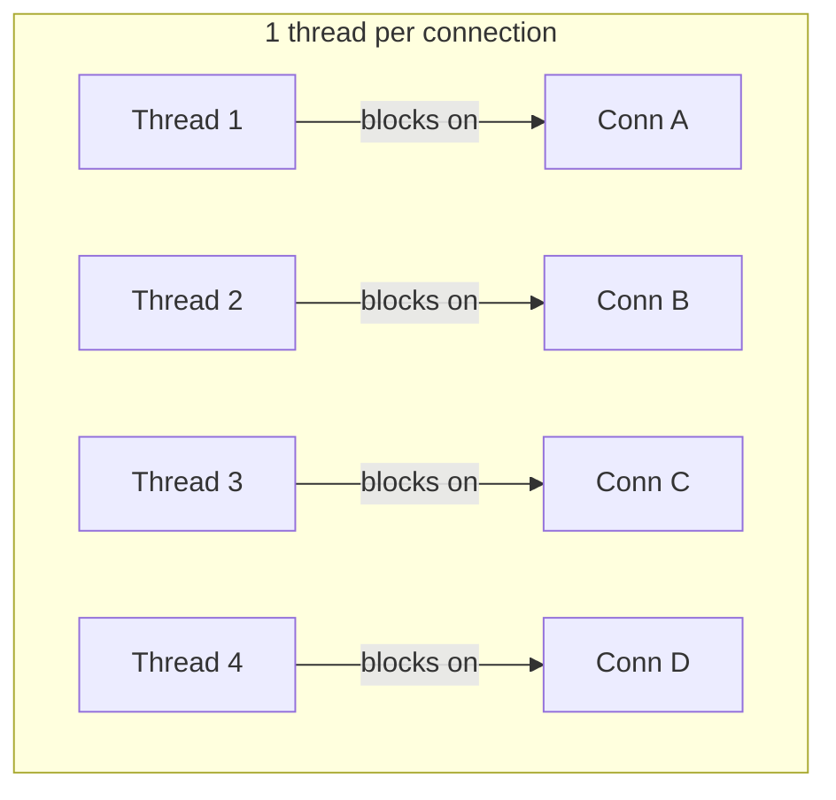
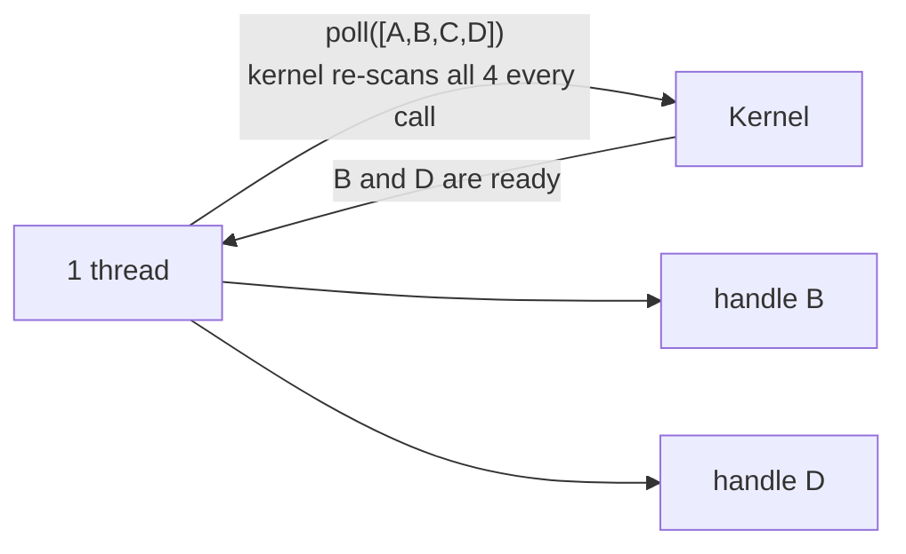
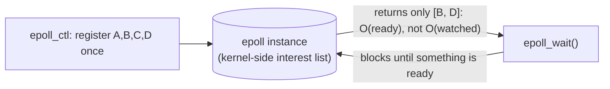
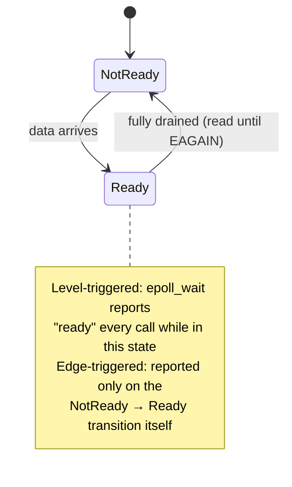
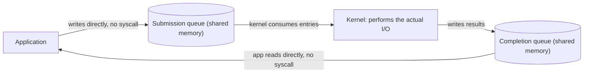
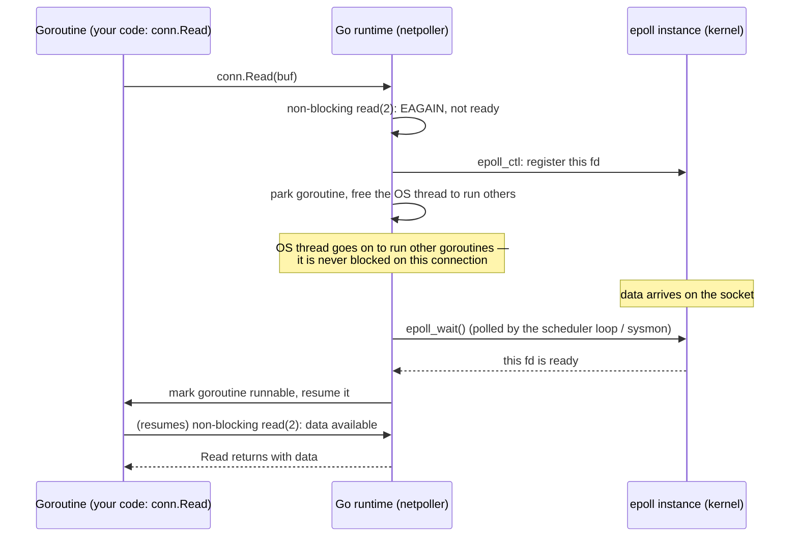

# I-O Models - Blocking, epoll, io_uring and the Go Netpoller

> [!summary] TL;DR
> A program handling many network connections at once has to choose how it finds out which ones are ready: ask the kernel one at a time and wait (blocking), ask and get told immediately either way (non-blocking), or hand the kernel a whole list and let it tell you which are ready (`select`/`poll`/`epoll`, or io_uring's even more general model). Go gives you blocking-looking code that is actually built on the non-blocking, `epoll`-based model underneath.

> [!abstract] Core idea
> - **Blocking I/O**: the calling thread stops until the operation finishes. Simple, but one thread per connection doesn't scale to tens of thousands of connections.
> - **Non-blocking I/O**: the call returns immediately, either with data or "not ready yet" (`EAGAIN`). You still need to know *when* to retry.
> - **`select`/`poll`**: ask the kernel "which of these N file descriptors are ready?" in one call — but the kernel re-scans the whole list every call, so this is `O(N)` per wait regardless of how many are actually ready.
> - **`epoll`** (Linux): register interest once; the kernel pushes only the *ready* descriptors back to you, so waiting is `O(ready)`, not `O(watched)`.
> - **`io_uring`** (Linux, kernel 5.1+): goes further — submit a whole batch of I/O operations (not just "tell me when ready"; the read/write itself) via a shared ring buffer, with the kernel completing them asynchronously and almost no syscalls per operation.
> - **Go's netpoller** uses `epoll` (Linux), kqueue (BSD/Darwin) or IOCP (Windows) under the hood so that application code can write plain blocking-looking `conn.Read()` calls while the runtime parks the *goroutine*, not an OS thread, until data is ready.

## 1. Why it exists

A single machine serving 50,000 concurrent long-lived connections (WebSocket fan-out, a chat server, long-polling clients) faces a hard constraint: an OS thread costs real memory for its stack (commonly 1–8 MB reserved address space per thread, even if resident usage is lower) and a real context switch cost (see [[CPU Scheduling]]) every time the kernel moves between threads. A naive "one blocking thread per connection" design for 50,000 connections means 50,000 OS threads, most of them asleep waiting for input at any moment — the kernel scheduler now has to manage all of them, and the memory alone can run into tens of gigabytes before the program does any real work.

The industry's answer, generalized across the C10K-and-beyond problem: don't dedicate an OS thread to each connection. Instead, use a small number of threads that each ask the kernel "which of these many connections have something ready right now?" and only do work for the ones that do. The mechanism for asking that question efficiently is the whole subject of this note.

## 2. Mental model

Imagine a waiter (a thread) responsible for many tables (connections):

- **Blocking I/O**: the waiter stands at one table and waits for that specific customer to finish ordering before serving anyone else. Works for one table; useless for fifty.
- **Non-blocking + polling**: the waiter walks past every table in turn, asking "ready to order?" If not, moves on and comes back later. Correct for many tables, but wastes effort checking tables that aren't ready, over and over.
- **`epoll`**: the waiter puts a small flag on each table when the customer presses a call button. The waiter just watches for raised flags instead of walking the room — attention scales with how many tables actually need something, not with how many tables exist.
- **`io_uring`**: instead of "tell me when table 7 is ready, then I'll go take their order", the waiter hands the kitchen a stack of order slips in advance ("bring these dishes out whenever each one is done") and a runner drops off finished plates — the waiter does almost no per-dish back-and-forth at all.

## 3. How it works

### Whiteboard version

The same four connections, handled three different ways: one blocking thread each, one thread polling all of them in a loop, and one thread asking `epoll` which ones are ready.







### `select` and `poll`: ask about everything, every time

`select(2)` and `poll(2)` both take a list of file descriptors and block until at least one is ready, then return which ones. The cost that limits them at scale: every call passes the *entire* list to the kernel again, and the kernel scans all of it again, even if only one of 10,000 descriptors changed state since the last call. That makes each wait `O(N)` in the number of watched descriptors, not in the number that are actually ready — fine for a handful of file descriptors, a real bottleneck at thousands.

### `epoll`: level-triggered vs edge-triggered

`epoll` splits the work into two steps: `epoll_ctl` registers (or modifies, or removes) interest in a file descriptor *once*, storing it in a kernel-side data structure; `epoll_wait` then blocks and returns only the descriptors that became ready, without re-scanning everything that's merely being watched. This makes waiting proportional to how much is actually happening, not to how much is being watched.

`epoll` supports two triggering modes, and mixing them up is a classic source of bugs:

- **Level-triggered (default)**: `epoll_wait` keeps reporting a descriptor as ready for as long as there's unread data (or buffer space to write into). Safe by default — if you don't drain it all this time, you'll be told again next time.
- **Edge-triggered (`EPOLLET`)**: you're told *once*, at the moment readiness transitions from not-ready to ready. If you don't read until you get `EAGAIN` (fully draining the socket buffer) on that notification, you will not be told again even though data is still sitting there — the edge already passed.



Edge-triggered is more efficient (fewer redundant wake-ups under high throughput) but requires the application to loop reading until it hits `EAGAIN` on every notification, or it will silently stop receiving data that's actually sitting in the kernel buffer. Nginx and most high-performance event loops use edge-triggered mode for exactly this throughput reason, paired with disciplined drain-to-`EAGAIN` loops.

### `io_uring`: shared ring buffers, not one syscall per operation

`epoll` (and `select`/`poll`) only ever answer "is it ready?" — you still make a separate `read(2)`/`write(2)` syscall to actually move the bytes, and each syscall has real overhead (a user→kernel mode transition; see [[System Calls and User vs Kernel Mode]]) plus, since 2018's Meltdown/Spectre mitigations, extra cost from stricter CPU isolation between user and kernel space.

`io_uring` (Linux 5.1+, 2019) takes a different approach: the application and kernel share two ring buffers in memory — a **submission queue (SQ)** and a **completion queue (CQ)**. The app writes a submission entry describing an operation (read this fd into this buffer, write that fd, accept a connection, …) directly into the SQ, with no syscall required to submit it in the common case; the kernel processes entries from the SQ asynchronously and writes results into the CQ. The app can batch many operations per actual syscall (or, with `IORING_SETUP_SQPOLL`, a dedicated kernel thread polls the SQ and the application never syscalls at all on the hot path), and can check for completions without blocking if it wants to do other work in between.



This matters most for very high IOPS workloads (storage-heavy services, some proxies) where syscall overhead itself is the bottleneck; it is a genuinely different model from `epoll` (which only ever reports readiness) because `io_uring` can perform the I/O operation itself asynchronously, including operations `epoll` has no notion of at all, like file reads.

### How Go's netpoller makes blocking-style code use `epoll`

This is the part that lets Go programmers write `conn.Read(buf)` and have it *look* blocking while the runtime does none of the one-thread-per-connection work described in "Why it exists". When a goroutine calls `conn.Read` and the socket has no data yet:

1. The runtime issues a non-blocking `read(2)` first. If data is already there, it returns immediately — no parking needed.
2. If it gets `EAGAIN` (not ready), the runtime registers the file descriptor's interest with the process-wide `epoll` instance it maintains internally (one per Go process on Linux), then **parks the goroutine** — not the OS thread — and hands that OS thread back to the scheduler to run other goroutines.
3. A separate part of the runtime (invoked from the scheduler's own loop, and also from a dedicated `sysmon` thread when nothing else is running) periodically calls `epoll_wait` to ask the kernel which registered descriptors became ready.
4. When `epoll_wait` reports this descriptor is ready, the runtime marks the parked goroutine runnable again and hands it back to a scheduler P to resume — right where `conn.Read` left off, with no visible difference to the calling code from an actual blocking call.



The effect: thousands of goroutines can each be "blocked" in a `Read` call, costing only a few KB of goroutine stack each (growable, starting around 2 KB in Go 1.24), while the actual OS thread count stays near `GOMAXPROCS` plus however many are genuinely needed for blocked syscalls the netpoller can't cover (disk I/O mostly goes through blocking syscalls on separate OS threads, not the netpoller — only network-ish, pollable file descriptors use this path). This is the mechanism, not goroutines themselves, that lets Go's concurrency model scale to large connection counts without the application writing a single line of event-loop code; see [[Runtime - Goroutine Scheduler (GMP)]] for how the M:N scheduling of goroutines onto OS threads works more generally, and [[Goroutines and Channels]] for the concurrency-building-blocks side of the same model.

## 4. Worked example

### Whiteboard version

```go
func EchoServer(ln net.Listener) {
	for {
		conn, err := ln.Accept()
		if err != nil {
			return
		}
		go func(c net.Conn) {
			defer c.Close()
			io.Copy(c, c)
		}(conn)
	}
}
```

This looks like ordinary blocking code — `Accept`, `Read` and `Write` inside `io.Copy` all appear to block the calling goroutine. Underneath, every one of them goes through the sequence in "How it works": a non-blocking syscall attempt first, parking on the netpoller only if the kernel isn't ready yet.

### A goroutine-per-connection echo server, proven to handle many connections cheaply

```go
// Package iomodels demonstrates the netpoller indirectly: it is an ordinary
// blocking-style TCP echo server. On Linux the Go runtime backs net.Conn
// with epoll (edge-triggered); on this module's build platform it uses the
// local equivalent (kqueue on Darwin and BSD, IOCP on Windows). Either way,
// the application code below never calls epoll or kqueue itself — that is
// the point of the netpoller, covered in "How it works".
package iomodels

import (
	"io"
	"net"
)

// EchoServer accepts connections on a net.Listener and echoes back whatever
// each client sends, one goroutine per connection, until the listener is
// closed. Every Read and Write below looks like a blocking syscall, but no
// OS thread blocks on it: see "How it works" for what actually happens.
func EchoServer(ln net.Listener) {
	for {
		conn, err := ln.Accept()
		if err != nil {
			return // listener closed
		}
		go func(c net.Conn) {
			defer c.Close()
			io.Copy(c, c) //nolint:errcheck // demo server: client closing the
			// connection is an expected io.EOF, not an error worth handling here.
		}(conn)
	}
}
```

```go
// TestEchoServerHandlesManyConcurrentConnections opens many concurrent
// connections and checks every one gets its own bytes back correctly. Each
// connection's goroutine spends almost all of its time blocked in Read, yet
// this test finishes in well under a second: the goroutines are parked on
// the runtime's netpoller, not on OS threads, so thousands of them are cheap.
func TestEchoServerHandlesManyConcurrentConnections(t *testing.T) {
	ln, err := net.Listen("tcp", "127.0.0.1:0")
	if err != nil {
		t.Fatalf("Listen: %v", err)
	}
	defer ln.Close()
	go EchoServer(ln)

	const clients = 200
	before := runtime.NumGoroutine()

	var wg sync.WaitGroup
	errs := make(chan error, clients)
	for i := 0; i < clients; i++ {
		i := i
		wg.Add(1)
		go func() {
			defer wg.Done()
			conn, err := net.DialTimeout("tcp", ln.Addr().String(), 2*time.Second)
			if err != nil {
				errs <- fmt.Errorf("client %d dial: %w", i, err)
				return
			}
			defer conn.Close()

			msg := fmt.Sprintf("hello-%d", i)
			if _, err := conn.Write([]byte(msg)); err != nil {
				errs <- fmt.Errorf("client %d write: %w", i, err)
				return
			}
			_ = conn.(*net.TCPConn).CloseWrite() // signal EOF so io.Copy on the server returns

			got, err := io.ReadAll(conn)
			if err != nil {
				errs <- fmt.Errorf("client %d read: %w", i, err)
				return
			}
			if string(got) != msg {
				errs <- fmt.Errorf("client %d: got %q, want %q", i, got, msg)
			}
		}()
	}
	wg.Wait()
	close(errs)
	for err := range errs {
		t.Error(err)
	}

	// With clients goroutines each blocked in a network read, the live
	// goroutine count rose by roughly that many while they ran; it is back
	// down near the baseline now that every client has finished.
	after := runtime.NumGoroutine()
	if after > before+5 {
		t.Fatalf("goroutines leaked: before=%d after=%d", before, after)
	}
}
```

**Tested:** `go vet` and `go test -race` both pass on Go 1.24.4, darwin/arm64 (2026-11-06) — 200 concurrent client connections complete in well under a second, every byte round-trips correctly, and the goroutine count returns to baseline afterward, confirming no goroutine was left parked forever.

**Representative numbers (estimate):** on Linux, a single Go process handling 100,000 idle, mostly-silent WebSocket connections typically holds roughly 2–8 KB of goroutine stack per connection (much of it the minimum stack before growth) versus the 1–8 MB of address space an OS-thread-per-connection design would reserve per connection — two to three orders of magnitude less memory for the same connection count. (Documented behavior, not independently benchmarked here: see the Go runtime source for `netpoll_epoll.go`, and the initial goroutine stack size in `runtime/stack.go`, both in `sources`.)

## 5. Variants and comparison

| Model | How it works | Use when | Cost |
| --- | --- | --- | --- |
| Blocking, 1 thread/connection | Each connection has a dedicated OS thread calling blocking `read`/`write` | Few, long-lived, simple connections; simplest to reason about | Thread stack memory + context-switch overhead scale linearly with connection count |
| Non-blocking + manual poll loop | Repeatedly call `read`/`write`, handle `EAGAIN`, retry | Rarely chosen directly today | Wastes CPU re-checking not-ready descriptors |
| `select`/`poll` | Ask the kernel about a list of fds each call | Small, bounded fd counts, portability across old Unixes | `O(N)` per wait in watched fds, regardless of how many are ready |
| `epoll` (Linux) | Register once; kernel reports only ready fds | High connection counts on Linux (the common server case) | `O(ready)` per wait; edge-triggered needs careful drain-to-`EAGAIN` discipline |
| `io_uring` (Linux 5.1+) | Shared ring buffers; kernel performs the I/O itself, batched, async | Very high IOPS, especially storage-heavy workloads; minimizing syscall count | Newer, more complex API; security surface and bugs still being found as adoption grows |
| Go netpoller | `epoll`/kqueue/IOCP internally; application code looks blocking | Writing Go network services, which is almost always | None visible to the application; it's the default for every `net.Conn` |

## 6. Trade-offs and when not to use

- Event-driven models (`epoll`, `io_uring`) trade simplicity for scale: debugging a stuck state machine across thousands of in-flight events is harder than reading a linear blocking-thread call stack. Go's netpoller is specifically designed to give you the event-driven model's scale with the blocking model's readability — that trade-off is why it exists.
- Edge-triggered `epoll` is a correctness trap if the application doesn't fully drain every notified descriptor to `EAGAIN`; level-triggered is safer by default and usually the right starting choice when hand-rolling an event loop in C or Rust.
- `io_uring` has had a real history of kernel security vulnerabilities (enough that some hardened environments and container runtimes disable or restrict it by default) precisely because of its larger, newer, more powerful kernel-facing surface area — not a reason to avoid it outright, but a reason to check your target environment's policy before depending on it.
- For a handful of outbound HTTP calls or a CLI tool, plain blocking I/O is simpler and completely adequate — none of this machinery matters until connection count or syscall overhead actually becomes the bottleneck.

## 7. In production

- **Real systems:** nginx and HAProxy both use `epoll` (edge-triggered) as their default event-loop mechanism on Linux; Redis's single-threaded event loop is built on an abstraction over `epoll`/kqueue/`select` (its `ae` event library); Node.js's `libuv` similarly wraps `epoll`/kqueue/IOCP; newer high-throughput systems and some database engines (recent PostgreSQL work, ScyllaDB's Seastar framework) have adopted `io_uring` for both networking and disk I/O.
- **Failure modes → fixes:**
	- A hand-rolled edge-triggered `epoll` server randomly stops delivering data on some connections under load → missing drain-to-`EAGAIN` loop; always read until you see `EAGAIN`, never assume one read per notification is enough.
	- A Go service's goroutine count climbs without bound → a network peer is slow to read (backpressure) or a goroutine is leaked holding a connection open with no deadline; set `SetReadDeadline`/`SetWriteDeadline` and investigate goroutine dumps (`pprof`) for stacks stuck in `net.Conn` reads.
	- Extremely high connection-handling CPU usage despite low actual traffic → check for level-triggered `epoll` being re-woken unnecessarily, or (in Go) excessive goroutine churn from creating a new goroutine per tiny unit of work instead of reusing a worker pool.
- **What to monitor:** goroutine count over time (a proxy for "connections in flight" plus any leaks); OS thread count (`GOMAXPROCS`-ish plus blocked-syscall threads) via `runtime.NumGoroutine()`/`runtime/debug` or `pprof`'s thread profile; file descriptor count against the process's `ulimit -n`; for a hand-rolled event loop, `epoll_wait` call rate and the ratio of ready-to-watched descriptors.

## 8. Deep dive

- **Why the netpoller is per-process, not per-connection.** Go maintains one shared `epoll` (or kqueue) instance for the whole process; every network file descriptor the runtime cares about is registered there once. This is why the overhead of "one more connection" in Go is close to the cost of one more `epoll_ctl` registration and a goroutine, not a full OS thread.
- **Edge-triggered specifics in Go's runtime.** Go's Linux netpoller uses `EPOLLET` (edge-triggered) internally for efficiency, paired with the discipline described above inside `internal/poll`: every read loops the non-blocking syscall until it actually gets `EAGAIN`, so the edge-triggered drain requirement is handled once, correctly, inside the runtime — application code never has to think about it.
- **Disk I/O is different from network I/O here.** `epoll` was designed around sockets and pipes; regular file I/O historically doesn't block the same way (the page cache usually serves it near-instantly, see [[Page Cache, File Systems and fsync]]) or doesn't support `epoll`-style readiness notification at all. This is part of why Go's netpoller covers network connections but a blocking disk read in Go can still tie up an OS thread — and part of why `io_uring`, which added real async file I/O support, matters more for storage-heavy services than `epoll` ever could.
- **io_uring's `SQPOLL` mode** goes one step further than batching: a dedicated kernel thread polls the submission queue continuously, so a sufficiently busy application can submit I/O with *zero* syscalls on the hot path — at the cost of that kernel thread spinning (burning a CPU core) even when idle, a trade-off only worth making under sustained very high IOPS.

## 9. Interview questions

> [!question]- Why is `epoll` faster than `select`/`poll` at scale, when all three do "tell me which fds are ready"?
> `select`/`poll` pass the full watch list to the kernel on every call and the kernel rescans all of it, so each wait costs `O(N)` in watched descriptors. `epoll` registers interest once via `epoll_ctl` and `epoll_wait` only returns descriptors that actually became ready, costing `O(ready)` — independent of how many are merely being watched.

> [!question]- What's the difference between level-triggered and edge-triggered `epoll`, and what bug does mixing them up cause?
> Level-triggered keeps reporting a descriptor ready as long as there's unread data; edge-triggered reports it only once, at the not-ready-to-ready transition. The bug: using edge-triggered mode but reading only once per notification leaves data sitting in the kernel buffer with no further notification ever coming, because the edge already passed — the fix is to always read until `EAGAIN` on edge-triggered mode.

> [!question]- How does Go let you write `conn.Read(buf)` as if it blocks, without one OS thread per connection?
> The runtime tries a non-blocking read first; if it gets `EAGAIN`, it registers the file descriptor with its internal `epoll` (or kqueue) instance and parks the *goroutine*, freeing the OS thread to run other goroutines. When `epoll_wait` later reports the descriptor ready, the runtime marks the goroutine runnable again and it resumes exactly where `Read` left off — all inside the runtime, invisible to application code.

> [!question]- What does `io_uring` do that `epoll` fundamentally cannot?
> `epoll` only ever answers "is this descriptor ready?" — you still issue a separate syscall to actually perform the read or write. `io_uring` lets the kernel perform the I/O operation itself asynchronously (including file I/O, which `epoll` was never designed for), submitted and completed through shared ring buffers with far fewer syscalls, sometimes zero on the hot path with `SQPOLL`.

> [!question]- A junior engineer says "Go is fast at networking because goroutines are lightweight threads." What's missing from that explanation?
> Lightweight goroutines explain why creating many of them is cheap, but not why thousands of them can each sit in a blocking-looking `Read` without exhausting OS threads. The actual mechanism is the netpoller: it detects a socket isn't ready, parks only the goroutine (not an OS thread) on an internal `epoll`/kqueue instance, and resumes it once the kernel says data arrived. Cheap goroutines plus the netpoller together are what scale; either alone isn't enough.
> [!trap] This is a common half-answer in interviews — "goroutines are cheap" alone doesn't explain concurrency at the I/O-readiness level, only at the scheduling-overhead level.

> [!question]- Why would a Go program still end up with many OS threads even though the netpoller handles network I/O?
> Blocking syscalls the netpoller doesn't cover — disk file I/O, cgo calls into blocking C code, DNS resolution via the system resolver on some platforms — tie up a real OS thread for their duration. The Go runtime spins up additional OS threads to keep `GOMAXPROCS` goroutines runnable even while some threads are stuck in such a blocking call, which is why `runtime.NumGoroutine()` staying flat doesn't guarantee the OS thread count does too.

## 10. Cheat sheet

- Blocking: 1 thread waits per connection — simple, doesn't scale past a few thousand connections.
- `select`/`poll`: ask about the whole watch list every call — `O(N)` in watched fds per wait.
- `epoll`: register once, get told only what's ready — `O(ready)` per wait; level-triggered is safer, edge-triggered needs a full drain-to-`EAGAIN` loop.
- `io_uring`: shared ring buffers; the kernel performs the I/O itself, batched and async, covering file I/O too.
- Go's netpoller: non-blocking syscall attempt first, park the *goroutine* (not the OS thread) on an internal epoll/kqueue instance if not ready, resume it on readiness.
- This is why `conn.Read()` in Go looks blocking but thousands of goroutines calling it concurrently cost KBs of stack each, not an OS thread each.
- Disk I/O mostly bypasses the netpoller; blocking file reads can still tie up an OS thread.
- `io_uring`'s larger kernel surface has had real CVEs; check your deployment environment's policy before relying on it.

## Links

- **Before this:** [[Concurrency Primitives - Mutex, Semaphore, Atomics]], [[System Calls and User vs Kernel Mode]], [[CPU Scheduling]]
- **Next:** [[Runtime - Goroutine Scheduler (GMP)]], [[Goroutines and Channels]]
- **Compare with:** [[Page Cache, File Systems and fsync]] (why disk I/O doesn't fit the epoll readiness model the way sockets do)
