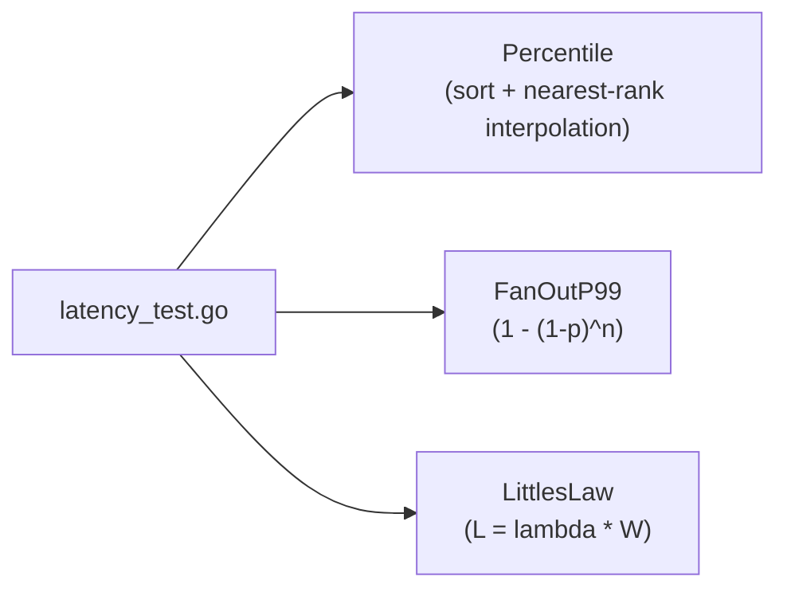
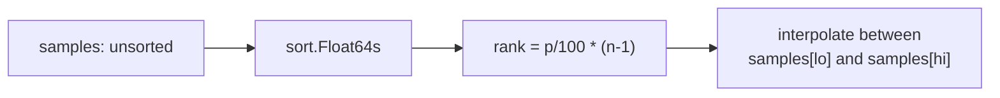

# Latency Numbers Every Engineer Should Know - Go

> [!summary] TL;DR
> The runnable side of [[Latency Numbers Every Engineer Should Know]]: a percentile function used the same way real APM dashboards compute p50/p95/p99, a formula that proves why fan-out makes the tail worse than any single dependency, and Little's Law as three lines of Go.

## Before the code

- **Package and exported functions**: a capitalized name like `Percentile` is visible outside the package `latency`.
- **Slices (`[]float64`)**: a growable view over an array; passing one shares the same backing data, which is why sorting in place affects the caller.
- **`sort.Float64s`**: standard-library sort for a `[]float64`, ascending, in place.
- **`append([]float64{}, s...)`**: the idiom for copying a slice into a fresh one.
- **`testing` package**: functions named `TestXxx(t *testing.T)` run under `go test`; `t.Fatalf` fails the test.
- **What to run**: `go vet ./... && go test -race -v ./...` inside the module folder.

## What this code shows

| Code | Concept in the theory note |
| --- | --- |
| `Percentile` | Nearest-rank percentile computation, the thing behind every p50/p95/p99 dashboard ([[Latency Numbers Every Engineer Should Know#p50, p95, p99: why the average lies]]) |
| `FanOutP99` | Why fanning out to many independent dependencies makes the aggregate tail worse, even when each one looks fine alone ([[Latency Numbers Every Engineer Should Know#Why fan-out makes the tail worse, not just the average]]) |
| `LittlesLaw` | `L = λW`, concurrency as a function of arrival rate and time-in-system ([[Latency Numbers Every Engineer Should Know#Little's Law connects concurrency to the ladder]]) |



## Setup

- Go 1.24. No external dependencies: everything is the standard library (`sort`).
- Layout: a single-package module `latency` with `latency.go` and `latency_test.go`.
- Run it with `go vet ./... && go test -race -v ./...`.
- No external service is needed; every measurement in this note comes from this code running on commodity hardware, not from a live network or database.

## Code

### Step 1: percentiles from a batch of samples

**Concept.** The theory note explains why p99 matters more than the average ([[Latency Numbers Every Engineer Should Know#p50, p95, p99: why the average lies]]): a handful of slow requests can hide inside a healthy-looking mean.

`Percentile` is the computation behind that claim — the same nearest-rank-with-interpolation method Go's own benchmarking tools and most APM agents use.

The alternative is a true histogram (fixed or exponential buckets), which scales to millions of samples without sorting them all, but is overkill for the batch sizes this note works with; sorting and interpolating is simpler and exact for a few thousand samples.

```go
package latency

import "sort"

// Percentile returns the p-th percentile (0 <= p <= 100) of samples using
// nearest-rank interpolation, the same method Go's own benchmarking tools
// and most APM agents use for p50/p95/p99 dashboards. samples is sorted
// in place.
func Percentile(samples []float64, p float64) float64 {
	if len(samples) == 0 {
		return 0
	}
	sort.Float64s(samples)
	if p <= 0 {
		return samples[0]
	}
	if p >= 100 {
		return samples[len(samples)-1]
	}
	rank := p / 100 * float64(len(samples)-1)
	lo := int(rank)
	hi := lo + 1
	if hi >= len(samples) {
		return samples[lo]
	}
	frac := rank - float64(lo)
	return samples[lo] + frac*(samples[hi]-samples[lo]) // linear interpolation between ranks
}
```

**How it works.**

1. An empty batch returns `0` rather than panicking on an out-of-range index — callers with no data yet (a brand-new counter) get a harmless zero instead of a crash.
2. `sort.Float64s` sorts the samples in place; callers who need the unsorted order back should pass a copy, which is exactly what the tests below do.
3. `p <= 0` and `p >= 100` are handled directly, because the interpolation formula below would otherwise need an extra bounds check on every call for these two common edge cases.
4. `rank` converts a percentile (0–100) into a fractional index into the sorted slice. `lo` and `hi` are the two samples the real rank falls between.
5. `frac` is how far between them it falls, and the return value linearly interpolates between the two.



### Step 2: why fan-out makes the tail worse

**Concept.** This is the probability argument behind "the aggregator's tail is worse than any single dependency's tail" ([[Latency Numbers Every Engineer Should Know#Why fan-out makes the tail worse, not just the average]]).

The alternative to a closed-form formula is a Monte Carlo simulation (draw `n` random outcomes many times and count how often at least one is slow).

That works too, but the formula below is exact and instant, because "at least one of n independent events happens" has a direct algebraic form.

```go
// FanOutP99 estimates the probability that at least one of n parallel
// downstream calls exceeds the given per-call p99 latency, assuming the
// calls are independent. This is why a request that fans out to many
// services sees a far worse tail than any one of them: at n=100 a
// per-call 1%-of-requests-slow rate becomes "almost every request
// has a slow leg".
func FanOutP99(n int) float64 {
	pFast := 0.99 // probability a single call is at or under its own p99
	allFast := 1.0
	for i := 0; i < n; i++ {
		allFast *= pFast
	}
	return 1 - allFast // probability at least one of the n calls is slow
}
```

**How it works.**

1. `pFast` is fixed at `0.99`, matching the definition of p99: 99% of calls finish at or under that latency, by construction.
2. The loop multiplies `pFast` by itself `n` times, computing `0.99^n`: the probability that *all n* independent calls are fast.
3. `1 - allFast` flips that into the probability that *at least one* is slow — the complement of "all fast."
4. The function is deliberately a plain loop instead of `math.Pow(0.99, n)`, so it reads as "multiply the probability of each independent event," matching the probability argument in the theory note line by line.

### Step 3: Little's Law in three lines

**Concept.** `L = λW` ties concurrency to arrival rate and time-in-system ([[Latency Numbers Every Engineer Should Know#Little's Law connects concurrency to the ladder]]).

There is no real alternative implementation to discuss here — the formula is the whole algorithm — so the only design choice is the signature: taking `lambdaPerSec` and `wSeconds` as separate named parameters instead of a single struct keeps call sites self-documenting (`LittlesLaw(1000, 0.05)` reads naturally next to its doc comment).

```go
// LittlesLaw returns the average number of in-flight requests L, given the
// arrival rate lambda (requests/sec) and the average time W (seconds) each
// one spends in the system: L = lambda * W. It holds for any stable queue,
// regardless of the arrival or service distribution.
func LittlesLaw(lambdaPerSec, wSeconds float64) float64 {
	return lambdaPerSec * wSeconds
}
```

**How it works.** A direct translation of the formula: multiply the rate of arrivals by how long each one stays, and the product is the average number present at any instant.

There is no loop, no state, because the law holds for any stable queue regardless of its arrival or service distribution.

## Design decisions

| Decision | Alternative | Trade-off |
| --- | --- | --- |
| Sort-and-interpolate for `Percentile` | A fixed- or exponential-bucket histogram | Exact for the batch given, but `O(n log n)` per call; a histogram scales to millions of samples at the cost of bucket-rounding error |
| A plain multiplication loop in `FanOutP99` | `math.Pow(0.99, n)` | Reads as "multiply this probability n times," matching the theory note's derivation line by line; `math.Pow` would be marginally faster for very large `n` |
| Two named `float64` parameters for `LittlesLaw` | A single `Workload` struct | Self-documenting call sites for a two-argument formula; a struct would pay off only if more fields were likely to join it later |

## Tests

### Test 1: percentile on known values

**Property.** On the sequence `1..101`, p50 must land exactly on `51` (the middle value), and p0/p100 must return the minimum and maximum exactly.

| Input | `p` | Expected |
| --- | --- | --- |
| `1..101` | `50` | `51` |
| `1..101` | `0` | `1` |
| `1..101` | `100` | `101` |

```go
package latency

import (
	"math"
	"testing"
)

func TestPercentileKnownValues(t *testing.T) {
	// 1..101, so p50 lands exactly on 51 and p99 near the top.
	samples := make([]float64, 101)
	for i := range samples {
		samples[i] = float64(i + 1)
	}
	if got := Percentile(samples, 50); got != 51 {
		t.Fatalf("p50 = %v, want 51", got)
	}
	if got := Percentile(samples, 0); got != 1 {
		t.Fatalf("p0 = %v, want 1", got)
	}
	if got := Percentile(samples, 100); got != 101 {
		t.Fatalf("p100 = %v, want 101", got)
	}
}
```

**How it works.** `1..101` is 101 evenly-spaced values, chosen so that `p = 50` lands on an exact integer rank (`50/100 * 100 = 50`, the 51st value) with no interpolation rounding to obscure a bug.

**If it fails.** A p50 of `50` or `52` instead of `51` means the rank formula is off by one. A p0 or p100 that panics means the early-return guards for `p <= 0` / `p >= 100` were removed or broken.

### Test 2: the tail exceeds the median on a skewed distribution

**Property.** On a realistic latency distribution — mostly fast, with a long tail — p99 must exceed p50, proving the function actually distinguishes typical-case from tail latency rather than returning the same value regardless of `p`.

| Input | Expected |
| --- | --- |
| `{1,1,1,1,1,1,1,1,2,50}` | `p99 > p50` |

```go
func TestPercentileTailIsWorseThanMedian(t *testing.T) {
	// A realistic skewed latency distribution: mostly fast, a long tail.
	samples := []float64{1, 1, 1, 1, 1, 1, 1, 1, 2, 50}
	p50 := Percentile(append([]float64{}, samples...), 50)
	p99 := Percentile(append([]float64{}, samples...), 99)
	if p99 <= p50 {
		t.Fatalf("p99 (%v) should exceed p50 (%v) on a skewed distribution", p99, p50)
	}
}
```

**How it works.** `append([]float64{}, samples...)` copies the slice before each call, since `Percentile` sorts in place.

Without the copy, the second call would operate on an already-sorted slice from the first call, which happens to still be correct here but would be fragile against future changes.

**If it fails.** `p99 <= p50` would mean the rank-to-index conversion is not actually scaling with `p`, which usually points to a hardcoded index or a swapped `p`/`100-p`.

### Test 3: fan-out probability grows with n

**Property.** `FanOutP99(1)` must equal the single-call rate exactly (`0.01`); `FanOutP99(100)` must be large (most requests see a slow leg); and the function must be strictly increasing in `n` — more fan-out never makes the tail better.

| `n` | Expected |
| --- | --- |
| `1` | `0.01` |
| `100` | `>= 0.6` |
| `50` vs `51` | `FanOutP99(50) < FanOutP99(51)` |

```go
func TestFanOutP99GrowsWithN(t *testing.T) {
	// Single call: by definition 1% exceed their own p99.
	if got := FanOutP99(1); math.Abs(got-0.01) > 1e-9 {
		t.Fatalf("FanOutP99(1) = %v, want 0.01", got)
	}
	// Fanning out to 100 independent legs: almost certain one is slow.
	got := FanOutP99(100)
	if got < 0.6 {
		t.Fatalf("FanOutP99(100) = %v, want a large majority of requests to see a slow leg", got)
	}
	// Monotonic: more fan-out never makes the tail better.
	if FanOutP99(50) >= FanOutP99(51) {
		t.Fatalf("FanOutP99 must strictly increase with n")
	}
}
```

**How it works.** The `n=1` case is a sanity check against the formula's own definition, independent of any approximation.

The monotonicity check (`50` vs `51`) catches a sign error or an inverted formula that might still happen to pass the `n=1` and `n=100` checks by coincidence.

**If it fails.** `FanOutP99(1) != 0.01` means `pFast` was changed or the loop runs zero or two times instead of once. A non-monotonic result means the formula was inverted (returning `allFast` instead of `1 - allFast`, for example).

### Test 4: Little's Law on a known input

**Property.** At 1,000 requests/sec with each held for 50 ms (0.05 s), the average number in flight must be exactly 50 — the textbook example from the theory note.

| `lambdaPerSec` | `wSeconds` | Expected |
| --- | --- | --- |
| `1000` | `0.05` | `50` |

```go
func TestLittlesLaw(t *testing.T) {
	// 1000 req/s, each held for 50ms (0.05s) of server time:
	// on average 50 requests are in flight at once.
	got := LittlesLaw(1000, 0.05)
	if got != 50 {
		t.Fatalf("LittlesLaw(1000, 0.05) = %v, want 50", got)
	}
}
```

**How it works.** `1000 * 0.05 = 50` is pure arithmetic — the test exists mainly to pin the formula itself (`L = λW`, a plain product) against an accidental change, such as adding a stray division or a unit-conversion bug.

**If it fails.** Any result other than `50` means the function body no longer computes a plain product of its two arguments — check for an accidental unit conversion (seconds vs. milliseconds) or a changed operator.

## Running it

```bash
go vet ./... && go test -race -v ./...
```

`go vet` is clean and `go test -race -v` passes on Go 1.24.4:

```text
=== RUN   TestPercentileKnownValues
--- PASS: TestPercentileKnownValues (0.00s)
=== RUN   TestPercentileTailIsWorseThanMedian
--- PASS: TestPercentileTailIsWorseThanMedian (0.00s)
=== RUN   TestFanOutP99GrowsWithN
--- PASS: TestFanOutP99GrowsWithN (0.00s)
=== RUN   TestLittlesLaw
--- PASS: TestLittlesLaw (0.00s)
PASS
ok  	latency	1.440s
```

**Reading the output line by line.**

1. Each `--- PASS` line names one test and its elapsed time; all four finish in well under a millisecond of real work, since nothing here touches the network, disk, or a sleep.
2. `ok latency 1.440s` is the whole package's time including the race detector's own start-up and instrumentation overhead — not a reflection of the four tests' own cost.
3. `FanOutP99(100) = 0.634` (computed separately, matching the theory note's cited figure): with each of 100 independent downstream legs slow only 1% of the time, 63.4% of fanned-out requests see at least one slow leg.

## Pitfalls in the code

- **`Percentile` sorts its argument in place.** Calling it twice on the same slice for two different percentiles is harmless (it is already sorted the second time).
  - But calling it on a slice you still need in its original order elsewhere will silently reorder it — copy first, as `TestPercentileTailIsWorseThanMedian` does.
- **`FanOutP99` assumes independence.** Real downstream calls often share a bottleneck (the same database, the same network link).
  - So the true probability of "at least one is slow" is usually higher than this formula predicts, not lower — treat the output as a floor, not a precise forecast.
- **`LittlesLaw` assumes a stable system.** If arrivals exceed capacity for a sustained period, the queue grows without bound and the formula's "average in flight" stops being a meaningful, finite number — it describes steady state, not an overloaded one.

## Exercises

1. `LittlesLaw` takes `lambdaPerSec` before `wSeconds`, but since it only multiplies them, swapping the call to `LittlesLaw(0.05, 1000)` gives the same answer. Add a doc comment or a named-parameter wrapper that would make a genuine unit mix-up (seconds passed where requests/sec was expected) visible at the call site instead of silently compiling.
2. Add a `FanOutP999(n int, pFast float64)` that takes the per-call fast-probability as a parameter instead of hardcoding `0.99`. Predict `FanOutP999(100, 0.999)` before running it, and compare it to `FanOutP99(100)`.
3. In `TestPercentileKnownValues`, change the sample count from 101 to 100 and predict the new p50. Run it and explain the difference using the rank formula in "How it works."

## Links

- **Theory:** [[Latency Numbers Every Engineer Should Know]]
- **Before this:** [[Memory Hierarchy and CPU Caches]], [[Storage Devices - HDD, SSD, NVMe]]
- **Related:** [[Complexity Analysis - Big-O and Amortized Cost]]
