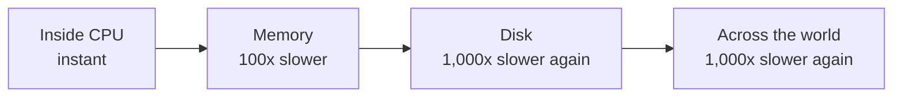
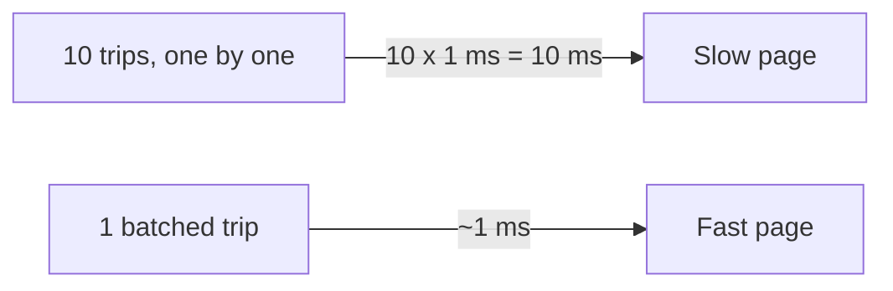
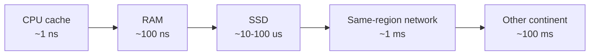
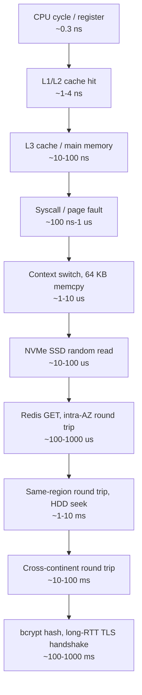
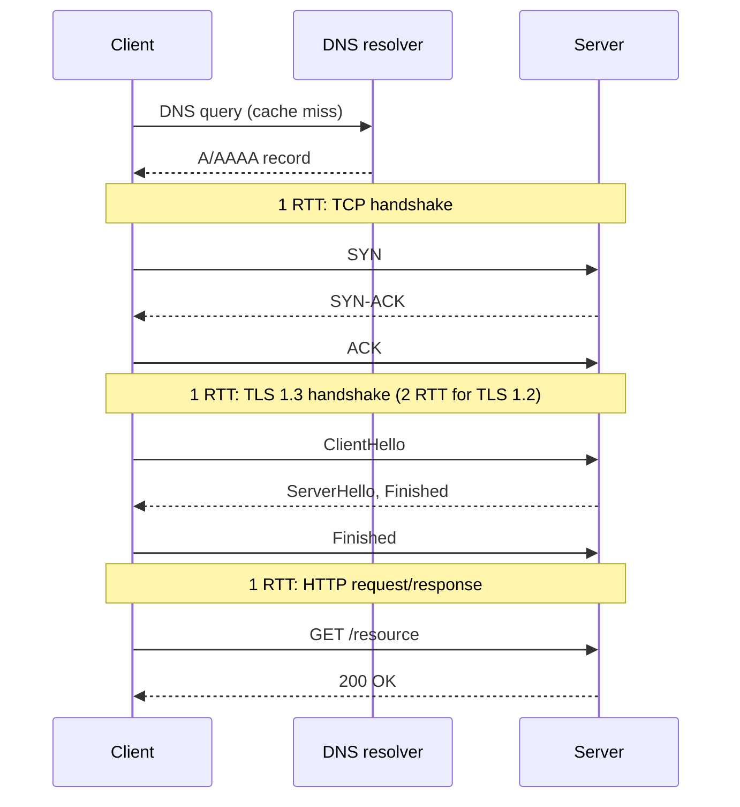
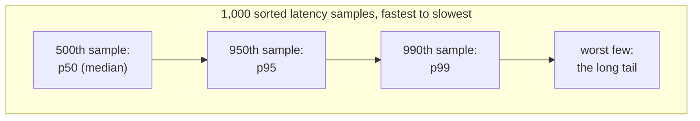
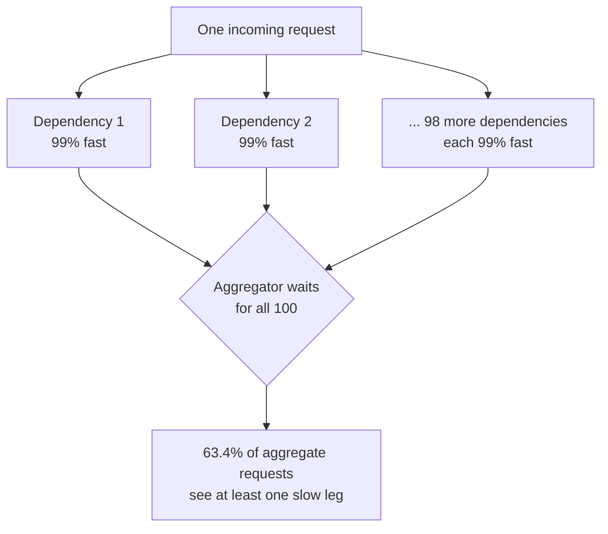
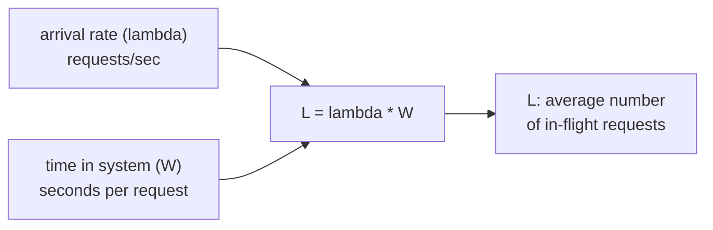
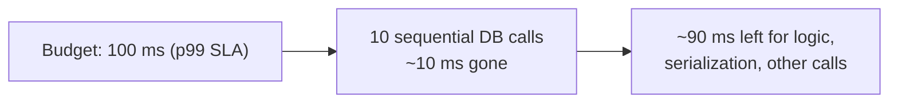

# Latency Numbers Every Engineer Should Know

> [!summary] TL;DR
> **Latency** is the delay between making a request and getting the response. **Throughput** is how many requests complete per second. **Bandwidth** is the maximum data rate a channel can carry.
>
> Every operation a backend engineer touches — a CPU cache hit, a memory read, an SSD read, a network round trip — sits at a different, roughly order-of-magnitude point on a ladder from nanoseconds to seconds (the full table is in "The latency ladder" below), and knowing that ladder lets you estimate a design's latency before you build it.

> [!abstract] Core idea
> - The latency ladder spans about 9 orders of magnitude, from a CPU cycle (~0.3 ns) to a cross-region round trip (100+ ms).
> - Each step up the ladder costs roughly 10–1,000× more than the step before it — not a small, steady increase, but a jump to a different *kind* of operation.
> - Sequential access beats random access at every level, because it amortizes the fixed cost of "getting there" across more data.
> - p50/p95/p99 latency, not the average, is what a backend engineer should actually budget and alert on — tails compound badly with fan-out.
> - Little's Law (`L = λW`) connects arrival rate, time-in-system, and concurrent requests, without needing to know the distribution of either.

## Start here: the basics 🟢

> [!info] How to read this note (pick your level)
> - 🟢 **New to this?** Read "From zero" below, then sections 1, 2 and the cheat sheet (10). Stop there, that is a full first pass.
> - 🟡 **Know the basics?** Add section 3 (the ladder, percentiles, Little's Law) and 4 (worked example).
> - 🔴 **Interview / SDE-3 prep?** Add 7, 8 and 9. Headings are tagged 🟢🟡🔴 so you always know where you are.

> [!note] Before this note
> - [[Memory Hierarchy and CPU Caches]]: a computer keeps data in layers, small and fast near the CPU, big and slow further away.
> - [[Storage Devices - HDD, SSD, NVMe]]: disks keep data after power-off, and SSDs are much faster than spinning hard disks but still far slower than memory.

**From zero, in 60 seconds** 🟢

Every time a computer fetches something, it waits. How long it waits is the **latency**.

The wait depends on where the thing is. Data already inside the CPU is basically instant. Data in memory takes a bit longer. Data on disk takes much longer. Data on another computer across the world takes the longest by far.



Each jump is huge — not "a bit slower" but 100x or 1,000x slower. So good design means asking "where does my data live, and how many trips am I making?"



The rest of this note is just these 4 questions:
1. How slow is each place data can live? (the latency ladder)
2. Why does the average hide slow requests? (percentiles)
3. How do I predict how many requests are in flight? (Little's Law)
4. What breaks in production and what do interviewers ask?

**The problem in one story.**
You open an app and tap "load my orders".
The server has to fetch your data from somewhere: its own memory, a disk, or another machine.
Some of those places answer almost instantly; others make you wait a noticeable moment.
Knowing roughly how long each kind of "fetch" takes lets you guess, before writing code, whether the page will feel fast.

**Words you need first.**

| Word | Plain meaning | Tiny example |
| --- | --- | --- |
| Nanosecond (ns) / microsecond (µs) / millisecond (ms) | One billionth / millionth / thousandth of a second | 1 ms = 1,000 µs = 1,000,000 ns |
| Latency | How long one request waits for its answer | "This API call takes 40 ms" |
| Throughput | How many requests finish per second | "5,000 requests per second" |
| Cache | A small, fast copy of data kept close to where it is used | The CPU's L1 cache holds recently used memory |
| RAM (main memory) | The computer's working memory; fast but lost on power-off | A Go map lives in RAM |
| SSD | Storage that keeps data after power-off; slower than RAM | A database file on disk |
| Round trip (RTT) | Sending a message to another machine and getting the reply back | Ping to a server in another region |
| Percentile (p99) | The latency that 99% of requests are faster than | p99 = 200 ms means 1 in 100 requests is slower |
| Tail latency | The slow end of the timings: the worst 1% or 0.1% of requests | the p99 and p999 |
| Fan-out | One request calling many other services at the same time | A home page asking 20 services for data |
| SLA | A promised limit, like "99% of calls finish within 100 ms" | "p99 under 100 ms" |
| AZ (availability zone) | One data centre (or group) inside a cloud region | Mumbai region has several AZs |
| Sequential vs random access | Reading data in order vs jumping around | Reading a file start to end vs picking rows at random |
| Little's Law | In-flight requests = arrival rate × time each takes | 1,000/s × 0.05 s = 50 in flight |

**Picture it.**



**Analogy.** Finding a fact: in your head (cache), on a sticky note (RAM), in the next room's filing cabinet (SSD), across town (same-region network), or by mailing a letter abroad (cross-continent).
Where it breaks: an SSD and a network call are both just "ask something else and wait", not totally different mechanisms like a room and a country.

**How the rest of this note builds up.**
- First, why the ladder matters ("Why it exists") and an everyday mental model.
- Then the full latency ladder table and a cold HTTPS request hop by hop.
- Next, percentiles (p50/p95/p99) and why fan-out makes the tail worse.
- Then Little's Law, a worked latency budget, and production failure modes.
- Finally, the SDE-3 deep dive on sequential vs random I/O, per-hop budgets and the speed-of-light floor.

> [!tip] Remember
> Each step down the ladder (cache → RAM → disk → network → other continent) costs roughly 10–1,000× more than the one before.

## 1. Why it exists 🟢

🟢 **Plain version:** Every call your server makes to something else costs waiting time. One call to a database next door costs about 1 ms. Ten calls made one after another cost about 10 ms. A call to another continent costs about 100 ms. If you know these rough sizes, you can tell on a whiteboard whether a design will feel fast or slow, before writing any code.


A service that makes one network call per request has a latency floor set by that one round trip.

A service that makes ten *sequential* database calls, each needing its own round trip, multiplies that floor by ten.

And if each of those calls is itself fanning out (calling several more services in parallel), the tail latency (the timing of the slowest few requests) compounds further still.

Without a mental ladder of "what costs what," it is easy to design an API that makes 50 sequential 1 ms calls and ships a 50 ms p50, when a single well-designed batch call could have done the same work in 2 ms.

The ladder is what lets you catch that mistake on a whiteboard, before any code runs.

Concretely: an in-region database round trip over a typical cloud network (an estimate: roughly 0.5–2 ms, depending on network path and load) is about 10,000–100,000× slower than an L1 cache hit (~1 ns).

A cross-continent round trip (an estimate: roughly 60–150 ms, depending on exact distance and route) is about 100× slower again than an in-region call.

These *ratios*, more than any single absolute number, are what should guide a decision like "should this be a local cache lookup, or a network call."

> [!tip] Remember
> You rarely need the exact nanosecond figures. You need the *ratios* between rungs of the ladder, because those ratios are what tell you whether a design choice costs 10× or 10,000×.

### Real-life example 🟢

When you open Swiggy, the home screen needs your address, nearby restaurants, offers, and your past orders.
Each of those can live in a different service.
If the app server asks them one by one, at about 5 ms each, 20 services already cost 100 ms before anything is drawn.
Asking them all at the same time, and keeping popular data in a memory cache, brings that close to the time of the single slowest call.
That one decision, "one by one or all together, memory or network", is exactly what the latency ladder helps you judge.

## Common beginner mistakes 🟢

- **Treating a network call like a function call** → a function call costs nanoseconds, a network call about 1 ms, roughly 1,000,000× more → batch calls, cache results, and count round trips.
- **Watching only the average** → a 5 ms average can hide 1% of users waiting 2 seconds → track p95 and p99.
- **Making calls one after another when they don't depend on each other** → 10 calls × 1 ms = 10 ms instead of about 1 ms → run independent calls in parallel.
- **Quoting a table number as if you measured it** → real numbers change with hardware and load → use the ladder for planning, then measure your own service.
- **Thinking faster cables fix cross-continent delay** → light in fibre needs about 100 ms for a 10,000 km round trip → move the data closer (CDN, regional copy).

## 2. Mental model 🟢

Imagine you need one fact. Where is it?

1. Already in your head (a CPU register or cache — instant)?
2. On a sticky note on your desk (RAM — you reach for it, a few nanoseconds)?
3. In a filing cabinet in the next room (SSD — you get up and walk, microseconds to tens of microseconds)?
4. In a different building across town (a same-region network call — over a millisecond)?
5. Or in a different country, requiring you to mail a letter and wait for a reply (a cross-continent round trip — tens to over a hundred milliseconds)?

Each step is a different *kind* of operation, not just a slower version of the last one, and the cost of "getting there" dominates unless you bring back a lot of data on each trip (sequential access).

> [!warning] Common mistake
> Stretching this analogy too far: in real hardware, "the next room" (an SSD) and "across town" (a network call) are not fundamentally different *mechanisms* in the way a building and a country are — they are both "ask something else and wait."
>
> The analogy's value is the order-of-magnitude intuition for *how long* each step takes, not a claim that each rung works nothing like the others.

## 3. How it works 🟡

> 🟢 → 🟡 **You now know** that every place data lives has a rough cost, and each step down the ladder is 10× to 1,000× slower. **Next we open the box:** the full ladder table, what a brand-new HTTPS request really pays, why averages lie, how fan-out makes slow requests common, and Little's Law. Each subsection starts with a short step-by-step walk.

### The latency ladder

**In plain words.** Every operation a backend engineer deals with sits on one ladder, from "effectively instant" to "noticeably slow." Memorizing the exact numbers matters less than knowing roughly which rung an operation lands on, and that each rung up is a real jump, not a small increment.

**Step by step:**
1. Your Go code reads a variable already in the CPU cache: about 1 ns.
2. It reads a value from a big map in RAM that is not cached: about 100 ns, 100× slower.
3. It reads a row from a local NVMe SSD: about 100 µs, 1,000× slower again.
4. It asks Redis in the same data centre: about 0.5 ms.
5. It asks a server on another continent: about 100 ms. That one call costs as much as 100 million cache hits.

**Picture it.**



**Example — the canonical table**, with every number labelled by kind (documented hardware spec, or a reasoned estimate bounded by a known physical limit):

| Rung | Operation | Typical cost | Kind |
| --- | --- | --- | --- |
| 1 | CPU cycle / register | ~0.3 ns | Documented (~3 GHz clock) |
| 2 | L1/L2 cache hit, branch mispredict (the CPU guessed the wrong side of an `if` and must redo work) | ~1–4 ns | Documented (CPU vendor docs) |
| 3 | L3 cache hit, main memory access | ~10–100 ns | Documented (JEDEC DDR5: ~70–100 ns) |
| 4 | Syscall (asking the kernel to do something), page fault (the OS loading a memory page that was not ready), hashing small data | ~100 ns–1 µs | Estimate (kernel-dependent) |
| 5 | Context switch (the CPU swapping one thread out for another), 64 KB memcpy (copying 64 KB from one memory spot to another) | ~1–10 µs | Estimate (scheduler-dependent) |
| 6 | NVMe SSD random read, 1 MB sequential RAM read | ~10–100 µs | Documented (NVMe spec, 2025 vendor datasheets) |
| 7 | SATA SSD write, intra-AZ round trip (between two machines in the same data centre), Redis GET | ~100–1,000 µs | Estimate (typical cloud intra-AZ RTT) |
| 8 | Inter-AZ/same-region round trip, HDD seek | ~1–10 ms | Estimate (typical same-region RTT) |
| 9 | Cross-continent round trip, 1 GB sequential RAM read | ~10–100 ms | Estimate (geography-dependent) |
| 10 | bcrypt hashing (a password hash made slow on purpose), long-RTT TLS handshake, 1 GB SSD read | ~100–1,000 ms | Estimate (cost-factor- and device-dependent) |
| 11 | 1 GB over an in-region network link | > 1 s | Estimate (link-speed dependent) |

**Why it matters.** A network round trip (rung 7–9) is not "a bit slower" than a memory access (rung 3) — it is 10,000 to 1,000,000 times slower. A design that turns one memory lookup into one network call per request has just paid for that entire jump, on every single request.

> [!tip] Remember
> This table is the one place in this note with the full numbers. Everywhere else, point back here instead of restating the ladder.

### A cold HTTPS request, hop by hop

**In plain words.** Before a server can answer a brand-new HTTPS request, the client and server must first agree on where to connect, then agree on an encrypted channel, and only then exchange the actual request and response. Each of those agreements costs at least one full round trip.

**Step by step:**
1. You type `api.example.com`. The phone asks a DNS resolver (a name-to-address lookup service) for the IP address: one trip, unless it is cached.
2. The phone opens a TCP connection (three short "hello / hello back / ok" messages): one round trip.
3. The phone and server set up encryption with TLS 1.3: one more round trip.
4. Only now does the phone send the real request and get the answer: one more round trip.
5. With a 50 ms round trip, that is about 150 ms of pure waiting, plus DNS, before the server does any work.

**Picture it.**



**Example.** Before the first byte of actual response data, a cold connection pays for a DNS lookup (if not cached), one round trip for the TCP handshake, one round trip for TLS 1.3 (TLS 1.2 needs two), and one more round trip for the HTTP request itself — a minimum of **three round trips** before counting server processing time at all.

**Why it matters.** This is exactly why connection reuse (keep-alive, which keeps the connection open for the next request; HTTP/2 multiplexing, which sends many requests over one connection at once) and DNS caching matter so much for perceived latency: they let you pay this cost once per connection instead of once per request. See [[TLS and HTTPS]] for the handshake mechanics.

### p50, p95, p99: why the average lies

**In plain words.** The **average** (mean) latency can look perfectly healthy while a meaningful slice of real users have a terrible experience. A **percentile** answers a sharper question: "what latency do the slowest X% of requests exceed?"

**Step by step:**
1. Record how long each of 1,000 requests took.
2. Sort the 1,000 times from fastest to slowest.
3. The 500th time is the p50 (median): half are faster.
4. The 990th time is the p99: only 10 requests were slower.
5. If most take 5 ms but 10 take 2 s, the average still looks small, while the p99 shows the 2 s pain.

**Picture it.**



**Example.** A system with a 5 ms average and a 2-second p999 (the 0.1% slowest) will feel broken to that unlucky one-in-a-thousand user, even though "5 ms average" looks great on a dashboard that only shows the mean.

Measured on this note's own code (Go 1.24.4, 2026-11-09): on the skewed sample set `{1,1,1,1,1,1,1,1,2,50}`, the p50 is `1` while the p99 is `45.68` — the tail is nearly 46× the median on a batch of only ten numbers.

**Why it matters.** Alerting on the average hides exactly the users you most need to notice: the ones having the worst experience. Alert on p95/p99/p999 instead.

> [!tip] Remember
> The average tells you about the typical request. The tail tells you about the request that will make someone complain.

### Why fan-out makes the tail worse, not just the average

**In plain words.** A single downstream call that is slow only 1% of the time looks fine in isolation. But if a request fans out to 100 *independent* such calls and needs all of them to finish, the chance that *at least one* is slow approaches certainty.

**Step by step:**
1. One backend is slow 1 time in 100 (its p99).
2. A page calls 1 such backend: 1% of pages are slow.
3. A page calls 10 of them in parallel and waits for all: about 10% of pages hit at least one slow call.
4. A page calls 100 of them: about 63% of pages are slow.
5. So the page's tail is far worse than any single backend's tail.

**Picture it.**



**Example.** If each of `n` independent downstream calls is slow with probability `p = 0.01` (its own 1% tail), the probability that at least one of them is slow is `1 - (1-p)^n`. At `n = 100`, that works out to about 63.4% — measured directly from this note's own code (`FanOutP99(100) = 0.634`, Go 1.24.4, 2026-11-06).

**Why it matters.** The aggregator's observed p99 is dominated by this compounding effect, not by the tail of any single dependency.

This is one of the core arguments for keeping fan-out shallow, setting aggressive per-call timeouts, and using hedged requests (firing a duplicate request to a different replica if the first hasn't answered by some threshold).

> [!warning] Common mistake
> Assuming that because every individual dependency "looks healthy" (each at or above its own p99 SLA), the aggregate request must also be healthy. The math says otherwise once you fan out to more than a handful of independent legs.

### Little's Law connects concurrency to the ladder

**In plain words.** If you know how fast requests arrive, and how long each one takes to finish, you can compute how many are in flight *at any given moment* — without knowing anything else about the distribution of either.

**Step by step:**
1. Requests arrive at 1,000 per second (λ, "lambda").
2. Each one takes 50 ms = 0.05 s to finish (W).
3. Multiply: 1,000 × 0.05 = 50. On average, 50 requests are inside the service at once (L).
4. So you need room for at least 50 at a time: 50 goroutines, 50 database connections, and so on.
5. If the database slows and W becomes 0.2 s, L jumps to 200. A pool of 50 now makes requests queue.

**Picture it.**



**Example.** A service handling 1,000 requests/sec, where each request takes 50 ms (0.05 s) end to end, has on average `1,000 × 0.05 = 50` requests in flight at once — matching `LittlesLaw(1000, 0.05) = 50` in the Go note's own test.

**Why it matters.** This tells you the minimum concurrency (goroutines, connections, worker threads) a service needs to sustain that load without queuing.

Undersizing that pool causes requests to queue, which raises `W`, which (by the same formula) raises `L` further — a feedback loop that gets worse, not better, on its own.

## 4. Worked example 🟡

### Whiteboard version

**In plain words:** a latency budget is pocket money — your SLA gives you 100 ms to spend, and every call you make spends some of it.

```go
func Percentile(samples []float64, p float64) float64
```

A service budget: if your API's SLA is 100 ms p99 and it makes one sequential in-region database call at roughly 1 ms, you have about 99 ms of headroom for everything else — application logic, serialization, and any other calls.

If it makes ten such calls *sequentially* (one after another) instead of in parallel, that floor alone is 10 ms, eating a tenth of the budget before any real work happens.

This is why an "N+1 query" bug is a latency problem, not just a database-load problem — see [[N+1 Query Problem]].



Runnable Go version: [[Latency Numbers Every Engineer Should Know - Go]]

## 5. Variants and comparison 🟡

| Term | What it measures | Example |
| --- | --- | --- |
| Latency | Time for one request to complete | "This API call takes 40 ms" |
| Throughput | Requests completed per unit time | "This service handles 5,000 req/s" |
| Bandwidth | Maximum data rate a channel can carry | "This link is 10 Gbps" |
| p50 (median) | Typical-case latency | Half of requests are faster than this |
| p95 / p99 / p999 | Tail latency | The slowest 5% / 1% / 0.1% of requests |

A system can have high throughput and bad latency at the same time (lots of parallel slow requests), or low throughput and great latency (few requests, each fast).

The two are independent axes, and Little's Law is the formula that ties them together with concurrency.

## 6. Trade-offs and when not to use 🟡

- Chasing average latency is often misleading — see "p50, p95, p99" above. A dashboard that only shows the mean can look healthy while 1% of users have a terrible experience.
- Optimizing for lower latency per call sometimes trades off against throughput: disabling batching to respond faster per request means doing more total round trips. Know which one your SLA actually demands.
- The ladder numbers are for *design-time* estimation, not a substitute for measuring your actual system. Real numbers vary with hardware generation, load, and contention.

> [!warning] Common mistake
> Quoting a ladder number as if it were measured on your own system. Every number in the table above is labelled documented or estimate for a reason — treat it as a planning tool, and measure your actual service before trusting a specific number in production.

> 🟡 → 🔴 **You now know** the ladder, percentiles, fan-out and Little's Law, and you can do a simple latency budget. **Next comes the advanced part:** how real systems (CDNs, connection pools) attack these costs, how latency goes wrong in production, and the physics that sets a hard floor on cross-region calls.

## 7. In production 🔴

- **Real systems:** CDNs (content delivery networks: copies of files kept on servers near users) and edge caching exist specifically to turn a cross-continent round trip into an intra-region one for static content.
  - Database connection pooling and HTTP keep-alive exist to amortize the TCP/TLS handshake cost shown in the sequence diagram above across many requests instead of paying it per request.
- **Failure modes → fixes:**
  - N+1 query pattern (one query per row of an earlier result) turns "1 round trip" into "1 + N round trips" → batch into a single query, or use a data-loader pattern (collect all the IDs first, then fetch them in one call).
  - A single slow downstream dependency drags down an otherwise-fast aggregator due to fan-out (see "Why fan-out makes the tail worse" above) → set per-call timeouts and use hedged requests or partial-response patterns, so one slow leg doesn't block the whole response.
  - A "fast" average hides a bad tail caused by GC pauses (the garbage collector briefly slowing the program), lock contention (threads queuing for the same lock), or noisy-neighbor CPU steal (another customer's VM on the same host using the CPU) → alert on p99/p999, not just mean or p50.
- **What to monitor:** p50/p95/p99/p999 latency per endpoint and per downstream dependency; RTT between regions/AZs as a baseline; queue depth and in-flight request count (both of which Little's Law connects directly to observed latency).

## 8. Deep dive 🔴

- **Why sequential I/O beats random I/O** at every layer of the ladder, for the same underlying reason each time: there is a fixed "getting there" cost (seek, RTT, cache-line fill) paid once per access, and sequential access amortizes it over more useful bytes per access, while random access pays it again and again for small amounts of data each time.
- **Latency budgets per hop.** A well-designed system assigns each hop in a request's path (load balancer → service → cache → database) an explicit slice of the total SLA, so that no single hop can silently consume the whole budget. This is standard practice at large-scale systems, usually enforced via per-hop timeouts that sum to less than the end-to-end SLA.
- **The physical floor on cross-region latency.** Signals in fiber travel at roughly two-thirds the speed of light in vacuum (~200,000 km/s).
  - A round trip between two points separated by, say, 10,000 km therefore cannot be faster than about 100 ms no matter how good the network hardware or routing is — a genuine physical floor, which is why reducing cross-region latency requires moving the data or compute closer (CDNs, regional replicas, edge compute), not faster cables.
- **Measuring latency in Go.** `time.Since(start)` around a call gives a single sample; collecting enough samples and feeding them to a histogram (or the `Percentile` function in the Go note) gives the distribution that actually matters.
  - `net/http/pprof` and `runtime/trace` let you see where wall-clock time goes inside a Go process without guessing — see [[Latency, Percentiles and Bottleneck Analysis]] for the full debugging workflow.

## 9. Interview questions 🔴

> [!question]- What's the difference between latency, throughput, and bandwidth?
> Latency is the time for one operation to complete. Throughput is how many operations complete per unit time. Bandwidth is the maximum data rate a channel can physically carry.
>
> A system can have low latency but low throughput (one request at a time, each fast) or high throughput but high latency (many requests in flight, each slow) — they're independent and connected only through concurrency (Little's Law).

> [!question]- Why do we budget and alert on p99 instead of average latency?
> Average latency can look fine while a meaningful fraction of requests are much slower — a 5 ms average with a 500 ms p99 still means 1% of users have a terrible experience.
>
> Tail latency also compounds across fan-out: if a request depends on several downstream calls, the overall request is only as fast as its slowest dependency, so the tail of the whole system is often worse than the tail of any single component.

> [!question]- Trap: TLS always adds exactly one extra round trip before the first byte of a response. True or false?
> False, it depends on the TLS version. TLS 1.3 needs one round trip for its handshake; TLS 1.2 needs two.
>
> Also, if the client has a cached session (TLS session resumption, or 0-RTT in some configurations), the handshake cost can be lower still. The "1 round trip" figure is specifically for a cold TLS 1.3 handshake.

> [!question]- How does Little's Law help with capacity planning?
> `L = λW` relates the average number of in-flight requests (`L`) to the arrival rate (`λ`) and average time-in-system (`W`). Given a target throughput and a measured or expected latency, you can compute the concurrency (connections, goroutines, worker threads) a service needs to sustain that load.
>
> Conversely, if you know your concurrency limit and measured latency, you can derive the maximum throughput the service can sustain before requests start queuing.

> [!question]- Why does fanning out a request to many parallel dependencies make the overall tail latency worse, even if each dependency is well-behaved?
> If each of `n` independent downstream calls is slow only with small probability `p`, the chance that at least one of them is slow is `1 - (1-p)^n`, which grows quickly with `n`.
>
> At `n = 100` and `p = 0.01`, about 63% of aggregate requests will have at least one slow leg — so the aggregator's observed tail latency is dominated by this compounding effect, not by any single dependency's own tail.

> [!question]- Give a rough latency ratio between an L1 cache hit, a DRAM access, and an NVMe SSD read.
> Roughly 1 : 30 : 10,000 in order-of-magnitude terms — an L1 hit is about 1 ns, a DRAM access is documented in the tens-to-low-hundreds of nanoseconds (DDR5 specs put it around 70–100 ns), and an NVMe read lands in the tens-of-microseconds range.
>
> The exact numbers shift with hardware generation, but the roughly 10–100× jump between each tier is the stable, interview-relevant fact.

> [!question]- Why is the minimum possible cross-continental round trip bounded below by physics, not engineering?
> Signals in fiber travel at roughly two-thirds the speed of light in vacuum.
>
> A round trip between two points separated by, say, 10,000 km therefore cannot be faster than about 100 ms no matter how good the network hardware or routing is — this is a genuine physical floor, which is why reducing cross-region latency requires moving the data or compute closer, not faster cables.

## 10. Cheat sheet 🟢

- Full ladder: see "The latency ladder" table above — CPU cycle at the top, network round trips and disk-scale reads at the bottom, about 9 orders of magnitude apart.
- Cold HTTPS request pays DNS (if uncached) + 1 RTT TCP + 1 RTT TLS 1.3 (2 for TLS 1.2) + 1 RTT HTTP before the first response byte.
- `throughput`, `latency`, and `bandwidth` are three different axes; Little's Law (`L = λW`) is what connects concurrency to the other two.
- Alert on p95/p99/p999, not average; tails compound badly across fan-out (`FanOutP99(100) ≈ 0.63` at a 1% per-call tail rate).
- Sequential access beats random access everywhere on the ladder, because it amortizes the fixed "getting there" cost over more data.
- Cross-region latency has a real physical floor (speed of light in fiber); fix it by moving data/compute closer, not by better-engineering the link itself.
- Label every latency number you quote as measured, documented, or an estimate — never state a number you can't back up one of those three ways.

## Self-check 🟢🟡

🟢 Easy

> [!question]- Roughly how much slower is a same-region network call than a RAM read?
> About 10,000×: about 1 ms against about 100 ns.

> [!question]- What does p99 = 200 ms mean?
> 99% of requests finish faster than 200 ms; 1 in 100 is slower.

> [!question]- Latency vs throughput in one line each?
> Latency: how long one request waits. Throughput: how many requests finish per second.

🟡 Medium

> [!question]- A cold HTTPS request with TLS 1.3: how many round trips before the first response byte (ignoring DNS)?
> Three: TCP handshake, TLS handshake, then the HTTP request and response.

> [!question]- 2,000 requests/s, each taking 100 ms. How many are in flight?
> L = λW = 2,000 × 0.1 = 200.

> [!question]- Why can calling 100 healthy backends at once give a bad p99?
> If each is slow 1% of the time, about 63% of requests hit at least one slow backend (1 − 0.99¹⁰⁰).

## Links 🟢

- **Before this:** [[Memory Hierarchy and CPU Caches]], [[Storage Devices - HDD, SSD, NVMe]]
- **Next:** [[How the Internet Works - IP, Ports, Packets, OSI vs TCP-IP]], [[TLS and HTTPS]]
- **Compare with:** [[Complexity Analysis - Big-O and Amortized Cost]] (algorithmic cost vs. real-world wall-clock cost)
- **Runnable Go version:** [[Latency Numbers Every Engineer Should Know - Go]]

### Watch on YouTube

- [Latency Numbers Programmer Should Know: Crash Course System Design #1](https://www.youtube.com/watch?v=FqR5vESuKe0) · ByteByteGo · short visual walkthrough of the latency ladder from CPU cycle to cross-region call
- [The numbers EVERY ENGINEER should know (napkin math)](https://www.youtube.com/watch?v=PFEBo7SMX3M) · Ben Dicken · practical napkin-math framing for estimating system latency before building
