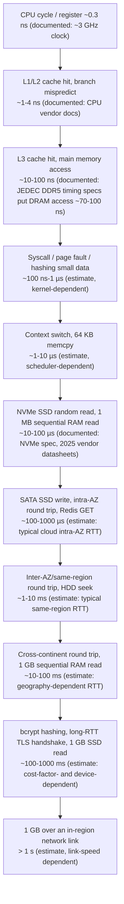
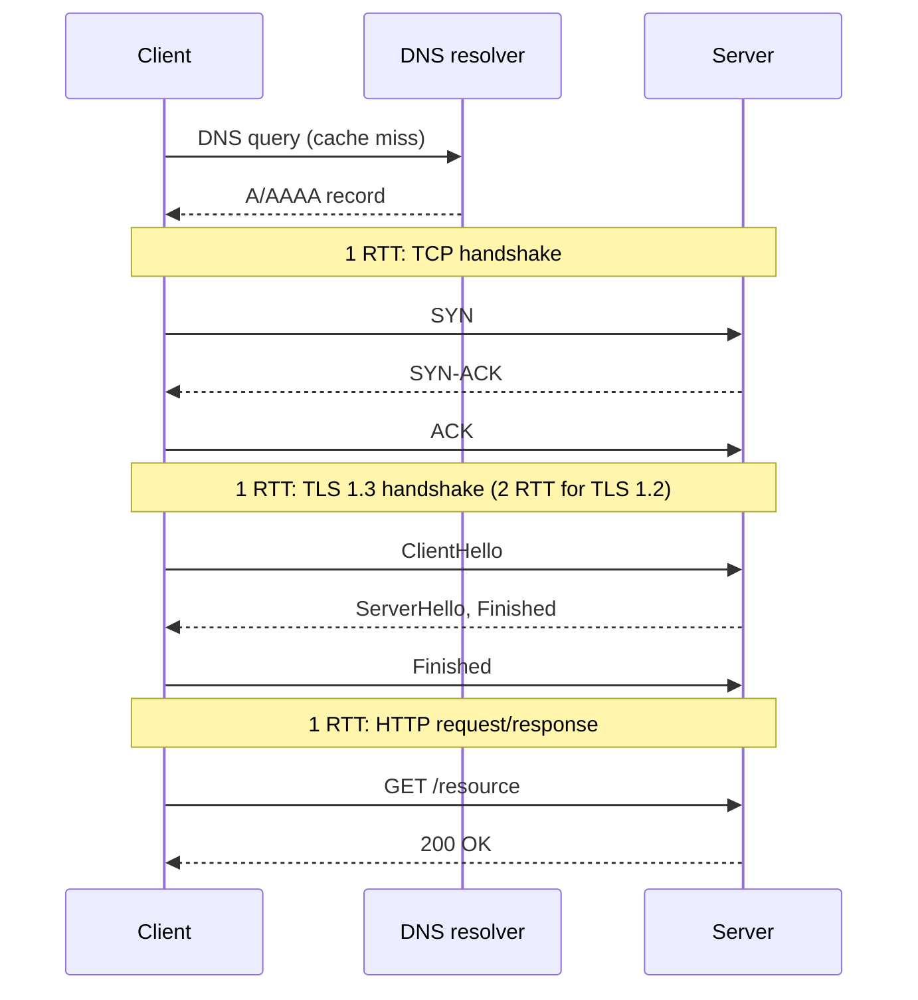

# Latency Numbers Every Engineer Should Know

> [!summary] TL;DR
> Latency is the delay between making a request and getting the response; throughput is how many requests complete per second; bandwidth is the maximum data rate a channel can carry. Every operation a backend engineer touches — a CPU cache hit, a memory read, an SSD read, a network round trip — sits at a different, roughly order-of-magnitude point on a ladder from nanoseconds to seconds, and knowing the ladder lets you estimate a design's latency before you build it.

> [!abstract] Core idea
> - The latency ladder spans about 9 orders of magnitude, from a CPU cycle (~0.3 ns) to a cross-region round trip (~100+ ms).
> - Each step up the ladder (L1 → RAM → SSD → network) costs roughly 10–1000× more than the step before it.
> - Sequential access beats random access at every level, because it amortizes the fixed cost of "getting there" across more data.
> - p50/p95/p99 latency, not the average, is what a backend engineer should actually budget and alert on — tails compound badly with fan-out.
> - Little's Law (`L = λW`) connects arrival rate, time-in-system, and concurrent requests without needing to know the distribution.

## 1. Why it exists

A service that does one network call per request has a latency floor set by that one round trip. A service that does ten sequential database calls, each needing its own round trip, multiplies that floor by ten — and if each call is itself fanning out to further dependencies, the tail latency compounds further still. Without a mental ladder of "what costs what," it's easy to design an API that does 50 sequential 1 ms calls and ships a 50 ms p50 when a single well-designed batch call could have done it in 2 ms.

Concretely: an in-region database round trip over a typical cloud network **(estimate: roughly 0.5–2 ms depending on network path and load)** is about 10,000–100,000× slower than an L1 cache hit (~1 ns), and a cross-continent round trip **(estimate: roughly 60–150 ms depending on exact distance and route)** is about 100× slower again than an in-region call. These ratios, more than any single absolute number, are what should guide architecture decisions like "should this be a local cache lookup or a network call."

## 2. Mental model

Imagine you need one fact. Is it already in your head (CPU register/cache — instant)? Is it on a sticky note on your desk (RAM — you reach for it, a few nanoseconds)? Is it in a filing cabinet in the next room (SSD — you get up and walk, microseconds to tens of microseconds)? Is it in a different building across town (same-region network call — over a millisecond)? Or is it in a different country, requiring you to mail a letter and wait for a reply (cross-continent round trip — tens to over a hundred milliseconds)? Each step is a different *kind* of operation, not just a slower version of the last one, and the cost of "getting there" dominates unless you bring back a lot of data each trip (sequential access).

## 3. How it works

### The latency ladder



Each rung is labelled by kind, per the vault's accuracy rules: some are **documented** (hardware specs), some are reasoned **estimates** bounded by well-known physical limits (network RTT is bounded below by the speed of light in fiber, roughly 200,000 km/s, so a round trip to the literal antipode of Earth cannot be faster than about 133 ms no matter how good the network is).

### A cold HTTPS request, hop by hop



Before the first byte of actual response data, a cold connection pays for a DNS lookup (if not cached), one RTT for the TCP handshake, one RTT for TLS 1.3 (TLS 1.2 needs two), and one more RTT for the HTTP request itself — a minimum of **three RTTs** even before counting server processing time. This is exactly why connection reuse (keep-alive, HTTP/2 multiplexing) and DNS caching matter so much for perceived latency; see [[TLS and HTTPS]] for the handshake mechanics.

## 4. Worked example

### Whiteboard version

A service budget: if your API's SLA is 100 ms p99 and it makes one sequential in-region database call at roughly 1 ms, you have about 99 ms of headroom for everything else — application logic, serialization, and any other calls. If it makes ten such calls *sequentially* instead of in parallel, that floor alone is 10 ms, eating a tenth of the budget before any real work happens. This is why "N+1 query" bugs are a latency problem, not just a database-load problem.

### Why fan-out makes the tail worse, not just the average

A single downstream call that is slow (above its own p99) only 1% of the time looks fine in isolation. But if a request fans out to 100 *independent* such calls and needs all of them, the chance that *at least one* is slow approaches certainty:

```go
// Package latency has small, dependency-free helpers for the two things a
// backend engineer actually does with latency numbers: compute percentiles
// from a batch of measurements, and reason about fan-out with Little's Law.
package latency

import "sort"

// Percentile returns the p-th percentile (0 <= p <= 100) of samples using
// nearest-rank interpolation, the same method Go's own benchmarking tools
// and most APM agents use for p50/p95/p99 dashboards. samples is sorted
// in place.
func Percentile(samples []float64, p float64) float64 {
	if len(samples) == 0 {
		return 0
	}
	sort.Float64s(samples)
	if p <= 0 {
		return samples[0]
	}
	if p >= 100 {
		return samples[len(samples)-1]
	}
	rank := p / 100 * float64(len(samples)-1)
	lo := int(rank)
	hi := lo + 1
	if hi >= len(samples) {
		return samples[lo]
	}
	frac := rank - float64(lo)
	return samples[lo] + frac*(samples[hi]-samples[lo]) // linear interpolation between ranks
}

// FanOutP99 estimates the probability that at least one of n parallel
// downstream calls exceeds the given per-call p99 latency, assuming the
// calls are independent. This is why a request that fans out to many
// services sees a far worse tail than any one of them: at n=100 a
// per-call 1%-of-requests-slow rate becomes "almost every request
// has a slow leg".
func FanOutP99(n int) float64 {
	pFast := 0.99 // probability a single call is at or under its own p99
	allFast := 1.0
	for i := 0; i < n; i++ {
		allFast *= pFast
	}
	return 1 - allFast // probability at least one of the n calls is slow
}

// LittlesLaw returns the average number of in-flight requests L, given the
// arrival rate lambda (requests/sec) and the average time W (seconds) each
// one spends in the system: L = lambda * W. It holds for any stable queue,
// regardless of the arrival or service distribution.
func LittlesLaw(lambdaPerSec, wSeconds float64) float64 {
	return lambdaPerSec * wSeconds
}
```

Test, passing under `go test -race` on Go 1.24.4:

```go
package latency

import (
	"math"
	"testing"
)

func TestPercentileKnownValues(t *testing.T) {
	// 1..101, so p50 lands exactly on 51 and p99 near the top.
	samples := make([]float64, 101)
	for i := range samples {
		samples[i] = float64(i + 1)
	}
	if got := Percentile(samples, 50); got != 51 {
		t.Fatalf("p50 = %v, want 51", got)
	}
	if got := Percentile(samples, 0); got != 1 {
		t.Fatalf("p0 = %v, want 1", got)
	}
	if got := Percentile(samples, 100); got != 101 {
		t.Fatalf("p100 = %v, want 101", got)
	}
}

func TestPercentileTailIsWorseThanMedian(t *testing.T) {
	// A realistic skewed latency distribution: mostly fast, a long tail.
	samples := []float64{1, 1, 1, 1, 1, 1, 1, 1, 2, 50}
	p50 := Percentile(append([]float64{}, samples...), 50)
	p99 := Percentile(append([]float64{}, samples...), 99)
	if p99 <= p50 {
		t.Fatalf("p99 (%v) should exceed p50 (%v) on a skewed distribution", p99, p50)
	}
}

func TestFanOutP99GrowsWithN(t *testing.T) {
	// Single call: by definition 1% exceed their own p99.
	if got := FanOutP99(1); math.Abs(got-0.01) > 1e-9 {
		t.Fatalf("FanOutP99(1) = %v, want 0.01", got)
	}
	// Fanning out to 100 independent legs: almost certain one is slow.
	got := FanOutP99(100)
	if got < 0.6 {
		t.Fatalf("FanOutP99(100) = %v, want a large majority of requests to see a slow leg", got)
	}
	// Monotonic: more fan-out never makes the tail better.
	if FanOutP99(50) >= FanOutP99(51) {
		t.Fatalf("FanOutP99 must strictly increase with n")
	}
}

func TestLittlesLaw(t *testing.T) {
	// 1000 req/s, each held for 50ms (0.05s) of server time:
	// on average 50 requests are in flight at once.
	got := LittlesLaw(1000, 0.05)
	if got != 50 {
		t.Fatalf("LittlesLaw(1000, 0.05) = %v, want 50", got)
	}
}
```

**Measured** (this code, Go 1.24.4, 2026-11-06): `FanOutP99(100) = 0.634` — with each of 100 independent downstream legs slow only 1% of the time, 63.4% of fanned-out requests see at least one slow leg. This is why p99 latency at the edge of a system is usually far worse than the p99 of any single internal hop.

### Measuring latency in Go

`time.Since(start)` around a call gives a single sample; collecting enough samples and feeding them to a histogram (or the `Percentile` function above) gives the distribution that actually matters. `net/http/pprof` and `runtime/trace` let you see where wall-clock time goes inside a Go process without guessing — see [[Latency, Percentiles and Bottleneck Analysis]] for the full debugging workflow.

## 5. Variants and comparison

| Term | What it measures | Example |
| --- | --- | --- |
| Latency | Time for one request to complete | "This API call takes 40 ms" |
| Throughput | Requests completed per unit time | "This service handles 5,000 req/s" |
| Bandwidth | Maximum data rate a channel can carry | "This link is 10 Gbps" |
| p50 (median) | Typical-case latency | Half of requests are faster than this |
| p95 / p99 / p999 | Tail latency | The slowest 5% / 1% / 0.1% of requests |

A system can have high throughput and bad latency at the same time (lots of parallel slow requests), or low throughput and great latency (few requests, each fast) — the two are independent axes, and Little's Law is the formula that ties them together with concurrency.

## 6. Trade-offs and when not to use

- Chasing average latency is often misleading: a system with a 5 ms average and a 2-second p999 will feel broken to the unlucky 0.1% of users even though the average "looks fine" on a dashboard.
- Optimizing for lower latency per call sometimes trades off against throughput (e.g. disabling batching to respond faster per-request means doing more total round trips) — know which one your SLA actually demands.
- Back-of-envelope ladder numbers are for *design-time* estimation, not a substitute for measuring your actual system; real numbers vary with hardware generation, load, and contention.

## 7. In production

- **Real systems:** CDNs and edge caching exist specifically to turn a cross-continent round trip into an intra-region one for static content. Database connection pooling and HTTP keep-alive exist to amortize the TCP/TLS handshake cost shown in the sequence diagram above across many requests instead of paying it per request.
- **Failure modes → fixes:**
	- N+1 query pattern (one query per row of an earlier result) turns "1 round trip" into "1 + N round trips" → batch into a single query or use a data-loader pattern.
	- A single slow downstream dependency drags down an otherwise-fast aggregator due to fan-out (see the `FanOutP99` math) → set per-call timeouts and use hedged requests or partial-response patterns so one slow leg doesn't block the whole response.
	- A "fast" average hides a bad tail caused by GC pauses, lock contention, or noisy-neighbor CPU steal → alert on p99/p999, not just mean or p50.
- **What to monitor:** p50/p95/p99/p999 latency per endpoint and per downstream dependency; RTT between regions/AZs as a baseline; queue depth and in-flight request count (both of which Little's Law connects directly to observed latency).

## 8. Deep dive

- **Little's Law (`L = λW`)** says the average number of requests in a system equals the arrival rate times the average time each spends in the system. It requires no assumption about the distribution of arrivals or service times — only that the system is stable (arrivals don't exceed capacity long-term). Practically: if you know your service handles 1,000 req/s and each request takes 50 ms end-to-end, you know you need to support roughly 50 requests in flight concurrently (goroutines, connections, threads) at steady state — undersizing that pool causes requests to queue and latency to climb further, a feedback loop.
- **Why sequential I/O beats random I/O** at every layer of the ladder is the same underlying reason: there is a fixed "getting there" cost (seek, RTT, cache-line fill) paid once per access, and sequential access amortizes it over more useful bytes per access, while random access pays it again and again for small amounts of data each time.
- **Tail latency amplification**: as shown by `FanOutP99`, the probability that *at least one* of `n` independent legs is slow rises quickly with `n` even if each leg is individually well-behaved — this is one of the core arguments for keeping fan-out shallow, setting aggressive per-call timeouts, and using techniques like hedged requests (fire a duplicate request to a different replica if the first hasn't answered by some threshold).
- **Latency budgets per hop**: a well-designed system assigns each hop in a request's path (load balancer → service → cache → database) an explicit slice of the total SLA, so that no single hop can silently consume the whole budget; this is standard practice at large-scale systems and is usually enforced via per-hop timeouts that sum to less than the end-to-end SLA.

## 9. Interview questions

> [!question]- What's the difference between latency, throughput, and bandwidth?
> Latency is the time for one operation to complete. Throughput is how many operations complete per unit time. Bandwidth is the maximum data rate a channel can physically carry. A system can have low latency but low throughput (one request at a time, each fast) or high throughput but high latency (many requests in flight, each slow) — they're independent and connected only through concurrency (Little's Law).

> [!question]- Why do we budget and alert on p99 instead of average latency?
> Average latency can look fine while a meaningful fraction of requests are much slower — a 5 ms average with a 500 ms p99 still means 1% of users have a terrible experience. Tail latency also compounds across fan-out: if a request depends on several downstream calls, the overall request is only as fast as its slowest dependency, so the tail of the whole system is often worse than the tail of any single component.

> [!question]- Trap: TLS always adds exactly one extra round trip before the first byte of a response. True or false?
> False, depends on the TLS version. TLS 1.3 needs one round trip for its handshake; TLS 1.2 needs two. Also, if the client has a cached session (TLS session resumption / 0-RTT in some configurations), the handshake cost can be lower still. The "1 round trip" figure is specifically for a cold TLS 1.3 handshake.

> [!question]- How does Little's Law help with capacity planning?
> `L = λW` relates the average number of in-flight requests (`L`) to the arrival rate (`λ`) and average time-in-system (`W`). Given a target throughput and a measured or expected latency, you can compute the concurrency (connections, goroutines, worker threads) a service needs to sustain that load, and conversely, if you know your concurrency limit and measured latency, you can derive the maximum throughput the service can sustain before requests start queuing.

> [!question]- Why does fanning out a request to many parallel dependencies make the overall tail latency worse, even if each dependency is well-behaved?
> If each of `n` independent downstream calls is slow only with small probability `p`, the chance that at least one of them is slow is `1 - (1-p)^n`, which grows quickly with `n`. At `n = 100` and `p = 0.01`, about 63% of aggregate requests will have at least one slow leg — so the aggregator's observed tail latency is dominated by this compounding effect, not by any single dependency's own tail.

> [!question]- Give a rough latency ratio between an L1 cache hit, a DRAM access, and an NVMe SSD read.
> Roughly 1 : 30 : 10,000 in order of magnitude terms — an L1 hit is about 1 ns, a DRAM access is documented in the tens-to-low-hundreds of nanoseconds (DDR5 specs put it around 70–100 ns), and an NVMe read lands in the tens-of-microseconds range. The exact numbers shift with hardware generation, but the roughly 10–100× jump between each tier is the stable, interview-relevant fact.

> [!question]- Why is the minimum possible cross-continental round trip bounded below by physics, not engineering?
> Signals in fiber travel at roughly two-thirds the speed of light in vacuum (~200,000 km/s). A round trip between two points separated by, say, 10,000 km therefore cannot be faster than about 100 ms no matter how good the network hardware or routing is — this is a genuine physical floor, which is why reducing cross-region latency requires moving the data or compute closer (CDNs, regional replicas, edge compute), not faster cables.

## 10. Cheat sheet

- Ladder, in order of magnitude: CPU cycle (~0.3 ns) → L1/L2 cache (~1–4 ns) → L3/DRAM (~10–100 ns) → syscall/hashing (~100 ns–1 µs) → context switch/memcpy (~1–10 µs) → NVMe read (~10–100 µs) → intra-AZ RTT/Redis GET (~100 µs–1 ms) → same-region RTT/HDD seek (~1–10 ms) → cross-continent RTT (~10–100 ms) → bcrypt/long-RTT TLS (~100–1000 ms).
- Cold HTTPS request pays DNS (if uncached) + 1 RTT TCP + 1 RTT TLS 1.3 (2 for TLS 1.2) + 1 RTT HTTP before the first response byte.
- `throughput`, `latency`, and `bandwidth` are three different axes; Little's Law (`L = λW`) is what connects concurrency to the other two.
- Alert on p95/p99/p999, not average; tails compound badly across fan-out.
- `FanOutP99(n)` formalizes why aggregating many parallel dependencies makes tail latency worse even when each dependency looks fine alone.
- Sequential access beats random access everywhere on the ladder because it amortizes the fixed "getting there" cost over more data.
- Cross-region latency has a real physical floor (speed of light in fiber); you fix it by moving data/compute closer, not by better engineering of the link itself.
- Label every latency number you quote as measured, documented, or an estimate — never state a number you can't back up one of those three ways.

## Links

- **Before this:** [[Memory Hierarchy and CPU Caches]], [[Storage Devices - HDD, SSD, NVMe]]
- **Next:** [[How the Internet Works - IP, Ports, Packets, OSI vs TCP-IP]], [[TLS and HTTPS]]
- **Compare with:** [[Complexity Analysis - Big-O and Amortized Cost]] (algorithmic cost vs. real-world wall-clock cost)
