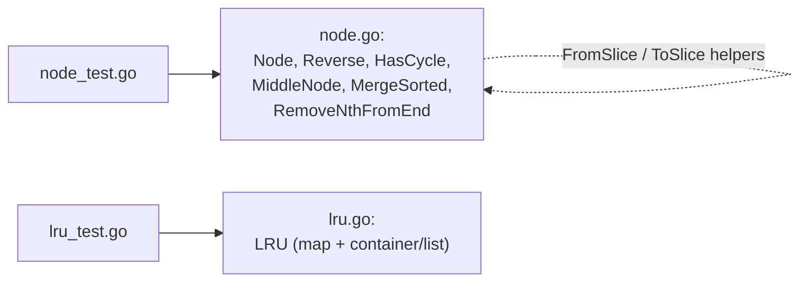
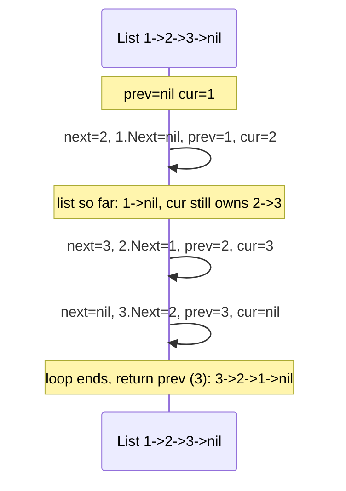
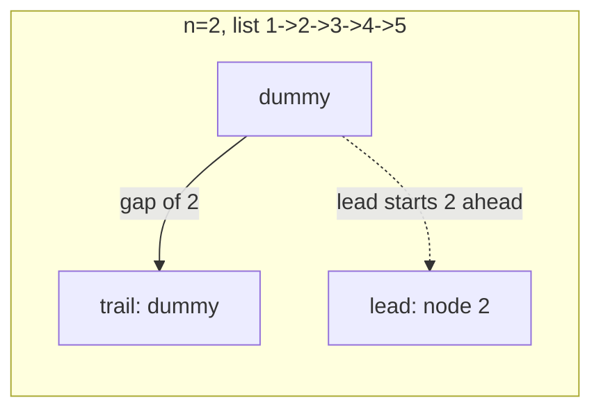

# Linked Lists - Go

> [!summary] TL;DR
> The runnable side of [[Linked Lists]]: a typed singly linked list with the five classic traversal patterns (reverse, cycle detection, middle node, merge, remove-nth-from-end), and an LRU cache built from a map plus Go's standard-library doubly linked list.

## Before the code

- **Pointers (`*Node`)**: a variable holding the address of a node; `nil` means "no node", which marks the end of a list.
- **Structs**: `Node` and `entry` group a value with its links into one record.
- **Methods on a type**: `func (c *LRU) Get(...)` attaches behaviour to the cache, so only its own methods touch the map and list.
- **`container/list`**: the standard-library doubly linked list; `Value` is `any`, so reads need a type assertion like `el.Value.(*entry)`.
- **Maps**: `map[int]*list.Element` gives `O(1)` key lookup straight to a list node.
- **What to run**: `go vet ./... && go test -race -v ./...` inside the module.

## What this code shows

| Code | Concept in the theory note |
| --- | --- |
| `Node`, `Reverse` | A chain of heap nodes; reversing by re-pointing `Next` as you walk ([[Linked Lists#Worked example]]) |
| `HasCycle` | Floyd's slow/fast pointers ([[Linked Lists#Interview questions]]) |
| `MiddleNode` | Slow/fast pointers again, stopped at the midpoint |
| `MergeSorted` | The dummy-node trick that avoids a special case for the new head |
| `RemoveNthFromEnd` | Lead/trail pointers, one pass, no length counting first |
| `LRU`, `NewLRU`, `Get`, `Put` | Map for O(1) lookup, `container/list` for O(1) reorder ([[Linked Lists#The LRU cache: map and list working together]]) |



## Setup

- Go 1.24. No external dependencies: everything is the standard library (`container/list`, `sort` is not needed here).
- Layout: a module `linkedlist` with `node.go` (the five traversal patterns plus `FromSlice`/`ToSlice` helpers) and `lru.go` (the LRU cache), each with its own `_test.go`.
- Run it with `go vet ./... && go test -race -v ./...`. No external service is needed.

## Code

### Step 1: the node and reversing it

**Concept.** The theory note's whiteboard trace shows reversing a 3-node list by walking forward once and re-pointing each `Next` to the node before it ([[Linked Lists#Worked example]]). The alternative is a recursive reverse, which is also `O(n)` time but uses `O(n)` stack frames instead of `O(1)` extra space — the iterative version below is preferred for exactly that reason.

```go
package linkedlist

// Node is one element of a singly linked list: a value and a pointer to
// the next node (nil at the tail).
type Node struct {
	Val  int
	Next *Node
}

// Reverse reverses the list in place in O(n) time and O(1) space by
// re-pointing each node's Next to the previous node as it walks forward.
func Reverse(head *Node) *Node {
	var prev *Node
	cur := head
	for cur != nil {
		next := cur.Next
		cur.Next = prev
		prev = cur
		cur = next
	}
	return prev
}
```

**How it works.**

1. `prev` starts `nil`: the new tail's `Next` must end the list.
2. Each loop iteration saves `cur.Next` *before* overwriting it, because once `cur.Next = prev` runs, the original forward link is gone.
3. `prev, cur = cur, next` advances both pointers one step together.
4. When `cur` becomes `nil`, `prev` holds the last node visited, which is the new head.



### Step 2: cycle detection and the middle node

**Concept.** Both functions reuse the same slow/fast pointer shape from [[Linked Lists#Interview questions]]: a slow pointer moves one node per step, a fast pointer moves two. The alternative for cycle detection is a `map[*Node]bool` of visited nodes, which works but costs `O(n)` extra memory; Floyd's approach is chosen here because it needs none.

```go
// HasCycle is Floyd's tortoise-and-hare: a slow pointer moves one node at a
// time, a fast pointer moves two. If there is a cycle they are guaranteed
// to meet; if the fast pointer reaches nil there is no cycle. O(n) time,
// O(1) space.
func HasCycle(head *Node) bool {
	slow, fast := head, head
	for fast != nil && fast.Next != nil {
		slow = slow.Next
		fast = fast.Next.Next
		if slow == fast {
			return true
		}
	}
	return false
}
```

**How it works.**

1. The loop guard checks `fast` and `fast.Next` so `fast.Next.Next` never dereferences `nil`.
2. If there is no cycle, `fast` reaches the tail before `slow` can catch it, and the loop exits normally, returning `false`.
3. If there is a cycle, `fast` eventually enters it and laps `slow` from behind — the gap between them shrinks by exactly one node per iteration once both are inside the cycle, so they are guaranteed to land on the same node.

```go
// MiddleNode finds the middle node in one pass with slow/fast pointers:
// when fast reaches the end, slow is at the middle (the second of two
// middles on an even-length list).
func MiddleNode(head *Node) *Node {
	slow, fast := head, head
	for fast != nil && fast.Next != nil {
		slow = slow.Next
		fast = fast.Next.Next
	}
	return slow
}
```

**How it works.**

1. Same loop shape as `HasCycle`, but without the equality check — there is no cycle to detect here, only an endpoint to reach.
2. By the time `fast` has moved `2k` steps, `slow` has moved `k` steps, which is why `slow` sits at the midpoint when `fast` runs out of list.
3. On an even-length list, `fast.Next` becomes `nil` one step before `fast` itself would, so `slow` lands on the *second* of the two middle nodes — worth stating explicitly in an interview, since it is a common point of confusion.

### Step 3: merging two sorted lists

**Concept.** The theory note's dummy-node trick avoids special-casing which list's head is smaller ([[Linked Lists#Worked example]]). The alternative is to compare the two heads up front to decide the real head, then loop — correct, but it duplicates the comparison logic that the loop already does once more, for no benefit.

```go
// MergeSorted merges two already-sorted lists into one sorted list in
// O(n+m) time, reusing the existing nodes.
func MergeSorted(a, b *Node) *Node {
	dummy := &Node{} // sentinel node: avoids a special case for the new head
	tail := dummy
	for a != nil && b != nil {
		if a.Val <= b.Val {
			tail.Next = a
			a = a.Next
		} else {
			tail.Next = b
			b = b.Next
		}
		tail = tail.Next
	}
	if a != nil {
		tail.Next = a
	} else {
		tail.Next = b
	}
	return dummy.Next
}
```

**How it works.**

1. `dummy` is never part of the answer; it exists only so `tail.Next = ...` always has somewhere valid to write, even for the very first node.
2. The loop always advances whichever list produced the smaller value, and always advances `tail` to the node it just attached.
3. When one list runs out, the other's remaining nodes are already sorted, so the final `if` just splices the rest on directly — no further comparisons needed.
4. `dummy.Next` is the real head; `dummy` itself is discarded by the garbage collector once the function returns.

### Step 4: removing the n-th node from the end

**Concept.** Finding the n-th-from-end node naively needs two passes: one to count the length, one to walk to the right spot. The lead/trail pattern does it in one pass by creating the gap first ([[Linked Lists#How it works]] covers the general shape of these two-pointer techniques).

```go
// RemoveNthFromEnd removes the n-th node from the end in one pass: a lead
// pointer moves n nodes ahead of a trail pointer, then both advance
// together until lead falls off the end, leaving trail just before the
// node to remove.
func RemoveNthFromEnd(head *Node, n int) *Node {
	dummy := &Node{Next: head}
	lead, trail := dummy, dummy
	for i := 0; i < n; i++ {
		lead = lead.Next
	}
	for lead.Next != nil {
		lead = lead.Next
		trail = trail.Next
	}
	trail.Next = trail.Next.Next
	return dummy.Next
}
```

**How it works.**

1. `dummy` again sidesteps a special case — this time, removing the head itself (when `n` equals the list's length).
2. The first loop advances `lead` by `n` nodes, opening a gap of exactly `n` nodes between `lead` and `trail`.
3. The second loop advances both pointers together until `lead` runs off the end; because the gap never changes size, `trail` is now exactly one node before the one to delete.
4. `trail.Next = trail.Next.Next` unlinks the target node in a single pointer write.



### Step 5: the FromSlice / ToSlice helpers

**Concept.** The tests build lists from slices and read them back as slices, so each check is one `reflect.DeepEqual` instead of a hand-written pointer walk. Both helpers live in `node.go`.

```go
// FromSlice builds a singly linked list holding vals in order.
func FromSlice(vals []int) *Node {
	dummy := &Node{}
	tail := dummy
	for _, v := range vals {
		tail.Next = &Node{Val: v}
		tail = tail.Next
	}
	return dummy.Next // nil for an empty slice
}

// ToSlice walks the list from head and collects every value.
// It must only be called on an acyclic list, or it never returns.
func ToSlice(head *Node) []int {
	var out []int
	for n := head; n != nil; n = n.Next {
		out = append(out, n.Val)
	}
	return out
}
```

**How it works.**

1. `FromSlice` reuses the dummy-node trick: `tail` always points at the last node built, so appending never needs a "first node" special case.
2. An empty input returns `nil`, which every function above already treats as the empty list.
3. `ToSlice` is a plain forward walk, `O(n)` time; on a cyclic list it would loop forever, so `TestHasCycle` never calls it after creating a cycle.

### Step 6: the LRU cache

**Concept.** The theory note's LRU section pairs a map (key to list element) with a doubly linked list ordered by recency ([[Linked Lists#The LRU cache: map and list working together]]). Front of the list = most recently used; back = next to evict.

```go
package linkedlist

import "container/list"

type entry struct {
	key, val int // key is stored so eviction can delete it from the map
}

// LRU is a fixed-capacity least-recently-used cache.
type LRU struct {
	cap   int
	ll    *list.List            // front = most recent, back = least recent
	items map[int]*list.Element // key -> its element in ll
}

func NewLRU(capacity int) *LRU {
	return &LRU{cap: capacity, ll: list.New(), items: make(map[int]*list.Element)}
}
```

```go
// Get returns the value and marks the key as most recently used.
func (c *LRU) Get(key int) (int, bool) {
	el, ok := c.items[key]
	if !ok {
		return 0, false
	}
	c.ll.MoveToFront(el) // a read counts as "used"
	return el.Value.(*entry).val, true
}

// Put inserts or updates a key, evicting the least recent entry when full.
func (c *LRU) Put(key, val int) {
	if el, ok := c.items[key]; ok {
		el.Value.(*entry).val = val
		c.ll.MoveToFront(el) // an update also refreshes recency
		return
	}
	if c.ll.Len() >= c.cap {
		oldest := c.ll.Back()
		c.ll.Remove(oldest)
		delete(c.items, oldest.Value.(*entry).key)
	}
	c.items[key] = c.ll.PushFront(&entry{key: key, val: val})
}
```

**How it works.**

1. `Get` is a map lookup (`O(1)`) plus `MoveToFront` (four pointer writes, `O(1)`).
2. `Put` on an existing key updates in place and refreshes recency.
3. `Put` on a new key at capacity removes `Back()` from both the list and the map, then pushes the new entry to the front.
4. The entry stores its own key, because eviction starts from the list element and must find the map key to delete.

## Design decisions

| Decision | Alternative | Trade-off |
| --- | --- | --- |
| Iterative `Reverse` | Recursive reverse | Same `O(n)` time, but `O(1)` space instead of `O(n)` stack frames |
| Floyd's cycle detection | `map[*Node]bool` of visited nodes | `O(1)` space instead of `O(n)`, at the cost of being less obviously correct on first read |
| Dummy node in `MergeSorted` and `RemoveNthFromEnd` | Special-case the first node or the head removal | One fewer branch to get wrong, at the cost of one throwaway allocation |
| `container/list` for the LRU cache | A hand-rolled doubly linked list | Tested, standard-library code, at the cost of a type assertion on every access (`Value any`) |
| Map plus list, kept in one type | Two free-standing collections the caller wires together | `Get`/`Put` can never let the map and list disagree, because only `LRU`'s own methods touch either |

## Tests

### Test 1: reverse

**Property.** Reversing a list and reading it back out gives the exact mirror image of the input, including order of every element.

| Input | Expected |
| --- | --- |
| `[1, 2, 3, 4]` | `[4, 3, 2, 1]` |

```go
package linkedlist

import (
	"reflect"
	"testing"
)

func TestReverse(t *testing.T) {
	head := FromSlice([]int{1, 2, 3, 4})
	head = Reverse(head)
	if got := ToSlice(head); !reflect.DeepEqual(got, []int{4, 3, 2, 1}) {
		t.Fatalf("Reverse = %v", got)
	}
}
```

**How it works.** `FromSlice` and `ToSlice` are small helpers (in `node.go`) that convert between `[]int` and the linked-list representation, so tests can compare against ordinary slice literals instead of walking pointers by hand.

**If it fails.** A result that is the same as the input means `Reverse` returned `head` unchanged — check that the loop runs at all. A result that is shorter than the input means a node's `Next` was overwritten before its original value was saved.

### Test 2: cycle detection, both ways

**Property.** `HasCycle` must say `false` on an acyclic list and `true` once a cycle is introduced, on the very same underlying nodes.

| Input | Expected |
| --- | --- |
| `[1, 2, 3]`, no cycle | `false` |
| same list, tail re-linked to node 2 | `true` |

```go
func TestHasCycle(t *testing.T) {
	head := FromSlice([]int{1, 2, 3})
	if HasCycle(head) {
		t.Fatal("expected no cycle")
	}
	tail := head
	for tail.Next != nil {
		tail = tail.Next
	}
	tail.Next = head.Next // tie the tail back into the list to create a cycle
	if !HasCycle(head) {
		t.Fatal("expected a cycle")
	}
}
```

**How it works.** The test deliberately mutates the list after the first check, so one list proves both the negative and the positive case. Re-linking the tail to `head.Next` (not `head` itself) checks that the cycle is detected even when it does not loop back to the very first node.

**If it fails.** `HasCycle` returning `true` on the acyclic list means the loop guard is wrong (for example, comparing `slow == fast` before either has moved).

Returning `false` after the tail is re-linked means the loop exits instead of looping forever — check the `fast != nil && fast.Next != nil` guard still allows the loop to keep running inside the cycle.

### Test 3: middle node, odd and even length

**Property.** The slow/fast method must return the single middle on an odd-length list and the *second* of the two middles on an even-length list.

| Input | Expected |
| --- | --- |
| `[1, 2, 3, 4, 5]` | `3` |
| `[1, 2, 3, 4]` | `3` (the second middle) |

```go
func TestMiddleNode(t *testing.T) {
	odd := FromSlice([]int{1, 2, 3, 4, 5})
	if got := MiddleNode(odd).Val; got != 3 {
		t.Fatalf("MiddleNode(odd) = %d, want 3", got)
	}
	even := FromSlice([]int{1, 2, 3, 4})
	if got := MiddleNode(even).Val; got != 3 {
		t.Fatalf("MiddleNode(even) = %d, want 3 (second of the two middles)", got)
	}
}
```

**How it works.** The two sub-cases exercise the loop guard's two ways of ending: `fast == nil` (odd length) and `fast.Next == nil` (even length) — see "How it works" in Step 2.

**If it fails.** Getting `2` instead of `3` on the even case means the loop stopped one iteration early, which usually points to a guard that should be `fast != nil && fast.Next != nil` written instead as `fast.Next != nil && fast.Next.Next != nil`.

### Test 4: merging two sorted lists

**Property.** Merging two sorted lists produces one sorted list containing every element from both, in order.

| Input | Expected |
| --- | --- |
| `[1, 3, 5]` and `[2, 4, 6]` | `[1, 2, 3, 4, 5, 6]` |

```go
func TestMergeSorted(t *testing.T) {
	a := FromSlice([]int{1, 3, 5})
	b := FromSlice([]int{2, 4, 6})
	got := ToSlice(MergeSorted(a, b))
	want := []int{1, 2, 3, 4, 5, 6}
	if !reflect.DeepEqual(got, want) {
		t.Fatalf("MergeSorted = %v, want %v", got, want)
	}
}
```

**How it works.** The two inputs interleave perfectly (odd list, even list), so a correct merge must alternate between them on every step — a bug that always drains one list first before touching the other would fail this exact case.

**If it fails.** An unsorted result means the `<=` comparison picked the wrong list. A result shorter than 6 elements means the trailing `if a != nil ... else ...` splice was skipped or only one branch was reached.

### Test 5: removing the n-th node from the end

**Property.** Removing the n-th-from-end node must remove exactly that one node and leave every other node, in order, untouched.

| Input | Expected |
| --- | --- |
| `[1, 2, 3, 4, 5]`, `n = 2` | `[1, 2, 3, 5]` (removes `4`) |

```go
func TestRemoveNthFromEnd(t *testing.T) {
	head := FromSlice([]int{1, 2, 3, 4, 5})
	got := ToSlice(RemoveNthFromEnd(head, 2)) // removes the 2nd-from-end: 4
	want := []int{1, 2, 3, 5}
	if !reflect.DeepEqual(got, want) {
		t.Fatalf("RemoveNthFromEnd = %v, want %v", got, want)
	}
}
```

**How it works.** `n = 2` on a 5-node list removes the 4th node, not the 2nd — the test deliberately picks a value where "from the end" and "from the start" disagree, so a function that accidentally counted from the head instead of the tail would fail visibly.

**If it fails.** Getting `[1, 2, 3, 4]` (missing the last element instead of the 4th) means the lead pointer was advanced `n` too few times, off by one in the gap size.

### Test 6: the LRU cache

**Property.** A cache at capacity evicts the *least* recently used entry, not the oldest-inserted one — `Get` on a key must count as using it.

| Steps | Expected |
| --- | --- |
| `Put(1,100)`, `Put(2,200)`, `Get(1)`, `Put(3,300)` | key `2` is evicted, not key `1` |

```go
func TestLRU(t *testing.T) {
	c := NewLRU(2)
	c.Put(1, 100)
	c.Put(2, 200)
	if v, ok := c.Get(1); !ok || v != 100 {
		t.Fatalf("Get(1) = (%d,%v)", v, ok)
	}
	c.Put(3, 300) // evicts 2: 1 was just touched, 2 is least recently used
	if _, ok := c.Get(2); ok {
		t.Fatal("expected key 2 to be evicted")
	}
}

func TestLRUUpdateExistingKeyRefreshesRecency(t *testing.T) {
	c := NewLRU(2)
	c.Put(1, 100)
	c.Put(2, 200)
	c.Put(1, 999) // update, not insert: should also refresh recency
	c.Put(3, 300) // 2 is now least recently used and gets evicted, not 1
	if v, ok := c.Get(1); !ok || v != 999 {
		t.Fatalf("Get(1) = (%d,%v), want (999,true)", v, ok)
	}
	if _, ok := c.Get(2); ok {
		t.Fatal("expected key 2 to be evicted, not key 1")
	}
}
```

**How it works.** The first test proves `Get` refreshes recency; without `c.ll.MoveToFront(el)` inside `Get`, key `1` (not `2`) would be evicted instead. The second test proves the same for `Put` on an existing key — a bug that updated the value but skipped `MoveToFront` would evict the wrong key here too.

**If it fails.** Key `1` evicted instead of `2` means `Get` or the update branch of `Put` forgot to call `MoveToFront`. A panic on the type assertion `el.Value.(*entry)` means a value of the wrong type was pushed onto the list somewhere.

## Pitfalls in the code

- **Saving `cur.Next` before overwriting it** in `Reverse` is not optional — skip it and the rest of the original list becomes unreachable the moment the first `cur.Next = prev` runs.
- **The loop guard order matters** in `HasCycle` and `MiddleNode`: `fast != nil && fast.Next != nil` must check `fast != nil` first, or `fast.Next` panics on a nil `fast` once short-circuit evaluation would otherwise have skipped it.
- **`container/list`'s `Value` is `any`.** Every read needs a type assertion (`el.Value.(*entry)`); a value of the wrong type pushed anywhere in `Put` would panic at the next `Get`, not at the point of the mistake.
- **`MoveToFront` must run on every access that counts as "used,"** including the update branch of `Put`, not only `Get` — `TestLRUUpdateExistingKeyRefreshesRecency` exists specifically to catch that one missing call.
- **The dummy node is discarded, not part of the list.** Returning `dummy` instead of `dummy.Next` from `MergeSorted` or `RemoveNthFromEnd` would silently prepend a zero-value node to every result.

## Exercises

1. In `RemoveNthFromEnd`, change the first loop to `for i := 0; i <= n; i++`. Predict which node gets removed instead, and verify with `TestRemoveNthFromEnd`.
2. Add a `Len()` method to `LRU` that returns `c.ll.Len()`. Write a test that calls it after a mix of `Put`s that exceed capacity, and predict the number before running it.
3. In `TestLRU`, change the capacity from `2` to `3` and keep the same sequence of calls. Predict whether `Get(2)` now succeeds, then run it to check.

## Links

- **Theory:** [[Linked Lists]]
- **Before this:** [[Data Structures Overview and Big-O Cheat Sheet]], [[Arrays and Dynamic Arrays (Go Slices)]]
- **Related:** [[Stacks, Queues and Deques]], [[Hash Tables and Go Maps]]
