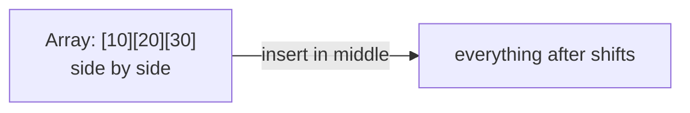
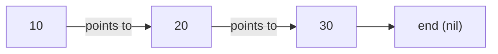
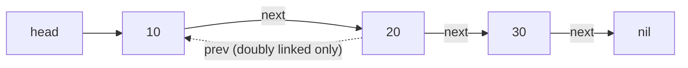
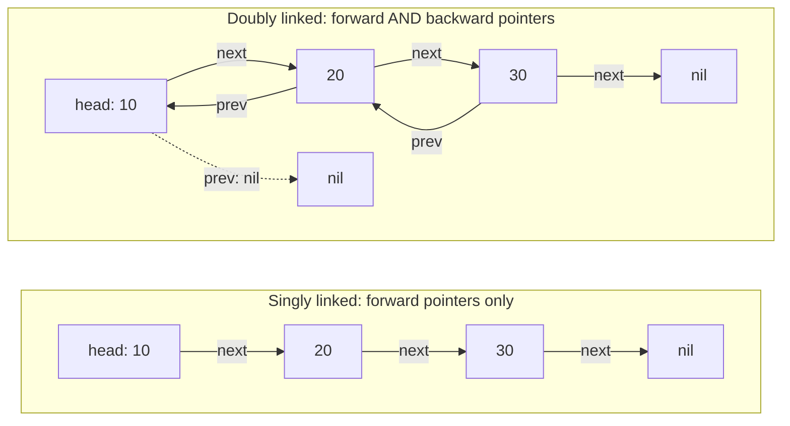
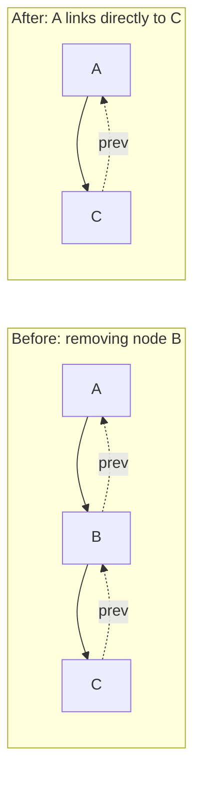
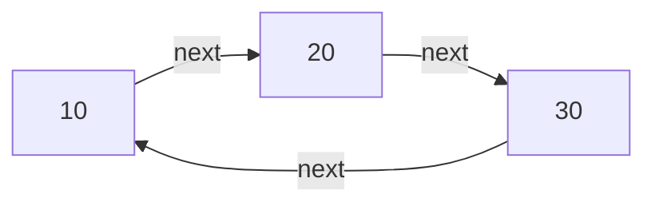
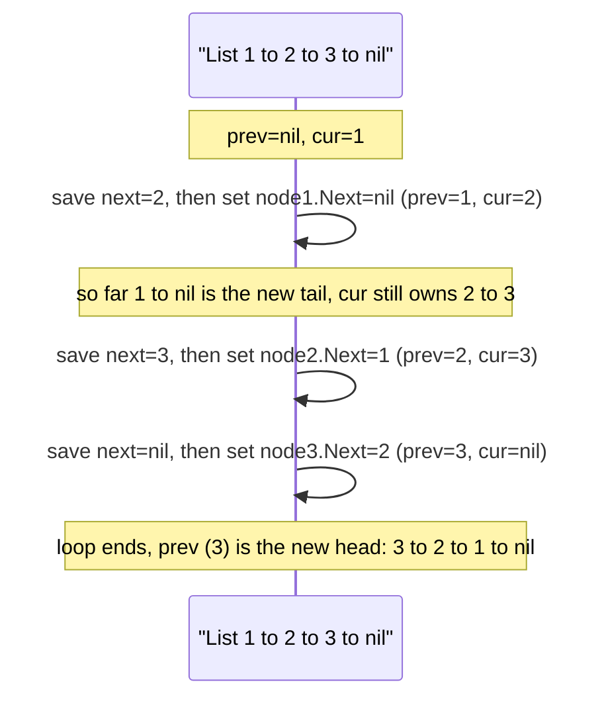
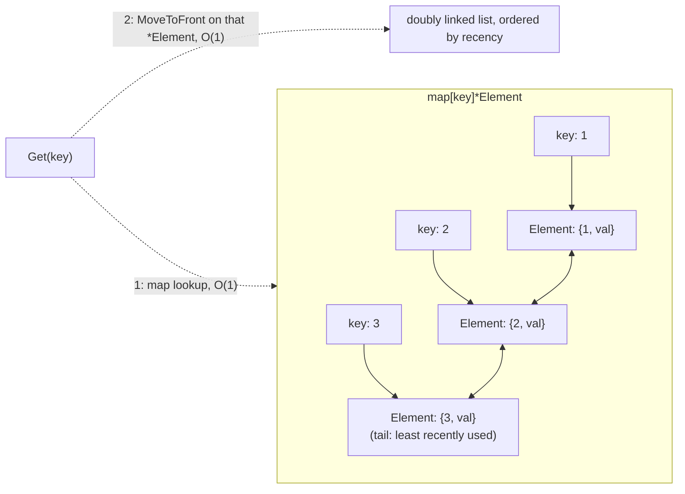
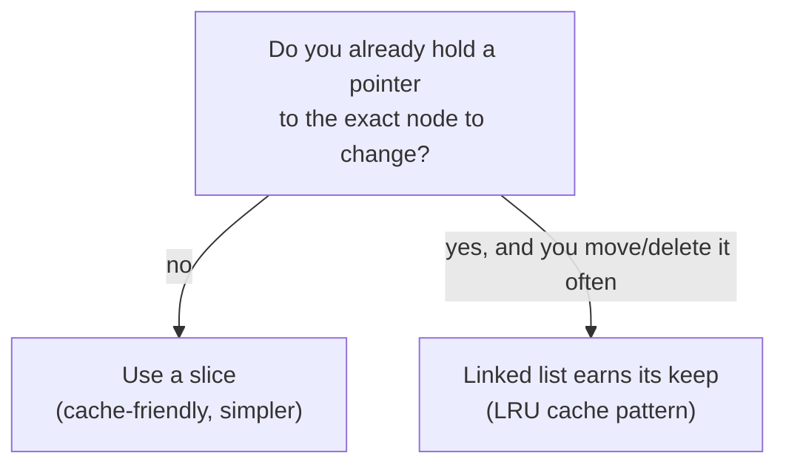

# Linked Lists

> [!summary] TL;DR
> A linked list is a chain of nodes scattered across the heap, each one holding a value and a pointer to the next node. Inserting or removing at a node you already have is `O(1)` — you just rewrite a couple of pointers, nothing else moves. The catch is that *reaching* that node in the first place costs `O(n)`, because there is no way to jump straight to position 37 the way an array can.

> [!abstract] Core idea
> - Nodes live scattered on the heap; the list itself is just a chain of pointers through them.
> - Singly linked lists point forward only; doubly linked lists also point backward, which is what makes `O(1)` removal possible without first searching for the previous node.
> - In Go, a slice beats a linked list for almost everything, because contiguous memory wins on cache locality even when the Big-O looks worse on paper; the exception is when you already hold a reference to the node you need to change.
> - The textbook case where that exception matters is an LRU cache: a hash map for `O(1)` lookup by key, paired with a doubly linked list for `O(1)` reordering by recency.

## Start here: the basics 🟢

> [!info] How to read this note (pick your level)
> - 🟢 **New to this?** Read "From zero" below, then sections 1, 2 and the cheat sheet (10). Stop there, that is a full first pass.
> - 🟡 **Know the basics?** Add section 3 (how it works) and 4 (worked example, LRU cache).
> - 🔴 **Interview / SDE-3 prep?** Add 7, 8 and 9. Headings are tagged 🟢🟡🔴 so you always know where you are.

> [!note] Before this note
> - [[Data Structures Overview and Big-O Cheat Sheet]]: `O(1)` means "same work at any size", `O(n)` means "work grows with the number of items".
> - [[Arrays and Dynamic Arrays (Go Slices)]]: a slice keeps items side by side in memory, so jumping to item 37 is instant but inserting in the middle shifts the rest.

**From zero, in 60 seconds** 🟢

An array stores items side by side, like numbered seats in a row. To squeeze a new item into the middle, everyone after it must shift over.

A **linked list** stores items anywhere in memory. Each item is a little box (a **node**) that holds a value plus the address of the next box (a **pointer**).





Because boxes only point at each other, pulling one out or hooking one in is instant — you rewrite a pointer or two and nothing shifts. The catch: to find box number 37 you must walk through the 36 boxes before it, one hop at a time.

The rest of this note is just these 4 questions:
1. When is "instant unhook/re-hook" actually worth it?
2. How do singly, doubly and circular lists differ?
3. Why does a plain Go slice still beat a list most of the time?
4. How does the classic map + list combo make an LRU cache?

**The problem in one story.**
You keep a "recently viewed" list of 50 products.
When someone views product 37 again, it must jump to the front.
With a numbered list, everything in front of it shifts down one slot.
A linked list lets you just "unhook" it and "re-hook" it at the front.

**Words you need first.**

| Word | Plain meaning | Tiny example |
| --- | --- | --- |
| Node | One box holding a value plus link(s) to other boxes | `{Val: 20, Next: →30}` |
| Pointer | A value that stores where another thing lives in memory | `Next *Node` |
| Head / tail | The first node / the last node of the chain | head = 10, tail = 30 |
| `nil` | "Points to nothing": marks the end of the chain | `30.Next = nil` |
| Heap | The memory area where nodes are allocated, scattered anywhere | each `&Node{}` lands somewhere new |
| Big-O (`O(1)`, `O(n)`) | How work grows with list size: constant vs grows with `n` | walking to item 37 is `O(n)` |
| Cache locality | CPUs read neighbouring memory fast; scattered memory is slow | a slice beats a list when scanning |
| LRU cache | A cache that evicts the Least Recently Used item when full | "recently viewed" capped at 50 |
| Singly / doubly linked | Each node points forward only / forward and backward | `A → B` vs `A ⇄ B` |
| Garbage collector (GC) | Go's automatic cleaner that frees memory nothing points to any more | an unlinked node is freed later |
| Dummy (sentinel) node | A fake first node so code never has to special-case "empty list" | `dummy.Next` is the real head |
| `memmove` | The fast machine-level copy that shifts a block of memory over | how a slice insert shifts items |
| `container/list` | Go's built-in doubly linked list | `l.PushFront(x)` |

**Picture it.**



**Analogy.** A train: each carriage is coupled only to its neighbours. Uncoupling one carriage and re-coupling it elsewhere is quick, but to reach carriage 37 you walk through the 36 before it.
Where it breaks: real train carriages sit side by side, while list nodes are scattered across memory, which is why walking a list is slower than the analogy suggests.

**How the rest of this note builds up.**

- First, why linked lists exist and a mental model (sections 1-2).
- Then how singly and doubly linked lists work, with `O(1)` delete at a known node (section 3).
- Then a worked example, variants, and when a slice is the better choice (sections 4-6).
- Finally the SDE-3 material: production use, the LRU cache deep dive, and interview questions (sections 7-9).

> [!tip] Remember
> A linked list is fast to rewire at a node you hold, slow to find a node in the first place.

## 1. Why it exists 🟢

Say you're building the "recently viewed items" list for a user, capped at 50 entries. Viewing an already-listed item must move it back to the front instead of adding a duplicate.

With a plain slice, moving entry 37 of 50 to the front means shifting the 36 entries in front of it over by one position each time — `O(n)` work on every single view.

With a doubly linked list, you already hold a reference to that item's node (because a side map stores it for you), so moving it to the front is just "unlink it from its current spot, relink it at the head": four pointer writes, `O(1)`, no matter where the node started.

This is the one situation a **linked list** — a chain of nodes, each holding a value and a pointer to the next — is built for: frequent insert or delete at a node you already hold, where a slice's *shifting* cost would otherwise dominate.

It's rarely the right default collection (see "Trade-offs" below for why), but it is exactly the data structure behind this one real pattern, and a few related ones: splicing two lists together in `O(1)`, or an iterator that keeps working even while other parts of the same list are being modified.

> [!tip] Remember
> A linked list trades fast *random access* for fast *local* insert/delete — it is a specialist tool for the second job, not a general-purpose replacement for a slice.

### Real-life example 🟢

Think of the "Continue watching" row on Netflix or the "Recently viewed" strip on Flipkart.
When you open a show you watched last week, it jumps to the front, and the oldest item drops off when the row is full.
Behind a strip like this, a common design is a map (show ID → its node) plus a doubly linked list in recency order.
The map finds the show's node instantly; the list moves it to the front by changing a few pointers.
The same pair powers in-memory caches such as Memcached, which drop the least recently used entry when memory is full.

## 2. Mental model 🟢

Picture a treasure hunt where each clue tells you only the location of the *next* clue. You can't skip ahead, and you can't see every clue laid out at once — you only know "here," plus how to get to "next" (a **singly linked list**), or "here," "next," **and** "previous" (a **doubly linked list**).

A slice is the opposite: a numbered map where you can jump straight to clue 37 without visiting clues 1 through 36 first. The trade is that inserting a new clue 20 means renumbering everything after it.

> [!warning] Common mistake
> Treating "linked lists are O(1) to insert" as a blanket win over slices. The `O(1)` only applies *after* you've already reached the right node — and reaching it, for a linked list, is `O(n)` with no shortcut. A slice's `O(n)` insert is often faster in practice precisely because *finding* the spot is `O(1)` (you already have the index) and the shift itself is one fast, cache-friendly `memmove` (a single bulk memory copy).

## Common beginner mistakes 🟢

- **Overwriting `cur.Next` before saving it** → the rest of the list is lost the moment you change the pointer → copy `next := cur.Next` first, then rewire.
- **Forgetting to update `head` or `tail`** → deleting the first or last node leaves `head`/`tail` pointing at a removed node → handle the ends, or use a dummy node so there are no special ends.
- **Following `.Next` without checking for `nil`** → the program panics at the end of the list → loop with `for cur != nil`.
- **Picking a list because "insert is `O(1)`"** → you still walk `O(n)` to find the spot, and the scattered memory is slow → use a slice unless you already hold the node.
- **Deleting in a singly linked list while holding only that node** → you cannot reach the node before it → keep the previous node while walking, or use a doubly linked list.

## 3. How it works 🟡

> 🟢 → 🟡 **You now know** that a linked list is a chain of boxes joined by pointers: quick to rewire, slow to search. **Next we open the box:** singly vs doubly linked, exactly which pointers change in an `O(1)` delete, and circular lists. Each subsection starts with a short step-by-step walk.

### Whiteboard version

The same chain, drawn two ways: a singly linked list that can only walk forward, and a doubly linked list that can walk either direction.

**Step by step:**
1. Create node 10. It is the head and the tail.
2. Create node 20 and set `10.Next = 20`. In a doubly linked list, also set `20.Prev = 10`.
3. Create node 30 and set `20.Next = 30` (and `30.Prev = 20`). `30.Next` stays `nil`, which marks the end.
4. To read the list, start at the head and follow `Next` until you hit `nil`.



### Singly vs doubly linked

**In plain words.** A singly linked node only knows what comes *after* it. A doubly linked node also knows what came *before* it. That one extra pointer per node is the entire difference between the two.

**Step by step:**
1. List: `10 → 20 → 30`. You hold only node 20 and want to delete it.
2. Singly linked: 20 does not know about 10, so you walk from the head to find 10. That walk is `O(n)`.
3. Then set `10.Next = 30`. Done.
4. Doubly linked: 20 already stores `Prev = 10`, so you skip the walk and rewire straight away: `O(1)`.

**Picture it.** The diagram above: the singly linked chain only has forward arrows; the doubly linked chain has both directions, drawn as solid forward arrows and dashed backward ones.

**Example.** To delete node `20` from the singly linked chain, you must already be holding node `10` (its predecessor), because only `10` can have its `next` pointer rewritten to skip over `20`. If you only have a reference to `20` itself, you're stuck walking from the head to find `10` first — `O(n)`.

In the doubly linked chain, `20` already stores a pointer to `10` directly, so no walk is needed.

**Why it matters.** This is the entire reason doubly linked lists exist: they turn "delete a node I'm holding" from an `O(n)` search-then-delete into a genuine `O(1)` operation.

> [!tip] Remember
> Forward pointer only = fast to build, cheap per node, but deletion needs the predecessor. Backward pointer too = twice the pointer overhead, but deletion from a known node is free.

### O(1) delete at a known node, before and after

**In plain words.** Deleting node `B` from the middle of a doubly linked list touches exactly two pointers: `A`'s forward pointer and `C`'s backward pointer. Nothing else in the list moves or is even visited.

**Step by step:**
1. Start with `A ⇄ B ⇄ C`. You hold a pointer to B.
2. Read B's neighbours: `B.Prev` is A, `B.Next` is C.
3. Set `A.Next = C`, so walking forward now skips B.
4. Set `C.Prev = A`, so walking backward also skips B.
5. Nothing points to B any more; Go's garbage collector frees it later.

**Picture it.**



**Example.** Deleting `B` from `A ⇄ B ⇄ C` is two assignments: `A.next = C` and `C.prev = A`. `B` itself is left untouched (and becomes eligible for garbage collection, meaning Go's runtime will free its memory, once nothing else references it) — the list simply stops pointing at it.

**Why it matters.** Compare this to a slice: removing the middle element of a 1,000-element slice shifts up to 999 elements over by one. The linked list's two-pointer delete is the entire appeal of the data structure for this one operation.

### Circular lists

**In plain words.** A circular linked list is an ordinary linked list where the tail's `next` points back to the head instead of to `nil` — there is no end, only "the next item," forever.

**Step by step:**
1. Playlist nodes: song A → song B → song C.
2. Instead of `C.Next = nil`, set `C.Next = A`.
3. The player keeps calling "next": A, B, C, A, B, C… with no "end of list" check.
4. To stop, remember where you started and stop when you get back to it, or you loop forever.

**Picture it.**



**Example.** A round-robin task scheduler cycling through three worker goroutines, or a music player set to "repeat playlist," both model naturally as a circular list: after the last item, you just keep going from the first.

**Why it matters.** Without a circular structure, "repeat from the start" needs an explicit check for `nil` and a jump back to a separately-stored head pointer on every step; the circular list bakes that behavior into the structure itself, so the iteration code has no special case at all.

> [!tip] Remember
> Circular = tail's `next` points at the head (and, if doubly linked, the head's `prev` points at the tail) instead of at `nil`.

## 4. Worked example 🟡

### Whiteboard version

**In plain words:** reversing a list means walking it once and making every arrow point backwards instead of forwards.

```go
type Node struct {
	Val  int
	Next *Node
}
```

Reversing the 3-node list `1 → 2 → 3 → nil` into `3 → 2 → 1 → nil` walks forward exactly once, re-pointing each node's `Next` to the node that came before it as it goes:



Three things to notice in the trace: the node's original `Next` is always saved *before* it gets overwritten (step 2 of "How it works" in the Go note), `prev` and `cur` always advance together, and the function returns `prev` — not `head` — once `cur` runs out of list.

Runnable Go version: [[Linked Lists - Go]]

### The LRU cache: map and list working together

**In plain words.** An LRU (least-recently-used) cache needs two things at once: instant lookup by key, and instant reordering by recency. Neither structure alone gives you both — a map has no sense of order, and a list alone has no fast lookup by key. Combining them gives you both for the price of one extra pointer per entry.

**Picture it.** The map's values are not the cached data directly — they are pointers *into* the list's nodes, so a key lookup and a list reorder are the same underlying operation seen from two angles:



**Example.** `Get(1)` first does a plain map lookup to find the `*Element` for key `1` — no list walk at all. It then calls `MoveToFront` on that exact pointer, which just relinks a couple of neighbors; the list never has to be searched to find node `1`, because the map already handed over its address.

**Why it matters.** Without the map, "find the node for key 1" would be an `O(n)` walk through the list on every single `Get`. Without the list, there would be no `O(1)` way to know which entry is least recently used when the cache is full and something has to be evicted.

> [!tip] Remember
> LRU = map (instant lookup by key) + doubly linked list (instant reorder by recency), with the map's values pointing directly into the list's nodes so neither structure ever has to search the other.

## 5. Variants and comparison 🟡

| Option | How it works | Use when | Cost |
| --- | --- | --- | --- |
| Singly linked list | Forward pointer only | You only ever traverse forward and never need to delete a middle node without first finding its predecessor | `O(1)` insert/delete at head; `O(n)` to find or delete elsewhere |
| Doubly linked list | Forward and backward pointers | You hold node references and need `O(1)` delete/move from the middle | `O(1)` insert/delete/move at a known node; double the pointer overhead per node |
| Circular linked list | Tail links back to head | Round-robin iteration with no natural "end" | Same as singly/doubly, plus no nil check needed to wrap around |
| `container/list` | Go's built-in doubly linked list, `any`-typed (each value is stored as "any type") | You want the pattern without writing it yourself, and the type-assertion cost (a runtime check like `v.(int)` to get the real type back) is acceptable | Same as doubly linked list; extra type assertion per access |
| Slice (for comparison) | Contiguous array | Almost everything else: iteration, index access, append at the end | See [[Arrays and Dynamic Arrays (Go Slices)]] |

## 6. Trade-offs and when not to use 🟡

- **In Go, a slice wins for most workloads, even ones that look list-shaped.** Each node is a separate heap allocation, so walking a list of `n` nodes means `n` potential cache misses, versus a slice's single contiguous scan. For small-to-medium `n`, a slice's `O(n)` middle-insert (a shift) is often faster in wall-clock time than a linked list's `O(1)` insert, because the shift is a tight, cache-friendly `memmove`, while the list insert is preceded by an `O(n)` cache-unfriendly search just to find the insertion point. See [[Memory Hierarchy and CPU Caches]] for the actual latency numbers behind "cache miss."
- **Per-node overhead.** Every node is its own allocation with its own pointer(s) and (in Go) a few bytes of allocator bookkeeping. For small value types, this overhead can dwarf the value itself, and it adds garbage-collector pressure that a single slice allocation doesn't.
- **No random access.** Reaching element `k` is `O(k)`, always — there is no way to jump to an index the way a slice does.
- **When it's still the right call.** You hold external references to nodes and need `O(1)` splice/move/delete at those references without a preceding search (the LRU case above), or you need to merge/split lists without copying (reattaching pointers is `O(1)`; splitting or merging slices copies).

**Slice or linked list? One question decides it:**



> [!warning] Common mistake
> Reaching for a linked list because "insert is O(1)" without checking whether you actually hold a node reference. If you don't, every insert or delete first pays an `O(n)` search to find the right spot — at which point a slice's `O(n)` shift, which skips that search entirely, is usually both simpler and faster in practice.

> 🟡 → 🔴 **You now know** how lists work, how the map + list LRU cache fits together, and why a slice usually wins in Go. **Next comes the advanced part:** how Memcached, Java and Redis handle LRU in real life, the bugs that hit hand-written lists, garbage-collector cost, and the classic interview questions.

## 7. In production 🔴

- **Real systems:** Memcached maintains an exact LRU list per slab class (a group of same-sized memory chunks) this way — a hash table for `O(1)` key lookup plus a doubly linked list for `O(1)` move-to-front on every `get`. Java's `LinkedHashMap` in access-order mode is the same pairing exposed as a library call (override `removeEldestEntry` and you have an LRU cache in a few lines). Redis, by contrast, deliberately avoids an exact recency list: `maxmemory-policy allkeys-lru` approximates LRU by sampling a few random keys and evicting the oldest of that sample, because a full doubly linked list reordered on every access doesn't scale to Redis's typical keyspace sizes. Browser history and most undo/redo UIs model "back/forward" as two stacks rather than a list, but editors that need arbitrary jump-to-any-point-in-history sometimes use a doubly linked list of states.
- **Failure modes → fixes:**
  - Using a linked list as a general-purpose Go collection where a slice would do → benchmark before choosing.
  - A linked list silently degrading into `O(n)` lookups when code forgets to keep the side map up to date (for example, an LRU cache whose map and list disagree after a bug) → keep map and list mutations atomic with respect to each other, ideally behind one method, as `LRU.Get`/`Put` do in the Go note.
  - Nil-pointer panics from forgetting to update a neighbor's pointer during a manual delete → prefer `container/list`'s tested implementation over hand-rolled pointer surgery unless you specifically need a typed version.
- **What to monitor:** for an LRU built this way, hit rate and eviction rate. A map/list size mismatch (`len(items) != ll.Len()`) is a sign of a bug, not something to monitor in steady state — it should never happen.

## 8. Deep dive 🔴

- **Why Go has no generic linked list in the standard library until you build one.** `container/list` predates Go generics (added in Go 1.18) and stores `any`, trading compile-time type safety and an allocation-free unboxed value for genericity. Most production code wraps it in a small generic type, or writes the roughly 20 lines of a typed doubly linked list directly, as shown in the Go note.
- **GC pressure.** Each node is a separate heap object the garbage collector must trace; a slice of `n` elements is one object (plus however many its elements themselves allocate). For large `n`, a linked list meaningfully increases GC scan work compared to one contiguous slice.
- **Why `q = q[1:]` isn't "a linked list without the pointers."** It looks similar — drop the front, keep going — but it leaks the first element's backing-array slot: the underlying array never shrinks, so a long-running queue built this way grows its backing array without bound even though `len` stays small. See [[Stacks, Queues and Deques]] for the ring-buffer fix.
- **Intrusive lists.** In lower-level systems code (the Linux kernel's `list_head`, for example), the "next/prev" pointers live *inside* the struct being linked rather than wrapping it in a separate node. This avoids one extra allocation and pointer hop per element, at the cost of a less generic design: one element can only be a member of that specific list type. Go's `container/list` is not intrusive; it wraps your value in its own `Element`.

## 9. Interview questions 🔴

> [!question]- Why would you choose a linked list over a slice in Go, given slices usually win on cache locality?
> Only when you hold a reference to a specific node and need to insert, delete, or move it without first searching for it — the clearest case being an LRU cache's recency list, where `Get`/`Put` must reorder in `O(1)` given a node you already have via a side map.

> [!question]- Trap: "a doubly linked list's delete is always O(1)."
> True only if you already have a pointer to the node to delete. If you're given a value and must first find its node by walking from the head, that search is `O(n)`; the delete itself, once you're at the node, is `O(1)`.

> [!question]- How does Floyd's cycle-detection algorithm prove a cycle exists without extra memory?
> Two pointers walk the list at different speeds — one step and two steps at a time. If there's no cycle, the fast pointer reaches the end first. If there is a cycle, the fast pointer eventually laps the slow one from behind, because the gap between them shrinks by one each step once both are inside the cycle.

> [!question]- Design an LRU cache with O(1) get and put. What two structures do you combine, and why both?
> A hash map from key to a doubly linked list node, for `O(1)` lookup by key, plus a doubly linked list ordered by recency, for `O(1)` move-to-front on access and `O(1)` evict-from-tail when over capacity. Either structure alone is insufficient: the map alone has no ordering, and the list alone has no `O(1)` lookup by key.

> [!question]- Why does `container/list`'s `Value any` field matter in practice?
> Every read needs a type assertion (`el.Value.(*entry)`), which costs a runtime check and loses compile-time type safety; most code wraps `container/list` in a small typed helper, or implements a typed doubly linked list directly, rather than using it bare in application code.

> [!question]- Merge two sorted linked lists. What's the trick that avoids special-casing the new head?
> Use a dummy (sentinel) node as the starting `tail`, build the merged list by always appending after it, and return `dummy.Next` at the end — this sidesteps the "what if the first node is the smaller one from list B" special case entirely.

> [!question]- What's the practical downside of a linked list that Big-O doesn't show?
> Per-node heap allocation and pointer-chasing: each hop between nodes is a potential cache miss (tens to roughly 100 ns on modern DRAM, versus well under 1 ns for data already in cache), and more heap objects means more work for the garbage collector to trace, even when the asymptotic complexity matches or beats a slice's.

## 10. Cheat sheet 🟢

- Linked list = chain of heap nodes; `O(1)` insert/delete at a known node, `O(n)` to reach any node by position.
- Singly linked: forward pointer only. Doubly linked: also backward, which is what makes `O(1)` delete-from-the-middle possible.
- In Go, default to a slice; reach for a linked list only when you hold node references and need `O(1)` reordering without a search.
- `container/list` is Go's stdlib doubly linked list; its `Value` is `any`, so wrap it in a typed helper for real use.
- LRU cache = map (O(1) lookup by key) + doubly linked list (O(1) reorder by recency), with the map's values pointing directly into the list's nodes.
- `q = q[1:]` on a slice is not a substitute for a ring buffer: it leaks the dropped prefix's backing-array space.
- Classic patterns: reverse (prev/cur/next), Floyd's cycle detection (slow/fast), slow/fast for the middle, dummy node for merges and nth-from-end.

## Self-check 🟢🟡

🟢 Easy

> [!question]- What does each node in a singly linked list hold?
> A value and a pointer to the next node (`nil` for the last one).

> [!question]- Why is reaching item 37 slow in a linked list?
> There is no index; you must follow 36 pointers from the head, one hop at a time.

> [!question]- What does a circular list's last node point to?
> Back to the head, instead of `nil`.

🟡 Medium

> [!question]- Which two pointers change when you delete B from `A ⇄ B ⇄ C`?
> `A.Next` becomes C and `C.Prev` becomes A.

> [!question]- Why does an LRU cache need both a map and a doubly linked list?
> The map gives `O(1)` lookup by key; the list gives `O(1)` move-to-front and evict-from-tail. Neither does both.

> [!question]- Why is a Go slice often faster than a list even for middle inserts?
> The list must first walk `O(n)` scattered nodes (cache misses), while the slice shift is one fast contiguous `memmove`.

## Links 🟢

- **Before this:** [[Data Structures Overview and Big-O Cheat Sheet]], [[Arrays and Dynamic Arrays (Go Slices)]]
- **Next:** [[Stacks, Queues and Deques]]
- **Compare with:** [[Hash Tables and Go Maps]] (the other half of the LRU pattern), [[Memory Hierarchy and CPU Caches]] (why pointer-chasing is expensive)
- **Runnable Go version:** [[Linked Lists - Go]]

### Watch on YouTube

- [Linked List Data Structure explained with animations / Common Operations / Study Algorithms](https://www.youtube.com/watch?v=lrXpTVEAXCM) · Nikhil Lohia · animated walkthrough of node/pointer structure and core operations
