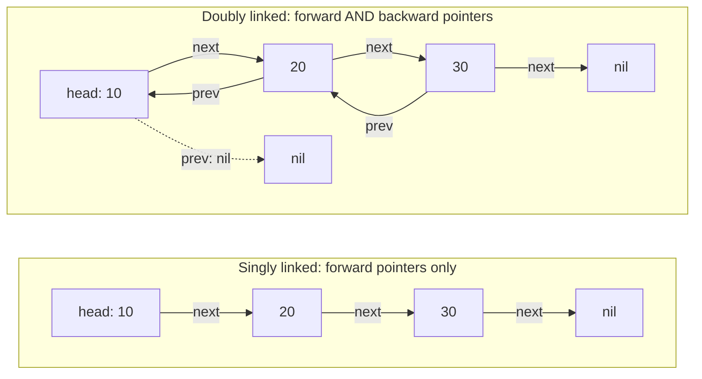
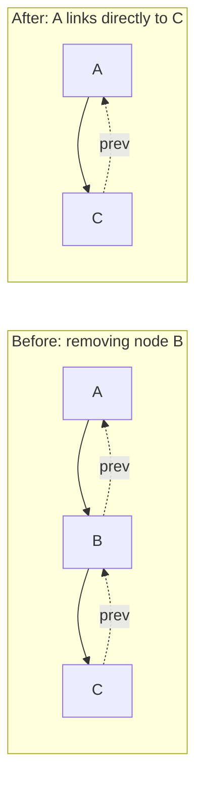

# Linked Lists

> [!summary] TL;DR
> A linked list is a chain of nodes, each holding a value and a pointer to the next node, so inserting or removing at a node you already have is `O(1)` without shifting anything else — unlike a slice. The cost is that reaching that node in the first place is `O(n)`, and every hop between nodes is a potential cache miss.

> [!abstract] Core idea
> - Nodes live scattered on the heap; the list itself is just a chain of pointers through them.
> - Singly linked lists point forward only; doubly linked lists also point backward, which is what makes `O(1)` removal possible without a preceding-node search.
> - In Go, a slice beats a linked list for almost everything, because contiguous memory wins on cache locality even when the Big-O is worse; the exception is when you need `O(1)` insert/delete at a node you're already holding a reference to.
> - The textbook case where that exception matters is an LRU cache: a hash map for `O(1)` lookup by key, paired with a doubly linked list for `O(1)` reordering by recency.

## 1. Why it exists

Say you're building the "recently viewed items" list for a user, capped at 50 entries, where viewing an already-listed item must move it back to the front instead of adding a duplicate. With a slice, moving entry 37 of 50 to the front means shifting 36 entries over by one position: `O(n)` work for every single view. With a doubly linked list, you already have a reference to that item's node (because you store it in a side map), so moving it to the front is "unlink from its current spot, relink at the head" — four pointer writes, `O(1)`, regardless of where it was.

This is the one situation a linked list is built for: frequent insert/delete at a node you already hold, where a slice's *shifting* cost would otherwise dominate. It's rarely the right default collection — see section 6 for why — but it is exactly the data structure behind this one real pattern (and a few others: `O(1)` splice of two lists, external iterators that survive concurrent modification of other parts of the list).

## 2. Mental model

Picture a treasure hunt where each clue tells you only the location of the *next* clue — you can't skip ahead, and you can't see all the clues laid out at once; you only know "here," plus how to get to "next" (singly linked) or also "here," "next," **and** "previous" (doubly linked).

A slice is the opposite: a numbered map where you can jump straight to clue 37 without visiting 1 through 36 first — the trade is that inserting a new clue 20 means renumbering everything after it.

## 3. How it works

### Singly vs doubly linked



Singly linked lists can only walk forward, so removing a node needs the *previous* node's pointer rewritten — which means you must already be holding that previous node, or have walked from the head to find it (`O(n)`). Doubly linked lists store both neighbours on every node, so removing a node you're holding is a local, `O(1)` operation: `node.prev.next = node.next; node.next.prev = node.prev`.

### O(1) delete at a known node, before and after



Only the two pointers touching `B` change; everything else in the list is untouched. This is the entire appeal of a linked list over a slice for this one operation — a slice would need to shift every element after `B`'s old position.

### Circular lists

A circular linked list simply has the tail's `next` point back to the head (and, if doubly linked, the head's `prev` point to the tail) instead of to `nil`. It's used where "there is no end, only the next item" is the natural model — a round-robin scheduler cycling through workers, or a playlist set to repeat.

## 4. Worked example

### Whiteboard version

```go
type Node struct {
	Val  int
	Next *Node
}

// Reverse a 3-node list: 1 -> 2 -> 3 -> nil  becomes  3 -> 2 -> 1 -> nil
head := &Node{1, &Node{2, &Node{3, nil}}}
var prev *Node
for cur := head; cur != nil; {
	next := cur.Next
	cur.Next = prev
	prev, cur = cur, next
}
// prev now points at the new head: 3
```

### Full version: traversal patterns, merging, and an LRU cache

Tested on Go 1.24.4 (darwin/arm64); `go vet` and `go test -race` both pass.

```go
// Node is one element of a singly linked list: a value and a pointer to
// the next node (nil at the tail).
type Node struct {
	Val  int
	Next *Node
}

// Reverse reverses the list in place in O(n) time and O(1) space by
// re-pointing each node's Next to the previous node as it walks forward.
func Reverse(head *Node) *Node {
	var prev *Node
	cur := head
	for cur != nil {
		next := cur.Next
		cur.Next = prev
		prev = cur
		cur = next
	}
	return prev
}

// HasCycle is Floyd's tortoise-and-hare: a slow pointer moves one node at a
// time, a fast pointer moves two. If there is a cycle they are guaranteed
// to meet; if the fast pointer reaches nil there is no cycle. O(n) time,
// O(1) space.
func HasCycle(head *Node) bool {
	slow, fast := head, head
	for fast != nil && fast.Next != nil {
		slow = slow.Next
		fast = fast.Next.Next
		if slow == fast {
			return true
		}
	}
	return false
}

// MiddleNode finds the middle node in one pass with slow/fast pointers:
// when fast reaches the end, slow is at the middle (the second of two
// middles on an even-length list).
func MiddleNode(head *Node) *Node {
	slow, fast := head, head
	for fast != nil && fast.Next != nil {
		slow = slow.Next
		fast = fast.Next.Next
	}
	return slow
}

// MergeSorted merges two already-sorted lists into one sorted list in
// O(n+m) time, reusing the existing nodes.
func MergeSorted(a, b *Node) *Node {
	dummy := &Node{} // sentinel node: avoids a special case for the new head
	tail := dummy
	for a != nil && b != nil {
		if a.Val <= b.Val {
			tail.Next = a
			a = a.Next
		} else {
			tail.Next = b
			b = b.Next
		}
		tail = tail.Next
	}
	if a != nil {
		tail.Next = a
	} else {
		tail.Next = b
	}
	return dummy.Next
}

// RemoveNthFromEnd removes the n-th node from the end in one pass: a lead
// pointer moves n nodes ahead of a trail pointer, then both advance
// together until lead falls off the end, leaving trail just before the
// node to remove.
func RemoveNthFromEnd(head *Node, n int) *Node {
	dummy := &Node{Next: head}
	lead, trail := dummy, dummy
	for i := 0; i < n; i++ {
		lead = lead.Next
	}
	for lead.Next != nil {
		lead = lead.Next
		trail = trail.Next
	}
	trail.Next = trail.Next.Next
	return dummy.Next
}

// FromSlice builds a singly linked list from a slice, in order.
func FromSlice(vals []int) *Node {
	dummy := &Node{}
	tail := dummy
	for _, v := range vals {
		tail.Next = &Node{Val: v}
		tail = tail.Next
	}
	return dummy.Next
}

// ToSlice walks a singly linked list into a slice, for comparing against
// expected output in tests.
func ToSlice(head *Node) []int {
	var out []int
	for n := head; n != nil; n = n.Next {
		out = append(out, n.Val)
	}
	return out
}
```

```go
func TestReverse(t *testing.T) {
	head := FromSlice([]int{1, 2, 3, 4})
	head = Reverse(head)
	if got := ToSlice(head); !reflect.DeepEqual(got, []int{4, 3, 2, 1}) {
		t.Fatalf("Reverse = %v", got)
	}
}

func TestHasCycle(t *testing.T) {
	head := FromSlice([]int{1, 2, 3})
	if HasCycle(head) {
		t.Fatal("expected no cycle")
	}
	tail := head
	for tail.Next != nil {
		tail = tail.Next
	}
	tail.Next = head.Next // tie the tail back into the list to create a cycle
	if !HasCycle(head) {
		t.Fatal("expected a cycle")
	}
}
```

### LRU cache: map + doubly linked list

The "recently viewed" problem from section 1, made concrete: `container/list` (Go's standard-library doubly linked list) gives `O(1)` `MoveToFront` and `Remove` given an `*list.Element`; a `map[key]*list.Element` gives `O(1)` lookup from a key to that element.

```go
import "container/list"

type LRU struct {
	cap   int
	ll    *list.List
	items map[int]*list.Element
}

type entry struct{ key, val int }

func NewLRU(capacity int) *LRU {
	return &LRU{cap: capacity, ll: list.New(), items: make(map[int]*list.Element)}
}

func (c *LRU) Get(key int) (int, bool) {
	el, ok := c.items[key]
	if !ok {
		return 0, false
	}
	c.ll.MoveToFront(el) // O(1): just relinks pointers, no search
	return el.Value.(*entry).val, true
}

func (c *LRU) Put(key, val int) {
	if el, ok := c.items[key]; ok {
		el.Value.(*entry).val = val
		c.ll.MoveToFront(el)
		return
	}
	if c.ll.Len() >= c.cap {
		back := c.ll.Back() // least recently used: the tail
		if back != nil {
			c.ll.Remove(back)
			delete(c.items, back.Value.(*entry).key)
		}
	}
	c.items[key] = c.ll.PushFront(&entry{key: key, val: val})
}
```

```go
func TestLRU(t *testing.T) {
	c := NewLRU(2)
	c.Put(1, 100)
	c.Put(2, 200)
	if v, ok := c.Get(1); !ok || v != 100 {
		t.Fatalf("Get(1) = (%d,%v)", v, ok)
	}
	c.Put(3, 300) // evicts 2: 1 was just touched, 2 is least recently used
	if _, ok := c.Get(2); ok {
		t.Fatal("expected key 2 to be evicted")
	}
}
```

`container/list`'s `Element.Value` is `any`, so every read needs a type assertion (`el.Value.(*entry)`) — the standard library predates generics (Go 1.18) and was never updated to use them, which is one more reason application code usually wraps it rather than using it bare.

## 5. Variants and comparison

| Option | How it works | Use when | Cost |
| --- | --- | --- | --- |
| Singly linked list | Forward pointer only | You only ever traverse forward and never need to delete a middle node without first finding its predecessor | `O(1)` insert/delete at head; `O(n)` to find or delete elsewhere |
| Doubly linked list | Forward and backward pointers | You hold node references and need `O(1)` delete/move from the middle | `O(1)` insert/delete/move at a known node; double the pointer overhead per node |
| Circular linked list | Tail links back to head | Round-robin iteration with no natural "end" | Same as singly/doubly, plus no nil check needed to wrap around |
| `container/list` | Go's built-in doubly linked list, `any`-typed | You want the pattern without writing it yourself, and the type-assertion cost is acceptable | Same as doubly linked list; extra type assertion per access |
| Slice (for comparison) | Contiguous array | Almost everything else: iteration, index access, append at the end | See [[Arrays and Dynamic Arrays (Go Slices)]] |

## 6. Trade-offs and when not to use

- **In Go, a slice wins for most workloads, even ones that look list-shaped.** Each node is a separate heap allocation, so walking a list of `n` nodes is `n` potential cache misses, versus a slice's single contiguous scan; for small-to-medium `n`, a slice's `O(n)` middle-insert (shift elements) is often faster in wall-clock time than a linked list's `O(1)` insert, because the shift is a tight, cache-friendly `memmove` while the list insert is preceded by an `O(n)` cache-unfriendly search to find the insertion point in the first place. See [[Memory Hierarchy and CPU Caches]] for the actual latency numbers behind "cache miss."
- **Per-node overhead.** Every node is its own allocation with its own pointer(s) and (in Go) a few bytes of allocator bookkeeping; for small value types this overhead can dwarf the value itself, and it adds garbage-collector pressure that a single slice allocation doesn't.
- **No random access.** Reaching element `k` is `O(k)`, always — there is no way to jump to an index the way a slice does.
- **When it's still the right call.** You hold external references to nodes and need `O(1)` splice/move/delete at those references without a preceding search (the LRU case above), or you need to merge/split lists without copying (reattaching pointers is `O(1)`; splitting/merging slices copies).

## 7. In production

- **Real systems:** Memcached maintains an exact LRU list per slab class this way — a hash table for `O(1)` key lookup plus a doubly linked list for `O(1)` move-to-front on every `get`; Java's `LinkedHashMap` in access-order mode is the same pairing exposed as a library call (override `removeEldestEntry` and you have an LRU cache in a few lines). Redis, by contrast, deliberately avoids an exact recency list: `maxmemory-policy allkeys-lru` approximates LRU by sampling a few random keys and evicting the oldest of that sample, because a full doubly linked list reordered on every access doesn't scale to Redis's typical keyspace sizes. Browser history and most undo/redo UIs model "back/forward" as two stacks rather than a list, but editors that need arbitrary jump-to-any-point-in-history sometimes use a doubly linked list of states.
- **Failure modes → fixes:** using a linked list as a general-purpose Go collection where a slice would do → benchmark before choosing; a linked list silently degrading into `O(n)` lookups when code forgets to keep the side map up to date (e.g., an LRU cache whose map and list disagree after a bug) → keep map and list mutations atomic with respect to each other, ideally behind one method, as the `LRU` type above does; nil-pointer panics from forgetting to update a neighbour's pointer during a manual delete → prefer `container/list`'s tested implementation over hand-rolled pointer surgery unless you specifically need a typed version.
- **What to monitor:** for an LRU built this way, hit rate and eviction rate; a map/list size mismatch (`len(items) != ll.Len()`) is a sign of a bug, not a thing to monitor in steady state — it should never happen.

## 8. Deep dive

- **Why Go has no generic linked list in the standard library until you build one.** `container/list` predates Go generics (added in Go 1.18) and stores `any`, trading compile-time type safety and an allocation-free unboxed value for genericity; most production code wraps it in a small generic type, or writes the ~20 lines of a typed doubly linked list directly, as shown in section 4.
- **GC pressure.** Each node is a separate heap object the garbage collector must trace; a slice of `n` elements is one object (plus however many its elements themselves allocate). For large `n`, a linked list meaningfully increases GC scan work compared to one contiguous slice.
- **Why `q = q[1:]` isn't "a linked list without the pointers."** It looks similar (drop the front, keep going), but it leaks the first element's backing-array slot: the underlying array never shrinks, so a long-running queue built this way grows its backing array without bound even though `len` stays small. See [[Stacks, Queues and Deques]] for the ring-buffer fix.
- **Intrusive lists.** In lower-level systems code (the Linux kernel's `list_head`, for example), the "next/prev" pointers live *inside* the struct being linked rather than wrapping it in a separate node — this avoids one extra allocation and pointer hop per element, at the cost of a less generic (one element can only be in that specific list type) design. Go's `container/list` is not intrusive; it wraps your value in its own `Element`.

## 9. Interview questions

> [!question]- Why would you choose a linked list over a slice in Go, given slices usually win on cache locality?
> Only when you hold a reference to a specific node and need to insert, delete, or move it without first searching for it — the clearest case being an LRU cache's recency list, where `Get`/`Put` must reorder in `O(1)` given a node you already have via a side map.

> [!question]- Trap: "a doubly linked list's delete is always O(1)."
> True only if you already have a pointer to the node to delete. If you're given a value and must first find its node by walking from the head, that search is `O(n)`; the delete itself, once you're at the node, is `O(1)`.

> [!question]- How does Floyd's cycle-detection algorithm prove a cycle exists without extra memory?
> Two pointers walk the list at different speeds — one step and two steps at a time. If there's no cycle, the fast pointer reaches the end first. If there is a cycle, the fast pointer eventually laps the slow one from behind and they land on the same node, because the gap between them shrinks by one each step once both are inside the cycle.

> [!question]- Design an LRU cache with O(1) get and put. What two structures do you combine, and why both?
> A hash map from key to a doubly linked list node, for `O(1)` lookup by key, plus a doubly linked list ordered by recency, for `O(1)` move-to-front on access and `O(1)` evict-from-tail when over capacity. Either structure alone is insufficient: the map alone has no ordering, and the list alone has no `O(1)` lookup by key.

> [!question]- Why does `container/list`'s `Value any` field matter in practice?
> Every read needs a type assertion (`el.Value.(*entry)`), which costs a runtime check and loses compile-time type safety; most code wraps `container/list` in a small typed helper, or implements a typed doubly linked list directly, rather than using it bare in application code.

> [!question]- Merge two sorted linked lists. What's the trick that avoids special-casing the new head?
> Use a dummy (sentinel) node as the starting `tail`, build the merged list by always appending after it, and return `dummy.Next` at the end — this sidesteps the "what if the first node is the smaller one from list B" special case entirely.

> [!question]- What's the practical downside of a linked list that Big-O doesn't show?
> Per-node heap allocation and pointer-chasing: each hop between nodes is a potential cache miss (tens to ~100 ns on modern DRAM, versus well under 1 ns for data already in cache), and more heap objects means more work for the garbage collector to trace, even when the asymptotic complexity matches or beats a slice's.

## 10. Cheat sheet

- Linked list = chain of heap nodes; `O(1)` insert/delete at a known node, `O(n)` to reach any node by position.
- Singly linked: forward pointer only. Doubly linked: also backward, which is what makes `O(1)` delete-from-the-middle possible.
- In Go, default to a slice; reach for a linked list only when you hold node references and need `O(1)` reordering without a search.
- `container/list` is Go's stdlib doubly linked list; its `Value` is `any`, so wrap it in a typed helper for real use.
- LRU cache = map (O(1) lookup by key) + doubly linked list (O(1) reorder by recency).
- `q = q[1:]` on a slice is not a substitute for a ring buffer: it leaks the dropped prefix's backing-array space.
- Classic patterns: reverse (prev/cur/next), Floyd's cycle detection (slow/fast), slow/fast for the middle, dummy node for merges and nth-from-end.

## Links

- **Before this:** [[Data Structures Overview and Big-O Cheat Sheet]], [[Arrays and Dynamic Arrays (Go Slices)]]
- **Next:** [[Stacks, Queues and Deques]]
- **Compare with:** [[Hash Tables and Go Maps]] (the other half of the LRU pattern), [[Memory Hierarchy and CPU Caches]] (why pointer-chasing is expensive)
