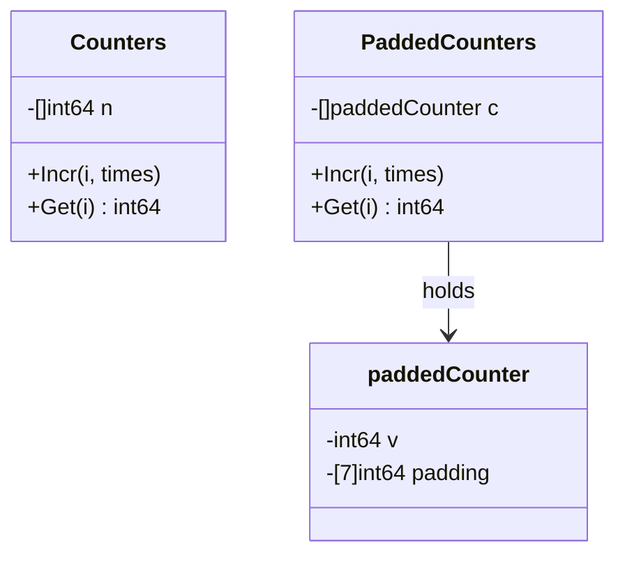
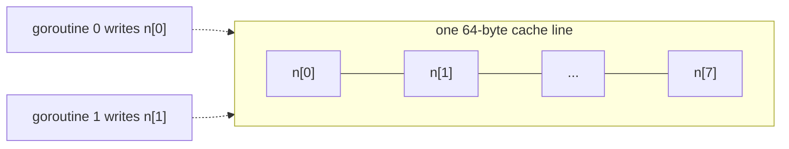
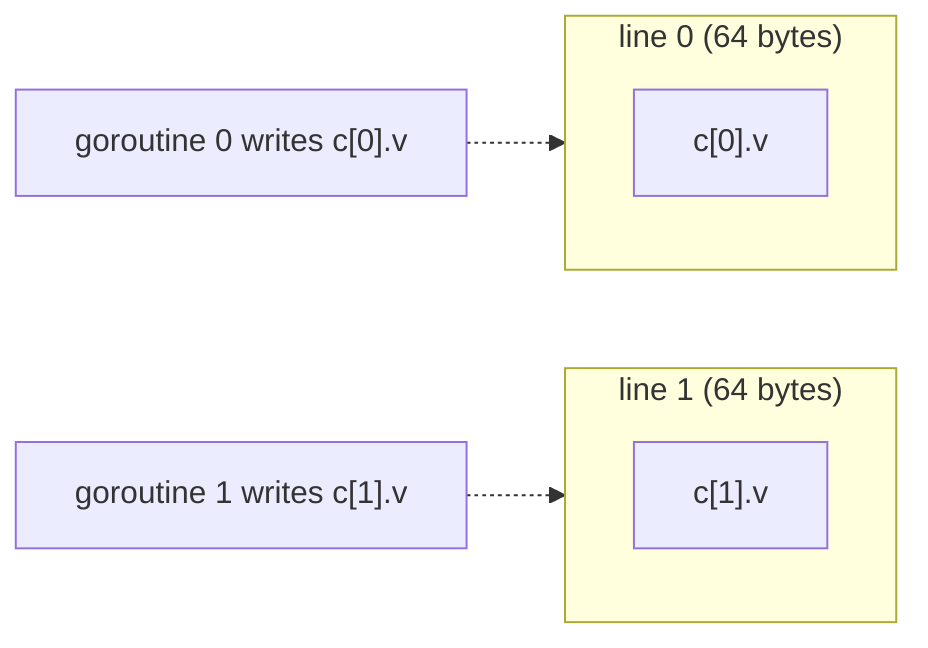

# Memory Hierarchy and CPU Caches - Go

> [!summary] TL;DR
> A false-sharing experiment in Go: two counter layouts that compute identical results but one pads each counter onto its own 64-byte cache line. The tests prove both are correct; the benchmark measures the performance gap MESI invalidation traffic causes, as described in [[Memory Hierarchy and CPU Caches]].

> [!info] How to read this note (pick your level)
> - 🟢 **New to this?** Read the theory note [[Memory Hierarchy and CPU Caches]] first. Here, read "Before the code" and "What this code shows", then skim the two Code steps.
> - 🟡 **Know the basics?** Read the Code, Design decisions and Tests sections, then run the benchmark yourself.
> - 🔴 **Interview / SDE-3 prep?** Add Pitfalls and the Exercises. Headings are tagged 🟢🟡🔴.

**From zero** 🟢: this file is one small Go experiment. It builds two versions of the same counter array — one where counters sit squeezed together in memory, one where each counter gets its own 64-byte "room" (a cache line). Both give the right answer; the padded one is faster under concurrency because CPU cores stop fighting over the same line. Read it top to bottom: the code first, then the tests that prove it is correct, then the benchmark that shows the speed difference.

## Before the code 🟢

- **Structs and blank fields**: `_ [7]int64` reserves memory without a usable name; here it is padding.
- **Slices**: `make([]T, n)` allocates `n` elements back to back in one block of memory.
- **Goroutines**: `go func(...)` starts a lightweight concurrent function; each counter gets its own.
- **`sync.WaitGroup`**: `Add`, `Done`, `Wait` let the test block until every goroutine finishes.
- **`testing` benchmarks**: `func BenchmarkX(b *testing.B)` runs the body `b.N` times and reports time per iteration.
- **What to run**: `go vet ./... && go test -race -v ./...`, then the benchmark command in Setup.

## What this code shows 🟢

| Code | Concept in [[Memory Hierarchy and CPU Caches]] |
| --- | --- |
| `Counters` | The packed layout where 8 counters share 64-byte lines, [[Memory Hierarchy and CPU Caches#4. Worked example]] |
| `PaddedCounters` / `paddedCounter` | The false-sharing fix: one counter per cache line, same section |
| `TestCountersAreCorrect` | False sharing is a performance bug, not a correctness bug — both layouts must compute the right answer |
| `BenchmarkUnpadded` / `BenchmarkPadded` | The measured 0.92x (about 9% faster) padded result in the worked example |



Both types expose the same two methods, `Incr` and `Get`, so the only difference between them is the memory layout underneath — which is exactly the point: identical behavior, different cache-line placement.

## Setup 🟢

- Module `falsesharing` with `falsesharing.go` and `falsesharing_test.go`.
- Go 1.24, standard library only (`sync`, `testing`).
- Run: `go vet ./... && go test -race -v ./... && go test -bench . -benchtime=50x -count=5 -cpu 8 ./...`

## Code 🟡

### Step 1: the packed layout

**Concept.** This implements the "before" side of [[Memory Hierarchy and CPU Caches#4. Worked example]]: `N` plain `int64` counters packed into one slice.

Because a `[]int64` is contiguous memory and each element is 8 bytes, eight consecutive counters fit in one 64-byte cache line.

The alternative — one counter per goroutine stored in a local variable — would avoid false sharing entirely, but a shared slice indexed by goroutine ID is a realistic shape for, say, per-worker request counters in a pool.

```go
package falsesharing

const goroutines = 8
const iters = 200000

// Counters is the false-sharing layout: N plain int64 counters packed into
// one slice. counters[0] and counters[1] are 8 bytes apart, so on a 64-byte
// cache line they (and six more) share one line.
type Counters struct {
	n []int64
}

func NewCounters(n int) *Counters { return &Counters{n: make([]int64, n)} }
```

```go
func (c *Counters) Incr(i int, times int) {
	for k := 0; k < times; k++ {
		c.n[i]++
	}
}

func (c *Counters) Get(i int) int64 { return c.n[i] }
```

**How it works.**

1. `n []int64` is one contiguous allocation — `make([]int64, n)` guarantees all `n` counters sit back to back in memory, which is what creates the sharing in the first place.
2. `Incr` is deliberately simple: a plain, non-atomic `c.n[i]++` loop. It is safe here only because each goroutine in the test writes to its *own* index `i` and never touches another index — there is no data race on any single `int64`, only cache-line contention between adjacent ones.
3. `Get` reads back the final value after all goroutines have finished, used only to check correctness, not during the timed section.



### Step 2: the padded fix

**Concept.** This implements the "after" side of the worked example: each counter is wrapped in a `paddedCounter` struct sized to exactly one 64-byte cache line, so no two counters can ever share a line regardless of how the slice is allocated.

The alternative designs are:

- Per-goroutine local variables: simplest, but doesn't generalize to a shared counter array an external caller needs to read.
- `sync/atomic` counters without padding: fixes correctness under concurrent writes to the *same* index, but does nothing for false sharing between *different* indices.

Padding is the one that specifically targets the cache-line problem.

```go
// paddedCounter is one int64 padded out to 64 bytes (one typical x86-64 and
// Apple-silicon cache line), so each counter owns a whole line and no two
// goroutines' counters ever share one.
type paddedCounter struct {
	v int64
	_ [7]int64 // padding: 8 + 7*8 = 64 bytes
}

// PaddedCounters is the false-sharing fix: each counter lives alone on its
// own cache line.
type PaddedCounters struct {
	c []paddedCounter
}

func NewPaddedCounters(n int) *PaddedCounters {
	return &PaddedCounters{c: make([]paddedCounter, n)}
}
```

```go
func (p *PaddedCounters) Incr(i int, times int) {
	for k := 0; k < times; k++ {
		p.c[i].v++
	}
}

func (p *PaddedCounters) Get(i int) int64 { return p.c[i].v }
```

**How it works.**

1. The blank field `_ [7]int64` is padding: Go still allocates the space for it in every `paddedCounter`, even though the field has no name and is never read or written. `8 + 7*8 = 64` bytes total, matching the cache-line size assumed in the theory note.
2. Because `paddedCounter` is exactly 64 bytes, a `[]paddedCounter` slice places element `i` at offset `i*64` — always a fresh cache line, never shared with element `i-1` or `i+1`.
3. `Incr` and `Get` have the identical shape to `Counters`' methods — the API is unchanged, only the memory layout underneath differs, which is the entire point of this comparison.



## Design decisions 🟡

| Decision | Alternative | Trade-off |
| --- | --- | --- |
| Plain (non-atomic) `int64` per index, one writer per index | `sync/atomic.Int64` per counter | Atomics add overhead per increment and solve a different problem (concurrent writes to the *same* counter); this experiment needs only per-index isolation, which padding alone provides. |
| `[7]int64` blank-field padding | A `//go:align` directive or `unsafe.Pointer` tricks | Blank-field padding is portable, simple, and needs no `unsafe`; its one cost is 56 wasted bytes per counter. |
| Fixed 8 goroutines, 200,000 iterations | A configurable, flag-driven benchmark | Keeps the test and benchmark deterministic and comparable across runs; a real tuning exercise would sweep goroutine counts. |
| Separate `TestCountersAreCorrect` before any benchmark | Trusting the benchmark alone | Proves correctness is identical between layouts before measuring performance, so a speed difference can't be mistaken for a correctness difference. |

## Tests 🟡

### TestCountersAreCorrect

**In plain words:** this test just checks that counting still counts right — 8 workers each add 200,000 to their own slot, and every slot must end at exactly 200,000, in both layouts.

**Property.** Both layouts must independently compute the same final value per counter: `iters` (200,000) after `iters` increments from exactly one goroutine per index.

This is the test that distinguishes "a performance bug" from "a correctness bug" — false sharing must never be confused with a race.

| Input | Expected |
| --- | --- |
| 8 goroutines, each calling `Incr(i, 200000)` on its own index `i`, unpadded layout | `Get(i) == 200000` for every `i` |
| Same, padded layout | `Get(i) == 200000` for every `i` |

```go
func TestCountersAreCorrect(t *testing.T) {
	t.Run("unpadded", func(t *testing.T) {
		c := NewCounters(goroutines)
		var wg sync.WaitGroup
		for i := 0; i < goroutines; i++ {
			wg.Add(1)
			go func(i int) {
				defer wg.Done()
				c.Incr(i, iters)
			}(i)
		}
		wg.Wait()
		for i := 0; i < goroutines; i++ {
			if got := c.Get(i); got != iters {
				t.Fatalf("counter %d = %d, want %d", i, got, iters)
			}
		}
	})
```

```go
	t.Run("padded", func(t *testing.T) {
		p := NewPaddedCounters(goroutines)
		var wg sync.WaitGroup
		for i := 0; i < goroutines; i++ {
			wg.Add(1)
			go func(i int) {
				defer wg.Done()
				p.Incr(i, iters)
			}(i)
		}
		wg.Wait()
		for i := 0; i < goroutines; i++ {
			if got := p.Get(i); got != iters {
				t.Fatalf("padded counter %d = %d, want %d", i, got, iters)
			}
		}
	})
}
```

```go
func TestPaddedCounterIsOneCacheLine(t *testing.T) {
	// The fix only works if each counter fills exactly one 64-byte line.
	if got := unsafe.Sizeof(paddedCounter{}); got != 64 {
		t.Fatalf("sizeof(paddedCounter) = %d, want 64", got)
	}
}
```

`TestPaddedCounterIsOneCacheLine` guards the layout itself: if the padding is edited, the size check fails before any benchmark is misread. The test file imports `sync`, `testing` and `unsafe`.

**How it works.**

1. Each subtest launches `goroutines` (8) goroutines, each incrementing only its own index `i` — this is why `-race` passes: no two goroutines ever write the same memory word, only the same cache line.
2. `wg.Wait()` ensures every increment has completed before any `Get` call, so the read-after-write ordering is correct.
3. `go func(i int) { ... }(i)` captures `i` by parameter, not by closing over the loop variable directly — necessary to avoid every goroutine seeing the final value of `i` (a classic Go closure-over-loop-variable bug, fixed here by passing `i` explicitly).

**If it fails.** A failure here (`counter %d = %d, want %d`) would mean an increment was lost or double-counted — a real data race, not false sharing.

Since each goroutine only ever touches its own index, this should never happen; if it does, suspect a typo that made two goroutines share an index.

```text
$ go vet ./falsesharing/...
$ go test -race -v ./falsesharing/...
--- PASS: TestCountersAreCorrect (0.02s)
    --- PASS: TestCountersAreCorrect/unpadded (0.01s)
    --- PASS: TestCountersAreCorrect/padded (0.01s)
--- PASS: TestPaddedCounterIsOneCacheLine (0.00s)
PASS
ok  	cs1scratch/falsesharing	1.488s
```

### BenchmarkUnpadded / BenchmarkPadded

**In plain words:** the benchmarks are a stopwatch — run the exact same work with each layout and see which finishes sooner.

**Property.** These measure wall-clock time for the same workload (8 goroutines × 200,000 increments) under each layout, to quantify the false-sharing cost described in the theory note — they do not assert anything, since the exact ratio is hardware- and noise-dependent.

| Benchmark | What it runs |
| --- | --- |
| `BenchmarkUnpadded` | `NewCounters` + the same goroutine fan-out as the test, timed |
| `BenchmarkPadded` | `NewPaddedCounters` + identical fan-out, timed |

```go
func BenchmarkUnpadded(b *testing.B) {
	for n := 0; n < b.N; n++ {
		c := NewCounters(goroutines)
		var wg sync.WaitGroup
		for i := 0; i < goroutines; i++ {
			wg.Add(1)
			go func(i int) {
				defer wg.Done()
				c.Incr(i, iters)
			}(i)
		}
		wg.Wait()
	}
}
```

```go
func BenchmarkPadded(b *testing.B) {
	for n := 0; n < b.N; n++ {
		p := NewPaddedCounters(goroutines)
		var wg sync.WaitGroup
		for i := 0; i < goroutines; i++ {
			wg.Add(1)
			go func(i int) {
				defer wg.Done()
				p.Incr(i, iters)
			}(i)
		}
		wg.Wait()
	}
}
```

**How it works.**

1. Both benchmarks re-create the counters struct inside the `b.N` loop, so allocation cost is included in every iteration identically — it cancels out in the comparison.
2. `-cpu 8` (passed on the command line, not hardcoded) pins the Go runtime to 8 OS threads, matching the 8 goroutines so each one gets its own core instead of time-slicing.
3. A failure here isn't possible in the test-pass/fail sense — a "bad" result would simply be padded coming out *slower* or statistically indistinguishable from unpadded, which would mean the false-sharing effect didn't manifest on that run (noise, or hardware without the expected interconnect cost).

## Running it 🟡

```text
$ go test -bench . -benchtime=50x -count=5 -cpu 8 ./falsesharing/
```

Measured on Go 1.24.4, darwin/arm64, Apple M4, 8 goroutines each doing 200,000 increments per benchmark iteration (2026-11-06):

| Layout | Mean time per iteration (5 runs) | Relative |
|---|---|---|
| Unpadded (false sharing) | ~448 us | 1.00x |
| Padded (one cache line each) | ~411 us | **0.92x** (about 9% faster) |

**Reading the output.** The padded layout was faster in every run, but the gap itself varied widely run to run (roughly 5% to over 25% across repeated identical invocations), with the first iteration in each run consistently the slowest — goroutine and scheduler warm-up, not the cache effect.

Apple's performance cores share a large per-cluster L2 with fast core-to-core transfers, which keeps the effect modest here; the same experiment on a multi-socket x86-64 server, where invalidations cross a slower inter-socket interconnect, documents a larger and more consistent gap.

Treat the ~9% figure as one representative sample, not a precise constant.

## Pitfalls in the code 🔴

- **`-cpu 8` matters.** Running this benchmark with the default `GOMAXPROCS` on a machine with fewer than 8 logical cores will time-slice goroutines onto the same core, hiding the inter-core invalidation cost entirely.
- **Small sample counts hide the noise.** A single `-count=1` run can easily show padded *slower* than unpadded by chance; `-count=5` or more is the minimum to see the real spread described in the theory note.
- **The padding constant is architecture-specific.** `[7]int64` assumes a 64-byte line; some ARM cores and all older or embedded chips may use a different line size, which would need a different padding constant to actually prevent sharing.
- **Benchmark allocation cost is included.** `NewCounters`/`NewPaddedCounters` run inside the timed loop, so part of the measured time is allocation, not just increments — acceptable here since both layouts pay the same allocation cost.

## Exercises 🔴

1. Change `goroutines` from 8 to 2 and re-run the benchmark with `-cpu 2`. Predict whether the padded/unpadded gap grows, shrinks, or stays about the same, then measure it.
2. Change the padding from `[7]int64` to `[3]int64` (32 bytes total per counter, so two counters now share a 64-byte line). Predict what happens to the benchmark gap, then run it.
3. Add a third layout where all 8 counters share a *single* `int64` behind a `sync/atomic.Int64`, incremented by all 8 goroutines. Predict how its time compares to both `Counters` and `PaddedCounters`, and explain why using the MESI model from the theory note.

## Links

- **Theory:** [[Memory Hierarchy and CPU Caches]]
- **Related:** [[Concurrency Primitives - Mutex, Semaphore, Atomics]]
