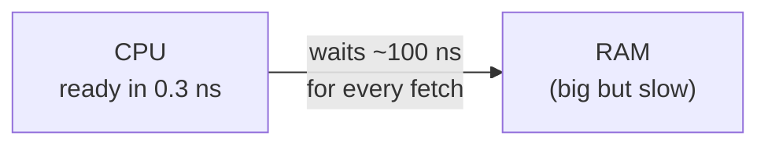
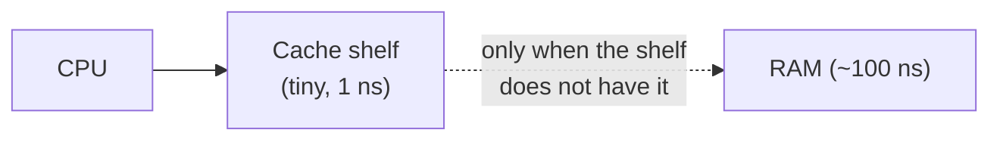
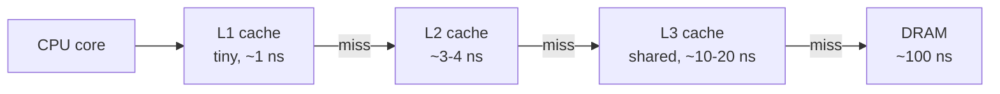
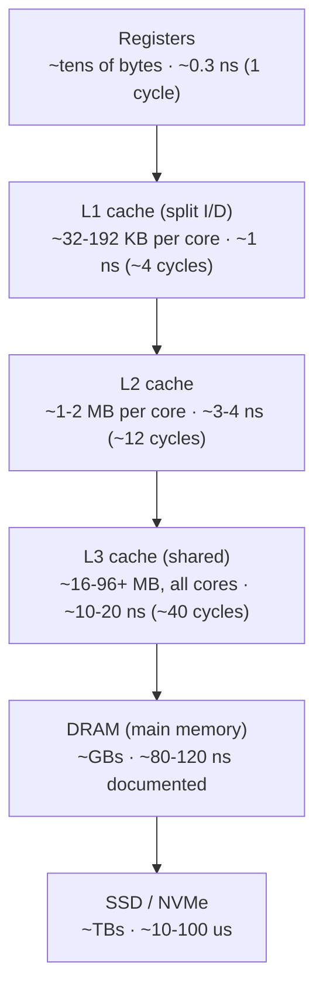
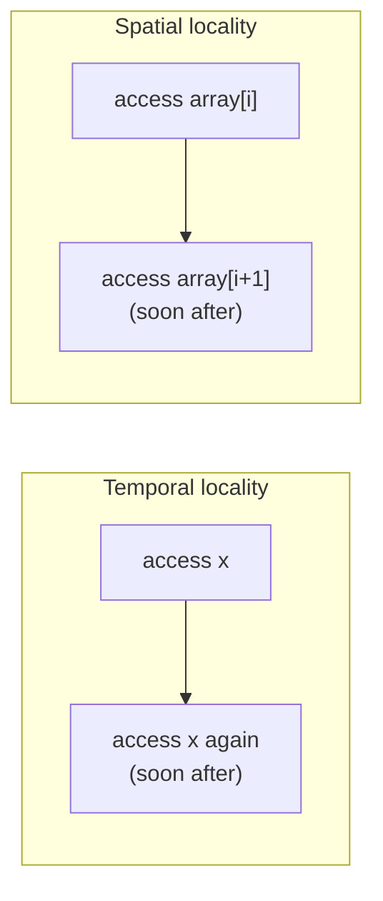
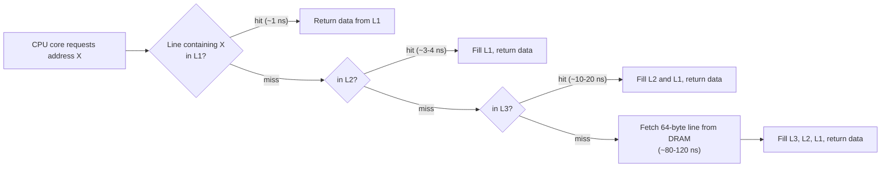
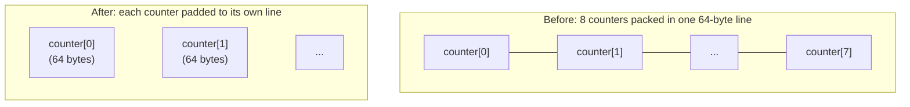

# Memory Hierarchy and CPU Caches

> [!summary] TL;DR
> A CPU core can execute an instruction roughly every third of a nanosecond, but a round trip to main memory (**DRAM**) takes on the order of 100 nanoseconds — about 300 times slower. The **memory hierarchy** closes that gap with a pyramid of progressively bigger, slower, cheaper storage (registers → L1 → L2 → L3 cache → DRAM → disk), and **caches** work because real programs reuse the same data and the same nearby addresses over and over.

> [!abstract] Core idea
> - Every level of the hierarchy trades capacity for speed: small and fast near the CPU, large and slow further away.
> - A cache holds data in fixed-size **cache lines** (64 bytes on most modern CPUs), not individual bytes, because programs tend to touch nearby addresses soon after ("spatial locality") and the same addresses again soon after ("temporal locality").
> - On a multi-core CPU, caches must stay consistent with each other. The **MESI** protocol makes every core agree on who owns a cache line before writing it — and two cores writing to *different* variables that happen to share one cache line pay for that agreement anyway. That's **false sharing**.
> - This note is about CPU/hardware caches only. The OS page cache and file-system caches are a different mechanism, covered in [[Page Cache, File Systems and fsync]]; the TLB (a cache for address translation) is covered in [[Virtual Memory, Paging and the TLB]]; application-level caches (Redis, in-process caches) are covered in `08 Caching & Redis`.

## Start here: the basics 🟢

> [!info] How to read this note (pick your level)
> - 🟢 **New to this?** Read "From zero" below, then sections 1, 2 and the cheat sheet (10). Stop there, that is a full first pass.
> - 🟡 **Know the basics?** Add section 3 (how it works) and 4 (the false-sharing worked example), plus 5 and 6.
> - 🔴 **Interview / SDE-3 prep?** Add 7, 8 and 9. Headings are tagged 🟢🟡🔴 so you always know where you are.

**From zero, in 60 seconds** 🟢

Your computer's brain (the **CPU**) is incredibly fast. But the data it works on lives in big, slow memory chips (the **RAM**). Fetching from RAM takes hundreds of times longer than doing the actual math.

So the CPU keeps tiny, super-fast shelves of recently used data right next to it. Those shelves are called **caches**. Most of the time, what you need is already on a shelf, so there is no long wait.

That is the whole trick. The rest of this note is just four questions:
1. How many shelves are there, and how fast is each one? (sections 1-3)
2. Why does keeping recent stuff work so well? (locality, section 3)
3. What happens when several CPU cores share data? (MESI and false sharing, sections 3-4)
4. What should you do about it in real Go code? (sections 6-8)

**The problem in one story.**
You are cooking and the recipe needs salt.
If the salt is on the counter, you grab it in a second.
If it is in a shop across town, dinner waits an hour.
A CPU has the same problem: it is very fast, but the data it needs is often far away in main memory.
Caches are the "counter": small shelves of recently used data kept right next to the CPU.

**Words you need first**

| Word | Plain meaning | Tiny example |
| --- | --- | --- |
| CPU core | One worker inside the processor that runs instructions | An 8-core laptop runs 8 instruction streams at once |
| Clock cycle | One tick of the CPU's clock; the smallest step of work | At 3 GHz, one cycle is ~0.33 ns |
| Nanosecond (ns) | One billionth of a second | A DRAM read takes ~100 ns |
| Register | A tiny storage slot inside the core itself | The CPU adds two numbers held in registers |
| DRAM / main memory | The big RAM chips, far slower than the core | 16 GB of RAM in a laptop |
| Cache | A small, fast copy of recently used memory | L1 cache holding the array you are looping over |
| Cache line | The fixed-size block a cache moves around (64 bytes) | Reading `a[0]` also brings in `a[1]..a[7]` for `int64`s |
| Hit / miss | Hit: the data was in the cache. Miss: it had to be fetched from further away | Second read of a variable is usually a hit |

**Picture it**

**Analogy.** Kitchen counter (L1), cupboard (L2), pantry (L3), shop across town (DRAM). You keep what you just used close, and you buy a whole packet, not one grain (a cache line).
Where it breaks: in a kitchen you choose what to keep close; the hardware decides automatically, and several cooks (cores) must agree on who changed the shared packet last (coherence).

**How the rest of this note builds up**

- First, why the hierarchy exists (section 1) and the desk-to-warehouse mental model (section 2).
- Then how it works: the pyramid, locality, cache lines, hits and misses, write policies (section 3).
- Then multi-core caches: MESI coherence and the false-sharing worked example with Go numbers (sections 3-4).
- Finally the SDE-3 view: trade-offs, production failure modes, prefetching, NUMA and associativity (sections 5-8).

> [!tip] Remember
> Keep hot data small, close and contiguous: the CPU is only as fast as the memory level its data lives in.

## 1. Why it exists 🟢

Imagine two co-workers: one sits at a desk with everything they need in arm's reach, the other has to walk to a warehouse across town for every single document. That is, roughly, the gap between a CPU register and main memory (**DRAM**).

A 2025-era server core runs at 3–4 GHz, so one clock cycle is about 0.25–0.33 ns. A single DRAM access takes on the order of 100 ns.

If every memory-touching instruction had to wait for DRAM, a core would spend over 99% of its time idle, no matter how fast its arithmetic units were.

> [!warning] Common mistake
> Assuming "the CPU is fast, so my program is fast." A CPU's raw instruction speed only matters if the data it operates on is already close by. A program that constantly waits on DRAM runs at DRAM's speed, not the CPU's clock speed — this is why data layout can matter as much as algorithm choice.

### Why it matters: a concrete number

A function that walks a 10-million-element linked list, where each node is a separate heap allocation scattered across memory, pays close to a full DRAM-latency cache miss per node (~100 ns each). That totals about **1 second** just in memory stalls — before any actual computation.

The same 10 million `int64` values packed into one contiguous slice stream through the cache hierarchy instead, at closer to a few nanoseconds per element, thanks to spatial locality and hardware prefetching (both explained below) — at least an order of magnitude faster for identical work.

The exact ratio depends on the machine, so treat this as an illustration of the shape of the effect, not a benchmark result.

> [!tip] Remember
> The memory hierarchy exists because DRAM is roughly 300× slower than a CPU cycle, and real programs touch the same data and nearby addresses repeatedly — that repetition is what a cache exploits.

## 2. Mental model 🟢

Picture a programmer's workspace:

- A desk (registers: a few items, instant access).
- A drawer at arm's reach (L1 cache: tens of kilobytes, barely slower than the desk).
- A filing cabinet across the room (L2 cache: roughly a megabyte, a short walk).
- A shared records room down the hall that the whole floor uses (L3 cache: tens of megabytes, shared across cores, a longer walk).
- An archive warehouse across town (DRAM: gigabytes, a real trip).

You never fetch "one byte" from the warehouse — you fetch a whole box (a 64-byte **cache line**) because if you need byte 100 of a file, you'll probably need byte 101 next.

The analogy breaks down in one place: unlike a human archive, the hardware automatically decides what to keep nearby based on what you recently touched, without being asked.

## 3. How it works 🟡

### The pyramid

In plain words: each level of memory is about an order of magnitude bigger and an order of magnitude slower than the level above it.

That ratio is deliberate — a cache only has to be a small fraction of the size of the level below it to absorb most of the traffic, because of locality (next section).

Sizes and latencies above are documented, approximate figures for a 2025-era server core (Intel/AMD x86-64 and Apple silicon all follow the same shape; exact numbers vary by SKU and are set by each vendor's optimization manual, listed in `sources`).

**Example with numbers.** Summing 10 million `int64` values:

- At ~1 ns per element if the data streams through L1/L2 (contiguous slice), the loop costs about 10 ms.
- At ~100 ns per element if every access misses to DRAM (scattered linked list), the same loop costs about 1 second — a 100× difference from data layout alone, with the algorithm unchanged.

> [!tip] Remember
> Each hierarchy level is roughly 10× bigger and 10× slower than the one above — that ratio, combined with locality, is what makes a small cache able to absorb most of a program's memory traffic.

### Why caching works: locality

In plain words: programs are not random. They tend to reuse things they just used, and they tend to reach for things sitting right next to what they just used.

- **Temporal locality**: if an address was accessed recently, it's likely to be accessed again soon (a loop counter, a hot function's local variables).
- **Spatial locality**: if an address was accessed, nearby addresses are likely to be accessed soon after (the next element of an array, the next field of a struct).

**Example.** A `for` loop that re-reads the same loop-counter variable a million times is temporal locality in action: after the first read, every later read is an L1 hit.

A loop that walks `array[0], array[1], array[2], ...` is spatial locality: fetching `array[0]`'s 64-byte cache line also pulls in `array[1]` through `array[7]` (for 8-byte elements) for free.

> [!tip] Remember
> Caches exploit both forms of locality: temporal locality by keeping recently used lines around instead of evicting them immediately, spatial locality by fetching a whole 64-byte line around the requested address instead of one byte.

### Cache lines, hits, misses, associativity

In plain words: when the CPU wants an address, it checks the fastest cache first and works its way down only on a miss, refilling each level it skips on the way back up.

A cache is organized as a grid of **sets**, and each set holds a small fixed number of lines (its **associativity** — e.g. "8-way set-associative" means each set holds 8 lines).

An address maps to exactly one set (by its middle bits) but can occupy any of that set's 8 ways.

On a miss that needs room, the cache picks a victim line to evict using a policy approximating least-recently-used.

**Example.** An L1 miss that hits in L3 costs roughly 10–20 ns instead of 1 ns — a 10–20× slowdown for that one access, still 5–10× faster than going all the way to DRAM's 80–120 ns.

- **Write-through**: a write updates the cache and immediately writes through to the next level too — simple, but every write costs a trip down the hierarchy.
- **Write-back**: a write only updates the cache and marks the line **dirty**; it's written down to the next level only when evicted. Faster for repeated writes to the same line, but a sudden power loss (not an ordinary process crash, which leaves the hardware cache untouched) can lose dirty data that never made it past that cache — one reason durability-critical writes use explicit flushes rather than trusting the write-back path alone (see [[Page Cache, File Systems and fsync]]).

> [!tip] Remember
> A miss at one level refills every level above it on the way back, so a later access to the same address is fast again — the hierarchy "remembers" what it just fetched.

### Cache coherence: MESI

In plain words: on a multi-core CPU, each core has its own private L1/L2, so the same 64-byte line of DRAM can be cached in several places at once.

If core A and core B both cache the same line and one writes to it, the other must not keep reading its now-stale copy.

**MESI** names four states a cache line can be in, per core, that make this safe.

```mermaid
stateDiagram-v2
    [*] --> Invalid
    Invalid --> Exclusive: this core reads the line,\nno other core has it cached
    Invalid --> Shared: this core reads the line,\nanother core already has it (read-only)
    Exclusive --> Modified: this core writes\n(no broadcast needed, it was the sole owner)
    Shared --> Modified: this core writes;\nbroadcasts invalidate to all other sharers
    Modified --> Shared: another core reads;\nthis core supplies the data and both end up Shared
    Shared --> Invalid: another core writes\n(invalidate received)
    Modified --> Invalid: another core writes\n(this core's dirty data is flushed first)
```

- **Modified**: this core has the only copy, and it's dirty (different from DRAM).
- **Exclusive**: this core has the only copy, and it matches DRAM.
- **Shared**: multiple cores have read-only copies, all matching DRAM.
- **Invalid**: this core's copy, if any, cannot be used.

**Example.**

1. Core A reads counter `x` (goes Exclusive on A).
2. Core B then also reads `x` (both go Shared).
3. Core A now writes `x` — this forces an invalidate broadcast to B before the write proceeds (Shared → Modified on A, Shared → Invalid on B).

That broadcast is not free: it crosses the inter-core interconnect, and it happens on *every* such write, even if A and B were never logically sharing data — only a cache line.

> [!warning] Common mistake
> Assuming cache coherence is "the hardware's problem, it's always free." MESI keeps caches *correct*, but the invalidate broadcast on a Shared→Modified transition has a real, measurable cost. When that transition happens far more often than the program logically needs, it is called false sharing (next).

> [!tip] Remember
> MESI's whole job is to stop any core from reading a stale copy after another core writes — it does this by requiring ownership (Modified/Exclusive) before a write, or a broadcast invalidate if the line was Shared.

## 4. Worked example 🟡

### Whiteboard version

Two goroutines each increment their own private `int64` counter, millions of times, with no shared state in the source code.

If both counters happen to sit in the same 64-byte cache line, every increment by goroutine A invalidates goroutine B's cached copy of that line (per the MESI diagram above) and vice versa — even though neither goroutine ever reads or writes the other's counter.

This is **false sharing**: two independent variables contending only because of where they happen to sit in memory.

Separating the counters onto different cache lines removes the invalidation traffic entirely.

**Step by step, what happens with the packed layout:**
1. Goroutine A increments `counters[0]`. Its core takes the line Exclusive, then Modified.
2. Goroutine B, running on a different core, increments `counters[1]` — the *same* 64-byte line. B's core must invalidate A's copy first (Shared → Modified broadcast), even though A and B never touch each other's counter.
3. A increments again. Now A must invalidate B's copy. The line ping-pongs between cores on every single increment from either side.
4. With padding, each counter owns a whole line, so step 2 and 3 never need to invalidate anyone else's copy — each core keeps its own line Modified indefinitely.

A runnable version of this experiment, with tests and a measured benchmark, is kept in the companion Go note: **[[Memory Hierarchy and CPU Caches - Go]]**.

**Measured** (Go 1.24.4, darwin/arm64, Apple M4, 8 goroutines × 200,000 increments each, `-count=5 -cpu 8`, 2026-11-06):

| Layout | Mean time per iteration (5 runs) | Relative |
|---|---|---|
| Unpadded (false sharing) | ~448 us | 1.00x |
| Padded (one cache line each) | ~411 us | **0.92x** (about 9% faster) |

The effect is real but modest on this machine, and noisy at this sample size — repeated runs produced gaps ranging from roughly 5% to over 25% faster.

Treat "padded was reproducibly faster, by a double-digit-percent amount that itself varies" as the honest takeaway, not "padded is exactly 9% faster."

The same experiment on a multi-socket x86-64 server, where invalidations cross a slower inter-socket interconnect, documents a much larger and more consistent gap — always re-measure on the target machine with enough samples to see the variance.

> [!tip] Remember
> False sharing is a performance bug, not a correctness bug: both layouts compute the right answer, but the packed one pays invisible coherence traffic for data that was never logically shared.

## 5. Variants and comparison 🟡

| Mechanism | What it caches | Granularity | Who manages it |
|---|---|---|---|
| L1/L2/L3 CPU cache (this note) | Recently used DRAM lines | 64-byte lines | Hardware, automatic |
| TLB | Virtual→physical address translations | One page table entry | Hardware (MMU), filled on a page-table walk — see [[Virtual Memory, Paging and the TLB]] |
| OS page cache | File data read from disk | 4 KB pages | Kernel — see [[Page Cache, File Systems and fsync]] |
| Application cache (Redis, in-process) | Query results, computed values | Arbitrary keys | Application code — see `08 Caching & Redis` |

## 6. Trade-offs and when not to use 🟡

- Bigger caches are slower per access (more sets/ways to search), which is exactly why the hierarchy has several small, fast levels instead of one big one.
- Padding data to avoid false sharing wastes memory (7 unused `int64`s per counter in the worked example) — only worth it for genuinely hot, independently-written counters; padding every struct "just in case" bloats memory and can itself hurt cache utilization by spreading related data across more lines.
- Chasing cache-friendliness can fight readability (e.g. manually flattening a tree into an array). For code that isn't on a hot path, clarity wins; profile before restructuring data layout.

## 7. In production 🔴

- **Real systems:** Go's own `runtime` pads per-P scheduler structures and some `sync` internals to avoid false sharing; high-throughput systems (databases, message brokers) commonly pad hot counters and shard per-CPU accumulators (`sync/atomic` counters per shard, summed on read) specifically to avoid cache-line contention under concurrency.
- **Failure modes → fixes:**
  - Mysterious scaling cliffs under concurrency (throughput flattens or drops as goroutines increase, with CPU usage still high) → suspect false sharing on a shared counter or lock variable; pad or shard it.
  - A workload that should be CPU-bound runs far below expected IPC (instructions per cycle) → suspect cache misses from poor data layout (e.g. array-of-structs accessed column-wise); consider struct-of-arrays.
  - Pointer-chasing data structures (linked lists, trees of individually-allocated nodes) are far slower than their Big-O suggests on real hardware → this is why Go slices usually beat linked lists in practice even for workloads where a list's O(1) insert looks better on paper: contiguous memory keeps the prefetcher and spatial locality working.
- **What to monitor:** IPC and cache-miss rate (`perf stat -e cache-misses,cache-references,instructions,cycles ./binary` on Linux), L3 miss rate specifically (a proxy for "how often do we hit DRAM"), and, for Go specifically, `go test -bench` with `-cpu` swept across core counts to catch contention that only appears at concurrency.

## 8. Deep dive 🔴

- **Cache lines and false sharing, precisely.** A cache line is the hardware's unit of coherence, not just of transfer: MESI tracks state per *line*, not per *variable*. Two `int64` variables 8 bytes apart that fall in the same 64-byte line are, as far as the coherence protocol is concerned, one unit — a write to either one invalidates the whole line everywhere else it's cached, per the Modified/Shared/Exclusive/Invalid transitions above.
- **Hardware prefetching.** Modern cores detect simple access patterns (e.g. "address N, then N+64, then N+128…") and speculatively fetch the next expected line before it's requested, which is a large part of why sequential array access is faster than its raw cache-miss count alone would predict, and why spatial locality matters even within a single core's own traffic.
- **NUMA.** On multi-socket servers, DRAM is physically attached to one socket and is slower to reach from a core on a different socket ("remote" access) than from a core on the same socket ("local" access) — often 1.5–2x the latency, documented in vendor NUMA whitepapers. The OS scheduler and memory allocator try to keep a process's threads and memory on the same NUMA node; `numactl` on Linux lets an operator pin both explicitly.
- **Associativity and thrashing.** A direct-mapped cache (1-way) can thrash badly if a program happens to access two hot addresses that map to the same set, even if the cache overall has plenty of free space; higher associativity (8-way, 12-way, common for modern L2/L3) makes that collision far less likely at the cost of more comparison hardware per lookup.
- **Measuring instead of guessing.** `perf stat` on Linux and `go test -bench` with multiple `-cpu` values are the two tools that turn "this feels slow" into a number; always benchmark on hardware close to production, with enough repetitions to see the run-to-run spread, before and after a cache-layout change — effects like false sharing are both hardware-dependent and noisy at small sample counts.

## 9. Interview questions 🔴

> [!question]- Why does the memory hierarchy have multiple cache levels instead of one big cache?
> Access latency grows with cache size (more sets and ways to search, physically farther from the core), so one big cache would be as slow as a small L3 for every access. Several small, fast levels let the common case (data already in L1) stay fast while still backstopping misses with progressively larger, slower caches instead of going straight to DRAM.

> [!question]- What is a cache line, and why 64 bytes?
> The fixed-size unit a cache stores, fetches and tracks coherence for — 64 bytes on most modern x86-64 and ARM64 CPUs. It exists because of spatial locality: fetching a line's worth of nearby bytes around a requested address, instead of one byte, usually saves a second trip to memory for the next few accesses, at a fixed bus and bookkeeping cost per fetch.

> [!question]- What is false sharing, and how do you fix it?
> Two independent variables that happen to sit in the same cache line. Writes to either one invalidate the whole line in every other core's cache under MESI, so concurrent writers to "different" data contend as if they shared it. Fix by padding each hot variable out to its own cache line, or restructuring so each goroutine/thread owns data that naturally lands on separate lines (e.g. per-CPU shards).

> [!question]- Trap: does a bigger L1 cache always make a CPU faster?
> No. L1 is deliberately kept small specifically to keep its latency near 1 cycle; a larger L1 would take more cycles to search (more sets, longer wire delays) and could easily make the *common* case slower even while reducing the miss rate, which is why vendors add capacity at L2/L3 instead of growing L1 indefinitely.

> [!question]- What does MESI actually prevent?
> Two cores silently reading stale data after one of them writes. Before any core writes a line, MESI either confirms it's the sole owner (Exclusive → Modified, no broadcast needed) or broadcasts an invalidate to every other sharer first (Shared → Modified) — so no core can be left believing a Shared copy is still valid after another core has modified it.

> [!question]- Why do contiguous slices usually beat linked lists in Go, even when Big-O favors the list?
> A slice's elements are adjacent in memory, so sequential access is almost all cache hits plus hardware prefetching; a linked list's nodes are typically separate heap allocations scattered across memory, so walking it pays close to a full DRAM-latency miss per node. The asymptotic advantage of O(1) list insertion rarely offsets a constant factor that large on real hardware for typical sizes.

> [!question]- How would you detect false sharing was happening in a production Go service?
> Look for throughput that stops scaling (or regresses) as concurrency increases while CPU usage stays high, profile with `perf stat -e cache-misses,cache-references` (Linux) or vendor equivalents to confirm an unusually high miss rate on specific cache lines, and benchmark the suspected hot variable with `go test -bench -cpu 1,2,4,8,...` — a result that gets relatively worse per core as `-cpu` rises, for code with no real contention on the data itself, points at false sharing.

## 10. Cheat sheet 🟢

- Hierarchy: registers (~0.3 ns) → L1 (~1 ns) → L2 (~3–4 ns) → L3 shared (~10–20 ns) → DRAM (~80–120 ns, documented) → SSD (~10–100 µs).
- Caches work because of locality: temporal (reuse soon) and spatial (nearby addresses soon).
- A cache line is 64 bytes on most modern CPUs — the hardware's unit of fetch and of coherence.
- Write-back caches mark dirty lines and flush on eviction; write-through writes down the hierarchy immediately.
- MESI = Modified / Exclusive / Shared / Invalid; a write to a Shared line broadcasts an invalidate to every other sharer.
- False sharing: independent hot variables on one cache line contend as if shared — pad or shard to fix it, measured here at roughly 5–25% faster across repeated runs on Apple M4 (noisy at small sample sizes), larger and more consistent on multi-socket x86-64.
- Prefer contiguous data (slices) over pointer-chasing structures (linked lists, scattered trees) for hot paths.
- Measure with `perf stat` or `go test -bench -cpu ...` before restructuring for cache behavior — effects are hardware-dependent.
- Runnable Go version: [[Memory Hierarchy and CPU Caches - Go]].

## Links

- **Before this:** [[How a Computer Runs a Program]]
- **Next:** [[RAM Technologies - SRAM, DRAM, DDR, GDDR, HBM]], [[Virtual Memory, Paging and the TLB]]
- **Compare with:** [[Page Cache, File Systems and fsync]] (OS-level file caching, a different mechanism), [[Concurrency Primitives - Mutex, Semaphore, Atomics]] (software coordination built on top of the hardware coherence this note describes)
- **Go code:** [[Memory Hierarchy and CPU Caches - Go]]

### Watch on YouTube

- [L1, L2, L3 Cache: CPU Cache Hierarchy Finally Explained! (Bonus: TLBs, MMU, Page Tables)](https://www.youtube.com/watch?v=tSAcFKW9lM8) · Tech Fairy · covers the cache hierarchy end to end, plus related TLB/paging context
- [Every CPU Cache Level Explained in Detail](https://www.youtube.com/watch?v=-YL9s9nBeN0) · Tech in a Teacup · deeper dive on why each cache level exists and how it's built
