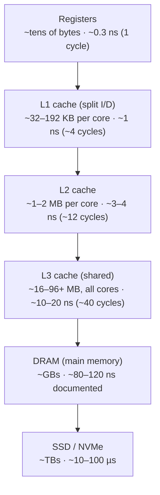
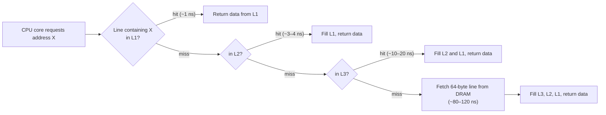

# Memory Hierarchy and CPU Caches

> [!summary] TL;DR
> A CPU core can execute an instruction roughly every third of a nanosecond, but a round trip to main memory (**DRAM**) takes on the order of 100 nanoseconds — about 300 times slower. The **memory hierarchy** closes that gap with a pyramid of progressively bigger, slower, cheaper storage (registers → L1 → L2 → L3 cache → DRAM → disk), and **caches** work because real programs reuse the same data and the same nearby addresses over and over.

> [!abstract] Core idea
> - Every level of the hierarchy trades capacity for speed: small and fast near the CPU, large and slow further away.
> - A cache holds data in fixed-size **cache lines** (64 bytes on most modern CPUs), not individual bytes, because programs tend to touch nearby addresses soon after ("spatial locality") and the same addresses again soon after ("temporal locality").
> - On a multi-core CPU, caches must stay consistent with each other. The **MESI** protocol makes every core agree on who owns a cache line before writing it — and two cores writing to *different* variables that happen to share one cache line pay for that agreement anyway. That's **false sharing**.
> - This note is about CPU/hardware caches only. The OS page cache and file-system caches are a different mechanism, covered in [[Page Cache, File Systems and fsync]]; the TLB (a cache for address translation) is covered in [[Virtual Memory, Paging and the TLB]]; application-level caches (Redis, in-process caches) are covered in `08 Caching & Redis`.

## 1. Why it exists

A 2025-era server CPU core runs at roughly 3–4 GHz, so one clock cycle is about 0.25–0.33 ns. A single main-memory (DRAM) access takes on the order of 100 ns (documented, varies by platform — see the comparison table below). If every instruction that touched memory had to wait for DRAM, a core doing nothing but memory accesses would run at under 1% of its clock speed, no matter how fast its arithmetic units are.

Concretely: a function that walks a 10-million-element linked list, where each node is a separate heap allocation scattered across memory, pays close to a full DRAM-latency cache miss per node (~100 ns documented each, see the comparison table), which is about **1 second** total just in memory stalls, no computation included. The same 10 million `int64` values packed into one contiguous slice stream through the cache hierarchy instead, at closer to a few nanoseconds per element thanks to spatial locality and hardware prefetching (see below) — at least an order of magnitude faster, and plausibly more, for identical "add up 10 million numbers" work; the exact ratio depends on the machine, so treat this as an illustration of the shape of the effect, not a benchmark result. The memory hierarchy, and knowing how to use it, is the difference.

## 2. Mental model

Picture a programmer's desk (registers: a few items, instant access), a drawer at arm's reach (L1 cache: tens of kilobytes, barely slower than the desk), a filing cabinet across the room (L2 cache: roughly a megabyte, a short walk), a shared records room down the hall that the whole floor uses (L3 cache: tens of megabytes, shared across cores, a longer walk), and an archive warehouse across town (DRAM: gigabytes, a real trip). You never fetch "one byte" from the warehouse — you fetch a whole box (a 64-byte cache line) because if you need byte 100 of a file, you'll probably need byte 101 next.

## 3. How it works

### The pyramid



Sizes and latencies are documented, approximate figures for a 2025-era server core (Intel/AMD x86-64 and Apple silicon all follow the same shape; exact numbers vary by SKU and are set by each vendor's optimization manual, listed in `sources`). Each level is roughly an order of magnitude bigger and an order of magnitude slower than the one above it — that ratio is what makes the hierarchy work: a cache only has to be a small fraction of the size of the level below it to absorb most of the traffic, because of locality (next).

### Why caching works: locality

- **Temporal locality**: if an address was accessed recently, it's likely to be accessed again soon (a loop counter, a hot function's local variables).
- **Spatial locality**: if an address was accessed, nearby addresses are likely to be accessed soon after (the next element of an array, the next field of a struct).

Caches exploit both: temporal locality by keeping recently used lines around instead of evicting them immediately, spatial locality by fetching a whole 64-byte line around the requested address instead of one byte.

### Cache lines, hits, misses, associativity



A cache is organized as a grid of **sets**, and each set holds a small fixed number of lines (its **associativity** — e.g. "8-way set-associative" means each set holds 8 lines). An address maps to exactly one set (by its middle bits) but can occupy any of that set's 8 ways. On a miss that needs room, the cache picks a victim line to evict using a policy approximating least-recently-used.

- **Write-through**: a write updates the cache and immediately writes through to the next level too — simple, but every write costs a trip down the hierarchy.
- **Write-back**: a write only updates the cache and marks the line **dirty**; it's written down to the next level only when evicted. Faster for repeated writes to the same line, but a sudden power loss (not an ordinary process crash, which leaves the hardware cache untouched) can lose dirty data that never made it past that cache — one reason durability-critical writes use explicit flushes rather than trusting the write-back path alone (see [[Page Cache, File Systems and fsync]]).

### Cache coherence: MESI

On a multi-core CPU, each core has its own private L1/L2, so the same line of DRAM can be cached in several places at once. If core A and core B both cache the same line and one writes to it, the other must not keep reading its stale copy. **MESI** names four states a cache line can be in, per core:



```mermaid
stateDiagram-v2
    [*] --> Invalid
    Invalid --> Exclusive: this core reads the line,\nno other core has it cached
    Invalid --> Shared: this core reads the line,\nanother core already has it (read-only)
    Exclusive --> Modified: this core writes\n(no broadcast needed, it was the sole owner)
    Shared --> Modified: this core writes;\nbroadcasts invalidate to all other sharers
    Modified --> Shared: another core reads;\nthis core supplies the data and both end up Shared
    Shared --> Invalid: another core writes\n(invalidate received)
    Modified --> Invalid: another core writes\n(this core's dirty data is flushed first)
```

- **Modified**: this core has the only copy, and it's dirty (different from DRAM).
- **Exclusive**: this core has the only copy, and it matches DRAM.
- **Shared**: multiple cores have read-only copies, all matching DRAM.
- **Invalid**: this core's copy, if any, cannot be used.

A write to a **Shared** line forces the writing core to broadcast an invalidate to every other core sharing it (over the inter-core interconnect) before the write can proceed — this is the mechanism, and the cost, behind false sharing (next).

## 4. Worked example

### Whiteboard version

Two goroutines each increment their own private `int64` counter, millions of times, with no shared state in the source code. If both counters happen to sit in the same 64-byte cache line, every increment by goroutine A invalidates goroutine B's cached copy of that line (per the MESI diagram above) and vice versa — even though neither goroutine ever reads or writes the other's counter. Separating the counters onto different cache lines removes the invalidation traffic entirely.

### False sharing, measured in Go

`Counters` packs 8 `int64` counters into one slice — adjacent elements share 64-byte cache lines. `PaddedCounters` pads each counter out to a full cache line so no two counters can ever share one:

```go
// Counters is the false-sharing layout: N plain int64 counters packed into
// one slice. counters[0] and counters[1] are 8 bytes apart, so on a 64-byte
// cache line they (and six more) share one line.
type Counters struct {
	n []int64
}

func NewCounters(n int) *Counters { return &Counters{n: make([]int64, n)} }

func (c *Counters) Incr(i int, times int) {
	for k := 0; k < times; k++ {
		c.n[i]++
	}
}

func (c *Counters) Get(i int) int64 { return c.n[i] }

// paddedCounter is one int64 padded out to 64 bytes (one typical x86-64 and
// Apple-silicon cache line), so each counter owns a whole line and no two
// goroutines' counters ever share one.
type paddedCounter struct {
	v int64
	_ [7]int64 // padding: 8 + 7*8 = 64 bytes
}

// PaddedCounters is the false-sharing fix: each counter lives alone on its
// own cache line.
type PaddedCounters struct {
	c []paddedCounter
}

func NewPaddedCounters(n int) *PaddedCounters {
	return &PaddedCounters{c: make([]paddedCounter, n)}
}

func (p *PaddedCounters) Incr(i int, times int) {
	for k := 0; k < times; k++ {
		p.c[i].v++
	}
}

func (p *PaddedCounters) Get(i int) int64 { return p.c[i].v }
```

The test proves both layouts are equally *correct* — false sharing is a performance bug, not a correctness bug — before the benchmark measures the performance difference:

```go
func TestCountersAreCorrect(t *testing.T) {
	t.Run("unpadded", func(t *testing.T) {
		c := NewCounters(goroutines)
		var wg sync.WaitGroup
		for i := 0; i < goroutines; i++ {
			wg.Add(1)
			go func(i int) {
				defer wg.Done()
				c.Incr(i, iters)
			}(i)
		}
		wg.Wait()
		for i := 0; i < goroutines; i++ {
			if got := c.Get(i); got != iters {
				t.Fatalf("counter %d = %d, want %d", i, got, iters)
			}
		}
	})
	// padded case is symmetric — see the note's scratch module for the full file
}
```

```text
$ go vet ./falsesharing/...
$ go test -race ./falsesharing/...
ok  	cs1scratch/falsesharing	1.934s
```

**Measured:** `go test -bench . -benchtime=50x -count=5 -cpu 8 ./falsesharing/` on Go 1.24.4, darwin/arm64, Apple M4, 8 goroutines each doing 200,000 increments per benchmark iteration (2026-11-06):

| Layout | Mean time per iteration (5 runs) | Relative |
|---|---|---|
| Unpadded (false sharing) | ~448 µs | 1.00× |
| Padded (one cache line each) | ~411 µs | **0.92×** (≈9% faster) |

The effect is real but modest here because Apple's performance cores share a large per-cluster L2 with fast core-to-core transfers. It is also noisy at this sample size: re-running the identical command several times on the same machine (same code, same `-count=5 -cpu 8`) produced padded-vs-unpadded gaps ranging from roughly 5% to over 25% faster run to run, with the first iteration in each run consistently the slowest (goroutine and scheduler warm-up, not the effect itself). Treat the ~9% figure as one representative sample, not a precise constant — the honest statement is "padded was reproducibly faster in every run, by a double-digit-percent amount that itself varies," not "padded is exactly 9% faster." The audit's guidance to also check "documented" numbers matters precisely because both the ratio and its stability are hardware-dependent — the same experiment on a multi-socket x86-64 server, where invalidations cross a slower inter-socket interconnect, documents a much larger and more consistent gap (do not assume the ratio above transfers to other hardware, or that it is this precise; always re-measure on the target machine with enough samples to see the variance).

## 5. Variants and comparison

| Mechanism | What it caches | Granularity | Who manages it |
|---|---|---|---|
| L1/L2/L3 CPU cache (this note) | Recently used DRAM lines | 64-byte lines | Hardware, automatic |
| TLB | Virtual→physical address translations | One page table entry | Hardware (MMU), filled on a page-table walk — see [[Virtual Memory, Paging and the TLB]] |
| OS page cache | File data read from disk | 4 KB pages | Kernel — see [[Page Cache, File Systems and fsync]] |
| Application cache (Redis, in-process) | Query results, computed values | Arbitrary keys | Application code — see `08 Caching & Redis` |

## 6. Trade-offs and when not to use

- Bigger caches are slower per access (more sets/ways to search), which is exactly why the hierarchy has several small, fast levels instead of one big one.
- Padding data to avoid false sharing wastes memory (7 unused `int64`s per counter above) — only worth it for genuinely hot, independently-written counters; padding every struct "just in case" bloats memory and can itself hurt cache utilization by spreading related data across more lines.
- Chasing cache-friendliness can fight readability (e.g. manually flattening a tree into an array). For code that isn't on a hot path, clarity wins; profile before restructuring data layout.

## 7. In production

- **Real systems:** Go's own `runtime` pads per-P scheduler structures and some `sync` internals to avoid false sharing; high-throughput systems (databases, message brokers) commonly pad hot counters and shard per-CPU accumulators (`sync/atomic` counters per shard, summed on read) specifically to avoid cache-line contention under concurrency.
- **Failure modes → fixes:**
  - Mysterious scaling cliffs under concurrency (throughput flattens or drops as goroutines increase, with CPU usage still high) → suspect false sharing on a shared counter or lock variable; pad or shard it.
  - A workload that should be CPU-bound runs far below expected IPC (instructions per cycle) → suspect cache misses from poor data layout (e.g. array-of-structs accessed column-wise); consider struct-of-arrays.
  - Pointer-chasing data structures (linked lists, trees of individually-allocated nodes) are far slower than their Big-O suggests on real hardware → this is why Go slices usually beat linked lists in practice even for workloads where a list's O(1) insert looks better on paper: contiguous memory keeps the prefetcher and spatial locality working.
- **What to monitor:** IPC and cache-miss rate (`perf stat -e cache-misses,cache-references,instructions,cycles ./binary` on Linux), L3 miss rate specifically (a proxy for "how often do we hit DRAM"), and, for Go specifically, `go test -bench` with `-cpu` swept across core counts to catch contention that only appears at concurrency.

## 8. Deep dive

- **Cache lines and false sharing, precisely.** A cache line is the hardware's unit of coherence, not just of transfer: MESI tracks state per *line*, not per *variable*. Two `int64` variables 8 bytes apart that fall in the same 64-byte line are, as far as the coherence protocol is concerned, one unit — a write to either one invalidates the whole line everywhere else it's cached, per the Modified/Shared/Exclusive/Invalid transitions above.
- **Hardware prefetching.** Modern cores detect simple access patterns (e.g. "address N, then N+64, then N+128…") and speculatively fetch the next expected line before it's requested, which is a large part of why sequential array access is faster than its raw cache-miss count alone would predict, and why spatial locality matters even within a single core's own traffic.
- **NUMA.** On multi-socket servers, DRAM is physically attached to one socket and is slower to reach from a core on a different socket ("remote" access) than from a core on the same socket ("local" access) — often 1.5–2× the latency, documented in vendor NUMA whitepapers. The OS scheduler and memory allocator try to keep a process's threads and memory on the same NUMA node; `numactl` on Linux lets an operator pin both explicitly.
- **Associativity and thrashing.** A direct-mapped cache (1-way) can thrash badly if a program happens to access two hot addresses that map to the same set, even if the cache overall has plenty of free space; higher associativity (8-way, 12-way, common for modern L2/L3) makes that collision far less likely at the cost of more comparison hardware per lookup.
- **Measuring instead of guessing.** `perf stat` on Linux and `go test -bench` with multiple `-cpu` values are the two tools that turn "this feels slow" into a number; always benchmark on hardware close to production, with enough repetitions to see the run-to-run spread, before and after a cache-layout change — as the measured table above shows, the size of an effect like false sharing is both hardware-dependent and noisy at small sample counts.

## 9. Interview questions

> [!question]- Why does the memory hierarchy have multiple cache levels instead of one big cache?
> Access latency grows with cache size (more sets and ways to search, physically farther from the core), so one big cache would be as slow as a small L3 for every access. Several small, fast levels let the common case (data already in L1) stay fast while still backstopping misses with progressively larger, slower caches instead of going straight to DRAM.

> [!question]- What is a cache line, and why 64 bytes?
> The fixed-size unit a cache stores, fetches and tracks coherence for — 64 bytes on most modern x86-64 and ARM64 CPUs. It exists because of spatial locality: fetching a line's worth of nearby bytes around a requested address, instead of one byte, usually saves a second trip to memory for the next few accesses, at a fixed bus and bookkeeping cost per fetch.

> [!question]- What is false sharing, and how do you fix it?
> Two independent variables that happen to sit in the same cache line. Writes to either one invalidate the whole line in every other core's cache under MESI, so concurrent writers to "different" data contend as if they shared it. Fix by padding each hot variable out to its own cache line, or restructuring so each goroutine/thread owns data that naturally lands on separate lines (e.g. per-CPU shards).

> [!question]- Trap: does a bigger L1 cache always make a CPU faster?
> No. L1 is deliberately kept small specifically to keep its latency near 1 cycle; a larger L1 would take more cycles to search (more sets, longer wire delays) and could easily make the *common* case slower even while reducing the miss rate, which is why vendors add capacity at L2/L3 instead of growing L1 indefinitely.

> [!question]- What does MESI actually prevent?
> Two cores silently reading stale data after one of them writes. Before any core writes a line, MESI either confirms it's the sole owner (Exclusive → Modified, no broadcast needed) or broadcasts an invalidate to every other sharer first (Shared → Modified) — so no core can be left believing a Shared copy is still valid after another core has modified it.

> [!question]- Why do contiguous slices usually beat linked lists in Go, even when Big-O favors the list?
> A slice's elements are adjacent in memory, so sequential access is almost all cache hits plus hardware prefetching; a linked list's nodes are typically separate heap allocations scattered across memory, so walking it pays close to a full DRAM-latency miss per node. The asymptotic advantage of O(1) list insertion rarely offsets a constant factor that large on real hardware for typical sizes.

> [!question]- How would you detect false sharing was happening in a production Go service?
> Look for throughput that stops scaling (or regresses) as concurrency increases while CPU usage stays high, profile with `perf stat -e cache-misses,cache-references` (Linux) or vendor equivalents to confirm an unusually high miss rate on specific cache lines, and benchmark the suspected hot variable with `go test -bench -cpu 1,2,4,8,...` — a result that gets relatively worse per core as `-cpu` rises, for code with no real contention on the data itself, points at false sharing.

## 10. Cheat sheet

- Hierarchy: registers (~0.3 ns) → L1 (~1 ns) → L2 (~3–4 ns) → L3 shared (~10–20 ns) → DRAM (~80–120 ns, documented) → SSD (~10–100 µs).
- Caches work because of locality: temporal (reuse soon) and spatial (nearby addresses soon).
- A cache line is 64 bytes on most modern CPUs — the hardware's unit of fetch and of coherence.
- Write-back caches mark dirty lines and flush on eviction; write-through writes down the hierarchy immediately.
- MESI = Modified / Exclusive / Shared / Invalid; a write to a Shared line broadcasts an invalidate to every other sharer.
- False sharing: independent hot variables on one cache line contend as if shared — pad or shard to fix it, measured here at roughly 5–25% faster across repeated runs on Apple M4 (noisy at small sample sizes), larger and more consistent on multi-socket x86-64.
- Prefer contiguous data (slices) over pointer-chasing structures (linked lists, scattered trees) for hot paths.
- Measure with `perf stat` or `go test -bench -cpu ...` before restructuring for cache behavior — effects are hardware-dependent.

## Links

- **Before this:** [[How a Computer Runs a Program]]
- **Next:** [[RAM Technologies - SRAM, DRAM, DDR, GDDR, HBM]], [[Virtual Memory, Paging and the TLB]]
- **Compare with:** [[Page Cache, File Systems and fsync]] (OS-level file caching, a different mechanism), [[Concurrency Primitives - Mutex, Semaphore, Atomics]] (software coordination built on top of the hardware coherence this note describes)
