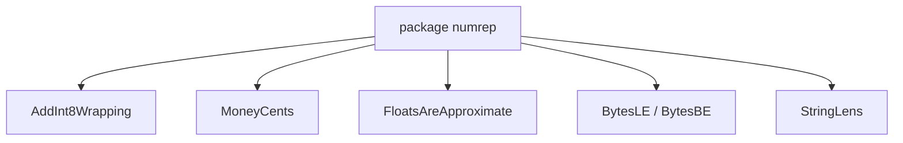
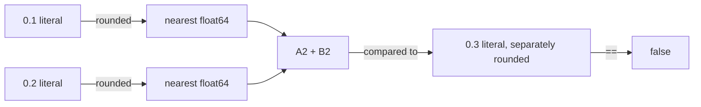
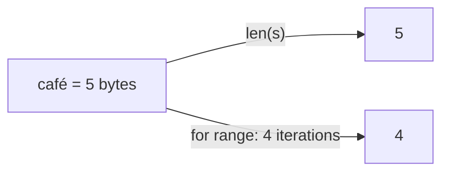

# Number Representation and Text Encoding - Go

> [!summary] TL;DR
> Five small functions and their tests demonstrate, by running real code, the sharp edges described in [[Number Representation and Text Encoding]]: silent `int8` overflow, float rounding that breaks `0.1 + 0.2 == 0.3`, exact integer-cent money math, endianness, and the byte-vs-rune gap in Go strings.

## Before the code

- **Fixed-width integer types** (`int8`, `int64`, `uint32`): each has a set size and range; arithmetic wraps when it leaves the range.
- **`float64`**: Go's IEEE 754 double; `==` compares exact bits.
- **`encoding/binary`**: standard package whose `ByteOrder` interface values (`LittleEndian`, `BigEndian`) write numbers as bytes in a fixed order.
- **Arrays vs slices**: `[4]byte` is a fixed array comparable with `==`; `buf[:]` makes a slice view over it.
- **`for range` on a string**: decodes UTF-8 and steps one rune (code point) at a time.
- **What to run**: `go vet ./... && go test -race -v ./...` in the `numrep` module.

## What this code shows

| Code | Concept in [[Number Representation and Text Encoding]] |
| --- | --- |
| `AddInt8Wrapping` | Two's complement silent overflow, [[Number Representation and Text Encoding#Two's complement and silent overflow]] |
| `MoneyCents` | Exact money math with integer minor units, [[Number Representation and Text Encoding#Why money uses integers or decimal types]] |
| `FloatsAreApproximate` | IEEE 754 rounding, [[Number Representation and Text Encoding#IEEE 754 floating point]] |
| `BytesLE` / `BytesBE` | Endianness, [[Number Representation and Text Encoding#Endianness]] |
| `StringLens` | Bytes vs. runes in a Go string, [[Number Representation and Text Encoding#Go's string, []byte, and rune]] |



Each function is a minimal, pure, standalone demonstration of exactly one representation rule — none of them depend on each other, so each can be read (and tested) in isolation.

## Setup

- Module `numrep` with `numrep.go` and `numrep_test.go`.
- Go 1.24, standard library only (`encoding/binary`, `testing`).
- Run: `go vet ./... && go test -race -v ./...`

## Code

### Step 1: silent integer overflow and exact money math

**Concept.** `AddInt8Wrapping` implements [[Number Representation and Text Encoding#Two's complement and silent overflow]] directly: it is Go's own `+` operator on `int8`, wrapped in a named function purely so a test can call it and assert on the wraparound.

`MoneyCents` implements the "why money uses integers" idea by using plain `int64` addition — the alternative of a `float64` parameter was deliberately rejected, since the whole point is that integer cents never need rounding.

```go
package numrep

import "encoding/binary"

// AddInt8Wrapping adds two int8 values with the exact two's-complement
// wraparound Go's + operator performs: no panic, no error, just silent
// overflow. int8 range is -128..127.
func AddInt8Wrapping(a, b int8) int8 {
	return a + b // e.g. 127 + 1 wraps to -128
}
```

```go
// MoneyCents adds two money amounts given in integer cents. Representing
// money as integer minor units (cents) avoids float rounding error entirely,
// which is why payment systems never store dollars as float64.
func MoneyCents(centsA, centsB int64) int64 {
	return centsA + centsB
}
```

**How it works.**

1. `AddInt8Wrapping` takes `int8` parameters specifically — not `int` — so the 8-bit wraparound happens at a small, easy-to-reason-about boundary (127, not `math.MaxInt64`).
2. The `+` operator is Go's built-in integer addition; nothing here suppresses or checks for overflow, which is exactly the behavior being demonstrated.
3. `MoneyCents` takes `int64`, wide enough that realistic cent amounts (even many billions of dollars) never approach overflow in practice, unlike the deliberately narrow `int8` above.

### Step 2: float approximation

**Concept.** `FloatsAreApproximate` implements [[Number Representation and Text Encoding#IEEE 754 floating point]]: it takes three `float64` arguments and reports whether `a + b == c` holds *exactly*, at the bit level.

The function is generic over its three arguments rather than hardcoded to `0.1, 0.2, 0.3` so the same function can also prove the positive case (integral floats compare equal exactly), which is important: the point isn't "floats are always wrong," it's "floats are exact only for specific values."

```go
// FloatsAreApproximate reports whether a + b equals c exactly in IEEE 754
// binary64 (Go's float64). 0.1 and 0.2 have no exact binary representation,
// so 0.1 + 0.2 != 0.3 at the bit level even though it looks equal when
// printed with default rounding.
func FloatsAreApproximate(a, b, c float64) bool {
	return a+b == c
}
```

**How it works.**

1. The function returns a plain `bool` from Go's `==` on `float64` — no epsilon comparison, no rounding, so the result reflects IEEE 754 binary equality exactly as the hardware computes it.
2. Calling it with `(0.1, 0.2, 0.3)` returns `false`: the literal `0.1` is parsed and rounded to the nearest representable `float64` before the addition even happens, and the same independent rounding happens to `0.2` and `0.3`.
3. Calling it with `(1, 2, 3)` returns `true`: small whole numbers are exactly representable in `float64`, so no rounding error enters the computation at all — this is the control case that proves the function isn't just always returning `false`.



### Step 3: endianness

**Concept.** `BytesLE` and `BytesBE` implement [[Number Representation and Text Encoding#Endianness]] using the standard library's `encoding/binary` package rather than manual bit-shifting, which is both less error-prone and the idiomatic Go approach for any code that needs a specific wire format.

The alternative — relying on the host's native byte order via `unsafe` pointer casts — was rejected because it would make the function's output depend on which machine it runs on, defeating the entire purpose of fixing a byte order explicitly.

```go
// BytesLE encodes v as 4 bytes in little-endian order (least-significant
// byte first), the native order on x86-64 and most ARM configurations.
func BytesLE(v uint32) [4]byte {
	var buf [4]byte
	binary.LittleEndian.PutUint32(buf[:], v)
	return buf
}

// BytesBE encodes v as 4 bytes in big-endian ("network byte order"), the
// order used on the wire by TCP/IP headers and most binary file formats.
func BytesBE(v uint32) [4]byte {
	var buf [4]byte
	binary.BigEndian.PutUint32(buf[:], v)
	return buf
}
```

**How it works.**

1. `binary.LittleEndian` and `binary.BigEndian` are pre-built values of the `binary.ByteOrder` interface — an interface specifically so callers can pass "which order" as a value, including choosing it at runtime based on a protocol header.
2. `PutUint32(buf[:], v)` writes directly into the backing array of `buf` via the slice `buf[:]`, so there is no extra allocation beyond the fixed `[4]byte` array itself.
3. Both functions return a fixed-size `[4]byte` array (not a slice), which is comparable with `==` — this is what lets the test compare the result directly against a literal expected array.

### Step 4: bytes vs. runes

**Concept.** `StringLens` implements [[Number Representation and Text Encoding#Go's string, []byte, and rune]]: it returns both the byte length (`len(s)`) and the rune count (via `for range`) so a caller — or a test — can see directly how far apart they are for a given string.

The alternative of using `utf8.RuneCountInString` was avoided here specifically so the function demonstrates the *mechanism* (decoding one rune per iteration) rather than calling a library function that hides it.

```go
// StringLens returns the byte length (len(s), what Go's len() always means
// for a string) and the rune count (the number of Unicode code points,
// what a human would call "characters") of s. They differ for any string
// containing a multi-byte UTF-8 character.
func StringLens(s string) (byteLen int, runeCount int) {
	byteLen = len(s)
	runeCount = 0
	for range s { // ranging over a string decodes one rune per step
		runeCount++
	}
	return byteLen, runeCount
}
```

**How it works.**

1. `len(s)` is evaluated once, up front — it is an O(1) operation in Go, since a string header already stores its byte length.
2. `for range s` is the Go-specific detail: ranging over a `string` (not a slice) decodes UTF-8 and yields one rune per iteration, with the loop variable (unused here, so omitted) giving the byte offset of each rune's start.
3. The loop runs once per *rune*, not once per *byte* — for `"café"` this means 4 iterations even though the string is 5 bytes long, which is exactly the gap the function exists to expose.



## Design decisions

| Decision | Alternative | Trade-off |
| --- | --- | --- |
| `int8` parameters for `AddInt8Wrapping` | `int` or a generic numeric type | A small, fixed-width type makes the overflow boundary (127) concrete and reachable in a single test, instead of needing `math.MaxInt64` increments. |
| `encoding/binary` for endianness | Manual bit-shifting (`byte(v>>24)`, etc.) | The standard library is less error-prone and self-documents which order is in use; manual shifting is easy to get backwards. |
| `for range s` in `StringLens` | `utf8.RuneCountInString(s)` | Shows the decoding mechanism explicitly for teaching purposes; `utf8.RuneCountInString` is what production code should actually call. |
| Returning a fixed `[4]byte` from `BytesLE`/`BytesBE` | Returning a `[]byte` slice | A fixed-size array is directly comparable with `==` in a test, with no allocation beyond the array itself. |
| Five independent, single-purpose functions | One larger "demo" function covering everything | Each representation rule is testable, and failing, in isolation — a reader can see exactly which rule a given test is about. |

## Tests

### TestAddInt8Wrapping

**Property.** Both directions of int8 wraparound must hold: `127 + 1` wraps to `-128`, and `-128 + -1` wraps to `127`.

| Input | Expected |
| --- | --- |
| `AddInt8Wrapping(127, 1)` | `-128` |
| `AddInt8Wrapping(-128, -1)` | `127` |

```go
func TestAddInt8Wrapping(t *testing.T) {
	if got := AddInt8Wrapping(127, 1); got != -128 {
		t.Fatalf("127 + 1 (int8) = %d, want -128 (silent wraparound, no panic)", got)
	}
	if got := AddInt8Wrapping(-128, -1); got != 127 {
		t.Fatalf("-128 + -1 (int8) = %d, want 127", got)
	}
}
```

**How it works.** Both assertions check the exact wrapped value, not just "some value other than the mathematically correct one" — this proves the wraparound is two's complement specifically (wrapping to `-128`, not to `0` or an error value).

**If it fails.** A failure here would mean Go's own `int8` arithmetic stopped silently wrapping — effectively impossible without a language change, but it is the test that would catch it if, say, a future Go version added opt-in overflow checks that this code accidentally triggered.

### TestMoneyCentsIsExact

**Property.** Adding cent amounts must be exact integer addition with no rounding step at all.

| Input | Expected |
| --- | --- |
| `MoneyCents(10, 20)` | `30` |

```go
func TestMoneyCentsIsExact(t *testing.T) {
	// $0.10 + $0.20 in cents must be exactly $0.30 (30 cents), unlike floats.
	got := MoneyCents(10, 20)
	if got != 30 {
		t.Fatalf("MoneyCents(10, 20) = %d, want 30", got)
	}
}
```

**How it works.** This is a direct contrast to the next test: the identical real-world amounts (`$0.10 + $0.20`), computed as integer cents, must give exactly 30 with no tolerance needed — unlike the float version.

**If it fails.** Any failure here would be a logic bug in the addition itself (there is no rounding step to go wrong), so this test is mostly a safety net against an accidental edit.

### TestFloatsAreApproximate

**Property.** `0.1 + 0.2 == 0.3` must be `false` at the bit level, while an equivalent computation on exactly representable integral values must be `true` — proving the earlier claim is about float *precision*, not about `==` being broken in general.

| Input | Expected |
| --- | --- |
| `FloatsAreApproximate(0.1, 0.2, 0.3)` | `false` |
| `FloatsAreApproximate(1, 2, 3)` | `true` |

```go
func TestFloatsAreApproximate(t *testing.T) {
	// The canonical trap: 0.1 + 0.2 != 0.3 in IEEE 754 binary64.
	if FloatsAreApproximate(0.1, 0.2, 0.3) {
		t.Fatalf("0.1 + 0.2 == 0.3 was true; IEEE 754 binary64 should make this false")
	}
	// But using integer cents for the same amounts is exact (ties back to
	// why MoneyCents exists).
	if !FloatsAreApproximate(1, 2, 3) {
		t.Fatalf("1 + 2 == 3 should hold exactly for integral float64 values")
	}
}
```

**How it works.** The two assertions bracket the behavior: the first proves rounding error is real and visible through `==`; the second proves it is not universal — whole numbers within `float64`'s exact range add up perfectly.

**If it fails.** If the first assertion fails (prints `true`), either the Go toolchain's float handling changed in a way that would be a major story, or a typo made the test compare the wrong values. If the second fails, something is deeply wrong with basic arithmetic on this platform.

### TestEndianness

**Property.** The same 4-byte value must serialize to different, specific byte orders depending on which encoder is used.

| Input | Expected |
| --- | --- |
| `BytesLE(0x01020304)` | `{0x04, 0x03, 0x02, 0x01}` |
| `BytesBE(0x01020304)` | `{0x01, 0x02, 0x03, 0x04}` |

```go
func TestEndianness(t *testing.T) {
	v := uint32(0x01020304)
	le := BytesLE(v)
	be := BytesBE(v)
	wantLE := [4]byte{0x04, 0x03, 0x02, 0x01}
	wantBE := [4]byte{0x01, 0x02, 0x03, 0x04}
	if le != wantLE {
		t.Fatalf("BytesLE(0x01020304) = %v, want %v", le, wantLE)
	}
	if be != wantBE {
		t.Fatalf("BytesBE(0x01020304) = %v, want %v", be, wantBE)
	}
}
```

**How it works.** `0x01020304` is chosen specifically because all four bytes are distinct (`01`, `02`, `03`, `04`), so a reversed-order bug cannot accidentally pass by having two bytes be equal.

**If it fails.** A failure would mean `encoding/binary`'s `LittleEndian`/`BigEndian` implementations disagree with their documented byte order — for the standard library, this would indicate a serious regression rather than a bug in this code.

### TestStringLensBytesVsRunes

**Property.** For a string containing a multi-byte character, byte length and rune count must differ by exactly the number of multi-byte characters; for pure ASCII, they must be equal.

| Input | Expected (byteLen, runeCount) |
| --- | --- |
| `StringLens("café")` | `(5, 4)` |
| `StringLens("go")` | `(2, 2)` |

```go
func TestStringLensBytesVsRunes(t *testing.T) {
	// "café" has 4 runes but 5 bytes: é is U+00E9, 2 bytes in UTF-8.
	bLen, rCount := StringLens("café")
	if bLen != 5 {
		t.Fatalf("len(\"café\") = %d, want 5 (len() always counts bytes)", bLen)
	}
	if rCount != 4 {
		t.Fatalf("rune count of \"café\" = %d, want 4", rCount)
	}

	// Plain ASCII: bytes and runes agree.
	bLen, rCount = StringLens("go")
	if bLen != 2 || rCount != 2 {
		t.Fatalf("StringLens(\"go\") = (%d, %d), want (2, 2)", bLen, rCount)
	}
}
```

**How it works.** The test deliberately includes both a non-ASCII case (`"café"`, where the two counts disagree) and a pure-ASCII case (`"go"`, where they agree) — proving the function isn't just "always subtracting one."

**If it fails.** A `len("café") != 5` failure would mean the source file itself wasn't saved as UTF-8 (so `é` was encoded differently). A rune-count failure would point at a bug in how `for range` decodes UTF-8, which for the standard library would be a serious regression.

```text
$ go vet ./numrep/...
$ go test -race -v ./numrep/...
```

## Running it

Measured with `go test -race -v ./...` on Go 1.24.4, darwin/arm64 (2026-11-06):

```text
=== RUN   TestAddInt8Wrapping
--- PASS: TestAddInt8Wrapping (0.00s)
=== RUN   TestMoneyCentsIsExact
--- PASS: TestMoneyCentsIsExact (0.00s)
=== RUN   TestFloatsAreApproximate
--- PASS: TestFloatsAreApproximate (0.00s)
=== RUN   TestEndianness
--- PASS: TestEndianness (0.00s)
=== RUN   TestStringLensBytesVsRunes
--- PASS: TestStringLensBytesVsRunes (0.00s)
PASS
ok  	roll4scratch/numrep	1.516s
```

**Reading the output.** Every test passes in under a millisecond individually — none of this code does I/O or allocation-heavy work, so the entire suite's wall-clock time is dominated by Go's test-harness startup, not the assertions themselves.

`AddInt8Wrapping(127, 1) = -128`, `FloatsAreApproximate(0.1, 0.2, 0.3) = false`, and `StringLens("café") = (5, 4)` are the three headline results the theory note cites as measured, not merely claimed, behavior.

## Pitfalls in the code

- **`AddInt8Wrapping` has no guard rail.** It is Go's own `+` with no bounds check, by design — calling it with values near the `int8` boundary in real code (not just the test) will wrap exactly the same way.
- **`FloatsAreApproximate` can mislead if misread.** It returns `true` for some inputs (e.g. integral values) and `false` for others — a reader skimming only the `false` case could wrongly conclude "floats are always imprecise," when the precision is exact for values that happen to be sums of powers of two.
- **`BytesLE`/`BytesBE` do not validate `v`.** Any `uint32` value is accepted; there is no "this value doesn't fit" case to worry about, unlike signed-integer wraparound.
- **`StringLens` counts runes, not grapheme clusters.** A visible "character" built from multiple combining code points (e.g. some emoji with skin-tone modifiers) will count as more than one rune even though a user sees one glyph — `for range` decodes Unicode code points, not what a font renders as a single glyph.

## Exercises

1. Change `AddInt8Wrapping`'s parameter types from `int8` to `int16` and update the test's expected values for the new range's boundary (`32767 + 1`). Predict the new wrapped value before running it.
2. Add a new case to `TestFloatsAreApproximate` that checks `FloatsAreApproximate(0.5, 0.25, 0.75)`. Predict whether it returns `true` or `false` before running it, using the "sums of powers of two are exact" rule from the theory note.
3. Add a `StringLens` test case for a string containing a 4-byte UTF-8 character (an emoji such as `"😀"`). Predict the byte length and rune count before running it.

## Links

- **Theory:** [[Number Representation and Text Encoding]]
- **Related:** [[Arrays and Dynamic Arrays (Go Slices)]]
