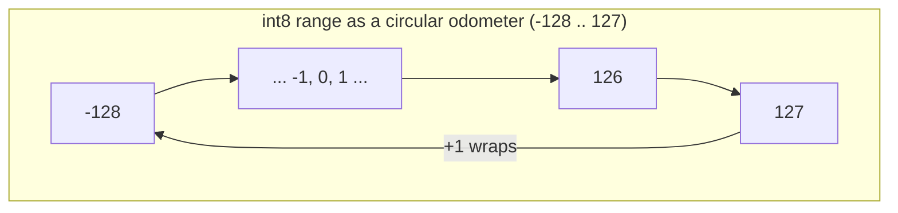
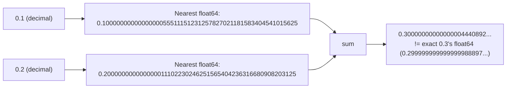
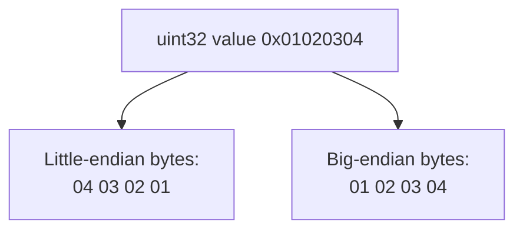
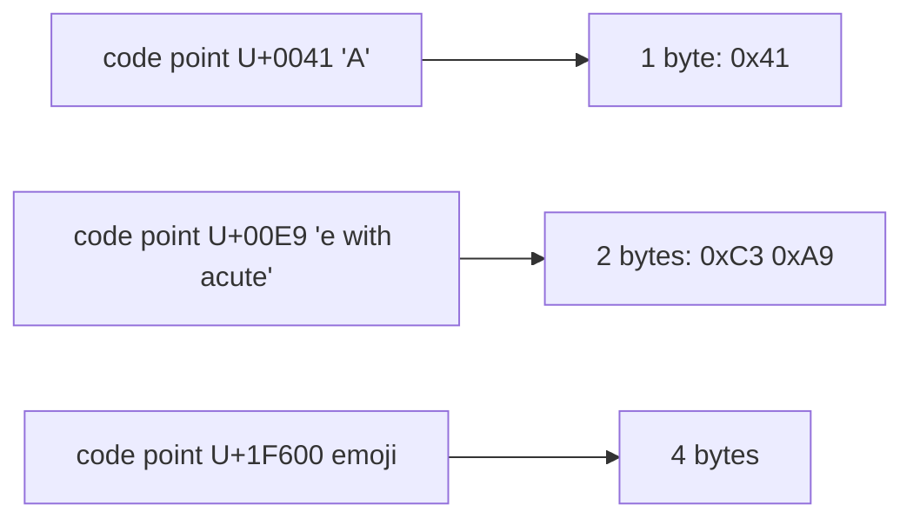
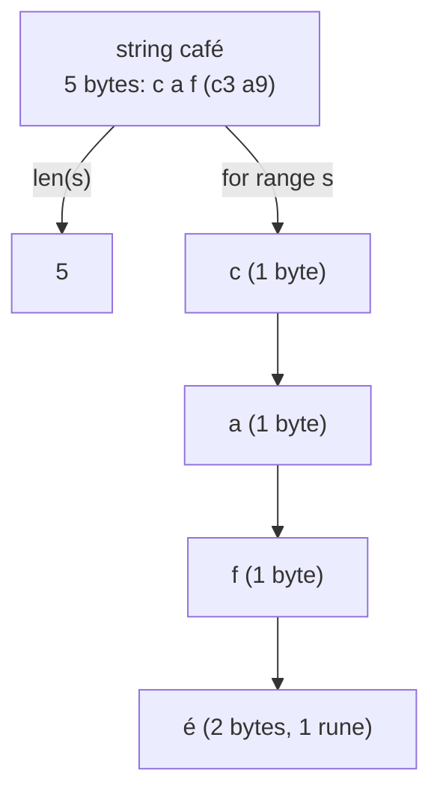

# Number Representation and Text Encoding

> [!summary] TL;DR
> Computers store everything as bits, and how those bits are interpreted — as a signed integer, an IEEE 754 float, or a UTF-8 byte sequence — is a choice made by the programming language and the programmer, not a property of the bits themselves. Getting that choice wrong causes silent integer overflow, float rounding bugs in money math, and byte-vs-character mismatches in text processing.

> [!abstract] Core idea
> - Integers are stored in two's complement, which makes negative numbers wrap around silently on overflow instead of raising an error.
> - Floats (IEEE 754) trade exactness for range: most decimal fractions, including `0.1`, have no exact binary representation.
> - Money should be integers (cents) or a decimal type, never a binary float, because float rounding error compounds in arithmetic.
> - Endianness is the byte order used to store a multi-byte number; it matters whenever bytes cross a machine boundary (network, file formats).
> - In Go, a `string` is a read-only sequence of bytes, `len()` always counts bytes, and a `rune` is one Unicode code point — these three can disagree for any non-ASCII text.

## 1. Why it exists

Every value in a running program — an `int32` counter, a `float64` price, a UTF-8 log line — is ultimately just bits in memory. The CPU and the language runtime agree on an **encoding**: a rule for turning those bits into a number or a character. Three real bugs show why this matters:

1. A counter declared as `int8` increments past 127 and silently becomes `-128` instead of erroring — no panic, no warning, just wrong data from that point on.
2. A price calculation adds `0.10 + 0.20` as `float64` and compares the result to `0.30`, and the comparison fails, because `0.1`, `0.2`, and `0.3` are all *approximations* in binary floating point.
3. A string's byte length is used as a buffer size for user-entered text containing emoji or non-Latin characters, and the buffer either overflows or truncates mid-character, because `len()` counts bytes, not displayed characters.

All three are the direct, mechanical consequence of how numbers and text are represented — not edge cases, but the normal behavior of the encoding, catching an engineer who assumed otherwise.

> [!warning] Common mistake
> Assuming "the compiler would warn me" or "this would crash if it were wrong." None of these three bugs produce an error. They produce a wrong number or a wrong byte count, silently, and the program keeps running.

## 2. Mental model

Think of an integer's bits as an odometer with a fixed number of digits: once it hits its maximum, the next increment rolls it back to the minimum (or to zero, for unsigned), silently, exactly like a car's mechanical odometer rolling over from `999999` to `000000`. **Two's complement** is just the specific rule for where "negative" sits on that odometer: the top half of the range (by bit pattern) is defined to mean negative numbers, chosen so that addition and subtraction work with the same circuitry as for unsigned numbers.

Think of an IEEE 754 float as scientific notation with a fixed, finite number of significant binary digits: you can represent `1.5 x 2^3` exactly, but you cannot represent `0.1` exactly any more than you can write `1/3` exactly in decimal — you always get a terminating approximation, and arithmetic on approximations accumulates error.

Think of a Go `string` as a shipping container of raw bytes with a label: the label (`string` type) tells you it's probably UTF-8 text, but `len()` tells you the container's byte weight, not how many distinct "items" (characters) are inside — to count items you have to actually open the container and decode it. The analogy breaks down in one place: a shipping container's weight is a property of the container, but a string's byte length also depends on *what characters* it contains, not just how many — two four-character strings can have different `len()`.

## 3. How it works

### Two's complement and silent overflow

In plain words: an integer type can only hold so many values. When arithmetic would produce a value outside that range, Go does not stop and complain — it wraps around to the other end of the range, as if the number were written on a circular dial.

An `n`-bit two's complement integer represents the range `-2^(n-1)` to `2^(n-1)-1`. Negation is "invert all bits, add 1." Addition and subtraction use ordinary binary adder circuitry regardless of sign — that uniformity is the entire reason two's complement won over older signed-magnitude schemes (more in the deep dive).

**Example.** `var x int8 = 127; x++` gives `-128`, with no panic and no compiler warning (confirmed by the test in the Go note). A request-counter field declared as `int8` that should never exceed 100 looks safe during testing, but under real load it silently wraps the moment it crosses 127 — the bug only shows up in production, at a volume the test never reached.

> [!warning] Common mistake
> Believing Go checks overflow "at least in debug builds," the way some languages do. Go never checks integer overflow for its built-in arithmetic operators, in any build mode, for any integer type.

> [!tip] Remember
> Two's complement makes overflow wrap silently, in exchange for letting one piece of adder hardware handle both signed and unsigned arithmetic — size integer types generously, and add explicit bounds checks where wrapping would be dangerous.

### IEEE 754 floating point

In plain words: a float is stored as a sign, an exponent, and a fraction — much like scientific notation (`1.5 x 10^3`) but in binary. Only numbers that are exact sums of powers of two can be stored exactly; everything else is rounded to the nearest representable value.

A `float64` stores a sign bit, an 11-bit exponent, and a 52-bit mantissa (fraction), representing a value as `(-1)^sign x 1.mantissa x 2^(exponent-bias)`. Because the mantissa is binary, only sums of powers of two are exact — `0.5`, `0.25`, `0.125` are exact, but `0.1` is a repeating binary fraction (like `1/3` in decimal) and gets silently rounded to the nearest representable value.

**Example.** `0.1 + 0.2 == 0.3` is `false` in Go (and in nearly every language using IEEE 754 binary64) — both operands and the comparison target are each independently rounded, and the roundings don't cancel out.

> [!tip] Remember
> A float is an approximation with finite precision, not a defect in one particular library — never compare two floats with `==`; compare their difference against a small tolerance instead.

### Why money uses integers or decimal types

In plain words: because float rounding error compounds across many additions, financial systems represent money as an integer count of the smallest unit (cents, or even smaller for some currencies) or as an arbitrary-precision decimal type, never as a binary float.

**Example.** `$0.10 + $0.20` as `10 + 20` cents is exactly `30` cents, with zero rounding risk, because integer arithmetic in a given range is exact — there's no approximation step at all. The same computation as `float64` dollars, `0.10 + 0.20`, yields `0.30000000000000004`, which fails an `== 0.30` check.

> [!tip] Remember
> Money math should never touch a binary float: use integer minor units (cents) when values fit comfortably in range, or an arbitrary-precision decimal type when they don't.

### Endianness

In plain words: a number bigger than one byte has to be stored as several bytes in some order. Two conventions exist for that order, and they disagree.

A multi-byte value like a 4-byte `uint32` can be stored with its most-significant byte first (**big-endian**, "network byte order," used by TCP/IP headers) or its least-significant byte first (**little-endian**, native on x86-64 and most ARM configurations in their default mode). The bits of the number are identical either way — only the order they're laid out in memory or on the wire differs.

**Example.** A service reads a 4-byte length prefix off a TCP socket. If it decodes the bytes using the host's native (little-endian, on x86-64) order instead of the protocol's documented big-endian order, a length of `0x00000104` (260) is misread as `0x04010000` (67,174,400) — a catastrophic, silent misparse, not a crash.

> [!tip] Remember
> Endianness matters the moment bytes cross a boundary between systems that might disagree — always decode using the *format's* documented byte order, never assume the host's native order.

### ASCII, Unicode, and UTF-8

In plain words: computers originally only had enough bits to represent English letters and a few symbols. Unicode extends that to every character in every script, and UTF-8 is the specific byte-level trick that makes the new, much bigger alphabet backward-compatible with the old one.

ASCII assigns 128 characters to 7-bit codes — enough for English text, nothing else. Unicode assigns a numeric **code point** to every character in every script (over 1.1 million possible code points). UTF-8 is the encoding that turns a code point into 1–4 bytes: code points 0–127 (ASCII) encode as a single byte identical to ASCII (this backward compatibility is why UTF-8 won), while non-ASCII characters take 2–4 bytes.

**Example.** The letter `A` (U+0041) is 1 byte in UTF-8, identical to its ASCII byte. The accented `e` in "café" (U+00E9) is 2 bytes. A smiley emoji (U+1F600) is 4 bytes. All three are single "characters" to a human, but 1, 2 and 4 bytes respectively to anything measuring `len()`.

> [!tip] Remember
> UTF-8 is backward-compatible with ASCII by design — every plain-English byte is already valid UTF-8 — which is a large part of why it won over UTF-16 and UTF-32 as the default text encoding.

### Go's string, []byte, and rune

In plain words: Go gives you three different ways to look at text, and they count differently. Knowing which one a given piece of code is using is the whole trick.

A Go `string` is an **immutable sequence of bytes** that is conventionally, but not enforced to be, valid UTF-8. `[]byte` is a mutable byte slice — converting `string` <-> `[]byte` copies the underlying bytes. A `rune` is Go's name for `int32` used to hold a single Unicode code point. **`len(s)` on a string always counts bytes**, never characters; `for range s` decodes UTF-8 one rune at a time, so a loop over a string with emoji or accented characters visits fewer iterations than `len(s)` would suggest.

**Example.** `café` looks like 4 characters. `len("café")` in Go returns `5`, because `é` (U+00E9) encodes as 2 UTF-8 bytes while `c`, `a`, `f` each encode as 1 byte: `1+1+1+2 = 5`. Any code that assumes `len(s)` equals "number of characters a user would count" breaks on this string.

> [!warning] Common mistake
> Indexing a Go string by position (`s[i]`) expecting the i-th *character*. `s[i]` gives you the i-th *byte*, which for non-ASCII text is frequently the middle of a multi-byte character, not a usable character at all.

> [!tip] Remember
> `len(s)` is always a byte count in Go; use `utf8.RuneCountInString(s)` or `for range s` when you actually mean "number of characters."

## 4. Worked example

### Whiteboard version

Trace `StringLens("café")` by hand: the string's bytes are `c` (0x63), `a` (0x61), `f` (0x66), then the 2-byte UTF-8 encoding of `é` (0xC3 0xA9). `len()` walks the raw byte slice and counts 5. `for range` decodes UTF-8 as it walks: it sees `c`, `a`, `f` as three separate one-byte runes, then recognizes `0xC3 0xA9` together as one two-byte rune (`é`), for a total of 4 runes. The byte count and the rune count disagree by exactly one, which is the number of multi-byte characters in the string.

Runnable Go version: [[Number Representation and Text Encoding - Go]].

**Measured** (this code, Go 1.24.4, darwin/arm64, 2026-11-06): `AddInt8Wrapping(127, 1) = -128`, `FloatsAreApproximate(0.1, 0.2, 0.3) = false`, `StringLens("café") = (5, 4)` — all three confirm the mechanisms described above, not just claimed behavior.

## 5. Variants and comparison

| Representation | Size | Exact for | Wraps / rounds silently? | Typical use |
| --- | --- | --- | --- | --- |
| `int8`/`int16`/`int32`/`int64` | 1–8 bytes | All integers in range | Wraps (two's complement overflow) | Counters, indices, IDs |
| `uint8`...`uint64` | 1–8 bytes | Non-negative integers in range | Wraps (modulo 2^n) | Byte buffers, bit flags, hashes |
| `float32`/`float64` | 4/8 bytes | Powers of two and their sums, within precision | Rounds (not an error, just imprecise) | Scientific/graphics math, never money |
| Integer minor units (cents) | typically `int64` | Exact money math | No (overflow still possible at extreme scale) | Payments, accounting, billing |
| Arbitrary-precision decimal | variable | Exact decimal math | No | Financial systems needing fractional cents or large sums |
| ASCII | 1 byte/char | English letters, digits, basic punctuation | n/a | Legacy protocols, fixed 7-bit contexts |
| UTF-8 | 1–4 bytes/code point | All Unicode code points | n/a | The dominant text encoding on the modern web |

**Overflow semantics by language**, since the right answer here depends on the language, not just the hardware:

| Language | Integer overflow behavior |
| --- | --- |
| Go | Always wraps silently (two's complement), in every build mode, for built-in arithmetic. |
| Swift | Panics (traps) on overflow by default for `+`, `-`, `*`; explicit `&+`, `&-`, `&*` opt into wrapping. |
| Python | Never overflows: integers are arbitrary-precision by default, at the cost of per-operation overhead. |
| C | Signed overflow is undefined behavior (compilers may assume it never happens); unsigned overflow wraps, defined by the standard. |

## 6. Trade-offs and when not to use

- `int8`/`int16`/`int32` save memory over `int64` but overflow at much smaller values — use the smallest type only when the range is provably bounded (e.g. a day-of-month field), not for general-purpose counters.
- Floats are the right choice for scientific computation, graphics, and anything where small relative error is acceptable and the dynamic range (very large and very small magnitudes) matters more than exactness — just never for money or anything requiring exact equality comparisons.
- Arbitrary-precision decimal types are exact but slower and use more memory than native integers; for performance-critical money math where values fit comfortably in an `int64`, plain integer cents is usually both simpler and faster.
- UTF-8 isn't always the right choice when interoperating with legacy systems that expect fixed-width encodings (UTF-16 on Windows APIs and inside the JVM/JavaScript strings internally) — conversion boundaries need explicit handling, not assumption.

## 7. In production

- **Real systems:** Stripe and most payment processors represent amounts as integer minor units (e.g. cents) in their APIs. PostgreSQL's `numeric`/`decimal` type stores exact arbitrary-precision decimals for money columns, distinct from `real`/`double precision` (IEEE 754 floats). Network protocols (IP, TCP headers) fix big-endian ("network byte order") explicitly so endianness is never ambiguous on the wire.
- **Failure modes → fixes:**
	- A counter type too small for its real range overflows silently in production under load → size integer types generously, and in Go, use the `math` package's `MaxInt32` etc. constants to add explicit bounds checks where overflow would be catastrophic.
	- Float-based money math drifts over many transactions, producing off-by-a-cent discrepancies that compound → migrate to integer cents or a decimal type; never compare floats with `==`.
	- A buffer sized by `len(s)` truncates multi-byte UTF-8 characters mid-sequence when `s` contains non-ASCII text → size buffers in bytes deliberately and validate UTF-8 boundaries, or count runes explicitly when the limit is meant to be "characters."
	- Bytes read from a network protocol or binary file are mis-parsed as the wrong endianness, corrupting every multi-byte field → always decode using the protocol/format's documented byte order (`encoding/binary`'s `BigEndian`/`LittleEndian`), never the host's native order, unless the format explicitly says "native/host order."
- **What to monitor:** overflow-prone counters approaching their type's max value (a surprisingly common production incident, e.g. an `int32` ID or timestamp field nearing its limit); any code path doing float arithmetic on monetary values (a static-analysis or code-review rule, not a runtime metric).

## 8. Deep dive

- **Why two's complement, specifically?** The alternative schemes — sign-magnitude (a dedicated sign bit, rest is magnitude) and one's complement (invert bits for negation) — both have two representations of zero (`+0` and `-0`) and require special-case logic in the adder circuit for subtraction. Two's complement has exactly one representation of zero and lets the same binary adder hardware handle both addition and subtraction of signed values, which is why every mainstream CPU architecture uses it.
- **IEEE 754 special values**: beyond ordinary numbers, binary64 reserves bit patterns for `+Inf`, `-Inf`, and `NaN` (not-a-number, the result of operations like `0.0/0.0`). Critically, `NaN != NaN` is true — `NaN` is not even equal to itself — which trips up naive equality-based deduplication or caching logic that doesn't special-case it.
- **Why UTF-8 won over UTF-16/UTF-32**: it's backward compatible with ASCII (every ASCII byte is valid UTF-8 for that same character), self-synchronizing (you can find a character boundary from any byte offset without scanning from the start, because continuation bytes have a distinct bit pattern), and endianness-free (unlike UTF-16, which needs a byte-order mark or an explicit LE/BE variant).
- **Go's design choice**: making `string` a read-only byte sequence (not an array of runes) means indexing a string by position (`s[i]`) gives a *byte*, not a character — a frequent surprise for newcomers expecting `s[i]` to return the i-th character. This is also why Go's standard library offers `utf8.RuneCountInString`, `[]rune(s)` conversion, and `strings.Reader`/`bufio.Scanner` with rune-aware splitting, rather than making every string operation rune-aware by default (which would cost performance for the common ASCII-heavy case).

## 9. Interview questions

> [!question]- Why does `var x int8 = 127; x++` not panic in Go, and what does it actually produce?
> Go's built-in integer arithmetic never checks for overflow, in any build mode; it simply wraps around using two's complement semantics. `127 + 1` as an `int8` produces `-128`, because the bit pattern for `128` interpreted as a signed 8-bit two's complement value is `-128`.

> [!question]- Trap: is `0.1 + 0.2 == 0.3` true in Go?
> False. Neither `0.1`, `0.2`, nor `0.3` has an exact binary floating-point representation; each is independently rounded to the nearest representable `float64`, and the rounding errors don't cancel when you add `0.1 + 0.2` and compare to the separately-rounded `0.3`. This is a property of IEEE 754 binary floating point in any language, not a Go-specific bug.

> [!question]- Why should money never be stored as `float64`?
> Float rounding error is small per operation but compounds across many additions, multiplications, and especially comparisons — a financial ledger built on floats will eventually show discrepancies that don't reconcile to the cent. Representing money as an integer count of minor units (cents) makes addition and subtraction exact, or using an arbitrary-precision decimal type preserves exactness for division and fractional-cent cases.

> [!question]- What's the difference between `len(s)`, `utf8.RuneCountInString(s)`, and ranging over a Go string with `for range`?
> `len(s)` always returns the number of bytes in the string, regardless of content. `utf8.RuneCountInString(s)` decodes the UTF-8 bytes and returns the number of Unicode code points (runes). `for range s` iterates once per rune (decoding UTF-8 as it goes), giving you both the byte offset and the decoded rune value at each step — it does not iterate once per byte.

> [!question]- What is endianness, and when does it actually matter to a backend engineer?
> It's the byte order used to lay out a multi-byte value in memory or on the wire: big-endian stores the most significant byte first, little-endian stores the least significant byte first. It matters whenever bytes cross a boundary between systems that might disagree — reading/writing binary file formats, parsing network protocol headers, or serializing structs directly to bytes — which is why formats and protocols explicitly document their byte order rather than leaving it to the host machine's native order.

> [!question]- A service increments a `uint32` request-ID counter per second at high volume. Roughly how long until it wraps, and why does that matter?
> A `uint32` holds values up to about 4.29 billion. At, say, 50,000 increments per second, it would take roughly 4.29e9 / 50,000 ≈ 85,800 seconds (about 24 hours) to wrap back to zero. It matters because if that ID is assumed unique (used as a map key, a cache key, or a primary key) code relying on uniqueness will silently start colliding once the counter wraps — exactly the silent-overflow problem, just at a larger scale and longer time horizon.

> [!question]- Why is `NaN != NaN` true, and what bug does that commonly cause?
> IEEE 754 defines `NaN` (not-a-number, produced by operations like `0.0/0.0`) to compare unequal to every value, including itself, so that any computation that has gone indeterminate is never mistaken for a valid, comparable number. This commonly breaks naive deduplication, set/map-key logic, or sorting code that assumes `x == x` always holds — `NaN` values need an explicit `math.IsNaN()` check rather than relying on `==`.

## 10. Cheat sheet

- Integers wrap silently on overflow in Go (two's complement, no panic, no check) — size types generously and add explicit bounds checks where it matters.
- `0.1 + 0.2 != 0.3` in `float64`; never compare floats with `==`, and never use floats for money.
- Money: integer minor units (cents) or an arbitrary-precision decimal type — never a binary float.
- Endianness is byte order for multi-byte values; it matters at every system boundary (network, binary files) — always decode using the format's documented order, not the host's native order.
- ASCII is 7-bit and English-only; Unicode assigns a code point to every character; UTF-8 encodes a code point as 1–4 bytes and is backward-compatible with ASCII.
- In Go: `string` is immutable bytes, `[]byte` is mutable bytes, `rune` is one Unicode code point (`int32`); `len()` always counts bytes.
- `for range` over a Go string decodes UTF-8 and iterates one rune at a time, not one byte at a time.
- `NaN != NaN` by IEEE 754 design — check `math.IsNaN()` explicitly instead of `==`.
- Overflow across languages: Go wraps silently, Swift panics by default, Python never overflows (arbitrary precision), C's signed overflow is undefined behavior.
- Runnable Go version: [[Number Representation and Text Encoding - Go]].

## Links

- **Before this:** [[How a Computer Runs a Program]]
- **Next:** [[Arrays and Dynamic Arrays (Go Slices)]], [[Complexity Analysis - Big-O and Amortized Cost]]
- **Compare with:** [[Memory Hierarchy and CPU Caches]] (how these bit patterns physically sit in cache lines and memory)
- **Go code:** [[Number Representation and Text Encoding - Go]]
