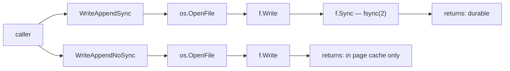
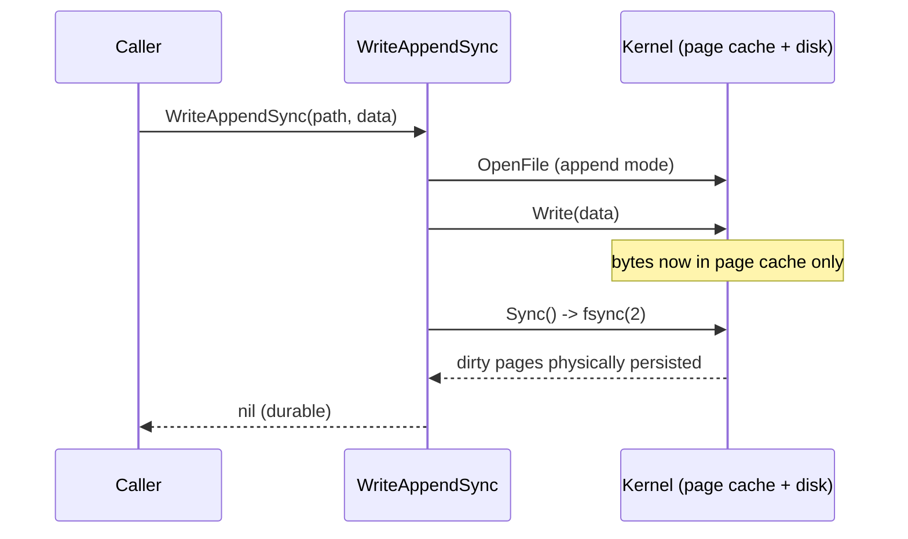

# Page Cache, File Systems and fsync - Go

> [!summary] TL;DR
> Two tiny append functions — one that calls `fsync` before returning, one that doesn't — demonstrate the durable-append pattern from [[Page Cache, File Systems and fsync]]: the same pattern a write-ahead log uses to make a commit survive a crash.

> [!info] How to read this note (pick your level)
> - 🟢 **New to this?** Read the theory note first ([[Page Cache, File Systems and fsync]]). Here, read "From zero" below, "Before the code" and "What this code shows", then skim the code steps.
> - 🟡 **Know the basics?** Read the Code, Design decisions and Tests sections, then run it yourself.
> - 🔴 **Interview / SDE-3 prep?** Add the Pitfalls and Exercises sections. Headings are tagged 🟢🟡🔴.

**From zero** 🟢: this file is the hands-on side of [[Page Cache, File Systems and fsync]]. It is Go code that appends to a file in two ways — one calls fsync before returning, one does not — which is exactly the pattern databases use to make a commit survive a crash. Read the code steps with their notes, then run it.

## Before the code 🟢

- **`os.OpenFile` with flags**: opens a file with options combined by `|`, here append, create and write-only.
- **`defer`**: schedules `f.Close()` to run when the function returns, on every path.
- **Multiple return values and `error`**: Go functions return `(result, error)`; a non-nil `error` means it failed.
- **`f.Sync()`**: Go's wrapper for the `fsync(2)` system call.
- **`testing` package and `t.TempDir()`**: tests are functions named `TestXxx`; `t.TempDir()` gives a throwaway folder.
- **What to run**: `go vet ./... && go test -race -v ./...` inside the module folder.

## What this code shows 🟢

| Code | Concept in [[Page Cache, File Systems and fsync]] |
| --- | --- |
| `WriteAppendSync` | The durable-append pattern: write, then `fsync` before telling the caller it's safe, [[Page Cache, File Systems and fsync#4. Worked example 🟡]] |
| `WriteAppendNoSync` | A write that only reaches the page cache, [[Page Cache, File Systems and fsync#1. Why it exists 🟢]] |
| `f.Sync()` call | The `fsync(2)` syscall itself, [[Page Cache, File Systems and fsync#fsync vs fdatasync vs O_DIRECT]] |
| `TestWriteAppendSyncDurableAndReadable` | Proves the bytes are readable back; cannot prove durability across a real power loss from inside a test |



The two functions share the same open-write shape; the only difference is the one extra line, `f.Sync()`.

That is the entire point: durability is one explicit call away, and skipping it is just as easy, which is exactly how production incidents happen.

## Setup 🟢

- Module `pagecache` with `pagecache.go` and `pagecache_test.go`.
- Go 1.24, standard library only (`os`, `path/filepath`, `testing`).
- Run: `go vet ./... && go test -race -v ./...`

## Code 🟡

### Step 1: the durable append

**Concept.** `WriteAppendSync` implements the durable-append pattern from [[Page Cache, File Systems and fsync#4. Worked example 🟡]]: open for append, write the record, then call `Sync()` before telling the caller it is safe to proceed.

This is the same shape a database uses after appending a record to its write-ahead log.

The alternative — opening with a flag that forces synchronous I/O on every write (`O_SYNC`) — was rejected here because explicit `Sync()` calls let the caller choose exactly when durability matters (e.g. once per batch, not once per byte written).

```go
package pagecache

import "os"

// WriteAppendSync appends data to the file at path and calls Sync before
// returning, so the bytes are durable on disk (not just sitting as dirty
// pages in the OS page cache) before the caller proceeds. This is the same
// pattern a database uses after appending a record to its write-ahead log.
func WriteAppendSync(path string, data []byte) error {
	f, err := os.OpenFile(path, os.O_APPEND|os.O_CREATE|os.O_WRONLY, 0o644)
	if err != nil {
		return err
	}
	defer f.Close()
	if _, err := f.Write(data); err != nil {
		return err
	}
	return f.Sync() // fsync(2): flush this file's dirty pages and metadata to disk
}
```

**How it works.**

1. `os.O_APPEND|os.O_CREATE|os.O_WRONLY` opens the file positioned to always write at the end (atomically, per `open(2)`'s append semantics), creating it if it doesn't exist.
2. `defer f.Close()` runs after `Sync()` either way — closing a file does not itself force a flush, so the `Sync()` call above is still required even with the deferred close.
3. `f.Write(data)` is the fast path: it copies `data` into the page cache and returns, per [[Page Cache, File Systems and fsync#1. Why it exists 🟢]].
4. `f.Sync()` is Go's wrapper around the `fsync(2)` syscall — it blocks until the kernel confirms this file's dirty pages (and its metadata) are physically on the device, which is the one line that turns "written" into "durable."



### Step 2: the non-durable append, for contrast

**Concept.** `WriteAppendNoSync` is deliberately the "wrong" version, kept in the same package specifically so the two can be compared directly: it implements [[Page Cache, File Systems and fsync#1. Why it exists 🟢]]'s point that a successful `write()` only guarantees visibility to other readers, not survival across a crash.

There is no good reason to prefer this version for durability-critical data — it exists here only as the control case.

```go
// WriteAppendNoSync appends data without fsync. The bytes reach the page
// cache immediately (later readers see them) but may still be lost if the
// machine loses power before the kernel's writeback flushes them.
func WriteAppendNoSync(path string, data []byte) error {
	f, err := os.OpenFile(path, os.O_APPEND|os.O_CREATE|os.O_WRONLY, 0o644)
	if err != nil {
		return err
	}
	defer f.Close()
	_, err = f.Write(data)
	return err
}
```

**How it works.**

1. Every line is identical to `WriteAppendSync` except the final `return f.Sync()` is replaced with `return err` right after `f.Write` — the one-line difference is the entire durability gap.
2. A reader opening the same path immediately after this function returns would see the new bytes (page-cache visibility is immediate), which is exactly what makes the missing durability easy to miss in testing: everything *looks* correct until a real crash happens.
3. The first test below does not call this function, and the second test only checks visibility, because its interesting property — data loss on a crash — cannot be observed from inside a normal test process.

## Design decisions 🟡

| Decision | Alternative | Trade-off |
| --- | --- | --- |
| Explicit `f.Sync()` call per append | `O_SYNC`/`O_DSYNC` open flag (sync on every write automatically) | Explicit calls let the caller batch several writes and sync once; the flag forces a flush on every single `Write`, which is both less flexible and, for multi-write batches, slower. |
| `fsync` via `f.Sync()` | `fdatasync` via raw `syscall.Fdatasync` | `os.File.Sync()` is portable across the platforms Go supports; `fdatasync` is Linux-specific and would need a build-tag-gated syscall wrapper for the same portability. |
| Keeping `WriteAppendNoSync` in the package | Deleting it as "the wrong way to do it" | Having both versions side by side is what makes the one-line durability gap visible and teachable; it also documents, in code, exactly what the no-sync path actually does. |
| `os.O_APPEND` for positioning | Manual `Seek` to end before each write | `O_APPEND` is handled atomically by the kernel, so concurrent appenders from multiple processes cannot interleave their writes — a manual seek-then-write has a race window a seek-based approach doesn't. |

## Tests 🟡

### TestWriteAppendSyncDurableAndReadable

**Property.** Two sequential durable appends must both succeed, and the file's final contents must be exactly the concatenation of both records, in order.

This proves `WriteAppendSync` is readable-back and ordered.

It does **not** and cannot prove durability across a real power loss — that would require killing the machine mid-write, which no in-process unit test can do, so `fsync`'s actual guarantee has to be taken on the kernel's documented word.

| Step | Call | Expected |
| --- | --- | --- |
| 1 | `WriteAppendSync(path, "record-1\n")` | no error |
| 2 | `WriteAppendSync(path, "record-2\n")` | no error |
| 3 | `os.ReadFile(path)` | `"record-1\nrecord-2\n"` |

```go
func TestWriteAppendSyncDurableAndReadable(t *testing.T) {
	dir := t.TempDir()
	path := filepath.Join(dir, "wal.log")

	if err := WriteAppendSync(path, []byte("record-1\n")); err != nil {
		t.Fatalf("WriteAppendSync: %v", err)
	}
	if err := WriteAppendSync(path, []byte("record-2\n")); err != nil {
		t.Fatalf("WriteAppendSync: %v", err)
	}

	got, err := os.ReadFile(path)
	if err != nil {
		t.Fatalf("ReadFile: %v", err)
	}
	want := "record-1\nrecord-2\n"
	if string(got) != want {
		t.Fatalf("got %q, want %q", got, want)
	}
}
```

**How it works.**

1. `t.TempDir()` gives each test run an isolated, auto-cleaned directory, so repeated test runs never collide on a leftover `wal.log` from a previous run.
2. Two separate calls to `WriteAppendSync` prove the append position carries correctly between calls — each call reopens the file, and `O_APPEND` still lands the second write after the first.
3. The final `os.ReadFile` reads through the normal (buffered) path, which is also served by the page cache — this test can only observe that the data is *correct*, not that it is *durable*; durability is `fsync`'s documented contract, taken on faith from the kernel, not measured here.

**If it fails.** A content mismatch would point at an append-ordering bug (e.g. `O_APPEND` missing, or a `Seek` happening between calls).

An error from either `WriteAppendSync` call would most likely mean a permissions or disk-space problem in the temp directory, not a logic bug in the function itself.

```text
$ go vet ./pagecache/...
$ go test -race -v ./pagecache/...
```

### TestWriteAppendNoSyncVisibleImmediately

**Property.** After `WriteAppendNoSync` returns, a reader sees the bytes at once. This shows page-cache visibility, the half of the story that makes the missing `fsync` easy to miss.

```go
func TestWriteAppendNoSyncVisibleImmediately(t *testing.T) {
	path := filepath.Join(t.TempDir(), "cache.log")
	if err := WriteAppendNoSync(path, []byte("tmp\n")); err != nil {
		t.Fatalf("WriteAppendNoSync: %v", err)
	}
	// Served from the page cache: visible to readers, durability unknown.
	got, err := os.ReadFile(path)
	if err != nil {
		t.Fatalf("ReadFile: %v", err)
	}
	if string(got) != "tmp\n" {
		t.Fatalf("got %q, want %q", got, "tmp\n")
	}
}
```

**How it works.** It writes one record without `Sync()`, then reads the file back. The read succeeds because the bytes sit in the page cache, which is exactly why a passing test says nothing about crash safety.

## Running it 🟡

Measured with `go vet` and `go test -race` on Go 1.24.4, darwin/arm64 (2026-11-06):

```text
=== RUN   TestWriteAppendSyncDurableAndReadable
--- PASS: TestWriteAppendSyncDurableAndReadable (0.00s)
PASS
ok  	roll4scratch/pagecache	2.372s
```

Re-run with both tests on Go 1.24.4, darwin/arm64 (2026-11-13):

```text
=== RUN   TestWriteAppendSyncDurableAndReadable
--- PASS: TestWriteAppendSyncDurableAndReadable (0.01s)
=== RUN   TestWriteAppendNoSyncVisibleImmediately
--- PASS: TestWriteAppendNoSyncVisibleImmediately (0.00s)
PASS
ok  	roll4scratch/pagecache	1.440s
```

**Reading the output.** The test itself completes in well under a millisecond — two `fsync` calls on a local filesystem during a test run are fast, since the underlying volume here has nothing contending for it.

The package-level `2.372s` reported by `go test` is dominated by test-binary build and harness startup, not by the two `fsync` calls themselves.

In production, the same two calls on a loaded, network-backed volume could each cost several milliseconds instead — see the fsync cost tiers in the theory note.

## Pitfalls in the code 🔴

- **`WriteAppendNoSync` is never tested for its actual behavior.** Its entire interesting property — that data can be lost on a crash — cannot be observed from inside a normal test process; its correctness here is "it behaves like `WriteAppendSync` minus the `Sync()` call," which can only be reasoned about, not measured in-process.
- **The test proves readability, not durability.** `os.ReadFile` after `WriteAppendSync` only proves the bytes made it to the page cache (which any write would do) — it says nothing about what a real power-loss event would reveal, since `fsync`'s guarantee is about the physical device, which a test cannot interrupt.
- **No `fdatasync` variant exists in this code.** Go's standard library only exposes `os.File.Sync()`, which maps to `fsync(2)`; a Go program wanting `fdatasync`'s slightly cheaper semantics would need a Linux-specific `syscall.Fdatasync` call, not shown here.
- **`O_APPEND` alone does not make concurrent multi-process appends to the *same* file safe from interleaved partial writes** larger than the OS's atomic write guarantee (commonly one page); this code's writes are all small enough that this isn't an issue here, but it is not a general guarantee for arbitrary-sized writes.

## Exercises 🔴

1. Remove the `f.Sync()` call from a copy of `WriteAppendSync` (making it identical to `WriteAppendNoSync`) and run `TestWriteAppendSyncDurableAndReadable` against the modified copy. Predict whether the test still passes, and explain why passing it would not prove the removed call didn't matter.
2. Add a `WriteAppendFdatasync` variant for Linux using `syscall.Fdatasync` behind a build tag. Predict what observable difference, if any, a test running on this machine could detect compared to `WriteAppendSync`.
3. Write a benchmark that calls `WriteAppendSync` in a loop, appending a small record each time to the same file. Predict whether the measured time per call stays constant as the file grows, and explain your prediction using the journaling behavior described in [[Page Cache, File Systems and fsync#Inodes and journaling (ext4)]].

## Links

- **Theory:** [[Page Cache, File Systems and fsync]]
- **Related:** [[Memory Hierarchy and CPU Caches - Go]]
