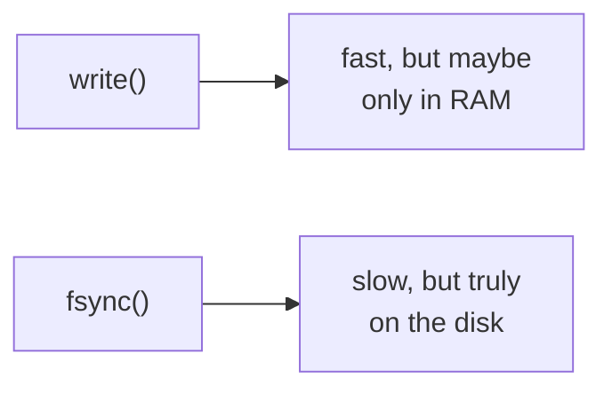
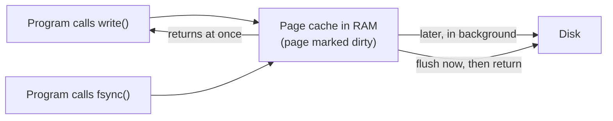
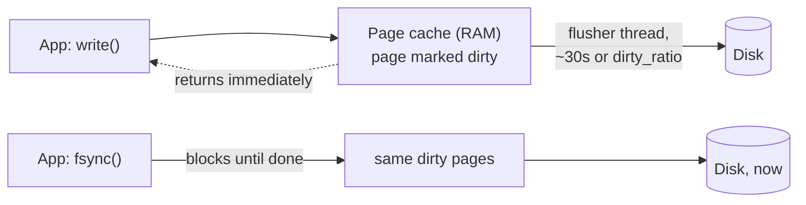
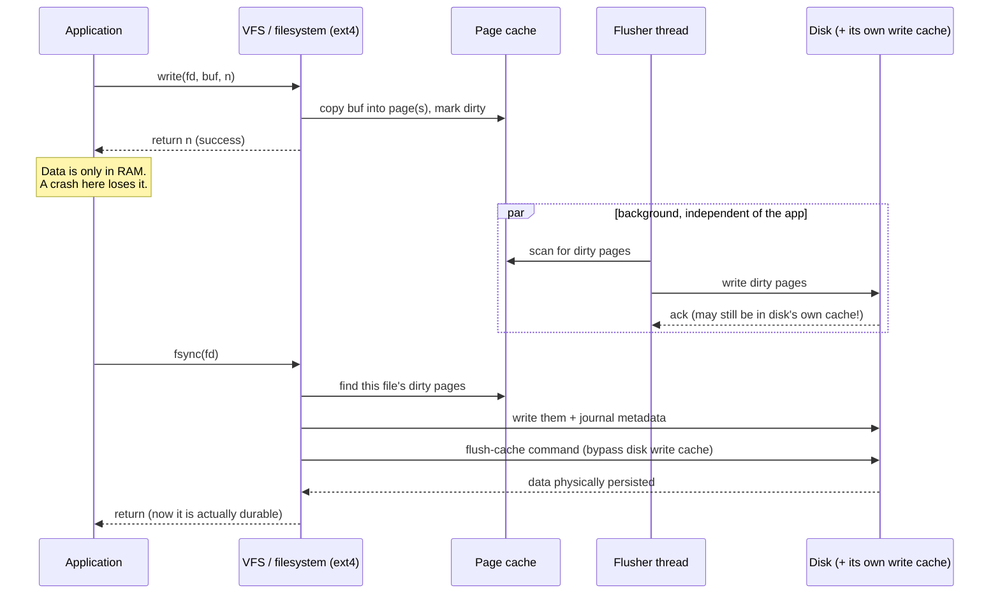
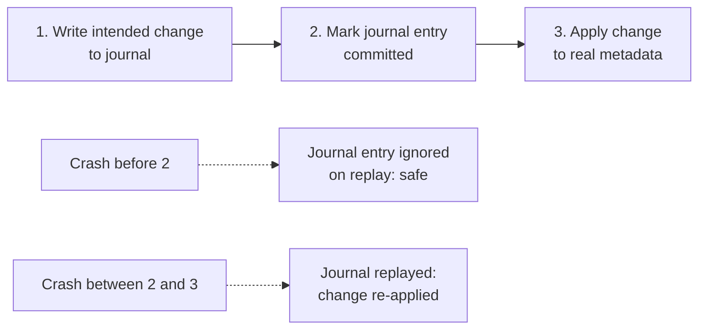
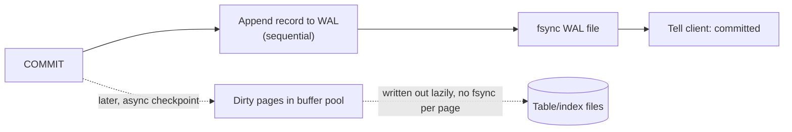

# Page Cache, File Systems and fsync

> [!summary] TL;DR
> When a program writes to a file, Linux normally writes into RAM first (the **page cache**) and returns immediately; the kernel copies those **dirty pages** to disk later, in the background. `fsync` forces that copy to happen now, which is the only way a program can be sure a write has survived a crash.

> [!abstract] Core idea
> - A write to a file is a write to a page cache page in RAM. The disk write happens later, asynchronously, unless you force it.
> - A "dirty" page is one that differs from what's on disk. `fsync` blocks until a file's dirty pages (and `fdatasync` also skips some metadata) reach the disk.
> - Reads are often free the second time: the page cache serves them straight from RAM with no I/O at all.
> - A crash before `fsync` can lose data that `write()` already "succeeded" on — this is the single most common cause of "but I thought I saved it".
> - Databases fsync their write-ahead log on every commit for exactly this reason: it is the only durability guarantee the OS gives you.

## Start here: the basics 🟢

> [!info] How to read this note (pick your level)
> - 🟢 **New to this?** Read "From zero" below, then sections 1, 2 and the cheat sheet (10). Stop there, that is a full first pass.
> - 🟡 **Know the basics?** Add section 3 (how it works), 4 (worked example), then 5 and 6.
> - 🔴 **Interview / SDE-3 prep?** Add 7, 8 and 9. Headings are tagged 🟢🟡🔴 so you always know where you are.

> [!note] Before this note
> - [[Storage Devices - HDD, SSD, NVMe]]: disks keep data after power-off but are thousands of times slower than RAM.
> - [[Virtual Memory, Paging and the TLB]]: memory is managed in fixed-size chunks called pages (usually 4 KB). The page cache uses the same pages.

**From zero, in 60 seconds** 🟢

Disks are slow, so the operating system cheats. When your program "writes a file", the data usually goes into fast memory first — a waiting room called the **page cache** — and the OS writes it to the real disk later.

This makes everything feel fast. But there is a catch: if the power dies before the background write happens, that data is gone — even though your program was told the write "succeeded". The fix is **fsync**, a call that says "do not come back until this is truly on disk".

The rest of this note is just three questions:
1. How does the page cache make reads and writes fast?
2. When exactly can you lose data, and what does fsync really promise?
3. How do databases and Go programs use this correctly?

**The problem in one story.**
You type a long essay and press Save. The app says "Saved!" instantly.
A second later the power goes out.
When the laptop comes back, the last paragraph is missing.
"Saved" meant "handed to the operating system", not "written onto the disk".

**Words you need first**

| Word | Plain meaning | Tiny example |
| --- | --- | --- |
| Disk / SSD | Slow storage that keeps data when power is off | Your laptop's NVMe drive |
| RAM | Fast memory that is wiped when power is off | 16 GB of memory |
| Kernel | The core of the OS that talks to hardware | Linux handling every file write |
| System call | A program asking the kernel to do something | `write()`, `read()`, `fsync()` |
| Page | A fixed-size chunk of memory or file, handled as one unit | 4 KB = 4096 bytes |
| Cache | A fast copy of data kept close by | Second read of a file comes from RAM |
| Dirty page | A cached page changed in RAM but not yet on disk | A file you wrote 2 seconds ago |
| Durable | Will survive a crash or power cut | Data after `fsync` returns |
| `fsync` | A system call meaning "write this file's changes to the disk now and wait" | `f.Sync()` in Go |
| `fdatasync` | Like `fsync`, but skips updates that only change timestamps | what most databases call |
| Flusher | A kernel background worker that writes dirty pages to disk on its own schedule | runs about every 30 s |
| Inode | The file's record card: size, permissions, where its blocks are (not its name) | `ls -i` shows its number |
| Journaling | The file system writing a note of a change before doing it, to recover after a crash | ext4's journal |
| WAL (write-ahead log) | A database's append-only diary, saved before the real tables change | PostgreSQL `pg_wal/` |

**Picture it**

**Analogy.** The page cache is an outbox tray on your desk. Dropping a letter in the tray is instant; the mail clerk empties the tray every so often. `fsync` is walking the letter to the post office yourself and waiting for the receipt.
Where it breaks: a real tray does not vanish in a fire before pickup without anyone knowing, but a power cut silently wipes every un-flushed page.

**How the rest of this note builds up**

- First, why writes go to RAM first (section 1) and a mental model of the page cache (section 2).
- Then the full write path, `fsync` vs `fdatasync` vs `O_DIRECT`, inodes and journaling (section 3).
- Then why databases fsync the WAL, fsync cost per storage tier, and a Go worked example (sections 3-4).
- Finally the SDE-3 deep dive: trade-offs, production failure modes, `mmap`, write amplification and `dirty_ratio` stalls (sections 5-8).

> [!tip] Remember
> `write()` puts your data in RAM; only `fsync()` puts it safely on disk.

## 1. Why it exists 🟢

Say a Go service calls `file.Write([]byte("order #4471 confirmed"))` and the call returns with no error. Did that data reach the disk?

No. `write(2)` only promises the bytes are now visible to every process that reads the file — which the kernel can guarantee far more cheaply by keeping them in RAM.

An SSD write (see [[Storage Devices - HDD, SSD, NVMe]]) costs tens to hundreds of microseconds; a RAM write costs single-digit nanoseconds.

If every `write()` had to wait for the physical device, every program doing file I/O would run thousands of times slower.

> [!warning] Common mistake
> Treating a successful `write()` call as proof the data is safe. It proves the data is *visible* to other readers, not that it has survived a crash. Those are different guarantees, and conflating them is the single most common cause of "but I thought I saved it" incidents.

So the kernel copies your bytes into a page of RAM called the **page cache**, marks that page **dirty**, and returns.

A background kernel thread (`kworker` on Linux, a general kernel helper thread; here it runs the per-device flusher, the modern replacement for the old `pdflush`) writes dirty pages to disk later — usually within about 30 seconds, sooner if the fraction of dirty memory crosses a threshold (`vm.dirty_ratio` / `vm.dirty_background_ratio`).

That is a reasonable trade for most files. It is not acceptable for a bank's ledger: if the machine loses power 10 seconds after `write()` returns, that dirty page is gone, and the write that "succeeded" never happened. This is why durability-sensitive software calls `fsync` (or `fdatasync`) before telling its own caller "done".

> [!tip] Remember
> A successful `write()` means "the kernel has your bytes," not "your bytes are on disk." Only `fsync` (or an equivalent explicit flush) closes that gap.

### Real-life example 🟢

When you pay with UPI, the bank's database must not forget the payment after a power cut.
So before it says "success", a database like PostgreSQL appends a small record to its WAL file and calls `fsync`, which waits until that record is really on disk.
Compare that with a chat app writing debug logs: losing the last few seconds of logs after a crash hurts nobody, so the app just calls `write()` and lets the kernel save the logs later.
Same `write()` call, very different needs: that is the whole choice this note is about.

## 2. Mental model 🟢

Think of the page cache as RAM standing in front of every file on the system, the same way a CPU cache stands in front of RAM (see [[Memory Hierarchy and CPU Caches]]):

- **Read a file page for the first time:** disk → page cache → your buffer. Slow.
- **Read it again:** page cache → your buffer. Disk never touched. Fast.
- **Write a file:** your buffer → page cache, marked dirty. Returns immediately. The disk write is the kernel's problem, later.
- **`fsync`:** "stop treating this as the kernel's problem — write the dirty pages for this file to the device, and the device's own cache too, and don't return until it's really there."

Unlike a CPU cache, the page cache has no fixed size dedicated to it: Linux uses whatever RAM isn't claimed by processes to cache file pages, and reclaims it instantly under memory pressure (when programs need that RAM back).

The analogy to a CPU cache breaks down here — a CPU cache has a hard capacity limit set by the hardware, while the page cache happily grows to fill all otherwise-idle RAM and shrinks the instant something else needs it.

`free -h`'s "available" column already accounts for this — a high "used" number that is mostly page cache is not a sign your machine is low on memory.

## Common beginner mistakes 🟢

- **Treating "write returned OK" as "saved to disk"** → the bytes may only be in RAM and vanish on a power cut → call `f.Sync()` before telling anyone the data is safe.
- **Calling `fsync` after every log line** → each call waits for the disk (about 0.1 to 10 ms), so the service slows down → sync only data that must survive, and batch it.
- **Thinking `bufio.Writer.Flush()` makes data durable** → it only moves bytes from your Go buffer to the kernel's page cache → call `Flush()` and then `f.Sync()`.
- **Panicking because "used memory" is high** → much of it is page cache that the kernel gives back instantly → read the "available" column in `free -h`.
- **Using `O_DIRECT` to "make writes faster"** → it removes the kernel's caching without giving you your own → only use it when you have your own cache, like a database buffer pool.

## 3. How it works 🟡

> 🟢 → 🟡 **You now know** that `write()` lands in RAM and only `fsync` makes it truly safe on disk. **Next we open the box:** the full path of a write, the three flush knobs (`fsync`, `fdatasync`, `O_DIRECT`), how ext4 stays consistent after a crash, why databases fsync only their WAL, and how much `fsync` costs on each kind of disk.

### Whiteboard version

In plain words: a write never touches the disk directly. It always lands in the page cache first, and a background flusher drains it later — unless the app forces an immediate flush with `fsync`.

**Step by step:**
1. Your Go program writes "order #4471 confirmed" to `orders.log`.
2. The kernel copies the bytes into a 4 KB page in RAM and marks it dirty. `write()` returns in under 1 µs.
3. Path A: nobody calls `fsync`. About 30 s later the flusher writes the page to disk.
4. Path B: the program calls `f.Sync()`. It waits, maybe 1 ms, until the page is on disk.
5. A power cut between steps 2 and 3 loses the line on path A, never on path B.

> [!tip] Remember
> There are exactly two ways a dirty page reaches disk: the background flusher's own schedule, or an explicit `fsync`/`fdatasync` call that blocks until it's done.

### The full write path

In plain words: a single `write()` call actually touches four different components — the application, the filesystem layer, the page cache, and eventually the disk — and only two of those four are involved before the call returns.

**Step by step:**
1. The app calls `write(fd, "hello")`.
2. The file system layer (ext4) works out which page of the file this touches.
3. The page cache copies "hello" into that page in RAM and marks it dirty.
4. `write()` returns. The disk has not been touched yet.
5. Later, the flusher (or an `fsync`) sends the dirty page to the disk, and the disk confirms.

**Example with numbers.** Say `write()` returns in under 1 microsecond (a RAM copy) and the background flusher normally runs every 30 seconds.

If the machine crashes 10 seconds after a `write()` that was never `fsync`'d, that write is gone — the "30 second window" is not a guarantee, it's an average, and any crash inside it loses data that the caller believes already succeeded.

> [!tip] Remember
> `write()` only ever talks to the page cache. The disk only gets involved later (the flusher) or on demand (`fsync`) — never as part of the `write()` call itself.

### fsync vs fdatasync vs O_DIRECT

In plain words: there are three different knobs for controlling how a write interacts with the page cache, and they are not interchangeable — each skips a different thing.

**Step by step:**
1. A database appends one WAL record to its log file.
2. `fsync` would save the record, the new file size, and the "last modified" time: everything.
3. `fdatasync` saves the record and the new size, but skips the timestamp, which is not needed to read the data back. One less write.
4. `O_DIRECT` is a different idea: open the file so writes skip the page cache completely. The database then keeps its own cache instead.

| Mechanism | What it forces to disk | What it skips |
| --- | --- | --- |
| `fsync(fd)` | File data **and** all metadata (size, timestamps, block pointers) | Nothing |
| `fdatasync(fd)` | File data and only the metadata needed to read it back (e.g. file size if it grew) | Timestamp-only metadata updates, which don't matter for reading the data back |
| `O_DIRECT` (open flag) | Every read/write bypasses the page cache entirely | The page cache's buffering and read-ahead (reading the next pages early, guessing you will want them) — the app does its own, usually with aligned buffers |

**Example.** Writing 1,000 WAL records with `fsync` after each one does 1,000 full metadata-plus-data flushes.

The same workload with `fdatasync` skips re-writing the file's access/modify timestamps each time (since they don't affect reading the data back), saving one write per call.

Most databases (PostgreSQL, MySQL/InnoDB) default to `fdatasync` for this reason; the difference matters at high commit rates, not for occasional writes.

`O_DIRECT` is a different tool entirely: it is for processes that manage their own cache better than the kernel can guess — a database's buffer pool already caches hot pages, so caching the same bytes again in the page cache just wastes RAM and adds a copy.

Linux exposes `O_DIRECT` via `open(2)`; Go's `os` package has no portable flag for it, so Go programs that want it open the file with `syscall.Open(path, syscall.O_RDWR|syscall.O_DIRECT, 0644)` on Linux (there is no equivalent flag on Darwin, which uses `fcntl(F_NOCACHE)` instead).

Those programs then must issue reads/writes in sector-aligned buffers (memory blocks that start at, and are sized in, whole multiples of the disk's sector, often 512 bytes or 4 KB), because the device no longer has the page cache smoothing out unaligned access.

> [!warning] Common mistake
> Reaching for `O_DIRECT` to "skip the slow page cache" on an ordinary sequential log writer. Without your own replacement cache, `O_DIRECT` just removes a free layer of buffering and read-ahead for no benefit — it only pays off once you have something better to put in its place.

> [!tip] Remember
> `fdatasync` is `fsync` minus the timestamp-only metadata update — cheaper, and what most databases actually call on their hot commit path.

### Inodes and journaling (ext4)

In plain words: a file's data and a file's bookkeeping (size, permissions, where its blocks live) are stored separately, and a crash in the middle of updating both can leave them disagreeing — journaling is how the filesystem recovers from that without a full disk scan.

**Step by step:**
1. You append 4 KB to `notes.txt`. Two things must change: a new data block, and the inode (size grows, a new block pointer).
2. ext4 first writes a note in its journal: "notes.txt: size 8 KB → 12 KB, add block 9001".
3. It marks that note committed.
4. Then it updates the real inode.
5. Power dies between 3 and 4? On reboot, ext4 replays the committed note and the inode is fixed in milliseconds.

A file's data lives in data blocks; a separate structure called the **inode** holds everything about the file except its name: size, permissions, timestamps, and the block pointers that say where its data blocks are. (The name-to-inode mapping lives in the parent directory's own data, which is why renaming a file doesn't touch the inode at all.)

The kernel keeps a cache of recently used inodes (the inode cache) and of recently resolved directory-entry lookups (the dentry cache), the same way it caches file data pages — this is what "inode cache" and "dentry cache" in `slabtop` (a Linux tool that lists the kernel's own memory caches) output refer to.

A crash mid-write can leave a file system with data blocks written but their inode's pointers not updated, or vice versa — a torn, inconsistent state.

ext4 avoids this with **journaling**: before changing the real metadata (or, in the strictest mode, data too), it writes a description of the intended change to a circular log (the journal) and marks it committed; only then does it apply the change in place.

After a crash, replaying the journal from the last commit brings the file system back to a consistent state in seconds, instead of needing a full `fsck` (file system check: a slow tool that reads every inode to find mistakes) scan of the whole disk.

**Example.** A crash between steps 2 and 3 above leaves the real metadata not yet updated, but the journal already has a committed record of the intended change — on reboot, replaying that one record finishes the update in milliseconds, instead of `fsck` scanning every inode on the disk to find what's inconsistent.

ext4 offers three journal modes, trading safety for speed:

| Mode | What goes through the journal | Risk after a crash |
| --- | --- | --- |
| `journal` | Metadata and data | Slowest; safest — no torn writes of any kind |
| `ordered` (default) | Metadata only, but data blocks are flushed before their metadata commits | Can't end up with metadata pointing at garbage, but non-journaled data writes that were in flight can still be lost |
| `writeback` | Metadata only, no ordering guarantee with data | Fastest; after a crash a file's metadata can say "32 KB long" while some of those bytes are stale garbage |

> [!tip] Remember
> The journal protects filesystem *metadata* consistency, not your *data's* durability — those are separate guarantees, and only `fsync` covers the second one.

### Why databases fsync the WAL

In plain words: fsyncing every table page a transaction touched would be slow and random; instead, a database writes one small sequential record describing the change and fsyncs only that, then applies the real change to its data pages lazily, later.

**Step by step:**
1. A transaction changes 50 rows spread across 50 table and index pages.
2. PostgreSQL changes those 50 pages in its own RAM buffer only.
3. On `COMMIT`, it appends one small record describing all the changes to the WAL file.
4. It calls `fsync` on the WAL file once, then tells the client "committed".
5. Later, a background checkpoint writes the 50 pages to disk. After a crash, replaying the WAL rebuilds anything not yet written.

A database like PostgreSQL never fsyncs its main table files on every write — that would be far too slow.

Instead it appends every change to a small, sequential **write-ahead log (WAL)** file and fsyncs *that* on commit (`synchronous_commit = on`, PostgreSQL 17 default).

The actual table and index pages are modified in RAM (in the database's own buffer pool, a page cache it manages itself) and written out lazily by a background checkpoint process (a job that regularly writes changed pages to the table files so the WAL before that point is no longer needed).

This works because the WAL alone is enough to recover: after a crash, PostgreSQL replays every WAL record after the last checkpoint, redoing the committed-but-not-yet-checkpointed changes. The cost of durability is one small, sequential, append-only fsync per commit, not a random-write fsync across however many pages the transaction touched.

**Example.** A transaction that updates 50 scattered index and table pages would need 50 random-write fsyncs if each page were flushed directly. Instead, it costs exactly one sequential fsync of a small WAL record — often a thousand times fewer physical seeks, which is the entire reason WAL-based durability is fast enough to use on every commit.

If `fsync()` itself lies — some disk write caches and, notoriously, some early Linux/ext4 + consumer SSD combinations acknowledged a flush before data was physically on platters — no amount of application-level care helps.

This is why production databases run on storage with power-loss protection (server SSDs have capacitors that finish in-flight writes on power loss) and why cloud block storage (EBS, Persistent Disk: AWS and Google Cloud disks that live on the network, not inside the server) documents its own durability guarantees separately from what `fsync` promises.

> [!tip] Remember
> A database doesn't fsync every page a transaction touches — it fsyncs one small, sequential WAL record per commit and replays that log after a crash to redo everything else.

### fsync cost across storage tiers

In plain words: how much `fsync` actually costs depends enormously on what's underneath it — the same call can be free-ish or a major latency source depending on the device.

**Step by step:**
1. The same Go service calls `f.Sync()` after each order.
2. On a local NVMe SSD with power-loss protection, each call takes about 0.1 to 1 ms.
3. On a cloud network disk (like EBS), the "disk" is across the network, so each call takes about 1 to 10 ms.
4. On a spinning hard disk, the head must move, so each call takes about 5 to 10 ms.
5. At 5 ms per call, one connection can confirm only about 200 orders per second. That is why batching matters.

| Storage tier | Typical `fsync` cost (small WAL record) | Why |
| --- | --- | --- |
| Cloud NVMe (local, with power-loss protection) | ~0.1–1 ms | Direct flash write, capacitor-backed write cache can be trusted |
| Consumer SATA SSD, no power-loss protection | Similar to NVMe, occasionally worse | May need to actually flush its own write cache rather than trusting it |
| Cloud network block storage (EBS, Persistent Disk) | Often 1–10+ ms, more variable | The "disk" is a network round trip to a replicated storage service |
| Spinning HDD | 5–10+ ms | Dominated by mechanical seek time to the right track (see [[Storage Devices - HDD, SSD, NVMe]]) |

**Example.** A service doing one `fsync` per request on cloud network block storage at ~5 ms each can serve at most about 200 synchronous commits per second *per connection* — which is exactly why group/batch commit (below) matters so much more on network-backed storage than on local NVMe.

> [!tip] Remember
> `fsync` cost is not a fixed constant — it ranges from under a millisecond on local NVMe with power-loss protection to several milliseconds or more on network-backed cloud storage, so always measure on the target storage tier.

## 4. Worked example 🟡

### Whiteboard version

Trace a single durable append through the write path: `WriteAppendSync` opens the file, writes the record into the page cache (step 1 of the sequence diagram above), then calls `Sync()`, which performs the `fsync(2)` syscall — forcing that specific file's dirty pages and journal metadata to disk before the function returns.

This is the same shape as a database's WAL append: open for append, write the record, sync before telling the caller it is safe to proceed.

**Step by step:**
1. `os.OpenFile` with `O_APPEND|O_CREATE|O_WRONLY` opens (or creates) the file positioned to append at the end.
2. `f.Write(data)` copies the bytes into the page cache; this is the fast, in-RAM part of the write path.
3. `f.Sync()` calls `fsync(2)`, which blocks until this file's dirty pages and metadata are physically on the device.
4. Only after `Sync()` returns does the function return `nil` — the caller can now treat the write as durable.

Runnable Go version: [[Page Cache, File Systems and fsync - Go]].

**Tested:** `go vet` and `go test -race` both pass on Go 1.24.4, darwin/arm64 (2026-11-06).

The test only proves the bytes are readable back; it cannot prove durability across a real power loss from inside a test — that would need to kill the machine mid-write, which is exactly why `fsync` has to be taken on documented faith (the kernel's), not measured in a unit test.

**Representative timing (estimate, not measured here):** on a cloud NVMe volume, an `fsync` of a small WAL record typically costs **0.1–1 ms**; on a consumer SATA SSD without power-loss protection it can be similar or occasionally worse if the device has to actually flush its own write cache.

A `write()` with no `fsync` costs **under 1 µs** — it's a `memcpy` into RAM.

That three-to-four-orders-of-magnitude gap is why `synchronous_commit = off` (deferring the fsync) is sometimes used in PostgreSQL for throughput, accepting that the last fraction of a second of commits can be lost on a crash.

## 5. Variants and comparison 🟡

| Option | How it works | Use when | Cost |
| --- | --- | --- | --- |
| Buffered I/O, no fsync | Write goes to page cache only | Logs, scratch files, anything re-creatable | Fastest; data can be lost on crash |
| Buffered I/O + `fsync` | Forces dirty pages + metadata to disk | Committing a transaction, a WAL record | One flush round-trip per call, ~0.1–1 ms on NVMe |
| Buffered I/O + `fdatasync` | Forces data + only size-relevant metadata | Same as above, slightly hotter path | Marginally cheaper than `fsync` |
| `O_DIRECT` | Bypasses the page cache entirely | A database or storage engine with its own buffer pool | No kernel readahead/caching; needs aligned I/O; still needs `fsync`/`fdatasync` for durability unless the device write cache is also disabled |
| `msync` on an `mmap`'d file | Flushes dirty pages of a memory-mapped file | Memory-mapped storage engines (some LMDB configurations) | Similar cost to `fsync`, different API |

### Flush vs Sync vs Close in Go: people mix these up 🟡

| Call | Where the bytes go | Survives a power cut? |
| --- | --- | --- |
| `bufio.Writer.Flush()` | From your Go buffer into the kernel's page cache | No |
| `f.Write(b)` | Into the page cache | No |
| `f.Sync()` | From the page cache onto the disk (calls `fsync`) | Yes |
| `f.Close()` | Releases the file; does **not** sync | No |

## 6. Trade-offs and when not to use 🟡

- `fsync` is a per-call latency tax. Calling it on every log line in a hot path will make your service's p99 look like your disk's `fsync` latency, not your CPU's.
- Batching commits (group commit: collect several transactions, `fsync` once) trades a little added latency per transaction for much higher throughput — PostgreSQL does this automatically for concurrent commits.
- `O_DIRECT` only pays off once you have your own cache to replace the page cache with; using it for simple sequential log writing just removes a free layer of buffering for no benefit.
- Skipping `fsync` entirely is fine for data you can regenerate or afford to lose up to the last flush interval (metrics batches, caches you'd rebuild anyway).

> 🟡 → 🔴 **You now know** the write path, the flush options, journaling, why databases fsync only the WAL, and what `fsync` costs. **Next comes the advanced part:** how PostgreSQL, Kafka and etcd choose differently, how page-cache problems show up in production, and deeper details like `mmap`, write amplification and `dirty_ratio` stalls.

## 7. In production 🔴

- **Real systems:** PostgreSQL and MySQL/InnoDB `fsync`/`fdatasync` their WAL/redo log on commit.
	- Kafka relies on the OS page cache for its hot read/write path and only optionally forces flushes (`flush.messages`), leaning on replication for durability instead.
	- etcd and most Raft logs `fsync` every appended entry before acknowledging it, because an un-fsynced "committed" entry that a crash erases can violate the consensus safety property.
- **Failure modes → fixes:**
	- "I wrote the file and it's gone after a power cut" → missing `fsync`; add it on the durability-critical path only.
	- Latency spikes under load with many small writers → batch/group commits instead of one `fsync` per writer.
	- `fsync` on an unrelated file is slow because the whole file system's journal commit is serialized behind it → separate WAL and data files onto different devices, or at least different file systems, for write-heavy databases.
	- "Disk is full" surprises from a huge page cache → page cache is reclaimable and shown separately from "used" memory in modern `free`; the real culprit is usually dirty pages that can't be written back fast enough (`vm.dirty_bytes` tuning) or an actual full file system (`df`, not `free`).
- **What to monitor:** `fsync` latency (histogram, not just average — tail latency is what callers feel), the dirty page ratio (`/proc/meminfo`'s `Dirty` and `Writeback`), WAL write/fsync rate, and journal commit latency on the underlying file system.

## 8. Deep dive 🔴

- **Write-back vs write-through caching, at the OS level.** The page cache is write-back by default: writes land in RAM and are flushed later. This is the same policy choice as a CPU or application cache (see [[Memory Hierarchy and CPU Caches]] and [[Cache Eviction Policies - LRU, LFU, TTL]]) — faster writes, a durability window you must close explicitly if you need it.
- **Read-ahead.** On sequential access the kernel speculatively reads the next several pages into the cache before you ask for them, which is why a sequential scan of a cold 10 GB file is often faster per byte than random reads of the same file — it isn't really "cold" for long.
- **`mmap` and the page cache are the same memory.** A memory-mapped file's pages are page-cache pages; dirtying them through a pointer write marks the same dirty bit a `write()` syscall would, and `msync` is the mmap equivalent of `fsync`. This is why some storage engines (LMDB) use `mmap` instead of `read`/`write`: no extra copy between the page cache and a user buffer.
- **Write amplification through the page cache.** Even a 4-byte `write()` dirties an entire 4 KB page, and ext4's journal can double-write that page's metadata (once to the journal, once in place). Combined with the SSD's own internal write amplification (see [[Storage Devices - HDD, SSD, NVMe]]), a small logical write can become a much larger physical one.
- **`dirty_ratio` and the stampede it can cause.** If writers produce dirty pages faster than the flusher can drain them, the kernel starts throttling — even blocking — writing processes once dirty memory crosses `vm.dirty_ratio` (percentage of RAM), to stop an unbounded crash-loss window from growing. A sudden burst of synchronous writes after a long quiet period is the classic trigger.

## 9. Interview questions 🔴

> [!question]- If `write()` returned successfully, is my data safe on disk?
> No. It is safe in the page cache, which is RAM. It survives a process crash (another process can still read it) but not a power loss or kernel panic until the dirty page is actually flushed, which `fsync` forces and the background flusher does lazily.

> [!question]- What's the difference between `fsync` and `fdatasync`?
> `fsync` flushes file data and all of its metadata (including timestamps). `fdatasync` flushes data and only the metadata needed to read that data back, such as file size after a growing write — it skips metadata updates that don't affect correctness, so it's usually a bit cheaper. Databases typically use `fdatasync` for their WAL.

> [!question]- Why does a database fsync its WAL but not its table files on every commit?
> The WAL is a small, sequential, append-only file — one cheap fsync per commit durably records the change. Table and index pages are modified in RAM and written back lazily by a checkpoint; after a crash, replaying the WAL since the last checkpoint reconstructs any changes that hadn't reached disk yet. Fsyncing every touched table page per commit would mean random-write fsyncs, far more expensive.
> [!trap] A common wrong answer is "because the WAL is more important" — it isn't more important, it's cheaper to make durable, and it's sufficient for crash recovery because it's replayable.

> [!question]- When would you reach for `O_DIRECT`?
> When your application already manages its own cache better than the kernel's generic LRU can — a database buffer pool is the classic case. `O_DIRECT` skips the page cache (and its read-ahead) entirely, so the app does its own buffering and must issue sector-aligned I/O. It is not a durability mechanism by itself; you can still need `fsync`/`fdatasync` unless the device's own write cache is also disabled.

> [!question]- What does ext4's journal protect against, and what does it not protect against?
> It protects file system metadata consistency across a crash — so a crash mid-write doesn't leave an inode pointing at garbage blocks or a directory structure that `fsck` would need a full scan to repair. In the default `ordered` mode, it does not guarantee your most recent *data* write is durable unless you called `fsync`; metadata consistency and data durability are separate guarantees.

> [!question]- Your service's p99 latency jumped after you added `fsync()` per request to "be safe". What's the fix?
> Group/batch commits: collect writes from a short window (or from concurrently pending callers) and `fsync` once for the batch, then acknowledge all of them. This trades a small amount of added latency for far higher throughput, which is exactly what PostgreSQL's commit grouping and most production WAL implementations do.

## 10. Cheat sheet 🟢

- `write()` goes to RAM (the page cache) first; the disk write happens later, in the background.
- `fsync` blocks until this file's dirty data and metadata are really on disk; `fdatasync` skips non-essential metadata.
- `O_DIRECT` bypasses the page cache; it needs your own buffering and aligned I/O.
- The inode holds a file's metadata and block pointers; names live in the parent directory, not the inode.
- ext4's journal protects metadata consistency across a crash; it is not the same guarantee as `fsync`'d data durability.
- Databases fsync a small sequential WAL per commit instead of fsyncing scattered table pages.
- Batch/group commits trade a little latency for much higher fsync throughput.
- A big "used" number in `free -h` that's mostly page cache is not a memory problem.
- `fsync` cost ranges from under 1 ms on local NVMe to several ms or more on network-backed cloud storage — measure on the target tier.
- Runnable Go version: [[Page Cache, File Systems and fsync - Go]].

## Self-check 🟢🟡

🟢 Easy

> [!question]- When `write()` returns OK, where is the data?
> In the page cache in RAM, marked dirty. It is not yet on disk.

> [!question]- What does `fsync` promise?
> When it returns, the file's changes are on the disk and survive a crash.

> [!question]- Why is reading the same file twice often much faster the second time?
> The second read comes from the page cache in RAM; the disk is not touched.

🟡 Medium

> [!question]- Why does a database fsync only its WAL and not every changed table page?
> One small sequential WAL fsync per commit is far cheaper; after a crash the WAL is replayed to redo the rest.

> [!question]- `fsync` vs `fdatasync`: what is the difference?
> `fdatasync` skips metadata that only changes timestamps, so it does one less write per call.

> [!question]- Does ext4 journaling mean you do not need `fsync`?
> No. The journal keeps the file system's bookkeeping consistent; only `fsync` makes your data durable.

## Links

- **Before this:** [[Storage Devices - HDD, SSD, NVMe]], [[Virtual Memory, Paging and the TLB]]
- **Next:** [[CPU Scheduling]], [[System Calls and User vs Kernel Mode]]
- **Compare with:** [[Memory Hierarchy and CPU Caches]] (write-back caching at the hardware level), [[Consistent Hashing]] (another "quality bar" note on durability and real systems)
- **Go code:** [[Page Cache, File Systems and fsync - Go]]

### Watch on YouTube

- [The Secret Behind Database Durability: Write-Ahead Logging (WAL)](https://www.youtube.com/watch?v=VP00nqv6txY) · Shubh Patel · shows why databases fsync their WAL on commit for durability
- [Write-Ahead Logging Explained: Database Durability & Recovery](https://www.youtube.com/watch?v=ZyGF-ag0p68) · CodeLucky · complements the fsync/durability angle with crash-recovery mechanics
