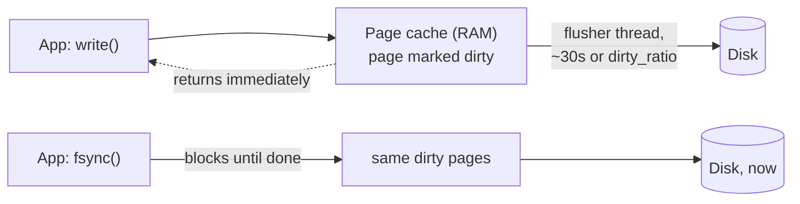
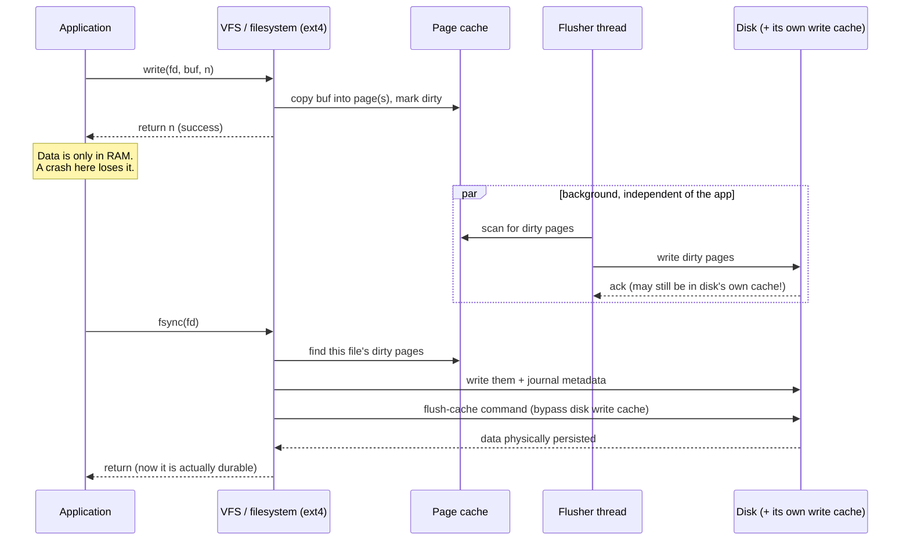
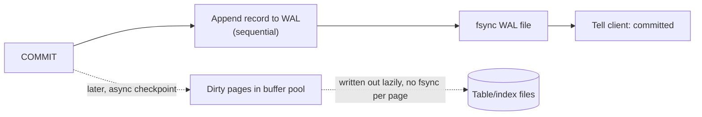

# Page Cache, File Systems and fsync

> [!summary] TL;DR
> When a program writes to a file, Linux normally writes into RAM first (the **page cache**) and returns immediately; the kernel copies those **dirty pages** to disk later, in the background. `fsync` forces that copy to happen now, which is the only way a program can be sure a write has survived a crash.

> [!abstract] Core idea
> - A write to a file is a write to a page cache page in RAM. The disk write happens later, asynchronously, unless you force it.
> - A "dirty" page is one that differs from what's on disk. `fsync` blocks until a file's dirty pages (and `fdatasync` also skips some metadata) reach the disk.
> - Reads are often free the second time: the page cache serves them straight from RAM with no I/O at all.
> - A crash before `fsync` can lose data that `write()` already "succeeded" on — this is the single most common cause of "but I thought I saved it".
> - Databases fsync their write-ahead log on every commit for exactly this reason: it is the only durability guarantee the OS gives you.

## 1. Why it exists

Say a Go service calls `file.Write([]byte("order #4471 confirmed"))` and the call returns with no error. Did that data reach the disk?

No. `write(2)` only promises the bytes are now visible to every process that reads the file — which the kernel can guarantee far more cheaply by keeping them in RAM. An SSD write (see [[Storage Devices - HDD, SSD, NVMe]]) costs tens to hundreds of microseconds; a RAM write costs single-digit nanoseconds. If every `write()` had to wait for the physical device, every program doing file I/O would run thousands of times slower.

So the kernel copies your bytes into a page of RAM called the **page cache**, marks that page **dirty**, and returns. A background kernel thread (`kworker` on Linux, via `pdflush`'s modern replacement, the per-device flusher thread) writes dirty pages to disk later — usually within about 30 seconds, sooner if the fraction of dirty memory crosses a threshold (`vm.dirty_ratio` / `vm.dirty_background_ratio`).

That is a reasonable trade for most files. It is not acceptable for a bank's ledger: if the machine loses power 10 seconds after `write()` returns, that dirty page is gone, and the write that "succeeded" never happened. This is why durability-sensitive software calls `fsync` (or `fdatasync`) before telling its own caller "done".

## 2. Mental model

Think of the page cache as RAM standing in front of every file on the system, the same way a CPU cache stands in front of RAM (see [[Memory Hierarchy and CPU Caches]]):

- **Read a file page for the first time:** disk → page cache → your buffer. Slow.
- **Read it again:** page cache → your buffer. Disk never touched. Fast.
- **Write a file:** your buffer → page cache, marked dirty. Returns immediately. The disk write is the kernel's problem, later.
- **`fsync`:** "stop treating this as the kernel's problem — write the dirty pages for this file to the device, and the device's own cache too, and don't return until it's really there."

Unlike a CPU cache, the page cache has no fixed size dedicated to it: Linux uses whatever RAM isn't claimed by processes to cache file pages, and reclaims it instantly under memory pressure. `free -h`'s "available" column already accounts for this — a high "used" number that is mostly page cache is not a sign your machine is low on memory.

## 3. How it works

### Whiteboard version

A write never touches the disk directly. It always goes through the page cache first, and a background flusher drains it later:



### The full write path



### fsync vs fdatasync vs O_DIRECT

| Mechanism | What it forces to disk | What it skips |
| --- | --- | --- |
| `fsync(fd)` | File data **and** all metadata (size, timestamps, block pointers) | Nothing |
| `fdatasync(fd)` | File data and only the metadata needed to read it back (e.g. file size if it grew) | Timestamp-only metadata updates, which don't matter for reading the data back |
| `O_DIRECT` (open flag) | Every read/write bypasses the page cache entirely | The page cache's buffering and read-ahead — the app does its own, usually with aligned buffers |

`fdatasync` is usually a little faster than `fsync` because it can skip one metadata write when only the file's content changed, not its size. Most databases (PostgreSQL, MySQL/InnoDB) default to `fdatasync` for this reason; the difference matters at high commit rates, not for occasional writes.

`O_DIRECT` is a different tool: it is for processes that manage their own cache better than the kernel can guess — a database's buffer pool already caches hot pages, so caching the same bytes again in the page cache just wastes RAM and adds a copy. Linux exposes `O_DIRECT` via `open(2)`; Go's `os` package has no portable flag for it, so Go programs that want it open the file with `syscall.Open(path, syscall.O_RDWR|syscall.O_DIRECT, 0644)` on Linux (there is no equivalent flag on Darwin, which uses `fcntl(F_NOCACHE)` instead) and then must issue reads/writes in sector-aligned buffers, because the device no longer has the page cache smoothing out unaligned access.

### Inodes and journaling (ext4)

A file's data lives in data blocks; a separate structure called the **inode** holds everything about the file except its name: size, permissions, timestamps, and the block pointers that say where its data blocks are. (The name-to-inode mapping lives in the parent directory's own data, which is why renaming a file doesn't touch the inode at all.) The kernel keeps a cache of recently used inodes (the inode cache) and of recently resolved directory-entry lookups (the dentry cache), the same way it caches file data pages — this is what "inode cache" and "dentry cache" in `slabtop` output refer to.

A crash mid-write can leave a file system with data blocks written but their inode's pointers not updated, or vice versa — a torn, inconsistent state. ext4 avoids this with **journaling**: before changing the real metadata (or, in the strictest mode, data too), it writes a description of the intended change to a circular log (the journal) and marks it committed; only then does it apply the change in place. After a crash, replaying the journal from the last commit brings the file system back to a consistent state in seconds, instead of needing a full `fsck` scan of the whole disk.

ext4 offers three journal modes, trading safety for speed:

| Mode | What goes through the journal | Risk after a crash |
| --- | --- | --- |
| `journal` | Metadata and data | Slowest; safest — no torn writes of any kind |
| `ordered` (default) | Metadata only, but data blocks are flushed before their metadata commits | Can't end up with metadata pointing at garbage, but non-journaled data writes that were in flight can still be lost |
| `writeback` | Metadata only, no ordering guarantee with data | Fastest; after a crash a file's metadata can say "32 KB long" while some of those bytes are stale garbage |

### Why databases fsync the WAL

A database like PostgreSQL never fsyncs its main table files on every write — that would be far too slow. Instead it appends every change to a small, sequential **write-ahead log (WAL)** file and fsyncs *that* on commit (`synchronous_commit = on`, PostgreSQL 17 default). The actual table and index pages are modified in RAM (in the database's own buffer pool, a page cache it manages itself) and written out lazily by a background checkpoint process.

This works because the WAL alone is enough to recover: after a crash, PostgreSQL replays every WAL record after the last checkpoint, redoing the committed-but-not-yet-checkpointed changes. The cost of durability is one small, sequential, append-only fsync per commit, not a random-write fsync across however many pages the transaction touched.



If `fsync()` itself lies — some disk write caches and, notoriously, some early Linux/ext4 + consumer SSD combinations acknowledged a flush before data was physically on platters — no amount of application-level care helps; this is why production databases run on storage with power-loss protection (server SSDs have capacitors that finish in-flight writes on power loss) and why cloud block storage (EBS, Persistent Disk) documents its own durability guarantees separately from what `fsync` promises.

## 4. Worked example

### Whiteboard version

```go
package pagecache

import "os"

func WriteAppendSync(path string, data []byte) error {
	f, err := os.OpenFile(path, os.O_APPEND|os.O_CREATE|os.O_WRONLY, 0o644)
	if err != nil {
		return err
	}
	defer f.Close()
	if _, err := f.Write(data); err != nil {
		return err
	}
	return f.Sync() // the fsync(2) syscall
}
```

### The durable-append pattern, with and without fsync

This is the same shape as a WAL append: open for append, write the record, `Sync()` before telling the caller it is safe to proceed.

```go
package pagecache

import "os"

// WriteAppendSync appends data to the file at path and calls Sync before
// returning, so the bytes are durable on disk (not just sitting as dirty
// pages in the OS page cache) before the caller proceeds. This is the same
// pattern a database uses after appending a record to its write-ahead log.
func WriteAppendSync(path string, data []byte) error {
	f, err := os.OpenFile(path, os.O_APPEND|os.O_CREATE|os.O_WRONLY, 0o644)
	if err != nil {
		return err
	}
	defer f.Close()
	if _, err := f.Write(data); err != nil {
		return err
	}
	return f.Sync() // fsync(2): flush this file's dirty pages and metadata to disk
}

// WriteAppendNoSync appends data without fsync. The bytes reach the page
// cache immediately (later readers see them) but may still be lost if the
// machine loses power before the kernel's writeback flushes them.
func WriteAppendNoSync(path string, data []byte) error {
	f, err := os.OpenFile(path, os.O_APPEND|os.O_CREATE|os.O_WRONLY, 0o644)
	if err != nil {
		return err
	}
	defer f.Close()
	_, err = f.Write(data)
	return err
}
```

```go
func TestWriteAppendSyncDurableAndReadable(t *testing.T) {
	dir := t.TempDir()
	path := filepath.Join(dir, "wal.log")

	if err := WriteAppendSync(path, []byte("record-1\n")); err != nil {
		t.Fatalf("WriteAppendSync: %v", err)
	}
	if err := WriteAppendSync(path, []byte("record-2\n")); err != nil {
		t.Fatalf("WriteAppendSync: %v", err)
	}

	got, err := os.ReadFile(path)
	if err != nil {
		t.Fatalf("ReadFile: %v", err)
	}
	want := "record-1\nrecord-2\n"
	if string(got) != want {
		t.Fatalf("got %q, want %q", got, want)
	}
}
```

**Tested:** `go vet` and `go test -race` both pass on Go 1.24.4, darwin/arm64 (2026-11-06). The test only proves the bytes are readable back; it cannot prove durability across a real power loss from inside a test — that would need to kill the machine mid-write, which is exactly why `fsync` has to be taken on documented faith (the kernel's), not measured in a unit test.

**Representative timing (estimate, not measured here):** on a cloud NVMe volume, an `fsync` of a small WAL record typically costs **0.1–1 ms**; on a consumer SATA SSD without power-loss protection it can be similar or occasionally worse if the device has to actually flush its own write cache. A `write()` with no `fsync` costs **under 1 µs** — it's a `memcpy` into RAM. That three-to-four-orders-of-magnitude gap is why `synchronous_commit = off` (deferring the fsync) is sometimes used in PostgreSQL for throughput, accepting that the last fraction of a second of commits can be lost on a crash.

## 5. Variants and comparison

| Option | How it works | Use when | Cost |
| --- | --- | --- | --- |
| Buffered I/O, no fsync | Write goes to page cache only | Logs, scratch files, anything re-creatable | Fastest; data can be lost on crash |
| Buffered I/O + `fsync` | Forces dirty pages + metadata to disk | Committing a transaction, a WAL record | One flush round-trip per call, ~0.1–1 ms on NVMe |
| Buffered I/O + `fdatasync` | Forces data + only size-relevant metadata | Same as above, slightly hotter path | Marginally cheaper than `fsync` |
| `O_DIRECT` | Bypasses the page cache entirely | A database or storage engine with its own buffer pool | No kernel readahead/caching; needs aligned I/O; still needs `fsync`/`fdatasync` for durability unless the device write cache is also disabled |
| `msync` on an `mmap`'d file | Flushes dirty pages of a memory-mapped file | Memory-mapped storage engines (some LMDB configurations) | Similar cost to `fsync`, different API |

## 6. Trade-offs and when not to use

- `fsync` is a per-call latency tax. Calling it on every log line in a hot path will make your service's p99 look like your disk's `fsync` latency, not your CPU's.
- Batching commits (group commit: collect several transactions, `fsync` once) trades a little added latency per transaction for much higher throughput — PostgreSQL does this automatically for concurrent commits.
- `O_DIRECT` only pays off once you have your own cache to replace the page cache with; using it for simple sequential log writing just removes a free layer of buffering for no benefit.
- Skipping `fsync` entirely is fine for data you can regenerate or afford to lose up to the last flush interval (metrics batches, caches you'd rebuild anyway).

## 7. In production

- **Real systems:** PostgreSQL and MySQL/InnoDB `fsync`/`fdatasync` their WAL/redo log on commit; Kafka relies on the OS page cache for its hot read/write path and only optionally forces flushes (`flush.messages`), leaning on replication for durability instead; etcd and most Raft logs `fsync` every appended entry before acknowledging it, because an un-fsynced "committed" entry that a crash erases can violate the consensus safety property.
- **Failure modes → fixes:**
	- "I wrote the file and it's gone after a power cut" → missing `fsync`; add it on the durability-critical path only.
	- Latency spikes under load with many small writers → batch/group commits instead of one `fsync` per writer.
	- `fsync` on an unrelated file is slow because the whole file system's journal commit is serialized behind it → separate WAL and data files onto different devices, or at least different file systems, for write-heavy databases.
	- "Disk is full" surprises from a huge page cache → page cache is reclaimable and shown separately from "used" memory in modern `free`; the real culprit is usually dirty pages that can't be written back fast enough (`vm.dirty_bytes` tuning) or an actual full file system (`df`, not `free`).
- **What to monitor:** `fsync` latency (histogram, not just average — tail latency is what callers feel), the dirty page ratio (`/proc/meminfo`'s `Dirty` and `Writeback`), WAL write/fsync rate, and journal commit latency on the underlying file system.

## 8. Deep dive

- **Write-back vs write-through caching, at the OS level.** The page cache is write-back by default: writes land in RAM and are flushed later. This is the same policy choice as a CPU or application cache (see [[Memory Hierarchy and CPU Caches]] and [[Cache Eviction Policies - LRU, LFU, TTL]]) — faster writes, a durability window you must close explicitly if you need it.
- **Read-ahead.** On sequential access the kernel speculatively reads the next several pages into the cache before you ask for them, which is why a sequential scan of a cold 10 GB file is often faster per byte than random reads of the same file — it isn't really "cold" for long.
- **`mmap` and the page cache are the same memory.** A memory-mapped file's pages are page-cache pages; dirtying them through a pointer write marks the same dirty bit a `write()` syscall would, and `msync` is the mmap equivalent of `fsync`. This is why some storage engines (LMDB) use `mmap` instead of `read`/`write`: no extra copy between the page cache and a user buffer.
- **Write amplification through the page cache.** Even a 4-byte `write()` dirties an entire 4 KB page, and ext4's journal can double-write that page's metadata (once to the journal, once in place). Combined with the SSD's own internal write amplification (see [[Storage Devices - HDD, SSD, NVMe]]), a small logical write can become a much larger physical one.
- **`dirty_ratio` and the stampede it can cause.** If writers produce dirty pages faster than the flusher can drain them, the kernel starts throttling — even blocking — writing processes once dirty memory crosses `vm.dirty_ratio` (percentage of RAM), to stop an unbounded crash-loss window from growing. A sudden burst of synchronous writes after a long quiet period is the classic trigger.

## 9. Interview questions

> [!question]- If `write()` returned successfully, is my data safe on disk?
> No. It is safe in the page cache, which is RAM. It survives a process crash (another process can still read it) but not a power loss or kernel panic until the dirty page is actually flushed, which `fsync` forces and the background flusher does lazily.

> [!question]- What's the difference between `fsync` and `fdatasync`?
> `fsync` flushes file data and all of its metadata (including timestamps). `fdatasync` flushes data and only the metadata needed to read that data back, such as file size after a growing write — it skips metadata updates that don't affect correctness, so it's usually a bit cheaper. Databases typically use `fdatasync` for their WAL.

> [!question]- Why does a database fsync its WAL but not its table files on every commit?
> The WAL is a small, sequential, append-only file — one cheap fsync per commit durably records the change. Table and index pages are modified in RAM and written back lazily by a checkpoint; after a crash, replaying the WAL since the last checkpoint reconstructs any changes that hadn't reached disk yet. Fsyncing every touched table page per commit would mean random-write fsyncs, far more expensive.
> [!trap] A common wrong answer is "because the WAL is more important" — it isn't more important, it's cheaper to make durable, and it's sufficient for crash recovery because it's replayable.

> [!question]- When would you reach for `O_DIRECT`?
> When your application already manages its own cache better than the kernel's generic LRU can — a database buffer pool is the classic case. `O_DIRECT` skips the page cache (and its read-ahead) entirely, so the app does its own buffering and must issue sector-aligned I/O. It is not a durability mechanism by itself; you can still need `fsync`/`fdatasync` unless the device's own write cache is also disabled.

> [!question]- What does ext4's journal protect against, and what does it not protect against?
> It protects file system metadata consistency across a crash — so a crash mid-write doesn't leave an inode pointing at garbage blocks or a directory structure that `fsck` would need a full scan to repair. In the default `ordered` mode, it does not guarantee your most recent *data* write is durable unless you called `fsync`; metadata consistency and data durability are separate guarantees.

> [!question]- Your service's p99 latency jumped after you added `fsync()` per request to "be safe". What's the fix?
> Group/batch commits: collect writes from a short window (or from concurrently pending callers) and `fsync` once for the batch, then acknowledge all of them. This trades a small amount of added latency for far higher throughput, which is exactly what PostgreSQL's commit grouping and most production WAL implementations do.

## 10. Cheat sheet

- `write()` goes to RAM (the page cache) first; the disk write happens later, in the background.
- `fsync` blocks until this file's dirty data and metadata are really on disk; `fdatasync` skips non-essential metadata.
- `O_DIRECT` bypasses the page cache; it needs your own buffering and aligned I/O.
- The inode holds a file's metadata and block pointers; names live in the parent directory, not the inode.
- ext4's journal protects metadata consistency across a crash; it is not the same guarantee as `fsync`'d data durability.
- Databases fsync a small sequential WAL per commit instead of fsyncing scattered table pages.
- Batch/group commits trade a little latency for much higher fsync throughput.
- A big "used" number in `free -h` that's mostly page cache is not a memory problem.

## Links

- **Before this:** [[Storage Devices - HDD, SSD, NVMe]], [[Virtual Memory, Paging and the TLB]]
- **Next:** [[CPU Scheduling]], [[System Calls and User vs Kernel Mode]]
- **Compare with:** [[Memory Hierarchy and CPU Caches]] (write-back caching at the hardware level), [[Consistent Hashing]] (another "quality bar" note on durability and real systems)
