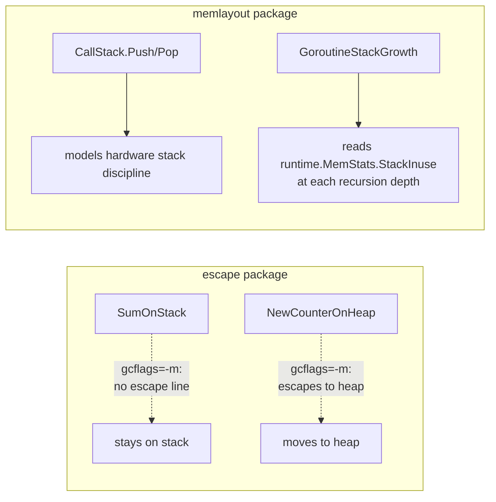
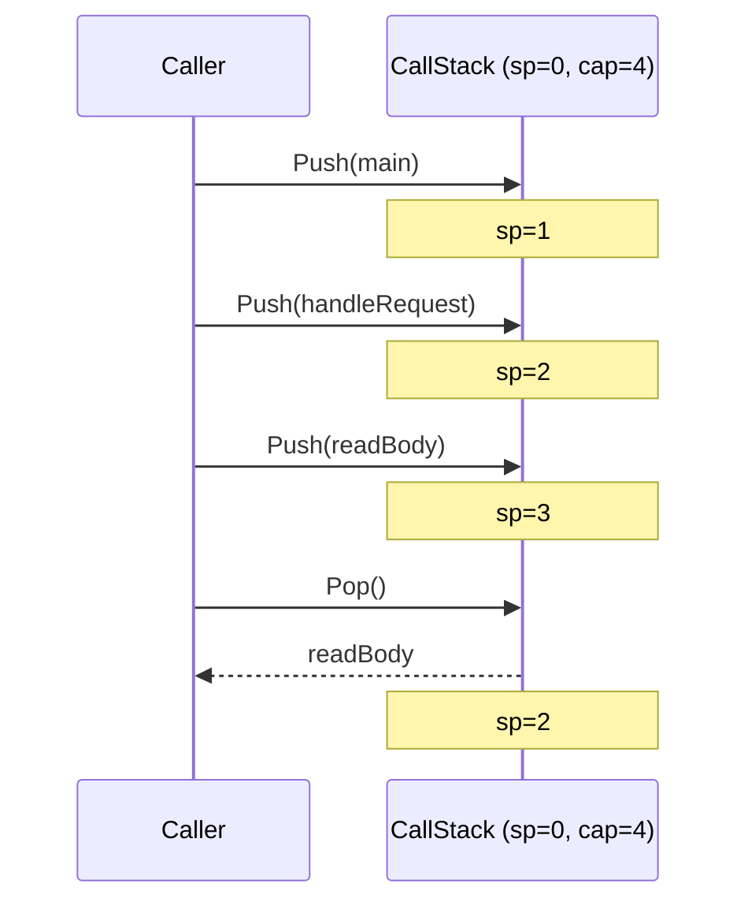

# Process Memory Layout - Stack vs Heap - Go

> [!summary] TL;DR
> Runnable code for [[Process Memory Layout - Stack vs Heap]]: two functions whose `-gcflags=-m` output proves the escape-analysis rule directly, a hand-built LIFO call stack that makes "push/pop is just a pointer move" concrete and testable, and a stack-growth harness that measures a real goroutine's stack doubling as recursion gets deeper.

## Before the code

- **Packages**: three small packages (`escape`, `memlayout`, `cmd/stackdemo`) in one module; each folder is one package.
- **Pointers and `&`**: `&Counter{...}` takes the address of a value; returning it is what makes a value escape to the heap.
- **Methods on a pointer receiver**: `func (s *CallStack) Push(...)` lets the method change the stack it is called on.
- **Goroutines and channels**: `go func(){...}()` starts a goroutine; closing `done` and receiving `<-done` waits for it to finish.
- **`runtime.ReadMemStats`**: reads the runtime's memory counters, including `StackInuse` (bytes used by all goroutine stacks).
- **What to run**: `go vet ./... && go test -race ./...`, then `go build -gcflags=-m ./escape/` and `go run ./cmd/stackdemo`.

## What this code shows

| Code | Concept in the theory note |
| --- | --- |
| `escape.SumOnStack`, `escape.NewCounterOnHeap` | The provable-lifetime rule, confirmed by the compiler's own `-gcflags=-m` output ([[Process Memory Layout - Stack vs Heap#Tracing escape analysis, step by step]]) |
| `memlayout.CallStack` (`Push`/`Pop`) | The stack is a LIFO region; allocation and deallocation are both one pointer move ([[Process Memory Layout - Stack vs Heap#Stack frames and the call stack]]) |
| `memlayout.GoroutineStackGrowth` | Goroutine stacks start small and grow by doubling, measured directly ([[Process Memory Layout - Stack vs Heap#Worked numeric example: a goroutine's stack growing by doubling]]) |



## Setup

- Go 1.24. No external dependencies — everything is the standard library (`fmt`, `runtime`).
- Layout: a module with three packages — `escape` (the escape-analysis demo), `memlayout` (the call-stack model and the stack-growth harness and their tests), and a `cmd/stackdemo` runnable that prints the growth measurement.
- Run it with `go vet ./... && go test -race ./...`. The stack-growth measurement itself is printed by `go run ./cmd/stackdemo`.

## Code

### Step 1: two functions the compiler treats differently

**Concept.** The theory note's whole claim is that a value's *provable lifetime*, not its type or syntax, decides stack vs heap ([[Process Memory Layout - Stack vs Heap#3. How it works]]).

The clearest way to prove that isn't to assert it — it's to write the smallest possible pair of functions where one value obviously can't escape and one obviously must, and then ask the compiler itself what it decided.

The alternative — reading the Go spec's escape-analysis prose alone — tells you the rule but not whether your mental model of it matches what the real compiler does on real code.

```go
// Package escape holds two functions used only to demonstrate the compiler's
// escape analysis decisions via `go build -gcflags=-m`. Their behaviour is
// trivial on purpose; what matters is where each value is allocated.
package escape

// Counter is a small struct big enough to see in compiler diagnostics but
// small enough to keep the demo readable.
type Counter struct {
	n int
}

// SumOnStack adds a and b using a local variable that never leaves this
// function: the compiler can prove it, and keeps it on the stack.
func SumOnStack(a, b int) int {
	sum := a + b // local; its address is never taken or returned
	return sum
}

// NewCounterOnHeap returns a pointer to a freshly created Counter. Because
// the pointer outlives the function call, the compiler cannot place it on
// this frame's stack: it must "escape" to the heap.
func NewCounterOnHeap(start int) *Counter {
	c := &Counter{n: start} // escapes: its address is returned
	return c
}
```

**How it works.**

1. `SumOnStack` returns `sum`, a plain `int` value — a copy, not an address. Nothing about `sum` can be observed after the function returns except its copied bits, so the compiler is free to keep it on the stack.
2. `NewCounterOnHeap` returns `c`, which is `&Counter{...}` — the **address** of a struct built inside the function. That address is exactly what the caller receives.
3. Because the caller might keep that address indefinitely (store it, pass it on, hold it across many more calls), the compiler cannot place `Counter{...}` on this frame; it must allocate it somewhere that outlives the frame — the heap.
4. Nothing in the Go source says "heap" or "stack" anywhere. The decision is entirely the compiler's, made from the shape of the code.

### Step 2: confirming it with the compiler's own output

**Concept.** `go build -gcflags=-m` asks the compiler to print its escape-analysis reasoning alongside the normal build.

Running it is the fastest way to find an unexpected heap allocation in a hot path, and it's how you check the theory note's rule against reality for any function, not just this demo pair.

```text
$ go build -gcflags=-m ./escape/
# cs1scratch/escape
escape/demo.go:14:6: can inline SumOnStack
escape/demo.go:22:6: can inline NewCounterOnHeap
escape/demo.go:23:7: &Counter{...} escapes to heap
```

**How it works.**

1. `can inline SumOnStack` and `can inline NewCounterOnHeap` are a separate optimization (inlining) the compiler mentions alongside escape analysis; it means the whole function body is small enough to be substituted directly into its caller.
2. There is no "escapes to heap" line for `SumOnStack` at all — its absence *is* the answer: the value stayed on the stack.
3. `&Counter{...} escapes to heap`, at the exact source line of the struct literal in `NewCounterOnHeap`, is the compiler's direct confirmation of the rule traced in the theory note.
4. This output is reproducible on any package: `go build -gcflags=-m ./...` (stack an extra `-m` for verbose detail, which also prints "does not escape" lines explicitly).

### Step 3: a call stack you can push and pop

**Concept.** The LIFO mechanism itself, modelled directly and tested — not a demonstration of escape analysis, but of what "the stack" actually *is* underneath it ([[Process Memory Layout - Stack vs Heap#Stack frames and the call stack]]).

The alternative to a fixed backing array would be a `[]Frame` that grows with `append`, which is how Go's own growable goroutine stacks behave conceptually — but a fixed-capacity array is the better teaching tool here because it makes "stack overflow" an explicit, testable error instead of something `append` silently absorbs.

```go
// Package memlayout models a call stack explicitly, as a backing array plus
// a stack pointer, to make the mechanism that the hardware stack pointer and
// Go's goroutine stacks both use concrete and testable: a LIFO region of
// fixed-size frames, growth by moving one pointer, and overflow when the
// region runs out.
package memlayout

import "fmt"

// Frame is a stand-in for one function activation record: its locals and
// its return address, the two things a real stack frame holds.
type Frame struct {
	FuncName      string
	Locals        [4]int64 // fixed-size "locals", like a real frame's fixed layout
	ReturnAddress int
}

// ErrStackOverflow mirrors a real thread hitting the end of its guard page.
var ErrStackOverflow = fmt.Errorf("stack overflow: exceeded capacity")
```

**How it works.**

1. `Frame` is a fixed-size struct, the same way a real stack frame's layout is fixed once the compiler knows the function's locals.
2. `ErrStackOverflow` is a sentinel error, mirroring the fact that a real thread hitting the end of its reserved stack region gets a fault (SIGSEGV on a guard page), not a graceful "please wait."

The `CallStack` type itself, plus its constructor:

```go
// CallStack is a fixed-capacity LIFO region, like one goroutine's or one OS
// thread's stack before any growth. Push/Pop only ever move one index:
// exactly why stack allocation is cheap compared to a heap allocator call.
type CallStack struct {
	frames []Frame
	sp     int // stack pointer: index of the next free slot
}

// NewCallStack preallocates capacity frames, the way the OS reserves address
// space for a thread stack up front (committing pages lazily on first touch).
func NewCallStack(capacity int) *CallStack {
	return &CallStack{frames: make([]Frame, capacity)}
}
```

**How it works.**

1. `CallStack.frames` is a plain slice used as a fixed-capacity array; `sp` is the one piece of mutable state that both `Push` and `Pop` touch.
2. `NewCallStack` preallocates the whole backing array up front with `make`, modelling how the OS reserves a stack's address range before any of it is actually used.

The push operation is the "enter a function" half of the mechanism:

```go
// Push enters a new function call: write its frame, advance sp by one.
func (s *CallStack) Push(f Frame) error {
	if s.sp >= len(s.frames) {
		return ErrStackOverflow
	}
	s.frames[s.sp] = f
	s.sp++
	return nil
}
```

**How it works.**

1. `Push` checks capacity first — exactly the compiler-inserted "enough stack left?" guard check the theory note describes for real goroutines.
2. Only once that check passes does it write the frame into the next free slot and advance `sp` by one.
3. There is no search for space: the next free slot is always `s.frames[s.sp]`, known in advance.

Pop is the "return from a function" half:

```go
// Pop returns from a function call: step sp back by one. Memory is not
// zeroed or freed individually, exactly like a real stack: it is reclaimed
// in bulk just by moving the pointer.
func (s *CallStack) Pop() (Frame, bool) {
	if s.sp == 0 {
		return Frame{}, false
	}
	s.sp--
	return s.frames[s.sp], true
}

// Depth reports how many frames are currently live (the call depth).
func (s *CallStack) Depth() int { return s.sp }
```

**How it works.**

1. `Pop` does the reverse of `Push`: step `sp` back, then hand back the frame that is logically still sitting in `s.frames[s.sp]` — its bytes are not cleared, they are simply no longer considered live, exactly like a real stack.
2. Both `Push` and `Pop` are `O(1)` and touch exactly one index — the concrete reason stack operations are "near free" in the theory note's cost table, with nothing to allocate or search.
3. `Depth` is a cheap derived value: the current recursion depth is always just `sp`, with no separate counter to keep in sync.



### Step 4: measuring a goroutine's stack actually grow

**Concept.** The theory note claims goroutine stacks grow by doubling as recursion goes deeper ([[Process Memory Layout - Stack vs Heap#Worked numeric example: a goroutine's stack growing by doubling]]).

`recurseAndMeasure` and `GoroutineStackGrowth` turn that claim into a number you can read off a real run: each call recurses to a chosen depth, forcing the runtime's `morestack` mechanism to fire repeatedly, then reports the process-wide stack memory in use.

The alternative — trusting the Go runtime's documentation alone — tells you the policy exists; running this shows the actual jumps on your own machine and Go version.

```go
package memlayout

import "runtime"

// stackHog is a deliberately large local array: recursing into it burns
// through a goroutine's current stack allocation quickly, forcing the
// runtime's morestack mechanism to kick in and double the stack a few
// times, instead of needing thousands of recursion levels to see it.
type stackHog [512]int64

// recurseAndMeasure descends depth levels, touching a stackHog-sized local
// on each one, then calls record with the runtime's current total
// stack-memory-in-use (summed over every goroutine) once it bottoms out.
func recurseAndMeasure(depth int, record func(uint64)) {
	var pad stackHog
	pad[0] = int64(depth) // touch the array so it can't be optimized away
	if depth == 0 {
		var m runtime.MemStats
		runtime.ReadMemStats(&m)
		record(m.StackInuse)
		return
	}
	recurseAndMeasure(depth-1, record)
	_ = pad[0]
}
```

**How it works.**

1. `stackHog` is a `[512]int64`, 4 KB — large enough that even modest recursion depths burn through the goroutine's current stack allocation and force growth, instead of needing thousands of frames.
2. `pad[0] = int64(depth)` writes to the array specifically so the compiler can't prove it's unused and optimize it away entirely.
3. At `depth == 0`, the function calls `runtime.ReadMemStats`, which fills a `MemStats` struct including `StackInuse`: the total bytes currently committed to every goroutine's stack in the whole process.
4. The recursive call happens *before* reporting, so by the time `record` runs, the goroutine has already recursed to its full requested depth and whatever stack growth that required has already happened.

```go
// GoroutineStackGrowth runs recurseAndMeasure at each of the given
// recursion depths, on a fresh goroutine per depth (so each one starts
// from the runtime's default small initial stack), and returns the
// runtime-wide stack-memory-in-use measured at each depth. It is a
// best-effort, representative measurement: StackInuse is a process-wide
// total, so background goroutines add noise, but the jumps at the
// doubling points are still visible across repeated runs.
func GoroutineStackGrowth(depths []int) []uint64 {
	out := make([]uint64, len(depths))
	for i, d := range depths {
		done := make(chan struct{})
		go func(i, d int) {
			recurseAndMeasure(d, func(inUse uint64) { out[i] = inUse })
			close(done)
		}(i, d)
		<-done
	}
	return out
}
```

**How it works.**

1. Each depth runs on a **fresh goroutine**, so every measurement starts from the runtime's default small initial stack rather than reusing one that has already grown from a previous depth.
2. The `done` channel blocks the loop until that goroutine finishes recursing and has recorded its measurement, so the loop body behaves like a synchronous call despite launching a goroutine.
3. `out[i] = inUse` is written inside the spawned goroutine but only read after `<-done`, so there is no data race despite the closure capturing `out` and `i` — the channel receive happens-before the read.
4. The function returns one `StackInuse` reading per requested depth, in order, ready to print or assert against.

## Design decisions

| Decision | Alternative | Trade-off |
| --- | --- | --- |
| Fixed-capacity `[]Frame` for `CallStack` | A growing slice via `append` | Makes overflow an explicit, testable error instead of `append`'s silent reallocation — closer to a real thread's hard stack limit |
| Process-wide `runtime.MemStats.StackInuse` | Per-goroutine stack size via `runtime.Stack` | `StackInuse` is simpler to read in one line, at the cost of including other goroutines' stacks as noise |
| A fresh goroutine per measured depth | One goroutine reused across depths | Guarantees each measurement starts from the same small initial stack, instead of carrying over growth from the previous depth |
| `stackHog` sized at 4 KB (`[512]int64`) | A 1-byte local | Forces visible `morestack` events within a few hundred recursion levels instead of needing many thousands |
| `done` channel to synchronize the measurement | `sync.WaitGroup` | Either works here; the channel also naturally models one goroutine handing a result back, consistent with the channel-based measurements elsewhere in this topic |

## Tests

### Test 1: push/pop behaves as LIFO

**Property.** The most recently pushed frame must be the one `Pop` returns, and `Depth` must reflect exactly how many frames are currently pushed. This is the entire correctness contract of a stack — get the order wrong and it isn't a stack any more.

| Input | Expected |
| --- | --- |
| Push `main`, `handleRequest`, `readBody` | `Depth() == 3` |
| `Pop()` | returns `readBody`, `ok == true` |

```go
func TestPushPopIsLIFO(t *testing.T) {
	s := NewCallStack(4)
	s.Push(Frame{FuncName: "main"})
	s.Push(Frame{FuncName: "handleRequest"})
	s.Push(Frame{FuncName: "readBody"})

	if s.Depth() != 3 {
		t.Fatalf("depth = %d, want 3", s.Depth())
	}
	top, ok := s.Pop()
	if !ok || top.FuncName != "readBody" {
		t.Fatalf("Pop() = %+v, %v; want readBody, true", top, ok)
	}
}
```

**If it fails.** A wrong `Depth()` means `Push` or `sp` bookkeeping is broken. A wrong `FuncName` from `Pop` means the stack is behaving FIFO (first-in-first-out) instead of LIFO — the defining property it exists to have.

### Test 2: overflow is reported, not panicked

**Property.** A full stack returns `ErrStackOverflow` to the caller instead of panicking or corrupting memory, mirroring (at the application level) how a real thread's guard page turns an overflow into a detectable fault rather than silent corruption.

| Input | Expected |
| --- | --- |
| Pool of capacity 2; push `a`, `b`, then `c` | Third `Push` returns `ErrStackOverflow` |

```go
func TestOverflowIsReportedNotPanicked(t *testing.T) {
	s := NewCallStack(2)
	s.Push(Frame{FuncName: "a"})
	s.Push(Frame{FuncName: "b"})
	if err := s.Push(Frame{FuncName: "c"}); err != ErrStackOverflow {
		t.Fatalf("Push c: got %v, want ErrStackOverflow", err)
	}
}
```

**If it fails.** A nil error means the capacity check is missing or off-by-one. A panic instead of a returned error means the code indexed past `len(s.frames)` before checking.

### Test 3: popping an empty stack reports false, not a panic

**Property.** Popping nothing is a normal, expected condition (the equivalent of a function returning to an already-empty call chain) and must be reported through the second `bool` return value, never a panic.

| Input | Expected |
| --- | --- |
| `Pop()` on a brand-new, empty stack | `ok == false` |

```go
func TestPopOnEmptyStackIsFalseNotPanic(t *testing.T) {
	s := NewCallStack(2)
	if _, ok := s.Pop(); ok {
		t.Fatalf("Pop() on empty stack returned ok=true, want false")
	}
}
```

**If it fails.** `ok == true` on an empty stack means `sp` went negative or wrapped, which would also corrupt the next `Push`.

### Test 4: a goroutine's measured stack usage never decreases with depth

**Property.** Because `morestack` only ever doubles a goroutine's stack — it never shrinks one mid-recursion — the measured stack-in-use at a deeper recursion must never be smaller than at a shallower one, across the sampled depths.

| Input | Expected |
| --- | --- |
| Depths `1, 50, 500, 2000` | `StackInuse` is non-decreasing across depths, in order |

```go
// TestGoroutineStackGrowthIsNonDecreasing checks the shape of the
// measurement, not exact byte counts (those are environment-specific):
// total stack-in-use at a deeper recursion should never be smaller than
// at a shallower one, because morestack only grows a goroutine's stack,
// never shrinks it mid-recursion.
func TestGoroutineStackGrowthIsNonDecreasing(t *testing.T) {
	depths := []int{1, 50, 500, 2000}
	got := GoroutineStackGrowth(depths)
	for i := 1; i < len(got); i++ {
		if got[i] < got[i-1] {
			t.Fatalf("StackInuse decreased from depth %d (%d bytes) to depth %d (%d bytes)",
				depths[i-1], got[i-1], depths[i], got[i])
		}
	}
}
```

**If it fails.** A decrease would mean either the measurement methodology is unsound (e.g. goroutines interfering with each other) or, far less likely, that the Go runtime version in use shrinks goroutine stacks mid-recursion, which would contradict the documented `morestack` behaviour this note relies on.

## Running it

```bash
go vet ./... && go test -race ./...
go run ./cmd/stackdemo
```

`go vet` is clean. `go test -race` passes on Go 1.24.4, darwin/arm64:

```text
ok  	cs1scratch/memlayout	1.224s
```

`go run ./cmd/stackdemo` prints the measurement behind the worked example's table:

```text
depth=1     runtime StackInuse=294912 bytes
depth=10    runtime StackInuse=360448 bytes
depth=50    runtime StackInuse=819200 bytes
depth=150   runtime StackInuse=1343488 bytes
depth=400   runtime StackInuse=4489216 bytes
depth=1000  runtime StackInuse=8683520 bytes
depth=3000  runtime StackInuse=33849344 bytes
```

**Reading the output line by line.**

1. Depth 1 reads 288 KiB, not ~2 KB, because `StackInuse` is process-wide: the test binary's other goroutines (the runtime's own background goroutines, GC workers) already hold stack memory before this measurement even starts.
2. Between depth 1 and depth 10 the number barely moves — the goroutine's own stack hasn't needed to grow yet.
3. From depth 50 onward each step shows a clear jump, not a smooth climb — each jump is one or more `morestack` doubling events for that one measured goroutine.
4. By depth 3000 the total has grown over 100x from the depth-1 baseline, entirely attributable to one goroutine's stack having doubled repeatedly to hold that much recursion.

## Pitfalls in the code

- **`StackInuse` is process-wide, not per-goroutine.** Reading it right after a measurement is "best effort": background goroutines (GC workers, the runtime's own housekeeping) add a baseline that makes depth 1 look larger than 2 KB.
- **A fresh goroutine per depth is essential.** Reusing one goroutine across depths would let an earlier, deeper measurement's already-grown stack mask the next, shallower one's true starting size.
- **`stackHog`'s size controls how quickly growth becomes visible.** A 1-byte local would need many thousands of recursion levels to force even one doubling; 4 KB forces several within a few hundred levels, which is why this harness can show the effect with modest, fast-to-run depths.
- **`CallStack.Pop` does not zero the returned slot.** This mirrors a real stack (bytes are abandoned, not wiped) but means `s.frames[s.sp]` still holds stale data after a pop — reading past `Depth()` directly (instead of through `Pop`) would see leftover values, which is why nothing in this package exposes `frames` itself.

## Exercises

1. Change `stackHog` from `[512]int64` (4 KB) to `[64]int64` (512 B). Predict whether the doubling jumps in the printed table happen at the same depths, earlier, or later, then run `go run ./cmd/stackdemo` and check.
2. In `TestOverflowIsReportedNotPanicked`, change `NewCallStack(2)` to `NewCallStack(0)`. Predict what the very first `Push` call returns, then run the test.
3. Add a fourth sample depth of `6000` to `cmd/stackdemo/main.go`'s `depths` slice. Predict whether `StackInuse` roughly doubles again from the depth-3000 reading, then run it and compare.

## Links

- **Theory:** [[Process Memory Layout - Stack vs Heap]]
- **Before this:** [[Virtual Memory, Paging and the TLB]], [[Processes, Threads and Context Switching]]
- **Related:** [[Pointers, Values and Escape Analysis]], [[Runtime - Memory Allocator and Garbage Collector]]
