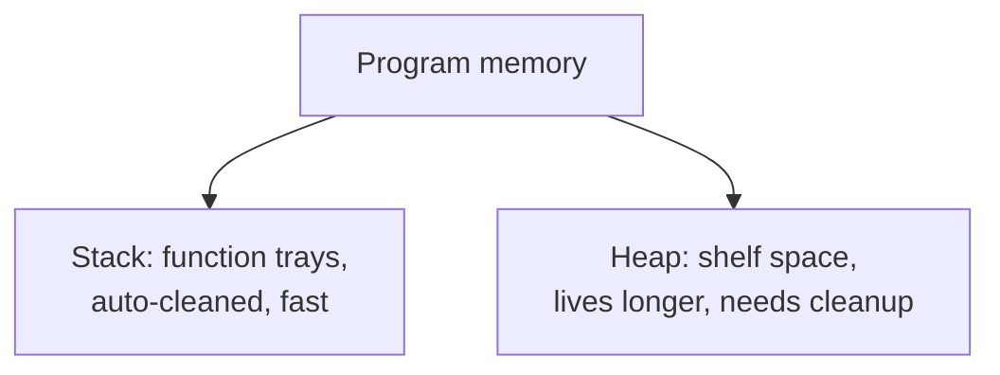
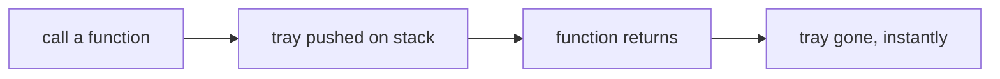
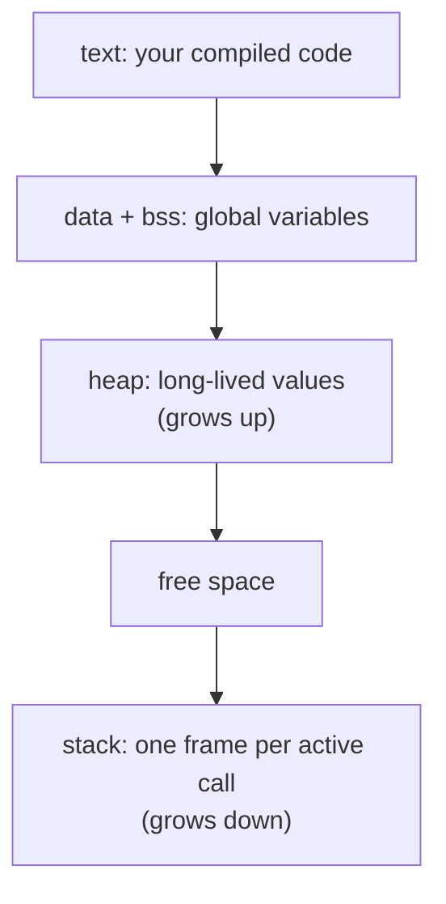
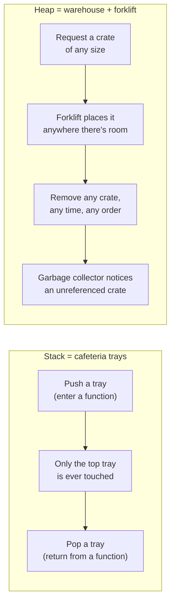
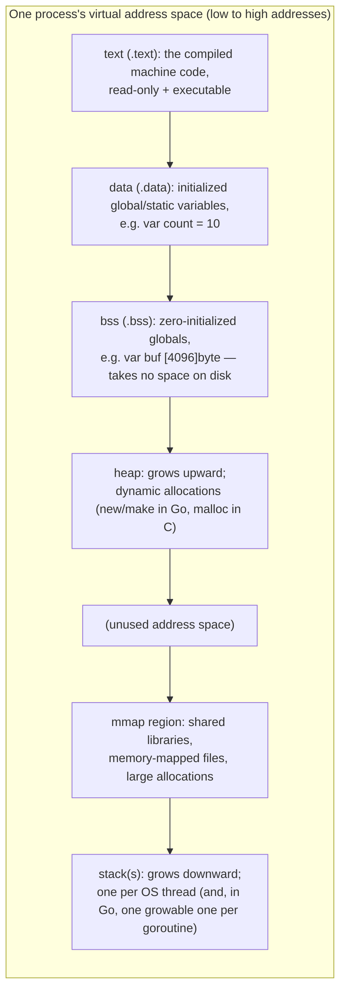
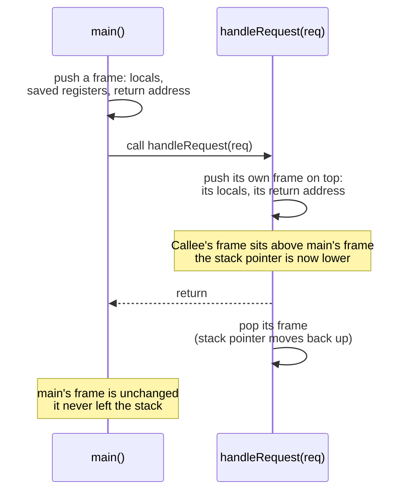
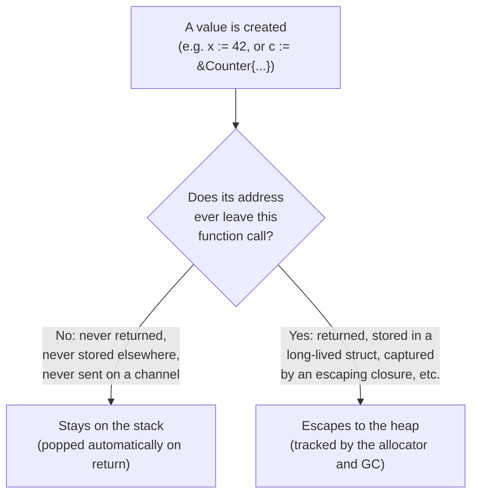
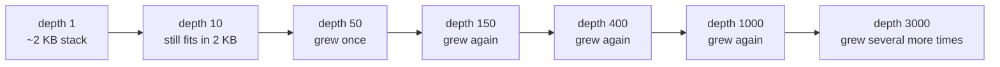

# Process Memory Layout - Stack vs Heap

> [!summary] TL;DR
> A running process's virtual address space is divided into regions with different jobs: code (**text**), initialized globals (**data**), zeroed globals (**bss**), a growable **heap** for dynamic allocations, memory-mapped regions (**mmap**), and a **stack** per thread for function calls. The stack is cheap and automatic; the heap is flexible but needs a manager (an allocator, and in Go a garbage collector) to reclaim it. Runnable Go version: [[Process Memory Layout - Stack vs Heap - Go]].

> [!abstract] Core idea
> - The stack is a LIFO region: entering a function pushes a frame, returning pops it — allocation and deallocation are both just moving one pointer.
> - The heap has no inherent order: anything can be freed at any time, in any order, which is exactly why it needs a real allocator (and, in Go, a garbage collector) instead of a single pointer.
> - A value's lifetime, not its type, decides where it lives: if a function could return a pointer to it, it can't safely live on that function's stack frame.
> - The Go compiler decides stack vs heap at compile time via **escape analysis**; `go build -gcflags=-m` shows you its reasoning.
> - Go goroutine stacks start small (about 2 KB) and grow by copying to a bigger stack, unlike a fixed-size OS thread stack that simply overflows when exhausted.

## Start here: the basics 🟢

> [!info] How to read this note (pick your level)
> - 🟢 **New to this?** Read "From zero" below, then sections 1, 2 and the cheat sheet (10). Stop there, that is a full first pass.
> - 🟡 **Know the basics?** Add section 3 (how it works), 4 (worked example), then 5 and 6.
> - 🔴 **Interview / SDE-3 prep?** Add 7, 8 and 9. Headings are tagged 🟢🟡🔴 so you always know where you are.

> [!note] Before this note
> - [[Virtual Memory, Paging and the TLB]]: each process sees its own private range of memory addresses (its "address space"), and the OS backs it with real RAM page by page, only when touched.
> - [[Processes, Threads and Context Switching]]: a process is a running program; a thread (or goroutine) is one line of execution inside it, and each gets its own stack.

**From zero, in 60 seconds** 🟢

When your program runs, the OS gives it one big private block of memory. That block has rooms with fixed jobs. Two rooms matter most: the **stack** and the **heap**.

The stack is a neat pile of trays. Each function call adds a tray with its local variables; when the function returns, the tray is thrown away. Automatic and very fast.

The heap is open shelf space. You can put anything there, keep it as long as you like — but something (in Go, the **garbage collector**) must notice when nobody needs it anymore and clear it.





The rest of this note is just three questions:
1. What are all the rooms in a process's memory, and what goes where?
2. How does the language decide stack vs heap (in Go: escape analysis)?
3. Why do you care — what gets slow or crashes when this goes wrong?

**The problem in one story.**
You write a function that makes a small list, uses it, and returns.
Another function makes a user profile and hands it back to its caller to keep.
The first list can be thrown away the moment the function ends; the profile cannot.
A program needs two kinds of memory for these two kinds of lifetime: the stack and the heap.

**Words you need first**

| Word | Plain meaning | Tiny example |
| --- | --- | --- |
| Memory address | A number naming one byte of memory | `0xc000010000` |
| Pointer | A variable that holds an address | `p := &x` |
| Function call / frame | One running call and its private scratch space | `main` calling `parse` |
| Local variable | A variable declared inside a function | `sum := a + b` |
| Global variable | A variable that lives for the whole program | `var count = 10` at package level |
| Allocator | Code that hands out and takes back memory chunks | `malloc`, Go's runtime allocator |
| Garbage collector (GC) | Code that frees memory nobody points to any more | Go's GC |
| Thread / goroutine | One line of execution; each gets its own stack | `go handle(req)` |
| Stack | Per-thread memory for function calls; grows and shrinks as calls start and end | locals of `parseBody` |
| Heap | Shared memory for values that must outlive the function that made them | a `*User` returned to the caller |
| Escape analysis | The Go compiler deciding, at build time, if a value must move to the heap | `return &c` makes `c` escape |
| Address space | The full range of memory addresses one process can use | 0 up to a very large number |
| text / data / bss | Fixed regions for code, globals with a starting value, and globals that start at zero | `var limit = 10` lives in data |
| Stack overflow | A stack running out of room, usually from very deep recursion | `fatal error: stack overflow` |

**Picture it**



**Analogy.** The stack is a pile of cafeteria trays: you only add or take from the top. The heap is a warehouse: crates go anywhere and leave in any order, so someone must track them.
Where it breaks: real trays are never moved, but Go copies a whole goroutine stack to a bigger place when it fills up.

**How the rest of this note builds up**

- First, why two regions exist (section 1) and the trays-vs-warehouse model (section 2).
- Then the address-space layout, stack frames and Go's growable stacks (section 3).
- Then escape analysis traced and measured, plus stack growth numbers (section 4) and a region comparison table (section 5).
- Finally the SDE-3 deep dive: trade-offs, production failures, pointer fixup during stack copy, and fragmentation (sections 6-8).

> [!tip] Remember
> Short-lived values that die with their function go on the stack; anything that must outlive the call goes on the heap.

## 1. Why it exists 🟢

Say you call a function. Before you can picture what "the stack" is, picture the plainer problem it solves: every function call needs somewhere to put its local variables, and it needs to remember where to return to once it finishes.

Calls nest — `main` calls `handleRequest`, which calls `parseBody`, which calls `readAll` — and they *unnest* in exactly the reverse order they were entered: `readAll` finishes first, then `parseBody`, then `handleRequest`.

That "last in, first out" pattern has a name: a **stack** — a data structure where you only ever add or remove from one end.

Because function calls always follow this pattern, hardware and operating systems give every thread one real, dedicated region of memory organized this way, called **the stack**.

Using one simple region for it, instead of asking an allocator for fresh memory on every single call, makes function calls cheap: entering a function just means moving a stack pointer down by the frame's size, and returning moves it back up. No searching for free space, no bookkeeping about which chunks are in use.

But not everything a program creates has that nested, "it dies when the function returns" lifetime.

A value a function builds and returns a pointer to — a new struct handed back to the caller, a buffer stashed in a long-lived cache — must outlive the function that created it, sometimes indefinitely, and in no particular nesting order relative to other allocations.

That is the **heap**: a region with no inherent structure, managed by an **allocator** that can hand out and reclaim chunks in any order, exactly because their lifetimes don't follow a stack's nesting discipline.

> [!tip] Remember
> The stack exists because function calls nest predictably (LIFO); the heap exists because not every value's lifetime does.

### Real-life example 🟢

Picture the Go service behind a Zomato-style "place order" button.
For each request, the handler reads the body, adds up item prices into a local `total`, and builds an `Order` struct that it saves into an in-memory cache.
`total` dies when the handler returns, so it can sit on the goroutine's stack and costs almost nothing.
The `Order` is kept in the cache after the handler ends, so it must live on the heap, and Go's garbage collector frees it only when the cache drops it.
At thousands of requests per second, moving needless values from heap to stack is one of the easiest speed-ups in Go.

## Common beginner mistakes 🟢

- **"Pointers live on the heap, values live on the stack"** → the compiler decides by lifetime, not by type → check with `go build -gcflags=-m`.
- **Returning a pointer to a small struct "for speed"** → it forces a heap allocation and more GC work → return small structs by value.
- **Thinking every goroutine costs megabytes** → goroutine stacks start at about 2 KB and grow only when needed → thousands of goroutines are fine.
- **Recursing on untrusted, deeply nested input** → the stack can hit Go's limit and crash the whole program → use a loop with your own explicit stack.
- **Reading "used memory" as "heap only"** → stacks, globals and `mmap` regions also count → look at `runtime.MemStats` fields separately (`HeapInuse`, `StackInuse`).

## 2. Mental model 🟢

**In plain words:** think of the stack as a stack of trays in a cafeteria line: you can only add a tray to the top or take the top tray off. There's nothing to decide — the next free spot is always "wherever the top currently is."

The heap is a warehouse with a forklift (the allocator): you can request a crate of any size, the forklift puts it wherever there's room, and later you can remove any crate regardless of when it arrived.

Someone has to keep track of what's free and what's occupied — and in Go, someone (the garbage collector) also has to notice when a crate is no longer referenced by anyone and can be hauled away.



Whether a value becomes a tray or a crate is not a property of its *type* — an `int` and a `*Counter` can each go either way.

It's a property of whether the compiler can prove its lifetime ends when the function that created it returns. If it can prove that, the value is a tray (stack).

If a pointer to the value might be used after the function returns — the function returns `&x`, or stores `x`'s address somewhere that outlives the call — the value has to be a crate (heap), because the tray it would have sat on is about to be reused by the next function call.

> [!warning] Common mistake
> Thinking "pointers go on the heap, values go on the stack." Wrong on both counts: a `*Counter` that never leaves its function stays on the stack, and a plain `int` returned by value through a long chain of escaping closures can still end up on the heap. The only question is lifetime, never the spelling of the type.

## 3. How it works 🟡

> 🟢 → 🟡 **You now know** that short-lived values go on the stack and long-lived ones on the heap. **Next we open the box:** the full map of a process's memory, what one stack frame holds, and how Go grows a goroutine's stack by copying it. Each subsection starts with a short step-by-step walk.

### The address space, region by region

**In plain words:** a running process doesn't get one undivided blob of memory. The operating system lays it out in bands, each with one job, from low addresses to high.

**Step by step:**
1. **text**: your compiled machine code, read-only. Example: the instructions of `main`.
2. **data**: globals that start with a value, like `var limit = 10`.
3. **bss**: globals that start at zero, like `var cache [1000]int`.
4. **heap**: grows upward as the program allocates, like a `*Order` kept in a map.
5. **mmap regions**: big blocks and shared libraries, mapped in on request.
6. **stack(s)**: one per thread, near the top, growing downward with each call.



**Example:** `size` on Linux reports the exact byte counts of `text`, `data` and `bss` straight from the binary, because those three are fixed the moment the linker (the build step that joins compiled pieces into one program file) finishes — nothing at runtime changes their size.

The heap and the stack(s), by contrast, grow and shrink continuously while the program runs: a slice growing past its capacity extends the heap; a deeply recursive call extends a stack.

**Why it matters:** this is a logical layout, not a promise about exact addresses. **ASLR** (Address Space Layout Randomization, see [[Virtual Memory, Paging and the TLB]]) randomizes where the heap, stack, and shared libraries actually start each run — specifically so an attacker who finds one bug can't hardcode "the buffer is always at address X" to exploit it.

### Stack frames and the call stack

**In plain words:** every time a function is called, it gets its own private slab of the stack, called a **frame**, sized exactly for its needs. When it returns, that slab disappears instantly — not erased, just abandoned, because the next call will simply overwrite it.

**Step by step:**
1. `main` calls `parse(body)`. The stack pointer moves down by, say, 64 bytes: that is `parse`'s frame.
2. The frame holds `parse`'s locals, the return address (where to go back in `main`), and a few saved registers.
3. `parse` calls `readAll`. Another frame is pushed below it.
4. `readAll` returns: the stack pointer moves back up. Its frame is just left behind, to be overwritten later.
5. `parse` returns the same way, and `main` carries on.



**Example:** each frame typically holds three things: the function's local variables (the ones that qualify for the "stack" rule above), saved copies of registers (the CPU's own tiny, fastest storage slots) the function is about to overwrite, and the return address — where execution resumes once the function is done.

Entering a function is one instruction adjusting the stack pointer by the frame's size, a size computed once, at compile time, from the function's own locals. Returning is the exact reverse: one instruction, moving the pointer back.

**Why it matters:** this is why stack allocation is close to free compared to a heap allocation, which has to consult an allocator's data structures to find and reserve free space before it can hand anything back.

> [!tip] Remember
> A frame is a private, temporary slab of stack for one function call. Pushing and popping it costs one arithmetic instruction each way — there is no "freeing," only abandonment.

### Go goroutine stacks: small and growable

**In plain words:** a traditional OS thread's stack is reserved up front, at a large fixed size (1–8 MB is typical on Linux via `pthread_create`'s defaults), because the kernel has no cheap way to grow it later — the stack must occupy one contiguous region, and whatever sits above it in the address space might already be claimed by something else.

**Step by step:**
1. Go starts a goroutine with a 2 KB stack.
2. At the start of each function, a tiny check asks: "is there room for my frame?"
3. Deep recursion fills the 2 KB. The check fails.
4. The runtime allocates a 4 KB stack, copies everything across, and fixes every pointer that pointed into the old stack.
5. The goroutine carries on as if nothing happened. If it fills 4 KB, it moves to 8 KB, and so on.

Reserving 8 MB per thread for a program running thousands of threads is expensive, even though a thread may only ever touch a few KB of it (demand paging, from [[Virtual Memory, Paging and the TLB]], means the unused pages are never actually backed by physical RAM — but the *virtual* reservation and the kernel's own bookkeeping around it still aren't free at scale).

Go sidesteps the whole problem.

Each goroutine starts with a tiny stack — **2 KB** as of recent Go releases — and the compiler inserts a cheap check (a "stack guard" check) at the start of functions that might need more room than is left.

If a goroutine's stack would overflow, the runtime does not fail: it allocates a new, larger stack (typically double the size), copies the old stack's contents into it, and **fixes up every pointer that pointed into the old stack** so each one now points at the matching address in the new stack.

This copy-and-grow trick only works because the Go runtime — unlike a general-purpose OS — knows, from compiler-generated metadata, exactly which values on the stack are pointers, and can therefore safely rewrite them.


**Analogy:** it's like moving into a bigger apartment every time your current one gets cramped, rather than renting the biggest apartment you could ever conceivably need on day one — except the "movers" (the Go runtime) also walk through every box you own and relabel it with your new address, something ordinary movers can't do for memory addresses.

This analogy breaks down in one place: a goroutine never *shrinks* back down mid-recursion the way you might downsize an apartment; it only grows, and only the runtime decides when (see the measured example below for exactly how fast this happens).

> [!tip] Remember
> OS thread stacks are reserved large and fixed because moving them is unsafe without compiler cooperation. Go goroutine stacks start tiny and double on demand because the Go compiler tracks every pointer and can safely rewrite it.

## 4. Worked example 🟡

### Whiteboard version

The one decision the compiler is really making, reduced to its essence: does this value's address ever leave the function?

```go
func stackCandidate() int {
    x := 42   // address never taken, never returned: can live on the stack
    return x
}

func heapCandidate() *int {
    x := 42   // address IS returned: must outlive this frame
    return &x // the compiler must allocate x on the heap instead
}
```

### Tracing escape analysis, step by step

**Picture it:** the compiler's decision, for any one value, reduces to one question asked over and over as it reads the function body:



1. The compiler reads `SumOnStack(a, b int) int`: it adds `a + b` into a local `sum` and returns the value `sum` (not its address). No pointer to `sum` ever exists, so the compiler can prove `sum` dies the instant the function returns.
2. It reads `NewCounterOnHeap(start int) *Counter`: it builds a `Counter{n: start}` and returns `&c` — the counter's **address**, not a copy of it.
3. Because that address is now visible to the caller, and the caller might keep it around indefinitely, the compiler cannot place `c` on this frame — the frame is about to be reused by whatever the caller calls next.
4. The compiler marks `c` as **escaping to the heap**, and emits code to allocate it there instead of on the stack.

**Measured** (`go build -gcflags=-m`, Go 1.24.4, darwin/arm64, run in the scratch module for this note, 2026-11-06):

```text
# scratch/escape
escape/demo.go:14:6: can inline SumOnStack
escape/demo.go:22:6: can inline NewCounterOnHeap
escape/demo.go:23:7: &Counter{...} escapes to heap
```

Exactly as predicted: `SumOnStack`'s local never gets an "escapes" line.

It stays on the stack, and the whole tiny function is also small enough to be inlined (its body copied straight into the caller, so no call happens at all) into its caller, removing the frame entirely — while `&Counter{...}` inside `NewCounterOnHeap` is explicitly flagged as escaping, because its address is returned to the caller.

> [!tip] Reading `-gcflags=-m` yourself
> Run `go build -gcflags=-m ./...` (add a second `-m` for more detail) on any package. A line mentioning "escapes to heap" names a heap allocation the compiler could not avoid; "does not escape" (shown with `-m -m`, or implied by its absence here) means the value stayed on the stack. This is the single fastest way to find an unexpected allocation in a hot path.

### Worked numeric example: a goroutine's stack growing by doubling

**In plain words:** "the stack doubles when it overflows" is easy to say and easy to picture wrong. Here is what it actually measures to, on real hardware, as one goroutine recurses deeper and deeper and a growing array forces its stack to expand.

**Picture it:**



**Example (measured, Go 1.24.4, darwin/arm64, this machine, 2026-11-09):** a goroutine recurses to a given depth, touching a 4 KB local array (`[512]int64`) on every level, so its stack has to expand several times to hold the recursion. `runtime.ReadMemStats` reports process-wide `StackInuse` (total stack memory across every goroutine) immediately after each run:

| Recursion depth | Measured process-wide `StackInuse` |
| ---------------- | ----------------------------------- |
| 1 | 294,912 B (≈ 288 KiB — dominated by other goroutines already running) |
| 10 | 360,448 B |
| 50 | 819,200 B |
| 150 | 1,343,488 B |
| 400 | 4,489,216 B |
| 1000 | 8,683,520 B |
| 3000 | 33,849,344 B |

**Why it matters:**

`StackInuse` is a process-wide total (it includes every other goroutine's stack, which is why depth 1 doesn't read as "2 KB"), but the *shape* is unmistakable: it climbs in clear jumps as recursion depth increases, not smoothly — each jump is one or more `morestack` doubling events kicking in, copying the goroutine's whole stack to roughly twice its previous size, exactly as the state diagram above describes.

A single goroutine never shrinks this number mid-recursion; it only grows, which is also exactly what the test for this measurement asserts (see [[Process Memory Layout - Stack vs Heap - Go]]).

> [!warning] Common mistake
> Assuming a goroutine stack "starts at 2 KB and grows one byte at a time as needed." It grows in discrete doubling jumps (2 KB -> 4 KB -> 8 KB -> ...), triggered only when a function's prologue check (the few instructions at the very start of a function) finds too little room left — not continuously, and not down to the byte.

Runnable Go version, including the escape-analysis demo, the LIFO call-stack model, and the full stack-growth measurement harness: [[Process Memory Layout - Stack vs Heap - Go]].

## 5. Variants and comparison 🟡

| Region | Grows how | Lifetime | Allocation cost | Reclaimed by |
| ------ | ---------- | -------- | ---------------- | ------------- |
| Stack | Pointer bump on call; shrinks on return | Bound to the function call (or, in Go, to the goroutine) | Near-free: move a pointer | Automatic, on return — no manager needed |
| Heap | Allocator finds/extends free space | Until nothing references it | An allocator call (`malloc`-class bookkeeping); in Go also tracked by the GC | `free`/manual (C); garbage collector (Go, Java); see [[Runtime - Memory Allocator and Garbage Collector]] |
| `mmap` region | Explicit `mmap`/`munmap` (or Go's large-allocation path, which also uses `mmap` under the hood) | Until explicitly unmapped | A syscall (see [[System Calls and User vs Kernel Mode]]); pages then fault in lazily | Explicit `munmap`, or process exit |
| `data`/`bss` (globals) | Fixed size, set at link time | Whole process lifetime | None at runtime — space exists from process start | Process exit |

## 6. Trade-offs and when not to use 🟡

- Stack allocation is nearly free but inflexible: a value's size must be known (or boundable) at compile time for a given frame, and its lifetime must not outlive the call. Neither constraint can be relaxed without moving the value to the heap.
- Heap allocation is flexible but not free: in Go, every heap allocation is a candidate for the garbage collector to track and eventually scan, so unnecessary escapes (e.g., returning `*int` where returning `int` would do) add both allocator and GC pressure in a hot path — exactly what `-gcflags=-m` helps you find and what [[Pointers, Values and Escape Analysis]] covers in full.
- Go's growable goroutine stacks remove the "reserve 8 MB per thread" cost, but stack growth itself (copy + pointer fixup) is not instant; a function with an unusually deep, tight recursive loop can pay repeated stack-growth costs if each growth step is quickly outgrown again. This is rarely a practical problem, but it's why extremely deep recursion in a hot path is worth profiling rather than assuming is free.
- `mmap`-backed large allocations (Go's runtime uses this path for big objects) skip the heap's usual small-object bookkeeping, at the cost of needing a real syscall and page-fault-driven backing, which only pays off for allocations large enough that overhead is a rounding error.

> 🟡 → 🔴 **You now know** the memory map, stack frames, growable goroutine stacks and how escape analysis decides stack vs heap. **Next comes the advanced part:** how Go, Java and C differ in real systems, stack-overflow and GC-pressure failures, and the deep details: pointer fix-up during stack copy and heap fragmentation.

## 7. In production 🔴

- **Real systems:** Go's own runtime documents the 2 KB initial goroutine stack and its doubling growth policy; JVM threads famously default to large fixed stacks (`-Xss`) for exactly the reason Go avoids — without growable stacks, you must either over-provision per thread or risk `StackOverflowError`; C programs commonly crash with a segmentation fault (the OS killing a program that touched memory it does not own) on deep uncontrolled recursion because their OS thread stack is fixed-size and unmoving.
- **Failure modes -> fixes:**
  - Unexpectedly high allocation/GC pressure in a Go hot path -> run `go build -gcflags=-m` on the package, or `go tool pprof` with an allocation profile, to find avoidable escapes (e.g., a small struct returned by pointer when returning by value would do, or a value captured by a closure that's stored somewhere long-lived).
  - A Go goroutine recursing very deeply (e.g., parsing a deeply nested structure) hits the runtime's maximum stack size and the whole program crashes with `fatal error: stack overflow` — unlike a normal stack-growth event, this one is not recoverable; convert unbounded recursion to an explicit loop with your own bounded stack ([[Stacks, Queues and Deques]]) if input depth isn't trusted.
  - A C/C++ or cgo-adjacent component segfaults under deep recursion -> its OS thread stack is fixed-size; check `ulimit -s` (Linux) and consider increasing it or bounding recursion depth, since there's no "morestack" there.
- **What to monitor:** Go's allocation profile (`pprof`'s `alloc_objects`/`alloc_space`) for unexpected heap growth; `GODEBUG=gctrace=1` output for GC frequency and pause time; for native code, `ulimit -s` and any crash reports mentioning stack exhaustion.

## 8. Deep dive 🔴

- **Escape analysis, mechanically.** The compiler keeps a value on the stack only if it can prove the address never outlives the call; the full rules and how to read `-gcflags=-m` output live in [[Pointers, Values and Escape Analysis]].
- **Stack growth's pointer-fixup problem, and why only Go's runtime can do it.** Moving a C thread's stack mid-flight is not generally safe: any raw pointer another part of the program holds into the old stack (a pointer to a local variable passed to another thread, for instance) would become invalid, and C's type system can't find and fix all of them.

Go's compiler emits per-function metadata describing exactly which stack slots hold pointers at every point a stack check could trigger growth, so the runtime's `copystack` can find and rewrite every live pointer into the old stack as part of the copy — a capability that depends on the compiler and runtime co-designing this format, not something retrofittable onto an arbitrary ABI (application binary interface: the low-level rules for how functions pass arguments and use the stack).
- **bss costs nothing on disk, something at runtime.** A 64 MB zero-initialized global array costs essentially nothing in the compiled binary's file size (bss is just a "reserve this many zeroed bytes" directive), but still costs real virtual address space and, once touched, real physical pages — the same demand-paging mechanism from [[Virtual Memory, Paging and the TLB]] applies to bss pages exactly as it does to heap pages.
- **Why the heap needs a manager and the stack doesn't.** The stack's nesting guarantee (whatever was pushed most recently is freed first) means "where is the next free byte" is always answered by one pointer.

The heap has no such guarantee — a value allocated first might outlive one allocated after it, and vice versa — so free and in-use regions end up interleaved over time (fragmentation), and finding a free block of the right size, or coalescing adjacent free blocks, needs real data structures (free lists, size classes, Go's own span-based allocator) and, in a garbage-collected language, a separate process (the GC) to even determine what's still in use. See [[Runtime - Memory Allocator and Garbage Collector]] for that machinery in full.

## 9. Interview questions 🔴

> [!question]- What actually decides whether a value goes on the stack or the heap?
> Not its type, and not whether you wrote `new`/`&` — its *provable lifetime*. If the compiler can prove a value's address never outlives the function call that created it, it stays on the stack.
>
> If a pointer to it might be used after the function returns (returned, stored in a long-lived structure, sent on a channel, captured by an escaping closure), it must go on the heap, because the stack frame it would have occupied is about to be reused.

> [!question]- Why is stack allocation so much cheaper than heap allocation?
> Because the stack's structure (strictly LIFO — nested calls unwind in reverse order) means "allocate" and "free" are both just moving one pointer, with no search for free space and nothing to track afterward.
>
> The heap has no such ordering guarantee, so an allocator needs real bookkeeping (free lists, size classes) to find space and, eventually, to reclaim it — in Go's case, with help from the garbage collector.

> [!question]- Trap: does returning a pointer from a Go function always cause a heap allocation?
> Not always — the compiler can sometimes prove a returned pointer's target doesn't actually escape further (for instance, if it's immediately dereferenced and discarded by an inlined caller), in which case it may still stay stack-allocated after inlining.
>
> But as a rule of thumb it very often does escape, and the only way to know for a specific function is to check `go build -gcflags=-m`'s actual output rather than assume from the syntax alone.

> [!question]- How does a goroutine's stack grow without the goroutine itself breaking?
> The compiler inserts a cheap "do I have enough stack space left?" check near the start of functions.
>
> If not, the runtime allocates a new, larger stack (typically double the old size), copies the old stack's contents into it, and rewrites every pointer that referenced an address on the old stack so it now points into the new one — using compiler-generated metadata that identifies exactly which stack slots are pointers.
>
> The goroutine then resumes as if nothing happened.

> [!question]- Why don't OS threads get this same growable-stack treatment?
> Because the kernel and a general-purpose ABI have no reliable way to find and rewrite every pointer into a thread's stack — unlike Go, which controls both the compiler and the runtime and can therefore track exactly which stack slots hold pointers.
>
> So OS thread stacks are reserved at a large fixed size up front instead, trading some wasted virtual address space (and kernel bookkeeping overhead at scale) for not needing that pointer-safe relocation machinery at all.

> [!question]- A Go function returns a `*Counter` built from a struct literal in its body. Will that struct be on the stack or the heap, and how would you check?
> Almost certainly the heap, because its address is returned and therefore must outlive the function's own frame — the compiler cannot place something behind a returned pointer on a frame that's about to be popped. Confirm it with `go build -gcflags=-m`: it will print a line like `&Counter{...} escapes to heap` at the exact source location of the allocation.

> [!question]- What's actually stored in `bss`, and why does it matter for a large Go program?
> Zero-initialized package-level variables: Go arrays or slices backed by package-level zero values, for instance. `bss` costs nothing in the compiled binary on disk — it's a directive, not stored bytes — but it still reserves real virtual address space, and once the program actually touches those bytes, real physical pages get mapped in via ordinary demand paging, exactly like heap memory would.

## 10. Cheat sheet 🟢

- Layout, low to high: text (code) -> data (initialized globals) -> bss (zeroed globals) -> heap (grows up) -> ... -> mmap region -> stack(s) (grows down).
- Stack = LIFO, pointer-bump allocation, reclaimed automatically on return. Heap = unordered, needs a real allocator (and in Go, a GC) to track and reclaim.
- A value escapes to the heap when its address could outlive its creating function's frame — check reasoning directly with `go build -gcflags=-m`.
- Go goroutine stacks start ~2 KB and grow by copy-and-pointer-fixup, in discrete doubling jumps (measured on this machine: 288 KiB -> 33.8 MB of process-wide stack as recursion depth went from 1 to 3000) — OS thread stacks are large and fixed because that relocation trick needs compiler/runtime cooperation an OS ABI doesn't have.
- `bss` costs nothing on disk but still costs virtual (and eventually physical) memory once touched.
- Avoidable heap escapes in a hot path (e.g. pointer-returning small structs) add both allocation and GC-scanning cost; `-gcflags=-m` and an allocation profile both find them.
- Unbounded deep recursion in Go can still exhaust the runtime's maximum stack and crash — "growable" is not "unlimited".

## Self-check 🟢🟡

🟢 Easy

> [!question]- What lives on a function's stack frame?
> Its local variables, the return address, and a few saved registers.

> [!question]- Why does the heap need a garbage collector in Go but the stack does not?
> Stack memory is freed automatically when the function returns; heap values can outlive any call, so something must find which ones are no longer used.

> [!question]- How big is a new goroutine's stack?
> About 2 KB, and it grows by doubling when needed.

🟡 Medium

> [!question]- `func New() *Counter { c := Counter{}; return &c }`: where does `c` live, and why?
> On the heap: its address is returned, so it must outlive `New`'s frame.

> [!question]- How do you see the compiler's stack-vs-heap decisions?
> `go build -gcflags=-m`; look for "escapes to heap".

> [!question]- Why can Go move a goroutine's stack but C cannot move a thread's stack?
> Go's compiler records which stack slots hold pointers, so the runtime can fix them after copying; C has no such map.

## Links

- **Before this:** [[Virtual Memory, Paging and the TLB]], [[Processes, Threads and Context Switching]]
- **Next:** [[Pointers, Values and Escape Analysis]], [[Runtime - Memory Allocator and Garbage Collector]]
- **Compare with:** [[Runtime - Goroutine Scheduler (GMP)]] (how goroutines using these stacks get scheduled onto OS threads)
- **Runnable code:** [[Process Memory Layout - Stack vs Heap - Go]]

### Watch on YouTube

- [Stack vs Heap / Simply Explained](https://www.youtube.com/watch?v=wP8_Dci6EQc) · TechPrep · quick, clear intro to stack vs heap allocation and lifetime
- [Stack vs Heap Memory](https://www.youtube.com/watch?v=9loizVWAk1M) · The Coding Gopher · Go-flavored walkthrough matching the note's Go runtime angle
